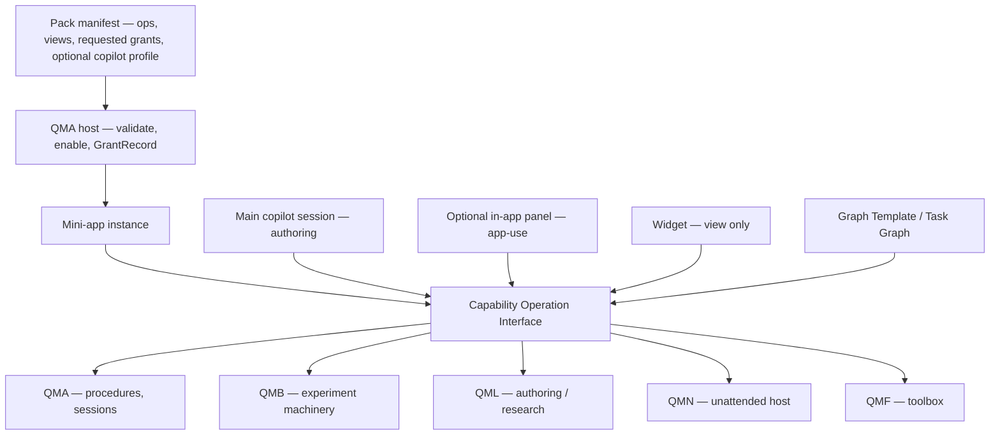
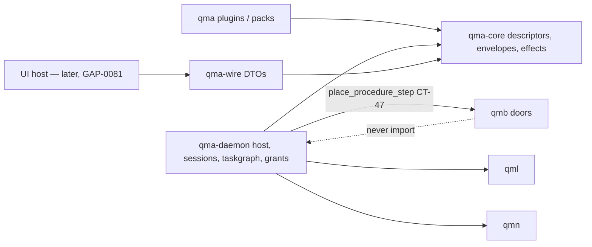

# Architecture Spine — QMX pack-and-grant kit

## Design Paradigm

**Pack-and-grant construction kit** over the inherited capability-oriented hexagonal libraries. QMF remains the toolbox. QML, QMB, QMA, QMN remain the shops. This sitting does not mint a sixth COMP, a second orchestrator, a marketplace, or a foreign workflow runtime.

A **pack** declares operations, optional views, requested access, and an optional copilot profile. The **host grants**. A **workflow** composes operations (deterministic graph, agent node, or both). A **widget** is a view of an operation. A **mini-app** is an installed instance of a pack. Copilot is one shared platform capability, not a field every pack must ship.

Screen-kit (dashboards first) and automation-kit (graphs first) are rejected as the center.



## Inherited Invariants

Parent `architecture-QMX-2026-09-18` AD-1..AD-31 bind read-only. Local ADs do not renumber them. A local rule that would mint a sixth COMP, treat json-render or MCP Apps as identity/authority, union nested grants, or let app-use apply a change-request is a **conflict**, not an override.

| Inherited | From parent | Binds here |
| --- | --- | --- |
| AD-1, AD-2, AD-3 | 09-18 | Capability, ContributionHit, operation descriptor + InvocationEnvelope |
| AD-4, AD-5, AD-6, AD-7 | 09-18 | Board ≠ graph ≠ Task Graph; mapping; DAG; QMA is the procedure runtime |
| AD-8, AD-9 | 09-18 | product_session profiles; copilot discovers grants not prose |
| AD-10 | 09-18 | Four composition modes; nested invoke does not union permissions |
| AD-15 | 09-18 | Five listing axes: published / configured / authorized / reachable / healthy |
| AD-16 | 09-18 | Logs are not evidence; store split |
| AD-17 | 09-18 | UI host is a client; json-render / MCP Apps are presentation adapters |
| AD-18, AD-21, AD-24, AD-26, AD-29, AD-30 | 09-18 | Packs, headless, envelope/effects, outbox/JobHandle, CAS/change-request, pack lifecycle |
| AD-11, AD-14, AD-22, AD-23, AD-25 | 09-18 | Trading-system completeness — inherit, do not re-elicit |
| DEC-0112, DEC-0200, DEC-0322 | docs | Logs ≠ journals; QMN zero-authority stack; QMA telemetry store |
| Codex preserve 2026-09-23 | this sitting input | Sessions resumable and independent of panels; permissions in backend; UI under discussion |

Cite parent ADs as `parent AD-n`. Local `AD-n` never means a parent id.

**Named parent amendments (conflicts if ignored):**

- **parent AD-8:** `app_instance_id` MAY be absent when `profile=authoring` (main/home, nothing selected). It remains required when `profile=app-use`. Closed `selected_refs` kinds gain `instance_id`. No third profile.
- **parent AD-24:** InvocationEnvelope gains closed `caller_kind`: `user` \| `agent` \| `workflow`. Envelope `instance_id` remains required on every invoke.

## Invariants & Rules



### AD-1 — Pack-and-grant is the SDK [ADOPTED]

- **Binds:** packs, host, copilot, UI-later
- **Prevents:** screen-kit or n8n-as-runtime becoming the center; each pack inventing host access
- **Rule:** The SDK is the host contract a pack author gets: versioned operation descriptors (parent AD-3), parent AD-2 contribution points for operations only, GrantRecords as the only grant, InvocationEnvelope as the only invoke, listing axes (parent AD-15: published / configured / authorized / reachable / healthy — `authorized` is not a session GrantRecord), typed refusals. Pack `view:*` remains a **wire DTO** (parent AD-17), not a contribution point and not a json-render runtime id. Optional `copilot_profile` is a **request blob** on the pack, not a contribution point and not a grant. Installing a pack does not grant. Enabling after validate still does not grant until GrantRecords exist for a session. Headless packs are first-class: they appear as reusable parent-AD-3 steps with no navigation and no copilot panel.

### AD-2 — Kit nouns span the platform; QMA is host not owner of every op [ADOPTED]

- **Binds:** mini-apps, widgets, workflows, QMA/QMB/QML/QMN
- **Prevents:** stuffing every app into qma-daemon as a sixth application; QMB/QML core forks for kit features
- **Rule:** Bytes of a pack live in the plugin tree + daemon install/instance rows. Execution of each `op_id` is owned by the COMP named on the descriptor. Display is a wire DTO consumed by a later UI host. A new idea that no existing COMP can execute is a **named connect/extend of that COMP**, not a kit rewrite and not a QMA-owned fake. Widgets never own invoke. Broker/venue stays QMN. Closed QMA store classes stay closed.

### AD-3 — One copilot capability; many sessions; in-app panel optional [ADOPTED]

- **Binds:** copilot, product_session, packs
- **Prevents:** a second copilot product; requiring a copilot to ship or run a pack; tab as session; home invoke without an instance
- **Rule:** QuantMind/QMX Copilot is one product identity over QMA. Tool availability for every seat is parent AD-9 intersection (published ContributionHits ∩ host grants ∩ session GrantRecords ∩ health). `ProductSessionProfile` remains authoring or app-use (parent AD-8). Authoring is the main/general seat (build, edit, version). App-use is the weaker seat (inspect, invoke granted ops, mint change-request, must not apply). A pack **may omit** a copilot profile. An instance **may omit** an in-app panel. Authoring with absent `app_instance_id` may not invoke. An invoke from that seat MUST carry envelope `instance_id` taken from a `selected_refs` kind `instance_id`; zero or many such refs is `INVALID_INPUT` (ambiguous instance). Nested invoke still does not union grants (parent AD-10). QMA `sess:` remains the engine run, not a third chat. Running work is not cancelled by panel dispose (parent AD-17). Reconnect resumes queries/events; it does not replay unacked intent. Context transfer is explicit `selected_refs` or `change_request` only.

### AD-4 — Caller is user, agent, or workflow on one envelope [ADOPTED]

- **Binds:** InvocationEnvelope, copilot, Graph Templates
- **Prevents:** a widget-to-widget runtime; a second invoke API for agents
- **Rule:** Every public call carries parent AD-24 InvocationEnvelope including named-amendment `caller_kind` `user` \| `agent` \| `workflow`. Widgets bind or display ops; they do not introduce a fifth composition mode. Many-to-many is Graph Template edges plus parent AD-10 modes (consume artifact, invoke op, coordinate, composite instance graph). Workflow-to-workflow at **runtime** is parent-AD-3 invoke of the callee template's `start` / `query-state` / `cancel` / `await` (`qualified_id`+version). That invoke creates **one nested Mission / one Task Graph / one JobHandle** (parent AD-7: one compile → one Mission). Occupancy and cancel follow that JobHandle. Include-at-author is a **new versioned Graph Template**, not a runtime merge. Merging two live Task Graphs is refused. Nested invoke depth is envelope `call_depth` against the host-registered recursion ceiling already implied by parent AD-10; exceeding it is `INVALID_INPUT`. Partial failure does not silently substitute another instance, version, or account.

### AD-5 — Host observability is a relationship every pack inherits [ADOPTED]

- **Binds:** qma-daemon, qma-wire, copilot, CLI
- **Prevents:** a fourth observability product; silent daemon; extending `qmn/FAILURES.md` onto mini-apps
- **Rule:** For every public operation and every Task Graph run the host MUST expose, headless: (1) parent AD-15 listing axes including `healthy`; (2) instance `health()` as the existing component typed-report (DEC-0112), distinct from pack `published`; (3) JobHandle in QMA AD-17 vocabulary; (4) typed refusal; (5) `correlation_id` join (never fp1); (6) harness-authored QMA telemetry (agents must not write it; OTel remains export-port only). Failure class is closed: `grant` \| `workflow` \| `view` \| `dependency` \| `host`. `view` means the wire DTO failed to mount, was stale, or was unhealthy — it is not an invoke. `qma-daemon` emits stdlib JSON-lines using QMN field names where they apply (`ts`, `level`, `event`, `correlation_id`) plus `instance_id`, `op_id`, `logical_invocation_id`, `graph_run_id` when present. How-it-failed is that log line + JobHandle `attempt_id` + typed refusal; no fourth store. QMB LogSink may remain; new daemon code does not invent a third logger. Logs are not evidence (parent AD-16). Mini-app typed failures, when first ids ship, live in that owning package's FAILURES.md — never on the QMN alert allow-list.

### AD-6 — Default host retry; implementation repair is change-request [ADOPTED]

- **Binds:** SDK, Task Graph, packs
- **Prevents:** per-pack retry dialects; operator as the hiccup loop; app-use applying fixes
- **Rule:** Retry is host/SDK behaviour. Default **on** means: for effect `none` and `read`, the host retries until success, until typed `retryability=NO`, or until the host-registered attempt ceiling (registry row; this spine does not mint a number). It does **not** mean retry of every effect. Parent AD-24 / SCN-0021 remain the matrix: `append-evidence` dedupes; `mutate-config` is CAS (`conflict` is not a retry); `place-run` uses logical invocation identity (outbox replay is not a second dispatch); `external-egress` obtains a receipt or becomes `unknown` and MUST NOT blind-retry. `reconcile_policy` `never-retry` and `unknown-manual` win. Parent AD-25 `unknown-blocked` is never auto-retried. A pack may set attempts to zero. A pack MUST NOT exceed the host ceiling or the effect-class matrix. Implementation edits (code, graph, grants, account target) are `change_request` (parent AD-29): app-use may mint; authoring + operator apply. Alerts never authorize. HMR and hot-apply stay dead.

### AD-7 — Weak models operate through schemas, not prose [ADOPTED]

- **Binds:** copilot, skills, hooks, descriptors
- **Prevents:** hoping a smarter model invents powers; skill or MCP App HTML granting tools
- **Rule:** Build and operate must work for a weaker/older model. Load-bearing surfaces are descriptors, GrantRecords, `input_schema`, typed refusals, and host-intercepted tool calls. Skills describe; they do not grant (parent AD-9). ContributionHit ≠ grant. Hooks cannot override a failed privilege gate. MCP App HTML and json-render catalog entries cannot add ops or fields (parent AD-17). Model roster and prompt essays are not architecture.

### AD-8 — Presentation adapters stay unpinned [ADOPTED]

- **Binds:** later UI host
- **Prevents:** json-render as runtime; MCP Apps as identity or grant
- **Rule:** JSON Render is a catalog-constrained generative view. MCP Apps (SEP-1865-class: tool + `ui://` resource, sandboxed iframe, host-proxied `tools/call`) are an optional in-conversation or in-panel view. Native QMX panes remain first. Do not pin `@json-render/*` or `@modelcontextprotocol/ext-apps` here. Chrome, handoff UX, and dashboard layout remain GAP-0081 / GAP-0100.

### AD-9 — Tested work graduates to a pack [ADOPTED]

- **Binds:** Graph Templates, loops, packs
- **Prevents:** a second packaging runtime; treating a live Loop as a mini-app without export
- **Rule:** Daily idea path is: yap at authoring → Graph Template (and/or ungoverned call) → runs with JobHandles → **pack export** of those operations after validate. A Loop remains node state at runtime (parent AD-4). Packaging a loop exports the ops it calls; it does not mint a new loop engine. Graduation does not skip parent AD-18/AD-30 enable/validate.

## Consistency Conventions

| Concern | Convention |
| --- | --- |
| Naming | capability / extension / workflow / mini-app / widget stay distinct. Copilot is one identity; panel is optional chrome over a session. SDK means pack-and-grant host contract, not a pip extra. |
| Identity | Inherit parent: `fp1`, `psess:`, `sess:`, contribution tuple, `instance_id`, `grant_id`, `correlation_id`. |
| Caller | Envelope `caller_kind` is `user` \| `agent` \| `workflow` only. |
| Errors | Typed refusals at every public boundary. Failure class `grant` \| `workflow` \| `view` \| `dependency` \| `host`. |
| Logging | Daemon JSON-lines; QMA telemetry store; QMN stack stays QMN. Logs ≠ journals. |
| Extensibility | Add pack contributions and COMP-owned ops. Never a new tunnel. |
| Docs vs code | Fixtures at `34c148b` are not e2e (DEC-0286). |

## Stack

Inherited pins stand. This sitting adds **no** required runtime.

| Name | Version |
| --- | --- |
| CPython | 3.14 inherited |
| uv workspace + lockfile | inherited (`docs/architecture/stack.md`) |
| QMA daemon store | SQLite single writer inherited |
| json-render | not pinned — presentation candidate; upstream v0.21.0 as of 2026-09-18 |
| MCP Apps | SEP-1865 2026-01-26 — presentation candidate, not storage |
| OpenTelemetry | export-port adapter only, inherited QMA |
| Hermes / n8n / OpenBB / Salesforce / Bloomberg / GHL / Slack / VS Code | mental models only |

## Structural Seed

```text
qmx-agents/packages/qma-core/       # descriptors, effects, envelope caller_kind
qmx-agents/packages/qma-wire/       # DTOs, listing, health, view:*
qmx-agents/packages/qma-daemon/     # host SDK: grants, sessions, taskgraph, JSON-lines logs, retry
qmx-agents/plugins/*/               # packs: ops + optional views + optional copilot profile
qmb/src/qmb/                        # doors only — no kit fork
qml/src/qml/                        # authoring/research — no kit fork
qmn/src/qmn/                        # unattended host — no kit fork
```

## Capability → Architecture Map

| Area | Lives in | Governed by |
| --- | --- | --- |
| Pack SDK | qma-core + daemon plugin lifecycle | AD-1, parent AD-18/AD-30 |
| Mini-app instance | daemon plugin-install projection | AD-2, parent AD-16 |
| Optional copilot | product_session + wire | AD-3, parent AD-8/AD-9 |
| Cross-app / workflow compose | envelope + Graph Template | AD-4, parent AD-10 |
| Diagnosis | daemon logs + telemetry + JobHandle | AD-5 |
| Default retry | qma-core effects + daemon | AD-6, parent AD-24 |
| Weak-model operate | descriptors ∩ grants | AD-7 |
| Views | wire DTOs; later UI host | this AD-8, parent AD-17 |
| Graduation to pack | plugin export + AD-30 | this AD-9 |

## Deferred

| Item | Why it can wait |
| --- | --- |
| GAP-0081 chrome / GAP-0100 cutover dashboard | UI sitting; contracts here are enough |
| Pin json-render or MCP Apps SDK | Presentation candidate until UI host chooses |
| Third ProductSessionProfile | Operator did not name one; authoring-with-absent-instance covers home |
| CheckpointManifest implementation | Parent AD-27; not this kit's new store |
| Mini-app metric families | Measure-then-budget (ADR-0014); diagnosis is logs + JobHandle + health() |
| Model roster / prompt text | Not architecture |
| App-specific risk, sizing, venue, ML recipes | Apps on the kit; parent AD-11/AD-31 already bind honesty |
| GAP-0058/0062 placement | Envelope: QMA local-authoritative, QMN may be remote; mini-apps must not assume a machine |

## Open questions

None blocking. Revisit a third copilot seat only if the UI sitting proves authoring-with-absent-instance is not the main workspace.
