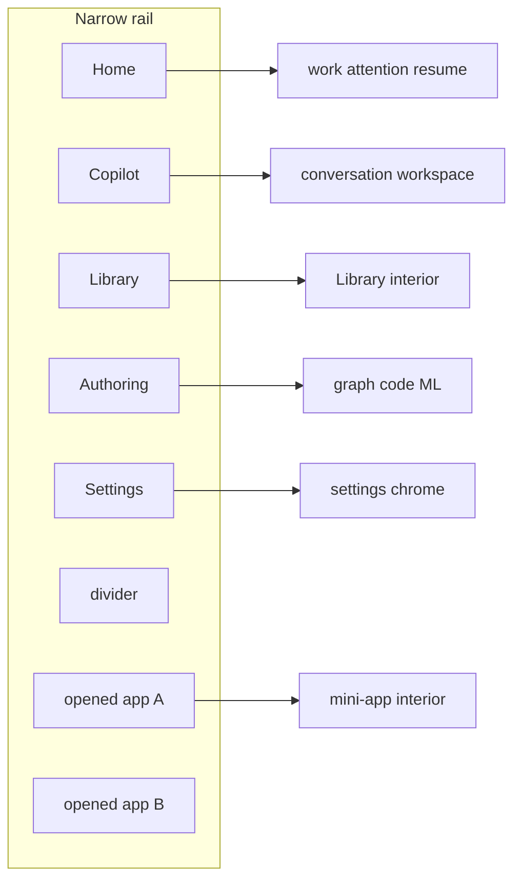
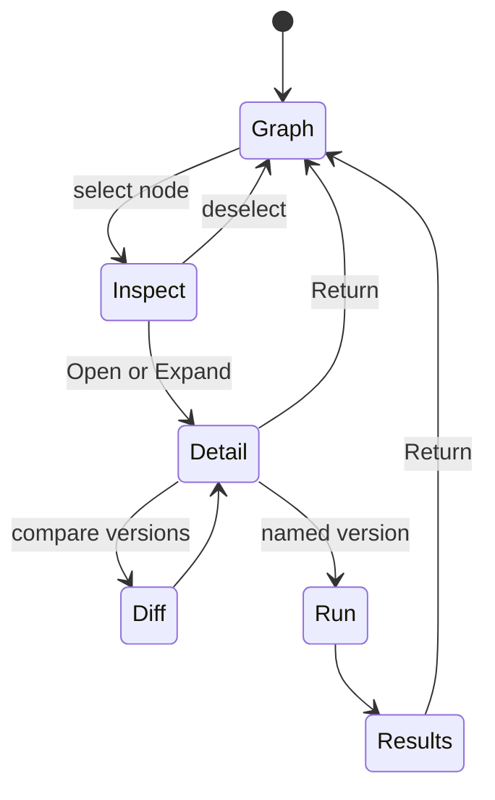

# Experience and layout

Law is in `ARCHITECTURE-SPINE.md`. This companion is the spatial and interaction contract. Original Excalidraw images and dictation `JHZj5SdT` remain the layout foundation. Coordinates are not frozen.

**Correction vs an early orchestrator note:** the VS Code screenshot governs the **authoring/ML** family (editor + right copilot). Main copilot session/preview is the Hermes / Codex / Cowork family. Mini-app canvas is OpenBB. See `research/09-images-video-codex-refs.md`.

## 1. Platform rail

Source: user turn placing Home (work state), main agent, Library, Authoring above opened apps (`session-visible-messages.md` around the Home / main agent / Library / Authoring dictation). Shared components are allowed. Home is not Copilot.

- Destinations above the divider exist with zero opened apps.
- Home resumes an existing job or `psess:` without creating an instance or merging histories.
- Opened apps below the divider are instances, not definitions.
- Close on an opened-app icon unmounts chrome. It does not cancel JobHandles (local AD-13).
- Attention (running, unknown, failed) appears on **Home** and on rail badges.
- Layout of the rail is client-local, not a `psess:` field.

## 2. Main copilot

Source: `C39LFtm1`, `rrUMAlEq`, Hermes/Codex/Cowork images, Codex refs 01–05.

| Region | Owns | Must not |
| --- | --- | --- |
| Left: sessions / history / agent settings | List of `psess:` authoring sessions | Be copied onto every mini-app |
| Centre: conversation | Messages, questions, chips | Be the JobHandle |
| Right or tabbed: preview / work area | Browser, terminal, files, diffs, mini-app preview, video | Imply grant or install |
| Composer | Content refs, tools, target (local AD-7) | Study-02 modal picker |

Work-area launcher (Codex reference) is a valid way to open preview tabs. The expanded plus menu was **not** operated; do not invent plugin contents.

Concurrent jobs keep stable identities. Switching the visible app does not redirect an in-flight answer (J-UI-01).

## 3. Mini-app

Source: OpenBB image, `YJYDP26I`, `JHZj5SdT`, widget crop `…155654_792.png`.

| Region | Owns |
| --- | --- |
| App navigation above canvas | Pack-declared views; omit-able |
| Widget canvas (majority) | Dense charts, tables, controls; scroll; unequal widget sizes |
| Optional right copilot | `app-use` `psess:` for this instance |
| Widget chrome | Refresh/history, message-to-copilot, overflow, **expand**, close |

Message on a widget adds a **reference** into the relevant copilot session. It does not merge sessions. Expand follows local AD-8.

A second app (Manus / Voices images) must visibly change navigation and canvas. That is the anti-template test.

## 4. Authoring and ML

Source: VS Code image, n8n as mental model, 03 §3, LSE **capabilities only**.

Retain viewport, selection, draft/version on the trip. Validation names the version. No lossless code-to-graph round-trip. No LSE Train/Optimise form as the default.

## 5. Library

Platform destination. Four rails: Artifact, Knowledge, Contribution on the facade; Hypothesis on `qml.research` only. See local AD-10 and `research/13-library-lifecycle.md`.

## 6. Research, charts, and data

Local AD-17. A research mini-app is OpenBB-like widgets: pickers for instrument/time/query bound to descriptors; linked views via typed mappings; provenance/units/timezone/freshness on the snapshot. Missing, empty, truncated, and denied stay distinct. Analytics charts are LayerChart. Financial candles are a dedicated host. Stream subscribe is not a trading grant.

## 7. First-run and settings

Splash then partial shell (`research/14-firstrun-packaging-placement.md`). Global settings vs app vs session vs instance scopes. Local vs remote workspace picker is a reference, not QMX chrome lock.

## 8. State checklist (every surface)

Loading, empty, unavailable, failed, reconnecting, stale, unknown, recovery. Map onto typed refusals + listing axes + JobHandle. Not twelve dashboards and not a modal per state.

## 9. Accessibility floor

Keyboard: rail destinations, session list, composer, widget expand/close, graph selection, command palette (bits-ui Command). Focus rings from shadcn-svelte. Do not ship a surface whose only path is drag.
