# View and pack contract

Companion to local AD-6, local AD-8, local AD-15. Law for independent pack authors and shell authors. Worked examples live in [`EXAMPLES.md`](EXAMPLES.md).

This sitting does **not** mint a `ui_view` contribution point, a UI permission bit, a view-specific GrantRecord, or a second grant store. `view:*` remains a wire DTO (parent AD-17, local AD-15, kit AD-1). Host grants stay parent GrantRecords. Widgets bind and display; the unique invoke issuer remains `apps/qmx-ui/src/lib/host/dispatchInvoke`.

**Honesty.** `ViewPresentation`, `GrantRecord`, and `compare_envelope_to_grant` exist as types/fixtures at `34c148b`. `PackUiRequest`, `get_pack_ui_request`, host-minted `ActionContext`, json-render catalog enforcement, and MCP Apps intercept are **specified here and absent in code**. Until the daemon accepts envelope `caller_kind`, the host refuses pack invoke with typed `caller_kind_unsupported`; qmb CLI remains the operator door (local AD-8). Static JSON in this file is an architecture artifact, not running software.

## 1. What a pack may request vs what the host grants

| Surface | Kind | Contribution point? | Grant? |
| --- | --- | --- | --- |
| `contributes`: `{point, local_id}` | operation request | yes — closed eight: `tool`, `tool_adapter`, `hook`, `skill`, `graph_template`, `model_deployment`, `toolset`, `worker_template` | no. Hit ≠ grant (parent AD-2) |
| `PackUiRequest` v1 (`nav`, `views`) | versioned request DTO | **no** | **no** |
| `view:*` / `ViewPresentation` | COMP-QMA-WIRE DTO, CT-40 additive | **no**. `view_id` must start with `view:`. Token `ui_view` is refused | no. `VIEW_OWNS_GRANTS = False`. `authorizes_invoke: true` refuses |
| `PluginManifest.copilot_profile` | **Epic 60 / kit sibling field** | **no** | **no**. Absence is valid. PackUiRequest **references** this field; it does not replace it |
| `requested_capabilities` | kit AMEND/alias of inspect `PluginManifest.permissions` | no | no. Do not add a second live request field |
| `GrantRecord` into `psess:` | host-minted, immutable | n/a | **yes — the only grant** |

Install is not grant. Enable after validate is not grant. Open-view / mount is not grant and does not start work. `product_session.granted_ops` stores `grant_id`s, never bare op-id strings.

Forbidden on any view/nav/copilot request blob (same family as inspect `_FORBIDDEN_VIEW_KEYS`): `grant_id`, `granted_ops`, `authorizes_invoke`, `product_session` / `product_session_id`, contribution-hit identity (`hit_class`, `qualified_id`, `package_version`, `availability_revision`, `fp1`, …), chrome ids pretending to be sessions (`tab_id` as `psess:`). Presence is typed `INVALID_INPUT` / policy rejection on the **DTO**, not a GrantRecord mint.

## 2. PackUiRequest v1 (candidate schema)

Schema name: `qmx.ui.pack_ui_request.v1`. Not a new CT. Not identity. Not a json-render runtime id.

The pack manifest keeps Epic 60 fields: `contributes`, optional `view:*`, optional **`copilot_profile`**, `requested_capabilities` (alias of inspect `permissions`). **At most one** `pack_ui_request` document may be added for chrome. Omit it for a headless pack. Do **not** nest `copilot_profile` inside `pack_ui_request` as a replacement for the manifest field. No parent amendment. Epic 60 stories 60.1+ stay the owner of that blob.

```json
{
  "schema": "qmx.ui.pack_ui_request.v1",
  "pack_id": "sector-desk",
  "pack_version": "0.1.0",
  "nav": [
    { "id": "coverage", "title": "Coverage", "slot": "app-nav", "view_ids": ["view:coverage"] }
  ],
  "views": [
    {
      "view_id": "view:coverage",
      "view_version": 1,
      "op_id": "research.coverage.snapshot",
      "renderer": "native",
      "slot": "canvas-widget",
      "parameter_binding": { "schema": "research.coverage.snapshot.v1" }
    }
  ]
}
```

Host reads optional `PluginManifest.copilot_profile` beside this document.

| Field | Rule |
| --- | --- |
| `schema` | Exactly `qmx.ui.pack_ui_request.v1` for this candidate. Unknown / other version → §3 unknown-schema path. |
| `pack_id` | Non-empty string. Must equal the manifest package id. |
| `pack_version` | Non-empty string. Must equal the manifest version being enabled. |
| `nav` | Optional. Omit or `[]` to omit app-owned top navigation. Each item is `{id, title, slot, view_ids}`. `id` and `title` are non-empty strings. `slot` is a slot token (§4). `view_ids` is a non-empty array of `view_id`s declared in `views`. Unknown view_id → ignore that nav item (do not fail enable). Empty `view_ids` is invalid for that item (ignore item). |
| `views` | Optional. Omit or `[]` for no chrome. Each item: `view_id`, `view_version` (positive int), `op_id`, `renderer`, `slot`, `parameter_binding.schema` (non-empty name of an existing parent-AD-3 `input_schema`). |
| `view_id` | Must start with `view:`. `ui_view` / `ui-view` refused as a contribution-point attempt. |
| `renderer` | Closed: `native` \| `json-render` \| `mcp-app`. |
| `slot` | Closed set in §4. |
| `parameter_binding` | Request-time object `{ "schema": "<input_schema name>" }` only. Values are not authority; they are filled later on the live `ViewPresentation`. Schema must not add or drop fields versus the descriptor `input_schema`. |
| `copilot_profile` | **Not a PackUiRequest field.** Lives on `PluginManifest` (Epic 60). Host copies it at enable if present. |

Renderer-specific **non-authority** extras (ignored if unknown; never grants):

- `mcp-app`: optional `ui_resource` (`ui://…`, MIME `text/html;profile=mcp-app`). Required to mount that renderer; absence → incompatible-renderer fallback (§3).
- `json-render`: optional `catalog_ref` naming a **host** catalog id. Packs do not ship a second catalog.

Live mount still uses parent `ViewPresentation` (`view_id`, `view_version`, `op_id`, `mount`, `parameter_binding` including `values`, `snapshot_cursor`, `stale`). `PackUiRequest` is the pack-side request. `ViewPresentation` is the wire DTO attached to an existing `psess:`. `ActionContext` is the host-minted invoke binding. Three records; none of them is a GrantRecord.

## 3. Host ingestion (read at enable)

**When.** After parent AD-30 validate, as part of enable, the host reads `pack_ui_request` from the pack bytes being enabled. Ingestion is **not** granting and **not** mounting. ContributionHits still publish only from `contributes`.

**Who.** COMP-QMA-DAEMON enable path parses and records the request (or records that it was empty). The Svelte host later **loads** that recorded request when an instance is opened via addable query **`get_pack_ui_request`** keyed by enabled **`instance_id` + `availability_revision`** (authenticated HTTP GET snapshot family). Neither step mints `ui_view` hits.

**Pack enable vs UI request.** A bad or empty UI request must not roll back the operations roster. Views are not contribution points; they are not enable-critical the way missing operation deps are (parent AD-30 hard-error). Ops can enable headless even when chrome cannot mount.

| Condition | Enable ops roster? | UI outcome |
| --- | --- | --- |
| Key omitted or `{}` / `{schema, pack_id, pack_version}` with empty `nav`+`views` | yes | Headless chrome. Valid. Manifest may still omit `copilot_profile` (Epic 60). |
| `schema` missing or not `qmx.ui.pack_ui_request.v1` | yes | Treat UI as empty; record `failure_class=view` diagnostic `unknown_pack_ui_schema`. |
| `pack_id` / `pack_version` mismatch with the enabling manifest | yes | Ignore the UI request (empty chrome); diagnostic `pack_ui_identity_mismatch`. Do not silently bind another pack's views. |
| View `op_id` not on this pack's `contributes` (no ContributionHit for that op after qualification) | yes | **Drop that view**. Diagnostic `view_op_not_contributed`. Other views remain. |
| `parameter_binding.schema` ≠ descriptor `input_schema` name, or field drift versus descriptor | yes | Drop that view. Diagnostic `view_schema_drift`. |
| `view_id` not `view:…` or equals `ui_view` | yes | Drop that view (`refuse_view_as_contribution_hit`). |
| Forbidden grant/session keys on nav or view | yes | Drop that item. |
| Malformed `nav` item (missing `id` or `title`, wrong types, `nav` not an array) | yes | Drop that item or the whole `nav` array. **Do not fail enable.** Remaining valid nav/views stand. |
| Unknown `slot` | yes | **Ignore that view or nav item.** Do not fail enable. |
| `renderer` not in the closed enum, or renderer incompatible with this host (adapter package absent, MCP resource missing, json-render catalog unknown) | yes | Pack stays enabled. At **mount**, use native empty pane + reason (§8). Do not disable the pack. |
| Valid request | yes | Record request. Still no GrantRecord. Still no chrome until open-view. |

`failure_class=view` means the wire DTO failed to ingest, mount, went stale, or is unhealthy. It is **not** an invoke (kit AD-5).

## 4. Slots

Closed slot tokens:

| Slot | Shell region | Typical occupant |
| --- | --- | --- |
| `app-nav` | Mini-app navigation **above** the canvas | `MiniAppNavHost` items from `nav[]`. Omit the host when `nav` is empty. |
| `canvas-widget` | Mini-app dense widget canvas | `WidgetFrame` / json-render / MCP iframe |
| `detail` | Authoring/ML code, diff, data, results | `DetailHost` after explicit Open/Expand |
| `copilot-panel` | Optional right in-app copilot | `OptionalCopilotPanel` over an **app-use** `psess:`. Requires a `copilot_profile` blob; absence means no panel. |
| `preview-tab` | Main-copilot work-area tab | Preview of a view; preview ≠ install ≠ grant |

Unknown slot → ignore that view or nav item; do not fail enable.

A pack must not invent slots (no pack-defined OS). Layout coordinates stay client-local, never a `psess:` field (parent AD-8).

## 5. Mount and immutable ActionContext

Mount attaches chrome to an **existing** `psess:` (`ProductSessionChrome.mount_view` writes no grant, no occupancy, no layout). Occupancy stays `none`. Mount does not start durable work.

For every mounted native pane, json-render tree, or MCP iframe the host mints exactly one **immutable** `ActionContext`. The renderer does not mint it. The pack does not mint it. Remount (new snapshot, new grant, new config_revision) mints a **new** context and drops the old one.

```json
{
  "psess": "psess:app-sector-1",
  "view_id": "view:coverage",
  "contribution": {
    "qualified_id": "sector-desk:coverage",
    "package_version": "0.1.0"
  },
  "instance_id": "inst:sector-a",
  "config_revision": 4,
  "grant_id": "grant:coverage-a",
  "allowed_op_ids": ["research.coverage.snapshot"],
  "account_scope": null,
  "snapshot_cursor": 9
}
```

| Field | Source (host-derived) | Renderer may set? |
| --- | --- | --- |
| `psess` | Current product session for this chrome. App-use row already has `app_instance_id`. Authoring uses the session only after exactly one `selected_refs` kind `instance_id` (parent AD-8 / kit amend). | no |
| `view_id` | The `PackUiRequest` view being mounted | no |
| `contribution` | Enabled pin `(qualified_id, package_version)` for the view's `op_id` | no |
| `instance_id` | Opened-app instance, or the single selected `instance_id` ref | no |
| `config_revision` | Instance config revision from authoritative stores | no |
| `grant_id` | Matching GrantRecords for this contribution + instance + config + `op_id`/`op_version` + audience `psess`: **0** → null (paint allowed, invoke refuses); **1** → that `grant_id`; **≥2** → do not mint context; typed `GRANT_AMBIGUOUS` (no first-wins, no merge, no order pick). Operator must grant uniquely or the host must name one grant in a later explicit bind — v1 refuses ambiguity | no |
| `allowed_op_ids` | Intersection of this view's declared `op_id` (v1: one op per view) with currently matching, unrevoked, unexpired GrantRecords for **this** instance. Empty if ungranted | no |
| `account_scope` | From that GrantRecord (`null` unless granted) | no |
| `snapshot_cursor` | Host snapshot for this binding. `stale: true` or a newer cursor than the bound one refuses invoke (parent AD-17) | no |

Untrusted content (native event payload, json-render spec, MCP iframe `postMessage`) may supply **only**:

```json
{ "action": "research.coverage.snapshot", "input": { "as_of": "2026-09-01" } }
```

- `action` must be a declared name in `allowed_op_ids` (and therefore an existing parent-AD-3 `op_id`).
- `input` must be valid against that op's `input_schema` and clipped to `parameter_ceiling.allow_keys`.

The host **ignores** `grant_id`, `instance_id`, `config_revision`, `psess`, `caller_kind`, `account_scope`, `contribution`, `allowed_op_ids`, `effect_class`, and `snapshot_cursor` when those keys appear on untrusted content. Ignoring is not retargeting: dispatch always uses the mint context. A payload whose `action` is not in this context's `allowed_op_ids` is refused by the host before the wire (§6, §9).

`caller_kind` is host-derived: `user` (operator press), `agent` (copilot tool), `workflow` (template node). There is no `caller_kind=widget`.

Two chrome tabs of the same `psess:` / instance share the session row and GrantRecords. Each mount still has its own `ActionContext` (`view_id` differs). Two **instances** with the same `op_id` string stay isolated by `instance_id` + `grant_id` on the context — the host must not pick “any grant in this session whose `op_id` matches.”

## 6. dispatchInvoke intersection

`WidgetFrame`, json-render `executeAction`, MCP `tools/call` intercept, graph Run, composer **tool** submit, and command palette call **`dispatchInvoke` only**. They never import the wire client. They never become a second grant list.

```text
untrusted {action, input}
    → bind to this mount's ActionContext (ignore foreign authority fields)
    → action ∈ allowed_op_ids
    → input_schema + parameter_ceiling.allow_keys
    → snapshot not stale
    → build InvocationEnvelope from the context
    → daemon compare_envelope_to_grant + parent AD-9
         published ContributionHits
         ∩ host grants
         ∩ session GrantRecords
         ∩ health
    → GRANT_MISMATCH / STALE_OBSERVATION / UNAVAILABLE / tombstone / INVALID_INPUT
```

Envelope fields the host fills from `ActionContext` + descriptor, never from the renderer:

- `op_id` / `op_version` from the declared action + descriptor
- `contribution` `{qualified_id, package_version}`
- `instance_id`, `config_revision`
- `caller_session_ref` = `psess`
- `grant_id`
- `effect_class` from the descriptor (closed parent set)
- `caller_kind` as above

GrantRecord match (parent CONTRACTS §3b / inspect `compare_envelope_to_grant`, plus ceiling and account the host already bound into the envelope/input):

| Compare | On mismatch |
| --- | --- |
| `grant_id` | `GRANT_MISMATCH` |
| `contribution` `(qualified_id, package_version)` | `GRANT_MISMATCH` |
| `instance_id` | `GRANT_MISMATCH` (`retargeted=false`, `substituted=false`) |
| `config_revision` | `GRANT_MISMATCH` (same flags) |
| `op_id` / `op_version` | `GRANT_MISMATCH` |
| `effect_class` | `GRANT_MISMATCH` |
| input keys ⊆ `parameter_ceiling.allow_keys` | `GRANT_MISMATCH` / `INVALID_INPUT` |
| `account_scope` | `GRANT_MISMATCH` if the envelope/account target disagrees; `null` unless granted |

Two instances A and B both granted `research.coverage.snapshot` do **not** cross-invoke. Context A carries `instance_id=inst:A` and `grant_id=grant:A`. A press on A's widget cannot select `grant:B`. The host refuses a foreign `action` or a foreign authority field; the daemon would also `GRANT_MISMATCH` if a buggy host mixed fields.

Nested invoke does not union grants (parent AD-10). Disabled / uninstalled contribution → `unavailable` or `tombstone`, never another version (parent AD-30).

Absence of a json-render catalog entry still allows native or CLI invoke of the same `op_id` (parent AD-17). An empty `allowed_op_ids` on a mount means **this view** cannot press; it does not hide the op from CLI.

## 7. Three presentation lanes

Closed renderers. Native QMX panes remain default (local AD-6, kit AD-8).

| `renderer` | Adapter | Invoke path |
| --- | --- | --- |
| `native` | QMX Svelte pane (`WidgetFrame`, `GraphCanvas`, `DetailHost`) | component `request_invoke` → `dispatchInvoke(ctx)` |
| `json-render` | `@json-render/core` + `@json-render/svelte` + `@json-render/shadcn-svelte` **0.21.0** (optional frontend packages; Python core must not take them) | `executeAction` = host wrapper around `dispatchInvoke(ctx)` |
| `mcp-app` | `@modelcontextprotocol/ext-apps` 2.0.0 optional host adapter; sandboxed iframe | host intercepts `tools/call` → `dispatchInvoke(ctx)` |

Incompatible or unknown renderer at **mount**: native empty pane + visible reason (`failure_class=view`). Pack stays enabled. Other views of the same pack still mount. Jobs are not cancelled.

## 8. MCP Apps — pinned profile and QMX declines

**Pin:** MCP Apps `specification/2026-01-26` (Stable). Not `specification/draft`. Extension id `io.modelcontextprotocol/ui`. This is the protocol profile this host will speak.

**Supported (QMX v1):**

1. **One tool** whose name is this view's `op_id`, plus one `ui://` resource (`text/html;profile=mcp-app`) declared on that tool (`_meta.ui.resourceUri` / PackUiRequest `ui_resource`).
2. Host `resources/read` of that URI; render in a **sandboxed iframe**. Web hosts wrap the view in a different-origin sandbox proxy (`allow-scripts`; `allow-same-origin` only on that proxy origin, per the pinned spec). The iframe must not read host grants, tokens, or `ActionContext` bytes from parent DOM/storage.
3. App ↔ host JSON-RPC over `postMessage`. `tools/call` is **host-proxied**: the host intercepts, binds `ActionContext`, then may call `dispatchInvoke`. The iframe never speaks CT-40 / qma-daemon.

**QMX declines** (host policy — **not** a claim that MCP inherently forbids these):

- App-provided extra tools (`tools/list` from the view, draft bidirectional app-tool registration, `notifications/tools/list_changed` as a grant path).
- Any `tools/call` that is not intercepted (direct iframe → daemon, unauthenticated proxy, or host forward without ActionContext ∩ GrantRecord).
- Tool names that are not this mount's `allowed_op_ids`.
- HTML that adds ops, fields, grants, or `caller_kind`.

Enforcement: the host interceptor is mandatory for `mcp-app` mounts. If the intercept cannot be installed, the renderer is incompatible → native empty+reason, pack stays enabled. Skills describe; they do not grant. MCP Apps remain a presentation adapter, not identity, persistence, runtime, or authority.

## 9. json-render 0.21.0

Host-owned catalog: QMX components + listed shadcn primitives. Packs do not ship a second catalog and do not invent `submit_form`.

Catalog `actions` keys **are existing `op_id`s**. Params schema ⊆ descriptor `input_schema` (same names, no extras, no dropped required keys). Generated JSON cannot add ops or fields.

Svelte `defineRegistry` `executeAction` **is** a host wrapper:

```text
executeAction(name, params) → dispatchInvoke({ action: name, input: params }, mountActionContext)
```

It must not `fetch` a private API and must not select a GrantRecord from the session bag. Spec `action` unknown to this mount's `allowed_op_ids` → ignore/refuse, never a new op. Failed spec validation → native empty+reason or labelled repair; `autoFixSpec` must not introduce actions. A null spec renders nothing.

json-render is not identity, not a store, not an executor (`JSON_RENDER_STORES` / `JSON_RENDER_EXECUTES` stay false).

## 10. Dispose

Unmount / close-view / iframe teardown:

1. Drop this mount's `ActionContext` (it is no longer usable).
2. Do **not** `JobHandle.cancel`. Do not stop a Mission. Close ≠ cancel (local AD-13, parent AD-17).
3. Revoke iframe `postMessage`: invalidate the mount nonce, close the MessageChannel / bridge, refuse subsequent `tools/call` from that frame. Sandbox proxy origin for that mount is retired.
4. json-render registry handlers for that mount are unregistered.
5. Write nothing to `psess:` (no layout, no occupancy, no grant change).

Already-accepted work finishes under the grant that accepted it (parent GrantRecord evaluation moments). New dispatch after dispose has no context and cannot use the dead iframe.

## 11. Headless pack

Empty `PackUiRequest` is valid:

```json
{
  "schema": "qmx.ui.pack_ui_request.v1",
  "pack_id": "nightly-replay",
  "pack_version": "0.1.0"
}
```

Equivalent: omit `pack_ui_request` from the manifest. Omit `nav` and `views`. Omit manifest `copilot_profile` (Epic 60 absence is valid). Enable still does not grant. The pack appears as ContributionHits + JobHandles (Home attention, Library, qmb CLI / wire). No `MiniAppNavHost`. No in-app copilot. A future tab close still does not cancel work (SCN-0024 / J-UI-02 / J-KIT-01).

A headless pack cannot fail `failure_class=view` by missing chrome.

## 12. What this contract must not mint

- A UI permission bit, capability token, or “trusted pane” flag.
- `ui_view` as a grant or invoke authority.
- View-specific GrantRecords or a catalog that is a second grant store.
- `caller_kind=widget`.
- Pack-shipped json-render catalogs with novel actions.
- Direct iframe → daemon tools.
- Install / enable / open-view as synonyms of grant.
- Cancellation of Jobs on unmount.

## 13. Inspect vs specified

| Need | Specified | Wired at `34c148b` |
| --- | --- | --- |
| Ops on `contributes` | parent AD-2 / AD-18 | yes — `PackContribute` |
| `view:*` DTO | parent AD-17 CONTRACTS §14 | yes — `ViewPresentation`; not a hit |
| `PackUiRequest` v1 | this file | **absent** |
| `ActionContext` | this file | **absent** |
| `copilot_profile` | kit AD-1 / AD-3 | **absent** |
| GrantRecord compare | parent AD-24 | types/fixtures; `compare_envelope_to_grant` |
| json-render `executeAction` wrapper | this file; pin 0.21.0 | **absent** |
| MCP intercept + 2026-01-26 pin | this file | **absent** |
| Headless without nav | parent AD-17, J-KIT-01 | packs `daemon_renders: false`; no UI host |
| Envelope `caller_kind` | DEC-0464 | **absent** → UI pack invoke refused until amend |

```mermaid
flowchart TD
  MAN[Pack manifest contributes ops]
  REQ[pack_ui_request PackUiRequest v1]
  MAN --> ENABLE[Enable: publish hits; ingest request]
  REQ --> ENABLE
  ENABLE --> HITS[ContributionHits]
  ENABLE --> REC[Recorded PackUiRequest or empty]
  HOSTG[Host mints GrantRecord into psess]
  HITS -.->|not this step| HOSTG
  REC --> OPEN[Open instance / mount]
  OPEN --> CTX[Host-minted ActionContext]
  OPEN --> NATIVE[native pane]
  OPEN --> JR[json-render 0.21.0]
  OPEN --> MCP[MCP iframe 2026-01-26]
  NATIVE --> DI[dispatchInvoke]
  JR --> DI
  MCP --> DI
  CTX --> DI
  HOSTG --> DI
  DI --> ENV[InvocationEnvelope]
  ENV --> CMP[compare_envelope_to_grant plus AD-9]
```


