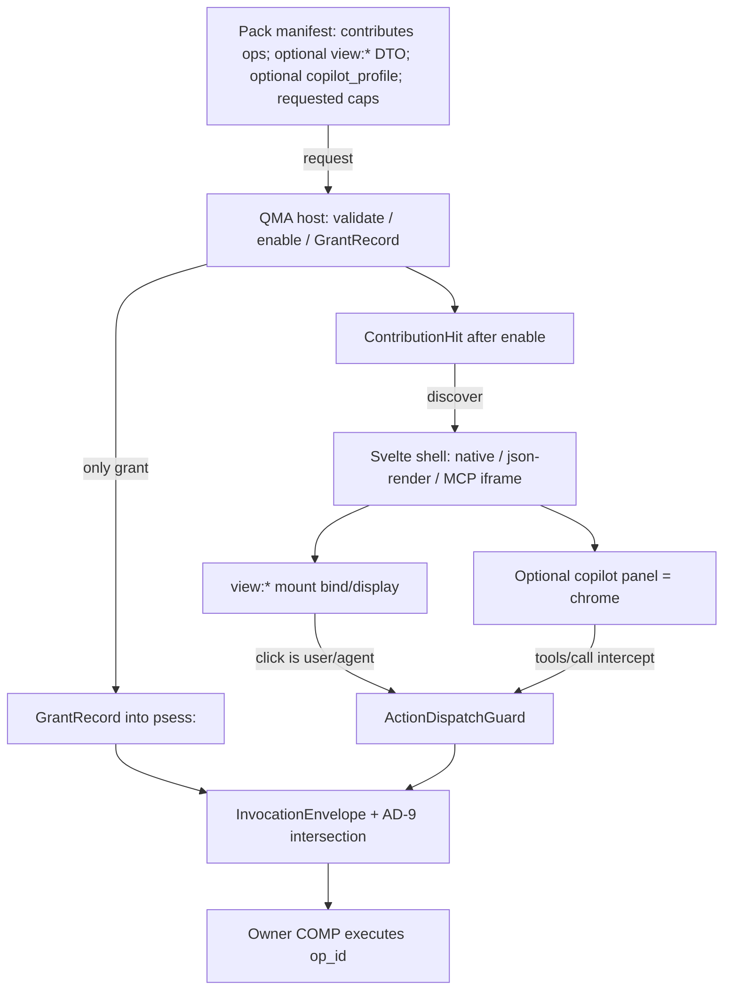

# Pack view contribution UI — bind to pack/grant, not a new trust system

Sitting: `architecture-QMX-UI-2026-09-23`. Research only. Not a spine. Not ratified.

**Question:** how should mini-app navigation, widgets, and optional copilot panels bind to the existing pack/grant architecture rather than minting a second trust system?

**Answer in one sentence:** a pack may *request* operations, optional `view:*` wire DTOs, optional navigation metadata, and an optional `copilot_profile`; the host *grants* immutable `GrantRecord`s into a `psess:`; the Svelte shell mounts, binds, and displays; invoke always goes through parent AD-3 `input_schema` plus parent AD-24 envelope plus parent AD-9 ∩ GrantRecord. json-render and MCP Apps paint. They do not grant.

## Honesty pins

| Plane | SHA / status |
|---|---|
| Docs checkout | `main@92279dfe43922d60fabe38e29284ca52956ab75c` |
| Inspect source | `.worktrees/integration-inspect` = `integration@34c148be404a375cbfd79fd4ce6997452e4f1d20` |
| Parent freeze for ADR-0024 original Decision | `270e992` still applies (DEC-0450) |
| Fixtures ≠ e2e | DEC-0286, DEC-0465 |
| This UI sitting | GAP-0081 chrome / GAP-0100 remain out of pack-and-grant kit law (DEC-0468). This report proposes how chrome *consumes* that kit. |

**CONNECT at `34c148b` (types/fixtures, not e2e):** `ViewPresentation`, `GrantRecord`, `InvocationEnvelope`, `product_session` / `ProductSessionProfile`, pack lifecycle fixture, `PackContribute` `{point, local_id}`, closed contribution points, chrome `open_view` that writes nothing.

**ABSENT as product surface at `34c148b`:** pack `copilot_profile`; `requested_capabilities` as a named manifest field (inspect packs use `permissions: []`); envelope `caller_kind`; optional authoring `app_instance_id`; `SELECTED_REF_KINDS` kind `instance_id`; `ui_view` contribution point; json-render catalog enforcement; MCP App host intercept; a live Svelte shell.

**Forbidden by sitting law if this UI sitting invents them:** a second grant store, a UI permission bit, a `ui_view` that authorizes invoke, json-render as identity/runtime, MCP App HTML that adds tools, widget-owned invoke, tab-as-session, install=grant, DOM-driving composition.

Cite parent 09-18 ADs as `parent AD-n`. Cite 09-23 kit ADs as `kit AD-n`.

---

## 1. What a pack may declare for UI vs what the host grants

### Pack requests (manifest + wire DTOs)

| Declaration | Kind | Contribution point? | Grant? |
|---|---|---|---|
| `contributes`: `{point, local_id}` for **operations only** | request | yes — closed eight: `tool`, `tool_adapter`, `hook`, `skill`, `graph_template`, `model_deployment`, `toolset`, `worker_template` | no. Hit ≠ grant (parent AD-2, SCN-0018) |
| optional `view:*` DTO (`view_id`, `view_version`, `op_id`, `mount`, `parameter_binding`, `snapshot_cursor`, `stale`) | wire DTO, COMP-QMA-WIRE, CT-40 additive | **no**. `view_id` must start with `view:`. Token `ui_view` is refused (GAP-0081) | no. `VIEW_OWNS_GRANTS = False`. `authorizes_invoke: true` refuses |
| optional navigation / commands / forms / context / events / reconnect | wire-owned presentation descriptors (parent AD-17, CONTRACTS §14) | **not** a v1 plugin point until a named GAP-0081 `ui_view` increment | no |
| optional `copilot_profile` blob | request blob (kit AD-1, kit AD-3) | **no** | **no**. Absence is valid |
| `requested_capabilities` / inspect `permissions` | request | no | no. `ManifestIsNotGrant` |

Kit AD-1: *“Pack `view:*` remains a **wire DTO** (parent AD-17), not a contribution point and not a json-render runtime id. Optional `copilot_profile` is a **request blob** on the pack, not a contribution point and not a grant.”*

09-23 `CONTRACTS.md` §1: *“A pack manifest **requests** … Host **grants** GrantRecords into a `psess:`.”*

Parent AD-8: *“Packs ship a versioned **copilot integration profile** as a request, not a grant.”*

Inspect five first-party packs (`research-corpus`, `analysis-backtest`, `dev-factory`, `trading-readonly`, `pm-coordination`) all declare `contributions` as `{point, local_id}` (or singleton ports), `permissions: []`, `daemon_renders: false`, `qma_api: ">=0.1.0,<1.0.0"`. Their `ui/` directories are empty. None declare `copilot_profile` or `view:*`. `ui_view` in a manifest raises `ManifestError` (`test_ports_and_plugins.py`).

### Host grants (the only trust)

A `GrantRecord` is minted by the host, immutable, audience `psess:`, bound to contribution tuple + `instance_id` + `config_revision` + `op_id`/`op_version` + `effect_class` + `parameter_ceiling` + optional `account_scope` + `expires_at`. `revoked_at` is not a field; revocation is append-only `GrantRevocation`. `product_session.granted_ops` stores `grant_id`s, never bare op-id strings.

Tool availability = published ContributionHits ∩ host grants ∩ session GrantRecords ∩ health (parent AD-9). Chrome, views, skills, MCP HTML, and json-render catalogs are **not** in that intersection.

`refuse_manifest_grant` / `ManifestIsNotGrant` (inspect `qma-wire/grant_record.py`): *“Manifests request; they never mint GrantRecord.”*

### UI sitting implication (proposal, not a new AD)

Do **not** add a sixth contribution point that means “this pack may paint, therefore it may run.” If GAP-0081 later mints `ui_view` as a discovery hit, it remains a hit: published ≠ granted. Until then, keep:

- operations on `contributes`
- views/nav as `view:*` / presentation DTOs
- copilot as optional request blob
- authority only in GrantRecord

Salesforce-style packaged permission sets and Slack-style install scopes are the donor rhyme (DONOR-DEEP-RESEARCH): the pack lists; install does not assign; assignment is a separate host act. OpenBB’s `widgets.json` vs `apps.json` is the donor rhyme for widget-vs-app **presentation**, not for QMX grants.

---

## 2. Headless pack: Home / Library / workflow without a nav pane

User direction (02-CURRENT-DIRECTION): mini-apps and workflows may be UI-oriented, backend/headless, or mixed; a useful capability need not have its own UI. 03-EXPERIENCE-SCOPE §1: *“A headless capability can be found/invoked without acquiring a navigation pane.”*

Parent AD-17 / kit AD-1 / parent COPILOT-AND-APPS: headless packs appear as reusable parent-AD-3 steps **without navigation**. SCN-0024 / J-KIT-01: omit `view:*` and omit `copilot_profile`; enable still does not grant; CLI/wire invoke produces a JobHandle; no in-app panel; closing a future tab does not cancel work.

**How that maps onto the shell (proposal, using existing nouns):**

| Surface | Headless pack appears as | Does **not** appear as |
|---|---|---|
| **Home** | Attention / running work via JobHandle + listing axes (`published` / `configured` / `authorized` / `reachable` / `healthy`). Resume instance/session, not a fake app chrome. Platform destinations above the rail divider stay usable with zero opened apps (02-CURRENT-DIRECTION; copilot-and-platform-clarification). | An opened-app rail item with app-owned top nav. A required copilot panel. |
| **Library** | Typed hits: `ContributionHit` after enable (tuple identity, never fp1); `ArtifactHit` for saved results; `KnowledgeHit` for corpus. One Library chrome over typed rails; do not collapse kinds (parent COPILOT-AND-APPS). UX-05: Library navigation is not a new universal backend object type. | A mini-app page. A nav pane. A new “headless app” kind. |
| **Workflow / graph** | Enabled `graph_template` contribution + parent-AD-3 `op_id` nodes. Operator (or Graph Template) invokes through the envelope. Door parity (parent AD-21, SCN-0022): same semantics on library / qmb CLI / qma-wire. | A widget canvas. An in-app assistant. A privileged terminal. |
| **Main copilot** | Authoring `psess:` may *reference* the pack via `selected_refs` (kit AD-3: exactly one `instance_id` on invoke; zero/many is `INVALID_INPUT`). Tools still require GrantRecords. | Auto-grant because the hit is visible. Merged history with an app-use session. |

Inspect: `SESSION_GRANTED_IS_PACK_STATE is False`. Enable publishes ContributionHits; it does not mint grants. `daemon_renders: false` on all five desk packs is the current first-party default: they are already headless presentation-wise.

`failure_class=view` (kit AD-5) means the wire DTO failed to mount, was stale, or was unhealthy — **not** an invoke. A headless pack that never ships a view cannot fail that class by missing chrome.

---

## 3. Widget = view of an op — does the UI invoke or only bind/display?

**Law:** widgets bind or display; they do not own invoke.

- Kit AD-2: *“Widgets never own invoke.”*
- Kit AD-4: *“Widgets bind or display ops; they do not introduce a fifth composition mode.”*
- Parent AD-17: mount/dispose must not start or kill durable backend work. Stale snapshot/cursor refuses invoke.
- Inspect `ViewPresentation`: `starts_durable_work` and `kills_durable_work` are frozen `False`; occupancy is `"none"`; `authorizes_invoke` refuses. `ProductSessionChrome.mount_view` parses the DTO and attaches chrome to an **existing** `psess:`; it writes no grant and no occupancy.
- J-KIT-04: *“User (or agent) presses a widget bound to `start` of template T. Envelope `caller_kind=user` or `agent`. Widget dispose does not cancel the Mission.”*

**Split (this is the load-bearing UI contract):**

| Layer | Owns | Does not own |
|---|---|---|
| Widget / `view:*` | Binding: `view_id` → `op_id` + `parameter_binding.schema` (must name existing AD-3 `input_schema`) + snapshot cursor. Compact/detail chrome. Display of last known result. | `GrantRecord`. Envelope. JobHandle lifetime. Occupancy. `caller_kind`. |
| User / agent / workflow | Press, ask, or graph-edge that *requests* an invoke | Painting the widget |
| Host | Build InvocationEnvelope, compare GrantRecord, dispatch, retry per effect class | Treating the widget as the caller |

So: the Svelte widget **binds and displays**. The **shell host** (not the widget component, not json-render, not MCP HTML) is the only client that may call invoke. The envelope `caller_kind` is `user` | `agent` | `workflow` (kit AD-4; absent at `34c148b`). There is no `caller_kind=widget`.

If a widget button looks like “Run”, the click is a **user** invoke of the bound `op_id` with `parameter_binding.values` clipped to `parameter_ceiling.allow_keys`. Closing the widget is chrome dispose (`open_view` / `close` query-only). It is not cancel.

---

## 4. json-render catalog actions must name existing `op_id`s — native-shell enforcement

Parent AD-17 / kit AD-7 / 09-23 CONTRACTS §7: *“json-render catalog `action` names an existing `op_id`.”* Catalog entries MUST NOT add/remove fields vs AD-3 `input_schema`. Absence of a catalog entry is native/CLI using the same schema. JSON Render is not identity, persistence, runtime, or authority. Do not pin `@json-render/*` in Python core (kit AD-8). Frontend may use it as an **optional adapter** (`15-stack-currency-orchestrator.md`: `@json-render/core` + `@json-render/svelte` 0.21.0, Apache-2.0).

Upstream (json-render.dev, 2026-09-23): a catalog is the **host-owned vocabulary** of components + actions; AI generates a JSON spec constrained to that catalog; `defineRegistry` maps action names to **application** handlers (`executeAction`). json-render does not talk to QMA by itself. That is the guardrail QMX must fill.

**Native-shell enforcement (proposal, three gates, all host-owned):**

1. **Catalog compile (UI package, not pack bytes).** The only legal `actions` keys are existing published AD-3 `op_id`s for this QMX version. Params schema ⊆ descriptor `input_schema` (same names, no extras, no dropped required keys). Catalog components are QMX-owned or shadcn primitives — not pack-supplied arbitrary types. A pack may *request* which catalog components a `view:*` prefers; it may not ship a second catalog that invents `submit_form`.
2. **Validate / enable (daemon).** Pack `view:*` `op_id` must resolve to a live ContributionHit + descriptor. Unknown `op_id`, field drift, or `view_id` not prefixed `view:` → typed refusal; last usable roster stays (parent AD-30). This is the same hard-error-at-enable rule as missing deps — not Hermes warn-and-continue.
3. **Runtime dispatch.** `ActionProvider` handlers do **not** `fetch("/api/…")`. They call the host invoke adapter: envelope + GrantRecord compare (`grant_binding.compare_envelope_to_grant`) + `GRANT_MISMATCH` / `STALE_OBSERVATION` / `UNAVAILABLE`. Spec `action` name unknown to the catalog → ignore/refuse, never a new op. Stale `snapshot_cursor` / `stale: true` refuses invoke (parent AD-17). Generated JSON cannot add ops or fields (kit AD-7).

Inspect already refuses treating json-render trees as `selected_refs` (`_FORBIDDEN_SELECTED_KEYS` includes `json-render`, `json_render`, `widgets`). `JSON_RENDER_STORES` / `JSON_RENDER_EXECUTES` are `False`.

**Do not** let a generative spec become an untracked in-process execution path (03-EXPERIENCE-SCOPE §5). json-render stays a renderer of host catalog + host handlers.

---

## 5. MCP App HTML cannot grant tools — host intercept for a Svelte shell

Parent AD-17 / kit AD-7 / 09-23 CONTRACTS §7: *“MCP App `tools/call` is intercepted by the host against the session GrantRecord.”* MCP App HTML MUST NOT grant tools. Skills describe; they do not grant. Hooks cannot override a failed privilege gate.

Upstream MCP Apps (SEP-1865-class, modelcontextprotocol.io/extensions/apps, 2026-09-23):

- Tool + `ui://` resource; host may preload the resource.
- HTML renders in a **sandboxed iframe**; no parent DOM, cookies, or storage.
- App ↔ host JSON-RPC over `postMessage`. Shared method: `tools/call`. Host **forwards** tool calls; host controls which tools the app may call.
- App Bridge: iframe rendering, message passing, **tool call proxying**, security policy. Svelte starter exists; `@modelcontextprotocol/ext-apps` is unpinned here (kit AD-8).
- CSP deny-by-default; extra origins only via `_meta.ui.csp`.

Inspect: `MCP_APPS_STORES` / `MCP_APPS_EXECUTES` are `False`. Presentation candidate only.

**Svelte-shell intercept requirements (proposal):**

| Requirement | Why |
|---|---|
| Iframe `sandbox` without `allow-same-origin` unless a named exception is sitting-law | HTML must not read host grants or tokens |
| All `tools/call` / `app.callServerTool` land in the **host** first, never on qma-daemon from the iframe | Parent AD-17 intercept |
| Host maps tool name → existing `op_id` (same rule as json-render actions) | Cannot add ops |
| Host evaluates parent AD-9 ∩ GrantRecord at accept, dispatch, nested call, retry, external commit (parent AD-24) | HTML cannot self-grant |
| Audience is the **current** `psess:` (app-use panel vs authoring main). Nested invoke does not union (parent AD-10, `NestedPermissionUnionRefused`) | Cross-app iframe must not inherit main-seat tools |
| `updateModelContext` / `selected_refs` writes are named CAS commands (`command_id`, `expected_revision`); iframe cannot patch grants or `account_scope` | Parent AD-8 / AD-29 |
| Teardown of iframe = chrome dispose, not JobHandle cancel | Parent AD-17, J-KIT-01 |
| Fallback: if MCP Apps unpinned or unhealthy, native pane or json-render catalog using the same `op_id` | kit AD-8: native first |

Do **not** treat an MCP App as a mini-app identity, a pack, or a grant issuer. It is an optional in-conversation / in-panel **view** of an already-granted op.

---

## 6. App-to-app composition via contracts (parent AD-10), not UI automation

Parent AD-10 four modes, none compulsory; inspect `COMPOSITION_MODES` (lifecycle fixture) with `COMPOSITION_MODES_REQUIRE_CORE_EDITS is False`:

1. `consume_artifact_fp1` — saved artifact by fp1/content id
2. `invoke_exported_op_through_envelope` — parent AD-3 / AD-24
3. `graph_template_coordinates_two_apps` — DAG template, not a live board
4. `composite_app_cites_contribution_ids` — instance graph, not a new Library kind

**Forbidden (parent AD-10, J12):** one app driving another’s screen; union of permissions; un-budgeted invocation cycles; latest-instance substitution; DOM driving.

Kit AD-4: many-to-many is Graph Template edges plus those four modes. Runtime workflow-to-workflow is parent-AD-3 invoke of callee `start` | `query-state` | `cancel` | `await` → **one** nested Mission / Task Graph / JobHandle. Merging two live Task Graphs is refused.

UI sitting consequences:

- A widget in app A that “opens” app B is either (2) invoke of B’s exported op, (1) consume B’s artifact, (4) a composite instance that already cited B, or a **reference chip** (`selected_refs`) — never a synthesized click in B’s iframe.
- Cross-app copilot reference does not merge `psess:` histories or grants (02-CURRENT-DIRECTION; kit AD-3). Context transfer is `selected_refs` or `change_request` only.
- Shared filters are typed AD-5 edges, not ambient globals (parent AD-5).
- Preview rendering must not imply installation or execution permission (03-EXPERIENCE-SCOPE §4).

---

## 7. Install vs enable vs grant vs open-view

Four different verbs. Collapsing them is how a “UI trust system” gets invented.

```text
downloaded → installed → validated → enabled ⇄ disabled → uninstalled
                 ↑ pack states (parent AD-18 / AD-30)
session-granted (GrantRecord into psess:)     ≠ pack state
open-view / mount (chrome)                    ≠ pack state, ≠ grant, ≠ invoke
```

| Verb | What becomes true | What stays false | Inspect / law |
|---|---|---|---|
| **Install** | Bytes present in plugin tree + install row. `instance_id` ≠ `plugin_id` | Roster not on. No ContributionHit. No GrantRecord. No nav pane | Parent AD-13, AD-16; kit AD-1: *“Installing a pack does not grant.”* |
| **Validate** | Manifest/schema/deps/migrations/export-scan checks | Not enabled. Missing dep is hard error, not warning-and-continue | Parent AD-30; `MISSING_DEP_WARN_AND_CONTINUE is False` |
| **Enable** | Atomic roster swap; `availability_revision` publishes; ContributionHits appear | Still no session grant. Still no chrome. Custom packs need explicit operator enable (v1 first-party trust) | Parent AD-18/AD-30; SCN-0022 |
| **Grant** | Host mints immutable GrantRecord; `granted_ops` gains `grant_id`; copilot may see the op if also published ∩ healthy | Does not open a view. Does not start a Mission. Upgrade cannot widen/retarget without re-grant + `context_revision` bump | Parent AD-8, AD-24; `grant_binding.py` |
| **Open-view / mount** | Client mounts `view:*` (`mount: mounted`) on an existing `psess:`. Occupancy none | Does not mint session, grant, or JobHandle. Dispose does not cancel | `ProductSessionChrome.open_view` / `mount_view`; parent AD-17 |

Authoring home: `app_instance_id` MAY be absent (DEC-0463). App-use: instance required. Envelope `instance_id` still required on every invoke. At `34c148b`, `ProductSession.app_instance_id` is still a required `str` and `SELECTED_REF_KINDS` lacks `instance_id` — specified, not wired.

UX-06 (03-EXPERIENCE-SCOPE): *“installation versus permission grant”* must stay visible in Library/authoring. Preview of a draft view is not enable and not grant.

---

## 8. Version compatibility of contributed views

Several version axes already exist. The UI sitting should **use them**, not add a parallel “UI SDK semver” that grants by itself.

| Axis | Identity | UI rule |
|---|---|---|
| Pack bytes | `package_id` + `version`; pin `(qualified_id, package_version, availability_revision)` | Invoke revalidates; disabled/uninstalled → `unavailable` / `tombstone`, never another version (parent AD-2, AD-30, SCN-0018) |
| Host API | inspect `qma_api` range, e.g. `>=0.1.0,<1.0.0`; descriptor `compatibility` (e.g. `{ "qmb": ">=0.1" }`) | Enable refuses out-of-range. Do not run a view against an incompatible core |
| Operation | `op_id` + `op_version`; GrantRecord binds both | New op version needs explicit re-grant. Parameter ceiling does not silently grow |
| View DTO | `view_id` (`view:…`) + `view_version` (positive int) | Wire DTO version, not fp1, not contribution identity. Bump when binding/schema of the view changes |
| Snapshot | `snapshot_cursor`, `stale` | Stale cursor refuses invoke. Newer result is a distinct snapshot (experience-v02 Preview panel) |
| Wire protocol | `qma-wire` sole compatibility authority; same-major additive-only; deprecation minors default 2 | Unknown view fields: older clients ignore; newer required fields must not land as silent grant widening |
| Catalog (json-render / native) | Host catalog version, separate from pack version | Pack cannot ship a newer action than the host catalog knows. Unsupported renderer → labelled fallback (R-02, R-08 in design-system-and-authoring.md) |
| Copilot profile | versioned request blob | Profile revision does not grant tools. App-use still cannot apply `change_request` |

Side-by-side pack versions allowed; running work stays pinned to the instance it started (parent AD-18). Layout JSON is **not** durable on `product_session` (parent AD-8). Saved runnable pins code/config/data/env — not widget positions.

**Proposal:** a contributed view is compatible iff (pack pin valid) ∧ (op_id/op_version granted) ∧ (view_version understood by this host catalog) ∧ (parameter_binding.schema = descriptor input_schema) ∧ (snapshot not stale). Any miss is a typed `failure_class=view` or `grant` / `dependency`, not a guessed substitute.

---

## 9. Recommended QMX-owned components vs shadcn primitives

03-EXPERIENCE-SCOPE §5: commodity primitives = shadcn-svelte (copy into repo, MIT, editable source). QMX owns **domain behavior**. Do not wrap every primitive without value. User: zero spend; commercial React dashboard kit is reference only (`15-stack-currency-orchestrator.md`: Rhea compact seed, bits-ui under shadcn-svelte).

### QMX-owned (names / purpose only)

These exist because pack/grant/session/view law is QMX-specific. They are the catalog json-render may generate *from*, and the slots MCP Apps may not bypass.

| Component | Purpose |
|---|---|
| `WidgetFrame` | Compact bound `view:*`: header, freshness, expand/message/overflow. Binds `op_id`; does not invoke. |
| `WidgetDetailHost` | Explicit expand of the same binding; retain graph/app return context. Dispose ≠ cancel. |
| `ViewMountHost` | Chooses native pane \| json-render spec \| MCP iframe for one `view_id`. Never a grant. |
| `MiniAppNavHost` | Optional app-owned nav from presentation DTO. **Omitted** when pack is headless. |
| `OpenedAppRailItem` | Opened **instance**, not pack id. Close view ≠ stop run. |
| `HeadlessCapabilityRow` | Library/Home/workflow listing for ops with no nav pane. |
| `PackLifecycleCue` | Distinguishes installed / validated / enabled / granted / view-open. |
| `GrantStatusCue` | Published vs authorized vs healthy vs expired/revoked. Hit is not a grant. |
| `ResourceReferenceChip` | `selected_refs` `{kind, id}`. Inspect/remove. Does not grant. |
| `ResourcePicker` | Pick typed Library hits (artifact / knowledge / contribution / research_ref). |
| `ResourceInspector` | Provenance, version, location, unavailable/tombstone. |
| `ComposerSessionPanel` | Authoring vs app-use chrome over a `psess:`. Panel ≠ session. |
| `SessionSwitcher` | Resume independently scoped conversations; no merge, no re-grant. |
| `OptionalCopilotPanel` | App-use seat chrome. Pack may omit. Cannot apply `change_request`. |
| `TargetRunInspector` | JobHandle + `instance_id` + effect class + correlation_id. Location ≠ renderer. |
| `GraphCodeDetailCoordinator` | Graph inspect → explicit Open/Expand → code/diff/data; return restores viewport. Not the Mission runtime. |
| `ActionDispatchGuard` | Catalog/MCP/native action → envelope builder. The only path to invoke from UI. |
| `ProvenanceFreshnessCue` | Snapshot cursor, stale, missing vs empty vs truncated. |
| `UnavailableSource` | Missing / unsupported / inaccessible / disconnected — not “empty”. |
| `QuestionCard` | Clarification vs approval. Approval is not grant mint. |
| `ChangeRequestPreview` | App-use mint vs authoring+operator apply. v1 instance stays. |
| `StatusIndicator` | Opened ≠ running ≠ connected ≠ healthy (listing axes). |

### Use shadcn-svelte / bits-ui as-is (do not wrap)

Button, Input, Textarea, Label, Checkbox, Switch, RadioGroup, Select, Combobox, Slider, Toggle, Tabs, Accordion, Collapsible, Dialog, AlertDialog, Sheet, Popover, DropdownMenu, ContextMenu, Tooltip, HoverCard, Separator, ScrollArea, Card, Badge, Avatar, Skeleton, Table, Command (palette primitive), Breadcrumb, Pagination, Progress, Sonner/toast primitive.

Own a thin **token + density** layer (neutral dark Rhea-class baseline). Do not own a `QmxButton`.

### Specialized adapters (not pack grants)

Svelte Flow (`GraphCodeDetailCoordinator` canvas), LayerChart / shadcn-svelte charts (analytics, not tape), `lightweight-charts` candidate for financial candles, `@tanstack/svelte-table`, CodeMirror 6, xterm.js **preview** (parent AD-21: not a general shell). Isolate behind adapters; unmount/dispose must not cancel jobs.

### Catalog rule for future agents

Permitted generated components = the QMX-owned table plus listed shadcn primitives. Permitted actions = existing `op_id`s. Layout slots = shell regions (rail, app nav, canvas, optional right copilot, detail tab) — not a pack-defined OS. Validation = host enable + runtime GrantRecord. Tests = contract tests on `ActionDispatchGuard` plus Reticle on user-facing chrome. A copilot may propose a `change_request` or a catalog-constrained spec; it may not ship a private catalog.

---

## Binding picture (no new trust system)



json-render catalog and MCP App Bridge sit **inside** `ActionDispatchGuard`, not beside GrantRecord.

---

## What this UI sitting must not mint

- A UI permission bit, capability token, or “trusted pane” flag.
- `ui_view` as a grant or as invoke authority. If GAP-0081 mints it, it is discovery-only.
- Widget-to-widget runtime or `caller_kind=widget`.
- Pack-shipped json-render catalogs with novel actions.
- Direct iframe → daemon tools.
- Install/enable/open-view as synonyms of grant.
- A second copilot product for in-app panels.
- Chrome that cancels Missions on unmount.

Donor research that said “declare widgets as contribution points” is **overruled** by adopted kit AD-1 / parent AD-2: operations only on `contributes`; views stay DTOs.

---

## Inspect vs specified (quick map)

| Need | Specified | Wired at `34c148b` |
|---|---|---|
| Pack requests ops | parent AD-2/AD-18 | yes — `PackContribute`, five desk manifests |
| `view:*` DTO | parent AD-17 CONTRACTS §14 | yes — `ViewPresentation` + schema; not a hit |
| `copilot_profile` optional | kit AD-1/AD-3, SCN-0024 | **absent** |
| GrantRecord | parent AD-24 | types/fixtures; not e2e |
| Chrome ≠ session | parent AD-8/AD-17 | yes — `ProductSessionChrome` |
| json-render action = `op_id` | parent AD-17 | **absent** (frontend adapter not in tree) |
| MCP intercept | parent AD-17 | **absent** |
| Headless without nav | parent AD-17, J-KIT-01 | packs `daemon_renders: false`; no UI host |
| Four composition modes | parent AD-10 | fixture constants only |
| `caller_kind` | DEC-0464 | **absent** |

---

## Sources

- `_bmad-output/planning-artifacts/architecture/architecture-QMX-2026-09-23/ARCHITECTURE-SPINE.md` (kit AD-1..AD-9)
- `_bmad-output/planning-artifacts/architecture/architecture-QMX-2026-09-23/CONTRACTS.md`
- `_bmad-output/planning-artifacts/architecture/architecture-QMX-2026-09-23/COPILOT-AND-APPS.md`
- `_bmad-output/planning-artifacts/architecture/architecture-QMX-2026-09-23/JOURNEYS.md` (J-KIT-01..07)
- `_bmad-output/planning-artifacts/architecture/architecture-QMX-2026-09-23/REQUIREMENTS-ADDENDUM.md`
- `_bmad-output/planning-artifacts/architecture/architecture-QMX-2026-09-18/ARCHITECTURE-SPINE.md` (parent AD-3, AD-8..AD-10, AD-13, AD-15, AD-17, AD-18, AD-21, AD-24, AD-29, AD-30)
- `_bmad-output/planning-artifacts/architecture/architecture-QMX-2026-09-18/CONTRACTS.md` §1, §3b, §8, §14, §15
- `_bmad-output/planning-artifacts/architecture/architecture-QMX-2026-09-18/COPILOT-AND-APPS.md`
- `_bmad-output/planning-artifacts/architecture/architecture-QMX-2026-09-18/UI-HOST.md`
- `docs/decisions/ADR-0025-pack-and-grant-kit.md`, `docs/scenarios/SCN-0022-pack-lifecycle-headless.md`, `docs/scenarios/SCN-0024-optional-copilot-headless.md`
- `workroom/qmx-ui-architecture-handoff-2026-09-23/02-CURRENT-DIRECTION.md`, `03-EXPERIENCE-SCOPE.md` §§1, 5, 6
- Inspect: `qmx-agents/packages/qma-wire/src/qma/wire/view_presentation.py`, `invocation_envelope.py` (`GrantRecord`), `grant_record.py`; `qma-daemon/src/qma/daemon/sessions/chrome.py`, `product_session.py`, `grant_binding.py`; `qma-daemon/src/qma/daemon/plugins/lifecycle.py`; `qma-core/src/qma/core/plugins/contributes.py`, `ports/cardinality.py`, `ports/extensibility.py`; `qma-ui-contract/STUB.md`; five `qmx-agents/plugins/*/manifest.json`
- json-render.dev/docs (catalog, registry, actions); modelcontextprotocol.io/extensions/apps (sandbox, `tools/call` host forward, App Bridge)
- `_bmad-output/planning-artifacts/architecture/architecture-QMX-2026-09-23/research/DONOR-DEEP-RESEARCH.md` (install ≠ assign; widget vs app presentation)
- `_bmad-output/planning-artifacts/architecture/architecture-QMX-UI-2026-09-23/research/15-stack-currency-orchestrator.md` (json-render adapter pin caution)
