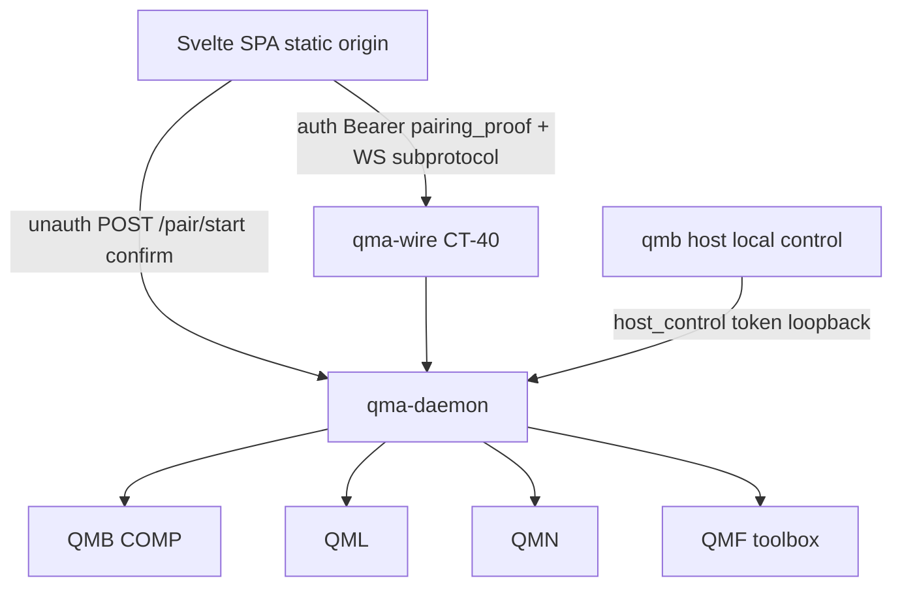
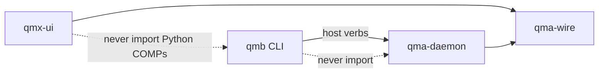
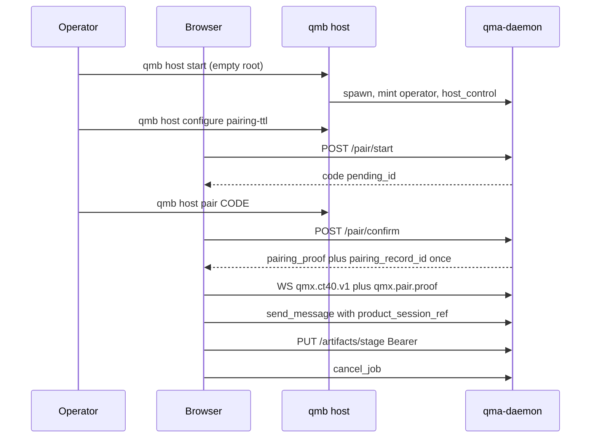

# Architecture Spine — QMX UI backend-delta

## Design Paradigm

**Privileged-door daemon with named pairing bootstrap.** QMX stays a pack-and-grant platform. The Svelte host stays a client of `qma-wire`. This sitting names the daemon, wire, and QMB changes that client needs.

QMB remains the only operator CLI. `qma-daemon` remains the only process that writes durable QMA state. Pairing is a **named unauthenticated HTTP carve-out** on the daemon origin so a browser can obtain one proof. After that proof exists, CT-40 is authenticated. Origin is a browser boundary. Origin is never operator identity.



## Inherited Invariants

Parents bind read-only. Local `AD-n` never means a parent, kit, QMA, or UI id. Cite `parent AD-n`, `kit AD-n`, `QMA AD-n`, `UI AD-n`. A local rule that would mint a sixth COMP, a new CT, a UI grant store, a UI BFF, REST invoke, cookies as login, or Origin-only session issuance is a **conflict**.

| Inherited | From | Binds here |
| --- | --- | --- |
| parent AD-1..AD-7 | 09-18 | Capability, envelope, Board vs graph vs Task Graph |
| parent AD-8 / DEC-0463 | 09-18 + kit | `psess:` authoring may omit `app_instance_id`; no third profile |
| parent AD-9 | 09-18 | Tools = hits ∩ host grants ∩ session GrantRecords ∩ health |
| parent AD-17 | 09-18 | UI is a client; adapters are not authority; mount does not kill work |
| parent AD-18 / AD-30 | 09-18 | Pack lifecycle; install is not grant; compile-at-enable |
| parent AD-21 | 09-18 | QMB is the only operator CLI; door parity |
| parent AD-24 / DEC-0464 | 09-18 + kit | Envelope `instance_id` required on invoke; `caller_kind` planned |
| parent AD-26 | 09-18 | JobHandle vocabulary; first durable terminal wins |
| parent AD-29 | 09-18 | Reconnect is a query; no intent replay |
| kit AD-1..AD-9 | 09-23 | Pack-and-grant SDK; optional copilot; widgets never own invoke |
| QMA AD-5 / AD-6 / AD-8 | 08-28 | Closed store list; journal forever; mailbox is a projection |
| QMA AD-17 | 08-28 | JobHandle states and cancel/reattach |
| QMA AD-20 | 08-28 | Durable mailbox Envelope; non-authoritative bus |
| QMA AD-21 | 08-28 | Plugin manifest; reversible load |
| QMA AD-24 | 08-28 | Principal classes; secrets as refs; authenticate before protocol |
| UI AD-1..AD-24 | 09-23 | Client host, issuers, pairing transport, chat/mailbox, PUT ingest, cancel |
| Epic 41–42, 46.4, 57, 60–65 | planned | Wire, journal, mailbox delivery, handles, pack SDK |

**Named amendments still required from kit/UI (not re-decided here):** envelope `caller_kind`; authoring `app_instance_id` optional; selected-ref kind `instance_id`; optional `PluginManifest.copilot_profile`. Those stay Epic 60.

## Invariants & Rules



### AD-1 — This sitting is backend-delta only [USER]

- **Binds:** all local ADs, companions, UI candidate edits
- **Prevents:** a second UI-design session; Documentation Factory from this sitting; epic rewrite; application code
- **Rule:** Scope is daemon, wire, QMB host door, and named records the reviewed UI needs. Preserve UI rail (Home / Copilot / Library / Authoring), Svelte seed, headless/visual/mixed independence, Origin-only issuance closure, and closed UI findings R1, R3–R9. Edit the UI candidate for R2 issuance, reload/cold-start, and the 2026-09-24 J1–J5 plus small reconciliations. Do not run Documentation Factory, generate or start epics, or modify application branches.

### AD-2 — Planned stories are requirements [USER]

- **Binds:** every dependency row
- **Prevents:** treating inspect types as e2e; duplicating Epics 60–65; labelling mailbox “Epic 41 only”
- **Rule:** Classify each need as **reuse**, **already planned**, **adoption gap**, or **proposed amendment**. Inspect SHA is `34c148be`. Class/fixture existence is not delivery (DEC-0286). Durable mailbox delivery is **Epic 46 / Story 46.4**. Epic 41 owns wire/query vocabulary. Epic 42 owns journal/fold. Reuse Epics 60–65 for copilot_profile, caller_kind, diagnosis, retry, nested Mission, health/listing, and kit proofs.

### AD-3 — Pairing issuance [USER]

- **Binds:** `/pair/start`, `/pair/confirm`, `/pair/renew`, pairing table, UI second tab
- **Prevents:** Origin-only auto-approval; two builders shipping different issuance; treating Origin as operator identity
- **Rule:** A remembered Origin **never** authorizes issuance of a new pairing proof. Every new `pairing_proof` requires **exactly one** of: (1) fresh privileged local-control confirmation of **that** pending request (`qmb host pair <code>` then POST `/pair/confirm`); or (2) authenticated renewal presenting an existing **unexpired unrevoked** `pairing_proof` matching that Origin (`POST /pair/renew` with `Authorization: Bearer pairing:<proof>`). Origin match remains required and is never sufficient. Negative trace: Origin known, no valid proof, no fresh QMB confirm → no proof, no CT-40. Positive traces: newly confirmed pending → proof once; valid authenticated renewal → new proof and old proof revoked; revoked or expired proof alone → refusal. Details: `PAIRING-AND-ADMISSION.md`.

### AD-4 — Pairing record versus pairing proof [CANDIDATE]

- **Binds:** COMP-QMA-DAEMON store; COMP-QMB confirm/revoke; logs, traces, diagnostics
- **Prevents:** journaling a bearer credential; treating a renamed field as nonsecret; two lifecycle implementations
- **Rule:** `pairing_proof` is a **bearer credential** ([RFC 6750 §1.2](https://datatracker.ietf.org/doc/html/rfc6750#section-1.2)): possession authorizes. `pairing_record_id` is the nonsecret row identity. Journal projections `pairing_pending` and `pairing_session` (**AM-03**) store `pairing_record_id`, Origin, operator principal, `proof_fp1` (hash of the proof), issued/expires/revoked, pending lineage — **never** the raw proof. HTTP `Authorization: Bearer pairing:<proof>` and WS `qmx.pair.<proof>` present the proof. Access logs, traces, diagnostics, crash reports, and `qmb host status` redact Authorization and `qmx.pair.*`; they may show `pairing_record_id`. Surface scan refuses raw proof values, not only keys named `token`/`bearer`. Confirm, renew, expiry, revoke, restart: `PAIRING-AND-ADMISSION.md` §lifecycle. TTL is `registry:pairing.session_ttl` (no number minted here). **Only** `qmb host configure pairing-ttl` over host-control may create or change that row; CT-40 `variable.set` naming that key **refuses**. Missing TTL refuses `/pair/start` and `/pair/confirm` issue. Expiry **closes** sockets that presented that proof. Renew **rotates**: new proof, old `proof_fp1` revoked, old sockets closed. One proof **may** be presented on multiple connections for that Origin until expiry/revoke/rotate. **`--session`** revokes that `pairing_record_id` only. **`--origin`** is an administrative barrier: when that event is durable at `journal_seq` R, every `pairing_session` and `pairing_pending` for that Origin with `journal_seq` < R is revoked (including **confirmed-unconsumed** pendings and a **renew that committed earlier**). Origin-revoke is never discarded because a renew appended first. The argv is `qmb host pair revoke --origin <origin>` (the paired static Origin, not every Origin on the daemon). After R: `/pair/renew` of proofs with `journal_seq` < R refuses; `/pair/confirm` of pendings with `journal_seq` < R cannot issue. A **new** `/pair/start` after R (new pending, seq > R) is legal and may be QMB-confirmed (re-pair). Each `--origin` is a new barrier at its own `journal_seq`. Close matching WS. Details: `PAIRING-AND-ADMISSION.md`.

### AD-5 — Unauthenticated bind is a named carve-out [CANDIDATE]

- **Binds:** daemon HTTP listener; Story 41.4; QMA AD-24 transport custody
- **Prevents:** silent override of “never offers an unauthenticated bind”; pairing on a WebSocket; unauthenticated `initialize`
- **Rule:** **Named amendment** to QMA AD-5, QMA AD-15, QMA AD-24, and Epic 41 Story 41.4: unauthenticated HTTP is allowed **only** for (1) `POST /pair/start`, (2) `POST /pair/confirm`, (3) CORS `OPTIONS` on the AD-15 HTTP routes only (`/pair/start`, `/pair/confirm`, `/pair/renew`, `PUT /artifacts/stage`, GET snapshot family, `GET /artifacts/<fp1>`). `OPTIONS` never returns a pairing proof, never upgrades to WebSocket, and never returns artifact bytes. Never on WebSocket upgrade. Authenticated ACAO is the exact paired Origin; start/confirm may reflect the requesting Origin; credentials omit; never `*`. `POST /pair/renew` is **authenticated** (Bearer pairing proof). Confirm request body names `pending_id` (Origin header binds). Every other HTTP method and every WebSocket still authenticates before protocol bytes. Browser-paired `AuthenticatedWireSession` carries `principal_class=operator` and `pairing_record_id`; it does **not** populate `credential_ref` and does not pass the proof to `parse_credential_ref`. Machine/worker clients still present `credential_ref` as Story 41.4. QMB pair/revoke/TTL/bootstrap use the **local host-control channel** (AD-17), not CT-40 `confirm_pair` with a broker ref. Cookies are refused. `Set-Cookie` on `/pair/*` is a spec miss.

### AD-6 — QMB owns process lifetime [CANDIDATE]

- **Binds:** UX-01, parent AD-21, local UI AD-19
- **Prevents:** browser spawn of Python; a launcher COMP; unnamed start/status/stop
- **Rule:** Privileged verbs are `qmb host start|status|stop|pair|configure|rotate-control|recover-control` (COMP-QMB add). They speak the **local host-control** channel (AD-17). `start` sets `QMA_DAEMON_ROOT`, spawns `python -m qma.daemon` if the lock is free, and on an **empty** root (no `local_operator` row) runs first-operator bootstrap. A root that already has `local_operator` but is missing `host_control` is **not** empty: start may spawn if the lock is free and **does not** remint a principal; host-control verbs then refuse until `recover-control`. `status` reports lock, pid, bind, operator-established, TTL set/unset, pending/bound **record ids** (never proofs). `stop` stops the **local** daemon: current `host_control` **or**, if that file is missing/unreadable, the OS owner of the root (so a lost token can still reach recover). `qmb host pair <code>` confirms that pending over host-control. `qmb host pair revoke --session|--origin <origin>` revokes (AD-4). `qmb host configure pairing-ttl` writes `registry:pairing.session_ttl` over host-control (operator supplies the duration; this sitting mints no number). `rotate-control` and `recover-control` are AD-17. **QMB never writes daemon sqlite.** `recover-control` runs a one-shot daemon recover entry that acquires `.daemon_writer`, appends the journal, releases the lock, and exits; it does not bind port 8765. Until the group exists, UI Start local is setup copy. Details: `HOST-LIFECYCLE.md`.

### AD-7 — Mailbox delivery stays Epic 46 [CANDIDATE]

- **Binds:** UI AD-18, Home/Copilot chat, reconnect
- **Prevents:** a parallel conversation store; routing Send through InvocationEnvelope; labelling delivery “Epic 41 mailbox”
- **Rule:** `send_message` remains the seed command (reuse vocab). Durable record is the CT-48 mailbox Envelope / journal `message.*` (Story 46.4). **Named amendment** to QMA AD-20 / Story 46.4 and QMA `_ref` convention: operator **product-chat** Envelopes persist additive **`product_session_ref`** (pointer at the product-session projection; **excluded from Envelope fp1**). Own identity of a product session remains `product_session_id` on that row. Quant/machine rows with no product conversation **omit** the field; seed `send_message` stays legal for `machine` when the field is absent. When `product_session_ref` is present, `send_message` and `list_mailbox` admit only if the connection’s operator principal **equals** that session’s durable principal. Replies and questions inherit `product_session_ref` from an authorized parent and refuse retarget. Originating wire pair `(producer_id, id)` and payload hash of the **wire payload bytes** live on the journal row and are echoed on every `list_mailbox` row. Addable query `list_mailbox` is an authenticated HTTP GET snapshot (same family as `facade_search`). Collision: same pair + same hash returns the prior result; same pair + different hash refuses for **journal lifetime** (AM-12, mailbox sends only). Old rows without `product_session_ref` are omitted from session snapshots. Details: `MAILBOX-AND-DELIVERY.md`.

### AD-8 — Cancel binds originating_product_session_ref at admit [CANDIDATE]

- **Binds:** UI AD-23, Epic 57 handles, Epic 63 nested children
- **Prevents:** observer cancel; mapping cancel to `stop_run`; a second invoke
- **Rule:** Addable command `cancel_job` (COMP-QMA-WIRE). `handle_id` **is** `job_id`. Other fields: `logical_run_id`, `attempt_id`, `command_id`, `expected_state`. **Named amendment** to QMA AD-17 / parent AD-26 / Story 57.3 handle **record** (states unchanged): UI-originated admits store immutable **`originating_product_session_ref`**. Headless/QMB admits **omit** the field. UI `cancel_job` is unavailable when the field is absent; Story 36.5 remains the headless abort door. UI cancel requires exact equality of `handle_id`/`job_id`, `logical_run_id`, and `attempt_id` with the durable handle, and connection principal equal to that session’s principal. `expected_state` is a non-authoritative observation; `queued`→`running` does not change the `command_id` hash. Nested children store the session that started **that child**, or omit the field if that admit was headless. Terminal is a recorded no-op. `unknown` is not cancellable. Details: `CANCEL-AND-HANDLES.md`.

### AD-9 — Artifact ingest is authenticated PUT then explicit transfer [CANDIDATE]

- **Binds:** UI AD-22, J-UI-09, artifact store
- **Prevents:** hash-as-possession; JSON-RPC byte bodies; silent local fallback; calling the store “already implemented PUT”
- **Rule:** Initial possession is HTTP `PUT /artifacts/stage` on the **authenticated** daemon origin (Bearer pairing proof, paired Origin, `Content-Length` required). Missing `registry:artifact.stage_max_bytes` **refuses** the PUT (no number minted here). Completeness is daemon-recomputed fp1 **plus** byte count. Interrupted v1 PUT is refused and deleted; no RFC 9110 §14.5 partial PUT. `transfer_artifact` (operator, durable `command_id`) issues `artifact_transfer_ticket` only when the **source daemon origin is recorded reachable TLS** that the destination environment’s network allowlist can dial. Default loopback is **not** a remote route: typed `source_unreachable`. Never silently expose loopback. Never fall back to local invoke. Ticket binds `ticket_id`, source origin, fp1, byte count, operator/`product_session_ref`, destination environment identity + placement revision, and the **exact machine `credential_ref` audience**. The command returns `ticket_id`; dest is notified on the already-authenticated control connection **when that connection is live**; if it is not, the ticket stays `issued` until dest reconnect then `notified`. Only that audience may `GET /artifacts/<fp1>` with `X-QMX-Transfer-Ticket`. After dest hash/byte-count verify and durable placement, dest authors `transfer_complete` (idempotent on `ticket_id`/`command_id`). Source records that ack; dest is sole writer of dest bytes. Invoke on that placement refuses until complete. Failure leaves the source local-complete fp1. Details: `ARTIFACTS-AND-TRANSFER.md`.

### AD-10 — PackUiRequest is ingested request, not a grant [CANDIDATE]

- **Binds:** UI AD-15/AD-20, Epic 60
- **Prevents:** moving `copilot_profile` into `pack_ui_request`; `ui_view` contribution point; first-wins grants
- **Rule:** Host ingests at most one `qmx.ui.pack_ui_request.v1` document at enable. It is a versioned request DTO, not a contribution point. Optional `PluginManifest.copilot_profile` stays the Epic 60 sibling field. Read-back is addable query **`get_pack_ui_request`** keyed by enabled `instance_id` + `availability_revision` (authenticated HTTP GET snapshot family). Nav items bind `view_ids`. Zero matching GrantRecords → paint, invoke refuses. One → that record. Two or more → `GRANT_AMBIGUOUS`. ActionContext remains host-minted and immutable. Details: `PACK-UI-AND-AUTHORING.md`.

### AD-11 — Draft head is not AD-22 staging [CANDIDATE]

- **Binds:** UI AD-21, first Run, QMA AD-22
- **Prevents:** collapsing draft/template/instance/JobHandle; using RefinementProposal as the graph editor store; a second enable machine
- **Rule:** Saved drafts are artifact-store bytes plus journal projection `editor_draft_head`. `editor_revision` **is** that content fp1. **Daemon** is the sole durable `editor_draft_id` issuer. Owner is the operator principal of the first save. Draft bytes use the AD-9 PUT channel; `save_editor_draft` names the local-complete fp1. First `save_editor_draft` **omits** `editor_draft_id` (a supplied id on first save is a typed refuse); `expected_revision` is empty; optional `client_draft_correlation` makes lost-ack retry of the **same** fp1 return the same durable id. Same correlation + different fp1 refuses. Result is `{editor_draft_id, editor_revision}`. Subsequent saves require durable id + `expected_revision` = current head fp1. Reload-head is addable query **`get_editor_draft_head`**. Addable **`publish_editor_draft`** checks draft ownership, `expected_revision`, **reruns** validation against that immutable fp1 (no mandatory stored-verdict record), and writes the local authoring-pack contribution (this daemon’s unpublished roster item). Preview/validate of unsaved buffer or a named revision stay legal and mint no JobHandle. Parent AD-30 **enable** remains compile identity. Library facade excludes draft blobs. QMA AD-22 stays one RefinementProposal type (AM-07). Details: `PACK-UI-AND-AUTHORING.md`.

### AD-12 — Provider secrets stay off the wire [INHERITED]

- **Binds:** first-run cards, Credential Broker, L34
- **Prevents:** secret values as pairing proof; browser OS-store writes as v1; venue keys in QMA
- **Rule:** Broker allowlist stays the inspect prefixes (models/inference/compute/sandbox/corpus/knowledge/telemetry). It is **not** widened with an operator-login family. v1 browser may **select a ref** already in the OS store. Clean-machine **shell** launch (AD-17 + pair + initialize) does **not** imply provider readiness. Provider use requires **external** credential provisioning into the OS store (or a later QMB write-once helper). ReadinessCard states: absent ref, unresolved ref, unhealthy, usable. Secrets never enter the page, pairing, or journals. Broker `_reader` injection remains an adoption gap. Details: `PROVIDER-AND-COMPAT.md`.

### AD-13 — Compatibility is additive and honest [CANDIDATE]

- **Binds:** J-UI-13, J-UI-14, Epic 41.2
- **Prevents:** silent downgrade; claiming inspect types are live protocol
- **Rule:** Same-major wire changes are additive. `initialize` advertises capabilities including `pairing`, `list_mailbox`, `cancel_job`, `caller_kind`, `stage_artifact` (**means** authenticated PUT `/artifacts/stage` exists — not a `WireCommand`), `transfer_artifact`, `transfer_complete`, `pack_ui_request`, `get_pack_ui_request`, `save_editor_draft`, `get_editor_draft_head`, `publish_editor_draft`. Missing capability → typed mismatch; shell stays usable for surfaces that do not need it. Older clients ignore unknown fields. Client bits are not journals. Clean-machine **shell** is `QMA_DAEMON_ROOT` + `qmb host start` (bootstrap) + configure TTL + pair + initialize. That is not provider-ready. Details: `PROVIDER-AND-COMPAT.md`.

### AD-14 — Reload, clone, and cold start are different recoveries [USER]

- **Binds:** sessionStorage, T-CH-06, TRACE-MATRIX Home row, UI AD-24
- **Prevents:** promising browser-restart restoration from sessionStorage; sharing `producer_id` across live tabs
- **Rule:** Browser home for `pairing_proof` / `pairing_record_id` / pending chat triple is **memory + `sessionStorage` only**. `localStorage`, cookies, IndexedDB, and any other durable web store are forbidden for the proof. **Same-tab reload:** `sessionStorage` may restore those values; reconnect presents that **same** proof. **Auxiliary/cloned tab:** copied storage is existing proof; the clone **reconnects** (new live `producer_id` if the old is live). `/pair/renew` is **not** the clone path; it is an explicit rotate that closes sockets on the old proof. **Cold start / closed tab:** empty storage; `/pair/renew` impossible; new pair requires QMB confirm; selected `psess:` restores via `list_mailbox`; never auto-resend. Lost `/pair/confirm` response: proof unrecoverable; start a new pending. Details: `PAIRING-AND-ADMISSION.md`.

### AD-15 — HTTP PUT is a byte channel on the daemon origin [CANDIDATE]

- **Binds:** CT-40 families, pairing HTTP, artifact PUT
- **Prevents:** a REST invoke API; a fourth message family; serving the SPA from port 8765
- **Rule:** Port 8765 carries: unauthenticated pairing POST + CORS OPTIONS (AD-5); authenticated HTTP GET snapshots (`list_mailbox`, `get_pack_ui_request`, `get_editor_draft_head`); authenticated HTTP PUT `/artifacts/stage`; authenticated HTTP GET `/artifacts/<fp1>` for **machine** transfer pull; authenticated JSON-RPC WebSocket; authenticated POST `/pair/renew`. Local **host-control** is a separate token-gated loopback channel under `QMA_DAEMON_ROOT` (AD-17), not a second unauthenticated 8765 bind, not pairing HTTP. PUT and artifact GET are byte channels, not invoke, not a BFF. SPA origin ≠ daemon origin.

### AD-16 — No sixth COMP and no new CT [INHERITED]

- **Binds:** all adds
- **Prevents:** COMP-UI, qma-cli, a second scheduler, a new protocol family name
- **Rule:** Adds are closed-and-addable names on `qma-wire`, journal projections on `qma-daemon`, and QMB CLI verbs. Envelope `instance_id` stays required on invoke. Headless `qmb` remains a door without the UI.

### AD-17 — First operator is local host-control [CANDIDATE]

- **Binds:** clean install, pairing TTL, `qmb host pair`, recovery of operator identity
- **Prevents:** assuming an existing authenticated CT-40 operator; using a provider `cred://` as login; a well-shaped ref as proof
- **Rule:** Trust root is the **OS user who owns `QMA_DAEMON_ROOT`** plus a daemon-minted **`host_control` token** stored under that root with owner-only ACL. The channel is loopback-only and is **not** the CT-40 listener (named amendment of QMA AD-5 single inbound port, QMA AD-15/AD-24, Story 41.4: this path is outside port 8765). `qmb host start` on an **empty** root (no `local_operator` row): acquire lock, mint the first operator principal into journal projection **`local_operator`** (AM-03), mint `host_control`, refuse `/pair/start` and `/pair/confirm` until `qmb host configure pairing-ttl` has written the registry row. A root that already has `local_operator` is never empty bootstrap, even if `host_control` is missing. Only that host-control verb mutates pairing TTL. Proof verification for a **running** daemon: QMB must present the current `host_control` token from that root; a forged `credential_ref` / caller-selected `principal_class` is not proof; a remote caller without that token is refused; a different OS user who cannot read the token is refused. **Rotation** (token still held): `qmb host rotate-control` presents the current token; daemon mints a new file, journals the new `host_control_fp1`, invalidates the previous fingerprint; `local_operator` unchanged. **Lost-token recovery** (file missing or unreadable): daemon **must be stopped**; the OS user who owns the root runs `qmb host recover-control`. That verb does not present the lost token. It verifies OS ownership of `QMA_DAEMON_ROOT`, mints a new owner-only `host_control` file, journals the new fingerprint and the invalidation of the previous one, and **preserves** `local_operator` and all journals. It does not remint a second principal. It does not delete the data root. If the daemon is live, recover-control refuses; OS owner may `stop` without the token when the file is missing (AD-6), then recover. If another OS user (not the directory owner that first-start used), refuse. If the token file is still readable, refuse recover-control. Browser pairing **maps** to that principal (AD-4/AD-5). Broker allowlist is not widened. Details: `HOST-LIFECYCLE.md`.

## Consistency Conventions

| Concern | Convention |
| --- | --- |
| Naming | Cite `parent AD-n` / `kit AD-n` / `QMA AD-n` / `UI AD-n` / local `AD-n`. Journeys stay `J-UI-*`. Classification: reuse / already planned / adoption gap / proposed amendment. |
| Data & formats | Bearer proof is `pairing_proof` (header `pairing:<proof>`, subprotocol `qmx.pair.<proof>`). Nonsecret row is `pairing_record_id`. Mailbox Envelope ≠ wire envelope. Cross-store pointers use `_ref`: `product_session_ref`, `originating_product_session_ref` (AM-14). JobHandle states unchanged. |
| State | Pairing records, mailbox, draft head, transfer tickets, operator principal are journal projections. Client layout stays client-local. |
| Errors | Typed refusals. Origin-only issuance is `POLICY_REJECTION`. Expired/revoked proof is refusal then re-pair. Unreachable transfer is `source_unreachable`. |
| Auth | Local host-control proves first operator (AD-17). Browser pairing maps to that principal. Machine principal for workers and artifact pull. |
| Logging | Logs are not evidence. Raw `pairing_proof`, Authorization, `qmx.pair.*`, pairing codes, and provider secrets are excluded from journals, traces, diagnostics, and status. |

## Stack

Inherited runtime. This sitting adds no frontend pins.

| Name | Version |
| --- | --- |
| CPython (daemon, QMB) | 3.14 (inherited; observed 3.14.6 at parent freeze) |
| qma-wire / qma-daemon / qma-core | packages at inspect `34c148be` plus named adds |
| Default bind | `127.0.0.1:8765` |
| Persistence | journal + sqlite under `QMA_DAEMON_ROOT` |
| UI host (out of scope here) | Svelte 5.57.1 + SvelteKit 2.70.3 as UI AD-2 |

## Structural Seed

```text
qma-daemon/
  process.py          # inspect: discards TCP bytes. This sitting names the live HTTP+WS contract.
  pairing/            # pending + sessions: record id + proof_fp1, never raw proof
  host_control/       # loopback token under QMA_DAEMON_ROOT
  bus/                # mailbox fold including product_session_ref
  artifacts/          # PUT /artifacts/stage + transfer tickets
  drafts/             # editor_draft_head
  sessions/           # product_session (exists)
qma-wire/
  vocabulary.py       # add list_mailbox, get_pack_ui_request, get_editor_draft_head, cancel_job, transfer_artifact, save_editor_draft, publish_editor_draft, transfer_complete
  auth.py             # browser: pairing_record_id + operator principal; machine: credential_ref
qmb/doors/cli/
  host.py             # start|status|stop|pair|configure|rotate-control|recover-control
```



Operational envelope: v1 is a **workstation-local** daemon (loopback HTTP/WS plus host-control) or an operator-recorded **remote HTTPS/WSS** host. Remote artifact pull requires that recorded TLS origin; loopback is not a remote route. Default data root is per-user (`%LOCALAPPDATA%\QMX\qma-daemon` on Windows). Single-instance lock `.daemon_writer`. Backup/restore remains QMA AD-27. Tauri packaging stays deferred (UI AD-12).

## Capability → Architecture Map

| Capability / Area | Lives in | Governed by |
| --- | --- | --- |
| First operator / TTL | local host-control | AD-17, AD-6 |
| Pairing issuance and proof | pairing projection + QMB pair | AD-3, AD-4, AD-5, AD-14 |
| Process start/status/stop | COMP-QMB `qmb host` | AD-6 |
| Chat history | mailbox Envelope + `list_mailbox` | AD-7 |
| Cancel | `cancel_job` + `originating_product_session_ref` | AD-8 |
| Upload / remote placement | PUT + reachable transfer ticket | AD-9, AD-15 |
| Pack chrome request | PackUiRequest + `get_pack_ui_request` | AD-10 |
| Authoring first Run | draft save + `publish_editor_draft` + enable | AD-11 |
| Provider refs | Credential Broker; external provision | AD-12 |
| Protocol mismatch / install | initialize capabilities | AD-13 |

## Deferred

| Item | Why it can wait |
| --- | --- |
| Numeric pairing TTL | Operator supplies duration on `qmb host configure pairing-ttl`; this sitting mints no number. Unset **refuses** `/pair/start` and `/pair/confirm`. |
| Numeric `registry:artifact.stage_max_bytes` | Unset **refuses** PUT. No number minted here. |
| Host-control IPC encoding | Token + loopback + not port 8765 + not CT-40 is frozen; HTTP vs named pipe vs file drop is a story |
| Proof-token entropy | Must be unguessable and RFC 6455 token-safe; length is a story |
| Cross-tab transfer code / QR | v1 second tab uses QMB confirm; revisit if operators reject that friction |
| RFC 9110 partial PUT / resume | v1 refuses incomplete; revisit if large artifacts need resume |
| Tauri sidecar calling `qmb host` | UI AD-12; not v1 bootstrap |
| Envelope crypto algorithm | GAP-DESK-ENVELOPE-CRYPTO |
| Isolated `sv create` lockfile | UI sitting; frontend stream |
| Trading ticket chrome | UI sitting deferred to a trading-app sitting |
| Exact `websockets` / ASGI server class | Implementation choice under live CT-40 server; must speak the named HTTP+WS contract |

## Open questions

None blocking Codex closure after H-1/H-2/F-1/F-2 gate fixes. Remaining later gates: registry TTL number; live server implementation; operator acceptance.
