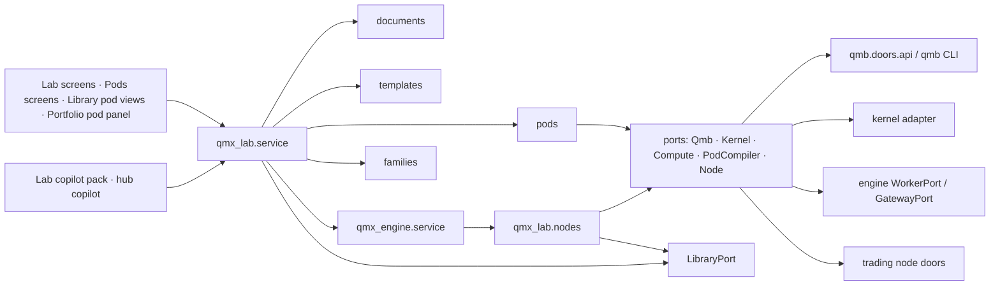
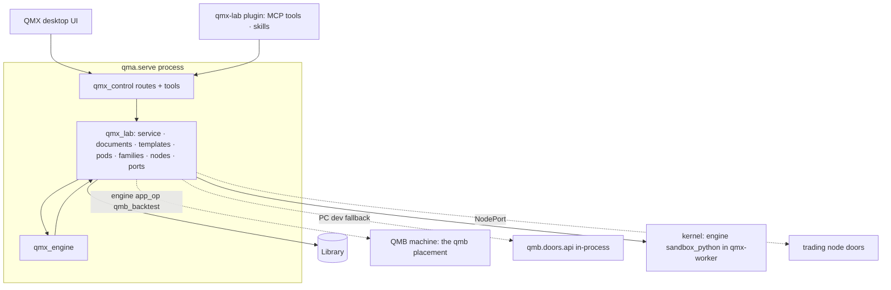
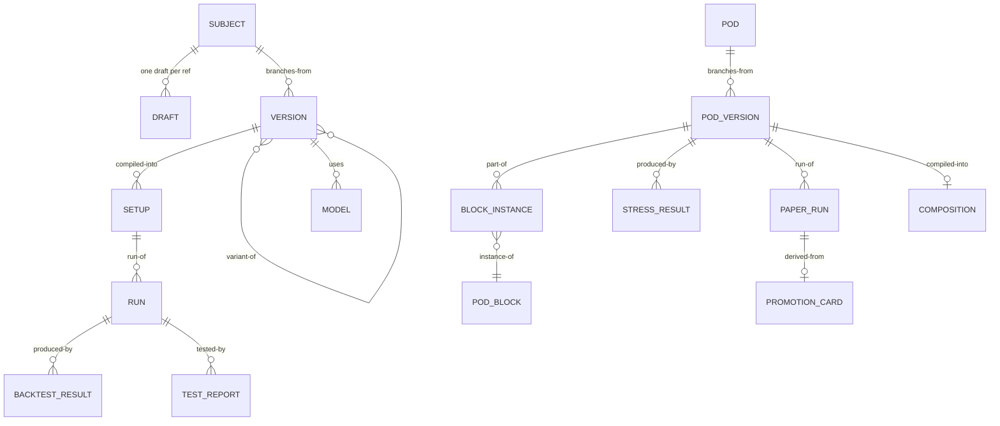

# Architecture Spine — QMX Lab and Pods backend

Labels on claims: **[retrieved]** read today from a cited file, screenshot or branch; **[remembered]** training knowledge; **[inferred]** reasoned here. An AD without a label is a decision. Requirements were taken from the screenshots and from what each screen is trying to do; UI code and demo arrays were read only to learn which kinds of things the design shows (operator correction, this run).

## Design Paradigm

**Document kinds, a node pack and templates over the one engine and the one Library.** The Lab owns no runner and no store. It owns (1) a registry of *document kinds* the editor can hold, each with an authoritative form and two projections (Graph, Code); (2) a *node pack* of Lab-specific step types the engine executes; (3) *templates* (engine configurations) that are the Lab's procedures; (4) the *pod model* and one pod simulator; and (5) four ports where the world varies: QMB, the kernel, compute, and the trading node.

| Layer | Namespace | Owns |
| --- | --- | --- |
| Documents | `qmx_lab.documents` | document-kind registry (`workflow`, `bot-logic`, `pod-block`, `board`), projections, round-trip check, importers (model file, repo, notebook, Python file) |
| Node pack | `qmx_lab.nodes` | `lab.*`, `qmb.*`, `ml.*`, `pod.*`, `paper.*`, `data.*` node types registered with the engine registry |
| Templates | `qmx_lab.templates` | procedure templates (backtest, sweep, walk-forward, Monte Carlo, optimise, significance, training, pod test, stress, paper) and the L1-L4 / D1-D10 templates as `qmx.workflow/1` documents |
| Pods | `qmx_lab.pods` | pod model, block catalogue, the one pod simulator (size trail, replay, stress, fan, head-to-head, mix, paper step) |
| Families | `qmx_lab.families` | family ledger reads over Library edges: trial count, deflated Sharpe, holdout registry, luck warning, identity rule table |
| Ports | `qmx_lab.ports` | `QmbPort`, `KernelPort`, `ComputePort`, `PodCompilerPort`, `NodePort`; the engine's `LibraryPort` and `qmx_engine.service` are consumed, never re-defined |
| Service | `qmx_lab.service` | the one Lab API the UI, the copilot pack and the hub call |
| Copilot pack | `plugins/qmx-lab/` | MCP tools over the service, skills per template, the Lab prompt layer |

## Inherited Invariants

| Inherited | From parent | Binds here |
| --- | --- | --- |
| engine AD-2 one definition format `qmx.workflow/1` | workflow-engine | every Lab workflow, procedure template and training pipeline is one such document; no Lab dialect |
| engine AD-3 engine beside the harness, no engine code in the harness | workflow-engine | the Lab is a package beside the engine; it reaches models only through engine `llm`/`agent` nodes |
| engine AD-4, AD-5 node contract and closed kind vocabulary | workflow-engine | Lab node types are pack types `<pack>.<name>`, each registered with a `base_kind` from `script`, `library`, `subworkflow`, `grader`, `app_op`, `llm`, `agent`; the validator checks each against its base kind; no new base kind; `note` is the engine's one draft-only type |
| engine AD-7 memo key and node-level replay | workflow-engine | "fresh / stale / reran" badges and "run just this part" are the memo, not a Lab cache |
| engine AD-11 lifecycle and test gate; selected-subgraph runs | workflow-engine | drafts run only in test mode; publish freezes a version; schedules need a passing test report |
| engine AD-13 roles, not models | workflow-engine | a Lab template names roles (`builder`, `validator`, `grill`, `generator`, `diagnoser`, `writer`, `explainer`); never a model id |
| engine AD-14 Library contract; AD-20 placement preflight; AD-21 three surfaces, one API | workflow-engine | the Lab writes only through `LibraryPort`; placement states `available / configured / authorized / reachable / healthy`; Graph and Code are projections of one draft |
| library AD-3 closed kind roster; AD-4 closed relations; AD-7 ref ownership and explicit merge; AD-9 fourteen verbs plus `adopt`, with Effects; AD-17 previews are schema data | library-and-data | the Lab adds no kind and no relation outside the roster; his drafts are on `refs/drafts/<item>` and agents edit on `refs/agents/<session>/<item>`; `main` is published-only; governed and lifecycle kinds merge into `main` under MANAGE (publishing asks once, ruling 80) |
| harness `Effect` table and money gate (DESIGN.md, ruling 24) | QMA v2 harness | every Lab tool carries READ / DOMAIN_WRITE / MANAGE; `PROPOSE_MONEY` is never a Lab effect; the Lab's tool rows are `AGENT_OPERATIONS` entries that need his grant (engine HARNESS-REQUESTS H17) |
| engine AD-16 and AD-40, ruling 27 and the 2026-10-18 no-caps rule; engine AD-31, ruling 68 one QMB machine; engine AD-25 finite runs | workflow-engine | no USD ask and no usage ceiling anywhere in the Lab, only the providers' limits and the engine's stuck detector; backtests go to the `qmb` placement; a paper soak is a chain of finite daily runs |
| QMB B-1..B-15 and DEC-0270 lanes; CT-47 occupancy | docs | one `qmb` run invocation per execution environment; QMB owns intra-run parallelism, its ledger and CT-32 |
| ADR-0024 AD-11 (Book/BMS default, dummy forbidden), AD-15 (placement preflight) | docs | the pod adapter emits a complete Book + BMS or a complete PolicyPair, never a sentinel |
| TN-9, TN-19, TN-20 (node-paper, MIS seam, two-click promotion) | docs | the Lab never runs a node loop, never promotes, never activates |

## Invariants & Rules



Arrows mean "may import or call". `documents`, `templates`, `pods` and `families` import no port and no adapter. Nothing points back up.

### AD-1 — The Lab is document kinds, a node pack and templates over the one engine and the one Library `[ADOPTED]` (rulings 22, 28)

- **Binds:** all
- **Prevents:** a second scheduler or job queue, a Lab-only run table, a Lab-only artifact folder, Lab maths living in the browser
- **Rule:** `qmx_lab` owns no execution loop and no persistent store. Every run is an engine run (`qmx_engine.service.runs`), every saved thing is a Library object through `LibraryPort`, every Lab-specific step is a node type registered in the engine registry. The only Lab-owned state is in-memory and rebuildable (projection caches, the family-ledger index).

### AD-2 — One draft per subject; an authoritative form per document kind; Graph and Code are projections

- **Binds:** documents, service, surfaces
- **Prevents:** Graph and Code drifting apart (the click-through's finding), a subject with two drafts, a code edit that silently loses graph layout
- **Rule:** the editor's subject is one Library item with one draft (the operator's draft on `refs/drafts/<item>`, or an agent's on `refs/agents/<session>/<item>`); `main` holds published versions only (library AD-7), and Save publishes the draft as the next version on `main`. Each document kind declares its authoritative form: `workflow` = the `qmx.workflow/1` JSON (engine AD-2; Code is the cell-script projection `# %% step:<node_id>` per node); `bot-logic` = the Python logic plus its declaration (QML QL-2; Graph is derived from declared steps and legs); `pod-block` = `form | graph | code | model` by block kind; `board` = the cell script (ruling 31, "simply code"; Graph is the cell DAG). A graph edit and a code edit are both patches applied through `service.drafts.patch(kind, patch)`; the registry's `to_graph` and `to_code` must round-trip, and a draft that fails the round-trip check carries a validation finding and cannot publish.

### AD-3 — The Lab node pack is closed and built only from engine kinds

- **Binds:** nodes, documents, templates, surfaces
- **Prevents:** a step kind invented per screen, a palette that differs from what runs, a node that bypasses the engine ledger
- **Rule:** the palette is `engine.registry()` filtered to the Lab pack. v1 types, each a pack type with a `base_kind` (engine AD-5) and typed `data` ports: `lab.data`, `lab.feature`, `lab.label`, `lab.model`, `lab.test`, `lab.report`, `lab.cell` (base `script` / `library`), plus the engine's draft-only `note` for markdown; `qmb.compile`, `qmb.compare` (base `script` over `QmbPort`); `qmb.run`, `qmb.sweep`, `qmb.walk_forward`, `qmb.robustness`, `qmb.optimize`, `qmb.holdout_touch` (base `app_op`: the engine's `qmb_backtest` door on the `qmb` placement, through `QmbPort`, AD-5); `ml.dataset`, `ml.split`, `ml.leakage_check`, `ml.train`, `ml.evaluate`, `ml.plug` (script over `KernelPort` + `ComputePort`); `pod.sim`, `pod.stress`, `pod.fan`, `pod.head_to_head`, `pod.mix` (script over the pod simulator); `paper.step`, `paper.check` (script over the pod simulator and `NodePort` reads); `data.inspect`, `data.snapshot` (library). Model-bearing steps (`grill`, `builder`, `validator`, `writer`) are engine `llm` / `agent` nodes with roles; no Lab node calls a provider.

### AD-4 — Every Lab run is an engine run; procedures are templates; the Runs table is the Library

- **Binds:** templates, service, surfaces, families
- **Prevents:** a run the engine cannot resume, explain or bill; a Runs row with no Library object; a "run" button that bypasses validation
- **Rule:** Backtest, Sweep, Walk-forward, Monte Carlo, Optimise, Significance, Training, Pod test, Stress, Paper are `qmx.workflow/1` templates in `qmx_lab.templates`; the header Run button calls `tests.run` on a draft or `runs.start` on a version with the template's inputs. The Runs table, Equity, Robustness, Compare, Sweep grid and Log read `workflow-run`, `backtest-result` and `test-report` objects plus `events.stream`; roles `confirmation | trial | replicate | aborted` are copied from QMB's ledger line, never assigned by the Lab. "Run just this part" is `tests.run(draft, subgraph=selected)`; fresh / stale / reran badges are the engine memo's verdict per node.

### AD-5 — The QMB door: compile a setup, run through the qmb node pack, cite evidence by fp1

- **Binds:** nodes.qmb, ports.QmbPort, families, service
- **Prevents:** the pre-registered-config-only door (`run_backtest(config_ref)` at hp17), a second backtest governor, a relabelled world or claim class, agents writing the registry
- **Rule:** `qmb.compile` turns (subject version, composition ref, data recipe and CT-12 split, costs preset, parameter assignment, measures) into one resolved run-config through `qmb.config.compile_run_config` and saves it as a Library `setup` object (CT-47 shape, content-addressed). `qmb.run`, `qmb.sweep`, `qmb.walk_forward`, `qmb.robustness`, `qmb.optimize` call `QmbPort`, whose **default adapter is the engine's `app_op qmb_backtest` on the `qmb` placement** (engine AD-31, ruling 68: backtests run on one dedicated QMB machine that agents call); the in-process `qmb.doors.api` adapter is used only when the registered `qmb` placement is the PC itself (the developer fallback); one qmb run invocation per execution environment (CT-47); QMB's orchestrator owns the Cartesian batch and process-per-run. These compute nodes have effect `none` (memoised by intent key, engine AD-27; a worker dying mid-backtest is simply retried, nothing waits for him); only `qmb.holdout_touch` is `irreversible`. The node's output is the QMB ledger line and the CT-32 artifact imported as a `backtest-result` object citing both by fp1, with `world`, `claim_class`, `role`, `fidelity`, `provenance` copied verbatim. A run against the sealed window goes only through `qmb.holdout_touch` (one per family per window, journaled), never through a parameter. Every setup names its composition: a Strategies-bench run uses the subject's declared default pod (`uses → pod` on the bot version) and otherwise `settings.lab.default_pod`; the Pods bench names the pod under test; a setup without a composition does not compile.

### AD-6 — Families, trials and holdouts are Library edges

- **Binds:** families, nodes.qmb, nodes.ml, templates
- **Prevents:** a winner that forgot its dead siblings, a holdout opened twice, a luck warning computed from a guess
- **Rule:** every subject version, variant, child, sweep cell and training config is a trial in its family; the family is the connected component over `variant-of | branches-from | derived-from` edges from the family root; `families.ledger(family)` folds trial count, deflated Sharpe over all trials (dead ones included) and the holdout registry (`window`, `created`, `touched` count); the scenario builder's luck warning and the robustness ladder read this fold. The family ledger is never a stored counter.

### AD-7 — Models are objects; a slot is a port of the document that owns the decision

- **Binds:** nodes.ml, documents, templates, surfaces
- **Prevents:** a tuned model wearing an old bot's record, a slot with no owner, a sealed test opened twice
- **Rule:** a trained model is a Library `model` object (weights blob, dataset fingerprint, CT-12 split fingerprint, purge and embargo, metrics, feature list, card). Training is the `training` template (`ml.dataset → ml.features → ml.split → ml.leakage_check → ml.train → ml.evaluate → ml.plug`) placed by the compute preflight; loss curves are `metric` events on the run stream. A *slot* is a declared port of a document: `entry_signal` on `bot-logic`, `sizing` and `throttle` on a `pod-block` of kind `model`, `regime` on an MIS config. Filling a slot (`ml.plug`) mints a new version of the owning document with a `uses → model` relation, so the owner re-enters test. The sealed test of a model family is touched once; a second look is a new counted trial on a new sealed window.

### AD-8 — Placement goes through the engine preflight; evidence stays on a controlled host (`pc` or `qmb`)

- **Binds:** ports.ComputePort, nodes, service, surfaces
- **Prevents:** a placement sticker, a vendor name in a document, sealed data on a cloud box, an estimate computed in the browser
- **Rule:** the machine picker, the scenario builder's "Run on", the training's machine and every `runs_on` resolve through `ComputePort.list()` and `ComputePort.preflight(name)` (engine AD-20 states) and are placed by `ComputePort.place(ComputeRequirement)`; a document names a placement name from the engine registry (`pc`, `contabo`, `qmb`, provider rows), never a vendor or host. The time and cost estimate is `ComputePort.estimate(template, inputs, placement)`; it is shown, never gated on. A **controlled host** is the `pc` or the `qmb` placement, and both produce evidence. A run placed anywhere else is tagged `exploration_only: true` and its results can never be cited as evidence (QMB B-9); the UI's "rerun winners for evidence" is `runs.start` with `placement = qmb`. Sealed data never leaves a controlled host: other placements receive split-governed exports without the sealed segment, and `ml.evaluate` on the sealed test and `qmb.holdout_touch` always run on `qmb` or `pc`.

### AD-9 — Notebooks and cells run on `KernelPort`; the adapter is the environment study's choice `[ADOPTED]` (ruling 53)

- **Binds:** ports.KernelPort, nodes.lab.cell, documents.board
- **Prevents:** the Lab choosing the sandbox, a cell that runs outside the run ledger, a kernel that outlives its run
- **Rule:** `KernelPort = { start(env_ref, mounts) -> Kernel, exec(kernel, cell) -> stream[stdout, display, result, error], snapshot(kernel) -> blob, restore(kernel, blob), interrupt(kernel), stop(kernel) }`. A cell is a `lab.cell` node; a board is a draft whose cells are nodes; running one cell is a selected-subgraph test run; a kernel lives inside one run and dies with it; snapshots are run artifacts. The day-one adapter runs the kernel as an ordinary local Python process on the PC, inside the run's Job object so it dies with its run (engine AD-24); the engine's `sandbox_python` kernel in the `qmx-worker` container or on a remote placement (engine AD-25) is his option per board or workflow, and the same kernel code serves the engine's `rlm` node either way, so the Lab has no second kernel. (Retired 2026-10-18 (rulings 115-117): "a cell an agent wrote never runs bare on the PC" and the saved-hash rule for host cells.)

### AD-10 — A pod is a versioned stack of pure blocks; one simulator serves every pod screen

- **Binds:** pods, nodes.pod, nodes.paper, service, surfaces
- **Prevents:** five screens computing five different sizes (the demo's browser maths), a block with side effects, a pod edited in place
- **Rule:** `pod` = `{ item, version, name, template, stage untested|tested|paper|promoted, stack: slot -> [block_instance{ block_ref, params }] }` with the seven fixed slots `inputs, guards, allocator, sizer, throttles, caps, ledger`; venue fit always runs last and is not a slot. A `pod-block` is a Library object `{ slot, kind form|graph|code|model, param_schema, required, docs: yes|partial|new, code|graph|model ref }` and is **pure**: same inputs, same answer. `qmx_lab.pods.simulator` is the one evaluator behind the size trail, the pod test replay, stress cells, the drawdown fan, head-to-head measures, mixes and `paper.step`; every screen reads its output from Library objects the simulator wrote. Editing mints a draft; Save mints the next version (`branches-from`); Send to paper requires `saved`, `kill line set`, `stress board run`. The Portfolio Pod panel edits a pod through the same `pods.patch` and `pods.save`, so its Save is a new `untested` version (the word "draft" is kept for the unpublished head on `refs/drafts/<item>`, which never sits on `main`); a pod's stage moves forward only through Lab runs (`pod-test` → `tested`, a paper run → `paper`, a signed card → `promoted`), never by an edit.

### AD-11 — The pod reaches trading only through two ports: `PodCompilerPort` and `NodePort` `[ADOPTED]` (ruling 14)

- **Binds:** ports, pods, service
- **Prevents:** the Lab guessing node internals, a dummy Book (ADR-0024 AD-11), a Lab import of `qmn` or `qmf-venue`, a money verb in the Lab
- **Rule:** `PodCompilerPort.compile(pod_version, target) -> ResolvedComposition { book_fragment, bms_fragment | policy_pair, placed_blocks[], unsupported_blocks[] }`; the v1 adapter targets the default Book (CT-22) + BMS (CT-27) composition; blocks with no governed home are returned as `unsupported_blocks` and stay Lab-only (they run in the simulator for test and paper and appear as a failed "Ready for live?" check). The compiled fragments are stored as governed Library objects of kinds `book` and `bms` (mirrors of CT-22 and CT-27 under their own `fp1`, library AD-2 `identity: ct06`) with `derived-from → pod version`; the UI's `pod` and `pod-block` kinds keep the stack-of-blocks shape and are ungoverned design kinds. The mapping `book-definition → book` and `bms-definition → bms` is resolved by library AD-3. `NodePort` is read-mostly: `seats()`, `bindings()`, `mis_snapshot()`, `servers()`, `latency()`; its only writes are `register_candidate_labeler()` (shadow lane, TN-19) and `mint_promotion_card()` (TN-20 input). The Lab holds no `propose_order`, no bind, no activate.

### AD-12 — Paper ends the Lab line; promotion is two human clicks elsewhere `[ADOPTED]` (ruling 29, TN-20)

- **Binds:** templates.paper, nodes.paper, pods, service
- **Prevents:** paper evidence gating live money, a Lab order, an agent that promotes
- **Rule:** a paper soak is a **chain of finite engine runs**, one per trading day (engine AD-25: a workflow is a finite run with a bounded ledger). The `paper` template is published once and bound to a daily `cron` trigger (session open, the market's IANA zone) with `continuity` (each day's run receives the previous day's ledger state, open positions and band position as input), `max_concurrent 1` and `follow_champion: false`. Each daily run is a bounded `loop` over that day's bars: a `wait` until the next bar closes, then `paper.step`, which folds live prices from qmf-data live rooms through the pod simulator and the ticked bots on the paper ledger; the loop ends at session close, and `paper.check` runs once at the end of each day. Each day appends a version to the one `paper-run` item, with the decision feed (`sizing steps`, `refused`, `intervention`) and the band check against the pod's own test. A daily run ends when its loop reaches the session boundary, never on a wall-time ceiling (engine AD-40 removed those). For a 24-hour market (crypto, and FX through the trading week) the "day" is the market's session boundary from the instrument calendar (00:00 UTC by default for crypto): each daily run's loop ends at that boundary, before the next fire, so `max_concurrent 1` never blocks the next day. A day that never reaches its boundary (a feed stalls) is caught by the engine's stuck detector (no progress past the idle timeout), not by a time cap. Pause and resume = disable and enable the trigger; extend = raise `days_planned`; stop = disable the trigger and mark the `paper-run` stopped, keeping the record. Starting a paper soak is his human step (ruling 80: MANAGE once); after that the days run without him. `paper.check` folds the five readiness checks. `Promote` calls `NodePort.mint_promotion_card(pod_version, unit, evidence_refs)`; the card is signed and activated in Portfolio by the operator (TN-20); the Lab never writes a binding.

### AD-13 — The Lab rule: no asks inside the Lab except money and publishing out `[ADOPTED]` (research 12 decision 2, rulings 27 and 80)

- **Binds:** service, copilot pack, templates, triggers
- **Prevents:** an ask per step, an agent loosening a gate, a Lab schedule that needs a click every night
- **Rule:** Lab tools carry `DOMAIN_WRITE` onto the caller's own ref; `MANAGE` is reserved for publishing and live work (a merge of a governed or lifecycle kind into `main`, a live run of a published version through the engine's `workflows_run` (engine SOLUTION-DESIGN §13), a paper start, a promotion card, a labeler promotion, enabling a schedule, a mini-app install). **There is no spend ask, no spending cap and no usage ceiling in the Lab** (ruling 27; engine AD-40): runs end on their own stop conditions, providers' limits pause them (engine AD-9), and the engine's stuck detector (engine AD-16) stops a looping or stalled attempt; none of these asks him. A Lab schedule (the overnight loop, weekly code health) is a workflow like any other: he says yes once when it is published and enabled (ruling 80, engine AD-22), and after that it runs without asking. *Lab agents starting their own jobs (his Q1 yes, read with ruling 80, latest wins):* a Lab agent may start test runs of drafts and runs of published workflows inside an enabled workflow's scope (`subworkflow` children, `after` chains he enabled) at any time, spread by the pool; a new recurring schedule an agent wants is drafted and waits for his one yes. Gate thresholds (robustness bars, overfit thresholds, trial caps) are Settings data bound to the draft's content hash; an agent may tighten, never loosen; the validator refuses a template step that writes Settings.

### AD-14 — The Lab copilot capability pack is the service with Effects

- **Binds:** copilot pack, service, harness tools table
- **Prevents:** tools that exist only in the UI (the click-through's "fiction" list), a hub copilot without Lab tools (ruling 12)
- **Rule:** the 17 tools the Lab composer shows map one-to-one onto `qmx_lab.service` operations exposed as MCP tools on the control door with harness Effects (LLD section 7); the pack `qmx-lab` is a capability pack in the engine's sense (engine AD-19, AD-35): its tools are namespaced rows served by the in-process `qmx` MCP server, its skills (one per template) are Library `skill` objects read through the skill tool, plus the attachment resolvers (toolbox item, ticked runs, a tile, a code folder, a dataset) and the Lab prompt layer; it is not a second Claude plugin (the harness keeps its one locked plugin). The hub and any combined session load the same pack, mid-session included. A tool the pack does not list is not a Lab tool.

### AD-15 — One service, three doors, the UI computes nothing

- **Binds:** service, surfaces
- **Prevents:** demo maths becoming product maths, a panel that reads a store directly
- **Rule:** `qmx_lab.service` is reachable in-process, over REST under `qmx_control` (`/api/lab/*`, `/api/pods/*`) and as MCP tools; every number a Lab or pod screen shows (sizes, measures, bands, p(kill), freshness, estimates, counts) is a service read; the browser keeps only layout, selection and ticks.

### AD-16 — The identity rule is a table the Lab reads

- **Binds:** families, documents, templates D4
- **Prevents:** the variant-vs-new-strategy rule baked into prompts; a profile change minting a new strategy
- **Rule:** `settings.lab.identity_rule` maps a change label from the closed set `instrument | timeframe | params | spiced | structural | model-made | profile` to a lineage outcome `variant-of (same item) | branches-from (new version) | new item (derived-from)`; the default row set is research 17's D4 mapping with `profile -> branches-from`; the risk session replaces rows without a code change.

### AD-17 — Labelers come from the Lab, reach the node as candidates, and are promoted by the operator

- **Binds:** documents.component, ports.NodePort, surfaces (Portfolio MIS tab)
- **Prevents:** a Lab model deciding live money, a labeler written straight into a governed consumer
- **Rule:** a labeler is a `component` of class `labeler` built with the component template (tests first, no-future test); `NodePort.register_candidate_labeler(component_version)` places it in the node's shadow lane (TN-19); the Portfolio MIS switch is a MANAGE act through `NodePort.promote_labeler`; the Lab reads `NodePort.mis_snapshot()` for the regime input block and never writes a governed consumer.

### AD-18 — The board cuts iterations: what it understood, questions with recommended answers, side-by-side options, and memory of rejected ideas (ruling 17; alignment A M-7)

- **Binds:** documents.board, Lab copilot pack, templates L1 and RS0, Library memory rows, surfaces
- **Prevents:** a vibe-trading session that needs many rounds to reach what he meant, the same rejected idea proposed again, a question he must answer before anything runs
- **Rule:** a board session (the `board` kind, AD-2) works in rounds the copilot drives and the service records: (1) a **"what I understood" card** restating his rough idea as a structured draft (instrument, timeframe, edge, entries, exits, risk notes) before any build; (2) **numbered questions, each with a recommended answer** he can accept in one click, asked together, never one at a time; nothing waits on them: the round runs on the recommended answers and his later answer re-runs only the affected part (selected-subgraph test runs, engine AD-11); (3) **side-by-side options** (two or three variants of the same draft with their first results) when an answer would fork the design; (4) an **iteration counter** on the board, so a round that changes nothing is visible; (5) **rejected ideas** become `memory-row` objects tagged `dead_end` with the reason, read before the next proposal (engine AD-18, AD-27), so the board never offers them again. The L1 template ("Get a first backtest result from an idea") is the board's run path; its pause for his answer is replaced by (2), so it needs no `human_gate`.

## Consistency Conventions

| Concern | Convention |
| --- | --- |
| Naming | node types `<pack>.<verb_or_noun>` lower snake (`qmb.walk_forward`); templates kebab (`backtest`, `walk-forward`, `pod-test`, `training`, `paper`, `l1-idea-to-first-result`); pod slots exactly `inputs, guards, allocator, sizer, throttles, caps, ledger`; block kinds `form, graph, code, model`; Python modules `qmx_lab.<layer>` |
| Identity | subjects and pods are Library items (UUIDv7) with versions by object `fp1`; a scenario is a `setup` object keyed by its own `fp1`; a run is the engine `run_id`; a QMB run is cited by its ledger-line and CT-32 `fp1`; a family root is the first item version with no `variant-of`/`branches-from` parent |
| Data & formats | JSON on every door; measures are raw named numbers with unit kinds (QMB AD-40 vocabulary), never a composite score; money USD; percentages as ratios in the API, formatted in the UI; timestamps RFC 3339 UTC |
| Documents | `qmx.workflow/1` per engine; the Code projection uses `# %% step:<node_id> <name>` cell markers; bot logic is a folder (`logic.py`, `declaration.json`, `tests/`) stored as blobs of one `bot` object |
| Drafts and refs | the operator edits `refs/drafts/<item>` and Save publishes it to `main` (published-only); every agent edits `refs/agents/<session>/<item>`; a run edits `refs/runs/<run_id>`; merges follow library AD-7; an agent merging a governed kind (`bot`, `unit`, `book`, `bms`) or a lifecycle kind (`pod`, `workflow`) into `main` is MANAGE (publishing asks once); `pod-block` stays DOMAIN_WRITE |
| Reads | every Lab list and fold (Runs, Sweep grid, family ledger, pod results, paper) reads `main` ∪ `refs/drafts/*` ∪ `refs/runs/*` ∪ the caller's own `refs/agents/<session>/*`, so a run's results are visible before any merge; the engine memo is the only Lab-level cache, and QMB's own reproducibility (B-10) is not a second cache |
| Effects | READ for every list/get/estimate/explain; DOMAIN_WRITE for drafts, runs in test mode, scenario and preset saves, pod drafts, choosing a placement; MANAGE for publish, enable, merge of governed or lifecycle kinds, paper start, promotion card, labeler promote, adding a compute provider; never an ask about spend (ruling 27) |
| Errors | typed refusals `{code, message, retryable}`; QMB refusals pass through verbatim (AR-58); the Lab adds `round_trip_failed`, `slot_unknown`, `block_not_pure`, `unsupported_block`, `holdout_already_touched`, `placement_not_healthy`, `family_cap_reached` |
| Events | engine bus names `lab.run.finished`, `lab.gate.verdict`, `lab.plateau`, `pod.intervention`, `paper.decision`, `paper.check` with `run_id` and the Library object ids |
| Settings | `settings.toml [lab]`: `cheap_run_seconds`, `identity_rule`, gates per procedure, trial caps, `paper.min_days`, `paper.band_quantiles`, `paper.day_trigger` (no spend threshold exists); every value UI-editable, every default once in `qmx_lab.settings.DEFAULTS` |
| Logging | one structured line per service call with `caller_kind user | agent | workflow`, subject item id, run id; redaction per harness rules |

## Stack

| Name | Version |
| --- | --- |
| Python | 3.14 (workspace pin) |
| pydantic | 2.13.4 |
| fastapi | 0.142.2 |
| @xyflow/svelte (Graph projection renderer) | 1.6.6 |
| codemirror (Code projection editor) | 6.0.2 with @codemirror/lang-python 6.2.1 |
| qmb, qml, qmf-* | the versions on `qma/hp17` (workspace lockstep) |

All pins are ratified from the parent spines and `QMX-worktrees/ui-review-repair/apps/qmx-ui/package.json` **[retrieved]**; this spine binds no new library. ML frameworks (LightGBM, PyTorch, ONNX Runtime) are dependencies of a model's own training workflow, declared in that workflow's folder, never pinned here. The kernel adapter and the sandbox are the environment study's choice (ruling 53).

## Structural Seed





```text
qmx-agents/packages/qmx-lab/src/qmx_lab/
  documents/     # kind registry: workflow, bot-logic, pod-block, board; projections; round-trip; importers
  nodes/         # lab.*, qmb.*, ml.*, pod.*, paper.*, data.* executors (engine node types)
  templates/     # procedure templates + L1-L4, D1-D10 as qmx.workflow/1 folders
  pods/          # model, block catalogue, simulator (trail, replay, stress, fan, h2h, mix, paper step)
  families/      # ledger fold, holdout registry, identity rule, luck warning
  ports/         # QmbPort, KernelPort, ComputePort, PodCompilerPort, NodePort (+ fakes)
  adapters/      # qmb_app_op (default), qmb_api (PC dev fallback), kernel_sandbox (default), kernel_host (his saved cells),
                 #   compute_engine, pod_book_bms, node_doors
  service/       # drafts, subjects, runs, scenarios, training, slots, pods, paper, panels, explain
  settings.py    # DEFAULTS
plugins/qmx-lab/ # .claude-plugin/plugin.json, .mcp.json, skills/<template>/SKILL.md, prompts/lab-layer.md
```

## Capability → Architecture Map

| Capability / Area | Lives in | Governed by |
| --- | --- | --- |
| Editor engine: one draft, Graph and Code projections, Import | `documents`, `service.drafts` | AD-2, engine AD-21 |
| Palette, node types, ports, validation | `nodes`, engine registry | AD-3, engine AD-4/AD-5 |
| Run this part, fresh/stale | engine memo via `service.runs` | AD-4, engine AD-7/AD-11 |
| Notebooks, cells, kernels | `nodes.lab.cell`, `ports.KernelPort` | AD-9 |
| Indicators, components, variants | `documents.component`, `families`, templates D1/D4/D5 | AD-6, AD-16, library AD-7 |
| ML training, model slots, machine picker | `nodes.ml`, `service.training`, `service.slots`, `ports.ComputePort` | AD-7, AD-8 |
| Experiments, compare, scenario generator | `service.scenarios`, templates sweep/backtest/walk-forward/robustness/optimise, `families` | AD-4, AD-5, AD-6 |
| QMB door | `nodes.qmb`, `ports.QmbPort`, `adapters.qmb_*` | AD-5 |
| Lab copilot tools | `plugins/qmx-lab`, `service` | AD-14, AD-13 |
| Pod model, design, test, paper | `pods`, `nodes.pod`, `nodes.paper`, `service.pods`, `service.paper` | AD-10, AD-12 |
| Pod ↔ units ↔ trading node | `ports.PodCompilerPort`, `ports.NodePort` | AD-11, AD-17 |
| Surface API | `service` + `qmx_control` routes + MCP rows | AD-15, AD-14 |

## Deferred

| Decision | Why it can wait |
| --- | --- |
| A kernel adapter other than the engine's `sandbox_python` (agentOS mounting, E2B Embed) | ruling 53 settled by engine AD-25 (one sandbox contract); AD-9 binds the engine kernel; a better transport arrives behind the port after probe E23 |
| The unit's exact parts (strategy + risk profile + MIS needs + journal) and whether the Pods bench folds into Strategies | risk session (research 09); AD-11 reads units through `NodePort` and keeps parts as a list, not fields |
| Which blocks the node can run live (regime throttle, vol spike, model sizer, liquidity cap) | OPEN-1; the adapter names `unsupported_blocks` so nothing pretends |
| Broker demo / exchange testnet paper money | OPEN-2; v1 paper runs on the server paper ledger over live prices |
| Pairs (one market against another) in the scenario builder | OPEN-6; QMB has no spread instrument today |
| Robustness bar values, trial caps, overfit thresholds | GAP-0048/0049; AD-13 fixes that they are Settings data bound to the content hash |
| Agents panel live sub-agent state | depends on harness requests (engine HARNESS-REQUESTS H1/H2); the panel reads engine spans until then |
| Colab as a placement | not a `qmx_remote` provider at hp17 (`ssh \| amp \| modal \| e2b`); a notebook runtime arrives with the kernel adapter or as an `ssh` host |
| "Explain it as" video and interactive explainers for Lab results | the output-layer design (engine Deferred) |
| MIS configurations as per-unit Lab outputs | risk session; AD-17 fixes only the labeler path |
| Exact default numbers (`cheap_run_seconds`, `paper.min_days`, trial caps) | Claude's defaults in LLD section 9, all UI-editable, living once in `qmx_lab.settings.DEFAULTS` |
