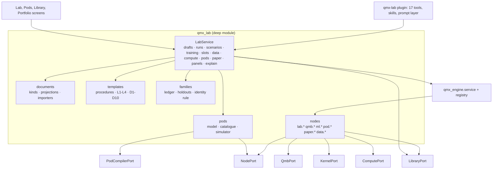
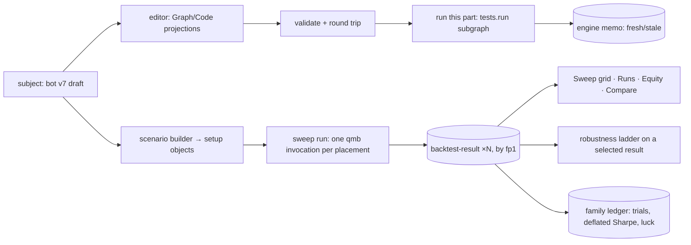
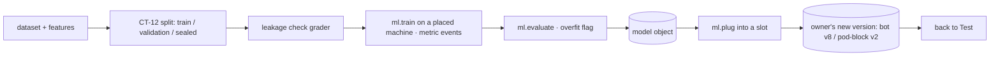
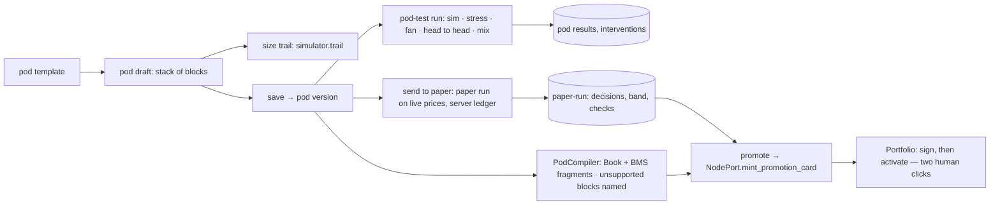

# High-level design — the Lab and Pods backend

Companion to `ARCHITECTURE-SPINE.md` (the invariants). This file carries the shape: what the screens ask for, the candidates weighed, the components and the flows. Labels: **[retrieved]** from a cited file or screenshot, **[remembered]**, **[inferred]**.

## 1. What the screens ask for

**[retrieved, shots 15-22, 32-34, 36-58]** The Lab is one page with two benches. *Strategies* has Build (Resources, an Editor with Graph, Code and Import, an Inspector for the selected step with its machine, a Log), Test (a Sweep grid of markets × timeframes with a New-scenario builder, a Runs table with roles and ticks, Equity with overlays, a Robustness ladder with editable bars), Train (a pipeline of chips Dataset → Features → Split → Leakage check → Train → Evaluate → Plug into slots with live loss curves, a split with a sealed year, and a machine), Compare (ticked runs side by side), plus Model slots, Data, Compute and Agents panels, a header subject picker, a machine picker with connection checks, Run, and the Lab copilot with 17 tools. *Pods* has Design (a pod as seven slots of blocks with live settings, a Block panel with sliders, a Size trail of one sample trade), Test (Pod equity with Run together, a Stress board of crises × pods, Head to head cards, a Drawdown fan, Interventions), and Paper (a pod version soaking on paper money on a server against its tested band, a Live decisions feed, Ready-for-live checks, Promote). The Library shows pods and pod blocks with Used-in, Code and Settings; Portfolio shows pod cards, a Pod panel that edits a version (sizing method, knobs, ladder, bot weights, draft replay), an MIS tab of labelers in live or shadow, and the promotion card.

**[retrieved, ruling 46]** The backend is designed for exactly that. Where today's backend cannot support a thing, section 7 says cut or defer.

## 2. Candidate designs

### 2a. The Lab

| Candidate | Shape | Verdict |
| --- | --- | --- |
| A. A Lab runner of its own | a Jupyter-style executor plus a job table beside the engine | rejected: ruling 22 and engine AD-3 allow one engine; the Lab would re-invent memo, replay and pause **[inferred]** |
| B. A thin UI over the `qmb` CLI | screens call `qmb` and read its JSONL | rejected: no editor, no drafts, no slots, no pods, no copilot tools; QMB is a library, not the Lab **[retrieved qmb.md B-1]** |
| C. Document kinds + a node pack + templates over the engine and the Library (**chosen**) | every step is an engine node, every procedure a template, every artifact a Library object; the Lab owns projections, the pod simulator and four ports | gives the editor, run-this-part, freshness, placement, pause at caps and lineage for free **[inferred]** |

### 2b. The editor's truth

| Candidate | Verdict |
| --- | --- |
| Code is the truth, graph is drawn (research 17 Q6) | right for bot logic (QML QL-2), wrong for workflows where engine AD-21 binds JSON **[retrieved]** |
| JSON is the truth, code is a projection (engine AD-21) | right for workflows, wrong for a Python bot |
| An authoritative form per document kind with a round-trip check (**chosen**) | honours both; the registry entry says which |

### 2c. Pods

| Candidate | Verdict |
| --- | --- |
| Edit CT-22 / CT-27 sections in the UI | rejected: the screens show blocks in slots, and the risk session says the unit's structure is not agreed (research 09) **[retrieved]** |
| The UI's block-and-slot pod with an adapter to the trading composition (**chosen**) | keeps ruling 14; names what the node cannot run instead of pretending |
| A new pod runtime replacing Book/BMS | rejected: ADR-0024 keeps Book/BMS as the default and forbids a sixth COMP **[retrieved]** |

### 2d. Paper

| Candidate | Verdict |
| --- | --- |
| Node-paper only (Book-level demo routing, DEC-0261/0275) | alone it cannot show the Paper bench, which soaks a pod version before any card exists |
| A Lab paper run as an engine run on live prices with a paper ledger, node adapter later (**chosen**) | ruling 29: the line ends at paper; the ledger needs no venue; demo accounts arrive through the node |
| QMA-paper | dead (DEC-0275) |

## 3. Components



| Component | Role | Depth |
| --- | --- | --- |
| `LabService` | the one interface the UI, the plugin and the hub call | hides projections, engine calls, Library writes, family folds, the simulator and every port |
| documents | kind registry, Graph and Code projections, round trip, importers | a kind is one class; the editor never knows which kind it edits |
| templates | the procedures and the research templates as `qmx.workflow/1` folders | a procedure is data; the engine runs it |
| nodes | Lab node executors registered with the engine | each is a small adapter over a port; memo, retry and placement are the engine's |
| pods | the pod model, the block catalogue and the one simulator | every pod number comes from one implementation |
| families | folds over Library edges | trial counts, deflated Sharpe, holdouts, luck warning, identity rule |
| ports | `QmbPort`, `KernelPort`, `ComputePort`, `PodCompilerPort`, `NodePort` | the four places the world varies, each with two adapters |
| `qmx-lab` plugin | the capability pack | tools, skills, prompt layer; nothing of its own |

## 4. Data flows

### 4a. Build → Test → Compare (a strategy)



### 4b. Train → Slot → new version



### 4c. Pod design → test → paper → promotion card



### 4d. The copilot in the Lab

```mermaid
sequenceDiagram
  participant O as Operator (Lab copilot column)
  participant H as Harness chat (qmx-lab plugin loaded)
  participant S as LabService (MCP tools)
  participant E as Engine
  O->>H: "Sweep BTC breakout across six markets on 1h and 4h" (+ context: subject, layout, ticked runs, machine)
  H->>S: lab_scenario_draft(...) [READ-ish: no run yet]
  S-->>H: 12 runs, 4 min on this laptop, no luck warning
  H->>S: lab_scenario_run(...) [DOMAIN_WRITE]
  S->>E: runs.start(sweep)
  E-->>H: run card (events)
  H-->>O: text + run card; the Sweep grid tile fills in from the same run
```

## 5. How ruling 14 and the unit are honoured

The Lab treats a **unit** as a list of parts it can read through `NodePort.seats()` (a bot version, a pod version, the MIS needs) and never as fixed fields. Nothing in the Lab imports `qmn` or `qmf-venue`. The only two writes toward trading are a candidate labeler for the shadow lane and a promotion card that a human signs elsewhere. When the risk session settles the unit, the `PodCompilerPort` adapter and the `identity_rule` table change; the screens and the service do not.

## 6. Where the Library mismatch lands

Every Lab noun is a Library kind already in the roster **[retrieved library AD-3]**: `bot`, `workflow`, `model`, `component` (indicators, features, labelers), `pod`, `pod-block`, `setup` (scenarios and presets), `backtest-result` (Runs rows), `test-report` (gates), `stress-scenario`, `paper-run`, `dataset`, `board`, `template`, `artifact` (reports, chart packs, pinned panel specs). The Lab's Resources tile and the Library's shelves read the same objects, so the click-through's disagreement (Lab lists Breakout research, Nightly evidence, Regime study; Library lists Nightly evidence, Hypothesis miner) cannot recur: Resources is `subjects.list` over the Library.

## 7. Gaps: what the screens show that the backend cannot carry yet

| Screen element | Why not yet | Recommendation |
| --- | --- | --- |
| Pairs (one market against another) in the scenario builder (shot 40) | QMB has no spread instrument; B-12 declares instruments per stream | **defer** (OPEN-6); keep the field disabled with "needs a spread instrument" |
| Colab and AWS GPU as machines (shot: Compute panel per research 10) | `qmx_remote` providers are `ssh, amp, modal, e2b` **[retrieved]** | **defer** Colab; AWS/RunPod/Lambda through `ssh` now |
| Broker demo and exchange testnet paper money (shot 39 "Binance testnet") | demo routing is node-paper (TN-9) and needs a binding the node mints | **defer** (OPEN-2); v1 paper money is the server ledger on live prices |
| Model sizer, regime throttle, volatility spike, thin hours, liquidity cap, peg input on the live node | no CT-22/CT-27 home today **[retrieved sections]** | **keep in the Lab** as simulator blocks; the adapter names them unsupported; Ready-for-live says so |
| Agents panel with live sub-agent progress and machine | the harness gives start and end only; engine spans give per-node state | **defer** the live last line; show spans now |
| "Build your own" robustness check and "Your own" measure by describing it | needs a component built and tested first | **keep** as the D1/D5 template path (tests first), not a free-text formula |
| Head-to-head trophy noise band, luck share | definable from the fan and the trade list | **keep**; formulas in LLD section 5.2 |
| Training on a notebook runtime (Colab) with live curves | kernel adapter not chosen (ruling 53) | **defer** the adapter; the port and the `metric` events are fixed |
| Portfolio Pod panel's "Workflow" sizing method | a sizer block of kind `graph` already covers it | **keep**; the Portfolio method chips map to the sizer block kinds (form = Simple rules / Book+BMS, model, graph = Workflow, hybrid = model under a form ceiling) |
| MIS labelers built in the Lab and promoted in Portfolio | the node's shadow lane is designed, not wired (TN-19) | **keep** the path through `NodePort`; promote stays MANAGE |
| "Explain it as" diagram or video of a result | output-layer design (engine Deferred) | **defer**; `explain()` returns text plus a diagram spec the tier-1 catalog can draw |
| Collections, layouts, ticks, selection | per-viewer conveniences | **keep in the browser**; the design never needed them server-side |
