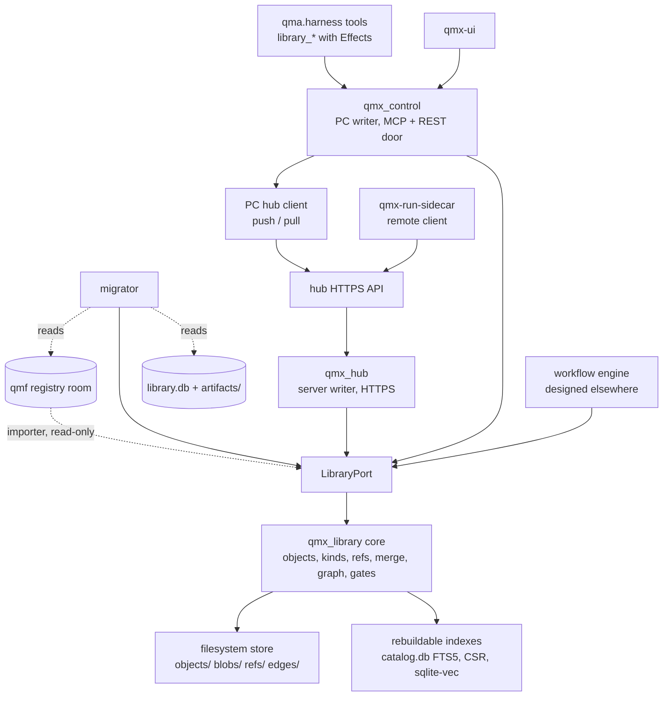
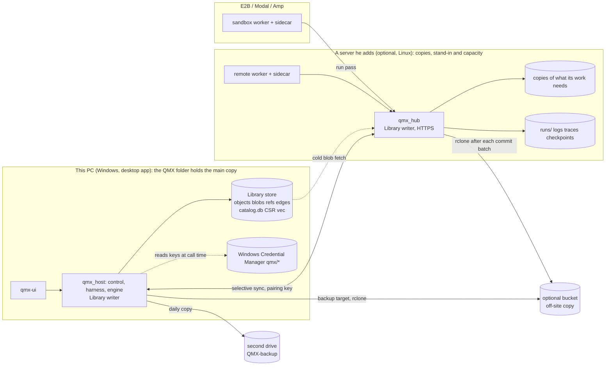
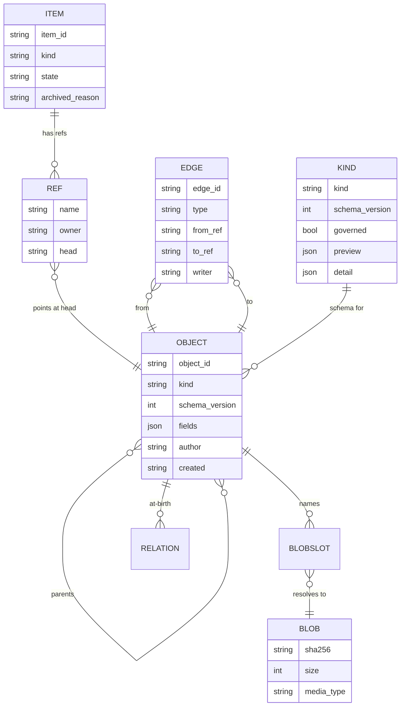

Amended 2026-10-26 by the local-first design (`research/methodology/62-local-first-design.md`, code `build/wu9` d7391716; rulings 140-145, which win over every earlier ruling): AD-34 (the QMX folder: one resolver, one layout, one label; his data apart from the program) and AD-35 (versions: open, migrate after a backup, or refuse by name; one release back always opens) added; AD-16 amended (the local backup: quick undo, a second drive, restore, the sealed key copy, GitHub as an optional target); AD-10 and AD-28 amended (This PC holds the main copy of every partition and durable blob; a server-born partition is pinned on its server until This PC verifies it; `keep_on` per dataset; 61 gaps G2 and G7 decided); AD-7, AD-11, AD-24, AD-26 and AD-27 amended, AD-26 and AD-27 retitled (the schedule default is `pc`; no Hub on This PC; claims on the primary; extraction on This PC by default). Marked *Local first (62)*. AD ids are stable.

Amended 2026-10-25 by the WU9 second round (`research/methodology/61-server-substitute-and-wu9b.md`, code `build/wu9` 546d06f1; rulings 136-139, which win over every earlier ruling): ruling 136 (the PC is home, servers substitute and add capacity, never the main copy) recorded in AD-10, AD-14, AD-16, AD-19 and AD-26, and the flip to `primary = server` (DR2D, G-FLIP) marked superseded without designing its replacement (61 section D lists the gaps, one Deferred row); AD-28 amended for ruling 137 (the market-data door always opens; a holdout is optional per study and off by default). Marked *Server substitute (61)*. AD ids are stable.

Amended 2026-10-24 by the wrap-up seams pass (`research/methodology/60-wrapup-seams.md`, code `engine/base` f05fc64b): AD-12 (the pass key is derived from the pairing key) and AD-29 (`StoreLanding`, the ref chosen by the caller's principal, the PC store's writer role while `[library] primary` is `pc`) amended in place, marked *Wrap-up seams (60)*; one Deferred row added. AD ids are stable.

Amended 2026-10-22 (night) by the fix-check round (`research/methodology/58-data-round-fix-check.md`, applied in 55 "Fix-check applied (58)"): AD-10, AD-12, AD-14, AD-16, AD-22, AD-25 and AD-28 amended in place, marked *Fix-check (58)* (text slots sync to the PC and re-index on arrival; a fetched blob is a cache copy; what has one copy without the bucket, said plainly; OAuth tokens never in the vault; a replay succeeds when the intended object was ever on the ref; a version refusal only for kinds the reader lacks, naming the side behind; a store that learns a higher epoch parks its moves as conflicts; freeze rules per kind and months that freeze without his click; the open file of a non-redownloadable series backed up; open-month corrections by range; one final look decided by the primary's journal; PC-born partitions pinned until the server verifies them; QMB's second reader for typed partitions with bid and ask paired; an inbox task when the sealed span outgrows its setting). Amended 2026-10-22 (evening) by the edge-case review fix round (`research/methodology/57-data-round-edge-case-review.md`, applied in 55 "Edge-case review applied (57)"; ruling 135): AD-10, AD-12, AD-14, AD-16, AD-19, AD-22 and AD-25 to AD-28 amended in place (selective sync and who gives way on a full disk; live-trade keys only on trading servers and an allow-list vault; a primary epoch and idempotent outbox replay; torn appends, push after each commit batch and the server-loss procedure; a partition key with subject and variant, a typed-column partition writer, an open month that is replaced and frozen only when complete, marks from partition fingerprints; the seal moved only by his click, one final look by claim, PC partitions staged to the server, big reads as handles). Amended 2026-10-22 by the data round (`research/methodology/55-data-round-architecture.md`; rulings 120-134): AD-25 to AD-33 added (price partitions and cards, the switch-on, uploads and sources, the market-data door, one result shape, line merge and history, trades and journals, lineage and components, card and page per kind); AD-1, AD-3, AD-10, AD-12, AD-13, AD-16, AD-17 and AD-19 amended in place; OPEN-2 closed (replace); two Deferred rows closed. Amended 2026-10-18 by the studies-folded pass (studies 44, 45 and 46 on top of the unlock pass; `research/methodology/47-studies-folded.md`): AD-22 (marks derived at read), AD-23 (hypotheses) and AD-24 (claims on in-progress work) added; AD-3 (a class per kind, the roster is data), AD-4, AD-6, AD-7, AD-8, AD-9, AD-15, AD-18, AD-19 and AD-21 amended in place. Amended 2026-10-18 by the unlock pass (ruling 118, `research/methodology/43-whole-app-unlocked.md`): AD-21 added (sessions are Library items); AD-3 (kind `session`), AD-5 (the PC writer is `qmx_host`) and AD-9 (no grant step) amended; the Deferred row on chat sessions closed. Amended 2026-10-16 (night) after rulings 45-59 and the engine's LIBRARY-REQUESTS L1-L10: AD-18 and AD-19 added; AD-3, AD-4, AD-5, AD-6, AD-7, AD-9, AD-10, AD-11, AD-12, AD-15 amended in place; OPEN-1, OPEN-5 and OPEN-6 closed. Amended again the same night for the gap fixes of ruling 88 (27b §6, engine L11-L17): drafts off `main` (`refs/drafts/*`, AD-7, AD-15, AD-18); one shared run status table plus `mode` (AD-15, AD-18); no key ever reaches a worker (AD-12, AD-13); challenger and draft refs (AD-7, AD-11, AD-19); `replaces` for the engine's `supersedes` and `ran-on` retired (AD-4); workflow templates (AD-3); the verb count (AD-9); OPEN-7 closed by ruling 80. AD ids are stable.

# Architecture Spine — QMX Library and remote data

Labels used throughout: **[retrieved]** read from a source named above, **[remembered]** from standing QMX memory, **[inferred]** this run's own reasoning, **[ADOPTED]** already settled by the operator or by existing code.

## Design Paradigm

**Content-addressed, append-only object store with git-like refs, behind one port.** Three nouns carry the whole model:

| Noun | Meaning | Mutable? |
| --- | --- | --- |
| `blob` | bytes, addressed by `sha256` | never |
| `object` | one version of one item: a typed manifest (kind, fields, blob refs, parents, at-birth relations), addressed by `fp1` of its canonical bytes | never |
| `ref` | a named pointer from an item to an object (`main`, a variant, a run branch) | only by compare-and-swap |

Plus `edge`: an append-only typed relation record between two objects that accrues after birth (the CT-07 shape, kept verbatim).

Layer map (hexagonal at the seam):

| Layer | Lives in | Owns |
| --- | --- | --- |
| Library core (the deep module) | `qmx_library/` (new package, pure Python, stdlib + pydantic) | object model, kinds registry, refs, merge, graph, grounding, refusal gates, replication |
| Store adapters (internal seams) | `qmx_library/store/` | filesystem object store, SQLite catalog + FTS5, CSR graph index, optional sqlite-vec index |
| Port (the one external seam) | `LibraryPort` (fourteen verbs plus the operator-only `adopt`) | the only way in for the UI, the harness tools, the engine, the hub and the migrator |
| Hosts | `qmx_control` (PC writer), `qmx_hub` (server writer), `qmx-run-sidecar` (remote client) | process, auth, transport |

Everything is files (rebuild DESIGN §7.6b rule zero, **[retrieved]**); one writer per store; indexes are never evidence.

## Invariants & Rules

### AD-1 — One Library, one paradigm [ADOPTED by ruling 28]

- **Binds:** all
- **Prevents:** a second Library (today there are two with opposite rules), mutable catalog rows, "projection only" kinds that cannot be stored, a free kind string
- **Rule:** Every stored thing in QMX that is not market data, live trading state or a secret is a Library object of a registered kind. There is exactly one Library object model (`blob`, `object`, `ref`, `edge`). `qmb/registryread/library.py` (Library A) and `qmx_control/library.py` (Library B) are both replaced by `qmx_library`; no code path writes a saved result anywhere else. *Data round (55):* "market data" here means the price partitions of AD-25, which every reader still finds in the Library through their `dataset` cards, so nothing that is data lacks an item (ruling 120); the four other stores that held Library-like data (QMB's registry projection, the engine's stand-alone fake, the mini-app `artifacts.db` and the QMF registry room) retire with `library.db` under AD-26.

### AD-2 — Identity is content, refs are the only pointer

- **Binds:** all writers, the migrator, the hub
- **Prevents:** one bot existing as three records (DEC-0271's own fear), lost updates between two agents, a remote run overwriting the PC's version, two ids for one registry record
- **Rule:** A manifest has two parts: `identity` (hashed) and `annotations` (not hashed). `object.id = fp1(canonical identity bytes)`. Each kind schema declares `identity: ct06 | manifest`: for a governed kind the identity content is exactly the CT-06 record's identity content, so the object id equals the registry's record `fp1` and a registry record imports under its own id; for every other kind the identity is the manifest minus `annotations`. `author`, `created`, `tags` and `aliases` are annotations for every kind, so two agents producing identical content dedupe to one object and a tag change mints no version; annotations ride a display-only occurrence sidecar keyed by object id, the way `qmf-registry` persistence already stores writer and sequence. `blob.id = sha256(bytes)`. `item.id` is a UUIDv7 (`uuid.uuid7()`, stdlib in Python 3.14) minted once and never reused. A ref moves only through `advance(ref, expected_head, new_head)`; a mismatch is a typed refusal `stale_head`, never a silent overwrite. A byte-identical re-put is idempotent; a true collision is refused and alarmed (CT-09 law, kept).

### AD-3 — Kinds are schema files with a class; the roster is data

- **Binds:** kinds registry, UI shelves, agent tools, migrator
- **Prevents:** the UI's 15 shelves and the backend's free `kind` string drifting apart again; a kind that cannot be previewed
- **Rule:** A kind exists only as a schema file `kinds/<kind>.schema.json` carrying `kind`, `schema_version`, `fields` (JSON Schema), `blobs` (named slots with media types), `preview` (card fields), `detail` (tabs and which blob or field each shows), `class: record | definition | governed` (studies-folded pass, 45 DC-1: the class replaces the `governed: bool` flag and every hand-written list of kinds in this spine, engine AD-11 and the Lab conventions; code reads the class, never a list of kinds). **The roster is data:** a kind is added by adding a schema file, never by code, and the v1 schema files are listed in the Structural Seed. **One rule per class:** `record` kinds (results, artifacts, notes, memory rows, runs, sessions, hypotheses and the like) have no lifecycle and land on `main` at once under AD-18; `definition` kinds (workflows, mini apps, agents, pods, pod blocks, skills, methodologies, personas, components, agent-made tools) follow engine AD-11's one lifecycle and reach `main` only by his publish; `governed` kinds (`unit`, `strategy`, `bot`, `book`, `bms`, `binding`) reach `main` only by his click. Retired by the same pass (marked `retired` in their schemas, as below; nothing was stored under them): `board` (a workflow draft shown in board view, Lab AD-2), `bot-card` (the bot kind's preview, AD-17), `logic` (a blob slot of `bot` and of a code `pod-block`) and `template` (a tag on any definition item); added: `hypothesis` (record, AD-23) and `app-profile` (record, engine AD-64). Added by the unlock pass (2026-10-18, ruling 118): `session` (one item per chat, AD-21). Added by the rerun (2026-10-18): `persona` (one operator-scope item: the copilots' tone and defaults, slot 1 of their system text, edited in Settings; engine AD-18) and `agent` (a named agent as a folder, ruling 19 and BACKLOG B32: persona text, model or role pins, skills, tool packs, routines as trigger refs, home machine; the backend shape of the Bots roster, whose organogram meaning is methodology work later); both follow the lifecycle rule of AD-18 (`agent` is a lifecycle kind). A **workflow template** additionally carries a `slots` schema (the fill-in fields of engine AD-46), and skills, workflow templates, mini-app templates and blueprints share engine AD-46's one lifecycle and curator; the curator archives, never deletes (AD-6). Pods are resolved with the Lab spine (lab-and-pods AD-10, AD-11): `pod` (a versioned stack of pure blocks in seven slots) and `pod-block` (one pure rule) are the UI's **ungoverned design kinds**; `book` and `bms` are **governed** mirrors of CT-22 and CT-27 (`identity: ct06`) that `PodCompilerPort` writes, linked `pod version → compiles-to → book | bms`. Three more kinds carry rules of their own: `dataset` is a **card**, never the data: fields `source, instruments[], window, world, split_fp (CT-12), licence, partition_digests[]`; ticks and bars stay in the qmf-data rooms or the market-data service, and every result object carries `consumed → dataset` by hash (file 30 §4a). `memory-row` (engine L1): identity `scope, tag, intent_key?, when_to_use, content, refs[]`, tag ∈ `built | lesson | dead_end | do_not_retry | negative_result | procedure | preference`; annotations `keywords[], confidence, f, u, source_run_ids[], learned_at, occurred_at`, so an `f`/`u` update mints no version; a memory row also carries `derived-from` relations, written at its birth by `consolidate` or the retain worker, to the results, runs or sessions it came from, so AD-22's walk reaches it (review 48 M6). `agent-tool` (engine L4): blob `tools/<name>.py` plus a declared schema, field `review ∈ unreviewed | reviewed`, loadable only into the run that made it (engine AD-61, its `run:<run_id>` toolset) while `unreviewed`, and elsewhere only after his review (review 48 M15); archive is the item state as for every kind. Each kind schema also declares which annotation fields it accepts (AD-2); `intent_key` is accepted by every kind a run can produce. The ten DEC-0271 kinds map one-to-one, by this table and no other: `bot-definition→bot`, `strategy-family→strategy`, `confluence→component`, `book-definition→book`, `bms-definition→bms`, `book-binding→binding`, `split-manifest→dataset`, `source-observation→source`, `performance-result→backtest-result`, `experiment-spec→setup`. The `workflow` kind accepts `semver` as an annotation (AD-2), so setting a version number at publish mints no new object; lifecycle is a ref fact (`refs/drafts/*` vs `main`), never a field. `template` is retired as a kind: a template of any definition kind is a published version tagged `template` (a pod template included); a **workflow template is a published `workflow` version tagged `template`** (engine AD-22), and "use this template" puts a new `workflow` draft with `derived-from → template version`; a variant is `variant-of`. A kind is never added by a string at a call site. A kind is never removed; it is marked `retired` in its schema. *Data round (55):* `trade` (record class, AD-31) is added, the one new kind of the pass; `source` gains `origin: upload | agent | feed | capture | import`, `canonical_url` and the slots `original`, `text`, `pages/*`, `transcript`, `frames/*`, so uploads, scraped pages, feed items and screen captures are one kind (AD-27); `component` gains `component_type: indicator | combination | feature | filter | labeler` (AD-32); `dataset` gains the card fields of AD-25; every schema's `preview` and `detail` take the `card` and `page` form of AD-33.

### AD-4 — Relations are typed and closed

- **Binds:** manifests, edge log, graph builder, UI "used in", agent `relate`
- **Prevents:** free-text `relation` ("related"), lineage split between a `links` table and CT-07 JSONL, a graph nobody can parse without a model
- **Rule:** The vocabulary is the fourteen CT-07 edges verbatim plus the Library set `produced-by`, `consumed`, `derived-from`, `uses`, `part-of`, `cites`, `tested-by`, `instance-of`, `run-of`, `ran-on`, `variant-of`, `version-of`, `merged-from`, `annotates`, `replaces`, `archived-as`, `resolves`, `made-by`, `used-by`, `compiles-to`, `touched`, `mentions`, `explains`, `related-to`. `compiles-to` links a `pod` version to the `book` and `bms` objects compiled from it (Lab AD-11); `touched` links a run to the sealed holdout `dataset` card it opened, so the Lab's family ledger counts holdout touches as edges, never as a stored counter (Lab AD-5, AD-6). The engine's closed set uses these names directly (`version-of, variant-of, run-of, produced-by, consumed, tested-by, replaces, archived-as`); the port still normalises `_` to `-` for old callers, `consumed_by` is the reverse reading of `consumed`, and the engine's earlier word `supersedes` is `replaces` (one relation, not two). `ran-on` is **retired**: a run's placement is a field set on the `workflow-run` (engine L14: `placement`, `agent_mode`, `health`, `cost_machine_minutes`, `link_out`), not a relation to a stored machine object; the name stays in the vocabulary so older records parse, and no new code writes it. At-birth relations are a field of the manifest (so they ride the object's `fp1`); after-birth relations are append-only edge records keyed by their own `fp1`. Readers never union the two without saying which is which. Any other relation string is refused. *Studies folded (47):* added `tests` (a result → the `hypothesis` it tests, AD-23); any edge may carry an optional `locator` attribute (`seconds`, `page` with `paragraph`, or `line`) naming where in the source a derived item came from, so a note points back to the minute of a video (46 X-24); a holdout touch stays the `touched` edge (46 X-19 merged). **An edge says what an object is about, never that it is true:** an outcome lives on the target object (a `tested-by` edge proves a test ran; the run's status says whether it passed; a result's `outcome` field says what it shows).

### AD-5 — One writer per store; indexes are never evidence

- **Binds:** `qmx_control`, `qmx_hub`, every agent, the UI, the engine
- **Prevents:** two processes writing `library.db`, an agent editing a catalog row, a backup of an index being mistaken for a backup of the Library
- **Rule:** Evidence is the on-disk set `objects/`, `blobs/`, `refs/` (append-only log of ref moves) and `edges/` (append-only JSONL). Exactly one process per store writes it: the host process (`qmx_host`, engine AD-52; the control process before the unlock pass) on the PC, the hub service on the server. `catalog.db` (SQLite: items, objects, refs head view, FTS5, kinds), the CSR graph and the vector index are rebuilt from evidence by `rebuild_indexes()` and may be deleted at any time. No caller opens `catalog.db` directly; every reader and writer goes through `LibraryPort`. **Index watchers** (engine L10) are the only other index path: the writer publishes `library` events after each commit, and a registered watcher (a `MemoryProvider` adapter among them) receives `index(objects)` on creation and `forget(ids)` on archive, with `rebuild(all)` available; a watcher's store is a rebuildable index like the catalog, never evidence, and a lost watcher is replayed from the ref log.

### AD-6 — Archive, never delete [ADOPTED by ruling 9]

- **Binds:** all kinds, all ports, the hub, the migrator
- **Prevents:** DEC-0443's `uninstalled` state, a "Remove" button that deletes, a GC that drops the only copy
- **Rule:** No port has a delete verb. An item has `state ∈ {active, archived}` with `archived_reason` and optional `replaced_by`. A state change is a ref-log entry on the reserved ref `refs/items/<item_id>/state`, whose head is the literal state and whose entry carries `reason` and `replaced_by`; it is owned by the item's `main` owner and changes no object. The catalog's `items.state` is rebuilt from that log. Blobs of class `durable` (the default) are never purged in v1. The one exception is blob class `transient`, declared per slot by the kind schema (today only `workflow-run` `checkpoints/*` and `heartbeat` logs, engine L5): a transient blob is kept on its home store for `transient_retention` (UI-editable, default 30 days, never shorter than the run's own life), is not pushed to the bucket, and is dropped after that; the object that named it stays readable and reports `blob_expired` for that slot. Search hides archived items by default and shows them on request. *Studies folded (47):* **one exception to archive-never-delete** (46 X-16): `purge(blob_id, reason)`, callable only by the `operator` principal and only for a blob holding a secret, replaces the blob with a tombstone on every store, replica and the bucket and writes the purge to the ref log; the object that named it reads `blob_purged`. Redaction (engine AD-37) runs at every `put`, from any principal, so a token-shaped value is refused at landing before a purge is ever needed. The curator (engine AD-46) archives records on test-mode run refs that nothing cites after `curator.test_record_days` (Claude's default 30), so noisy test output leaves search without anything being deleted (46 K-25).

### AD-7 — Every writer owns its ref namespace; merging into `main` is explicit

- **Binds:** agents, remote runs, the hub, the engine, the UI comparison view
- **Prevents:** two agents clobbering one item, a remote run writing `main`, a merge that silently picks a side
- **Rule:** Every call carries one `Principal` from the closed set `operator | agent:<session_id> | run:<run_id> | engine:<store> | hub | migrator`, derived once at the door (UI bearer → `operator`; the per-chat in-process `qmx` MCP server → `agent:<session_id>`; a run pass → `run:<run_id>`; the engine service's own credential on a store → `engine:<store>`; the pairing key → `hub`). Ref namespaces and their single owner: `main`, `refs/variants/<name>` and `refs/items/<item_id>/state` — `operator` on the **primary** store (AD-19), and `engine:<store>` may fast-forward `main` under AD-18; **`main` holds published versions only, never a draft**; `refs/drafts/<item>` — the operator's draft of that item, `operator` on the primary store, and `engine:<store>` may advance it only to land an object of a lifecycle kind that a run produced (AD-18; engine L15); `agent:<session_id>` may also **merge** into `refs/drafts/<item>` (DOMAIN_WRITE, recorded `merged-from`) but may not `put` onto it; `refs/agents/<session_id>/<item>` — that `agent:<session_id>` (an agent's draft); `refs/runs/<run_id>` — `run:<run_id>`, and the *store* that owns it is the store that minted the run (the PC for a local run, the hub for a remote one; run ids are UUIDv7, so no two stores mint the same ref); `refs/memory/wf/<workflow_item>`, `refs/champions/<workflow_item>` and `refs/challengers/<workflow_item>` — `engine:<store>` on the store of the engine instance named by the trigger's `home_engine` (engine AD-3; engine L2, L3, L16); a workflow whose triggers live on both homes keeps one champion and memory owner, the `pc` instance (the schedule default; *Local first (62)*: was `contabo`, ruling 142); `refs/memory/home/<home>` and `refs/memory/operator` — `engine:<store>` on the primary store; `refs/conflicts/<item>/<n>` — whoever owns the `into` ref; `refs/hub/*` — `hub`. A principal may advance only refs it owns. A challenger is drafted on `refs/challengers/<item>`; `refs/champions/*` moves only after a passing replay (engine AD-26) and is never a merge into `main`. Publishing a draft is a merge from `refs/drafts/<item>` or an agent ref into `main`. A merge into `main` is `merge(item, from_ref, into=main, strategy)`: three-way on the manifest field by field, and per blob by media type (`text/*` three-way line merge; `application/json` structural merge; anything else pick-one). Every merged object records `merged-from` relations to both parents. A conflict never picks a side: it mints a `merge-conflict` object on `refs/conflicts/<item>/<n>` carrying both sides and the diff, and the comparison view renders it until a human or an authorised agent resolves it. Which objects fast-forward without a merge is AD-18. *Studies folded (47):* two more reserved namespaces: `refs/items/<item_id>/marks` (the stored mark of AD-22), owned like `refs/items/<item_id>/state`, and `refs/claims/<intent_key>` (AD-24), owned by `engine:<store>` on the Hub store (the primary once the server exists) and transient (never bucketed, pruned when released or expired). The rule every namespace follows (45 C6): each principal writes only refs it owns, and `main` moves only by publish, by the landing rule (AD-18) or by merge; a new namespace needs a new principal or a new rule here. A `workflow` definition merges with its own driver, three-way per node id and per parameter with one conflict per node, and a merged definition that fails engine validation becomes a `merge-conflict` instead of landing (46 K-12; property tests on random graph edits).

### AD-8 — Search is parse-first; the graph gives provenance, calibrated confidence decides abstention

- **Binds:** search, grounding, agent `walk`/`ground`, the copilot's Library answers
- **Prevents:** an LLM inventing ids or edges, GraphRAG-style extraction, a refusal that is "a model being humble"
- **Rule:** (1) The knowledge graph is built by parsing manifests and edge records only; no model call builds any node or edge. (2) The grounder maps text to item ids by longest-match over a normalised alias table (titles, tags, symbols, families, kind names, aliases declared in schemas); a model never emits an identifier. (3) Text candidates come from FTS5; dense candidates (optional, sqlite-vec) only re-order a candidate set the graph or FTS already produced and never add an item. (4) Only plain facts refuse before any model runs, deterministically: `no_entry_point` (nothing matched), `only_archived_or_superseded`, `no_evidence_as_of`; the thin-evidence signals (`too_few_concepts`, `no_path`, `no_quotable_terminal`, `insufficient_paths`) are handed to the answering step, whose abstention comes from calibrated confidence (engine AD-45), because the clipping this design rests on found that path certification predicts correctness at chance while calibrated confidence does not (45 §3.3). (5) Every answer carries the object ids it walked and, per item, the edge type that admitted it (`used in`, `produced by`, `same family`). (6) Search stays a pipeline (ground, walk, rank, cite), never an agent loop. (7) Ranking reads the producer's status (a passed live run, his own item, a test run), grade and citations, so noisy fan-out output ranks below trusted results (46 X-15). (8) Every truncation constant (previews, snippets, `doc_read` cut-offs) is a tested setting and keeps a report's conclusion. (9) The grounder's precision is measured against items' own tags and edges, not coverage alone (probe P-SRCH); a span linker for paraphrase may sit behind the optional dense index and never emits an id outside the vocabulary. (10) The graph is the SQLite edge table with recursive queries in `catalog.db` first; the in-memory CSR is built only when measured (45 DC-15).

### AD-9 — One port, its verbs, harness Effects by class

- **Binds:** `LibraryPort`, the MCP tools on the control door, the engine, the hub API, the UI
- **Prevents:** per-kind tool sprawl, an agent writing `main` or `catalog.db`, a tool with no Effect
- **Rule:** `LibraryPort` = `resolve`, `get`, `search`, `walk`, `ground`, `find_by_intent`, `search_runs`, `marks` (AD-22), `put`, `relate`, `branch`, `merge`, `checkout`, `commit`, `annotate`, `claim` and `release` (AD-24, `engine:<store>` only), plus three verbs only the `operator` principal may call: `adopt` (the FM-16 recovery), `mark` (set or clear `quarantined` with a reason, AD-22) and `purge` (AD-6's one exception); `get`, `search` and `walk` take an optional `as_of` (a time or a ref-log position) answered from the ref log (46 K-26). `find_by_intent(intent_key) → [object_id]` returns active objects carrying that annotation whose `produced-by` run has status `passed` (engine L6). `search_runs(query, workflow?)` is FTS5 over `workflow-run` summaries and mirrored transcript blobs, no model call (engine L7). `annotate` sets annotation fields the kind schema accepts (`tags`, `aliases`, `intent_key`, `f`, `u`, …) and mints no version; any principal may annotate objects on refs it owns, and `operator` or `engine:<store>` may annotate anything. Effects (harness `Effect`, unchanged): `resolve/get/search/walk/ground/find_by_intent/search_runs` = READ; `put/relate/branch/commit/annotate` = DOMAIN_WRITE (always onto a ref the caller owns); `merge` into `main` from an **agent chat** = DOMAIN_WRITE for record-class kinds and MANAGE for governed-class and definition-class kinds (AD-3; a `pod-block` included, since its merge into `main` is publishing it), because a merge of those into `main` is publishing and publishing asks him once (ruling 80, which closed OPEN-7); a merge into `refs/drafts/<item>` is DOMAIN_WRITE; a **workflow's** fast-forward into `main` never asks (AD-18); `archive` from a chat = MANAGE, from a workflow under its standing rule = none; `adopt` is never exposed as an agent tool. The new tool rows are entries in the harness's `AGENT_OPERATIONS` table, added like any other change (H17 was built in HG1; ruling 118 removed the grant step); until the Library packet adds them the existing `library_*` rows serve. Agents get a filesystem view: `checkout(item, ref) → <home>/library/checkout/<ref>/<item>/` and `commit(path, message)`; the checkout is a working copy, never the store.

### AD-10 — Three storage tiers; the PC is not the only copy

- **Binds:** blob store, replication, the hub, backups
- **Prevents:** the PC filling up (ruling 42), the only copy living on a laptop, a blob fetched from nowhere
- **Rule:** The PC holds `catalog.db`, all manifests, all edges and hot blobs. The server replica holds everything durable. The S3-compatible bucket holds everything durable. A blob is addressed by hash wherever it is; `get` fetches a missing blob from server then bucket and caches it. A durable blob may be evicted from the PC only after two verified remote copies exist (hash re-read on both); a transient blob (AD-6) lives on its home store only and is never bucketed. Market-data Parquet is not Library data and keeps its qmf-data rooms (on the PC as a hot cache, on the server as the primary, file 30 §4b); the Library reaches it only through `dataset` cards. *Data round (55; rulings 120, 121):* price partitions (AD-25) live on the server as the main copy (as many as its disk holds, read live) and in the bucket as the full copy, pushed nightly by the server, and in a PC cache sized from the PC's live free space; a partition may leave the PC cache at any time (it is re-fetchable by fingerprint) and leaves the server only after its bucket copy is verified and only when its card says `redownloadable`; the Library reaches them only through `dataset` cards and the market-data door (AD-28). *Edge-case review (57; F10, F18, F21, F22, F23, F26):* **the PC syncs selectively**: it pulls the ref moves since the last ref-log sequence it saw, plus the manifests and edges they name and the blobs of their text slots (`text`, `transcript` and any slot a kind schema marks `index: true`), never any other blob (*Fix-check (58), N1*: the built `_index_object` indexes only blobs present on that store, so without the text slots the PC's search would miss what the server extracted); any other blob reaches the PC only when something on the PC opens or needs it (the `upstream` fetch of `get`); when a blob arrives on a store, by sync or by fetch, the store re-indexes the objects that name it; an existence check reads ids, never bytes; blobs move as streams; one sync runs at a time and a burst of commits coalesces into the next one. *Fix-check (58), N3:* **a blob is either born on a store or cached there.** A blob fetched from another store is a cache copy, evictable at any time (it comes back by hash); the two-verified-remote-copies rule binds only durable blobs born on that store (made, uploaded or written there), so opening a file never pins C:. **Until the bucket exists** the storage view says what is true, not "one copy off this PC": a durable blob born on the PC has two copies (the PC and the server) and stays on the PC; **a durable blob born on the server (server uploads, extracted pages, recordings, run logs, model weights) has one copy, on the server** (only its text slots also reach the PC); frozen price partitions live on the server only (redownloadable months can be fetched again; fills, calendar revisions and other non-redownloadable months have one copy); the old 10 GB stays on C:. Everything else works; price partitions in the PC cache stay evictable because they are re-fetchable. **Who gives way when a disk fills**, one rule per machine, read live: the price cache gives way first, then transient blobs, then the telemetry queue, then cache copies of blobs fetched from another store and hot blobs that already have two verified remote copies; every writer checks free space against what it is about to write and refuses whole with `disk_full` (never a half file); a Library write is refused last, with an incident and a plain message, when free space falls below what pending Library work needs (the outbox plus uploads in flight, measured); he may raise that floor in Settings, shown beside the measured need. The server keeps every durable blob for now; evicting server blobs that have a verified bucket copy is Deferred. *Server substitute (61; ruling 136, replacing ruling 121):* every sentence above that makes a server the main copy of price partitions or the only copy of anything ("on the server as the primary", "live on the server as the main copy", "frozen price partitions live on the server only", server-born durable blobs with one copy) is superseded: the PC holds everything first, the data included, with a local backup always, and a server holds copies of what the work placed on it needs. Until the stand-in round (61 gaps G2, G7, G9) is designed, nothing new may make a server the only copy of anything, and the selective-sync and disk rules above stand. *Local first (62; rulings 136, 140, 141; gap G2 decided):* **This PC holds the main copy of every price partition and every durable blob**, in its QMX folder (AD-34); a place he adds (engine AD-72) keeps copies of what work placed there needs, and a dataset card's annotation `keep_on` (a list of place names, minting no version) asks for standing copies on places; a durable blob or partition born on a server is pinned there until This PC has fetched and verified its copy, and only then follows the cache rules on that server (the reverse of the earlier pin). This PC's own copy of a dataset is freed only by his per-dataset choice, possible only while two places hold verified copies, off by default; the storage view and the item header (AD-33) say where every copy is. The disk rule's order is unchanged; on This PC the price data sits on the drive the QMX folder is on.

### AD-11 — The Hub is the remote-data intermediary [ADOPTED by ruling 43]

- **Binds:** remote runs (server, E2B, Modal, Amp), the PC, the engine when it runs remotely
- **Prevents:** remote runs needing the PC awake, remotes dialling into the PC (DEC-0497 keeps "daemon never dials in"), a remote run writing `main`
- **Rule:** `qmx_hub` on his server serves the same `LibraryPort` over HTTPS and is the single writer of the server store. The PC and every remote run are clients of it. The hub store owns `refs/runs/<run_id>` for runs it minted, `refs/memory/wf/*`, `refs/champions/*` and `refs/challengers/*` for workflows scheduled on the server, and `refs/hub/*`; the primary store (AD-19) owns `main`, `refs/drafts/*`, `refs/variants/*`, `refs/items/*/state`, `refs/memory/home/*` and `refs/memory/operator`; the PC store owns `refs/agents/*` and `refs/runs/<run_id>` for local runs. Replication is object-level (immutable objects and blobs copy in any direction without conflict) plus ref mirroring by owner (a mirror never advances a ref it does not own). The hub holds no broker credential and exposes no money verb. **The Hub is the engine's remote gateway** (engine AD-20, L8): `get_version_bundle(workflow_id, version)` is `get(object_id, blobs="fetch")` of the pinned `workflow` object and its blobs; `events(run_id)` is the Hub's SSE of that run's ref-log tail and sink; `placement_status` and `cancel(attempt)` belong to `qmx-node` (engine AD-25), which is colocated on the server but is not the Library. The Hub listens on the tailnet first: the PC, his server, Amp runners and orbs join by Tailscale (orbs through OIDC workload identity, file 32), and a run pass is still required on every call because identity is not authorisation; a public HTTPS listener for providers that cannot join the tailnet is OPEN-5. Names: `qmx_hub` is "the Library Hub"; DEC-0188's passive file-sync hub is "the node inbox" from here on (file 30 §3.12). The hub monitors itself: `/healthz`, replication lag and its own logs are written as `test-report` objects on `refs/hub/health`, and the PC's doctor page shows hub reachability and lag. *Local first (62; rulings 140, 142):* the Hub runs only on a server he adds; on This PC the port is in-process and no Hub runs, so a PC with no server needs nothing from this AD; the standalone Hub's `primary` defaults to `pc` and the bootstrap writes no `primary` line (61 gap G12).

### AD-12 — Per-run passes; no key reaches a worker; secrets never ride the hub

- **Binds:** hub auth, run submission, provider keys, broker credentials
- **Prevents:** a leaked pass reaching `main` or money, a hub that stores keys, a credential in a run manifest, a model key on any worker (engine AD-28), a key that can trade live money anywhere an agent runs (ruling 135)
- **Rule:** The owning engine instance (the PC's or Contabo's) mints a **run pass** per node attempt, the Library's run token grown into the engine's pass (engine L12): `{run_id, attempt, placement, read_scope, write_prefix: refs/runs/<run_id>, key_scope: [qmx/* names the relay may inject], model_scope, data_scope: [dataset or CT-12 fingerprints the run may read from the market-data service, file 30 §4d], relay_url, expires, nonce}`, signed with the pairing key; the hub verifies it by signature per request (no lookup) and refuses any pass on the signed revocation list it pulls each sync. **Provider keys never reach a worker:** the relay on the runner host, or the central relay on Contabo, injects the key into each model call (engine AD-28); the worker holds only the pass, and every `ComputeProvider.start` call passes only `{QMX_RUN_PASS}` in `secrets` (the old `credentials_scope` over stdin or sandbox env is retired). Keys are never stored on the hub or in any Library object; the encrypted key replica is `qmx-vault`, a separate service beside the Hub, never on the Hub's data path (engine L11). Broker credentials (`qmx/ctrader-*`, `qmx/backup-payload-key`) are never in any `key_scope`; the hub refuses a token naming them. The money rule stands: the only order verb is `propose_order` on the PC, and a remote run can at most write an `order-proposal` artifact to its own branch. *Data round (55):* `data_scope` is added to the built `Pass` in `qmx_router/passes.py` as a tuple of dataset card item ids; the server's market-data door (AD-28) refuses a pass whose scope does not list the card asked for, and a pass minted before the field existed carries none and is refused by the door. The credential rules by scope are engine AD-67: data-provider keys (`qmx/data/<connection>`) and confirmed read-only trading credentials (`qmx/read/<connection>`) may ride the vault to their connection's home machine; trade-scope credentials never do, and the refusal by name above still covers them. *Edge-case review (57; ruling 135; F28-F31):* a key that can trade a live account never sits on the PC, the server or any machine an agent can reach: he enters it on a trading server at its setup and it stays there, and QMX on the PC never stores it. The vault replicates by **allow-list only**: the router's model-provider rows, `qmx/read/<connection>` (confirmed read-only trading credentials) and `qmx/data/<connection>` (data-provider keys); every other name stays on the machine where it was typed, whatever it is called. "No key reaches a worker" holds for **model keys** (the relay injects them); a non-model key is used only on its connection's home machine (engine AD-67), handed to a step running there and redacted from everything the step writes, and never reaches a remote or burst worker. *Fix-check (58; N5):* the allow-list covers **static keys only**; an OAuth access or refresh token and a trade key are never vault entries (never sealed, replicated or tombstoned): they are written by the home host into its own key store and nowhere else, and a secret whose home is another machine is handed once to that home and kept by no other machine (engine AD-28, AD-67). *Wrap-up seams (60; WU9):* "signed with the pairing key" means signed with a key derived from it (`HMAC-SHA256(pairing key, "qmx run pass v1")`, engine AD-28), so the Hub and every host of one home verify any pass of that home by signature, after a restart as before it; an unpaired home signs with its own `<home>/vault/run-pass-key` until it is paired.

### AD-13 — Every remote run carries the DevOps sidecar

- **Binds:** `qmx-run-sidecar`, every ComputeProvider, the run object
- **Prevents:** a run that leaves no trail, logs that only exist on the sandbox, secrets in logs
- **Rule:** A remote run starts under `qmx-run-sidecar`, which: emits a heartbeat to the hub; ships structured JSONL logs and OTLP metrics/traces to `runs/<run_id>/` on the hub; flushes checkpoints every 5 s and at every node boundary; redacts the run pass and every declared secret value from logs and outputs (it holds no provider key to redact); scrubs the environment at exit. The `workflow-run` object links `logs`, `traces`, `checkpoints` and `outputs` as blobs, so observability is Library data. *Data round (55; engine AD-69):* the sidecar sends its traces, metrics and logs as OTLP to the server's OpenTelemetry Collector (the `runs/<run_id>/` Hub routes are not built), and at run end its logs and trace are saved as the run's blobs, so the Library keeps the permanent record and the monitoring viewer keeps a short window.

### AD-14 — Offline is the normal case

- **Binds:** PC client, hub, replication
- **Prevents:** sleep losing work, clock-ordered conflicts, a stale PC overwriting the hub
- **Rule:** The PC is a hub client like any other. While the PC sleeps the hub keeps serving runs. On wake the PC `pull`s refs and the objects it lacks, then `push`es its own; order is decided by parent hashes, never by wall clock. A pulled ref the PC does not own replaces the PC's mirror; a ref the PC owns is pushed with `expected_head`, and a `stale_head` from the hub is an alarm, not a merge; the one legitimate cause (the PC restored from an older backup) is resolved only by the operator's explicit `adopt(ref, from=hub)`, which records the adoption in the ref log. Neither side ever deletes. With `primary = server` (AD-19, from the Contabo setup on) the server lands server-homed runs and moves `main` while the PC sleeps; a PC-homed run that passes while the Hub is unreachable keeps its objects on its own run ref and lands when the PC reconnects (review 48 H5). *Edge-case review (57; F11, F12, F15, F16):* **which store is primary is one record that cannot be silently rewound**: the primary store holds `refs/primary`, owned by `operator`, whose object names `primary` and an `epoch` that only his flip raises; every store remembers the highest epoch it has seen, and a peer showing a lower epoch is stale: it cannot act as primary and its pushes are refused with an alarm; `settings.toml [library] primary` and `hub.toml` only cache that record. Pushing a ref this store owns is fast-forward only (the other side's head must be an ancestor of ours, else an alarm), and the Library server refuses `mirror` of a ref it owns. **A replayed save is not a conflict**: each outbox entry carries the item id (minted on the PC), the expected head, the object id it intends and the `qmx_version` that wrote it, and `put` returns success when the ref log shows the intended object was ever placed on that ref (it is the head, or a head the ref has since moved past), before any `stale_head` check (*Fix-check (58), F11*: a PC that sleeps after a lost reply while a server workflow moves the same ref on must not see a false conflict; the built `_placed_by` answers it once filtered to that ref). Reads on the PC show pending outbox entries marked "waiting for the server". *Fix-check (58), F16, N17:* each sync and each forward carries the writer's kind names with their schema versions; the reader refuses only an entry whose kind or schema version it lacks, with `needs_update` naming the side that is behind ("the server needs updating" or "this PC needs updating"), and the outbox keeps those writes; hosts on different `qmx_version`s that read each other's kinds sync normally, so an update window stops nothing. *Fix-check (58), N13, N19:* a store that learns of a higher epoch than its own (a PC restored from an old backup, or an old server cut off by the network and still running its crons) stops acting as primary at once; the ref moves it made as primary since the last ref-log sequence both sides share are parked as `merge-conflict` items on `refs/conflicts/*` for him, never applied silently and never lost. *Server substitute (61; ruling 136):* `primary = server` no longer comes with the Contabo setup. The PC stays primary, so its own writes never wait on a server, and while the PC sleeps a server's runs keep their objects on their own `refs/runs/<id>` until the PC lands them (61 gaps G1, G6).

### AD-15 — The engine reads and writes the Library through the port only

- **Binds:** the one workflow engine (designed elsewhere), the Library
- **Prevents:** a second definition store inside the engine, runs with no lineage, "tested" as a mutable flag
- **Rule:** A workflow definition is a `workflow` object (one JSON document blob, n8n-shaped, plus pinned test data blobs, plus the workflow folder as `bundle.tar`). The engine resolves `(item, ref)` to an object id at start and pins it for the run; a scheduled run resolves the exact object its trigger pinned, or `refs/champions/<item>` when the trigger follows the champion and that champion descends from the pinned object; it never runs a draft and never falls back to a moving ref. Each run writes exactly one `workflow-run` chain on `refs/runs/<run_id>` (a new object per status change, linked by `parents`) with the field **`mode: live | test`** (fixed at birth) and a **status from the one shared table** `queued | running | waiting | passed | failed | stopped | interrupted` (engine SOLUTION-DESIGN §3.1, the same words on both sides; engine L17), the placement fields of engine L14, per-node results, blob slots `summary`, `trace`, `logs/*`, `transcripts/*`, `checkpoints/<node>/<attempt>` (transient, AD-6), and the relations `run-of → workflow object`, `consumed → inputs and dataset cards`, `produced-by ← every artifact`. A workflow version is "tested" when a `tested-by` edge points at a `workflow-run` whose status is `passed`, **in either mode**, for an object whose `fields.content_hash` equals this one's (the engine's definition hash, computed at `put` and excluding `position` and `meta`, engine SOLUTION-DESIGN §2.2); `publish` (engine) copies the edge onto the published object when the hashes match, and a publish whose merge changed the hash reads as untested. A passed run with `mode: test` (engine L9) is a real run on real models that never fast-forwards (AD-18). The engine keeps live execution state in its own SQLite and nothing else. *Studies folded (47):* `qmx_library` ships `EngineLibraryAdapter`, which implements the engine's built `LibraryPort` (`qmx_engine/ports/library.py`, its kind-specific verbs) over this port, so the engine's seam has two adapters, the engine's in-memory fake and the real one, and the engine changes nothing; the engine's own tests against the fake are the adapter's contract tests (45 DC-14).

### AD-16 — Backups are replication plus drills, not snapshots of an index [ADOPTED by DEC-0118 topology]

- **Binds:** PC, server, bucket, restore drills
- **Prevents:** a GitHub snapshot standing in for a backup, the bucket pushed by a sleeping laptop, an index restored as if it were data
- **Rule:** PC→server: every commit pushes its objects and blobs and the ref-log tail through the Library server's API (*Fix-check (58), N22*: the first wording's rclone over SFTP is withdrawn, as the amendment below says). Server→bucket: pushed by the server, never by the PC (DEC-0188 kept), after each commit batch (below). Restore = copy evidence back and `rebuild_indexes()`. Drills on the server: nightly sample restore (one random object and its blobs, hash verified), monthly full rebuild into a scratch root. The control weekly GitHub snapshot no longer carries `library.db`. *Data round (55; file 54 default 14):* one backup plan covers everything: PC to server on each commit, server to bucket (after each commit batch since the edge-case review; frozen price partitions nightly), price partitions included (AD-25); the weekly GitHub snapshot keeps only small settings databases and becomes a script workflow on a cron trigger (engine AD-57, RUN1c); restore drills include one random partition per night, hash verified. *Edge-case review (57; F13, F14, F17, F24, F25):* with `primary = server` the PC reaches the server store only through the Library server's API; rclone runs only server to bucket (and once for DR0's copy of the old ticks), never into a live store. The server pushes Library objects, refs, edges and durable blobs to the bucket after each commit batch, and price partitions nightly. Append-only logs survive a power cut: a last line with no newline or that does not parse (a torn append, NUL bytes included) is moved to `quarantine/` with an alarm and the store opens; a bad line anywhere else opens the store read-only with an incident (restore from a replica); file writers fsync before their atomic rename, and on Windows the rename retries a sharing violation (WinError 5 or 32). The monthly drill rebuilds the catalog from the existing evidence into a scratch catalog and hash-checks a rolling sample of blobs and partitions; it never copies the whole store. **Server loss** has a written procedure, drilled on scratch roots before DR2 (MIGRATION, "When the server is lost"): his click promotes the PC (epoch raised, AD-14), the PC lists the server-owned refs it holds only as stale mirrors, a new server is restored from the bucket and re-paired, and the flip back is the same procedure. *Fix-check (58; N6, N13, F14):* the open file of a series whose card says not `redownloadable` (fills, calendar revisions) is pushed to the bucket after each commit batch under its fixed name, overwritten each time, so no month of data that cannot be fetched again waits for its freeze to be backed up. The server-loss procedure first asks him to stop the old server's host when it can still be reached, and a store that comes back with the old epoch parks its moves as conflicts (AD-14). It is drilled on both branches: with a bucket, and without one, where everything born on the server and never opened on the PC is named as lost except its text slots (AD-10). *Server substitute (61; ruling 136):* the backup plan starts from the PC: a local backup on the PC always (its own folder on another drive, chosen in Settings), a server as the off-site copy, the bucket optional (G-R2 closed by his decision). Losing a server becomes routine, because the PC carries on and a new server is seeded from the PC; losing the PC is the drill that matters (61 gap G7). The server-loss procedure above stays as built until that round. *Local first (62 section C; G7 decided):* **QMX backs itself up on This PC.** What: everything in the QMX folder's `data/` (AD-34) except rebuildable indexes (`catalog.db`, the FTS5 recall index), partial uploads, staging, launch files, locks and the plan login file; SQLite files copied whole by `VACUUM INTO`; Hindsight's database by `pg_dump -Fc` where pg0 bundles it (probe P-PGDUMP), else by a stop-and-copy; immutable files once by hash; append-only logs to their last full line. **Quick undo:** in `<QMX>/backups/`, every hour while something changed and before every migration, switch, import, restore or folder move (AD-35); a snapshot holds the mutable files and a hash list of the immutable ones; kept 48 hours hourly, then 7 daily; pre-change snapshots until the next second-drive copy plus 30 days. **Second drive:** a folder he picks on another drive (default: the largest fixed drive that is not the folder's), `<target>/QMX-backup/<home_id>/` with `pool/` (every immutable file once by hash) and `snapshots/<stamp>/` (a manifest plus the mutable files), needing no hard links; daily, and before a migration; kept 14 daily, 8 weekly, 12 monthly, all in Settings; a full target refuses whole with a task; while no second drive is set, the start screen and the data health read say so. **Off-site, optional:** a server, a bucket (This PC pushes with rclone), or a private GitHub repository carrying only settings, profiles, prompt slots and published definitions, weekly; the GitHub snapshot is no longer the backup, and the `backup-weekly` template becomes the `backup` script workflow over these targets. **Restore:** from the start screen even when the folder will not open, or from Settings; the current `data/` moves aside into `backups/before-restore-<stamp>/`, the copy is rebuilt and hash-checked, indexes rebuild, and copying to and from any place stays paused until he carries on, with a place's newer saves offered through `adopt` (AD-14). **Sealed key copy:** with a passphrase he sets, the static `qmx/*` keys and the `keys/` files (not `tokens.json`) are sealed to a public key derived from it (Argon2id), so the daily backup needs no passphrase; OAuth tokens, live-trading keys and the plan login are never in any backup (AD-12). **Drill:** monthly, without him, one random snapshot restored into `cache/restore-drill/` and checked; a failure is an incident.

### AD-17 — Previews and detail views are schema data

- **Binds:** kinds registry, the UI, agent summaries
- **Prevents:** the UI drawing its own version of an item from demo arrays, a kind with no card
- **Rule:** `preview` (card fields, badge field, colour-by field) and `detail` (tabs; each tab names a field set or a blob slot and a renderer: `text`, `markdown`, `code`, `json`, `table`, `chart`, `video`, `pdf`, `image`, `graph`, `diff`) are declared in the kind schema; `merge-conflict` uses `diff`, which is the comparison view. The UI renders generically from them and may register a richer per-kind component; the generic path must always work. "Used in" is the relation neighbourhood, never a hand-built list. *Data round (55):* the `card` and `page` form and the computed header are AD-33.

### AD-18 — Nothing waits for him: workflows land on `main` under a standing rule [ADOPTED by ruling 57]

- **Binds:** engine fast-forwards, `main`, the UI "what landed" feed, governed promotion
- **Prevents:** a review queue that silently blocks overnight work, a human gate inside a run, a result that exists only on a run branch nobody looks at, a workflow promoting a trading unit onto the node
- **Rule:** Every `workflow` object carries a standing rule `publish ∈ auto | hold` (default `auto`; `hold` is set by him per workflow, never by a run). When a run ends with status `passed` and `publish = auto`, `engine:<store>` fast-forwards every `record`-class object the run produced (AD-3: results, artifacts, notes, memory rows and the rest of that class) from `refs/runs/<run_id>` into the owning item's `main`, garbage or clean, without asking; a non-fast-forward (someone else moved `main`) becomes a `merge-conflict` object and the run's other objects still land. Runs with `mode: test` never fast-forward, even when they pass, and runs whose status is not `passed` never do. **Objects of the definition and governed classes** (AD-3) that a run produced land on `refs/drafts/<item>` instead of `main` (ruling 80: creation is human-driven first; engine AD-11, AD-22), and he publishes them with one yes; record-class objects still land on `main` without asking (ruling 57). A non-fast-forward on `refs/drafts/<item>` becomes a `merge-conflict` object like one on `main`. The UI shows what landed (a `landed` feed built from `ref_advanced` events on `main` by `engine:<store>`, with the run and the rule that let it in) and never gates it. Two things stay outside this rule by design: a self-improvement **challenger** of a workflow moves `refs/champions/<item>` (engine AD-26) and reaches that workflow's `main` only by his click; **promotion of a governed unit to the trading node** is the node's own click-gated pull of registry as-of sets (DEC-0188, TN-20), and the Library's `main` never triggers it. *Studies folded (47):* **one landing rule by class for every writer** (45 DC-1): a `record`-class object lands on `main` at once when its writer is a live run that passed (above), a copilot chat (the session recorder, as `engine:<store>`, fast-forwards the records an agent session wrote on its agent ref at each turn end, AD-21; 45 A5) or the operator; a `definition`-class object stays a draft until his publish; a `governed`-class object reaches `main` only by his click (a governed object a run produced, such as a compiled `book`, waits on `refs/drafts/<item>` and is visible to Lab reads there); test-mode runs never land. A live run of a published procedure on a draft *subject* lands its records citing the subject's exact object id (Lab AD-4).

### AD-19 — The primary store is configuration, not architecture [ADOPTED by ruling 56]

- **Binds:** both stores, every client, the migration
- **Prevents:** a server move that needs a redesign, two primaries, a UI that knows which store it talks to
- **Rule:** Exactly one store is `primary` at a time, named in `settings.toml [library] primary = pc | server`; the primary owns `main`, `refs/drafts/*`, `refs/variants/*`, `refs/items/*/state`, `refs/memory/home/*` and `refs/memory/operator`, and runs the operator writer. Every client (UI, harness tools, engine, migrator) talks to `LibraryPort` through the control door, which routes to the primary and never exposes which store answered. The PC store is a full client either way: with `primary = pc` it is the writer and the server replicates from it; with `primary = server` it is a replica plus a local cache of hot blobs and a working copy for checkouts, and its writes go to the Hub. Cut-over is a procedure, not a build (MIGRATION step 8): quiesce the PC writer, push until the ref logs are equal, flip `primary` on both sides, restart; the reverse is the same steps. No kind, relation, verb, token or ref namespace changes with the flip. *Studies folded (47), made unconditional by review 48 H5:* the flip to `primary = server` is part of the Contabo setup step, because server-homed work (schedules, webhooks, app-to-app chains, memory consolidation) must land and fire events while the PC sleeps; before the server exists the PC is primary and no work is homed elsewhere. Probe P-LAT measures the Library screens over the tailnet with the PC as replica and cache; a failure is a latency bug fixed on the PC side (reads served from the replica), never a reason to keep the PC primary (45 DC-11). *Data round (55; ruling 121):* the flip to `primary = server` runs this week as part of the switch-on (AD-26); on the server the Library service runs inside the one `qmx_host` process, which is the one writer of the server store. *Edge-case review (57; F12):* the flip raises the epoch of `refs/primary` (AD-14); the two config keys follow that record and never decide on their own. *Server substitute (61; ruling 136, replacing ruling 121):* **the flip to `primary = server` is superseded.** It is no longer part of the Contabo setup, no step runs it, and G-FLIP is withdrawn; `[library] primary` stays `pc`, and the sentences above that make the flip unconditional or keep the PC primary only until a server exists no longer bind. The server host keeps refusing puts onto `main` while the primary is `pc` (built in WU9), and work a server runs while the PC is off waits on its run refs until the PC lands it. The right shape, designed in a later round, is the PC as primary with a server that stands in while the PC is off and hands back when it returns, the same for every borrowed machine (61 section D). The built `qmx_control.primary.Flip` and the server-loss procedure stay in code, unused by setup, until that round decides what the hand-back reuses.

### AD-20 — A checkout is a working copy per writer, materialised from objects; destructive edits are checkpointed (rulings 41, 102; engine AD-49; wording fixed after 41 M12)

- **Binds:** `checkout`/`commit` (AD-9), agents, delegated children, the engine's workers
- **Prevents:** two agents editing one working copy, a hand edit lost to an agent's restore, a working copy pruned with unmerged work
- **Rule:** the Library is a content-addressed object store with git-like refs, not a git repository, so `checkout(item, ref)` gives each writer principal its own working copy as a folder **materialised from that ref's objects**, labelled for its ref (`agents/<session_id>/<item>` for `refs/agents/<session_id>/<item>`, `runs/<run_id>/<item>` for a run), never a shared folder; `commit(path, message)` turns the folder's tree into objects on that ref (AD-7), so merging stays the Library's three-way merge and a collision still mints a `merge-conflict`. `git worktree` is used only for real git repositories an agent edits (engine AD-49). A working copy is removed only with proof (its ref merged, or the item archived). Before an agent's destructive edit the writer takes a checkpoint in the working copy's own shadow-git store (the last three kept, removed with the working copy); a restore keeps his hand edits and can restore one file. Dependency trees are linked into a working copy when the lockfile matches.

### AD-21 — Sessions are Library items; the live transcript stays the CLI's (ruling 28, ruling 118; closes the Deferred row on chat sessions)

- **Binds:** the host's session recorder, kinds registry, search, the UI session lists, agent recall of past sessions
- **Prevents:** sessions being the one thing the Library cannot find or link ("the Library stores everything", ruling 28), a second session store the UI and agents query, a session item that grows a version per turn, a raw transcript (with a key in it) landing in the Library
- **Rule:** every chat the harness creates gets one Library item of kind `session` (identity: `session_id`, `home`, `created`), written by the host's session recorder with the principal `engine:<store>` (the host's own system writes, engine AD-52). At each turn end the recorder sets annotations only (title, last turn time, models and profiles used, pack set, token totals, child session ids), so no version is minted per turn (AD-2). When the chat is closed by its owner, archived, or idle past a day, the recorder puts a new object version whose blob slot `transcript` is the harness's redacted export (engine AD-37), and links `produced-by` from every object the session's agent wrote (their `author.id` already names the session). Search finds sessions through FTS5 over those blobs and annotations like any other kind (AD-8); there is no new verb. The live transcript stays the CLI's SDK JSONL in the harness home; the Library copy is an export, never read back to resume a chat. Archive, never delete (AD-6). *Studies folded (47):* the recorder also mirrors the chat record's attached context references (engine AD-63) into the session item's annotations with a `mentions` edge to each attached item, and records the session's surface digest (engine AD-62).

### AD-22 — Marks live on roots and are derived at read (46 X-1; studies-folded pass)

- **Binds:** `LibraryPort` (`marks`, `mark`), the reserved ref `refs/items/<item_id>/marks`, search ranking (AD-8), engine preflight (engine AD-20), memory recall (engine AD-18), the Lab family reads (Lab AD-6) and hypothesis status (AD-23), the UI badge
- **Prevents:** a result built on a corrected feed, a fixed indicator or a poisoned lesson still looking healthy; a write storm of "tainted" flags onto every descendant and a second source of truth; a schedule that keeps firing on bad input; a stale mark that nobody can clear
- **Rule:** one mark is stored: `quarantined`, with a reason, set or cleared only by the `operator` principal through `mark` (from the UI, a copilot `MANAGE` ask, or a `quarantine_item` proposal action a workflow raised, engine AD-17), recorded on `refs/items/<item_id>/marks`. Two more are computed, never stored: `superseded` (the object consumed is no longer the head of its item's `main`) and `corrected` (a `replaces` edge points at the object consumed). `marks(object_id) -> {worst, path}` walks `consumed`, `derived-from`, `uses` and `compiles-to` upstream to the roots and returns the worst mark with the path that carries it, bounded by the edge index and computed per object shown, never as a batch over the Library (probe P-TAINT measures the walk on 100,000 items in SQLite). Clearing a mark clears every derived mark at once, because nothing was stored downstream. Engine preflight refuses to fire a trigger whose pinned inputs carry a derived `quarantined`; a node that consumes one fails `bad_input` with code `quarantined_input`; recall down-weights marked rows; a hypothesis status ignores marked evidence (AD-23); search shows the mark beside the item. *Edge-case review (57; F4):* for market data, marks come from the partition fingerprints a result read, not from the card version: `superseded` is never computed through a `dataset` card (a new month, a frozen month or an open-month update marks nothing), and `corrected` is computed only when a partition the result read appears in its card's `replaced` list (AD-25). *Fix-check (58; N21):* a result that read part of an open month lists the (key, range) it read; a correction of an open month is recorded on the card as (key, range, reason), and `corrected` is computed when that range overlaps the range the result read.

### AD-23 — A hypothesis is a record; its status is computed from evidence (46 X-2; studies-folded pass)

- **Binds:** kind `hypothesis`, relation `tests`, result kinds' `outcome` field, the Lab board and templates (Lab AD-18), memory dead ends, explainers, the UI's Ideas shelf
- **Prevents:** a hypothesis whose status is a stored word that goes stale, prose saying "supported" with no result behind it, exploration counted as evidence, an idea tested forty times by three agents with nobody able to say what became of it
- **Rule:** a `hypothesis` is a record-class item (a statement, its source with a locator, AD-4, and the subject it concerns). A result links to it with `tests` and carries its own `outcome: supports | refutes | inconclusive` as a field, because an edge is about, not true (AD-4). `status(hypothesis)` is computed at read, never stored: `supported`, `refuted`, `open` or `mixed`, from the results that test it through an evidence door (Lab AD-8) minus those carrying a mark (AD-22), grouped by `regime` tag when results carry one (so "refuted in a low-volatility regime, untested in the current one" is an answer), with the family trial count of Lab AD-6 beside it. A dead end (engine AD-18) links to the hypothesis it killed. The same function serves the Library read, the copilot and the UI. The shelf is called "Ideas" in the UI; the word is his to change.

### AD-24 — Claims on in-progress work are transient refs renewed by heartbeat (46 X-6; studies-folded pass)

- **Binds:** `LibraryPort` (`claim`, `release`), `refs/claims/<intent_key>`, the primary store, the Hub, engine AD-27 and AD-65
- **Prevents:** the PC's intake and the server's watcher building the same paper at the same moment, a dead run's claim blocking others forever, a claim store that needs its own backup
- **Rule:** `claim(intent_key, run_id, ttl) -> granted | held_by(run_id, expires)` is a compare-and-swap on the transient ref `refs/claims/<intent_key>` of the Hub store (the primary from the Contabo setup on, AD-19; while no Hub exists there is one host and it claims in its own store; *Local first (62)*: claims live on the primary store, which is This PC; a server claims there while This PC answers, else in its own store under the duplicate rule below), owned by `engine:<store>` there and called only by engine instances, so a sleeping PC never splits claims across two stores (review 48 M4); a claim past its `expires` may be taken by the next caller; each engine renews all its live claims in one call per heartbeat (engine AD-65), so a claimant that died lets its claims expire within one `ttl`; `release(intent_key, run_id)` runs when the output lands with that key or the attempt ends. Claims are never bucketed and are pruned when released or expired. With the primary unreachable an engine claims in its own store and accepts a rare duplicate, which the intent key then dedupes on landing (engine AD-27).

### AD-25 — One catalog: price files sit beside the Library as monthly partitions, each series listed by one dataset card [ADOPTED by ruling 120] (data round, 55 D-1)

- **Binds:** the `qmf-data` store, every downloader and importer (engine AD-68), the `dataset` kind, the market-data door (AD-28), results' `consumed` edges, marks (AD-22), the UI's Data shelf and data health view
- **Prevents:** ticks stored as Library blobs that swamp search, refs, replication and backups; two copies of the same days under two fingerprints (window-based fingerprints, file 50 problem 3); a dataset list outside the Library (`datasets.json`); a result that cannot say which bytes it read; a card that nothing writes
- **Rule:** every piece of data has a Library item; data read by time range (ticks, bars, trades, order books, calendars, fills, derived features and labels) is stored as Parquet partitions in the `qmf-data` store, keyed `source / subject / kind / variant / year / month` (below), one immutable file per frozen partition whose window is exactly one UTC calendar month, named by its fingerprint. One `dataset` card per series `(source, subject, kind, variant)` lists its frozen partitions; a newly frozen month or a corrected month mints a new card version, and a correction records the old and new fingerprints in the card's `replaced` list, so every result that read the old month reads `corrected` (AD-22). Card fields add `kind`, `subject`, `variant`, `quality` per frozen month (gaps against the series' market calendar, spikes, duplicates, drift against a broker series when one exists), `price_digits`, `replaced`, `redownloadable`, and keep `source`, `instruments`, `window`, `world`, `split_fp`, `licence`. A result's `consumed` edge points at the exact card version and its fields list the partition fingerprints it read. Card writing is part of every downloader, importer and derived-data step, and a card update first claims the series key `series:<source>/<subject>/<kind>/<variant>` (AD-24), so one writer at a time moves a series' card; nothing else lists datasets. Small tables read as documents (a pasted CSV, an exported report) may live inside a Library item; the test is the read shape, never a byte count. *Edge-case review (57; F1-F5):* **the partition key** is `source / subject / kind / variant / year / month`: `subject` is the instrument, the account (fills) or `-` (a calendar); `variant` is the price side (`bid | ask | mid`) of a one-sided series (bars, which providers deliver per side), the parameter fingerprint of a derived series, or `-` (ticks keep bid and ask in one row, *Fix-check (58), N2*); a series and its card are `(source, subject, kind, variant)`. The market-data door's `commit` refuses a second, different file for an existing frozen key unless the call marks it a correction with a reason. **Price partitions get their own writer in `qmf-data`**: typed, compressed Parquet columns (`t` int64 UTC nanoseconds, prices as int64 scaled by the instrument's price digits recorded on the card, volumes and the kind's own columns), written in row groups as the rows stream, with no copy of the rows in the file's metadata; the fingerprint is sha256 over a pinned logical encoding (schema id and version, the key, then the rows in time order as fixed-width integers), computed while streaming, so it does not change with the pyarrow version or the compression; the existing engine that embeds canonical JSON in the metadata keeps serving small evidence artifacts and never holds price rows. **Only frozen months are immutable**: the current month, and a past month not yet frozen, is one file under the fixed key `<...>/<year>/<month>/open`, replaced whole by each update, which only adds rows the file lacks (after its last row, or inside a listed gap); changing a stored row is a correction run; the open file is never archived and mints no card version. *Fix-check (58; N6, N7):* **order inside a month is the kind's own**: event time for market kinds, observation time for bitemporal kinds (fills, calendars), so while its month is open a late fill or a calendar revision is an append, never a correction run; a revision is a new row carrying its event's time and its own observation time, and rows are kept in the month of their event. **Each kind declares its freeze rule** in its schema, with the provider's facts from its adapter declaration (engine AD-67): continuous price kinds (ticks, bars) freeze when the gap check against the series' market calendar passes; kinds delivered as provider files (Binance bulk) freeze when every file of the month is present with its checksum verified; event kinds without a fixed density (fills, calendars, trades and book events) freeze at month end plus the provider's own settlement delay, with no gap check. **A month whose check fails freezes anyway once one re-fetch of its listed gaps returns the same gaps** (the provider has nothing more); the gaps stay in its `quality`, data health lists such months as information, never as tasks, and his click is needed only to re-open a frozen month or to hold one series' months open, never to freeze one (imported months with gaps freeze after the downloader's first re-fetch of them, engine AD-68). Freezing writes the immutable partition named by its fingerprint, the card gains one version and the open file goes. Rows that reach the door later for a frozen month (a late fill after an outage, a revision after the settlement delay, a gap the provider filled) land as an automatic correction of that month with the reason, never refused and never waiting for him. The open file of a series whose card says not `redownloadable` is pushed to the bucket after each commit batch (AD-16). **The card stores what does not change**: per frozen month its fingerprint, rows, bytes and quality, plus `price_digits` and `replaced` (old fingerprint, new fingerprint, reason) for corrections; `where`, `complete_up_to` and freshness are computed at read (AD-33) and are not card fields. A result lists every partition fingerprint it read and, for an open month, the range it read.

### AD-26 — The switch-on: one Library store, the five old stores retired, on This PC [ADOPTED by rulings 28, 120, 136] (55 D-2; retitled by 62)

- **Binds:** `qmx_control` `library_*` rows, `qmx_host` (PC and server), `qmx_hub`, the harness's domain context, `qmx_apps`, QMB's registry reader, the QMF registry room, `backup.py`, MIGRATION steps 5-8
- **Prevents:** the old `library.db` staying the truth while the new store waits for seven clean comparisons nobody triggers; a mini-app output that never reaches the Library; a second writer on the server store (a Hub process beside the engine); the PC as the only home of `main` once the server exists; a write lost while the server is unreachable
- **Rule:** the switch-over runs once on his real home: import `library.db` (the known test junk filtered by its tags), compare counts and hashes once, flip every `library_*` operation to the new store, and move `library.db` and `artifacts/` read-only to `migration/retired/` (never deleted). The other stores retire in the same step: `artifacts.db` is imported and the running app attaches `LibrarySink`; the engine's stand-alone fake serves tests only; QMB's registry projection (`qmb/registryread/library.py`) reads through `LibraryPort`; the QMF registry room is **replaced**, not mirrored (OPEN-2 closed by ruling 120): governed kinds keep `identity: ct06`, so records keep their fingerprints, and a trading server keeps only a read-only copy of the bot versions he admits, fetched by id. Then the primary moves to the server by AD-19's procedure: on the server the Library service runs **inside the one `qmx_host` process** (engine AD-52) over the same `Store` object as the engine, so the server store has exactly one writer; the PC host runs `replicate.sync()` on each commit, on a timer and on wake, and keeps a **write outbox** (an append-only local file of pending port calls with their expected heads) for writes made while the server is unreachable, replayed in order on reconnect; a replay whose expected head moved becomes a `merge-conflict` object, never a silent pick. *Edge-case review (57; F10, F11, F15, F16, F19):* the sync loop is the selective sync of AD-10 and the outbox replays by AD-14's rules; the switch-over is rehearsed first on a copy of his real `~/.qmx` in a scratch root, counts and hashes compared, because the mirror never ran on his real home and the importer has not yet met his real data. *Server substitute (61; ruling 136):* the step "then the primary moves to the server" and the title's "the server holds the main copy this week" are superseded; the switch-on of the one store stands, the move does not (AD-19). The PC host is the writer of its own store (AD-29), and an outbox is needed only for a server's work coming home, never for the PC's own writes (61 gap G6). *Local first (62 section F):* on his real old-layout home the switch runs at the first start on a **copy**: the first-start card lists the old folder's files with their hashes, copies it into the new QMX folder's `data/` (AD-34), runs `switch_over` there, and never writes the old folder, which stays as the backup; the separate rehearsal on a scratch copy is no longer needed, because a failed switch leaves only a new folder to delete. A host refuses to start on a folder holding `library.db` and no `qmx-home.toml`, and names the first-start card (62a gap L4).

### AD-27 — Ways in: one streaming upload door; every outside document is a `source`; extraction is a workflow on This PC by default; QMX sets no size limit of its own (55 D-3; retitled by 62)

- **Binds:** the PC host and server REST doors, the Library server's blob routes, the `source` kind, search indexing, the extraction template, the browser and computer-use packs (engine AD-44), intake templates
- **Prevents:** a file he cannot hand QMX; a book whose chapter twelve is never searched; a 3 GB recording held in memory; uploads, scraped pages, feed items and screen captures as four kinds with four dedupe rules; a note that cannot point back to the page or minute it came from
- **Rule:** one route, `POST /api/library/upload`, on the PC host and the server host streams bytes to the blob store while hashing them, chunked and resumable by offset; QMX sets no size limit (the provider's limits only; a bucket's single-part limit is met by multipart), and the Library server's blob moves stream the same way (the 64 MB body limit is removed). Every document that enters from outside is one kind, `source`, with `origin: upload | agent | feed | capture | import`, optional `canonical_url`, and blob slots `original`, `text`, `pages/*`, `transcript`, `frames/*`. Extraction is a workflow on the server (Docling for documents, slides, spreadsheets, e-books, images by OCR and audio by speech recognition) that writes `text` and per-page or per-second `derived-from` edges with locators (AD-4). Search indexes the whole extracted text in chunks (the first-megabyte limit is removed). Dedupe: identical bytes are one blob; a page is keyed by `canonical_url` as its `intent_key`; the same document with different bytes is found by its extracted-text hash and linked `replaces`. A workflow output file a script declares with the artifact type `source` (engine AD-14) lands as a `source` item with the run's origin, never as an `artifact`. A screen capture lands with `origin: capture`, `produced-by` its run or session; its extracted text is redacted against the account ids in Connections (engine AD-67) and its pixels are kept. *Edge-case review (57; F26, F41):* a resumed upload re-hashes the partial file before taking more bytes; a partial whose upload is cancelled, or not resumed when its client session ends, is deleted (it is not a durable blob). On the PC with the server reachable, an upload streams through to the server and the PC keeps its staging copy only until two verified remote copies exist (AD-10). Canonical URLs are normalised before they become intent keys (scheme, host case, trailing slash, tracking parameters), and the extracted-text hash carries `extractor_version` and is compared only within one version. *Fix-check (58), N1:* the `text` and `transcript` slots extraction writes on the server reach the PC with the manifests (AD-10), so a search on the PC finds the words of a book, page or feed item made on the server. *Local first (62; ruling 140):* extraction is a workflow placed on This PC by default, and on a place only when he places it there; Docling is the program's optional "documents" part, installed from Settings, and a source added while it is off waits with one line; the upload door starts `extract-source`; Docling's model downloads go to `<QMX>/cache/models/`. "On the PC with the server reachable, an upload streams through to the server" no longer applies: an upload lands on This PC, and a server gets a copy only by `keep_on` or by work placed there.

### AD-28 — One market-data door; the holdout lock and the train/test gap are applied where data is served (55 D-5; file 54 defaults 5 and 6)

- **Binds:** `qmx_host` on every machine, the `qmf-data` store, its seal and split definitions, the agent data tools, QMB's reader (engine AD-31, Lab AD-5), run passes (AD-12), the Lab, ML runs (Lab AD-20), synthetic-data templates
- **Prevents:** an agent or workflow reading the sealed months by accident; a caller that forgets to pass the seal; features that leak across the seal through a look-back window; a remote worker reading data it was not given; QMB reading a folder nobody filled; synthetic data drawn from sealed months
- **Rule:** the market-data door is a module of the one host process on each machine, not a separate service, and it is the **only writer** of the market-data store on its machine: a downloader, importer or derived-data step writes finished partition files to a staging folder and calls `commit(files)`, which verifies each fingerprint, moves the file into place and records it, so the store's metadata never has two writers. Its reads are `instruments()`, `card(series)`, `read(series or fingerprints, from, to, purpose)` and `materialise(fingerprints)` returning local paths. It always opens the store **with** the seal and the split definitions; a read that names no split is `exploration` and serves every unsealed month; a read that names a split states `purpose: train | validation | test | final_look` and gets only that split's segment; a read into sealed months is refused with the seal's typed refusal unless its purpose is the one journaled final look (which also writes the `touched` edge); split definitions carry a `gap` between training and testing (bars or a duration), part of the split fingerprint, and the door applies it. A missing partition is fetched by fingerprint (PC cache, then the server, then the bucket) and its hash verified before use. On the server the door also serves remote callers over the tailnet and refuses a run pass whose `data_scope` does not list the card asked for. Sealed partitions are never materialised into a shared cache; a final look reads into the run's own attempt folder. QMB reads through `materialise`. *Fix-check (58), N2:* QMB's replay reader today takes CT-10 archive receipts from a QMF EvidenceStore and pairs bid and ask observations inside them (`qmb/host/replay.py` `read_recorded_replay_source`), which the typed partitions are not; it gains a second entry point that takes the materialised partition paths and fingerprints, verifies each file's streamed fingerprint, the replay world, the seal and the split as the CT-10 reader does, and builds quote pairs from tick rows (both sides in one row) or from a bid and an ask bar series of the same subject, which `materialise` returns month by month as a pair. Synthetic generators read through the door with `purpose: train` only and write cards with `world: synthetic`, the generator, its settings, the seed and `derived-from` the source card version. The agent data tools are filled from the door at host start-up. *Edge-case review (57; F6-F9, F40):* **the seal moves only by his click**, journaled as a new version of the seal's Library item with its reason, never on a schedule (DEC-0119: the boundary is frozen and never silently recycled); each door reads the seal item, and a door that cannot confirm it holds the primary's current seal version serves only months older than the last boundary it confirmed. *Fix-check (58), N15:* when the sealed span grows past the setting `historical_holdout_months`, an inbox task offers to move the boundary (his click, the dialog listing the months that already had a final look); nothing moves without it. **One final look per family and window**: *Fix-check (58), F8* (replacing the claim, which stops two looks at once but not one after another): only the primary's door serves `purpose: final_look`, so `seal.py`'s one journal (`authorize_final_look`) decides every look; a door on another machine forwards the read to it and waits while it is unreachable. **Partitions made on the PC** (MT5 history, a feed he moved to the PC, ML features) reach the main store when the PC door streams the finished file to the server door's staging route, whose `commit` verifies the fingerprint; the PC door commits locally only into its cache and *pins* the file there (*Fix-check (58), F6*: never evicted under AD-10) until the server's `commit` has verified it. **A big read returns a handle, not rows**: when the rows exceed what the caller can take in (engine AD-63 budgets for a model, the caller's own ask otherwise), `read` returns the materialised file path, row count, a summary and a chart spec, and the caller reads excerpts; a read that materialises or scans beyond that runs in a child process, never in the host process. A `commit` for a key whose claim another run holds is refused. *Server substitute (61; ruling 137, extending rulings 106 and 118):* **the door always opens.** A holdout is an optional setting he chooses per study, off by default and editable in the UI: Settings, Data holds the default for new studies (off; when he turns it on, the boundary month and `holdout_months`), and a study's own holdout overrides it (Lab AD-6's holdout registry; until the Lab's study record exists, a read may carry its study's holdout as an argument). With no holdout no month is sealed and every month is served, 1996 included; a final look with no holdout is answered by name ("this study has no holdout"), which limits nothing because exploration serves every month. When he turns a holdout on, the rules above apply to that study's reads (the seal moves only by his click; one final look per family and window). Downloads, imports and commits never need a holdout. "Only the primary's door serves the final look" means the door of the store `[library] primary` names, which is the PC (ruling 136), not the door placed on the server. The `data_scope` check on remote callers is access control for remote runs (ruling 117), not a research lock, and stays. *Local first (62; G2 decided):* **This PC's store is the main market-data store.** A partition made on This PC (MT5 history, a download, ML features) is committed into This PC's store as final, with no pin and no staging to a server; a partition made on a server is committed there and pinned until This PC's door has fetched it into its own store and verified the fingerprint. A commit's `born_on` is the host's own place name (`pc` on This PC), never a default of `server`; the door's placement enum gives way to place names (engine AD-72). The downloaders and the host share one root, `<QMX>/data/market`.

### AD-29 — One result shape: every backtest lands as one `backtest-result` through one landing step (55 D-6)

- **Binds:** QMB runs, the engine's `qmb_backtest` operation (engine AD-31), the backtest tools, the Lab (Lab AD-4, AD-5), the old Library's `backtest` items, QMB's own result files
- **Prevents:** three result shapes (QMB files, old `backtest` items, new `backtest-result` items); a result with no link to its data, bot version or hypothesis; trade tables of millions of rows as Library items
- **Rule:** a backtest's result lands as exactly one `backtest-result` object through one landing step that runs after QMB finishes, carrying QMB's ledger line and CT-32 artifact verbatim (`world`, `claim_class`, `role`, `fidelity`, `provenance`), `consumed` to the dataset card version (AD-25), `uses` to the bot version, `tests` to a hypothesis when one is named (AD-23), and its trade and equity tables as Parquet blobs inside it. QMB's existing result files and the old Library's `backtest` items import into this shape once; nothing writes the other two shapes afterwards. *Wrap-up seams (60; WU4):* the landing step is QMB's `land()` over its `LandingPort`, and the Store side is one adapter, `qmx_library.adapter.StoreLanding(store)`: `put` becomes one `Draft` under QMB's run id, and `link` becomes `store.relate`. The **principal the caller passes picks the ref**, by AD-7's owners: `operator` (the copilot's tool) puts the record straight onto `main`, the path every copilot save already takes; `run:<run_id>` (a workflow node) puts onto `refs/runs/<run_id>`, and AD-18's run-end landing moves it. Any other principal is refused by name; QMB's old default `qmb:backtest` is not a principal and is retired, so every caller names one. The adapter imports nothing from QMB (the port is structural). A put on a store opened as a replica is refused `read_only_replica`, so the PC host opens its store as the **writer while `[library] primary` is `pc`** (until his flip; the server host stays the writer of its own store, as built); the PC's write path after the flip is Deferred and blocks G-FLIP.

### AD-30 — Text merges line by line; history and blame are reads; chat agents reach version control (55 D-7; file 54 default 3)

- **Binds:** `qmx_library` merge, the `library` toolset, the engine's node start, the UI history and comparison views
- **Prevents:** two agents' edits to one note becoming a whole-blob conflict; a merge that silently picks a side; chat agents saving through a door with no branches; "who changed this line" being unanswerable; two engines building the same thing at once
- **Rule:** AD-7's per-media merge is built as follows: a `text/*` blob slot changed on both sides is merged by `git merge-file -p --diff3` over the base, ours and theirs bytes; exit status 0 lands the merged text; a positive status (the number of conflicts) mints a `merge-conflict` object whose entry carries the marked text. An `application/json` slot merges key by key with one conflict entry per clashing key. `history(item)` returns the ref-log entries for the item (ref, principal, time, object), and `blame(item, slot, ref)` returns, for a text slot, the object and principal that last changed each line, computed at read from parents and line diffs, never stored. The `library` toolset carries `branch`, `merge`, `conflicts`, `resolve`, `history` and `blame` rows over `LibraryPort` with AD-9's Effects. The engine claims an intent key (AD-24) at node start for every node that declares one and releases it when the output lands or the attempt ends. No outside version-control system holds Library data.

### AD-31 — Trades and journals: fills are partitions, round trips are `trade` items, a journal is a collection (55 D-13; file 54 default 7)

- **Binds:** broker imports, backtest landings, the trading server's journals (contract only), the Lab, Portfolio, the unit's research
- **Prevents:** a journal schema per source; his tags minting versions; paper, demo, live and backtest trades in four shapes; millions of backtest trades as items
- **Rule:** fills are append-only partitions (`source` = the broker or `backtest`, `account`, `month`) keeping every broker id and the raw broker record; money keeps exact integers with `moneyDigits`. Each round trip, grouped by position id, is one `trade` item (record class; identity: account, position id or backtest run and sequence, instrument, side, entry and exit times and prices, volume, gross and net result, fees, swap, initial risk, R, worst and best swing during the trade, holding time, `world: backtest | paper | demo | live | synthetic`; blob slots `screenshots/*`; relations `produced-by` the unit, bot or strategy version, `consumed` the card version used for the swing figures, `tests` a hypothesis when relevant). His tags, setups, mistakes and notes are annotations and never mint a version. A journal is a `collection` per account. A re-import of the same statement dedupes by broker ids. Backtest trades stay as Parquet inside the result (AD-29) unless he promotes a set into a journal.

### AD-32 — Lineage is written by templates; indicators and combinations are components (55 D-13; file 54 default 9)

- **Binds:** the strategy funnel templates, the Lab, QML families, the `component` kind, models, units
- **Prevents:** a family tree that exists only if a model remembered to link; an indicator with no home and no versions; a combination that does not know what it combines; the same logic on two timeframes counted as two independent bets
- **Rule:** every template step that makes a variant writes `variant-of` to its parent with a `what_changed` annotation; composites write `merged-from` to each parent; a domain-expansion cell is a variant whose fields name its instrument, timeframe and window, and variants that share a logic fingerprint are counted as one logic in the family's trial count (Lab AD-6). Indicators, combinations, features, filters and labelers are `component` items with `component_type: indicator | combination | feature | filter | labeler`; a combination `uses` each component it combines; derived feature and label partitions form series keyed `source = derived`, `kind = <component item id>-v<version>`, whose cards are `derived-from` their source card version and `uses` the component version. Units link `uses` to their bot version and risk settings; a model links `consumed` to its card versions, `derived-from` its code version, and carries its seed. A publish of a variant with no lineage edge whose logic fingerprint matches an existing item is refused with that item named. "Pairs" means both compared or combined variants and the instruments a variant ran on; both are edges. One family read (`walk` from a root, both directions) returns parent, children, siblings and history.

### AD-33 — Every kind has a card and a page, served from one read (ruling 127; 55 §3)

- **Binds:** kind schemas, `LibraryPort` reads, the UI (every list, search answer, chat chip, inspector and full page), agent summaries
- **Prevents:** the UI computing facts from raw fields per kind; a card showing a stale mark or a stale freshness; a kind with no thumbnail; two views of one item drawn from two reads that disagree
- **Rule:** AD-17's `preview` and `detail` are declared as `card` (`facts`, at most five by name; `thumbnail`: a blob slot, a computed chart spec or the kind icon; `badge`) and `page` (`tabs`, each a field set, a blob slot, a relation neighbourhood or a named computed read, with a renderer). `view(object_id, level)` with `level: card | page` answers both, and every answer carries a header the Library computes at read time and never stores: title, kind, version label, state, author and time, the worst mark with its path, how it landed, where its bytes are and their size, and freshness when the kind has one. Computed facts (marks, freshness, used-in count, trial count, hypothesis status, card completeness, an equity curve from a trades blob) are named in the schema and filled at read; a fact that cannot be computed reads unavailable with its reason. The per-kind table is in `research/methodology/55-data-round-architecture.md` §3.

### AD-34 — The QMX folder: one resolver, one layout, one label; his data apart from the program (rulings 141, 143; 62 section A)

- **Binds:** every entry point (`qmx_host`, the console, `qmx_control`, `qmx_tools`, `qmx_broker`, `qmx node`, the engine CLI), every package that writes a file, the desktop host's first-start card, backups (AD-16), the guard's protected paths (engine AD-54)
- **Prevents:** five home defaults and three current-folder defaults that disagree; a home made in temp or wherever a command was typed; his data inside a folder an uninstaller deletes (Velopack and Squirrel remove `%LOCALAPPDATA%\<packId>`, MSIX removes redirected AppData); program pieces (environments, plugin copies, app images, model downloads) mixed into his data; stray top-level folders (`~/.qmx.zones`, `~/.pg0`, `~/.hindsight`); a secret file swept into a plain backup
- **Rule:** his data lives in one **QMX folder** chosen at the first start, never inside `%LOCALAPPDATA%`, `%APPDATA%`, the install tree, the checkout, a network drive or a live-synced cloud folder; the default offered on Windows is `<drive>:\QMX` on the fixed drive with the most free space when that is not C:, else `%USERPROFILE%\QMX`; on Linux and macOS `~/QMX`. A **pointer** (`%APPDATA%\QMX\home.toml`, `$XDG_CONFIG_HOME/qmx/home.toml`, `~/Library/Application Support/QMX/home.toml`) names it and lists recent folders; the PC's recovery twin and its conf sit beside it. **One resolver** in the leaf package `qmx-home` (stdlib only), used by every entry point: `--home`, then `QMX_HOME`, then the pointer, then the default path if it holds the label, then `<drive>:\QMX` on each fixed drive; with none found the desktop app shows the first-start card and every command line program refuses with one line; nothing creates a folder implicitly (a test or lane passes `--home <path> --create`). **One layout**, five parts and a label: `qmx-home.toml` (AD-35), `README.txt`, `data/` (his data; what every package calls `home` today, so its inner names are unchanged), `keys/` (the secret files: pairing key, vault key, sealed copies, revocation list, and on a server the token files), `backups/` (quick undo, AD-16), `cache/` (rebuildable and stamped with the machine: plugins, mini-app environments and images, model downloads through `HF_HOME` and `TORCH_HOME` in script children, pg0's binaries, the run zones, big-read handles, pids and ports, the local deep log viewer), `logs/` (the host log, live readings, Hindsight's log). Hindsight's database is `data/memory/hindsight/pg`, started by QMX through pg0 with that data folder. The per-folder table of purposes and formats is 62 section A3, and every file written outside the folder is one of 62 A5's allowed few (Credential Manager entries, uv's own cache, OS temp scratch cleaned on exit, the pointer). A setting the UI keeps goes through the host into `data/settings.toml`; the webview keeps only view state. A cache whose machine stamp differs from this machine is emptied at start.

### AD-35 — Versions: each store says what it is; open, migrate after a backup, or refuse by name; one release back always opens (ruling 141; 62 section B; 62a gap L10)

- **Binds:** the label `qmx-home.toml`, every store's opener (the Library, the market store, `engine.sqlite`, `inbox.sqlite`, `control.db`, `runs.db`, `apps.db`, `portfolio.db`, chats, settings), the indexes, the settings writer, the installer's rollback, `qmx-recover rollback`
- **Prevents:** an older release that cannot open a folder a newer one touched only to add something; a silent downgrade or a backward migration; a migration with no copy taken first; an older release deleting settings a newer one added; an index blocking a start
- **Rule:** the label holds `format = "qmx-home"`, `format_version` (0 the old `library.db` layout, 1 today's flat `~/.qmx`, 2 the QMX folder), `home_id` (UUIDv7), `created_by`, `last_written_by`, and per store `version` and `min_reader` (the oldest store version whose code still reads and writes it safely). A SQLite store's own file is the truth (`PRAGMA application_id` set to QMX's id, `PRAGMA user_version`, a `min_reader` row; the engine's `meta` table gains that key); a store of plain files keeps its version in the label; when they disagree the file wins and the label is rewritten. On open, per store: the same version opens; an older store is migrated forward one step at a time, each step in its own transaction, after a **pre-change snapshot** (AD-16); a newer store whose `min_reader` this release meets opens normally, keeping unknown fields, tables, folders and settings keys as they are; a newer store whose `min_reader` this release does not meet is refused by name with the version needed and the offer of the pre-upgrade snapshot (with a count of what returning to it loses), and the Library and the market store open read-only instead; an index (`catalog.db`, the FTS5 recall index, Hindsight's database) never refuses: it is rebuilt from evidence or bypassed while it rebuilds. A release that changes what existing data means ships it in two releases (write both forms, then drop the old and raise `min_reader`), so the previous release always opens a folder the current one wrote; the installer keeps that previous release. Library kinds keep their own schema versions and AD-14's refusal by kind.

### Dependency direction



Nothing below `qmx_library` imports anything above it. `qmx_library` imports no harness, control, hub, UI or engine module.

## Consistency Conventions

| Concern | Convention |
| --- | --- |
| Naming | kinds and relations are lower-case hyphenated (`workflow-run`, `produced-by`); refs are `main`, `refs/<namespace>/<...>`; ids: `item_id` and `run_id` UUIDv7, `object_id` `fp1:sha256:<hex>`, `blob_id` `sha256:<hex>` |
| Principal | closed set `operator`, `agent:<session_id>`, `run:<run_id>`, `engine:<store>`, `hub`, `migrator`; derived once at each door, carried on every port call, recorded in every ref-log entry and edge; the engine's `caller_kind` maps one to one (`user → operator`, `agent → agent:<session_id>`, `workflow → run:<run_id>`), and only the engine's own fast-forward, draft landing, consolidation and champion or challenger moves carry `engine:<store>` |
| Run vocabulary | `workflow-run` carries `mode: live | test` and one status from `queued | running | waiting | passed | failed | stopped | interrupted`, word for word the engine's SOLUTION-DESIGN §3.1 table |
| Drafts | a draft is the head of `refs/drafts/<item>` or `refs/agents/<session_id>/<item>`; `main` is published-only; there is no draft kind and no `stage = draft` on `main` |
| Two hubs | "the Library Hub" = `qmx_hub`; "the node inbox" = DEC-0188's passive file-sync hub; never the bare word hub in docs or code |
| Blob classes | `durable` (default) and `transient` (checkpoints, heartbeat logs); declared per slot in the kind schema |
| Blob slots | wildcard slots (`pinned/*`) merge per concrete slot name; a slot's media type is fixed by the kind schema |
| Manifest canonical form | JSON, UTF-8, sorted keys, no whitespace, no NaN; `fp1` computed by `qmf.core.fingerprint` so governed records match the registry |
| Dates | ISO-8601 UTC strings in manifests; `int64` UTC ns only inside governed payloads (DEC-0106 kept) |
| Errors | typed refusals `{code, message, status}` with the closed codes in LLD §7; never a raw exception across the port |
| Events | control topic `library` keeps its name; event kinds `object_put`, `ref_advanced`, `edge_appended`, `merge_conflict`, `archived`, `replicated` |
| Media types | every blob slot declares one; text extraction runs per media type at `put` and feeds FTS5 |
| Authorship | every object carries `author = {kind: operator|agent|run|migrator, id}`; agents cannot claim `operator` |
| Config | `settings.toml [library]` (PC) and `hub.toml` (server), written only by their owner process |
| Logging | JSONL per process; the sidecar's log schema is the same on PC and remote |
| Classes | every kind schema names `class: record | definition | governed`; no code or spine lists kinds to decide landing, Effects or lifecycle (AD-3) |
| Marks | one stored mark (`quarantined`) on a reserved ref; `superseded` and `corrected` computed; nothing is written onto descendants (AD-22) |
| Edges | an edge is about, never true; outcomes live on objects (AD-4) |
| Price partitions | key `source / subject / kind / variant / year / month`, one UTC calendar month per frozen file, named by its streamed fingerprint; the open month is one replaced file under `<...>/open`; one `dataset` card per series `(source, subject, kind, variant)`; each kind declares its freeze rule, and a month freezes without his click once a re-fetch returns the same gaps (AD-25) |
| Blob copies | a blob fetched from another store is a cache copy, evictable at any time; the two-copy rule binds only durable blobs born on that store; text slots sync with manifests (AD-10) |
| Secrets | static keys replicate by allow-list; OAuth tokens and trade keys live only in their home's key store and are never vault entries (AD-12; engine AD-28, AD-67) |
| Primary | one record on `refs/primary` with an epoch only his flip raises; config keys cache it (AD-14, AD-19) |
| Disk | every writer checks free space before writing and refuses whole; the price cache, transient blobs and the telemetry queue give way before any Library write (AD-10) |
| Read purpose | every market-data read states `train | validation | test | final_look` (AD-28) |
| Names he reads | "Library server" for `qmx_hub`; "worker" for a machine that runs workflow steps; "trading server" for where admitted bots trade; "node" only for a step in a workflow graph (file 54 default 8) |
| Source origin | `upload | agent | feed | capture | import` on every `source` (AD-27) |
| QMX folder | one folder of five parts plus the label: `data/` (what code calls `home`), `keys/`, `backups/`, `cache/`, `logs/`; one resolver in `qmx-home` for every entry point; no implicit folder (AD-34) |
| Versions | per store `version` and `min_reader`; open, migrate after a snapshot, or refuse by name; indexes rebuild; expand, then contract (AD-35) |
| Backups | quick undo in `backups/` hourly, a second drive daily, off-site targets optional; never a key in a plain copy (AD-16) |
| Copies | This PC holds the main copy of everything; a place keeps copies (`keep_on` on a dataset card); a server-born file is pinned on its server until This PC verifies it (AD-10, AD-28) |

## Stack

| Name | Version |
| --- | --- |
| Python | 3.14 (qmx-control pins `>=3.14,<3.15`) |
| SQLite with FTS5 | 3.51.3 (the Litestream-compatible writer floor the code already enforces; 3.50.7 also accepted) |
| pydantic | 2 (as used by qmx-control models today) |
| sqlite-vec (optional dense index) | 0.1.9 (PyPI, 2026-03-31) |
| rclone | 1.75.2 (2026-10-09) |
| Litestream (hub catalog only, optional) | 0.5.17 (as pinned in `qmx_apps/docker.py`) |
| qmf-core fingerprint (`fp1`) | the version on `qma/hp17` (584a7f41) |
| DuckDB (price partitions) | 1.5.5 (the `qmf-data` pin; 2.0.0 of 2026-10-21 only after probe P-MDREAD, bumped everywhere at once because 1.x cannot read 2.0 files) |
| pyarrow | 25.0.1 (the `qmf-data` pin; price partitions use the typed-column writer of AD-25, whose fingerprint does not depend on this version) |
| git (`merge-file` for AD-30) | 2.55.0 on the PC; the server's distribution git, any 2.x with `merge-file --diff3` |
| Docling (extraction, AD-27) | 2.134.0 (2026-10-06) |

## Structural Seed

### Container view



### Core entity relationships



### Minimal source tree

```text
qmx-agents/packages/qmx-library/src/qmx_library/
  port.py            # LibraryPort protocol: the fourteen verbs, operator-only adopt, typed refusals
  core/
    objects.py       # Manifest, Object, Blob, Item, Ref, Edge; canonical bytes; fp1
    kinds.py         # KindRegistry loads kinds/*.schema.json; validates manifests
    refs.py          # ref log, compare-and-swap advance, namespaces and owners
    merge.py         # three-way manifest merge, per-media blob merge, conflict objects
    graph.py         # CSR build from manifests + edges; walk; neighbourhoods
    ground.py        # alias table, longest-match grounder
    gates.py         # refusal ladder (pure predicates)
    search.py        # FTS5 candidates, optional dense re-rank, result shaping
    replicate.py     # push/pull of objects, blobs and owned refs; tiering
  store/
    fs.py            # objects/ blobs/ refs/ edges/ on disk; fsync; atomic rename
    catalog.py       # catalog.db (SQLite + FTS5), rebuild_indexes()
    vectors.py       # sqlite-vec adapter (optional)
    extract.py       # text extraction per media type
  kinds/             # <kind>.schema.json, one per roster entry
  migrate/
    from_library_b.py
    from_registry.py
    from_apps_artifacts.py
qmx-agents/packages/qmx-hub/src/qmx_hub/
  app.py             # HTTPS API = LibraryPort + push/pull + runs/ sink
  tokens.py          # run-pass verification by signature, revocation list; pairing key
  runs.py            # runs/<id>/ folders: logs, traces, checkpoints, heartbeat
qmx-agents/packages/qmx-remote/src/qmx_remote/
  sidecar.py         # qmx-run-sidecar (replaces worker.py's LangGraph loop)
```

### v1 kind schema files (data, AD-3)

| Class | Kinds |
| --- | --- |
| `record` | `artifact`, `note`, `source`, `trade`, `backtest-result`, `test-report`, `paper-run`, `stress-scenario`, `setup`, `dataset` (a card), `memory-row`, `workflow-run`, `model`, `collection`, `merge-conflict`, `mini-app-instance` (a snapshot), `session`, `hypothesis`, `app-profile` |
| `definition` | `workflow`, `mini-app`, `agent`, `pod`, `pod-block`, `skill`, `methodology`, `persona`, `component`, `agent-tool` |
| `governed` | `unit`, `strategy`, `bot`, `book`, `bms`, `binding` |
| retired | `board`, `bot-card`, `logic`, `template` |

## Capability → Architecture Map

| Capability / Area | Lives in | Governed by |
| --- | --- | --- |
| Kinds (units … backtest results) | `qmx_library/kinds/*.schema.json` | AD-3, AD-17 |
| Relationships and lineage | manifest relations + `edges/` | AD-4, AD-8 |
| Versions, variants | `objects/` + `refs/` | AD-2, AD-7 |
| Previews and detail views | kind schema `preview`/`detail` | AD-17 |
| Text search + knowledge graph | `store/catalog.py`, `core/graph.py`, `core/ground.py`, `core/gates.py` | AD-8 |
| Agent access | `LibraryPort` → `qma.harness.tools` rows | AD-9 |
| Concurrent agent edits | `core/refs.py`, `core/merge.py` | AD-7 |
| Backups | the `backup` module (quick undo, second drive, off-site targets), `core/replicate.py` for server copies | AD-10, AD-16 |
| Migration | `qmx_library/migrate/` | AD-1, AD-2, AD-3 |
| Remote gateway / sync | `qmx_hub` + `replicate.py` | AD-11, AD-14 |
| Auth, secrets, money read-only | `qmx_hub/tokens.py`, run passes minted by the engine, relays inject keys (engine AD-28) | AD-12 |
| Artifact transfer, caching | content addressing + tiering | AD-10 |
| Conflict handling | ref ownership + merge | AD-7, AD-14 |
| Offline behaviour | `replicate.py` pull/push | AD-14 |
| DevOps layer per run | `qmx_remote/sidecar.py`, `qmx_hub/runs.py` | AD-13 |
| Engine ↔ Library | AD-15 contract, HLD §6, ENGINE-REQUESTS-ANSWERED.md | AD-15, AD-18 |
| Workflow memory rows, champions, agent tools | kinds `memory-row`, `agent-tool`; `refs/memory/*`, `refs/champions/*`; index watchers | AD-3, AD-5, AD-7 |
| Dataset cards and market data | `dataset` kind; `data_scope` on run passes; `qmx-marketdata` (file 30, not this spine) | AD-3, AD-10, AD-12 |
| Primary store placement and cut-over | `[library] primary`; MIGRATION step 8 | AD-19 |
| Marks, taint and "newer input exists" | `refs/items/*/marks`, `core/marks.py` over the edge index | AD-22, AD-4 |
| Hypotheses and their status | kind `hypothesis`, relation `tests`, `core/status.py` | AD-23, AD-4 |
| In-flight claims | `refs/claims/*`, `core/claims.py` | AD-24, AD-7 |
| The engine's built port over this one | `qmx_library/adapters/engine.py` (`EngineLibraryAdapter`) | AD-15 |
| Price partitions and dataset cards | `qmf-data` store, card writer in each downloader and importer | AD-25 |
| The switch-on on a copy at the first start; a server's work coming home | `qmx_control` rows, `qmx_host` (first-start card, PC sync loop; server Library service in-process), `migrate/` | AD-26, AD-19 |
| The QMX folder, the pointer, the resolver | `qmx-home` (leaf package), every entry point | AD-34 |
| Versions, migrations, rollback | `qmx-home` label, each store's opener | AD-35 |
| Local backup, second drive, restore, sealed key copy | the `backup` module and script workflow, the startup card | AD-16 |
| Uploads, sources, extraction | upload routes on both hosts, `source` kind, the extraction template | AD-27 |
| The market-data door | a module of `qmx_host` over `qmf-data` with the seal and splits | AD-28 |
| One result shape | the QMB landing step, `backtest-result` | AD-29 |
| Line merge, history, blame | `store.py` merge, `library` toolset rows | AD-30 |
| Trades and journals | `trade` kind, fills partitions, journal collections | AD-31 |
| Lineage, components | templates, `component_type` | AD-32 |
| Card and page per kind | kind schemas, `view` read | AD-33 |

## Deferred

| Deferred | Why it can wait |
| --- | --- |
| The embedding model for the dense index | optional index; AD-8 fixes that it only re-orders, so the model choice cannot cause divergence |
| CSR rebuild cadence (per commit vs batched) | internal to `graph.py`; both give the same graph |
| Full field schemas for every kind beyond the roster and preview/detail slots | each schema is a file; the roster and the slot names are the invariant |
| Hub high availability, more than one server | one server today; replication is already multi-target |
| Multi-user authorship | one operator; `author` already carries the field |
| Blob garbage collection | never purge in v1 (AD-6); a policy needs measured volume first |
| The PC's write path once it is a replica (put to the primary, else append to the outbox) | Superseded by ruling 136 (61): the PC stays primary and is never a server's replica, so it needs no such path; the outbox question moves to the server's work coming home (61 gap G6) |
| The server as stand-in and hand-back (ruling 136): who lands a server's runs, partitions and sessions on the PC, how a server fires the PC's schedules while it is off and stops when it returns, the PC's local backup, and the same model for burst machines and the trading node | a later round; 61 section D lists the gaps with a recommendation each; until then a server never moves `main`, its work waits on its own refs, and the PC never waits on a server |
| One server home instead of two (`/srv/qmx/home/.qmx` for the host beside `/var/lib/qmx` for the bootstrap and the standalone Hub), laid out as AD-34's tree | servers are stand-ins; WU9's layout works, and folding the two is part of the stand-in round |
| Which installer (Velopack, MSI) and its package id | the desktop packet's probe (engine AD-48); AD-34 binds only that it is not a virtualized MSIX package and that its id is not `QMX` while anything lives under `%LOCALAPPDATA%\QMX` |
| Replay/simulated worlds for governed objects | a `world` field on governed kinds only; the registry room keeps world isolation (OPEN-2) |
| Phone alerts on run events | ruling 34: later |
| Performance budgets | expected scale is thousands to low hundreds of thousands of objects (401 articles, dozens of bots today), far below the clipping's forty million; FTS5 and an in-memory CSR are sized for it; measure before optimising |
| Chat sessions as a Library kind | Closed by the unlock pass: kind `session` (AD-21); the live transcript stays the CLI's JSONL |
| The engine's own node kinds, scheduler, pause/resume | the engine architect's scope; AD-15 fixes only the Library side |
| The market-data service (`qmx-marketdata`) and the one ingest path | Closed by the data round: no separate service; the market-data door is a module of each host (AD-28), and downloaders and feeds are engine workflows (engine AD-68) |
| Which external memory provider rides the watcher | engine AD-18 bake-off; the watcher contract is fixed here |
| A `unit-journal` read model over CT-29 exit records (file 30 §4e) | a rebuildable view, not a kind; built when the node runs |
| Why ticks and bars stay outside the Library (he said "everything goes in the Library"; alignment B mismatch 11), closed by ruling 120: the Library is the one catalog, price files sit beside it listed by cards (AD-25) | a `dataset` card in the Library stands for them, by hash, so every result still shows what data it used; the bytes stay in the market-data service because billions of ticks as Library objects would swamp search, refs and backups. Explaining this to him belongs to the deeper data study (ruling 91, data held) |
| A graph database | Not now (file 54 default 2): lineage lives in the edge table with recursive queries (AD-8 point 10); a rebuildable graph projection (LadybugDB or Neo4j) is built only when probe P-TAINT or a lineage screen measures slow |
| A multi-writer catalog for price partitions (DuckLake) | only if several machines must write partitions at once; today one writer per series by claims |
| Burst machines reading partitions straight from the bucket | they read through the server's door; direct reads with a scoped read-only bucket token wait for probe P-MDREAD to show the hop matters, and must exclude sealed months |
| Pixel redaction of screen captures | text is redacted against account ids (AD-27); blurring pixels waits for a real need |
| Evicting durable blobs from the server once their bucket copy is verified (57 F23) | price partitions, the bulk, may already leave the server (AD-10); revisit when the storage view's fill reading shows durable Library blobs need the room, and then evict only blobs with a verified bucket copy plus a second copy |
| Which UI build shows the Library shelves he described (alignment B-79) | the kinds he named all exist in the roster (`unit`, `artifact`, `bot`, `bot-card`, `logic`; relationships are AD-4's typed relations); which branch's screens show them is a check for the UI session (UI-HANDOFF §12), not a backend decision |
