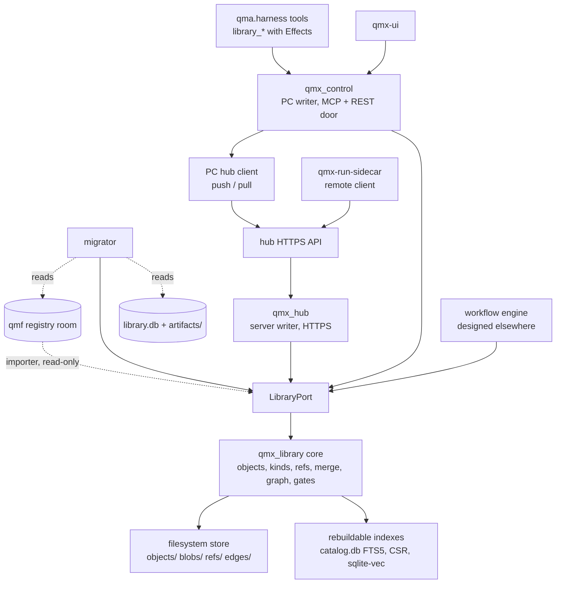
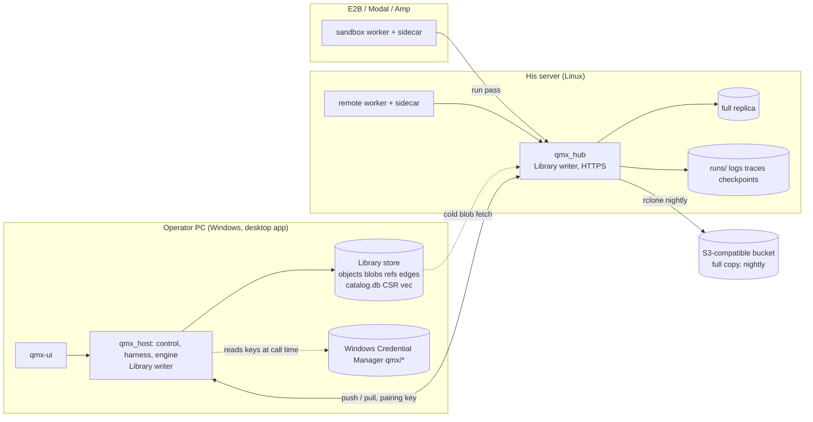
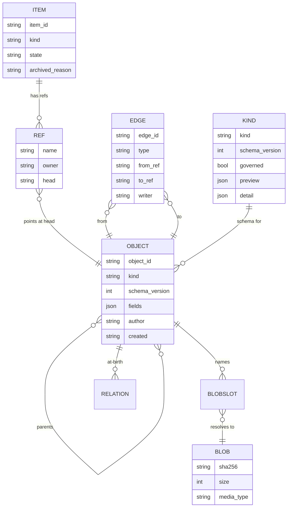

Amended 2026-10-18 by the studies-folded pass (studies 44, 45 and 46 on top of the unlock pass; `research/methodology/47-studies-folded.md`): AD-22 (marks derived at read), AD-23 (hypotheses) and AD-24 (claims on in-progress work) added; AD-3 (a class per kind, the roster is data), AD-4, AD-6, AD-7, AD-8, AD-9, AD-15, AD-18, AD-19 and AD-21 amended in place. Amended 2026-10-18 by the unlock pass (ruling 118, `research/methodology/43-whole-app-unlocked.md`): AD-21 added (sessions are Library items); AD-3 (kind `session`), AD-5 (the PC writer is `qmx_host`) and AD-9 (no grant step) amended; the Deferred row on chat sessions closed. Amended 2026-10-16 (night) after rulings 45-59 and the engine's LIBRARY-REQUESTS L1-L10: AD-18 and AD-19 added; AD-3, AD-4, AD-5, AD-6, AD-7, AD-9, AD-10, AD-11, AD-12, AD-15 amended in place; OPEN-1, OPEN-5 and OPEN-6 closed. Amended again the same night for the gap fixes of ruling 88 (27b §6, engine L11-L17): drafts off `main` (`refs/drafts/*`, AD-7, AD-15, AD-18); one shared run status table plus `mode` (AD-15, AD-18); no key ever reaches a worker (AD-12, AD-13); challenger and draft refs (AD-7, AD-11, AD-19); `replaces` for the engine's `supersedes` and `ran-on` retired (AD-4); workflow templates (AD-3); the verb count (AD-9); OPEN-7 closed by ruling 80. AD ids are stable.

# Architecture Spine — QMX Library and remote data

Labels used throughout: **[retrieved]** read from a source named above, **[remembered]** from standing QMX memory, **[inferred]** this run's own reasoning, **[ADOPTED]** already settled by the operator or by existing code.

## Design Paradigm

**Content-addressed, append-only object store with git-like refs, behind one port.** Three nouns carry the whole model:

| Noun | Meaning | Mutable? |
| --- | --- | --- |
| `blob` | bytes, addressed by `sha256` | never |
| `object` | one version of one item: a typed manifest (kind, fields, blob refs, parents, at-birth relations), addressed by `fp1` of its canonical bytes | never |
| `ref` | a named pointer from an item to an object (`main`, a variant, a run branch) | only by compare-and-swap |

Plus `edge`: an append-only typed relation record between two objects that accrues after birth (the CT-07 shape, kept verbatim).

Layer map (hexagonal at the seam):

| Layer | Lives in | Owns |
| --- | --- | --- |
| Library core (the deep module) | `qmx_library/` (new package, pure Python, stdlib + pydantic) | object model, kinds registry, refs, merge, graph, grounding, refusal gates, replication |
| Store adapters (internal seams) | `qmx_library/store/` | filesystem object store, SQLite catalog + FTS5, CSR graph index, optional sqlite-vec index |
| Port (the one external seam) | `LibraryPort` (fourteen verbs plus the operator-only `adopt`) | the only way in for the UI, the harness tools, the engine, the hub and the migrator |
| Hosts | `qmx_control` (PC writer), `qmx_hub` (server writer), `qmx-run-sidecar` (remote client) | process, auth, transport |

Everything is files (rebuild DESIGN §7.6b rule zero, **[retrieved]**); one writer per store; indexes are never evidence.

## Invariants & Rules

### AD-1 — One Library, one paradigm [ADOPTED by ruling 28]

- **Binds:** all
- **Prevents:** a second Library (today there are two with opposite rules), mutable catalog rows, "projection only" kinds that cannot be stored, a free kind string
- **Rule:** Every stored thing in QMX that is not market data, live trading state or a secret is a Library object of a registered kind. There is exactly one Library object model (`blob`, `object`, `ref`, `edge`). `qmb/registryread/library.py` (Library A) and `qmx_control/library.py` (Library B) are both replaced by `qmx_library`; no code path writes a saved result anywhere else.

### AD-2 — Identity is content, refs are the only pointer

- **Binds:** all writers, the migrator, the hub
- **Prevents:** one bot existing as three records (DEC-0271's own fear), lost updates between two agents, a remote run overwriting the PC's version, two ids for one registry record
- **Rule:** A manifest has two parts: `identity` (hashed) and `annotations` (not hashed). `object.id = fp1(canonical identity bytes)`. Each kind schema declares `identity: ct06 | manifest`: for a governed kind the identity content is exactly the CT-06 record's identity content, so the object id equals the registry's record `fp1` and a registry record imports under its own id; for every other kind the identity is the manifest minus `annotations`. `author`, `created`, `tags` and `aliases` are annotations for every kind, so two agents producing identical content dedupe to one object and a tag change mints no version; annotations ride a display-only occurrence sidecar keyed by object id, the way `qmf-registry` persistence already stores writer and sequence. `blob.id = sha256(bytes)`. `item.id` is a UUIDv7 (`uuid.uuid7()`, stdlib in Python 3.14) minted once and never reused. A ref moves only through `advance(ref, expected_head, new_head)`; a mismatch is a typed refusal `stale_head`, never a silent overwrite. A byte-identical re-put is idempotent; a true collision is refused and alarmed (CT-09 law, kept).

### AD-3 — Kinds are schema files with a class; the roster is data

- **Binds:** kinds registry, UI shelves, agent tools, migrator
- **Prevents:** the UI's 15 shelves and the backend's free `kind` string drifting apart again; a kind that cannot be previewed
- **Rule:** A kind exists only as a schema file `kinds/<kind>.schema.json` carrying `kind`, `schema_version`, `fields` (JSON Schema), `blobs` (named slots with media types), `preview` (card fields), `detail` (tabs and which blob or field each shows), `class: record | definition | governed` (studies-folded pass, 45 DC-1: the class replaces the `governed: bool` flag and every hand-written list of kinds in this spine, engine AD-11 and the Lab conventions; code reads the class, never a list of kinds). **The roster is data:** a kind is added by adding a schema file, never by code, and the v1 schema files are listed in the Structural Seed. **One rule per class:** `record` kinds (results, artifacts, notes, memory rows, runs, sessions, hypotheses and the like) have no lifecycle and land on `main` at once under AD-18; `definition` kinds (workflows, mini apps, agents, pods, pod blocks, skills, methodologies, personas, components, agent-made tools) follow engine AD-11's one lifecycle and reach `main` only by his publish; `governed` kinds (`unit`, `strategy`, `bot`, `book`, `bms`, `binding`) reach `main` only by his click. Retired by the same pass (marked `retired` in their schemas, as below; nothing was stored under them): `board` (a workflow draft shown in board view, Lab AD-2), `bot-card` (the bot kind's preview, AD-17), `logic` (a blob slot of `bot` and of a code `pod-block`) and `template` (a tag on any definition item); added: `hypothesis` (record, AD-23) and `app-profile` (record, engine AD-64). Added by the unlock pass (2026-10-18, ruling 118): `session` (one item per chat, AD-21). Added by the rerun (2026-10-18): `persona` (one operator-scope item: the copilots' tone and defaults, slot 1 of their system text, edited in Settings; engine AD-18) and `agent` (a named agent as a folder, ruling 19 and BACKLOG B32: persona text, model or role pins, skills, tool packs, routines as trigger refs, home machine; the backend shape of the Bots roster, whose organogram meaning is methodology work later); both follow the lifecycle rule of AD-18 (`agent` is a lifecycle kind). A **workflow template** additionally carries a `slots` schema (the fill-in fields of engine AD-46), and skills, workflow templates, mini-app templates and blueprints share engine AD-46's one lifecycle and curator; the curator archives, never deletes (AD-6). Pods are resolved with the Lab spine (lab-and-pods AD-10, AD-11): `pod` (a versioned stack of pure blocks in seven slots) and `pod-block` (one pure rule) are the UI's **ungoverned design kinds**; `book` and `bms` are **governed** mirrors of CT-22 and CT-27 (`identity: ct06`) that `PodCompilerPort` writes, linked `pod version → compiles-to → book | bms`. Three more kinds carry rules of their own: `dataset` is a **card**, never the data: fields `source, instruments[], window, world, split_fp (CT-12), licence, partition_digests[]`; ticks and bars stay in the qmf-data rooms or the market-data service, and every result object carries `consumed → dataset` by hash (file 30 §4a). `memory-row` (engine L1): identity `scope, tag, intent_key?, when_to_use, content, refs[]`, tag ∈ `built | lesson | dead_end | do_not_retry | negative_result | procedure | preference`; annotations `keywords[], confidence, f, u, source_run_ids[], learned_at, occurred_at`, so an `f`/`u` update mints no version; a memory row also carries `derived-from` relations, written at its birth by `consolidate` or the retain worker, to the results, runs or sessions it came from, so AD-22's walk reaches it (review 48 M6). `agent-tool` (engine L4): blob `tools/<name>.py` plus a declared schema, field `review ∈ unreviewed | reviewed`, loadable only into the run that made it (engine AD-61, its `run:<run_id>` toolset) while `unreviewed`, and elsewhere only after his review (review 48 M15); archive is the item state as for every kind. Each kind schema also declares which annotation fields it accepts (AD-2); `intent_key` is accepted by every kind a run can produce. The ten DEC-0271 kinds map one-to-one, by this table and no other: `bot-definition→bot`, `strategy-family→strategy`, `confluence→component`, `book-definition→book`, `bms-definition→bms`, `book-binding→binding`, `split-manifest→dataset`, `source-observation→source`, `performance-result→backtest-result`, `experiment-spec→setup`. The `workflow` kind accepts `semver` as an annotation (AD-2), so setting a version number at publish mints no new object; lifecycle is a ref fact (`refs/drafts/*` vs `main`), never a field. `template` is retired as a kind: a template of any definition kind is a published version tagged `template` (a pod template included); a **workflow template is a published `workflow` version tagged `template`** (engine AD-22), and "use this template" puts a new `workflow` draft with `derived-from → template version`; a variant is `variant-of`. A kind is never added by a string at a call site. A kind is never removed; it is marked `retired` in its schema.

### AD-4 — Relations are typed and closed

- **Binds:** manifests, edge log, graph builder, UI "used in", agent `relate`
- **Prevents:** free-text `relation` ("related"), lineage split between a `links` table and CT-07 JSONL, a graph nobody can parse without a model
- **Rule:** The vocabulary is the fourteen CT-07 edges verbatim plus the Library set `produced-by`, `consumed`, `derived-from`, `uses`, `part-of`, `cites`, `tested-by`, `instance-of`, `run-of`, `ran-on`, `variant-of`, `version-of`, `merged-from`, `annotates`, `replaces`, `archived-as`, `resolves`, `made-by`, `used-by`, `compiles-to`, `touched`, `mentions`, `explains`, `related-to`. `compiles-to` links a `pod` version to the `book` and `bms` objects compiled from it (Lab AD-11); `touched` links a run to the sealed holdout `dataset` card it opened, so the Lab's family ledger counts holdout touches as edges, never as a stored counter (Lab AD-5, AD-6). The engine's closed set uses these names directly (`version-of, variant-of, run-of, produced-by, consumed, tested-by, replaces, archived-as`); the port still normalises `_` to `-` for old callers, `consumed_by` is the reverse reading of `consumed`, and the engine's earlier word `supersedes` is `replaces` (one relation, not two). `ran-on` is **retired**: a run's placement is a field set on the `workflow-run` (engine L14: `placement`, `agent_mode`, `health`, `cost_machine_minutes`, `link_out`), not a relation to a stored machine object; the name stays in the vocabulary so older records parse, and no new code writes it. At-birth relations are a field of the manifest (so they ride the object's `fp1`); after-birth relations are append-only edge records keyed by their own `fp1`. Readers never union the two without saying which is which. Any other relation string is refused. *Studies folded (47):* added `tests` (a result → the `hypothesis` it tests, AD-23); any edge may carry an optional `locator` attribute (`seconds`, `page` with `paragraph`, or `line`) naming where in the source a derived item came from, so a note points back to the minute of a video (46 X-24); a holdout touch stays the `touched` edge (46 X-19 merged). **An edge says what an object is about, never that it is true:** an outcome lives on the target object (a `tested-by` edge proves a test ran; the run's status says whether it passed; a result's `outcome` field says what it shows).

### AD-5 — One writer per store; indexes are never evidence

- **Binds:** `qmx_control`, `qmx_hub`, every agent, the UI, the engine
- **Prevents:** two processes writing `library.db`, an agent editing a catalog row, a backup of an index being mistaken for a backup of the Library
- **Rule:** Evidence is the on-disk set `objects/`, `blobs/`, `refs/` (append-only log of ref moves) and `edges/` (append-only JSONL). Exactly one process per store writes it: the host process (`qmx_host`, engine AD-52; the control process before the unlock pass) on the PC, the hub service on the server. `catalog.db` (SQLite: items, objects, refs head view, FTS5, kinds), the CSR graph and the vector index are rebuilt from evidence by `rebuild_indexes()` and may be deleted at any time. No caller opens `catalog.db` directly; every reader and writer goes through `LibraryPort`. **Index watchers** (engine L10) are the only other index path: the writer publishes `library` events after each commit, and a registered watcher (a `MemoryProvider` adapter among them) receives `index(objects)` on creation and `forget(ids)` on archive, with `rebuild(all)` available; a watcher's store is a rebuildable index like the catalog, never evidence, and a lost watcher is replayed from the ref log.

### AD-6 — Archive, never delete [ADOPTED by ruling 9]

- **Binds:** all kinds, all ports, the hub, the migrator
- **Prevents:** DEC-0443's `uninstalled` state, a "Remove" button that deletes, a GC that drops the only copy
- **Rule:** No port has a delete verb. An item has `state ∈ {active, archived}` with `archived_reason` and optional `replaced_by`. A state change is a ref-log entry on the reserved ref `refs/items/<item_id>/state`, whose head is the literal state and whose entry carries `reason` and `replaced_by`; it is owned by the item's `main` owner and changes no object. The catalog's `items.state` is rebuilt from that log. Blobs of class `durable` (the default) are never purged in v1. The one exception is blob class `transient`, declared per slot by the kind schema (today only `workflow-run` `checkpoints/*` and `heartbeat` logs, engine L5): a transient blob is kept on its home store for `transient_retention` (UI-editable, default 30 days, never shorter than the run's own life), is not pushed to the bucket, and is dropped after that; the object that named it stays readable and reports `blob_expired` for that slot. Search hides archived items by default and shows them on request. *Studies folded (47):* **one exception to archive-never-delete** (46 X-16): `purge(blob_id, reason)`, callable only by the `operator` principal and only for a blob holding a secret, replaces the blob with a tombstone on every store, replica and the bucket and writes the purge to the ref log; the object that named it reads `blob_purged`. Redaction (engine AD-37) runs at every `put`, from any principal, so a token-shaped value is refused at landing before a purge is ever needed. The curator (engine AD-46) archives records on test-mode run refs that nothing cites after `curator.test_record_days` (Claude's default 30), so noisy test output leaves search without anything being deleted (46 K-25).

### AD-7 — Every writer owns its ref namespace; merging into `main` is explicit

- **Binds:** agents, remote runs, the hub, the engine, the UI comparison view
- **Prevents:** two agents clobbering one item, a remote run writing `main`, a merge that silently picks a side
- **Rule:** Every call carries one `Principal` from the closed set `operator | agent:<session_id> | run:<run_id> | engine:<store> | hub | migrator`, derived once at the door (UI bearer → `operator`; the per-chat in-process `qmx` MCP server → `agent:<session_id>`; a run pass → `run:<run_id>`; the engine service's own credential on a store → `engine:<store>`; the pairing key → `hub`). Ref namespaces and their single owner: `main`, `refs/variants/<name>` and `refs/items/<item_id>/state` — `operator` on the **primary** store (AD-19), and `engine:<store>` may fast-forward `main` under AD-18; **`main` holds published versions only, never a draft**; `refs/drafts/<item>` — the operator's draft of that item, `operator` on the primary store, and `engine:<store>` may advance it only to land an object of a lifecycle kind that a run produced (AD-18; engine L15); `agent:<session_id>` may also **merge** into `refs/drafts/<item>` (DOMAIN_WRITE, recorded `merged-from`) but may not `put` onto it; `refs/agents/<session_id>/<item>` — that `agent:<session_id>` (an agent's draft); `refs/runs/<run_id>` — `run:<run_id>`, and the *store* that owns it is the store that minted the run (the PC for a local run, the hub for a remote one; run ids are UUIDv7, so no two stores mint the same ref); `refs/memory/wf/<workflow_item>`, `refs/champions/<workflow_item>` and `refs/challengers/<workflow_item>` — `engine:<store>` on the store of the engine instance named by the trigger's `home_engine` (engine AD-3; engine L2, L3, L16); a workflow whose triggers live on both homes keeps one champion and memory owner, the `contabo` instance (the schedule default); `refs/memory/home/<home>` and `refs/memory/operator` — `engine:<store>` on the primary store; `refs/conflicts/<item>/<n>` — whoever owns the `into` ref; `refs/hub/*` — `hub`. A principal may advance only refs it owns. A challenger is drafted on `refs/challengers/<item>`; `refs/champions/*` moves only after a passing replay (engine AD-26) and is never a merge into `main`. Publishing a draft is a merge from `refs/drafts/<item>` or an agent ref into `main`. A merge into `main` is `merge(item, from_ref, into=main, strategy)`: three-way on the manifest field by field, and per blob by media type (`text/*` three-way line merge; `application/json` structural merge; anything else pick-one). Every merged object records `merged-from` relations to both parents. A conflict never picks a side: it mints a `merge-conflict` object on `refs/conflicts/<item>/<n>` carrying both sides and the diff, and the comparison view renders it until a human or an authorised agent resolves it. Which objects fast-forward without a merge is AD-18. *Studies folded (47):* two more reserved namespaces: `refs/items/<item_id>/marks` (the stored mark of AD-22), owned like `refs/items/<item_id>/state`, and `refs/claims/<intent_key>` (AD-24), owned by `engine:<store>` on the Hub store (the primary once the server exists) and transient (never bucketed, pruned when released or expired). The rule every namespace follows (45 C6): each principal writes only refs it owns, and `main` moves only by publish, by the landing rule (AD-18) or by merge; a new namespace needs a new principal or a new rule here. A `workflow` definition merges with its own driver, three-way per node id and per parameter with one conflict per node, and a merged definition that fails engine validation becomes a `merge-conflict` instead of landing (46 K-12; property tests on random graph edits).

### AD-8 — Search is parse-first; the graph gives provenance, calibrated confidence decides abstention

- **Binds:** search, grounding, agent `walk`/`ground`, the copilot's Library answers
- **Prevents:** an LLM inventing ids or edges, GraphRAG-style extraction, a refusal that is "a model being humble"
- **Rule:** (1) The knowledge graph is built by parsing manifests and edge records only; no model call builds any node or edge. (2) The grounder maps text to item ids by longest-match over a normalised alias table (titles, tags, symbols, families, kind names, aliases declared in schemas); a model never emits an identifier. (3) Text candidates come from FTS5; dense candidates (optional, sqlite-vec) only re-order a candidate set the graph or FTS already produced and never add an item. (4) Only plain facts refuse before any model runs, deterministically: `no_entry_point` (nothing matched), `only_archived_or_superseded`, `no_evidence_as_of`; the thin-evidence signals (`too_few_concepts`, `no_path`, `no_quotable_terminal`, `insufficient_paths`) are handed to the answering step, whose abstention comes from calibrated confidence (engine AD-45), because the clipping this design rests on found that path certification predicts correctness at chance while calibrated confidence does not (45 §3.3). (5) Every answer carries the object ids it walked and, per item, the edge type that admitted it (`used in`, `produced by`, `same family`). (6) Search stays a pipeline (ground, walk, rank, cite), never an agent loop. (7) Ranking reads the producer's status (a passed live run, his own item, a test run), grade and citations, so noisy fan-out output ranks below trusted results (46 X-15). (8) Every truncation constant (previews, snippets, `doc_read` cut-offs) is a tested setting and keeps a report's conclusion. (9) The grounder's precision is measured against items' own tags and edges, not coverage alone (probe P-SRCH); a span linker for paraphrase may sit behind the optional dense index and never emits an id outside the vocabulary. (10) The graph is the SQLite edge table with recursive queries in `catalog.db` first; the in-memory CSR is built only when measured (45 DC-15).

### AD-9 — One port, its verbs, harness Effects by class

- **Binds:** `LibraryPort`, the MCP tools on the control door, the engine, the hub API, the UI
- **Prevents:** per-kind tool sprawl, an agent writing `main` or `catalog.db`, a tool with no Effect
- **Rule:** `LibraryPort` = `resolve`, `get`, `search`, `walk`, `ground`, `find_by_intent`, `search_runs`, `marks` (AD-22), `put`, `relate`, `branch`, `merge`, `checkout`, `commit`, `annotate`, `claim` and `release` (AD-24, `engine:<store>` only), plus three verbs only the `operator` principal may call: `adopt` (the FM-16 recovery), `mark` (set or clear `quarantined` with a reason, AD-22) and `purge` (AD-6's one exception); `get`, `search` and `walk` take an optional `as_of` (a time or a ref-log position) answered from the ref log (46 K-26). `find_by_intent(intent_key) → [object_id]` returns active objects carrying that annotation whose `produced-by` run has status `passed` (engine L6). `search_runs(query, workflow?)` is FTS5 over `workflow-run` summaries and mirrored transcript blobs, no model call (engine L7). `annotate` sets annotation fields the kind schema accepts (`tags`, `aliases`, `intent_key`, `f`, `u`, …) and mints no version; any principal may annotate objects on refs it owns, and `operator` or `engine:<store>` may annotate anything. Effects (harness `Effect`, unchanged): `resolve/get/search/walk/ground/find_by_intent/search_runs` = READ; `put/relate/branch/commit/annotate` = DOMAIN_WRITE (always onto a ref the caller owns); `merge` into `main` from an **agent chat** = DOMAIN_WRITE for record-class kinds and MANAGE for governed-class and definition-class kinds (AD-3; a `pod-block` included, since its merge into `main` is publishing it), because a merge of those into `main` is publishing and publishing asks him once (ruling 80, which closed OPEN-7); a merge into `refs/drafts/<item>` is DOMAIN_WRITE; a **workflow's** fast-forward into `main` never asks (AD-18); `archive` from a chat = MANAGE, from a workflow under its standing rule = none; `adopt` is never exposed as an agent tool. The new tool rows are entries in the harness's `AGENT_OPERATIONS` table, added like any other change (H17 was built in HG1; ruling 118 removed the grant step); until the Library packet adds them the existing `library_*` rows serve. Agents get a filesystem view: `checkout(item, ref) → <home>/library/checkout/<ref>/<item>/` and `commit(path, message)`; the checkout is a working copy, never the store.

### AD-10 — Three storage tiers; the PC is not the only copy

- **Binds:** blob store, replication, the hub, backups
- **Prevents:** the PC filling up (ruling 42), the only copy living on a laptop, a blob fetched from nowhere
- **Rule:** The PC holds `catalog.db`, all manifests, all edges and hot blobs. The server replica holds everything durable. The S3-compatible bucket holds everything durable. A blob is addressed by hash wherever it is; `get` fetches a missing blob from server then bucket and caches it. A durable blob may be evicted from the PC only after two verified remote copies exist (hash re-read on both); a transient blob (AD-6) lives on its home store only and is never bucketed. Market-data Parquet is not Library data and keeps its qmf-data rooms (on the PC as a hot cache, on the server as the primary, file 30 §4b); the Library reaches it only through `dataset` cards.

### AD-11 — The Hub is the remote-data intermediary [ADOPTED by ruling 43]

- **Binds:** remote runs (server, E2B, Modal, Amp), the PC, the engine when it runs remotely
- **Prevents:** remote runs needing the PC awake, remotes dialling into the PC (DEC-0497 keeps "daemon never dials in"), a remote run writing `main`
- **Rule:** `qmx_hub` on his server serves the same `LibraryPort` over HTTPS and is the single writer of the server store. The PC and every remote run are clients of it. The hub store owns `refs/runs/<run_id>` for runs it minted, `refs/memory/wf/*`, `refs/champions/*` and `refs/challengers/*` for workflows scheduled on the server, and `refs/hub/*`; the primary store (AD-19) owns `main`, `refs/drafts/*`, `refs/variants/*`, `refs/items/*/state`, `refs/memory/home/*` and `refs/memory/operator`; the PC store owns `refs/agents/*` and `refs/runs/<run_id>` for local runs. Replication is object-level (immutable objects and blobs copy in any direction without conflict) plus ref mirroring by owner (a mirror never advances a ref it does not own). The hub holds no broker credential and exposes no money verb. **The Hub is the engine's remote gateway** (engine AD-20, L8): `get_version_bundle(workflow_id, version)` is `get(object_id, blobs="fetch")` of the pinned `workflow` object and its blobs; `events(run_id)` is the Hub's SSE of that run's ref-log tail and sink; `placement_status` and `cancel(attempt)` belong to `qmx-node` (engine AD-25), which is colocated on the server but is not the Library. The Hub listens on the tailnet first: the PC, his server, Amp runners and orbs join by Tailscale (orbs through OIDC workload identity, file 32), and a run pass is still required on every call because identity is not authorisation; a public HTTPS listener for providers that cannot join the tailnet is OPEN-5. Names: `qmx_hub` is "the Library Hub"; DEC-0188's passive file-sync hub is "the node inbox" from here on (file 30 §3.12). The hub monitors itself: `/healthz`, replication lag and its own logs are written as `test-report` objects on `refs/hub/health`, and the PC's doctor page shows hub reachability and lag.

### AD-12 — Per-run passes; no key reaches a worker; secrets never ride the hub

- **Binds:** hub auth, run submission, provider keys, broker credentials
- **Prevents:** a leaked pass reaching `main` or money, a hub that stores keys, a credential in a run manifest, a provider key on any worker (engine AD-28)
- **Rule:** The owning engine instance (the PC's or Contabo's) mints a **run pass** per node attempt, the Library's run token grown into the engine's pass (engine L12): `{run_id, attempt, placement, read_scope, write_prefix: refs/runs/<run_id>, key_scope: [qmx/* names the relay may inject], model_scope, data_scope: [dataset or CT-12 fingerprints the run may read from the market-data service, file 30 §4d], relay_url, expires, nonce}`, signed with the pairing key; the hub verifies it by signature per request (no lookup) and refuses any pass on the signed revocation list it pulls each sync. **Provider keys never reach a worker:** the relay on the runner host, or the central relay on Contabo, injects the key into each model call (engine AD-28); the worker holds only the pass, and every `ComputeProvider.start` call passes only `{QMX_RUN_PASS}` in `secrets` (the old `credentials_scope` over stdin or sandbox env is retired). Keys are never stored on the hub or in any Library object; the encrypted key replica is `qmx-vault`, a separate service beside the Hub, never on the Hub's data path (engine L11). Broker credentials (`qmx/ctrader-*`, `qmx/backup-payload-key`) are never in any `key_scope`; the hub refuses a token naming them. The money rule stands: the only order verb is `propose_order` on the PC, and a remote run can at most write an `order-proposal` artifact to its own branch.

### AD-13 — Every remote run carries the DevOps sidecar

- **Binds:** `qmx-run-sidecar`, every ComputeProvider, the run object
- **Prevents:** a run that leaves no trail, logs that only exist on the sandbox, secrets in logs
- **Rule:** A remote run starts under `qmx-run-sidecar`, which: emits a heartbeat to the hub; ships structured JSONL logs and OTLP metrics/traces to `runs/<run_id>/` on the hub; flushes checkpoints every 5 s and at every node boundary; redacts the run pass and every declared secret value from logs and outputs (it holds no provider key to redact); scrubs the environment at exit. The `workflow-run` object links `logs`, `traces`, `checkpoints` and `outputs` as blobs, so observability is Library data.

### AD-14 — Offline is the normal case

- **Binds:** PC client, hub, replication
- **Prevents:** sleep losing work, clock-ordered conflicts, a stale PC overwriting the hub
- **Rule:** The PC is a hub client like any other. While the PC sleeps the hub keeps serving runs. On wake the PC `pull`s refs and the objects it lacks, then `push`es its own; order is decided by parent hashes, never by wall clock. A pulled ref the PC does not own replaces the PC's mirror; a ref the PC owns is pushed with `expected_head`, and a `stale_head` from the hub is an alarm, not a merge; the one legitimate cause (the PC restored from an older backup) is resolved only by the operator's explicit `adopt(ref, from=hub)`, which records the adoption in the ref log. Neither side ever deletes. With `primary = server` (AD-19, from the Contabo setup on) the server lands server-homed runs and moves `main` while the PC sleeps; a PC-homed run that passes while the Hub is unreachable keeps its objects on its own run ref and lands when the PC reconnects (review 48 H5).

### AD-15 — The engine reads and writes the Library through the port only

- **Binds:** the one workflow engine (designed elsewhere), the Library
- **Prevents:** a second definition store inside the engine, runs with no lineage, "tested" as a mutable flag
- **Rule:** A workflow definition is a `workflow` object (one JSON document blob, n8n-shaped, plus pinned test data blobs, plus the workflow folder as `bundle.tar`). The engine resolves `(item, ref)` to an object id at start and pins it for the run; a scheduled run resolves the exact object its trigger pinned, or `refs/champions/<item>` when the trigger follows the champion and that champion descends from the pinned object; it never runs a draft and never falls back to a moving ref. Each run writes exactly one `workflow-run` chain on `refs/runs/<run_id>` (a new object per status change, linked by `parents`) with the field **`mode: live | test`** (fixed at birth) and a **status from the one shared table** `queued | running | waiting | passed | failed | stopped | interrupted` (engine SOLUTION-DESIGN §3.1, the same words on both sides; engine L17), the placement fields of engine L14, per-node results, blob slots `summary`, `trace`, `logs/*`, `transcripts/*`, `checkpoints/<node>/<attempt>` (transient, AD-6), and the relations `run-of → workflow object`, `consumed → inputs and dataset cards`, `produced-by ← every artifact`. A workflow version is "tested" when a `tested-by` edge points at a `workflow-run` whose status is `passed`, **in either mode**, for an object whose `fields.content_hash` equals this one's (the engine's definition hash, computed at `put` and excluding `position` and `meta`, engine SOLUTION-DESIGN §2.2); `publish` (engine) copies the edge onto the published object when the hashes match, and a publish whose merge changed the hash reads as untested. A passed run with `mode: test` (engine L9) is a real run on real models that never fast-forwards (AD-18). The engine keeps live execution state in its own SQLite and nothing else. *Studies folded (47):* `qmx_library` ships `EngineLibraryAdapter`, which implements the engine's built `LibraryPort` (`qmx_engine/ports/library.py`, its kind-specific verbs) over this port, so the engine's seam has two adapters, the engine's in-memory fake and the real one, and the engine changes nothing; the engine's own tests against the fake are the adapter's contract tests (45 DC-14).

### AD-16 — Backups are replication plus drills, not snapshots of an index [ADOPTED by DEC-0118 topology]

- **Binds:** PC, server, bucket, restore drills
- **Prevents:** a GitHub snapshot standing in for a backup, the bucket pushed by a sleeping laptop, an index restored as if it were data
- **Rule:** PC→server: every commit pushes its objects and blobs (rclone over SFTP, checksum mode) and the ref-log tail. Server→bucket: nightly, pushed by the server, never by the PC (DEC-0188 kept). Restore = copy evidence back and `rebuild_indexes()`. Drills on the server: nightly sample restore (one random object and its blobs, hash verified), monthly full rebuild into a scratch root. The control weekly GitHub snapshot no longer carries `library.db`.

### AD-17 — Previews and detail views are schema data

- **Binds:** kinds registry, the UI, agent summaries
- **Prevents:** the UI drawing its own version of an item from demo arrays, a kind with no card
- **Rule:** `preview` (card fields, badge field, colour-by field) and `detail` (tabs; each tab names a field set or a blob slot and a renderer: `text`, `markdown`, `code`, `json`, `table`, `chart`, `video`, `pdf`, `image`, `graph`, `diff`) are declared in the kind schema; `merge-conflict` uses `diff`, which is the comparison view. The UI renders generically from them and may register a richer per-kind component; the generic path must always work. "Used in" is the relation neighbourhood, never a hand-built list.

### AD-18 — Nothing waits for him: workflows land on `main` under a standing rule [ADOPTED by ruling 57]

- **Binds:** engine fast-forwards, `main`, the UI "what landed" feed, governed promotion
- **Prevents:** a review queue that silently blocks overnight work, a human gate inside a run, a result that exists only on a run branch nobody looks at, a workflow promoting a trading unit onto the node
- **Rule:** Every `workflow` object carries a standing rule `publish ∈ auto | hold` (default `auto`; `hold` is set by him per workflow, never by a run). When a run ends with status `passed` and `publish = auto`, `engine:<store>` fast-forwards every `record`-class object the run produced (AD-3: results, artifacts, notes, memory rows and the rest of that class) from `refs/runs/<run_id>` into the owning item's `main`, garbage or clean, without asking; a non-fast-forward (someone else moved `main`) becomes a `merge-conflict` object and the run's other objects still land. Runs with `mode: test` never fast-forward, even when they pass, and runs whose status is not `passed` never do. **Objects of the definition and governed classes** (AD-3) that a run produced land on `refs/drafts/<item>` instead of `main` (ruling 80: creation is human-driven first; engine AD-11, AD-22), and he publishes them with one yes; record-class objects still land on `main` without asking (ruling 57). A non-fast-forward on `refs/drafts/<item>` becomes a `merge-conflict` object like one on `main`. The UI shows what landed (a `landed` feed built from `ref_advanced` events on `main` by `engine:<store>`, with the run and the rule that let it in) and never gates it. Two things stay outside this rule by design: a self-improvement **challenger** of a workflow moves `refs/champions/<item>` (engine AD-26) and reaches that workflow's `main` only by his click; **promotion of a governed unit to the trading node** is the node's own click-gated pull of registry as-of sets (DEC-0188, TN-20), and the Library's `main` never triggers it. *Studies folded (47):* **one landing rule by class for every writer** (45 DC-1): a `record`-class object lands on `main` at once when its writer is a live run that passed (above), a copilot chat (the session recorder, as `engine:<store>`, fast-forwards the records an agent session wrote on its agent ref at each turn end, AD-21; 45 A5) or the operator; a `definition`-class object stays a draft until his publish; a `governed`-class object reaches `main` only by his click (a governed object a run produced, such as a compiled `book`, waits on `refs/drafts/<item>` and is visible to Lab reads there); test-mode runs never land. A live run of a published procedure on a draft *subject* lands its records citing the subject's exact object id (Lab AD-4).

### AD-19 — The primary store is configuration, not architecture [ADOPTED by ruling 56]

- **Binds:** both stores, every client, the migration
- **Prevents:** a server move that needs a redesign, two primaries, a UI that knows which store it talks to
- **Rule:** Exactly one store is `primary` at a time, named in `settings.toml [library] primary = pc | server`; the primary owns `main`, `refs/drafts/*`, `refs/variants/*`, `refs/items/*/state`, `refs/memory/home/*` and `refs/memory/operator`, and runs the operator writer. Every client (UI, harness tools, engine, migrator) talks to `LibraryPort` through the control door, which routes to the primary and never exposes which store answered. The PC store is a full client either way: with `primary = pc` it is the writer and the server replicates from it; with `primary = server` it is a replica plus a local cache of hot blobs and a working copy for checkouts, and its writes go to the Hub. Cut-over is a procedure, not a build (MIGRATION step 8): quiesce the PC writer, push until the ref logs are equal, flip `primary` on both sides, restart; the reverse is the same steps. No kind, relation, verb, token or ref namespace changes with the flip. *Studies folded (47), made unconditional by review 48 H5:* the flip to `primary = server` is part of the Contabo setup step, because server-homed work (schedules, webhooks, app-to-app chains, memory consolidation) must land and fire events while the PC sleeps; before the server exists the PC is primary and no work is homed elsewhere. Probe P-LAT measures the Library screens over the tailnet with the PC as replica and cache; a failure is a latency bug fixed on the PC side (reads served from the replica), never a reason to keep the PC primary (45 DC-11).

### AD-20 — A checkout is a working copy per writer, materialised from objects; destructive edits are checkpointed (rulings 41, 102; engine AD-49; wording fixed after 41 M12)

- **Binds:** `checkout`/`commit` (AD-9), agents, delegated children, the engine's workers
- **Prevents:** two agents editing one working copy, a hand edit lost to an agent's restore, a working copy pruned with unmerged work
- **Rule:** the Library is a content-addressed object store with git-like refs, not a git repository, so `checkout(item, ref)` gives each writer principal its own working copy as a folder **materialised from that ref's objects**, labelled for its ref (`agents/<session_id>/<item>` for `refs/agents/<session_id>/<item>`, `runs/<run_id>/<item>` for a run), never a shared folder; `commit(path, message)` turns the folder's tree into objects on that ref (AD-7), so merging stays the Library's three-way merge and a collision still mints a `merge-conflict`. `git worktree` is used only for real git repositories an agent edits (engine AD-49). A working copy is removed only with proof (its ref merged, or the item archived). Before an agent's destructive edit the writer takes a checkpoint in the working copy's own shadow-git store (the last three kept, removed with the working copy); a restore keeps his hand edits and can restore one file. Dependency trees are linked into a working copy when the lockfile matches.

### AD-21 — Sessions are Library items; the live transcript stays the CLI's (ruling 28, ruling 118; closes the Deferred row on chat sessions)

- **Binds:** the host's session recorder, kinds registry, search, the UI session lists, agent recall of past sessions
- **Prevents:** sessions being the one thing the Library cannot find or link ("the Library stores everything", ruling 28), a second session store the UI and agents query, a session item that grows a version per turn, a raw transcript (with a key in it) landing in the Library
- **Rule:** every chat the harness creates gets one Library item of kind `session` (identity: `session_id`, `home`, `created`), written by the host's session recorder with the principal `engine:<store>` (the host's own system writes, engine AD-52). At each turn end the recorder sets annotations only (title, last turn time, models and profiles used, pack set, token totals, child session ids), so no version is minted per turn (AD-2). When the chat is closed by its owner, archived, or idle past a day, the recorder puts a new object version whose blob slot `transcript` is the harness's redacted export (engine AD-37), and links `produced-by` from every object the session's agent wrote (their `author.id` already names the session). Search finds sessions through FTS5 over those blobs and annotations like any other kind (AD-8); there is no new verb. The live transcript stays the CLI's SDK JSONL in the harness home; the Library copy is an export, never read back to resume a chat. Archive, never delete (AD-6). *Studies folded (47):* the recorder also mirrors the chat record's attached context references (engine AD-63) into the session item's annotations with a `mentions` edge to each attached item, and records the session's surface digest (engine AD-62).

### AD-22 — Marks live on roots and are derived at read (46 X-1; studies-folded pass)

- **Binds:** `LibraryPort` (`marks`, `mark`), the reserved ref `refs/items/<item_id>/marks`, search ranking (AD-8), engine preflight (engine AD-20), memory recall (engine AD-18), the Lab family reads (Lab AD-6) and hypothesis status (AD-23), the UI badge
- **Prevents:** a result built on a corrected feed, a fixed indicator or a poisoned lesson still looking healthy; a write storm of "tainted" flags onto every descendant and a second source of truth; a schedule that keeps firing on bad input; a stale mark that nobody can clear
- **Rule:** one mark is stored: `quarantined`, with a reason, set or cleared only by the `operator` principal through `mark` (from the UI, a copilot `MANAGE` ask, or a `quarantine_item` proposal action a workflow raised, engine AD-17), recorded on `refs/items/<item_id>/marks`. Two more are computed, never stored: `superseded` (the object consumed is no longer the head of its item's `main`) and `corrected` (a `replaces` edge points at the object consumed). `marks(object_id) -> {worst, path}` walks `consumed`, `derived-from`, `uses` and `compiles-to` upstream to the roots and returns the worst mark with the path that carries it, bounded by the edge index and computed per object shown, never as a batch over the Library (probe P-TAINT measures the walk on 100,000 items in SQLite). Clearing a mark clears every derived mark at once, because nothing was stored downstream. Engine preflight refuses to fire a trigger whose pinned inputs carry a derived `quarantined`; a node that consumes one fails `bad_input` with code `quarantined_input`; recall down-weights marked rows; a hypothesis status ignores marked evidence (AD-23); search shows the mark beside the item.

### AD-23 — A hypothesis is a record; its status is computed from evidence (46 X-2; studies-folded pass)

- **Binds:** kind `hypothesis`, relation `tests`, result kinds' `outcome` field, the Lab board and templates (Lab AD-18), memory dead ends, explainers, the UI's Ideas shelf
- **Prevents:** a hypothesis whose status is a stored word that goes stale, prose saying "supported" with no result behind it, exploration counted as evidence, an idea tested forty times by three agents with nobody able to say what became of it
- **Rule:** a `hypothesis` is a record-class item (a statement, its source with a locator, AD-4, and the subject it concerns). A result links to it with `tests` and carries its own `outcome: supports | refutes | inconclusive` as a field, because an edge is about, not true (AD-4). `status(hypothesis)` is computed at read, never stored: `supported`, `refuted`, `open` or `mixed`, from the results that test it through an evidence door (Lab AD-8) minus those carrying a mark (AD-22), grouped by `regime` tag when results carry one (so "refuted in a low-volatility regime, untested in the current one" is an answer), with the family trial count of Lab AD-6 beside it. A dead end (engine AD-18) links to the hypothesis it killed. The same function serves the Library read, the copilot and the UI. The shelf is called "Ideas" in the UI; the word is his to change.

### AD-24 — Claims on in-progress work are transient refs renewed by heartbeat (46 X-6; studies-folded pass)

- **Binds:** `LibraryPort` (`claim`, `release`), `refs/claims/<intent_key>`, the primary store, the Hub, engine AD-27 and AD-65
- **Prevents:** the PC's intake and the server's watcher building the same paper at the same moment, a dead run's claim blocking others forever, a claim store that needs its own backup
- **Rule:** `claim(intent_key, run_id, ttl) -> granted | held_by(run_id, expires)` is a compare-and-swap on the transient ref `refs/claims/<intent_key>` of the Hub store (the primary from the Contabo setup on, AD-19; while no Hub exists there is one host and it claims in its own store), owned by `engine:<store>` there and called only by engine instances, so a sleeping PC never splits claims across two stores (review 48 M4); a claim past its `expires` may be taken by the next caller; each engine renews all its live claims in one call per heartbeat (engine AD-65), so a claimant that died lets its claims expire within one `ttl`; `release(intent_key, run_id)` runs when the output lands with that key or the attempt ends. Claims are never bucketed and are pruned when released or expired. With the primary unreachable an engine claims in its own store and accepts a rare duplicate, which the intent key then dedupes on landing (engine AD-27).

### Dependency direction



Nothing below `qmx_library` imports anything above it. `qmx_library` imports no harness, control, hub, UI or engine module.

## Consistency Conventions

| Concern | Convention |
| --- | --- |
| Naming | kinds and relations are lower-case hyphenated (`workflow-run`, `produced-by`); refs are `main`, `refs/<namespace>/<...>`; ids: `item_id` and `run_id` UUIDv7, `object_id` `fp1:sha256:<hex>`, `blob_id` `sha256:<hex>` |
| Principal | closed set `operator`, `agent:<session_id>`, `run:<run_id>`, `engine:<store>`, `hub`, `migrator`; derived once at each door, carried on every port call, recorded in every ref-log entry and edge; the engine's `caller_kind` maps one to one (`user → operator`, `agent → agent:<session_id>`, `workflow → run:<run_id>`), and only the engine's own fast-forward, draft landing, consolidation and champion or challenger moves carry `engine:<store>` |
| Run vocabulary | `workflow-run` carries `mode: live | test` and one status from `queued | running | waiting | passed | failed | stopped | interrupted`, word for word the engine's SOLUTION-DESIGN §3.1 table |
| Drafts | a draft is the head of `refs/drafts/<item>` or `refs/agents/<session_id>/<item>`; `main` is published-only; there is no draft kind and no `stage = draft` on `main` |
| Two hubs | "the Library Hub" = `qmx_hub`; "the node inbox" = DEC-0188's passive file-sync hub; never the bare word hub in docs or code |
| Blob classes | `durable` (default) and `transient` (checkpoints, heartbeat logs); declared per slot in the kind schema |
| Blob slots | wildcard slots (`pinned/*`) merge per concrete slot name; a slot's media type is fixed by the kind schema |
| Manifest canonical form | JSON, UTF-8, sorted keys, no whitespace, no NaN; `fp1` computed by `qmf.core.fingerprint` so governed records match the registry |
| Dates | ISO-8601 UTC strings in manifests; `int64` UTC ns only inside governed payloads (DEC-0106 kept) |
| Errors | typed refusals `{code, message, status}` with the closed codes in LLD §7; never a raw exception across the port |
| Events | control topic `library` keeps its name; event kinds `object_put`, `ref_advanced`, `edge_appended`, `merge_conflict`, `archived`, `replicated` |
| Media types | every blob slot declares one; text extraction runs per media type at `put` and feeds FTS5 |
| Authorship | every object carries `author = {kind: operator|agent|run|migrator, id}`; agents cannot claim `operator` |
| Config | `settings.toml [library]` (PC) and `hub.toml` (server), written only by their owner process |
| Logging | JSONL per process; the sidecar's log schema is the same on PC and remote |
| Classes | every kind schema names `class: record | definition | governed`; no code or spine lists kinds to decide landing, Effects or lifecycle (AD-3) |
| Marks | one stored mark (`quarantined`) on a reserved ref; `superseded` and `corrected` computed; nothing is written onto descendants (AD-22) |
| Edges | an edge is about, never true; outcomes live on objects (AD-4) |

## Stack

| Name | Version |
| --- | --- |
| Python | 3.14 (qmx-control pins `>=3.14,<3.15`) |
| SQLite with FTS5 | 3.51.3 (the Litestream-compatible writer floor the code already enforces; 3.50.7 also accepted) |
| pydantic | 2 (as used by qmx-control models today) |
| sqlite-vec (optional dense index) | 0.1.9 (PyPI, 2026-03-31) |
| rclone | 1.75.2 (2026-10-09) |
| Litestream (hub catalog only, optional) | 0.5.17 (as pinned in `qmx_apps/docker.py`) |
| qmf-core fingerprint (`fp1`) | the version on `qma/hp17` (584a7f41) |

## Structural Seed

### Container view



### Core entity relationships



### Minimal source tree

```text
qmx-agents/packages/qmx-library/src/qmx_library/
  port.py            # LibraryPort protocol: the fourteen verbs, operator-only adopt, typed refusals
  core/
    objects.py       # Manifest, Object, Blob, Item, Ref, Edge; canonical bytes; fp1
    kinds.py         # KindRegistry loads kinds/*.schema.json; validates manifests
    refs.py          # ref log, compare-and-swap advance, namespaces and owners
    merge.py         # three-way manifest merge, per-media blob merge, conflict objects
    graph.py         # CSR build from manifests + edges; walk; neighbourhoods
    ground.py        # alias table, longest-match grounder
    gates.py         # refusal ladder (pure predicates)
    search.py        # FTS5 candidates, optional dense re-rank, result shaping
    replicate.py     # push/pull of objects, blobs and owned refs; tiering
  store/
    fs.py            # objects/ blobs/ refs/ edges/ on disk; fsync; atomic rename
    catalog.py       # catalog.db (SQLite + FTS5), rebuild_indexes()
    vectors.py       # sqlite-vec adapter (optional)
    extract.py       # text extraction per media type
  kinds/             # <kind>.schema.json, one per roster entry
  migrate/
    from_library_b.py
    from_registry.py
    from_apps_artifacts.py
qmx-agents/packages/qmx-hub/src/qmx_hub/
  app.py             # HTTPS API = LibraryPort + push/pull + runs/ sink
  tokens.py          # run-pass verification by signature, revocation list; pairing key
  runs.py            # runs/<id>/ folders: logs, traces, checkpoints, heartbeat
qmx-agents/packages/qmx-remote/src/qmx_remote/
  sidecar.py         # qmx-run-sidecar (replaces worker.py's LangGraph loop)
```

### v1 kind schema files (data, AD-3)

| Class | Kinds |
| --- | --- |
| `record` | `artifact`, `note`, `source`, `backtest-result`, `test-report`, `paper-run`, `stress-scenario`, `setup`, `dataset` (a card), `memory-row`, `workflow-run`, `model`, `collection`, `merge-conflict`, `mini-app-instance` (a snapshot), `session`, `hypothesis`, `app-profile` |
| `definition` | `workflow`, `mini-app`, `agent`, `pod`, `pod-block`, `skill`, `methodology`, `persona`, `component`, `agent-tool` |
| `governed` | `unit`, `strategy`, `bot`, `book`, `bms`, `binding` |
| retired | `board`, `bot-card`, `logic`, `template` |

## Capability → Architecture Map

| Capability / Area | Lives in | Governed by |
| --- | --- | --- |
| Kinds (units … backtest results) | `qmx_library/kinds/*.schema.json` | AD-3, AD-17 |
| Relationships and lineage | manifest relations + `edges/` | AD-4, AD-8 |
| Versions, variants | `objects/` + `refs/` | AD-2, AD-7 |
| Previews and detail views | kind schema `preview`/`detail` | AD-17 |
| Text search + knowledge graph | `store/catalog.py`, `core/graph.py`, `core/ground.py`, `core/gates.py` | AD-8 |
| Agent access | `LibraryPort` → `qma.harness.tools` rows | AD-9 |
| Concurrent agent edits | `core/refs.py`, `core/merge.py` | AD-7 |
| Backups | `core/replicate.py`, server timers | AD-10, AD-16 |
| Migration | `qmx_library/migrate/` | AD-1, AD-2, AD-3 |
| Remote gateway / sync | `qmx_hub` + `replicate.py` | AD-11, AD-14 |
| Auth, secrets, money read-only | `qmx_hub/tokens.py`, run passes minted by the engine, relays inject keys (engine AD-28) | AD-12 |
| Artifact transfer, caching | content addressing + tiering | AD-10 |
| Conflict handling | ref ownership + merge | AD-7, AD-14 |
| Offline behaviour | `replicate.py` pull/push | AD-14 |
| DevOps layer per run | `qmx_remote/sidecar.py`, `qmx_hub/runs.py` | AD-13 |
| Engine ↔ Library | AD-15 contract, HLD §6, ENGINE-REQUESTS-ANSWERED.md | AD-15, AD-18 |
| Workflow memory rows, champions, agent tools | kinds `memory-row`, `agent-tool`; `refs/memory/*`, `refs/champions/*`; index watchers | AD-3, AD-5, AD-7 |
| Dataset cards and market data | `dataset` kind; `data_scope` on run passes; `qmx-marketdata` (file 30, not this spine) | AD-3, AD-10, AD-12 |
| Primary store placement and cut-over | `[library] primary`; MIGRATION step 8 | AD-19 |
| Marks, taint and "newer input exists" | `refs/items/*/marks`, `core/marks.py` over the edge index | AD-22, AD-4 |
| Hypotheses and their status | kind `hypothesis`, relation `tests`, `core/status.py` | AD-23, AD-4 |
| In-flight claims | `refs/claims/*`, `core/claims.py` | AD-24, AD-7 |
| The engine's built port over this one | `qmx_library/adapters/engine.py` (`EngineLibraryAdapter`) | AD-15 |

## Deferred

| Deferred | Why it can wait |
| --- | --- |
| The embedding model for the dense index | optional index; AD-8 fixes that it only re-orders, so the model choice cannot cause divergence |
| CSR rebuild cadence (per commit vs batched) | internal to `graph.py`; both give the same graph |
| Full field schemas for every kind beyond the roster and preview/detail slots | each schema is a file; the roster and the slot names are the invariant |
| Hub high availability, more than one server | one server today; replication is already multi-target |
| Multi-user authorship | one operator; `author` already carries the field |
| Blob garbage collection | never purge in v1 (AD-6); a policy needs measured volume first |
| Replay/simulated worlds for governed objects | a `world` field on governed kinds only; the registry room keeps world isolation (OPEN-2) |
| Phone alerts on run events | ruling 34: later |
| Performance budgets | expected scale is thousands to low hundreds of thousands of objects (401 articles, dozens of bots today), far below the clipping's forty million; FTS5 and an in-memory CSR are sized for it; measure before optimising |
| Chat sessions as a Library kind | Closed by the unlock pass: kind `session` (AD-21); the live transcript stays the CLI's JSONL |
| The engine's own node kinds, scheduler, pause/resume | the engine architect's scope; AD-15 fixes only the Library side |
| The market-data service (`qmx-marketdata`) and the one ingest path | file 30's design; the Library binds only the `dataset` card and `data_scope` |
| Which external memory provider rides the watcher | engine AD-18 bake-off; the watcher contract is fixed here |
| A `unit-journal` read model over CT-29 exit records (file 30 §4e) | a rebuildable view, not a kind; built when the node runs |
| Why ticks and bars stay outside the Library (he said "everything goes in the Library"; alignment B mismatch 11) | a `dataset` card in the Library stands for them, by hash, so every result still shows what data it used; the bytes stay in the market-data service because billions of ticks as Library objects would swamp search, refs and backups. Explaining this to him belongs to the deeper data study (ruling 91, data held) |
| Which UI build shows the Library shelves he described (alignment B-79) | the kinds he named all exist in the roster (`unit`, `artifact`, `bot`, `bot-card`, `logic`; relationships are AD-4's typed relations); which branch's screens show them is a check for the UI session (UI-HANDOFF §12), not a backend decision |
