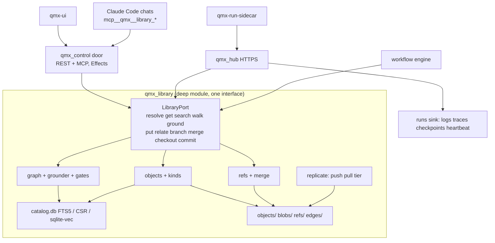
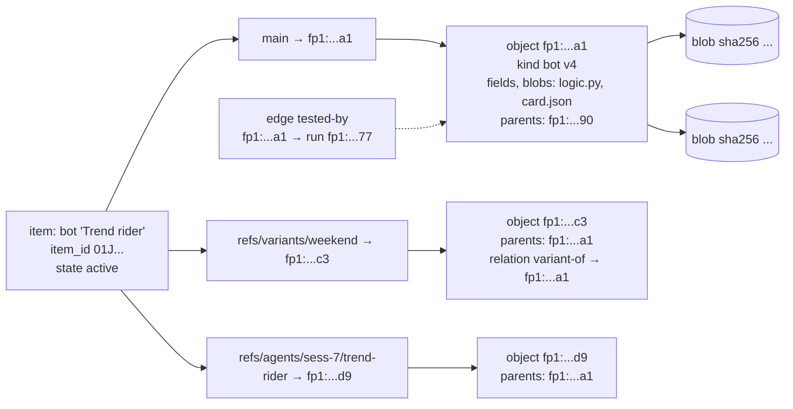
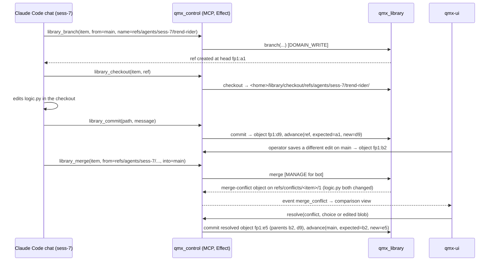
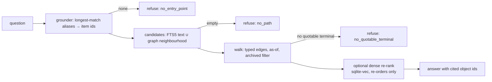
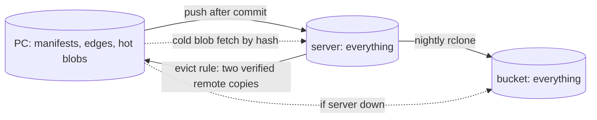

# High-level design — the unified Library and the remote-data Hub

Companion to `ARCHITECTURE-SPINE.md` (the invariants). This file carries the shape: components, data flows and diagrams. Labels: **[retrieved]** from a named source, **[remembered]** from standing memory, **[inferred]** this run's reasoning.

## 1. What problem this solves

**[retrieved]** Today the backend has two Libraries with opposite rules (research file 24 §2b): the QMB projection built to DEC-0271 (ten closed trading kinds, refuses skills, workflows, apps) and the control `library.db` from packet P22 (any kind string, JSON only, free-text links, weekly GitHub snapshot). The UI (file 23) draws a third version from demo arrays: 15 shelves, no item-to-item graph, "New version", "Import" and "Open file" all waiting for a daemon. Ruling 28 says the Library stores everything and that the UI and backend must match. Ruling 43 says runs off his PC must reach the same files and Library and carry a DevOps layer.

## 2. Candidate designs considered

### 2a. The Library

| Candidate | Shape | Why not / why |
| --- | --- | --- |
| A. Extend Library B | keep `library.db` + `artifacts/<sha256>`, add kinds and typed links | JSON-only content, free `kind`, a mutable `items` row per version, no branches, no merge, no binary; every ruling-28 kind would need a special case **[inferred]** |
| B. Widen the QMF registry | every kind becomes a CT-06 record in a registry room | per-world rooms, WriterId sequences and CT-06 headers do not fit notes, videos, mini apps or boards; the registry must stay the node's governed evidence room (DEC-0188) **[retrieved]** |
| C. Git-shaped object store (chosen) | content-addressed blobs and manifests, refs per item, append-only edges, rebuildable indexes | gives versions, variants, lineage, idempotent replication and agent branches from one model; governed records import under their own fp1 **[inferred]** |
| D. A real git repository + LFS | `dulwich`/`libgit2`, one repo | merge of JSON/binary is poor, many small objects are slow on Windows, history rewriting is possible, and agents need compare-and-swap on a ref rather than git porcelain **[inferred]** |

C borrows D's vocabulary (refs, branches, merge, checkout, commit) and B's identity (fp1).

### 2b. The remote-data intermediary

| Candidate | Shape | Why not / why |
| --- | --- | --- |
| 1. PC-hosted API, remote dials in | expose `qmx_control` over Tailscale | dies when the PC sleeps; reverses DEC-0497 "daemon never dials in" **[retrieved]** |
| 2. Hub service on his server (chosen) | a second Library writer on the server serving the same port over HTTPS; PC and remotes are clients | survives PC sleep; one auth model; one object model on both ends **[inferred]** |
| 3. Pure bucket sync, no service | what P21 built: manifests and blobs in `runs/<id>/` over rclone | no compare-and-swap, no live reads of the Library from a run, no token scoping, logs only at flush **[retrieved]** |

2 is built on 3's object layout, so if the hub is down a run can still write its folder to the bucket and the PC fetches later (degraded mode).

## 3. Components



| Component | Role | Depth (codebase-design vocabulary) |
| --- | --- | --- |
| `qmx_library` | the deep module: everything about storing, versioning, relating, finding and merging Library things | eleven verbs hide the object model, canonicalisation, fp1, ref log, merge strategies, graph build, grounding, gates, extraction, replication and tiering |
| `LibraryPort` | the one external seam; two adapters: in-process (PC, hub) and HTTPS client (remote) | a real seam: two adapters exist from day one |
| `qmx_control` | PC host: REST/MCP door with harness Effects; the PC's single writer | adapter at the door; unchanged shape |
| `qmx_hub` | server host: same port over HTTPS; token validation; runs sink; replication endpoint | adapter plus the auth module |
| `qmx-run-sidecar` | the client every remote run carries: heartbeat, logs, traces, checkpoints, redaction, scrub | adapter at the run |
| migrator | one-shot importers from Library B, the registry room and app artifact indexes | adapter; the registry importer stays as a sync under OPEN-2 |

Mini apps as Library objects **[retrieved from file 14 §2.5, mapped here]**: the mini-app plugin folder (`.claude-plugin/plugin.json`, `app.toml`, skills, `.mcp.json`, widgets, tests, evals) is one `bundle.tar` blob of a `mini-app` object; its parsed manifest is the object's `fields`; file 14's `pending/` folder for agent-written edits becomes an agent branch merged under AD-7; "semver plus content hash" is the object `fp1`; "archive, never delete" is AD-6.

## 4. The object model in one picture



Versions are objects linked by `parents`. Variants are refs. Branches are refs in a namespace the writer owns. A merge mints a new object with two parents and `merged-from` relations. Nothing is ever edited in place.

## 5. Data flows

### 5a. An agent edits a bot alongside the operator



### 5b. A remote workflow run, PC asleep

```mermaid
sequenceDiagram
  participant PC as qmx_control (PC)
  participant Hub as qmx_hub (server)
  participant Run as sandbox worker + sidecar
  participant Bucket as S3-compatible bucket
  PC->>Hub: push objects the run needs (workflow fp1:w1, inputs)
  PC->>Hub: submit run_id, token{write_prefix refs/runs/r9, key_scope [qmx/kimi]}
  PC->>Run: start (provider), keys over stdin, token
  Note over PC: PC sleeps
  Run->>Hub: heartbeat; logs/traces stream to runs/r9/
  Run->>Hub: get(fp1:w1) → cached locally by hash
  Run->>Hub: put artifact objects + blobs; advance(refs/runs/r9, ...)
  Run->>Hub: put workflow-run object (status passed, relations run-of, produced-by)
  Hub->>Bucket: nightly rclone push (everything)
  Note over PC: PC wakes
  PC->>Hub: pull refs/runs/* + missing objects (manifests + edges; blobs lazily)
  PC->>PC: engine fast-forwards everything the passed run produced into main (AD-18, publish=auto); UI "landed" feed shows it
```

### 5c. Search with refusal gates



### 5d. Replication and tiering



## 6. Interface to the workflow engine (from the Library side)

**[inferred]** `architecture/workflow-engine/` did not exist when this run started, so this is the contract the Library offers. The engine spine and its `LIBRARY-REQUESTS.md` (L1-L10) arrived the same night; every request is answered in `ENGINE-REQUESTS-ANSWERED.md` and folded into AD-3, AD-5, AD-6, AD-7, AD-9, AD-11, AD-15 and AD-18. Added since the first draft: kinds `memory-row` and `agent-tool`; refs `refs/memory/*` and `refs/champions/*`; transient checkpoint blobs; the `intent_key` annotation with `find_by_intent`; `search_runs`; the `test` run status; index watchers; `data_scope` on run tokens; the `publish` standing rule.

| The engine needs | The Library gives |
| --- | --- |
| a workflow definition to run | `resolve(item, ref) → object_id`, `get(object_id) → manifest + blob handles`; the definition is one JSON blob slot `definition` plus `pinned/<node>.json` blobs |
| templates | `template` objects whose `instantiates` field names a `workflow` kind; "use this template" = `put` a new `workflow` object with `derived-from → template` |
| a place to record a run | `put(kind=workflow-run, on=refs/runs/<run_id>)`, then `relate(run-of, consumed, produced-by, ran-on)`; one object per run, updated by new objects with `parents` as status changes |
| artifacts a node produced | `put(kind=artifact, on=refs/runs/<run_id>)` with `produced-by → run`, `produced-by-node: <node_id>` field |
| a "tested" gate before scheduling | `walk(workflow_object, tested-by)` must reach a `workflow-run` with `status=passed`; the engine refuses to schedule otherwise |
| checkpoints for pause/resume | blobs under the run's `checkpoints` slot, written by the sidecar; the engine's own live state stays in its SQLite |
| the machine it ran on | `ran-on → machine` descriptor stored as a `setup` object (provider, image, resources) |
| events | control topic `library` for `object_put`/`ref_advanced` on `refs/runs/*` |

### Interface notes for the engine architect

1. **No second definition store.** Research file 25 §"What this means" item 16 proposes "one SQLite store for workflows, executions and the job queue". Keep the job queue and live execution state there; put definitions, pinned data, templates and finished runs in the Library (AD-15). Otherwise the UI's Workflows shelf and the engine disagree, which is today's bug repeated.
2. **"Tested" is a relation, not a flag** (file 25 item 5 proposes a flag on the saved version). A flag on a mutable row cannot survive a new version; an edge from an exact object id can.
3. **Run branches.** A run writes only `refs/runs/<run_id>`. If the engine wants results on `main`, it asks for a merge; OPEN-6 decides auto fast-forward per kind.
4. **One agent can be a workflow** (ruling 44): a `Background` chat started by the engine still gets a `workflow-run` object; its transcript JSONL is a blob in the run's `logs` slot.
5. **Mismatch to flag:** DEC-0417's "do not fingerprint templates onto the Artifact rail" is reversed here; templates and workflow versions are Library objects with fp1 ids (ruling 28 overrides). DEC-0420/0439's Mission Compiler / Task Graph names refer to the deleted daemon engine; the new engine should not inherit their store.
6. **Pause at usage limits** (file 25 item 7) is engine state, not Library state; the Library sees only `status=waiting` objects if the engine chooses to publish them.

## 7. Security posture, plainly

- Money stays read-only: the hub and sidecar have no order verb; `propose_order` exists only on the PC harness **[retrieved]** (DESIGN.md).
- Broker credentials never leave Windows Credential Manager **[retrieved]** (DEC-0188); AD-12 refuses tokens naming them.
- A run token can write one branch, read a declared scope, and nothing else; it expires with the run.
- The hub stores no provider key; keys ride the submitter's stdin/sandbox env exactly as `qmx_remote` does today **[retrieved]**.
- Page text, article bodies and video transcripts in the Library are data; the grounder never executes them and the agent harness marks injected text verbatim (DESIGN.md).

## 8. What is deliberately not here

The engine's node kinds and scheduler; the load balancer; the browser; the Lab editor's internals; market-data rooms (stay qmf-data); the QMA harness (untouched, ruling 24).
