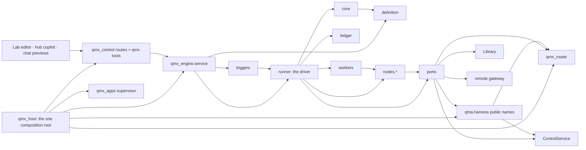
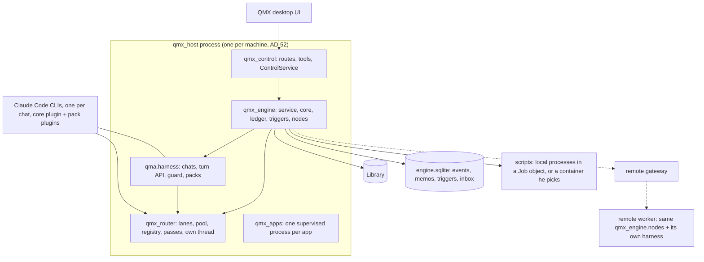
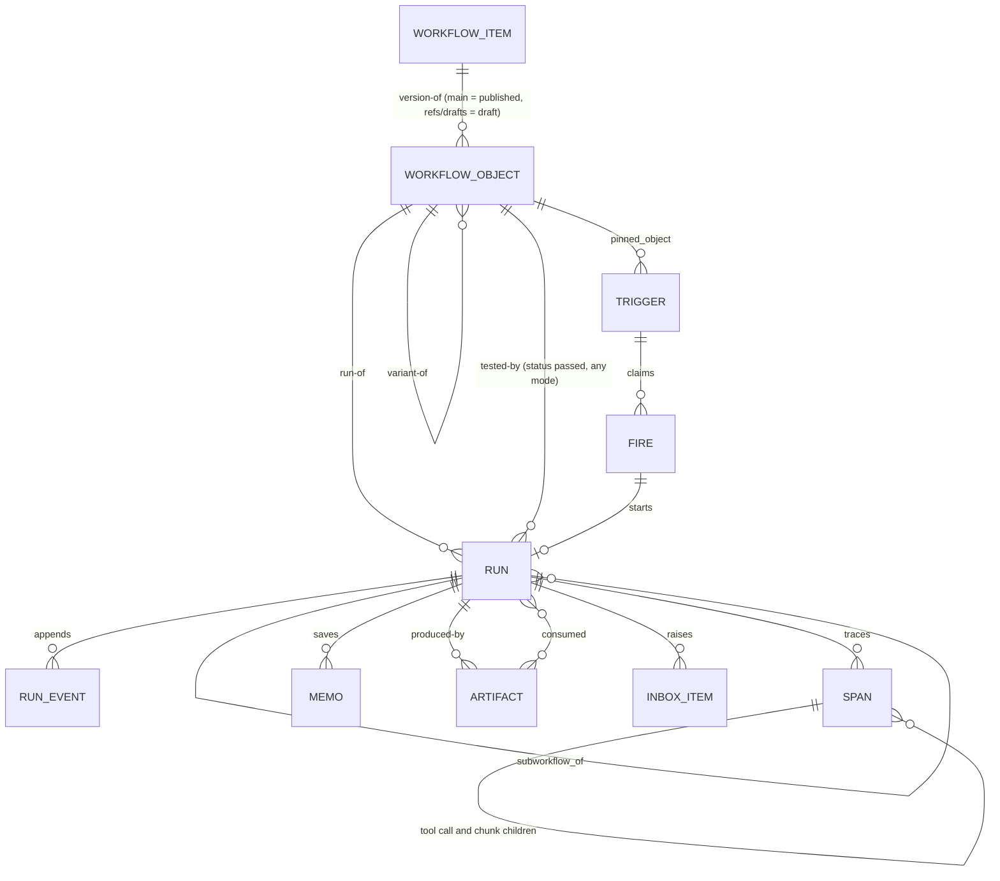

# Architecture Spine — QMX workflow engine

Amended 2026-10-24 by the wrap-up seams pass (`research/methodology/60-wrapup-seams.md`, code `engine/base` f05fc64b): AD-28 (the run-pass secret derived from the pairing key, one authority per host process), AD-31 (the `qmb` placement defaults to the local host, QMB's door replays in a child process, one function lands every backtest for the tool and the node) and AD-67 (the cTrader sign-in step by step, the app credential reaching the server as `qmx/read/ctrader-app`, no sign-in before the server host runs, the one venue session) amended in place, marked *Wrap-up seams (60)*; two Deferred rows added. AD ids are stable.

Amended 2026-10-22 (night) by the fix-check round (`research/methodology/58-data-round-fix-check.md`, applied in 55 "Fix-check applied (58)"; ruling 135 reworded): AD-28 (OAuth tokens and trade keys never vault entries; a secret for another home is handed once to that home), AD-31 (QMB's second reader for typed partitions), AD-65 (a version refusal only for kinds the reader lacks, naming the side behind), AD-67 (the home exchanges the sign-in code; the home belongs to the credential, for cTrader to the app registration; one cTrader app per trading server; `qmx-broker`'s reads through the home's session; a shared wait per egress address where the provider limits per address; one reading word per connection) and AD-68 (freeze rules per kind, months freeze without his click) amended in place, marked *Fix-check (58)*. Amended 2026-10-22 (evening) by the edge-case review fix round (`research/methodology/57-data-round-edge-case-review.md`, applied in 55 "Edge-case review applied (57)"; ruling 135): AD-28 (live-trade keys only on trading servers, allow-list replication, each machine its own vault key, non-model keys only on a connection's home), AD-30 (one out-of-memory kill cannot take the platform down), AD-65 (clock offset, version refusal, new incident signatures), AD-67 (one home per connection, two cTrader app registrations, adapter declarations and an open registry, `slowed_until`, health readings), AD-68 (Dukascopy flags, freeze rule, one fetcher, fan-out per partition), AD-69 (no PC collector, export after redaction, a narrower observer) and AD-70 (no non-model key on remote workers) amended in place. Amended 2026-10-22 by the data round (`research/methodology/55-data-round-architecture.md`; rulings 120-134; code `origin/engine/base` 8af1a1cd and the deletion branches): AD-67 (external connections), AD-68 (feeds and downloaders), AD-69 (two monitoring layers) and AD-70 (remote work reaches data) added; AD-5, AD-18, AD-30, AD-31, AD-59, AD-63 and AD-65 amended in place; the Deferred rows on the data track and the data-locality score closed. AD ids are stable.

Labels on claims: **[retrieved]** read from a cited file or branch today, **[remembered]** from training knowledge, **[inferred]** reasoned here. Every AD without a label is a decision, not a claim.

## Design Paradigm

**Durable execution** (the Temporal/Inngest shape [remembered, confirmed in `13` section 3 [retrieved]]): workflow control flow is deterministic and replayable; every side effect lives in a node whose result is saved once and returned on replay; failed or changed nodes rerun, finished ones never do. The engine is **hexagonal**: a pure orchestrator core with ports, and adapters for everything that can fail or vary.

| Layer | Namespace | Owns |
| --- | --- | --- |
| Definition | `qmx_engine.definition` | the `qmx.workflow/1` JSON schema, node-kind registry, validator, variant overlay resolver |
| Orchestrator (core) | `qmx_engine.core` | pure scheduling of nodes over the ledger: readiness, joins, loops, memo lookup, replay, drain and pause |
| Ledger | `qmx_engine.ledger` | the append-only event store (SQLite, one writer), memo index, spans |
| Executors | `qmx_engine.nodes.*` | one adapter per node kind; the only places that talk to the harness, scripts, apps or the Library |
| Scheduler | `qmx_engine.triggers` | trigger rows, ticker, fire claims, catch-up, quota hold, preflight, monitors |
| Ports | `qmx_engine.ports` | `HarnessPort` (over the harness turn API, AD-53), `RouterPort` (`complete`, run passes, AD-56), `LibraryPort`, `MemoryPort`, `InboxPort`, `WorkerPort`, `GatewayPort`, `SettingsPort`, `Clock` |
| Memory | `qmx_memory` (the `RecallEngine` seam and its two adapters, Hindsight by default and the built-in FTS5 one, plus the copilot retain worker; AD-18) and `qmx_engine.memory` (the `MemoryPort` adapter, intent keys, in-flight claims, consolidation, champion replay) | evidence stays Library `memory-row` objects; recall is a rebuildable index (ruling 119) |
| Environments | `qmx_engine.workers` | the one sandbox contract: `WorkerPort` → `qmx_remote.ComputeProvider` → the `qmx-worker` image; the runner-side sandbox tool server; local Docker, `qmx-node` on his server, E2B/Modal burst; the egress proxy for the fallback mode; on the PC scripts run as ordinary local processes in a Job object with their own zones (AD-24); a container or a remote placement is his choice per workflow |
| Redaction | `qmx_engine.ledger.redact` | the one redaction function every write seam applies (AD-37); the text scan of AD-36 is retired (retired 2026-10-18, rulings 115-117) |
| Service | `qmx_engine.service` | the one Engine API the surfaces call (drafts, versions, tests, runs, triggers, inbox, explain) |
| Credentials | `qmx_router.vault` + `qmx_router.passes` + the router on each host (or the central router on Contabo) | the vault sync from Windows Credential Manager to `qmx-vault` on Contabo, run passes (minted for the engine, verified by routers and the Hub), revocation; a router is the only key reader on its host, and non-owned placements route to the central router (ruling 75); moved out of `qmx_engine` and `qma.harness` by the unlock pass (AD-56) |
| Placements | `qmx_engine.workers.placements` | the placement registry (owned, managed VM, managed agent host, serverless, QMB machine, desktop), capacity derived from RAM, preflight states, the three agent modes, provider onboarding from published instructions (ruling 74) |
| Sessions | the harness chat record (AD-35, AD-53), mirrored into the Library `session` item (Library AD-21) | home (written at birth), pack set, attached context references (AD-63) and standing loops of every session, read by every surface |
| Catalog and surface | `qmx_control.catalog` (one row per operation, AD-61) and `qma.harness.surface` (AD-62) | every operation's tool, node type and REST route; the toolsets, built-ins, skills filter, system text by slot and digest each chat gets |
| Capability packs | Claude plugins materialised per pack (AD-55); engine-side pack node types in `qmx_engine.packs` | every pack (a mini app, the Lab, Portfolio, the built-in groups `cua`, browser, web, media) is a plugin whose skills, agents and commands load natively in chats whose pack set holds it, and whose tools are catalog rows listed on the chat's one in-process `qmx` server (AD-35, AD-61); a node's scope loads `cua` only when it declares a desktop or a browser |
| Router (provider contracts) | `qmx_router` (its own package since the unlock pass, AD-56): lanes, normaliser, pool, model registry and data profiles, Responses and chat translators, error classifier, run passes, vault sync | the in-house account pool and balancer (AD-12); the model router that fronts every CLI with four lanes (plan bytes untouched, GPT, key, chat-completions; AD-38); the model registry with wire and capabilities per model (AD-39); `complete` for one-shot calls without a CLI (AD-13); the router reachable on the tailnet with run-pass bearers. Ruling 118: changes here are ordinary design changes, not grants |
| Harness | `qma.harness` | chats as Claude Code CLI processes; the programmatic turn API, named permission policies and hook sinks, persisted chat options (AD-53); the guard (AD-54); pack loading (AD-55); `delegate` v2 (AD-41); the stuck detector's pure rules (AD-16). Ruling 118: an ordinary module of QMX; HARNESS-REQUESTS is a plain change list |
| Host | `qmx_host` (one process per machine, AD-52) | the one composition root: ControlService, the Library writer, the harness, the router on its own thread and loop, the engine, the apps supervisor and the REST and MCP doors, started as one process |
| Desktop host | `qmx-desktop` (the app's main process) | process supervision of `qmx_host` (AD-52), startup card, Docker start, keep-awake, dead-man switch, restart-loop breaker, pre-update snapshots, windows (main, pop-out, HUD); AD-48 |

## Invariants & Rules



Arrows mean "may import or call". Nothing points back up, and nothing imports `qmx_host`. `core` imports only `definition`, `settings` constants and `qmx_ledger.journal` hashing [retrieved engine/tp4]; it imports no ledger, port, node, worker or adapter, and `definition` imports none of them either. The runner is the driver: it folds the ledger through the pure core and carries the core's commands out through workers and ports (redrawn 2026-10-18, B-12). `qmx_router` imports no harness, engine or control module; it reads Settings through a reader the host injects (redrawn by the unlock pass, AD-52, AD-56).

### AD-1 — Durable execution, pure orchestrator

- **Binds:** all
- **Prevents:** a second scheduler, a model deciding control flow, two units that disagree on what "resume" means
- **Rule:** `qmx_engine.core` is pure: it takes the definition, the run inputs and the ledger events and returns the next commands (start node, wait, pause, finish). It performs no I/O and imports no adapter. Everything that can fail or vary (model calls, scripts, Library writes, app operations, time) happens inside a node executor and lands in the ledger as a saved result before the core sees it. No LLM output is ever a control-flow edge; a model can only produce data that a `rule` node reads.

### AD-2 — One definition format for every workflow `[ADOPTED]` (rulings 22, 23, 44)

- **Binds:** definition, builder, surfaces, mini-app-contract
- **Prevents:** hand-built templates, a second graph dialect for the Lab, "agent" and "workflow" as two product kinds
- **Rule:** every workflow, template, variant, mini-app workflow and single-agent workflow is one JSON document of schema `qmx.workflow/1`, n8n-shaped: `nodes[]` (id, name, type, typeVersion, position, parameters, credentials refs, retry and on-error options, disabled), `connections` keyed by source node name then output name then target list with edge mapping, `settings`, `pinData`, `inputs`/`outputs` schemas, `meta`. A template is a definition with defaults. A variant is an overlay (`extends` + patches) that the publisher resolves into a complete snapshot. A single-agent workflow is one trigger node plus one `agent` node and is still a workflow. Script-only, mixed and fully agentic workflows are all first-class (ruling 52): a run with no model-bearing node takes the same path as any other and spends no tokens (Hermes `no_agent`). A workflow is a **folder** (ruling 19): `definition.json` plus the files its `*_ref` fields name (`scripts/`, `prompts/`, `schemas/`, `fixtures/`); every ref resolves inside the folder, and the content hash covers the folder's bytes, so a version is one addressable thing.

### AD-3 — The engine runs beside the harness, apart from every chat

- **Binds:** engine, surfaces, harness-boundary
- **Prevents:** engine code inside `qma.harness`, a second door that accepts text into chats, a separate process that cannot start Background chats
- **Rule:** the engine is package `qmx-engine`, composed and started by `qmx_host` (AD-52) as its own task group plus worker threads in the same process as the harness, the router and the control doors. It holds the `Harness` and `Router` objects and uses only the names each of those packages exports from its `__init__`; an import of a submodule of either is a CI failure (kept by the unlock pass as a deep-module rule for locality, no longer as a lock; the H0 allow-listed `launch` import is gone because HG1 exported the names). The engine imports nothing from `qma-core`, which is deleted (AD-59); the definition lint's money-act rule reads a vendored word list in `definition/lint.py`. The copilot reaches the engine through `qmx` tools (the `workflow_*` rows of SOLUTION-DESIGN §13, built in HG1) and the UI through REST routes under `qmx_control`, both dispatching to `qmx_engine.service`. No engine operation accepts chat text. One engine codebase runs as **one instance per home**: the PC's `qmx_host` and Contabo's `qmx-node` (the same `qmx_host` started with the node role, AD-30). Each instance has its own ledger and runs only the triggers whose `home_engine` names it (`pc | contabo`, the registry names of AD-30; Contabo is the default for schedules, because it is always on); a trigger has exactly one home, so there is never a second scheduler for one schedule, and every run's summary lands in the one Library either way. *One view of both homes (review 48 H4):* the PC's `qmx_host` answers engine reads and inbox answers for runs, triggers and incidents homed on another owned instance by forwarding them to that instance's engine routes (AD-21, AD-65), so the ledgers stay apart and nothing replicates; a run changes home only through `runs.adopt` (AD-7). *One instance, enforced (40 §5 item 9; L-64, L-70):* at start an engine instance takes an exclusive OS lock on `<home>/engine.lock` for the life of the process (the OS releases it on death); a second instance on the same home refuses to start with one line; an engine object creates exactly one `Scheduler` in its constructor, and a second `serve` on it raises. A check-then-write marker is not a lock.

### AD-4 — The node contract

- **Binds:** definition, nodes.*, builder, remote-worker-contract
- **Prevents:** two node kinds whose results cannot be joined, a node that names a model, an executor that cannot be retried
- **Rule:** every node declares `type`, `typeVersion`, ports (every v1 port carries `data`: a JSON value or an artifact ref; the registry keeps DEC-0418's kind field so `reference`, `event` and `control` can be typed by a later `typeVersion`, and v1 validation checks edges by port name only), `parameters`, `role` (never a model id), `effect` (AD-8), `retry` (max tries, backoff, retryable errors), `timeout` (idle and in-tool only, read by AD-16's stuck detector; no run timeout exists, AD-40), `runs_on` placement, and `credentials` as `qmx/*` refs. An executor implements `run(NodeJob) -> NodeResult` where `NodeResult` is `ok(outputs by port) | failed(error, signature, retryable) | waiting(reason, resume_at) | gate(ask)`. Outputs are JSON values or artifact refs; anything over `settings.inline_limit` is an artifact. The registry entry for a kind fixes its input and output port names, so an editor and an executor never guess: `in` is the default single input and `main` the default single output; `trigger` has no input; `rule` outputs `true` and `false` (one predicate per node; a many-way branch is a chain of rules); `loop` takes `in` (the first value) and `next` (the loop-back, the one cycle a definition may hold) and outputs `body` and `done`; `grader` outputs `pass` and `fail`; `monitor` outputs `changed` and `silent`; `human_gate` has one output per option (ratified from the built registry, B-15). An `agent` node has **no default turn or tool-call ceiling** (AD-40); a `limits` block he wrote on the node or the workflow (`turns`, `tool_calls`, `tokens`, `wall_seconds`) is recorded on `run_created` and honoured as AD-16 says, and the lint refuses only a value below 1 (B-16 superseded). An `agent` node ends with exactly one terminator (`ok` with its output, `failed`, or `waiting`), carries `expected_run_id` on every write it makes, and a build-type agent's default output schema holds `changed_files, verification, dependencies, blocked_reason, retry_notes, residual_risk` (Hermes worker-lane contract). An `agent` node also declares `subagents` (each with a role, so each may resolve to a different provider through the model router, AD-38, with `via: native | delegate` (AD-41); a `native` sub-agent reaches a third-party model only through a registry-generated agent definition passed at launch (AD-38, HARNESS-REQUESTS H38), under a plan main only where probes P1 and P4 passed for that provider and under a key or GPT main only where probe P1k passed (42 N7), otherwise the engine resolves it `via: delegate`; `max_concurrent` is a parallelism setting, default the CLI's own; spawn depth is a setting, default 1; they live in the same chat tree as the node's agent (`native`) or as helper chats (`delegate`), and their tool calls go to the same sandbox, ruling 52 and study 29), `tools_may_create` (an agent may write its own tools; each is saved as an `agent-tool` Library object in state `unreviewed`, loads only into the run that made it, as that run's `run:<run_id>` toolset, until he reviews it, and never carries an order verb; review 48 M15), `isolation` and `agent_mode` (AD-25), and its permissions through the harness's named `engine` policy (AD-53, AD-60; replaced the ask-by-poll `reject` of the first build in the unlock pass): the node's declared tools are allowed inside its attempt overlay, an undeclared tool is denied at once with a one-line reason the agent reads, and a tool call the registry marks `irreversible_external` is deferred to one inbox item; the attempt waits for the inbox's answer or the harness's unattended window, whichever comes first (ruling 57). Executors are idempotent under the memo key of AD-7. *Studies folded (47):* an `agent` node declares `toolsets` and `skills` as **checked references**: the validator refuses a toolset or skill the registry does not know, preflight refuses one whose pack is disabled or unhealthy, and the Surface (AD-62) turns them into the chat's servers and skills filter, so no tool list is written into the prompt (44 DC-2). A node may declare `checkpoint: <path>` inside its overlay: the worker or the remote sidecar flushes it as a transient `checkpoint` blob (Library AD-6, AD-13), and a retry after a crash or a preemption restores the latest one and resumes instead of starting over (46 X-20). An unattended ask on a `MANAGE` operation is denied unless the run's published version holds a **standing grant** for it: the publish or enable card lists the `MANAGE` operations the version's toolsets hold, and his click on that card grants them for runs of that exact version; never grantable are publish, enable, a merge into `main` of a governed-class or definition-class kind, settings writes, quarantine and purge (Library AD-22, AD-6) and `PROPOSE_MONEY` (44 DC-6).

### AD-5 — The node-kind vocabulary

- **Binds:** definition, nodes.*, surfaces
- **Prevents:** a kind invented per template, Lab and workflow graphs with different palettes
- **Rule:** v1 kinds, closed and extended only by `typeVersion`: `trigger`, `script`, `rule`, `loop`, `join` (`all | any | quorum(n)`), `wait` (time, event, webhook), `human_gate` (allowed only in front of an irreversible external effect, ruling 57; it parks that effect in the inbox; `approval_gate` is the same kind with a timeout and `on_timeout`), `llm` (one model call with a JSON schema), `agent` (a harness Background chat with structured output, optional sub-agents and self-made tools, AD-4; its code-running tools execute in a sandbox, AD-25), `rlm` (a prime-agent-style Python kernel over data and tables: cells in a long-lived namespace inside the node's sandbox, driven over the same remote tool call, `spawn`/`collect` sub-model calls routed through the runner's provider layer so they land as spans, a snapshot after each cell shipped to the Hub as a `checkpoint` blob and restored on retry), `subworkflow` (typed inputs, caller policy, its own ledger namespace), `grader` (`mode: deterministic | llm`: a deterministic check or an LLM judge on the `judge` role, verdict plus feedback), `monitor` (cheap source, hash diff, wake gate), `app_op` (a mini app's exported operation), `library` (read or write a Library kind). `claude_workflow` (the Claude Code Workflow tool inside one chat) is **retired** by the unlock pass: it waited only on harness request H4, was never built, and duplicates the engine's own fan-out (ruling 22: one engine); the harness keeps `CLAUDE_CODE_DISABLE_WORKFLOWS=1`. Edge mapping is `one | zip | broadcast | chunk | keyed-join | cartesian` with cartesian explicit. An edge that carries a list into an `llm` or `agent` node must be `chunk` (ruling 78, AD-34); `broadcast` of a list into those kinds is refused at validation. A capability pack (the Lab pack, `cua`, later others) registers types named `<pack>.<name>`, each with a `base_kind` from this list; the JSON `type` is the pack type, and the validator checks the node against its base kind's contract (ports, effect, role rules), so the vocabulary stays closed. `note` is the one draft-only type (no `base_kind`, refused at publish unless disabled). DEC-0312's kinds map onto these one to one (SOLUTION-DESIGN section 2.3). *Readiness:* a node runs when every source slot it reads has settled, every inbound edge marked `required: true` carried output, and at least one inbound edge carried output; otherwise it is skipped, and so is what only it feeds. `required` defaults to false, so a merge after a `rule` runs on whichever branch fired; an edge that enters a loop body from outside it is context and never makes a body node ready on its own (B-24, B-87). *Subworkflows:* a `subworkflow` names its child either as a block folder inside the parent's folder (`blocks/<name>/`, carried in the parent's bundle and content hash) or as a pinned published object (`workflow_item`, `object_id`); the callee's `caller_policy` is checked at validation whenever the child resolves and again at dispatch; a child that ends `waiting` makes the parent node `waiting(child)`, never failed; cancelling the parent cancels its children (B-27, B-66, B-76). *Nesting:* v1 fans out one level deep; nested fan-out, a loop over fanned input and a loop inside a loop body are refused at validation (`nesting_unsupported`) until the nested fan-out packet, never parked at run time; a kind or mode the registry marks unavailable (the grader's `llm` mode until its packet) is refused at validation too (B-20, B-46). *Studies folded (47):* *the revolution-loop shape (44 DC-11):* a `loop` body may call a `subworkflow` whose child holds its own loop, because the child runs in its own ledger namespace; it is the one sanctioned nesting until the nested fan-out packet, and probe P-NEST checks that the built validator accepts it (if not, the validator gains exactly this exception). A board is a workflow draft shown with `meta.view: board` (Lab AD-2): its notes are `note` nodes and its cells `lab.cell` nodes (45 DC-9). *Data round (55):* the `library` kind is switched on (its registry row at `qmx_engine/definition/registry.py:94` gains `available=True`): it reads or writes Library items through `LibraryPort` under the run's principal, so a step can read Tuesday's results or save a source mid-run; a `library` write is `compensable` as registered.

### AD-6 — Determinism of control flow

- **Binds:** core, nodes.*, builder
- **Prevents:** a replay that takes a different branch than the original run
- **Rule:** the core and the definition layer never read any clock (wall clock, `time.monotonic`, `perf_counter`), randomness or the environment; measurement happens in the runner and the workers (L-20). `now`, seeds, operator answers and external events enter the run only as recorded ledger events (`run_input`, `clock_tick`, `gate_resolved`, `event_received`). A node that needs time reads it from its `NodeJob.now`. Replay feeds the same events and must produce the same commands; a divergence is a bug the ledger makes visible.

### AD-7 — Saved results and node-level replay

- **Binds:** core, ledger, nodes.*, remote-worker-contract
- **Prevents:** Claude-Workflow-style prefix replay that reruns everything after the first failure, double-paid model calls, a resume that silently reruns a finished script
- **Rule:** a node attempt's result is memoised under `(run_id, node_id, iteration, partition, sha256(inputs), sha256(node_definition))` (`partition` is the one spelling in memo keys, events and spans). On resume or rerun the core returns saved results for every valid memo and schedules only nodes without one. A downstream node reruns only when its own input hash changed. In a fan-out each partition has its own memo, so only failed partitions rerun and the join reuses the rest (DEC-0439 join algebra ratified). Editing a draft after a test run invalidates exactly the memos whose node definition hash changed. **Replay fork** (B-82): `service.runs.replay(source_run_id, object, mode: test)` starts a new test run of an edited folder seeded with the source run's recorded events (`run_input`, `clock_tick`, `event_received`, `gate_resolved`) and lets it reuse the source run's memo for every slot whose node definition hash and input hash are unchanged; the first changed node and everything downstream of it rerun on real models; the new run carries a `replay-of` edge to the source (LIBRARY-REQUESTS L20). Memos never cross runs any other way, and never across workflows. *Memo truth (40 §5 item 4; B-19, L-35):* the ledger events decide whether a memo is valid (a `node_finished` with its input and definition hashes, voided only by a later recorded event); `ledger.memo` is a derived index rebuilt from those events (AD-23), and no code reads its `valid` flag as truth. *Studies folded (47):* *Run fork (46 X-11):* `service.runs.fork(run_id, from_node, overrides)` stops the source run's not-yet-started nodes and starts a new run of the same pinned object that reuses the source's memo for every slot upstream of `from_node` whose definition and input hashes are unchanged, with a `replay-of` edge to the source; a live fork takes only what a `user` principal may set on a live start (AD-11: role and model overrides and the values of the definition's declared `inputs`); any other change is an edit, run as a test-mode replay fork of a draft (above). `runs.fetch_home(run_id)` uses the same seeding to replay a remote run on the PC (AD-65). *Review 48:* a live fork may also name a **newer published version of the same workflow item** (`runs.fork(run_id, from_node, object=<version>)`): it reuses the source's memo for every slot whose definition hash and input hash are unchanged, lands like any live run, and is how a running workflow is steered with an edit; publishing that version stays his click (M3). **Resume on another machine** (ruling 117; M1): every engine instance pushes a run's new ledger events to the Hub at each `node_finished`, as object replication of the run's own ref (Library AD-11); `service.runs.adopt(run_id)`, started by his click on the run card or a copilot `MANAGE` ask, is refused while the home's heartbeat is fresh, and otherwise takes the claim `adopt:<run_id>` on the Hub (Library AD-24), seeds a ledger from the mirrored events, records `run_adopted{from, to}`, folds every open attempt to `unknown` (AD-8), voids the memo of every finished node that committed files into its old home's `work/` zone (zones do not travel; values and artifacts do) and resumes. The old home, at start and before any resume, finds the adoption on the Hub and marks its copy `moved`, never resuming it. A schedule's home moves only by his edit of its `home_engine`.

### AD-8 — Effects are classed by reversibility

- **Binds:** definition, nodes.*, core
- **Prevents:** an automatic retry that sends twice, writes twice or pays twice; a node that places an order
- **Rule:** every node declares `effect: none | reversible | compensable | irreversible | irreversible_external` (the last is the subset of irreversible effects that leave QMX: a message, a post, a webhook, an app operation marked so; ratified from the built registry). `reversible` (run-workspace files) writes only into the attempt's own overlay and is undone by discarding that overlay, so a retry never touches a sibling attempt's files (AD-51; 40 §5 item 2, B-29). `compensable` (Library writes) is undone by supersede or archive, never by delete. `irreversible` (model spend, external sends, webhooks, app operations marked so) receives the idempotency key `run:node:iteration:attempt` in its `NodeJob` and is retried only on a failure that provably happened before the effect. After an `unknown` outcome the two differ: a **model call** is retried once under the ladder (duplicate spend is accepted, ruling 27, and the attempt writes an `info` line), while an `irreversible_external` effect (a message, a post, a webhook, an app operation marked so) is never retried automatically. The model-call exception covers only a model-bearing node whose declared effect is `none`, `reversible` or `compensable`; a model-bearing node that also declares `irreversible` or `irreversible_external` follows that class: after `unknown` it is retried only when it declares `idempotent: true` (its target dedupes on `QMX_IDEMPOTENCY_KEY`), else it goes to the inbox (40 §5 item 5, B-57; agent writes, Appendix G L6). Money acts are not an effect class: agents have no path to money (ruling 116), the harness money gate is replaced by the guard (AD-54), and the built definition lint keeps its existing money-act rule on node types and parameters, reading a vendored word list (AD-59); AD-36's wider scan is retired.

### AD-9 — Provider limits pause the work; nobody is asked; QMX sets no usage limit of its own `[ADOPTED]` (rulings 27, 90; settled 2026-10-18)

- **Binds:** core, nodes.llm, nodes.agent, triggers, pool
- **Prevents:** `LaunchRefused` plus a `needs_you` block on any send, a run that fails at a usage limit, an operator prompt about usage, a QMX-invented share or budget that pauses work
- **Rule:** before a model-bearing node starts, admission control asks the pool for a lease that fits the node's role (AD-12) and, for a node that runs a chat, takes one chat slot from the harness's slot table, which keeps `limits.interactive_reserve` free for his Interactive chats (chat slots are machine capacity derived from RAM, AD-30, so the copilot always has a slot; they are not usage). The harness slot table is the only chat-slot counter (AD-58); the engine keeps no `engine_cap` of its own, and a `complete` call takes no chat slot. A provider's closed window, a provider 429 with a reset time, or every allowed account of the role benched or cooling yields no lease. Without a lease the node enters `waiting(resume_at)` and the run drains: running nodes finish, script and rule nodes keep going, no new model node starts. The scheduler wakes the run at the earliest `resume_at` with no human action. A provider rate-limit inside a running node marks that attempt `waiting`, not failed, and keeps no partial output. Work beyond host capacity queues or spills to the next `runs_on` placement; it is never refused. *Held work is a recorded wait (40 §5 item 1; L-60, B-55):* a chunk queued for capacity, or held behind the warm-first gate (the first chunk of a node ends a turn so the rest read its prompt cache), is not started: the gate moves from inside `nodes/agent.py`'s attempt to dispatch, so a held chunk writes no `node_started` until it leaves the queue, and the stuck detector (AD-16) never sees it as an idle attempt. QMX itself never refuses, pauses or ends work on a usage number: there is no background share, no per-chat or per-run USD budget and no token, agent, tool-call, turn or wall-time ceiling by default (AD-40). One inbox item is raised only when every allowed account for the role has been closed longer than `settings.limits.alert_after`.

### AD-10 — Triggers are rows; the scheduler fires at most once per occurrence

- **Binds:** triggers, definition, service
- **Prevents:** a schedule baked into a definition, a backlog of catch-up runs after downtime, a run that spawns schedules
- **Rule:** a trigger is a row outside the definition (DEC-0417 ratified): `cron` with an IANA zone, `interval`, `event` (a cursor into the Library ref log, AD-64), `webhook` (through the gateway), `manual`, `after` (another workflow's completion), each bound to one workflow item and the **exact published object** it pins (`pinned_object`), plus `follow_champion: bool` (when true and the workflow's `self_improve` is `auto`, a fire runs `refs/champions/<item>` provided that champion descends from the pinned object; otherwise the pinned object; never a draft), with `precheck` (a `monitor` or `script` ref), model and effort pins, delivery target, `continuity` (inject the trigger's own last successful outputs as an input, Hermes style), `max_concurrent`, and a `created_by` principal that is never a run. The trigger **source** is pluggable and controls only when a fire is claimed, never execution: the in-process ticker now, a server or cloud trigger provider later. The ticker runs in-process every `settings.scheduler.tick` seconds and claims a fire under a lease with a heartbeat, so two processes never run one occurrence. A fire inside the grace window runs late; past it the backlog collapses into exactly one catch-up run per trigger (ruling 25). A fire into a closed usage window is parked (`quota_hold_until`) and merged with later fires. Preflight (credentials resolve, roles resolve, skills and apps present, delivery target exists) failing sets `blocked_config` with one item whose severity follows AD-17 (`info` when the workflow's own configuration is at fault, `normal` only for a provider failure such as a missing or rejected key) and no model call. A monitor whose source hash is unchanged ends the fire as `silent`. *Wakes (B-63, B-73, L-37):* every `waiting` with a `resume_at` (a usage limit, a time `wait`, a retry backoff, a quota hold) writes one wake row in `engine.sqlite`; the ticker is the only thing that resumes a run on time, and a held run reads `waiting`, never `running`, until its wake fires; every `resume_at` is an RFC 3339 UTC instant compared as an instant. *Enablement (B-68):* a version's `enabled` is derived, never stored: a version is enabled exactly while at least one enabled trigger pins it or follows it as champion, so disabling the last such trigger disables it. A trigger's `role_pins` and `effort_pin` override role resolution for the runs it fires and are recorded on `run_created` (B-60); pins are his, and no run or agent may change them (Hermes per-job pins). *Hermes-shaped additions (37c, 37d):* trigger kinds `event`, `webhook` and `session` (AD-47) join `cron | interval | manual | after` through a forward migration of the kind check; a run whose model node finds its model unreachable before any call is never re-fired: the same run continues with that node `waiting(resume_at)` at 5, 15 and 30 minutes after the first failure, then walks the ladder, so script and `irreversible_external` nodes that already ran in the fire never run twice (41 M5: Hermes' re-run is spend-neutral only because a Hermes fire with no model call has no side effects); a trigger may be created paused with a reason in one write; a run's delivery is its own field next to its status (`delivered | unverified | failed | none`), an adapter ack without evidence reads `unverified`, an empty payload fails closed; a script node may declare failure on its first output line (`[QMX_FAILURE]`) or ask for silence (`[QMX_SILENT]`), and a failure always delivers; repeated failures of one trigger with one masked signature are one **incident** (count, first and last seen, acknowledge until the signature changes, resolved by a passing run; the stored `incident_id` gets this logic); `service.explain_trigger(trigger_id)` answers "why didn't it fire" (ticker heartbeat age, version enabled, next fire, last ten fires with reason, open incident) for the UI, the copilot and the doctor. *Studies folded (47):* an `event` trigger fires on Library ref-log rows matching `(kind, output name, producer)` and declares `coalesce: each | latest` (AD-64); a `webhook` trigger's home defaults to `contabo` so the PC may sleep, and it dedupes deliveries by the sender's delivery id; a trigger carries `priority: normal | high` (admission serves `high` first, then age, AD-58) and an advisory `ready_by` time in its zone, for which the trigger card shows the start time the last ten durations imply (it never moves the schedule itself); a shipped `market_open` precheck script reads the built forex calendar (`extensions/qmf-calendar-forex`), so a fire while the market is shut ends `silent`. **Pause everything** is one Settings flag, `autonomy.paused`, whose authoritative value lives on the Hub once a Hub exists: the PC writes it there (a press while the Hub is unreachable applies locally at once and reaches the Hub on reconnect), and the Hub's reply to every heartbeat carries it to each host (AD-65; review 48 M5); a host that has not reached the Hub for `autonomy.stale_after` (Claude's default three heartbeat intervals) keeps the last value it knew and shows "pause state unknown" on the doctor page: while it is set no host claims a fire and no new node starts (a running attempt finishes its current node; new nodes read `waiting(paused)`), copilot chats are untouched, and clearing it gives each trigger at most one catch-up run as above (46 X-8, X-17, K-17).

### AD-11 — The creation lifecycle and the test gate `[ADOPTED]` (ruling 23)

- **Binds:** service, definition, builder, surfaces, library-contract, mini-app-contract
- **Prevents:** a live run on a mutable draft, a schedule on an untested version, a deleted workflow, a Lab "run this part" that bypasses the engine
- **Rule:** states are `draft -> published (version) -> enabled <-> disabled -> archived`, the one lifecycle of every definition-class item (Library AD-3: workflows, mini apps, agents, pods, pod blocks, skills, methodologies, personas, components, agent-made tools), and **`validated`, `tested` and `stale` are marks on a version, never states**: validated is a check result, tested a `tested-by` edge (below), stale a curator annotation (45 DC-5); the built `service/context.py` `ALLOWED` table keeps its behaviour (publish of anything QMX runs unattended needs the tested mark; a subject such as a pod or a bot versions freely, Lab AD-10). A draft is mutable and may hold free-form note nodes and unconnected nodes (the saved Board). **Drafts never live on `main`:** the operator's draft is the head of `refs/drafts/<item>`, an agent's is `refs/agents/<session_id>/<item>` (Library AD-7), and `main` holds published versions only. A version is **tested** when a `workflow-run` with status `passed` (either mode) ran an object whose definition `content_hash` (SOLUTION-DESIGN §2.2) equals the version's; publish copies the draft's `tested-by` edges onto the published object when the hashes match, and a publish that changes the hash (a non-fast-forward merge) needs a new test before enable. Objects of the definition and governed classes (Library AD-3) that a **run** produces land on `refs/drafts/<item>`, never as a published version (ruling 80: creation is human-driven first); results, artifacts, notes and memory rows still land on `main` without asking (ruling 57, Library AD-18). Every run carries `mode: live | test`, fixed at `run_created` and never changed, and a status from the one shared status table (SOLUTION-DESIGN §3.1, used identically by the Library's AD-15); mode and status are separate fields. Validation checks the DAG, port names, edge mapping, schemas, role names, effect classes and the lint rules (no `settings.write`, no money act, no trigger creation). A draft runs only in **test mode**: pinned data where present, **real models by default**: the cheapest candidate of each role through the plan login (`claude/haiku`; operator ruling of 2026-10-18; ruling 51: "we want to make sure things work"), with OpenRouter and other key rows used in test mode only by a provider-proof lane that names them, the fake provider only as an explicit per-run switch, irreversible *external* effects stubbed while model spend and Library writes are real, the result written on the run's own branch and bound to the draft's content hash as a `test-report`. Only runs with `mode: test` are excluded from the Library's fast-forward into `main`. Publishing freezes a version (immutable, content hash, semver) and is his act (AD-22). Enabling a trigger on a version requires that version to be tested. Live runs refuse drafts. Selected-subgraph runs (an induced DAG of node ids) are allowed on drafts in test mode and on versions in live mode. Archive is the only end state; archived versions keep their runs, lineage and content. *Who starts what (B-44, B-45, L-51, L-53):* `published` means reachable on `main`; a live run starts only through `service.runs.start` on such an object, by a `user` principal, by the scheduler for an enabled trigger, or as the `subworkflow` child of a live run (which inherits the parent's mode); publish, enable and live start are refused in the service itself for `agent` and `workflow` callers; the engine CLI runs folders in test mode only (no `--mode live`), and a `fake: true` run is always `mode: test`. *What the tested mark covers (L-26, L-75):* the definition `content_hash` covers `nodes` (layout `position` excluded), `connections`, `settings`, `inputs`, `outputs`, `pinData`, `meta.needs` and the bytes of every file in the folder, block folders included; a change to any of them drops `tested`. *Per-run overrides (Hermes per-task model):* a `user` principal may start a run (test or live) with a per-node role override (`node_id → candidate`), recorded on `run_created`; a run or an agent may not.

### AD-12 — The account pool and balancer are in-house, per host, and never touch a plan token `[ADOPTED]` (rulings 26, 39, 90, 95, 99)

- **Binds:** pool, relay, nodes.agent, nodes.llm, core, settings, surfaces
- **Prevents:** a third-party pool product in the key path (opencodex, CLIProxyAPI, any hybrid), a QMX process that stores, rewrites or swaps a Claude plan token between accounts, fill-first draining one account, workflows draining his copilot account, a request-level balancer that kills the prompt cache, test keys used for real runs, a share or ceiling QMX invents
- **Rule:** `qmx_router.pool` (in `qma.harness.pool` before the unlock pass moved the router into its own package, AD-56) is in-house code (balancing logic copied as ideas from Hermes credential pools (MIT), CLIProxyAPI session affinity and opencodex's reset-window strategy; no third-party product sits in the key path, ruling 99; no pool was ever built, so nothing is replaced). It owns account rows per provider row of the model registry (AD-39): **Claude plan accounts**, each its own plan home signed in by the CLI's own `/login` (the pool chooses which home launches a chat and never moves a token between homes); **GPT sign-in accounts**, each its own sign-in home, any number (no "capacity one"); **key accounts**, any number per provider. Selection happens once per chat at `start_chat` and once per `(session, provider)` for requests the router sends to another provider (session affinity; engine nodes use `run_id:node_id` so chunks share a cache). Strategies `least_used | round_robin | fill_first | reset_window | random`; **the default for background work is `least_used`** (lowest last reading from the provider's usage hook, the plan meter or the relay journal; ties round-robin); `fill_first` is never a default. Each account row carries `priority` and `background_priority: normal | last`; the account he marks as his copilot daily driver defaults to `last`, so workflows lease it only when every other account of that provider is benched or cooling, and his copilot chats pin it. Per-account `strategy`, `share`, `ceiling`, `concurrency` and `cooldown` overrides exist only as values he sets in Settings (CLIProxyAPI-like in capability, QMX's own look); their defaults are unset, so nothing binds unless he writes it (AD-40). A lease carries the provider's own concurrency (from its tier when known) so parallel nodes spread; that limit is the provider's. Errors arrive through the one classifier (AD-40): a plan or usage-limit 429 cools the account until `reset_at` and rotates at once; a generic 429 retries the same account once, then cools one hour and rotates; 402 cools one hour and rotates; a key 401 benches that key with one inbox item; a GPT 401 refreshes once (under a cross-process file lock that never writes older tokens over newer) and benches the account only when the refresh token itself is rejected; a **plan** 401 seen by the router benches nothing, because the CLI refreshes against Anthropic's sign-in endpoint, which the router never sees: a plan account is benched only on a dead-login signal from the CLI itself (its result or stream says it needs `/login`) or on three consecutive 401s on new requests spread over at least five minutes, and even then his copilot is never moved to another account or provider automatically: its chats show "sign in again" and wait, while workflow roles skip the benched account (Hermes H-24, H-27: rotate only after a failed refresh; 41 H2); a model-entitlement 400 benches that model on that account only; cooldowns are per `(account, model)`; a provider `reset_at` always wins; a `reset_at` already in the past is never waited on: the account turns `probing`, the next real lease is allowed, and that request's answer sets the new state (no synthetic probe request; 40 §5 item 6, L-63); a `probing` request answered by another 429 whose reset is absent or already past is classed a generic 429 (retry the same account once, then the generic one-hour cooldown and rotate) and never returns straight to `probing`, so no resend loop forms (42 N13). A running chat moves account only on a quota or auth error, through `quote` then `apply` (recorded `uncached_resend`), and moves back at the next turn start when the cooldown lifts; an explicit model switch cancels the move back. Status reads are peeks that never refresh or rotate. OpenRouter rows are `test_only` and leased only by provider-proof lanes. Every harness instance runs its own pool. *Two owned hosts, one set of accounts (41 H7):* a key account may be leased by the PC and Contabo alike, so the two pools exchange facts over the tailnet: each publishes `(account, model, state, until, reading, observed_at)` on every cooldown, bench and reading, applies the other's, and the newest provider fact wins; while the link is down each works on its own facts; a provider's own concurrency for a key is shared by live leases: each host publishes its live lease count with its facts, may hold up to the provider's limit minus the peer's live leases, and takes the whole limit when the peer is idle or has not answered for one sync (the provider's limit, never a QMX number; 42 N11). Each GPT sign-in account has exactly **one owner machine**, where its sign-in home lives: a sign-in of an account id already owned elsewhere is refused (account ids compared from the token claims), because two logins of one ChatGPT account share one token family upstream and the older is revoked [retrieved 41, Hermes `credential-pools.md:126`]; other owned hosts reach it through the owner's router: a request for a GPT row whose owner is another host is forwarded over the tailnet to the owner's router with a **host pass** (signed with the pairing key, naming the originating host, chat and GPT account, valid while that chat lives), which the owner's router accepts only from an owned host and only for that account; a PC chat's own per-launch grant never leaves the PC (42 N11). Plan logins stay per machine. Keys reach a host only through AD-28's vault. `UsageLedger` and readings are per account.

### AD-13 — Roles, not models; defaults do not assume Claude first

- **Binds:** definition, nodes.llm, nodes.agent, nodes.grader, settings, router
- **Prevents:** a template pinned to one vendor, a reviewer that quietly runs on the author's model, a default ladder that tries Claude before the providers he uses most, a node sent to a model that lacks a capability it needs
- **Rule:** a node names a role (`planner`, `writer`, `judge`, `doctor`, and the rest of the role table). Settings maps each role to an ordered candidate list of `(profile, model, effort)` per placement, editable in the UI and never in a template. Until he edits a list, its default is **generated from the providers he configured**, by the model registry's capability class (AD-39: `strong | mid | cheap`), in the order `key → gpt → plan` for workflow roles (he uses third-party models more than Claude), and every tier, the strong roles included, carries the Chinese models he configured (Kimi, DeepSeek, GLM, Qwen, MiniMax) as first-class candidates ahead of GPT and Claude; the copilot keeps the model he picks for it. Until the registry packet generates these lists, the built static defaults are brought in line by the **P0 pre-land hygiene** packet (`methodology/40` §3.1 row 0, B-95, B-98): no Fable row, Chinese rows first in every tier including strong, `roles.live_order` `key, gpt, plan`, test mode resolving `claude/haiku` through the plan login first, with tests that pin each (42 N2). Auxiliary roles exist for side work, each `auto` (the chat's main model when it has the capability): `titler`, `compactor`, `curator`, `vision_describer`, `transcriber`, `video_analyst`, `goal_judge`, `reviewer`, `background_review`; the UI warns when an auxiliary role sits on another provider than the main model. Resolution happens at dispatch against pool availability and the node's declared needs: a candidate whose model lacks `tools`, `vision`, `thinking` or a window large enough for the chunk plan is skipped with a span line, never sent. The failure ladder walks the list in order; a pinned candidate never borrows another role's ladder. Every provider runs an `agent` node the same way: a harness Background chat on that profile behind the model router (AD-38). An `llm` node on a key or GPT row is one `router.complete` call (AD-56; harness request H3, now a plain change): no CLI process, the same normaliser, lease, journal row and classifier as a chat request; an `llm` node on a plan row stays a one-turn, tool-less Background chat, because only the CLI holds the plan sign-in (AD-38). The engine never reads a provider key, because the router is the only key reader. A `judge` resolving to the same family as the author is allowed but labelled `same_family`. No default list names Fable (ruling 87). Tests use the cheapest candidate through the plan login (`claude/haiku`); OpenRouter rows only in provider-proof lanes. With one Claude account, test runs and builder tests draw on the same plan window as his copilot (`background_priority: last` orders leases, not pinned test candidates); the Accounts page shows their share as a reading, never a limit (41 M6). A `judge` or `validator` role in a shipped validation step defaults to a candidate of another model family than the author's; he may switch that off per workflow (44 §2.5; 46 K-05).

### AD-14 — The Library contract the engine depends on

- **Binds:** library-contract, nodes.library, service
- **Prevents:** two Libraries with opposite rules, a run that cannot be traced to its definition, a deleted version
- **Rule:** there is one Library (ruling 28). The engine uses the Library's own kind names: `workflow` (an item whose versions are its objects; a version is `(item_id, semver annotation, object_id)`, and the semver and the lifecycle are annotations or ref facts, never fields of the stored definition; drafts on `refs/drafts/<item>` or an agent ref, published versions on `main`; there is no separate version kind), `workflow-run` (summary plus trace blob, with `mode`, status, and the placement fields of LIBRARY-REQUESTS L14), `artifact` (content-addressed blob plus typed metadata; a script lists the files it leaves with an optional type from the Library's artifact types `card | source | report | proposal | dataset`, and `run-file` when it names none, LIBRARY-REQUESTS L19), `test-report`, `memory-row` (AD-18), `agent-tool` (AD-4, `review: unreviewed`), `checkpoint` blobs on a `workflow-run` (AD-5 `rlm`), the `intent_key` annotation (AD-27), and the refs `refs/champions/<workflow_item>` and `refs/challengers/<workflow_item>` (AD-26). All of these were granted by the Library (ENGINE-REQUESTS-ANSWERED L1-L14). The engine reaches the Library only through `LibraryPort` and never assumes which store answers: the PC store today, the Hub on his server later (ruling 56); a run writes only on its own branch `refs/runs/<run_id>` with its run token, test runs included, and a workflow's Library writes never wait for a human (ruling 57). It writes typed edges from the closed set `version-of | variant-of | run-of | produced-by | consumed | tested-by | replaces | archived-as | replay-of` (the Library's AD-4 names, `replay-of` requested as LIBRARY-REQUESTS L20; `consumed_by` is read as the reverse of `consumed`, and the earlier engine word `supersedes` is the Library's `replaces`), which the Library design may extend but not loosen. A run's own writes carry the principal `run:<run_id>` (its run pass); only the fast-forward into `main`, landing run-made drafts on `refs/drafts/*`, memory consolidation and champion or challenger moves carry `engine:<store>` (Library AD-7). It reads definitions by pinned object id, artifacts by hash, pinned data by draft; a version's bundle is the whole folder, every block folder a `subworkflow` node names included (LIBRARY-REQUESTS L18). Writes are append-only: a change is a new version or a new edge. The engine keeps no copy of these kinds; the run ledger stores events and memos, the Library stores content and summaries.

### AD-15 — One trace per run, one span per node attempt

- **Binds:** ledger, nodes.*, service, surfaces
- **Prevents:** a run the copilot cannot explain, a cost nobody can attribute
- **Rule:** `trace_id = run_id`; each node attempt is a span with `parent_span` (the run, the loop iteration or the subworkflow call), `kind`, `role`, `profile`, `account`, `model`, tokens in, out, cache read and write, cost estimate, duration, attempt, partition, verdict, effect class and placement; every tool call inside an `agent` or `llm` attempt is a child span of it, and every chunk of a `chunk` edge is its own partition span (AD-34). Spans are ledger events, so the UI run timeline, the watchdog and `service.explain(run_id)` read one source. At run end the trace is exported as a Library `artifact` linked `produced_by` the run. *Event keys (B-18, L-29, L-34):* every node event (`node_scheduled`, `node_started`, `heartbeat`, `log`, `node_finished`, `node_failed`, `node_waiting`, `gate_opened`, `gate_resolved`, `compacted`, `tool_called`, `ladder_step`, `doctor_verdict`) carries the attempt key `node_id, iteration, partition, attempt`; `node_scheduled` also carries the input hash. Span status is derived only: `ok` from `node_finished`, `failed` from `node_failed`, `waiting` from `node_waiting`, `gate` from `gate_opened` until its `gate_resolved`, and `cancelled` from `node_failed` with code `cancelled` or from `run_cancelled`, which closes every span of the run still open. *One trace shape for the copilot and workflows (ruling 92, C-50):* a copilot session is a trace too (`trace_id = session_id`), and every model request the router serves, on any lane, writes one journal row carrying `session_id`, the CLI's `x-claude-code-agent-id` and parent agent id when present [remembered; probe P1 records whether the CLI sends them, 41 L7], request class, lane, provider, account alias, model, tokens in/out, cache read and write, thinking tokens, latency, status class and `uncached_resend`; engine spans and copilot journals share these fields and a correlation id, so one Logs and Analytics view (by component, level, day, model) and one live work dock read both. Each delegated child (AD-41) is a child span with its own live transcript artifact. A "waiting on model, first token" state is emitted when a request has been sent and nothing streamed yet. Health gauges (engine heartbeat age, last good tick, overdue fires, catch-up count, `up`) and absent-series alerts are content-free and feed the desktop host's dead-man switch (AD-48) and the monitoring stack on Contabo. A prompt-surface snapshot test per chat kind and node kind runs in CI, so a change to what a model sees is a reviewed diff. *Studies folded (47):* every agent span and every session carries the **surface digest** (AD-62); every model span records `model_resolved` (the provider's own reported model id beside the QMX id), so a changed model behind an alias shows as drift; a result object carries a **comparability key** `(procedure object id, dataset card ids, cost model, engine version)` (Lab AD-6); `service.explain.diff(run_a, run_b)` compares two runs node by node over their memos and spans; app operation calls and copilot sessions write the same span shape (AD-65) (46 X-21, 45 DC-10).

### AD-16 — The failure ladder and the stuck detector; no usage ceilings

- **Binds:** core, nodes.*, pool, inbox, watchdog
- **Prevents:** a run that fails on a transient error, a doctor that rewrites logic, an agent looping forever on the same call, a stuck node nobody notices, a token, agent, tool-call, turn or wall-time ceiling that stops a big fan-out (rulings 27, 64, 90; settled 2026-10-18)
- **Rule:** on a failed attempt the core walks exactly this ladder: retry (retryable classes only, capped by the node's `retry`), other account (pool rotation), other model (next role candidate; the new candidate re-runs preflight: window, compaction point, chunk fit), run doctor, park. The run doctor is an `llm` node on the `doctor` role that reads the span and classifies `transient | bad_input | bad_output | logic`; it may re-run the node once with a repair hint or a stronger candidate; it may never edit a definition, and a logic finding becomes a challenger for AD-26, never a question for him. Park ends the run `failed` (reason `parked`) with one inbox item whose severity follows AD-17; nothing waits on it: the next trigger occurrence starts a fresh run with `continuity` (ruling 57). Only an attempt in front of an irreversible external effect waits for the inbox. **There is no runaway guard and no usage ceiling** (AD-40). A zero-token **stuck detector** runs every tick and needs no usage number: (a) *no progress*: an attempt with no progress event from its executor past `timeout.idle`, measured on a sleep-aware clock, gets a warning through the steer channel at 80 % of the window, then an interrupt and `timeout.grace`, then ends `stalled` and walks the ladder. Progress is a tool call, a turn, a log line, a chunk event, or **a model request in flight** per the router journal (sent and streaming, or sent and awaiting its first token), so a slow prefill is progress (Hermes H-08); the worker's own heartbeat never counts (B-55). A request that never yields a first token is ended by the router's per-model `first_token_timeout` (AD-50), classed `transport`. While a tool call is open, `timeout.in_tool` counts only time in which the tool's executor shows no CPU and no IO progress (container cgroup counters, Job object accounting on the PC, the sandbox server's own counters), so a 30-minute backtest or training cell never trips it. Recorded waits (a provider wait, a wake row, a capacity queue or the warm-first gate, AD-9; a gate; a child `waiting`) are not attempts in progress and are skipped; (b) *repeat signature*: the same node failing twice with one error signature goes straight to the doctor, a third time parks; (c) *loop*: an agent attempt that issues the same tool call (name and argument digest) with the same **stuck digest** of its result `loop.repeat` times in a row, or whose last `loop.window` turns produced no new stuck digest and no change to its output, is interrupted, gets one tool-less summary turn, and ends `stalled(loop)` with its summary as output. The stuck digest has its own narrow mask: uuids, timestamps, durations and temp paths (the OS temp folder, the attempt overlay root) are masked, while counts, test ids, row values and file paths are kept, so a re-run `pytest` with the same failures matches itself while a fixer whose failures fall (5, then 3, then 1) or an agent paging through rows or reading other files is progress; `ledger.signature`'s wider mask (every digit and path) is used only for whole-attempt failure signatures in (b) and incidents (42 N4); (c2) *no convergence*: an agent attempt whose **error results** (a tool result marked `is_error`, or a command with a non-zero exit) carry the same failing set (the failing test ids, or the error's file and line) in `loop.no_convergence` of its last `loop.window` turns, with a failure count that does not fall, while its edits differ (the flailing fixer that makes a new edit and gets the same failure each turn) gets the same summary turn and ends `stalled(no_convergence)`, then walks the ladder (next model, doctor) (41 H5, 42 N4); (d) *zero-token*: a run whose attempts produce no events and no tokens over `timeout.idle` while not in a recorded wait; (e) *crash loop*: a run whose attempts end `interrupted` by an engine restart three times parks; plus missed fires and lost workers. None of these counts tokens, turns, tool calls or time against a ceiling. *Where it runs:* every engine attempt, every Background and Child chat the harness starts (delegate v2 children, AD-41) and every session loop (AD-47); its chat rules (a–c2) are one pure module in the harness (`qma.harness.stuck`) fed by the turn events of AD-53, so a copilot helper and an engine attempt are judged by the same code, and the engine's watchdog adds only the run rules (d, e, wake rows, partitions, missed fires) (unlock pass); his Interactive turns, which he watches, get only the router's `first_token_timeout`. A `limits` block he wrote on a workflow or node (`tokens`, `turns`, `tool_calls`, `wall_seconds`) is honoured as a pause with one `info` line, resumable from the run card; it is checked at each turn end and every tick against the spans already landed for in-flight attempts, and `wall_seconds` counts active time only, excluding recorded waits, backoff and host sleep (40 §5 item 7; L-45, L-48); none exists by default, no template ships one, and the builder adds one only when he asks. A failed partition of a fan-out walks this ladder on its own, and its join counts it failed only after that partition parks (B-35). A join timeout waits with reason `join`; `no_progress_rounds` names `direction: up | down`; a partition that fails after its join fired writes one `info` line (B-23).

### AD-17 — The inbox is the one notification channel

- **Binds:** inbox, service, surfaces
- **Prevents:** one message per retry, a parked run that pings forever, a notification path that bypasses the UI
- **Rule:** an inbox item is keyed by `(run_id, error_signature)`; repeats update the item. Severities `info | normal | urgent | black`. `info` goes to the daily digest; `normal` and `urgent` to the inbox; `normal` and above are used **only** for provider failures (a 401, every account of a role closed past `alert_after`), harness or ledger errors, unknown outcomes on irreversible external effects (ruling 77); a park from logic, bad input or bad output, a stall or loop stop (AD-16), a pause at a limit he wrote himself and a preflight `blocked_config` caused by the workflow itself are `info` (digest) plus, for logic, a challenger for AD-26; repeated failures of one trigger with one masked signature are one incident (AD-10), and a failure streak raises one nudge, not one item per run; `black` (watchdog down, ledger corrupt, worker lost with irreversible effects pending) repeats until acknowledged. Phone channels are a later route the item already carries a slot for (ruling 34). Each item carries cause, what was tried, cost so far, the trace link and the actions `retry | stronger model | skip node | open trace | stop | resume`. A `needs_you` chat block is written only when the item belongs to a live chat. *Answers fold (B-32):* `InboxPort.resolve` writes `gate_resolved` (answer, principal) through the ledger writer, and the core folds it: `retry` starts a new attempt, `skip_node` ends the node skipped, `stop` cancels the run, `resume` lifts a pause at a limit he wrote, once he raised it, `stronger_model` moves the node to the next candidate. *Human points are proposals, not inbox items (B-88):* a run that reaches a point where his judgement belongs (sign a promotion, accept a lesson, approve a tightening) ends that branch with a typed `proposal` artifact; nothing waits on it, it shows on the run card and a Library proposals shelf, and the inbox keeps only the classes above. *Proposal actions are a closed enum per proposal type* (36 S13): `publish_draft`, `apply_challenger`, `accept_lesson`, `open_pods_screen` and the like; arguments may name only objects this run produced (its draft, challenger or lesson id); the UI writes each button label from the action, never from model text; "start a paper pod" is never an action, the proposal links to the pods screen where he starts it. Titles, causes and every text field of an item pass the one redaction (AD-37).

### AD-18 — Memory is a port; evidence lives in the Library, recall in a rebuildable index; Hindsight is the recall engine `[ADOPTED]` (rulings 49, 119)

- **Binds:** nodes.agent, nodes.llm, nodes.rlm, core, memory, library-contract
- **Prevents:** two writers on one memory, an agent that repeats a dead end, a memory store that needs its own backups and Hub route, memory text that acts as instructions, unbounded growth
- **Rule:** the engine talks to memory only through `MemoryPort` with the verbs `snapshot(scopes, budget)`, `recall(query, scopes, tags, budget)`, `check_built(intent_key)`, `check_dead_end(intent_key | query)`, `note(row, scope=run)`, `consolidate(run_id, into_scope)`, `feedback(row_ids, outcome)`, `search_runs(query, workflow)`. Every memory row is a Library `memory-row` object (fields from ReMe's experience record: `when_to_use`, `content`, `keywords`, `confidence`, `refs`; annotations `f` retrieved and `u` useful; tag `built | lesson | dead_end | do_not_retry | negative_result | procedure | preference`); a memory provider is only a recall index rebuilt from those objects, never evidence. Recall goes through one seam, `RecallEngine` in package `qmx_memory` (`retain(rows, tags)`, `recall(query, tags, budget, types?)`, `snapshot(standing_questions, tags)`, `reflect(question, tags)` where the adapter has it, `delete(row_ids)`, `rebuild(scope | all)`), shared by this port and the copilot's `memory` toolset: **Hindsight is the default adapter** (ruling 119), and the built-in adapter (Library rows plus SQLite FTS5, no model call on read) stays as the second adapter for tests, offline work and fallback; both return row ids, and `rebuild` from Library rows makes a change of engine a re-index, never a migration. ReMe's success-only storage and `u/f` pruning apply to the rows whichever adapter recalls them (after 5 retrievals a row with `u/f ≤ 0.5` is archived). Scopes `run | workflow | home | operator` each map to one Library ref namespace with one writer: `note` is the only write an ordinary node or agent has and lands in `run` scope; `consolidate` is the only path into the other three and applies the four moves create, corroborate, refine, correct; cron and sub-agent contexts never write `home` or `operator` directly. A run reads a frozen snapshot at start (size bounds for context hygiene, not usage: workflow 200 lines, home 400, operator 200; a note past the bound is refused until `consolidate` runs) and recalled text reaches a model only as a tool result or a fenced block, never as system text. The CLI's own auto memory is off for Background and Child chats (`autoMemoryEnabled: false` in the per-chat settings file, AD-53 [retrieved: `autoMemoryEnabled` and `CLAUDE_CODE_DISABLE_AUTO_MEMORY` in the bundled CLI 2.1.299]): an engine agent's working folder is its attempt overlay (AD-60), so per-folder memory would scatter into one folder per attempt; workflow agents reach memory only through this port, and `consolidate` reads the run's `note` rows and recorded blocks (review 48 H1). Interactive chats keep the CLI's auto memory for their own working folder. A run's shared script zone is `<zones_root>/<run_id>/work`, outside the QMX home (AD-24), each attempt writes only into its own overlay over it (AD-51), and a version with agent nodes defaults to `max_concurrent: 1`. *Hindsight inside this rule (ruling 119; 44 DC-14; 46 X-4):* three banks by writer trust, `qmx-operator` (his preferences and `operator`-scope consolidations), `qmx-copilot` (session digests and background-review rows) and `qmx-workflows` (`consolidate` at run end), and tags by subject (`item:<id>`, `home:<kind>`, `workflow:<id>`, `session:<id>`, `regime:<label>`), so a recall by `item:` finds what a Lab session, a hub session and the nightly workflow learned about one pod. Workflows retain only through `consolidate`. The copilot retains QMX-side, with no Hindsight plugin, hook or MCP server on any surface (its multi-bank server exposes `delete_bank` and `clear_memories`): at turn end, idle, compaction and close a retain worker reads the session's recorded blocks, writes a **session digest** as `memory-row`s on the session's own agent ref in `run` scope keyed by the session id (decisions, findings, stated preferences, items touched; redacted first, AD-37) and retains them; a new session on the same subject recalls them by `item:` tag; the copilot's `memory` toolset offers `memory_recall` and `memory_note`, and automatic per-turn recall arrives only as a block the UI attaches to his own turn. Standing questions (Hindsight mental models, kept as Library items) fill the frozen snapshot slot (AD-62) with a database read and no model call. Hindsight's retain and reflect call a model only through the router's `memory_extractor` role with a service pass (AD-28), never with a key of its own or its `claude-code` or `openai-codex` subscription modes; bulk workflow evidence may retain in `chunks` mode (no model call); `reflect` proposes merges inside `consolidate` and is never evidence; `check_built` stays the deterministic intent-key check (AD-27). *Where it runs:* on the PC in Hindsight's embedded mode until the Contabo node exists, then on Contabo, moved by `rebuild` with nothing migrated; whenever it is unreachable the built-in adapter answers from the same rows and Hindsight catches up by `rebuild`; remote workers reach memory only through the Hub's `MemoryPort`; probe P-MEM (his material, RAM on each host, retain cost, the extractor through the router, deletion by id) runs before ship. *Time and regime (46 X-4):* a `memory-row`'s identity gains `valid_from` and `valid_to` (nullable) and its annotations `regime[]`; recall passes the session's or run's `now` and the current regime label as filters or boosts, so a lesson from one period and regime arrives with its window instead of being applied blindly; rows built on a marked input are down-weighted (Library AD-22); `consolidate` and the retain worker write `derived-from` relations at a row's birth to the results, runs or sessions it came from, so the marks walk reaches memory rows (review 48 M6). *Forget:* `forget(row_id)` archives the row (Library AD-6) and calls `RecallEngine.delete`; `rebuild` never re-adds an archived row; only a secret is ever purged (Library AD-6). *Persona:* the copilots' tone and defaults live in one operator-scope Library `persona` item he edits in Settings (slot 1 of every copilot's system text, scanned for injection at load, a hit warns and still loads; paths, commands and project rules are refused in it); workflow agents never load it. Its content is methodology work done with him later (B29); this AD fixes only the slot. *Data round (55; binding stance):* the move to the server happens in the switch-on (step DR2), not later: Hindsight 1.1 runs on the server with a system PostgreSQL 18 and pgvector (not the embedded `pg0`), its banks made from its templates and kept as Library items, its model calls through the router; it was measured on the server at a peak of about 2.8 GB with about 8.5 GB still free (PRB-S PR 156), so the earlier "does not fit" verdict, which rested on an invented 2 GB line, is withdrawn; the move is `rebuild` from Library rows; probe P-HS measures the retain burst at the default worker slots.

### AD-19 — A mini app is a pack; apps meet only at declared edges; the copilot reaches an app without custom wiring

- **Binds:** mini-app-contract, nodes.app_op, triggers, definition, `qmx` tool server, surfaces
- **Prevents:** an app reaching another app's internals, an app with no archive state, a widget that owns invocation, QMX re-implementing what the CLI's plugin loader already does (skills, agents, commands), an app nobody can tell is broken
- **Rule:** a mini app is a pack folder (`app.toml` plus the Claude-plugin layout for its skills, agents and commands) holding workflows (AD-2 documents), widgets (display only) and tools (an MCP server behind the harness tool path). *Load path (ruling 10, M-3; rewritten by the unlock pass, AD-55):* an app **is** a Claude plugin. The harness loads, for every chat, the core plugin plus the packs of its pack set as plugins materialised from their published Library objects (AD-35); the app's skills reach the model through the CLI's own Skill tool (progressive disclosure), its agents are native sub-agent definitions (and `delegate` targets from that app's own sessions and runs only, AD-64), its commands are slash commands; its tools are catalog rows on the chat's one in-process `qmx` server, forwarding to the app's one supervised process and listed by the session's pack set (AD-35, AD-61); its widgets render in chat through transcript directives (AD-45). A pack's own `hooks` and `.mcp.json` never reach the CLI. The single SHA-locked plugin and the `app.<id>.<tool>` rows in the one `qmx` server are retired. *I/O:* `feeds` and `provides` (JSON schemas; `emits` and `accepts` are retired, because an event is a landed output read from the Library ref log, AD-64; webhooks come through the gateway), its operations in `[operations]` (catalog rows, AD-61), external APIs by `qmx/tool/*` refs, model calls through `llm_complete(role, schema)` (served by `router.complete` on the key and GPT lanes, AD-56; a plan role uses the one-turn, tool-less Background chat of AD-13; never a raw key; 41 M13). An app's own scheduled jobs are engine triggers on an `app_op` workflow inside its pack, never a second scheduler in the supervisor (AD-57). An app may consume its own output only through a trigger on its own landed output, so a self-feed is a visible loop that the intent key ends and the stuck detector watches (AD-27, AD-16). Apps depending on the Lab call `lab.*` operations like any other pack's, never by import. Another app is reached only through its operations or its landed outputs (AD-64). `app.toml` declares `[provides]`, `[capabilities]` (consent shown again as a delta on update; a kill list refuses a known-bad app), `[settings]` (a form rendered from the schema; state lives outside the install folder) and `[app]` (an application declaration: where a desktop app lives, its version and liveness per OS; availability gates the tools and skills that name it). *Does it work:* `qmx app check` is the doctor and the publish gate: manifest and schema validation, contract tests per declared edge, a shadow run of each workflow on haiku, and a render check of each widget in its four prop states (empty, loading, data, error); the copilot runs it after every build step. *DevOps:* every app has a health probe, a log stream (component `app.<id>`), incidents per signature (AD-10) and usage per tool, shown on its card; the copilot monitors them. The pack lifecycle is AD-11's with `archived` replacing `uninstalled` (archive, never delete). A pack may be a single workflow, a single agent or widgets only. *Studies folded (47):* the built road stages (`build | tests | sandbox | shadow | live`, `qmx_apps/road`) become evidence under AD-11's one lifecycle: each stage writes a `test-report`, shadow is a test run on live inputs and live is enabled (45 DC-5); `qmx app check` adds the wire-name check (AD-61), the consumer contract check (AD-64) and the acceptance journeys J-KIT-01 to J-KIT-07 (headless pack, optional in-app panel, a session using another app, a widget starting a workflow, workflow calling workflow, ordinary retry, a weak model building); `app.toml [schedule]` is a `suggested_trigger` created at his enable (AD-57); homes, state, profiles, freshness and asks across apps follow AD-64.

### AD-20 — Workers and placement

- **Binds:** remote-worker-contract, nodes.*, core, pool
- **Prevents:** a remote worker that returns results the ledger cannot memoise, a plan token shipped to a server, a placement toggle that lies
- **Rule:** every node runs through `WorkerPort.run(job, emit) -> NodeResult` and `WorkerPort.cancel(idempotency_key, reason)`, where `job` is a `NodeJob` and `emit` is the event sink for `log`, `span`, `tool_called` and `heartbeat`; the local adapter holds the runner's executor table and a remote adapter resolves executors on its own side, so no executor crosses the port (L-42). The local worker is an in-process pool (scripts in their AD-24 tier). A remote worker receives the same `NodeJob` as a bundle: the node's definition slice, inputs by content hash, credential scope refs, resources, placement; it returns outputs as artifacts by hash plus events, logs and spans through the gateway port. Placement is a node attribute checked by preflight states `available | configured | authorized | reachable | healthy` (DEC-0428 ratified), never a sticker. An `agent` node placed remote runs on a harness instance on that machine with its own account pool; plan tokens never travel. A host's heartbeat names its `qmx_version` and node-kind digest (AD-65); preflight refuses a placement that lacks a kind the definition uses, and the node waits `placement` with `node needs update` (46 X-7).

### AD-21 — Three surfaces, one Engine API

- **Binds:** surfaces, service
- **Prevents:** a Lab graph that cannot become a workflow, a copilot-built workflow that bypasses validation, logic duplicated in the UI
- **Rule:** the Lab Editor Graph mode, the hub copilot and chat previews all call `qmx_engine.service` (in-process, REST, or the `qmx` tools). The Graph mode and the Code mode are two projections of the one draft document and round-trip through `service.drafts` (a code edit changes the JSON, a graph edit changes the code view; the saved Board is a draft, "simply code", ruling 31). The copilot's draft panels and run cards render from `service` reads. No surface computes readiness, replay or validation itself; the engine returns the state and the surface draws it. Every mutation is idempotent under a client key, and a reconnecting surface gets a snapshot (`inflight`, `open_asks`, queued messages) and an honest terminal status, so a window opened later or a second window shows the same state. The PC's `service` answers for both homes: runs, inbox items and incidents homed on Contabo are read and answered through it by forwarding (AD-65), so the UI and the copilot never call a node directly (review 48 H4).

### AD-22 — The copilot builds drafts, the operator publishes

- **Binds:** builder, service, surfaces
- **Prevents:** a workflow enabled without a human, a template cloned by hand, a variant that drifts from its parent silently
- **Rule:** the builder is a copilot skill that runs the loop-me interview (Trigger, Checkpoints pushed as late as possible, Brief) inside BMad's six phases (discover intent, classify, gather requirements, draft, build with a deterministic lint gate, optimise). It writes drafts only, through `service.drafts.put` onto its own agent ref (Library AD-7), then calls validate and a real-model test run on cheap candidates (ruling 51) and shows the result card. Saving a draft and running a test are `DOMAIN_WRITE` tools and never ask him (SOLUTION-DESIGN §13; rows built in HG1): the harness turns the Effect table into allow rules at launch, so a `DOMAIN_WRITE` row never asks in any permission mode while his `[agents] domain_write` setting is `allow` (H20, now a plain change; B-5). The Library watcher that test-ran a draft on a `meta.test_requested` nonce (the H17 fallback in `control_door.py`) is deleted. The builder skill ships in the core plugin and loads through the CLI's own Skill tool (AD-55). Publish and enable of a new workflow are his acts as a `user` principal (ruling 80: creation is human-driven first; the same holds for a workflow, mini app, pod or skill that a run drafted): the copilot's `workflows_put` and `workflow_triggers_enable` rows return a publish or enable card whose button calls REST as `user`, and the service refuses both acts from `agent` and `workflow` callers (AD-11); after that a champion version (AD-26) runs under the standing rule without a new yes, and nothing in a run waits for him (ruling 57). A template is a published `workflow` version tagged `template` (Library AD-3); "use this template" creates a draft with `derived-from` it. A variant is an overlay over a published workflow object that publish resolves into a full snapshot with a `variant_of` edge, so a run never depends on the parent's later changes. *The builder is core, not an extra (ruling 22, B-17):* QMX creating workflows through the copilot is the reason for one engine, so the builder skill (today a placeholder file) ships as its own packet with the engine's tool rows, the skill authoring guide (AD-46) and E42. *Traces first (A-95):* a new workflow starts loose (one agent node with a brief, or a few steps), its first test traces are read with him, and only then is the graph tightened into script, rule and grader steps; the builder proposes the tightening from the traces. *Known gap (36 S9):* the copilot is an Interactive chat whose own Bash and PowerShell run as him, so "publish, enable and live start are his clicks only" holds for the copilot's tools and for running jobs, not for the copilot's shell; the later OS-account zone closes it. *Studies folded (47):* before writing a tool the builder asks Hermes' first question, skill or tool: instructions over existing operations become a skill, and only new data access, binary data, secrets or exact logic become an operation (AD-61). The publish and enable cards list the `MANAGE` operations the version's toolsets hold, which his click grants for that version's unattended runs (AD-4), and the eval battery's result for a persona, methodology or skill draft (AD-66).

### AD-23 — One writer per store

- **Binds:** ledger, triggers, inbox, library-contract, pool, settings
- **Prevents:** two processes writing one SQLite file, engine state in the Library, secrets in a definition
- **Rule:** the run ledger is one SQLite file with one writer thread (WAL, readers free) and is the source of truth, because fire claims, leases and memos need transactions; every append from the core, the scheduler, workers and the service goes through the `ledger` module's queue. At run end the trace is exported through the existing `qmx_ledger.RunJournal` (append-only, fingerprint-chained JSONL) so the Library artifact carries its own integrity chain; the harness's per-chat `model_call` rows stay where they are and a span records the chat id to join them. The engine bus is in-process, publishes only events already journaled and serves the UI's live streams and in-process subscribers only; no trigger fires from it and nothing crosses apps or machines on it (AD-64). Triggers and inbox tables live in the engine's SQLite under the same writer. Definitions, versions, artifacts, run summaries and test reports live in the Library through `LibraryPort`. Settings are read and written only through `ControlService`. Pool state lives in the harness. Secrets appear only as `qmx/*` references; the validator refuses any literal that matches a token shape. Every store has one recovery rule: derived indexes are rebuilt, never repaired; a corrupt file is moved to `quarantine/` with its reason and the store starts from its evidence (Hermes state-DB recovery); every migration step is preceded by a snapshot (AD-48).

### AD-24 — Scripts run locally as ordinary processes by default; a container or a remote placement is his choice (amended 2026-10-18 after B-30, B-31, B-89; forced isolation retired 2026-10-18, rulings 115-117)

- **Binds:** nodes.script, nodes.monitor, nodes.grader, nodes.agent, workers.local, workers.effects, templates, settings
- **Prevents:** a script that outlives the engine and races a rerun; two attempts overwriting each other's files; a script writing into the QMX home or a store; a provider key or the plan login path leaking into a script's environment; a script that cannot tell a test run from a live one; a container, Contabo or a server forced on him as a safety rule
- **Rule:** *Retired 2026-10-18 (rulings 115-117): agents have no path to money and QMX runs on his PC the way Claude Code does, so isolation is not a safety rule.* Gone: provenance tiers and the shipped-template manifest check, `host_confined` and the Windows AppContainer, the separate script runtime and its audit hook, "scripts never bare on the PC", Docker-first start-up and the spill of edited scripts to Contabo, and the forced removal of an engine agent chat's built-in tools. What stays, because each prevents a real bug:
  - *Where scripts run.* By default every script, shipped, edited, imported or model-written, runs on the host of its placement as an ordinary `python -I` process (as built in `nodes/script.py`), like a Claude Code tool call. A workflow or a node may choose `isolation: container` (the `qmx-worker` image, AD-25) or a remote placement (AD-30); that is his option, set per workflow. When a container was chosen and Docker is off, QMX starts Docker Desktop itself and waits for its health with a timeout; if it does not come up, the attempt waits `placement` with one doctor line. Nothing falls back silently and nothing forces a container.
  - *Zones outside the home.* A run's scripts get `<zones_root>/<run_id>/code` (a copy of the folder files, checked against the content hash), the run's shared zone `<zones_root>/<run_id>/work` (read-only to every attempt, `QMX_WORK_SHARED`) and the attempt's own overlay `<zones_root>/<run_id>/attempts/<node>.<iteration>.<partition>.<attempt>/` (the cwd and the only place it writes, `QMX_WORK`), committed into `work/` only when the attempt ends `ok` (AD-51). `<zones_root>` is a per-host setting (`%LOCALAPPDATA%\qmx-zones` on the PC, `/var/lib/qmx-node/zones` on Contabo) that is never the QMX home, never inside it and never above it, so a stray relative path never lands in a store.
  - *Lifetime.* Every process the engine starts on the PC sits in a Job object the engine holds with `KILL_ON_JOB_CLOSE`, so an engine crash kills it; a container, when chosen, runs `--rm --init` with labels `qmx.home`, `qmx.run` and `qmx.attempt`; at engine start, before any resume, a sweep stops labelled containers with no live owner and folds their attempts as `effect_state: unknown` (AD-8) (B-31). An overlay commit writes only inside `work/`, and a junction or symlink in an overlay fails the attempt with `zone_link`, never the engine (L-39, L-40).
  - *Run context.* A script's environment is the allow-list (as built: no provider key, no `CLAUDE_*`, no plan login path) plus `QMX_RUN_ID`, `QMX_NODE_ID`, `QMX_ATTEMPT`, `QMX_MODE` (`live | test`), `QMX_FAKE`, `QMX_NOW` (the recorded clock), `QMX_IDEMPOTENCY_KEY`, `QMX_WORK`, `QMX_WORK_SHARED` and `QMX_CODE`, and the value of any tool key the node declares (a `qmx/tool/<name>` key that a Settings `[credentials.tools]` row declares, resolved into that child and registered with the redactor, AD-37). A script reads engine state only as an input from a `library` node in `engine_view` read mode, never by opening a store. `network: true` is a container setting only; a local process has the host's network. `irreversible_external` nodes stay stubbed in test mode (B-78, B-80, L-84).
  - *Agent chats.* An engine agent chat with `local` isolation keeps its normal built-in tools, as a Claude Code chat does, with its attempt overlay as its working folder and the `engine` permission policy (AD-60): its file tools write only there, and a declared `Bash` writes as Claude Code's does, within the guard's floor (AD-60 states the boundary; review 48 H3). A node's declared tool list is honoured through `NewChat.tools` (H2, now a plain change: a node gets exactly the tools it declares and a plan-row `llm` chat gets none; a correctness fix, B-51, B-70). In a container or on a remote placement, `runner_outside` (AD-25) serves code tools from the sandbox.

### AD-25 — The harness runs outside the sandbox; the sandbox only executes tool calls

- **Binds:** workers, nodes.agent, nodes.rlm, nodes.script, pool, remote-worker-contract, settings
- **Prevents:** credentials, transcripts or the agent loop inside a box a model can break, a different runtime per placement, the agent server doubling as the trading node, an unbounded fleet
- **Rule:** *Outside every sandbox, always:* the engine core, ledger, scheduler, pool, credentials, permissions, session history, audit and traces, the inbox, and agent-to-agent routing (the Rivet principle, adopted by the lead). A sandbox executes only tool calls that arrive over a remote call. *The contract:* `WorkerPort.run(NodeJob)` is served through `qmx_remote.ComputeProvider` (`provision / start / status / logs / stop / teardown`, brownfield [retrieved]) and every provider boots the same OCI image `qmx-worker` (the sandbox tool server, the RLM kernel, data libraries, the run sidecar of Library AD-13); only the launcher differs; a fresh container per node attempt by default (`warm: true` is a per-agent optimisation whose state lives in the Hub `SessionStore`). *Isolation options* are a node attribute beside `placement`, his choice per workflow and never a safety requirement (forced tiers retired 2026-10-18, rulings 115-117): `local` (the default: an ordinary process on the placement's host, AD-24) · `runc` hardened container (`--read-only`, tmpfs, `--cap-drop ALL`, `no-new-privileges`, `--pids-limit`, `--memory`, `--cpus`, non-root, `/work` only), also for GPU jobs and tools the host lacks · `runsc` (gVisor) where the host has it (Contabo); no Docker socket, host home, `~/.ssh` or `.git` is ever mounted into a container. *Agent modes:* with `local` isolation an agent node is an ordinary harness Background chat with its normal tools, as a Claude Code chat is (AD-24); for a node placed in a container or on a remote placement the default is `runner_outside`: the agent loop is a harness Background chat in the runner process on that placement's host (the PC's `qmx_host`, or `qmx-node`'s on the server), started with the sandbox tool server as an extra per-chat MCP server (`NewChat.mcp_servers`, H8, now a plain change), holding its account lease through the harness as today, with the built-in `Bash`, `Write`, `Edit` and `NotebookEdit` tools disabled and the sandbox exposed as MCP tools (`sandbox_bash`, `sandbox_write`, `sandbox_python` for the RLM kernel, `sandbox_tool_<name>` for agent-made tools) that the runner serves and the container executes over the sidecar's remote call; `Read` may stay pointed at a synced read-only copy of `/work`; sub-agents run in the same chat tree and their tool calls reach the same sandbox. The fallback `cli_inside` runs the CLI inside the container; its model traffic carries the run pass to the nearest relay (AD-28), which injects the key, so the egress proxy is only a domain allow-list; it is chosen per node, never with a plan account. A third mode, `host_harness`, exists for providers that host Claude Code or Codex themselves (Cloudroom, Amp threads, an Amp runner in Claude Code mode): the provider's harness runs inside its VM, and the engine treats the whole provider thread as **one leaf node attempt** (AD-30). Trade-offs: `runner_outside` keeps every credential and transcript out of the box and gives the engine one audit path, at the cost of the built-in tools' quality (the sandbox tools must match them, probe E23); `cli_inside` keeps Claude Code's native tools but widens the blast radius to the whole CLI and puts the transcript inside the box; `host_harness` costs nothing to set up and brings the provider's desktop, dashboard and phone apps, but the loop, transcript, permissions and the run pass all sit in a VM the provider controls, so it is allowed only with key-provider accounts (a plan login only on an Amp runner on hardware he owns), never owns a schedule or state, and its traces are imported, not native. *Placements:* the PC (`pc`: local processes by default; Docker Desktop on WSL2 when he picks a container, container concurrency 3, Claude's default); his Contabo server (`contabo`: `qmx-node` = this engine's runner and worker with its own `qmx_host` and key-provider pool, `max_sessions` derived from RAM after the colocated services take their share (AD-30; about 4 on today's 12 GB, 6-core box, 2 once Hindsight runs there, ruling 76), Ubuntu + Docker + `runsc`, three systemd units `qmx-hub`, `qmx-node`, `qmx-egress`, joined to the PC by Tailscale; **that server is never the trading node and holds no broker credential**); E2B and Modal through the existing `E2BProvider` and `ModalProvider` as optional burst with the same image, sidecar and run token; E2B Embed is the later upgrade if the server has KVM. Wider fan-out than a node's sub-agents is an engine `chunk` edge (one agent per chunk of items, never per item, AD-34), whose chunks get their own containers and spill to burst placements when the home placement is full. Rivet's objection to workflow engines (an endless agent loop makes replay grow without bound) does not apply: a QMX workflow is a finite run with a ledger that ends; the never-ending agent is the copilot session, which belongs to the QMA v2 harness, not to this engine. Sizing, resources (`memory_mb`, `cpus`, `gpu`; no wall-time resource, AD-40) and the semaphores are Settings.

### AD-26 — Self-improvement runs without him: champion and challenger, replayed, auto-rolled back

- **Binds:** memory, core, service, library-contract, triggers
- **Prevents:** a per-change approval queue, a silent change to `main`, a proposal that edits money, risk, credentials or another workflow
- **Rule:** an `improve` workflow (an ordinary scheduled workflow per workflow or per home) reads the lessons pool and the last N runs and drafts **one** challenger (prompt or brief edit, skill, parameter default, or a node change) as an object on `refs/challengers/<workflow_item>` (owned by `engine:<store>` on the schedule's store, Library AD-7), naming the lessons it acts on. The engine replays the challenger as replay forks (AD-7) against a **fix set** (recent failed runs it claims to fix) and a **guard set** (recent passed runs it must not break) with pinned inputs and real models; scoring is deterministic where it can be, and a model judge is a tiebreak only, never the model that wrote the challenger. If the fix set improves and the guard set holds, the challenger becomes the workflow's **champion**: the pointer `refs/champions/<workflow_item>` moves, `tested-by` points at the replay runs, and the scheduler runs the champion for every trigger with `follow_champion` (AD-10) when the workflow's standing rule `self_improve` is `auto` (set once per workflow; default `auto` for workflows he created or enabled; `propose_only` and `off` exist). Live runs feed `feedback`; if the champion's pass rate over the next K runs falls below the previous version's, the pointer moves back on its own and a `dead_end` row records why. `main` moves only by his click. Hard limits no rule lifts: a challenger may not touch money-path tools, risk or sizing settings, credentials, the deny-list, its own `limits` block, or another workflow (the refusal rules of `qma.core.ports.refinement` are carried into `qmx_engine` before `qma-core` is deleted, AD-59; its manual approve stage is not), nor may it add a `MANAGE` operation its published version's standing grant does not hold (AD-4). A `procedure` row with `f ≥ 5` and `u/f > 0.8` is drafted into a `skill` by the same workflow. *For copilot chats (Hermes background review, H-75):* after a turn that ended a task of five or more steps, a `background_review` fork of the session (same model reusing the warm cache, or a cheaper role given a digest) proposes memory rows and skill drafts; it has narrow tools (`memory_note`, `skill_draft`), writes only drafts and `run`-scope rows, never asks him, and `/refine` runs it on demand; the session fork is a probe before build. *Studies folded (47):* two more moves. **Crystallise** (46 X-10): when a step's spans show an agent answering from a small set the curator can predict (four labels from title patterns over 30 runs, say), the improve workflow drafts a challenger that routes items through a `rule` node to a `script` and falls back to the agent step when the script's own check fails on a new shape; it is replayed against the fix and guard sets like any challenger and keeps measuring by also sending one item in `crystallise.sample_every` to the agent. **Reframe** (44 DC-11): in the revolution-loop template the outer loop's plateau rule routes to a reframe agent that may edit only the search specification (signal pool, fitness function, regime filter), never the gates, and the dead ends recalled at the start keep it from re-learning them.

### AD-27 — "Already built" is a deterministic check before any model call

- **Binds:** core, nodes.script, nodes.agent, nodes.library, memory
- **Prevents:** a workflow rebuilding what another already built, a model being asked a question the Library can answer exactly
- **Rule:** every build-type node (a `library` write, a data pull, a backtest, an `agent` node that declares `produces: <kind>`) computes an **intent key** `fingerprint(kind, canonical input object ids, canonical parameters, code object id)`, no model involved. The object it produces carries `intent_key` as an annotation. Before the node runs, the core calls `check_built(intent_key)`: a hit on an active object whose producing run passed means **skip and link** (the node returns the existing object and records `consumed_by`); a hit on a `dead_end` row means stop unless the node says `retry_dead_ends: true`. Only on a miss may an agent node use `recall` for near matches, and the agent decides. The check is a node option `reuse: exact | similar | never`, default `exact` for script nodes and offered to agent nodes as the `memory_check` tool; a workflow opts out per node (a nightly refresh says `never`). *Studies folded (47):* **in-flight claims** (46 X-6): on a miss, before a build-type node runs, the engine calls `claim(intent_key, run_id, ttl)` on the Library primary (Library AD-24); a claim held by another live run makes the node wait for that run's output and then skip and link; each engine renews its claims in one batch on every heartbeat (AD-65), so a dead claimant's claim expires; a claim is released when the output lands or the attempt ends; with the Hub unreachable the node claims locally and accepts a rare duplicate (the honest cost, as AD-8 accepts a duplicate model call). **Loops end by the key** (45 DC-12): every app and workflow output carries its intent key, so a fire whose node computes a key with an existing passed object skips and links, and a self-feed or fan-in that re-delivers the same content stops by itself.

### AD-28 — Credentials once, everywhere: one vault, one relay per host, a run pass per attempt `[ADOPTED]` (ruling 61)

- **Binds:** vault, relay, pool, workers, remote-worker-contract, settings, library-contract
- **Prevents:** a raw key on any worker, a key typed twice, a key in a Library object or on the Hub's data path, plan tokens leaving machines he owns, a stolen pass that can reach `main`, keys or money
- **Rule:** *Source of truth:* keys are entered once in Settings on the PC and live in Windows Credential Manager as `qmx/*` entries, as today. *Replication:* `qmx_router.vault` (in `qmx_engine.vault` before the unlock pass, AD-56) encrypts each replicable entry under the vault's public key (envelope encryption; each receiving machine holds its own private key, on Contabo in a file only the QMX service user can read, edge-case review 57) and pushes ciphertext with a `vault_version` to `qmx-vault`, a separate always-on service colocated with the Library Hub but **not a Library object and not on the Hub's data path** (Library AD-12 stays true: secrets never ride the Hub). Replicable: provider keys (`[providers]` rows) and declared tool keys (Firecrawl, data vendors). Never replicable: broker credentials (`qmx/ctrader-*`), the backup payload key, the pairing keys, the Claude plan logins. *One relay per host:* every runner host whose placement row says `relay: local` (the PC's `qmx_host`, `qmx-node` on Contabo, and a relay-only process on any owned machine that opts in) runs the router (the relay of the first build, now `qmx_router`), which reads keys only from its local keyring or vault copy and is that host's only key reader (DESIGN's rule, now per host); model calls from every worker go to the nearest relay, which injects the key. *Central relay (ruling 75):* each placement row names its relay, `relay: local | central`. `local`: the host runs its own relay over its own vault copy. `central`: the host runs no relay and holds no key; its model calls go over Tailscale, with the run pass, to the relay on Contabo, which is the **central relay machine**. Defaults: the PC stays `local` (its copilots must keep working when Contabo is down, and its plan lane serves only its own plan homes); Contabo is `local` and is itself the central relay; every non-owned placement (managed VMs, managed agent hosts, burst containers) and any further owned machine default to `central`. Trade-off: `central` keeps keys on two machines only (the PC and Contabo), gives one rotation and audit point, and installs nothing key-bearing on burst machines, at the cost of one tailnet hop per model call, Contabo bandwidth, and a single point of failure for remote placements (they go `waiting(placement)` while it is down); `local` removes the hop and survives a Contabo outage, at the cost of a vault copy on every host. A host may be switched per row in Settings. *Run pass:* for each node attempt the owning engine instance mints a pass `owner, run_id, attempt, placement, key_scope, model_scope, write_prefix: refs/runs/<run_id>, data_scope, relay_url, expires, nonce`, signed with the pairing key; it extends the Library AD-12 run token with `model_scope` and `relay_url`, is the bearer for the relay and the Hub alike, expires with the attempt (at most 1 h, renewed by the sidecar heartbeat), and is bound to its placement; every port and the router read the run's scope from one context value that fails closed when absent (Hermes `run_scope`). A new placement pairs with a single-use code (32-character alphabet without look-alikes, 1 h TTL, lockout after five failed tries, never logged). In `cli_inside` the pass is the CLI's auth token and the relay its base URL; in `runner_outside` the chat on the runner host needs no pass for the model (it is a harness chat) and the sandbox tool server carries one for the Hub; in `host_harness` the pass is handed to the provider thread as its only credential. *Claude plan and GPT sign-ins:* a plan login is per machine through the CLI's own `/login`, done once by him on that machine (`qmx node login` opens it), one plan home per Claude account; a GPT sign-in is per machine and per account the same way. Plan and GPT work runs only on machines he owns and has signed in on (the PC, Contabo, an Amp runner on his own hardware), never on a provider VM; Contabo's router serves its GPT lane only to chats and passes of owned placements, and a pass minted for a non-owned placement never lists a GPT provider in its `model_scope` (41 M11); each GPT account has one owner machine (AD-12). Plan traffic passes only through the plan lane of the same machine's router, byte for byte, on loopback (AD-38); it never crosses the tailnet and never reaches a central relay. *Rotation:* a changed key in Settings mints a new `vault_version`; relays resolve the key at request time (the grant re-reads the row, as today), so the next request uses the new key and in-flight streams finish on the old one; *revocation:* deleting a key writes a tombstone that replicates; a revoked pass goes on a short revocation list every relay and the Hub pull on each sync and check per request; rotating the pairing key re-pairs every placement. *Hub or vault unreachable:* every relay keeps its last vault copy, so model calls continue on cached keys; already-issued passes keep working until expiry because they are verified by signature, not by lookup; new passes for a placement whose relay the engine cannot reach are not minted and the placement reads `unreachable`; the sidecar buffers Library writes to the bucket layout (Library FM-3); sync resumes by `vault_version`. *Threat model:* a **stolen pass** is bounded by scope (`model_scope`, `key_scope`, `write_prefix`, `data_scope`), TTL, placement binding and source allow-list (tailnet or declared provider egress), and the revocation list; every pass names its **owner**, either an engine attempt `(run, node, iteration, partition, attempt)` or a `delegate` handle in `control.db` (a `cli` helper the copilot started has no engine run, AD-41), and expires with that owner (the misuse alarm and its `urgent` item are retired 2026-10-18, rulings 115-117: a theft alarm for a pass that reaches no key and no money); it can at most make model calls inside its `model_scope` until it expires or is revoked and write to that run's branch; it cannot read a key, another run, `main`, or anything money. A **compromised worker** holds no key and, in `runner_outside`, no transcript; it holds one pass with the same bounds; `runsc` and the mount rules keep it in `/work`; detection is heartbeat loss and the run's own logs; response is revoke pass, kill container, bench placement. In `cli_inside` and `host_harness` the same worker also holds that run's transcript, which is the accepted exposure of those modes. *Data round (55; AD-67):* "broker credentials" in the never-replicable class means trade-scope trading credentials; a trading credential whose probe confirmed it cannot trade is stored under `qmx/read/<connection>` and is replicable like a declared tool key, so server workflows can read accounts and history; every other trading credential keeps its name and stays never replicable, and the Library server's name-based refusal (Library AD-12) stays as written. *Edge-case review (57; ruling 135; F28-F31, F38):* **where keys live.** A key that can trade a live account never sits on the PC, the server or any machine an agent can reach (every chat has a shell, so anything stored where agents run is treated as readable by an agent): he enters it on a trading server at its setup and it stays there, and "broker credentials" in the never-replicable class above means exactly these. Keys on the PC and the server are model keys, data-provider keys, read-only trading credentials and trade keys whose probe finds only demo accounts. **Replication is by allow-list only** (replacing the code's name-based refusal, which lets `qmx/ctrader-live`, `qmx/crypto` and `qmx/backup-payload-key` through): the router's model-provider rows, `qmx/read/<connection>` and `qmx/data/<connection>` replicate; every other name stays where it was typed. **Each receiving machine holds its own vault key pair**: the PC seals each replicable entry to the receiving machine's public key, and the server keeps its private key in a file only the QMX service user can read (a systemd credential), so after a restart the server opens its own model, read and data keys with the PC asleep; the code's path where the node asks the PC for each value over the tailnet goes. A machine whose keys cannot be opened raises `vault:unavailable:<machine>`. **Non-model keys** are not relay-injected: a step that needs one runs on its connection's home (AD-67, AD-70) and gets it from that home's host, redacted from everything it writes; no remote or burst worker receives one. Pass checks tolerate the clock offset between the minting and checking hosts that their heartbeats measured (AD-65). *Fix-check (58; N5, ruling 135):* the vault moves **static keys only** (model keys, `qmx/read/<connection>`, `qmx/data/<connection>`); the built vault keeps the typed original on the PC and spreads a deletion by tombstone, which is right for a static key and wrong for a token, so **an OAuth access or refresh token and a trade key are never vault entries**: they are written by the home host into its own key store (Windows Credential Manager on the PC, the service user's credential file on the server) and exist nowhere else. A secret that may not replicate and whose home is another machine (a demo trade key for a server-homed connection, a sign-in code) is handed once from the PC's Settings form to the home host over the tailnet with a host pass, and the PC keeps nothing. Removing such a connection asks its home to delete the secret locally; no tombstone is published for it, so a deletion can never spread to a copy it does not own, and no later re-seal from the PC can overwrite a token the home has rotated. A static read or data key also stays on the PC where he typed it, as the vault's original for re-sealing, and is never used there to open a session for a connection homed elsewhere (AD-67). *Revocation* above applies to static keys. *Wrap-up seams (60; WU9):* **the run-pass secret is derived from the pairing key**, so it is durable per home and shared by every owned machine of that home with no new file to copy: `secret = HMAC-SHA256(pairing key, "qmx run pass v1")`, read from `<home>/vault/pairing-key`, the one file the host, the Hub and `qmx node pair` and `setup` all name. A home that is not paired yet (the PC alone) uses `<home>/vault/run-pass-key`, 32 random bytes created once, owner-only, and pairing replaces it, so passes in flight at that moment stop once. Re-pairing after a server loss rotates the pass secret with the pairing key, as rotation above already says. Each host process builds **one** `PassAuthority` from that secret and hands the same object to its door, its node sidecar and the harness's `delegate` helpers; no site draws its own secret. A pass is verified by signature on any machine of the home (no lookup, no call to the minting host, so the PC may sleep); federation by asking the minting host is rejected because it needs the minter awake. Only owned machines he pairs hold the pairing key; remote and burst workers hold passes only. Revocation lists stay per host for now (Deferred).

### AD-29 — Mixed providers inside one agent: the router resolves every request by model id, the pool leases per provider `[ADOPTED]` (rulings 62, 63, 92, 95; amended by the rerun)

- **Binds:** relay, pool, nodes.agent, nodes.llm, settings, copilot
- **Prevents:** one chat pinned to one vendor, sub-agents that cannot use a cheaper provider, a provider that needs custom code to join, a plan or GPT main whose helpers cannot reach Kimi or Qwen
- **Rule:** a provider is a data profile in the model registry (AD-39), and a model is a registry row with its own wire and capabilities; the pool takes any such row, key or sign-in. Within one chat of **any** main (plan, GPT or key) the router resolves each request's `model` field through the registry to a lane and a provider (AD-38; an unknown third-party id is refused, never guessed; a `claude-*` id on a plan grant follows the built family rule, 41 H3), normalises it for the target model (AD-50), leases that provider's account for `(session, provider)` through the pool, injects the key on the key and chat lanes, and journals usage per provider; a chat's grant or pass carries a `model_scope` listing every provider its node or copilot profile may address, so a plan-main copilot may run sub-agent 1 on Kimi and sub-agent 2 on Qwen, a Kimi-main agent node may run sub-agents on DeepSeek and a judge on GLM, and three or more providers are leased at once. A sub-agent model id reaches the wire unchanged when the sub-agent is defined at launch [retrieved: `scripts/probes/engine/FINDINGS.md:40`, probe E24: an API-key launch with `AgentDefinition(model="kimi-k3")`, a fake key and a throwaway home; `unrecognized_model` appeared on stderr; not yet shown under a plan `/login`, which probe P1 settles (41 C4, L6)]; the `Agent` tool's own `model` argument takes Claude aliases only [remembered], so third-party sub-agents come from registry-generated definitions passed at launch (AD-38, HARNESS-REQUESTS H38). The registry maps a QMX id to each provider's native id (DeepSeek refuses unknown non-`claude` ids; Qwen Token Plan's `auto` is pinned to real ids). Per-sub-agent thinking and effort come from the QMX id's `@effort` suffix or the sub-agent's role, applied by the router to that provider's thinking fields on the key and chat lanes; Claude sub-agents on the plan lane carry their own definition's effort, untouched. Thinking signatures never cross providers (AD-39). OpenCode Go's chat-completions-only models and every other `openai_chat` model join through the in-house chat lane (H12); nothing waits for a third-party translator. The **engine fallback** stays available and is used when a provider lacks a capability for native sub-agents: fan-out across provider-specific `agent` nodes, each role resolving to a different provider (AD-13), or `delegate` v2 helpers (AD-41); `delegate` v2 is also the copilot's and every plan-main chat's path to a provider for which probe P1 or P4 has not passed.

### AD-30 — Placements: Contabo is the always-on home; agent burst is provider-neutral behind `WorkerPort`

- **Binds:** workers, placements, triggers, settings, pool, remote-worker-contract
- **Prevents:** lock-in to one agent host, a scheduler that stops when the PC sleeps, more agent sessions on a box than its RAM holds (a hard-coded count), plan tokens on a provider VM, a provider that needs hand-wiring to join
- **Rule:** *Contabo (owned, always on)* hosts `qmx-hub` (Library), `qmx-vault` (AD-28), the market-data service (study 30), monitoring and health, the server engine instance with its scheduler (AD-3), `qmx-node` as runner and relay, and a few **warm** `qmx-worker` containers; it is never the trading node. *The placement registry* (`settings.toml [placements]`, UI-editable, shown as the Machines list) holds rows `name, kind owned | managed_vm | managed_agent_host | serverless | qmb | desktop, provider adapter, mode runner_outside | cli_inside | host_harness, relay local | central, relay_url, ram_budget_mb, overhead_mb, max_sessions, cost_rate, link_out`; one vocabulary for names: `pc`, `contabo`, `qmb`, plus one row per added provider (the word `local` and the phrase "controlled host" are not placement names; "controlled host" means `pc | qmb`). Every row has the preflight states `available | configured | authorized | reachable | healthy` (DEC-0428 ratified). *Burst* goes through `ComputeProvider` adapters behind `WorkerPort`, provider-neutral and nothing paid for yet: Amp (runner on owned machines at no fee; orbs billed by the minute, E2B microVMs underneath, Linux only), Cloudroom (open source, cloud agents, sub-agents mix models), Cloudflare, E2B, Modal, and any later host; an adapter maps `provision / start / status / logs / stop / teardown` onto the provider and nothing else. *Provider onboarding (ruling 74):* Contabo is the first placement; every other provider (Amp, Cloudroom, E2B, Modal, Cloudflare, later ones) joins without hand-wiring through the `provider-onboarding` copilot flow, an engine template: the copilot reads the provider's own published skill, `llms.txt`, MCP server description or agent instructions **as data, never as instructions to itself**; classifies the provider onto one generic adapter: `ssh` (any VM with SSH and Docker), `http_api` (a declarative `adapter.toml` mapping the six adapter verbs onto the provider's documented endpoints), `host_harness` (thread create, status, result, log) or `dashboard_mcp` (the provider's MCP, for AD-32); and drafts a `[placements]` row, a `KeyProvider` row when the provider sells model access, and the adapter spec, saved as a Library `artifact` of type `provider-adapter`. He applies the rows in Settings with one click (`MANAGE`; agents never write settings, `settings_put` stays out of the agent tool table) and types any key there once; preflight then walks `available → healthy` and a one-node smoke test runs on the new placement. A provider-specific Python adapter is written only when no generic adapter fits, through the normal build lane. *Capacity from RAM:* a Claude Code session is about 1 GB in the light case; admission control reserves `session_mb` (Claude's default 1,536) per agent node in `runner_outside` on the runner host plus the container's `memory_mb`, and a placement's `max_sessions` is always derived as `floor((ram_budget_mb − overhead_mb) / session_mb)`; a hand-set value may only lower it. `overhead_mb` counts every colocated service: on Contabo the Hub, `qmx-vault`, market data, monitoring, the server engine and its warm workers (Claude's default 6,144, plus Hindsight and its embedding model once memory moves there, Claude's default 2,048 until probe P-MEM measures it; review 48 M11), which derives **4 sessions on today's 12 GB, 6-core box, and 2 once Hindsight runs there** (ruling 76; an upgrade is possible in December and only changes `ram_budget_mb`); on the PC Claude's default is 4,096, and the harness's `[budgets] max_live_chats` bounds it too. No session count is a constant anywhere; the PC's `placement.pc.concurrency` (3) is a cap on concurrent worker **containers**, not on agent sessions. Burst placements absorb the overflow: a node lists `runs_on` candidates in order (`contabo`, then burst rows) and spills to the next healthy one instead of waiting. Scraping, RLM and backtests declare `resources.memory_mb` and count fully; backtests go to the QMB machine (AD-31). *Modes per placement:* owned hosts and our containers run `runner_outside` or `cli_inside`; a provider that hosts the harness itself is `host_harness` (AD-25): the engine ships a `NodeJob` as the thread's brief plus a run pass, treats the thread as one leaf attempt, takes its result and artifacts through the Hub, never uses the provider's schedules, webhooks or agent-to-agent features as control flow, and imports the provider's thread log as a trace artifact where it can. *Where plan work runs:* only on owned, signed-in machines (AD-28); every provider VM uses key accounts. *Machines list (37c, 37d):* every placement has a device name, and an agent or workflow seen on two machines shows as `name@machine`; the always-on services on Contabo (Hub, vault, market data, monitoring, engine, router) run as systemd units under one supervisor on the host, with only worker containers per attempt; images keep an immutable install tree and put every mutable byte on one data volume, so an agent's self-improvement writes only there. An update of `qmx-node` drains it first, the way AD-48 drains the PC (no new fire or node; running nodes finish), run by `qmx node update` under the node's supervisor (review 48 L9). `host_harness` is allowed as designed (a leaf attempt, key accounts only, never owning schedules or state; OPEN-DECISIONS 2 closed by the rerun): a provider he adds is usable at once, and he removes it from a node's `runs_on` if he wants every transcript on his own machines. *Data round (55; ruling 106, file 54 default 11):* capacity is computed from live readings, not reserved constants: admission reads the host heartbeat's free RAM and the measured resident size of a session (rolling, per placement), and admits an agent node when free RAM covers that measured size plus the node's declared `resources.memory_mb`; `max_sessions` is shown as the reading this gives. The defaults `ram_budget_mb` 12,288, `overhead_mb` 6,144, `session_mb` 1,536 and `attempt_memory_mb` 2,048 (`qmx_engine/settings.py:146-150`) are removed; a value he sets in Settings may only lower what the readings allow. The 4-sessions and 2-sessions figures above were derived from those constants and no longer bind. *Edge-case review (57; F39):* on the server one out-of-memory kill must not take the platform down. Admission reserves each admitted node's declared memory until its measured resident size replaces the reservation, so two nodes admitted from one reading do not both count the same free RAM; extraction (Docling, speech recognition), downloads and market-data reads that materialise or scan run as child processes sized by their declared memory, never inside `qmx_host`; the host's systemd unit lowers its out-of-memory score so the kernel picks a worker first; OpenObserve, the collector and Hindsight with Postgres stay separate units under the one supervisor. Probe P-OOM proves it.

### AD-31 — Backtests run on one dedicated QMB machine that agents call (ruling 68)

- **Binds:** placements, nodes.app_op, nodes.script, pool, library-contract
- **Prevents:** backtests competing with agent sessions for RAM, every agent linking QMB, a backtest that cannot be memoised
- **Rule:** the QMB machine is a placement of kind `qmb` with one door: a `qmb_backtest` operation reached as an `app_op` node (and as a Lab tool for copilots) with typed inputs (spec object id, data snapshot, cost model, splits), queued on that machine with its own semaphore, memoised by intent key (AD-27), returning result objects by hash on the run's branch. It needs no model account, no relay and no agent; it reads market data from the Contabo service and writes only to the Library. Its effect is `none` (memoised compute, retried freely); only a sealed-holdout touch is `irreversible`. The Lab's `QmbPort` uses this door as its default adapter (Lab AD-5); the PC answers as a `qmb` placement only as the developer fallback. Its internals, queue policy and sizing belong to the QMB session. *Data round (55; ruling 125):* QMB is the agent tool that matters now: the `backtest` toolset's rows bind to this door; QMB reads prices through the market-data door's `materialise` (Library AD-28) through a second replay-reader entry point for the typed partitions (*Fix-check (58), N2*: its CT-10 receipt reader cannot read them, and bid and ask bars are two series that `materialise` returns as a pair; ticks keep both sides in one row); its result lands as one `backtest-result` through one landing step (Library AD-29). *Wrap-up seams (60; WU4; ruling 117):* **the `qmb` placement defaults to the local host**; a dedicated QMB machine is a placement he may add, reached through the same door. The door's one implementation is QMB's own (`qmb/host/backtest_door.py`, satisfying `qmx_tools.service.BacktestDoor`): it materialises the partitions through the host's market-data door, runs the replay in **one child process** sized by the spec's declared memory (the reader's read surface grows with the frontier count, about 1 GB at 744 frontiers in P-QMBREAD, so it never runs inside `qmx_host`, AD-30), and returns one `BacktestRun`. The host builds one door and one set of recorded run configurations after its Store opens and hands them to the harness's domain tools and to the engine. **One function lands every backtest**, `qmx_tools.service.backtest_and_land(door, landing, arguments, principal)`: the copilot's `run_backtest` tool calls it as `operator` (a record lands on `main` at once, as every copilot save does today), and the `qmb_backtest` operation calls it as `run:<run_id>` from an `app_op` node with `parameters {app: qmb, job: backtest, config_ref, tests?}`, which `AppOp` routes to the host's door instead of the mini-app supervisor; the result sits on `refs/runs/<run_id>` and reaches `main` by the run-end landing (Library AD-18), never in test mode. Because both paths put the same manifest under QMB's run id, the same backtest yields the same object id on both. A stdio `qmx-mcp-backtest` process holds no Store (one writer per store) and keeps its named refusal. A template drops `needs: qmb-door` only when every script it runs needs nothing but `qmb_backtest`; one that also needs QMB's robustness, holdout or report doors keeps the need.

### AD-32 — Machines are seen through the providers' dashboards; QMX shows natively only what a run card needs (rulings 65, 67)

- **Binds:** surfaces, placements, inbox, service
- **Prevents:** a native fleet view that costs UI latency and load, a run card that cannot say where its node ran or what it cost
- **Rule:** the copilot reaches a provider's own dashboard (Cloudroom, Amp, Cloudflare, others) through its MCP where one exists, else through the Cua pack (AD-33), so he never babysits a fleet. Natively, every run card, span and inbox item shows `placement` (name and kind), `agent_mode` (AD-25), the run's `mode` badge (`live | test`, AD-11), `health` (the preflight state at the time), `cost so far` (tokens and cost estimate from spans, plus machine minutes × `cost_rate` for billed placements) and a `link_out` to the provider's thread, VM or desktop; the Machines list is the placement registry with live preflight states. A native **live view** (a desktop or VM stream) is loaded only when a node declares `watch: true` and he opens it, and it stops when he closes it; nothing streams by default. The UI handoff list gains these rows (ruling 47).

### AD-33 — Cua is an optional capability pack loaded only when a node's scope needs a desktop or a browser (ruling 60; broker proof retired 2026-10-18, rulings 115-117)

- **Binds:** packs, nodes.agent, placements, workers
- **Prevents:** a desktop driver loaded into every agent, two agents driving one desktop, an agent widening its own manifest, an agent driving a live account or signing in to his broker or provider accounts
- **Rule:** the `cua` pack is loaded into an `agent` node only when its `scope` declares `desktop` or `browser` (levels B1-B4 of study 14 kept: read web, act web, read as me, act as me). Under `runner_outside` the Cua Driver is the tool executor on the target desktop and the agent loop stays in the runner; the driver is reached as MCP over the tailnet or SSH. *Placement:* web and Linux apps run on a Linux desktop (an Amp orb or runner desktop, a Cua Linux sandbox); Windows apps (MT5, cTrader, TradingView desktop) run on the PC in the interactive session in background mode, or on a Windows VM from Cua's `windows:2022` image on a KVM host; both are `desktop` placements in the registry. *Bounded manifest per node:* every Cua node carries a manifest the agent cannot widen: apps, file roots, browser origins, profile `isolated | logged_in`, expiry, idle timeout, `one native input at a time per desktop`. *Brokers (Retired 2026-10-18 (rulings 115-117): the five-layer MT5 and cTrader demo proof):* agents use his dedicated demo accounts; live accounts are never in agent scope. He sets up the demo accounts and the terminal or profile that holds them (for MT5 an install he keeps demo-only; for cTrader a demo-only cTrader ID on a Windows `desktop` placement), and a node's manifest names only those; there an agent may set up and test a strategy (install or edit an EA or cBot, set its parameters, run the strategy tester, attach it, turn algorithmic trading on). Agents never sign in to his broker or provider accounts: a login wall or CAPTCHA ends the attempt with an inbox item, never a credential. Live trading starts only by his manual admission after backtest and stress test; withdrawals happen only through his broker in his own browser, and cTrader and MT5 cannot withdraw. Without a Windows desktop placement, cTrader click-through is unavailable; MT5 works on the PC. Browser work (logged-in profiles, leases, take-over, HUD) is AD-44. Every action is logged with a screenshot into the run's trace. Probes (study 31, E46 as narrowed): MT5 control on the PC and cTrader control on a Windows desktop placement; attaching to his real Chrome profile for reads. Permission modes map onto manifests (Hermes computer use): standard, bounded (manifest reviewed once at launch, fails loud), unrestricted only on a desktop with no trading app. Screenshots are evicted in batches at a model's image limit and counted at about 1,500 tokens each.

### AD-34 — Agent-node context discipline: chunked fan-out, early compaction, a cache-stable prompt, per-chat hooks, one span per tool call (ruling 78)

- **Binds:** nodes.agent, nodes.llm, definition, core, ledger, pool
- **Prevents:** one agent per item on a big fan-out, an agent working past 40% of its context, a prompt order that breaks the cache between chunks, a tool call nobody can trace, engine hooks that also fire in copilot chats
- **Rule:** *Chunking.* An edge that carries a list into an `llm` or `agent` node uses `map: chunk` with `chunk: {by: items | tokens, size?, fill?}`. With `by: tokens` the chunk size is `fill × the context window of the resolved model`, read from the model registry (AD-39), never from a run-wide `context_window` setting (`chunk.fill`, Claude's default 0.30: a 1M-context model takes about 300k tokens of items per chunk, a 256k model about 77k, a 128k model about 38k), and the planner checks that brief + chunk + expected output stay under the model's compaction point; token counts come from the provider's `count_tokens` when the model row has it, else from UTF-8 bytes ÷ the row's `chars_per_token` (Claude's default 3, more conservative than the built bytes ÷ 4) with 10 % headroom (40 §5 item 11, B-21); with `by: items` the size is fixed. A fallback to another candidate re-runs this plan for the not-yet-started chunks (the new model's window), and finished chunk memos stand. One agent runs per chunk, never per item; the validator refuses `broadcast` of a list into those kinds (AD-5). The chunk plan is computed deterministically at dispatch from the item list and the resolved model's window, recorded on `node_scheduled` and reused on replay; each chunk is a partition with its own memo (AD-7), so a failed chunk reruns alone and the join reads chunk memos in partition order. *Compaction.* Every agent node compacts at the resolved model's compaction point: `agent.compact_at` (Claude's default 0.40) for windows of 512k and more, and 0.75 below 512k (37a: compacting a 128k-256k model at 40 % throws away most of a small window), both overridable per model row. Mechanism: `NewChat.compact_at` (H15, built in HG1), kept on the chat record so a chat reloaded after a host restart compacts at the same point (H19, a plain change since the unlock pass, AD-53). Before any compaction the agent writes its working state with `memory_note` from a PreCompact hook on the engine's hook sink. The engine's own context-watch restart in a fresh chat (the H15 fallback in `nodes/agent.py`) is deleted by the unlock pass; the engine-built re-seed (the brief, the frozen memory snapshot, the summary and the open chunk items, in this AD's cache order; same memo key, same lease) stays only for the resume case below. Each compaction is a span event `compacted{trigger: threshold | auto | restart, at_fraction}`. *Resume of an attempt whose chat never got its task (40 §5 item 10, B-69):* on resume the engine looks in the attempt's session for a user turn carrying the attempt's task marker (`run:node:iteration:partition:attempt`); with none, it sends the full first prompt again in the same chat (brief, snapshot, chunk), never a bare `RESUMED`; with one, the attempt resumes as built or through the re-seed above. *Caching.* The prompt is built in one fixed order: harness system preset → skills → the frozen memory snapshot (AD-18) → node brief → chunk payload last; nothing that varies per chunk comes before the payload. The snapshot and the brief ride `NewChat.append_system_prompt` (H21, a plain change since the unlock pass; the per-chat Claude settings move from the command line into a per-chat settings file, so the Windows command-line check keeps room), so every chunk of a node reads them from the cache instead of paying for them in each first user message (B-53). All chunks of one node in one run, and their sub-agents, prefer one account: the pool's affinity key is `run_id:node_id` (AD-12 session affinity extended per node), so chunk 2 onward reads the prompt cache; a rotation forced by a quota error is recorded `uncached_resend: true`. On a model whose registry row says `prompt_cache: none` (Ollama Cloud) every turn is a full resend: the planner prefers fewer, larger chunks up to the compaction point, the brief is kept short, spans mark `uncached`, and the router never adds cache markers; `automatic` caches (DeepSeek, GLM) need no markers; `top_level_only` (Kimi) gets one top-level marker. *Hooks.* Engine agent chats name the engine's hook sink (`NewChat.hook_sink`, AD-53): PreToolUse (observe only, after the guard, which runs first, AD-54), PostToolUse, PreCompact, Stop and SubagentStop reach the engine adapter only, also after a host restart, because the sink is resolved by name from the chat record (H16 built in HG1; H19 a plain change). The global `[claude] hooks` setting is never used for engine work, because it fires in copilot chats too; his own Claude Code hooks for one workflow ride that workflow's `settings.claude_hooks` into the per-chat settings file of its agent chats (AD-53), checked by the harness's hook-key rules. *Tool calls.* Every tool call is a child span of its attempt (`kind: tool`, name, Effect, sandbox placement, duration, error, chunk), from PostToolUse, reconciled at each turn end against the session's `tool` blocks (kept: it is cheap and catches an observer cancelled at its timeout); there is no tool-call ceiling (AD-40), and the loop signature of AD-16 reads these spans. A tool result over `inline_limit` spills to an artifact with a pointer, never a silent truncation. Live checks E29-E31 prove this (SOLUTION-DESIGN §18).

### AD-35 — Session homes: a home is fixed at birth on the chat record, and every surface can resume the session (ruling 12; BACKLOG B30; storage moved by the unlock pass)

- **Binds:** surfaces, service, memory, the harness chat record, `qmx_control` sessions
- **Prevents:** the UI's one-way `absorb()` rewriting a session's origin, a Lab session that cannot be reopened in the hub or back in the Lab, a home written after birth by a second call that can race the first turn, memory scopes and packs keyed on a guess, a home field nobody owns
- **Rule:** *Owner:* this spine owns the home field, because its surfaces (AD-21) and its `home` memory scope (AD-18) key on it. *Shape:* `home: {kind: general | lab | portfolio | library | app | agent, project_id: string | null}`, where `project_id` is the Library item id of the subject, pod or app the session was born on, or null. *Birth (unlock pass):* the home is a field of `NewChat` (AD-53), written atomically into the harness chat record when the chat is created, by whoever creates it: the UI in the body of `POST /api/chats`, the engine in every Background chat's `NewChat` (the home of the workflow that started it), and a Child chat copies its parent's home at creation. It never changes afterwards; `GET /api/chats` and the control session list read it from the chat record. A chat created with no home reads as `general`. The designed `session_homes` control table and its write-once `PUT .../home` route were never built and are dropped. *Resume everywhere:* every surface (hub, Lab, Portfolio, Library, an app) lists and opens any session through the same control session id and the same turn routes (`/api/sessions/<session_id>/turns`, `/live`); opening a session elsewhere never changes its home; the hub lists every session with a home badge; "open in its home" is the way back; a combined session (ruling 12) keeps its one home while loading other packs. *Packs mid-session (M-15; rewritten by the unlock pass, AD-55):* a session's **pack set** lives beside its home on the chat record (`NewChat.packs`, changed only through `Harness.set_packs`). *What a chat sees, and when (review 48 H6, H8; the one rule AD-55 and Lab AD-14 also state):* a chat launches with the core plugin plus the plugins of its **pack set** only, so its skills, agents and commands are those packs' (the SDK fixes skills, plugins and the system prompt at connect [retrieved: `ClaudeSDKClient` in claude-agent-sdk 0.2.166 has no setter for them; the `skills` filter becomes `--allowedTools Skill(...)` entries]); its tools are the Surface's list on the chat's one `qmx` server (AD-61). Adding or removing a pack changes the **tools at once**: the server's list changes and the CLI re-reads it before the next model request (probe P-PK). The pack's **skills, agents, commands and pack-layer text join at the next turn**, when the harness relaunches the chat by resuming the same session id with the new plugin list and system text (context kept; `snapshot: false` makes the new text reach the model, AD-62); a pack installed or published after the chat launched joins the same way. The UI says "tools now, skills on your next message". A pack's tools reach the model through the in-process server only, so no pack starts a process per chat. On resume in another surface the session shows a short recap of where it stood (Hermes "recap on resume"). *What the home sets:* the default capability packs (the hub loads every pack), the memory scope `refs/memory/home/<kind>` (AD-18), the methodology's autonomy row, and the badge. Nothing else depends on the home. *Studies folded (47):* home kind `agent` is a session with a named agent item, a standing research employee with its persona, skills, triggers and home placement (AD-55, AD-64; 46 K-21). The chat record also holds the session's **attached references** (AD-63). A session's toolsets are its home preset (data, editable in Settings; the hub's preset is every enabled toolset) plus the toolsets its pack set brings, resolved by the Surface (AD-62). **Fork a session** (46 X-22): `Harness.fork(sid)` (the SDK's `fork_session`, probe P-FK) creates a new session with the same home, pack set and attached references and its own agent ref, so two directions run side by side and a compare explainer follows.

### AD-36 — Retired 2026-10-18 (rulings 115-117): the money text scan; agents have no path to money

- **Binds:** nothing (retired); the pieces that survive live in AD-23, AD-24 and AD-37
- **Prevents:** (retired) a scan that refuses innocent sentences and blocks templates for a risk that does not exist: agents hold no broker credential and no money tool, live trading starts only by his manual admission, and withdrawals happen only in his own browser
- **Rule:** *Retired:* the fail-closed text-surface scan of every name, note, prompt, script and file; the shared predicate `name_money_act_called`; prose matching; the broker-host literal check; the forbidden-import list and its runtime refusals; the fail-closed broker credential deny set. *Kept elsewhere:* a token-shaped literal is refused in any definition (AD-23, built in `definition/lint.py`); a node names only a declared tool key `qmx/tool/<name>` from Settings, resolved into that child and registered with the redactor (AD-24, AD-37); provider keys stay relay-only (AD-28). *Built, left as built:* the merged definition lint's existing money-act rule on node types and parameters (`definition/lint.py` on `engine/base`) stays because it works; it is not extended and it is not a boundary; a false positive there goes to the backlog.

### AD-37 — One redaction seam: nothing the engine stores or serves carries a secret (2026-10-18; B-39, L-50, L-52, L-58)

- **Binds:** ledger, inbox, service, ports.LibraryPort, nodes.*, trace export, definition
- **Prevents:** a provider message echoing a key into the ledger or the inbox, a script's stderr leaking a resolved credential, explain or REST showing a raw secret, several redactors that drift apart, a key glued to a word slipping past a word-boundary rule
- **Rule:** `qmx_engine.ledger.redact` is the one redaction function. It runs at the write seams, not in executors: the ledger writer applies it to every string in every event's `data` before commit, and the inbox table, written under the same writer (AD-23), passes through it too; the `LibraryPort` adapter applies it to every run summary, trace export, memory row and artifact metadata it writes; the REST serializer applies it to every response field not read from those stores. Two mechanisms: *shapes*: the high-specificity key prefixes (`sk-or-v1-`, `sk-ant-`, `sk-proj-`, `AKIA`, `ghp_`, `gho_`, `ghs_`, `github_pat_`, `xox?-`, `AIza`, JWTs, PEM private keys) match anywhere, glued to a word or not (`key_sk-or-v1-…`, `apikeysk-…`), while the generic `sk-…` shape keeps its digit rule and matches at a word start or right after `key`, `token`, `secret` or `bearer`; and *values*: every secret value the engine process handled (a credential it resolved into a child, a run pass it minted) is registered for that run and replaced by `[redacted:<ref>]` wherever it appears. Because redaction happens before commit, the stored value is the only value: the core reads node outputs only from committed events and output hashes are computed after redaction, so a live run and its replay see the same text. The definition lint's token-shape check (AD-23) uses the same shape list. A span counts its redactions (`redactions: n`) and never records the value. *Four more seams (36 S7):* every result the engine's sandbox tool server returns to an agent chat passes the redactor first (the last point the engine controls before the CLI writes its transcript); the `LibraryPort` adapter redacts every text blob it writes, contents included, and refuses a binary blob containing a registered value; memo rows are written from the redacted event payload only; stream redaction keeps a carry-over buffer as long as the longest key shape, so a key split across two chunks is still caught. Registered values shorter than 12 characters are refused at resolve, so redaction never blanks common words. Keys in encoded forms (base64, reversed, split across fields) pass; that is an accepted miss, as in DESIGN.

### AD-38 — One model router per host: four lanes, plan bytes pass untouched, every chat can mix providers (rulings 92, 95, 98; rerun 2026-10-18)

- **Binds:** relay, harness launch env, pool, delegate, nodes.agent, nodes.llm, copilot, settings, surfaces
- **Prevents:** a plan or GPT main whose sub-agents cannot reach Kimi, Qwen or DeepSeek; a Claude token reaching a non-Anthropic host; a QMX process that stores, logs, rewrites, cloaks or swaps a plan token; Claude requests sent to a third-party pool; a provider joining by new code; copilot and workflows routing differently; a router stall or crash that freezes his copilot; plan bytes routed through QMX when no third-party sub-agent can use them
- **Rule:** *Front door.* Every CLI the harness launches on a key or GPT profile points `ANTHROPIC_BASE_URL` at its own host's router (the existing relay, moved into the `qmx_router` package and onto its own thread and event loop at a fixed loopback port, 41 H1, AD-56) with its grant as `ANTHROPIC_AUTH_TOKEN`, as built. A **plan** launch goes through the router only while the plan lane is on for that Claude account (ship gate below); it then gets the router URL, the grant as a header in `ANTHROPIC_CUSTOM_HEADERS` (the CLI keeps its own `/login` credential) and the env that restores first-party behaviour behind a base URL (`ENABLE_TOOL_SEARCH=true` [retrieved `QH/profiles.py`: tool search is off by default behind a base URL]; probe P0 lists any other difference and the launch restores it or the lane does not ship). A `relay: central` placement reaches Contabo's router over the tailnet with a run pass and never carries plan traffic. The router resolves each request's `model` to exactly one lane. **Plan lane:** on a plan grant, any `claude-*` native id or tier alias, by the built family rule (`QH/profiles.py:229-230`), is forwarded to `api.anthropic.com`; an id the registry does not list is journaled, never refused, so a CLI update that sends a new dated id cannot break plan chats (41 H3). The plan lane serves **any method and path** with the body byte for byte and the **raw header list** unchanged (repeated headers and their order kept, `accept-encoding` passed through) except one removal: the router's own `x-qmx-grant` header, which never leaves the machine (41 M1); the router reads only the `model` field and the streamed usage, never logs a header value, never keeps the bearer past the hop and never sends it anywhere else. The router reads `x-qmx-grant` before any bearer check, so a plan request never reaches the Claude-token alarm path, and a test pins it (41 M2). **GPT lane:** a GPT id goes through the built Responses translator with one of his GPT sign-ins (AD-12), after AD-50's normaliser. **Key lane:** a third-party id whose model row says `wire: anthropic` has the incoming bearer dropped, is normalised for that model row (AD-50) and goes out with the leased key. **Chat lane:** a third-party id whose row says `openai_chat` goes through the in-house chat-completions translator (H12) after the same normaliser, with the same lease and journal. A third-party id the registry does not list is refused with 400. A Claude id on a chat with no plan grant (a Kimi-main copilot asking for an Opus helper) is refused in the router and reached through `delegate` v2 on a plan profile (AD-41). *Token canary:* on every non-plan lane the built egress stop runs on the outgoing request; a Claude token there fails the request closed and raises a `black` item. *Same host only:* the plan lane exists only on the router of the machine whose plan home launched the CLI, bound to loopback; plan bytes never cross the tailnet, a central router has no plan lane, and no provider VM ever sees a plan token (AD-28). *How a native sub-agent names another provider (41 C4):* the `Agent` tool's own `model` argument takes Claude aliases only [remembered], and agent definitions reach a chat only at launch, so the harness passes each chat **registry-generated agent definitions** (HARNESS-REQUESTS H38: `NewChat.agents` for Interactive, Background and Child chats): by default one definition per role (`reviewer`, `researcher` and the rest, each resolving through its role list to a model the chat's lanes can reach, a description the main model reads, tools inherited and never widened), and a per-model definition (`kimi-reviewer` with `model: kimi/k3`) only for a model he pins in Settings, so the `Agent` tool's description, which sits in the main's cached prompt, changes only when he asks (42 N21); the generator filters each chat's set by its lanes: a definition whose model the chat cannot reach now (under a plan main whose plan lane is off for any reason, a row whose `plan_main_native` is not `proven`) is left out, and the flip-off relaunch below regenerates the set (42 N7); a model he enables later joins at the next turn by resuming the same session id with the new set. A plan-main copilot or agent node then runs sub-agent 1 on Kimi and sub-agent 2 on Qwen in one process, each through its own lease (option A); a GPT-main chat does the same through its grant (ruling 92's Codex case); a key-main chat likewise (option D); `delegate` v2 (option B, AD-41) adds full helper chats with their own transcripts and steering, Claude helpers under a non-plan main, and external agent CLIs. *Ship gate (41 C1, C4; order fixed after 42 N9):* P0 (parity) and P1 (definitions under a real `/login`) run first, against a test router, before any plan-lane code is written; the router hardening, the normaliser (AD-50) and the plan lane are then built **dark** (off for every account); P4 (normaliser under a plan-main process) and P2 (live billing) run against that dark build; the lane may be turned on only when all four pass, with the exact pass and fail lines of SOLUTION-DESIGN §26.14. If P1 fails, a plan main cannot hold third-party sub-agents at all, so the plan lane is **not shipped** (no plan bytes go through a QMX process for nothing): plan launches stay as built, plan mains get no third-party definitions, and ruling 92's plan-main copilot case runs on `delegate` v2 helper chats, which need no plan lane. **P1 gates plan mains only (42 N7):** a Kimi-main (option D) or GPT-main (Codex-style) chat names third-party sub-agents through H38 with no OAuth and no plan lane, so its definitions are gated by probe **P1k** instead (E24's API-key shape under a key main and under a GPT main, plus P4's egress checks for those mains) and ship whatever P1 shows; ruling 92 holds for those mains on either outcome. If P4 fails for one provider, plan mains reach that provider only through `delegate` v2 (its model row reads `plan_main_native: delegate_only`) until a normaliser rule makes it pass; until P4 passes for the GPT lane, a GPT helper under a plan main is `delegate` v2 only. *Keeping the copilot alive (41 H1):* the router's own loop means engine work or a large body on the host loop cannot stall a plan stream; the desktop host health-checks the router every 5 s; a failed check flips `router.plan_lane` off for every account and relaunches plan chats without a base URL by resuming the same session ids, with one line to him; key and GPT chats wait for the router's restart. *Router supervision (42 N15):* `qmx_host` owns the router thread: a dead or stalled thread is stopped and started again inside the process on the same port, and the boot canary (P1's echo form) re-runs before it serves; key and GPT chats resume on it at once; a Claude account's plan lane turns back on only after three consecutive healthy checks plus a canary pass, and its plan chats move back to the router at their next turn start by resuming the same session ids; at first boot the router takes its configured port or, when that is taken, the next free one, and pins the result in `<home>/router.port`, which every launch reads, so a later collision never splits launches across two ports. *Billing watch (41 M7, 42 N18):* the built `hard_stop` (the plan never draws paid extra usage, `QH/usage.py` `overage_rule`) stays and does the stopping: its rule 1 already stops every plan chat on `using_overage`; the watch keys on the meter's `overage_status` changing while the plan lane is on and the five-hour window is below 100 %, and adds what `hard_stop` cannot: it turns the lane off for that account and one `urgent` item names the plan lane as the likely cause. Both read the provider's own billing state and set no number (AD-40). *Kill switch:* Settings `router.plan_lane: on | off` per Claude account; on only after the ship gate and the boot canary pass; off launches that account's chats with no base URL, as built, and their helpers on other providers go through `delegate` v2 only. *What changes in the harness, plainly (41 M2):* the plan lane changes the launcher (plan launches gain a base URL and a header), the router's request handling (grant read first, a plan path beside the egress stop, any path) and its threading; the docstrings that say plan traffic never reaches the relay (`relay.py:25-26`, `profiles.py:6-8`, `money.py:1-2`, `launch.py` `PlanLaunch`) are rewritten in the same PR. Since the unlock pass (ruling 118) these are ordinary changes, not a grant, and the router code lives in its own package (AD-56); chats and permissions stay as built, and the money gate is replaced by the guard (AD-54). The probe gates P0, P1, P4 and P2 stay exactly as written: they rest on what the CLI does with a base URL and on how Anthropic bills a plan, not on any lock. Why A + B + D is recorded in `methodology/39` §2; the probe gates and the fallbacks in `methodology/39` "Review applied"; the unlock in `methodology/43`.

### AD-39 — The model registry: wire, capabilities and limits are per model; providers are data

- **Binds:** relay, pool, roles, chunk planner, compaction, multimodal layer, settings, provider onboarding
- **Prevents:** wire as a provider-row flag, a provider that needs code to join, a chunk sized for 200k on a 1M model or for 1M on a 128k model, an image or a tool call sent to a model that cannot take it, a model id guessed, a coding plan barred from workflows, thinking blocks sent to the wrong model
- **Rule:** provider rows are data profiles (`profiles/<name>.toml`, bundled with QMX and overridable by a user profile of the same name): name, aliases, base URL per region, auth style (`bearer | x-api-key`), credential refs, models URL, usage hook, default headers, request overrides (merged one level deep, never the User-Agent), a cheap auxiliary model, `use: any | interactive` (default `any`, ruling 100; an optional knob he sets) and a free-text terms note he may fill (shown, never gating). Model rows: `qmx_id` (stable, provider-qualified, optional `@effort` suffix), provider row, native id per region, `wire: anthropic | openai_chat | responses`, capabilities `tools, vision, pdf, audio, video, thinking (none | optional | forced), budget (honoured | ignored), tool_choice_forcing, prompt_cache (explicit | automatic | top_level_only | none), count_tokens`, `context_window`, `max_output`, `compact_at` (optional override), `class: strong | mid | cheap`, `chars_per_token` (used when there is no `count_tokens`, AD-34), `first_token_timeout_s` plus its increment per 100k prompt tokens (AD-50), and the normaliser fields of AD-50 (`tool_search`, `accepts_betas`, `cache_ttl`, `forward_headers`, `plan_main_native: proven | delegate_only`, the last set by probe P4); precedence is his override, then the profile, then the live catalog (fetched, merged with a curated fallback list). Bundled profiles at first ship: the Claude plan, GPT sign-in, Kimi API and Kimi Code (User-Agent never rewritten), Z.ai GLM, DeepSeek, Qwen pay-as-you-go, Coding Plan and Token Plan (`auto` pinned to real ids), MiniMax (global and China Anthropic routes), OpenCode Zen and Go (wire per model), Ollama Cloud (bearer only, no cache, no `count_tokens`), Meta Muse, OpenRouter (`test_only`). Adding a provider is a profile row drafted by the onboarding flow (AD-30) and applied by him, then a one-token "Test" on the pinned wire; no code. Consumers read capabilities only here: the router (lane, quirks, thinking fields from the `@effort` suffix or the role's effort, cache markers), the chunk planner and compaction (AD-34), the multimodal layer (AD-42) and role resolution (AD-13). The effort sent is shown as sent, clamped to the model's maximum. Thinking signatures never cross providers: each sub-agent's conversation stays on one model, and a fallback to another provider inside one conversation drops earlier thinking blocks (the Pi rule). `tool_search` takes `native | bridge | none` (AD-61); a row reads `none` until probe P3 or P4 sets it.

### AD-40 — QMX has no usage caps: the providers' limits are the only limits; stuck and loop detection need no usage number (settled 2026-10-18; rulings 27, 64, 90)

- **Binds:** harness budgets, engine admission, ladder, pool, relay passes, settings, templates, builder, surfaces
- **Prevents:** a fixed background share, a per-chat or per-run USD budget, a token, agent, tool-call, turn or wall-time ceiling that pauses or ends work, a `needs_you` block or a question about usage, a big fan-out stopping halfway on a QMX number, a cap coming back as a "guard"
- **Rule:** (1) *Harness:* `[budgets] max_budget_usd`, `background_cap` and the Background and Child `max_turns` accept "unset" and default to unset (HARNESS-REQUESTS H28); an unset value reaches the SDK as no `max_budget_usd` and no `max_turns`, and the harness writes no `needs_you` block for usage on an unattended chat. (2) *Engine:* `runaway.*`, `on_runaway`, the `pool.accounts.*.background_share` default, `agent.max_turns`, `agent.max_tool_calls`, `timeout.agent.run` and `timeout.script.run` leave `settings.DEFAULTS`; a definition may carry a `limits` block he wrote (honoured per AD-16), templates ship none, and the builder adds one only when he asks. Every shipped template's `runaway` block, node `timeout.run_seconds` and agent `max_turns` and `max_tool_calls` are deleted, from the v1 schema's defaults too; an older document's `runaway` folds to nothing with one `info` line, never to `limits`, which only he writes; every shipped template's content hash changes, so each is re-tested and re-tagged in E48 (41 H4; 40 §5 item 12). (3) *Pool:* per-account share, ceiling, strategy and cooldown are his values in Settings, unset by default (AD-12). (4) *Passes:* a run pass is bounded by scope, TTL, placement and source allow-list (AD-28), never by a token allowance or a request rate. (5) *What remains is the providers' or the machine's:* a provider's own window, 429, 402 and concurrency (AD-9, AD-12), and host capacity (RAM-derived sessions and chat slots, AD-30): work past capacity queues or spills, it is never refused; a Background or Child send that finds no free chat slot waits for one instead of raising `ChatTableFull` and writing `needs_you`, while an Interactive chat keeps today's eviction (HARNESS-REQUESTS H28 b; 41 M3); waiting never deadlocks the table, the risk the built guard names ("nothing waits on a slot that only the parent could free", `QH/harness.py:431-432`): a child started by a parent that is blocked in its own send on that child (blocking `delegate`, or a v2 parent waiting for its child's report) borrows the parent's slot, and a parent blocked on its own child does not count against capacity (42 N5). *Money guards that set no number, kept:* the harness `hard_stop` (the plan never draws paid extra usage; it reads the provider's own overage state, `QH/usage.py` `overage_rule`) and the plan-lane billing watch (AD-38) (41 M7). (6) *One classifier:* every provider and router error is mapped once, with zero tokens, to a closed class with hints (`rate_limit`, `plan_quota`, `billing`, `auth`, `model_entitlement`, `context_overflow`, `model_not_found`, `content_policy`, `upstream_5xx`, `transport`) that feed the pool (rotate, cool, bench) and the ladder (retry, next model, compress, park); error bodies reach the CLI unchanged so its own recovery still matches (by default the router sends nothing before the upstream's first event, so a late error keeps its status and headers; only a row with `keepalive` on turns a late error into an SSE `error` event, AD-50 (8), 42 N3). (7) *Surfaces:* the UI shows estimates and the providers' own readings, never a QMX limit bar; the Settings budget rows read "unset (no QMX limit)" and let him set his own.

### AD-41 — `delegate` v2: helpers are full chats that return a handle at once, run in parallel and report back between turns

- **Binds:** harness `delegate`, control store, router, pool, engine agent nodes, surfaces
- **Prevents:** a parent frozen while a helper works, a helper whose result is lost in a restart, a helper bundle that mixes one provider's key with another's URL, a helper that widens its tools, Hermes treated as a model provider
- **Rule:** `mcp__qmx__delegate(task, role? | model? | profile?, effort?, output_schema?, images?, worktree?, group?)` resolves one child runtime bundle (profile, account lease, model, wire, effort, fallback chain) in one function and never mixes fields; it returns a handle at once; any number of children run in parallel (batches of 10 by default with no ceiling; host capacity queues the rest, AD-30); the same tool lists, steers and stops them (a steer is queued for the child's next checkpoint, and a result that missed it says so); a completion is stored in `control.db` before it is announced, claimed once, and delivered between the parent's turns as injected text (a bounded summary plus a Library artifact pointer); a child whose owner died reads `unknown`. Children inherit the parent's tools only, never widen them, and may not delegate (unless role `orchestrator` with a depth setting above its default 1), ask him, write `home` or `operator` memory, send messages or schedule. An `output_schema` gets one correction turn with the errors verbatim, then the raw text with `schema_valid: false`. Up to 8 images are forwarded natively when the child's model has `vision`, else through `vision_describer` (AD-42). Each child's live transcript is a Library trace blob with a manifest (transient retention, Library AD-6). Processes a child started die with it unless handed to the parent. The progress stall monitor of AD-16 applies. Target kinds: `chat` (a harness Child chat on any profile, through the router) and `cli` (an external agent CLI over stdio). *Day-one `cli` targets (42 N17):* only CLIs that take an Anthropic Messages base URL and token from their environment, so the router's existing `/v1/messages` front door serves them (OpenCode CLI through its Anthropic provider settings [remembered], Claude Code itself as a pinned image, Kimi Code only if E52 shows it accepts a base URL); a CLI that speaks only another wire (Codex CLI over Responses, other OpenAI-wire CLIs) is not a target until the router gets an inbound front door for that wire (Deferred, owner: the `delegate` v2 packet). *Where a `cli` target runs (the forced container is Retired 2026-10-18 (rulings 115-117)):* by default a `cli` helper runs on the host as an ordinary local process, like a CLI he starts himself, with its cwd in the helper's worktree or attempt overlay (AD-49, AD-51) and its process owned by the helper, so it dies with it; a container (a `qmx-worker` variant with the binary pinned by hash) or a remote placement is his option per helper role, and a missing image fails that container spawn. Either way its model traffic goes to the nearest router with a run pass whose owner is the helper's `delegate` handle (AD-28) and whose `model_scope` lists the providers it may use, through a front door the router speaks for that CLI's wire, so the pool, the journal and AD-40's classifier see it (a CLI whose wire the router cannot front is not a target). In a copilot chat the first spawn of each CLI binary version is an ask. Engine agent nodes use the same mechanism for sub-agents declared `via: delegate`. Hermes, if ever used, is a `cli` target, never a model provider: it serves an agent, not a model. *Studies folded (47):* a child's surface is computed by the Surface (AD-62) as a subset of its parent's, never wider; an app's own agents are `delegate` targets only from that app's sessions and runs, and across apps an agent asks through the other app's operations, with no union of permissions (AD-64).

### AD-42 — Multimodal input is on by default through one pre-processing layer (ruling 100)

- **Binds:** harness turn routes, composer, engine `library` inputs, roles, model registry, Library artifacts
- **Prevents:** audio or video silently dropped because the Anthropic wire has no such blocks, an image sent to a text-only model, one bad attachment poisoning a chat's history, a full paper read as an abstract only
- **Rule:** an attachment (image, PDF, audio, video, any file, or an `@file`, `@folder` or `@url` reference with line ranges and sensitive-path blocking) arriving on a turn or a node input is stored first as a Library artifact by hash, then reaches the model by the resolved model's capability row: images and PDFs as native blocks when the row says `vision` or `pdf`, else through the `vision_describer` role; audio always through the `transcriber` role (or local Whisper) into a transcript artifact; video always as frames plus transcript (yt-dlp and ffmpeg, the `watch` pattern) through the `video_analyst` role into a timeline artifact (a model that takes video natively outside the CLI may be that role through `router.complete`, AD-56; a plan-row role uses frames plus transcript, 41 M13); documents through `doc_read` (text extraction with a scanned-PDF coverage warning and a read-only SQLite preview), which also gives research templates full papers rather than abstracts. The turn carries the derived text plus the artifact pointers. Unsupported image formats are rasterised or replaced by a placeholder; a per-embed byte budget and newest-first replay on rebuilt turns are context hygiene, not limits. Settings name a model per role, each `auto` when the chat's model can do it; the layer is on by default. Delegated children get images per AD-41; the playlist template's visual pass uses the same layer. An image block inside a `tool_result` bound for a model whose row lacks `vision` (a native sub-agent reading a PNG or taking a screenshot) is replaced on the key and chat lanes by a short placeholder naming the artifact, or by a `vision_describer` text when Settings ask for it; the request is never refused as a whole (41 M10).

### AD-43 — Permissions: an answer per context, a floor below every mode, his rules lists, injection hygiene

- **Binds:** harness asks and gate, copilot chats, engine chats, settings, Cua manifests, URL tools
- **Prevents:** an engine run waiting on nobody, an LLM approving MANAGE or publishing, a destructive shell call that a rule lifted, rules hidden in code, a prompt injection riding a context file or an MCP result, a model changing money or risk settings
- **Rule:** *Answers per context:* engine runs (no human) answer every ask `deny` at once, except an `irreversible_external` step (AD-4); copilot chats wait, with no timeout by default and an optional attended timeout in Settings that fails closed (an expired ask cannot reopen and is not counted as a denial). No "smart" LLM approver exists for MANAGE or publishing (there is no money act to approve, ruling 116). *Floor (rebuilt by the unlock pass as the guard, AD-54):* the guard runs first on every tool call in every mode and inside sub-agents, and refuses recursive deletes outside the run's zones, disk and format tools, registry writes, credential-store and keyring readers, plan-login and secret files, writes into QMX stores and `settings.toml`, his personal `~/.claude`, Windows NT device and UNC paths to unknown hosts, a secret in an outbound command body, and invisible or bidirectional Unicode in a command; the money gate's money-word barrier is retired. *His rules:* a Rules page holds two lists, always-allow and never-allow, globs matched on normalised command candidates, each row with its source (`you | imported from Claude Code | suggested`); suggestions are mined from approvals he gave, never for destructive classes, and never applied by themselves; a first-run import reads his `~/.claude` permissions, MCP servers and skills by digest and never overwrites a local edit; these rules also guard every engine agent chat (his "we have hooks"; hook *scripts* for run events are `script` nodes on `after` or `event` triggers, AD-10, not a second hook system). *Locked keys:* money and risk/sizing Settings keys (authority: GitBook and node docs) are immutable to agents and change only by his explicit unlock. *Injection hygiene:* context files and the persona item are scanned at load (a hit warns; his own files still load); MCP results and tool descriptions are stripped of Unicode tag characters; every URL tool has one SSRF guard (private, CGNAT and metadata addresses, redirects re-checked) and one shared website blocklist; a supply-chain advisory check runs in the doctor at start. A YOLO-style auto-approve on any session shows a badge. *Known gap:* the copilot's own shell runs as him (AD-22).

### AD-44 — One browser and desktop layer for the copilot and workflows: his logins by snapshot, a lease per tab, take-over with an epoch, a read-only HUD

- **Binds:** browser pack, Cua pack, copilot tool rows, engine agent nodes, placements, site-login vault, surfaces
- **Prevents:** a copilot that cannot browse as him while he watches, two agents driving one tab, an agent acting while he holds control, a password or card number in a model's context, a HUD that clicks on a broker window, a sandboxed agent's screen falling back to his desktop
- **Rule:** *Browser.* The browser pack drives a QMX Browser profile over local CDP with a supervisor (dialog policy, `closed_by`, frame cap, reconnect limit). Profiles are `isolated` (default) or `logged_in`: a snapshot of his real profile taken by SQLite online backup that copies cookies **only for the sites he ticked** (a per-site allow-list, empty by default), pinned, refreshed on request, deleted when turned off; QMX launches **his real browser binary** on the snapshot folder (a non-default user-data dir), as Hermes does, because on Windows the cookie key is bound to the browser's own binary [remembered; probe P-BR]; banks, payment processors, crypto exchanges and mail providers join the always-deny origins beside broker and prop-firm origins and can never be ticked (41 H8); on Windows the snapshot needs his browser closed, QMX offers to close it only with his approval and otherwise uses a fresh browser and says why. Browser providers (local CDP by default; Browserbase, Browser Use and Firecrawl as optional providers) sit behind one interface, and private URLs always go to the local browser. The copilot gets the browser pack as tool rows (HARNESS-REQUESTS H35), not only engine nodes. *Leases:* one controller per tab; sub-agents and workflows queue for a logged-in tab at levels B1-B4 (study 14). *Watching and take-over:* any browser or agent desktop can be watched live (CDP screencast or the Cua stream) when he opens it; "Take over" gives him a control lease with an epoch, every tool result produced under an older epoch is void, and "Hand back" resumes the agent; a sandboxed agent's screen lives inside its sandbox and never falls back to the host. *Logins:* a site-login vault (masked entry, filled into the page, never shown to the model, TOTP supported) for site logins only; never cards or payment details, never broker logins; a login wall with no vault entry opens take-over, never a credential prompt. *HUD:* a floating, always-on-top chat bar; `read_window_below` returns a screenshot of the window under it as an image block; it never acts on what it reads, over broker windows included. *Desktop apps:* MT5 and cTrader on demo follow AD-33; application declarations (`app.toml [app]`) say where MT5, cTrader and TradingView desktop live, their version and liveness, and availability gates their tools. Recordings (WebM) and per-action screenshots are trace artifacts; each agent's cursor is labelled.

### AD-45 — Output reaches him as rendered explainers and widgets: the model writes data and directives, QMX renders (ruling 7)

- **Binds:** UI chat renderer, contribution registry, mini-app widgets, templates' output schemas, graders, copilot skills
- **Prevents:** walls of text, a model writing raw HTML into chat, a widget crash killing a message, a number shown before it was checked, each mini app inventing its own chat surface
- **Rule:** agents output structured data against an output schema; QMX's fixed renderers turn it into pages, and a `grader` checks the JSON and the numbers before display (the built `render-and-grade`). In chat the model writes a **transcript directive** as a whole paragraph (`::name{k="v"}`); one contribution registry, into which the core and every mini app register the same way, maps it to a component; an unknown directive renders as plain text and a failing component as an error chip. `::preview{artifact=...}` renders an HTML explainer (animated or interactive) in a sandboxed frame with theme tokens, and a control inside it may send a short hidden prompt back (at most 500 characters, one per second, typed result). A file path in a reply becomes an artifact chip. Mini-app widgets reach chat the same way (AD-19). The copilot learns the directive set from a skill. MCP apps (B16) use the same registry when designed. *What counts as evidence for a number (40 §5 item 3; B-84, L-81, L-87):* a number in a rendered output passes the grader only when it appears in, or is computed by a declared deterministic `script` or `rule` node from, the run's **source evidence**: its pinned inputs and the artifacts it fetched or was given (documents, datasets, pages and files read through fetch, `doc_read` or Library reads, and the results of declared scripts that no model in the run wrote, recorded as spans); the output of code an attempt's own model wrote (a `sandbox_python` or `sandbox_bash` call running model-written code, an `agent-tool`) is never evidence, so an agent cannot print a number into the evidence set (42 N12); never the text of any `llm` or `agent` output, the run's own brief or prompt, or the output being checked; timestamps, dates, run ids, hashes and version strings are removed from both sides before matching; a number the output schema marks `estimate` renders with an estimate label instead; a number that fails renders struck through with "unchecked", never silently. What goes on each screen of an explainer is methodology work with him later (B26-B29); this AD fixes the contract only. *Studies folded (47):* **calibration is a contract** (44 DC-12; 46 X-13, K-05): every research template's headline claims and every copilot explainer carry the built `_shared/calibrate` fields (`basis: retrieved | remembered | inferred`, evidence ids, blind-check votes, confidence); a remembered claim or a split vote is never more than low, and a low item is never a headline. An explainer renders a number by reference (`::value{item, field}`) to a field of a Library item, so the rendered value wins over the model's prose and a number found in no item renders `unverified`; a citation outside the run's admitted set is stripped by a deterministic filter; a grader mode `claims` checks claim sentences against the items they cite with a judge of another family (AD-13). On an open question the copilot shows candidates and a spread (several blind samples, from different families through the router where configured) instead of one confident draw; the shipped panel template asks several app agents' `ask` operations and two fresh-context models and has a judge list the agreements, the disagreements and the one that matters most.

### AD-46 — Skills, templates and blueprints are one Library family with one lifecycle and a curator; templates say what they do and ship working (rulings 18, 35, 48, 57, 83, 102)

- **Binds:** Library kinds, engine templates, copilot builder, curator workflow, surfaces
- **Prevents:** a template nobody can read the name of, a template that waits for approval on bulk intake, a shipped template that cannot run, skills that pile up unused, a suggestion that schedules itself
- **Rule:** skills, workflow templates, mini-app templates and blueprints share AD-11's one lifecycle (`draft → published → enabled ⇄ disabled → archived`, with checked, tested and stale as marks); "suggest" is a list, not a state (45 DC-5). A template is a published workflow tagged `template` with a `slots` schema; "use this template" asks the slots one at a time or as a form, then drafts; installing one only suggests a schedule; a Suggestions list (catalog, blueprints, usage, newly connected accounts) offers schedules, and a dismissal latches. A bundled curator workflow reads usage from runs and loads, marks agent-created items stale at 14 days and archives them at 30, never touches pinned or trigger-referenced items, and leaves consolidation off by default. `/learn` turns a folder, a URL or a chat into a lean skill with one reference per topic; a skill lint and conditional activation (`requires_tools`) run at check; the skill authoring guide (When to use, Quick reference, Procedure, Pitfalls, Verification) ships with the builder. *Names (ruling 35):* a template's id and title are a plain phrase of what it does ("Turn a video, a playlist or saved posts into strategy ideas", never "Fill the Library" or "Build and prove"). *Intake (ruling 57, 64):* expanding a playlist, a channel or a saved collection never asks; bulk intake runs as chunked fan-out (AD-34) with a manual, cron or monitor trigger. *Working (ruling 83):* every shipped template passes a real-model test on haiku before it ships (the E34 and E36 checks are retired, rulings 115-117). Build templates end in a `rule` node that proves the completion contract; Mixture-of-Agents is a template (references without tools, one acting aggregator). *Templates the studies add (47):* the revolution loop (inner subworkflow: generate, test, deterministic validation gates, negative results to memory; outer loop: plateau, reframe, continue; AD-5, AD-26), the panel (AD-45), the copilot eval battery (AD-66), the clippings intake (a watched folder by interval trigger, hashing, intent key and the intake blocks), the morning digest (the Library ref log since his last look, from an operator cursor row in control), the hypothesis grill that writes `hypothesis` items (Library AD-23), and the restore drill once the data study states the restore order (ruling 91).

### AD-47 — Copilot standing loops: heartbeat, loop and goal are session state driven by the scheduler

- **Binds:** the harness chat record, engine scheduler, harness `OperatorText`, surfaces
- **Prevents:** loop state that lives only in memory, a loop that dies with a restart, a ticking prompt that breaks the cache, a loop with a hidden budget
- **Rule:** `heartbeat` (one recurring idle-only prompt in the same session, coalesced, cache-safe), `loop` (a fixed interval, or self-paced with back-off while replies stop changing; ends on `LOOP_COMPLETE`, `--times n` or `--until <judge>`) and `goal` (a `goal_judge` check after each turn against a five-field completion contract, with quality checks and waits on a process) are rows on the harness chat record (beside the home and pack set, AD-35), fired by the engine scheduler as trigger kind `session`, which sends the loop's prompt into the session between turns and survives restart. The prompt is his own text, stored when he set the loop, so it is sent as `OperatorText` (an Interactive chat still refuses `InjectedText`); a `goal_judge` verdict reaches the session as a tool result, never as his text (unlock pass: replaces harness request H34). A session with a standing loop is exempt from the idle reaper. There is no default tick count, turn budget or wall time (AD-40); he may set `--times`. *Stuck loops and goals (41 H5):* AD-16 covers session loops: a fired turn with no progress past `timeout.idle` stalls; a `goal_judge` verdict `blocked` (Hermes) pauses the goal with a card; the same masked judge reason in `loop.no_convergence` of the last `loop.window` checks pauses it as `stalled(no_convergence)`; he resumes from the card. None of these counts turns or time. *Promote to a server workflow (46 X-9):* a loop card offers "run on the server": the builder turns the loop into a workflow draft (its prompt an `agent` node, its cadence a trigger whose home is `contabo`, its output a landed artifact, its attached references the workflow's inputs, AD-63), which he publishes and enables like any workflow; the session gets a digest line and links to the runs; a loop that needs his logged-in browser stays local with a note saying why.

### AD-48 — The desktop app owns process supervision, startup and health (rulings 32, 40, 102)

- **Binds:** desktop host, `qmx_host`, Docker start, updates, windows, dead-man switch
- **Prevents:** QMX dying silently, a Docker dependency that blocks without a try, a crash loop, an update that corrupts a store, a PC sleeping mid-turn, an installer nobody owns
- **Rule:** QMX is one installed desktop application. Its main process `qmx-desktop` starts and watches `qmx_host` (harness, control, engine, Library writer, apps supervisor and router in one process, AD-3, AD-52) and shows a startup card by stage (stores, harness, router canaries, engine resume and orphan sweep, Docker, Contabo reachability). It restarts a crashed `qmx_host` behind a restart-loop breaker (three quick restarts put QMX in safe mode: UI up, scheduler off, one `black` item); an event-loop watchdog inside `qmx_host` reports stalls; the model router runs on its own thread and loop at a fixed loopback port and is health-checked every 5 s, and a failed check flips the plan lane off and relaunches plan chats without a base URL (AD-38, 41 H1); when a container attempt needs Docker and it is down, it starts Docker Desktop and waits for health with a timeout (AD-24); it keeps the PC awake while a turn or run is in flight (setting, default on) and starts at login (setting, default on). It writes a heartbeat row that a Windows Scheduled Task checks (the PC's dead-man switch, alerting through the UI's notifier) and Contabo runs the matching off-box check. Every store is snapshotted before a migration step (keep three); this is update safety, not a backup design, which stays with the data study (ruling 91). The install tree is immutable; every mutable byte lives under the QMX home, and an update replaces only the install tree. The UI renders in the app's own windows (main, pop-out, HUD, Quick Entry hotkey), never as a web site. The shell framework is chosen by the desktop packet's probe (Deferred); this AD binds its duties. Before an update the desktop host drains: the ticker stops claiming, running attempts finish their node or are interrupted to resume afterwards (AD-7), then `qmx_host` restarts on the new install tree; a server one version behind is refused new node kinds by preflight (AD-65; 46 X-7).

### AD-49 — Concurrent writers on files get a worktree each; destructive edits are checkpointed; collisions go to a neutral reconciler (rulings 41, 102; BACKLOG B36)

- **Binds:** workers, delegate, Library checkouts, builder, templates
- **Prevents:** two agents editing one folder in place, a hand edit lost to an agent's rollback, a merge that silently picks a side, a worktree pruned with unmerged work
- **Rule:** any agent or child that edits a code folder works in its own working copy on its own branch (`agents/<session>/<item>`): for a real git repository that is a `git worktree`; for a Library item (a workflow draft folder, a mini app), which lives in a content-addressed object store with git-like refs and is not a git repository, it is a folder materialised from the ref's objects with its own shadow-git store for checkpoints, committed back as objects on that ref (Library AD-7, AD-20; 41 M12); its result reports `path, branch, commits, dirty`; a worktree is pruned only with proof (merged or archived). Shared dependency trees are linked into a worktree when the lockfile matches and installed locally otherwise. Before a destructive edit in a run's zone the engine takes a shadow-git checkpoint; restore keeps hand edits and can restore one file. Two branches that collide go to the `reconcile` template: a neutral third agent gets both sides as parents and writes a merge draft, and when it cannot, a Library `merge-conflict` object is minted; a file that keeps colliding is flagged for a split. *Retention (40 §5 item 8, L-43):* attempt overlays are deleted when their attempt is committed or discarded (AD-51); a shadow checkpoint store keeps the last three checkpoints per working copy and goes with the working copy, which is pruned only with proof; a run's zone is deleted after the run ends and its artifacts are committed, except the zone of a parked run, which stays until its inbox item closes, because an inbox `retry` starts a new attempt that may read `work/` (42 N20).

### AD-50 — The router owns every provider quirk, per request, for the target model; process env never decides another provider's wire (41 C1)

- **Binds:** relay (router lanes), profiles and model registry, launch env, GPT translator, chat translator, pool, classifier
- **Prevents:** a plan main's first-party request shape (deferred tools, `context_management`, `strict`, 1-hour cache TTLs, the OAuth beta) reaching Kimi, DeepSeek or OpenRouter and failing 400; his Anthropic account id or `x-claude-code-*` headers reaching a third party; a provider's usage-limit 429 retried ten times into his window; an env quirk meant for one provider changing another's requests; a slow prefill killed by a CLI timeout and resent whole
- **Rule:** on the key, chat and GPT lanes the router normalises each request for the **target model row** before it leaves, whatever the chat's main profile: (1) *tool search:* when the row's `tool_search` is not `native` (AD-61), the tool-search tool is dropped and every `defer_loading` flag removed, so all tools go out in full [retrieved: OpenRouter's 400 "Deferred custom tools are only supported on Anthropic models" for Kimi K2.5 and DeepSeek, measured through OpenRouter only, `QH/profiles.py:162-168`; direct Moonshot and DeepSeek rows are unprobed, so their `tool_search` stays `false` until P3 and P4 set it (42 N19)]; (2) *betas:* every `anthropic-beta` value not in the row's `accepts_betas` is dropped (the OAuth beta always), with the body fields those betas carry (`context_management`, tool `strict`, `container`, `inference_geo`, a `cache_control.ttl` the row's `cache_ttl` does not take): the built per-host `strip_fields` and `cache_markers` wire quirks, generalised per model; (3) *identity:* `metadata.user_id` and every `x-claude-code-*` header are dropped except the headers the row lists in `forward_headers` (OpenCode's session header); (4) *history:* blocks the target cannot parse are rewritten (`tool_reference`, `server_tool_use`, thinking blocks from another model per the Pi rule, image blocks per AD-42 when the row lacks `vision`); (5) *output:* `max_tokens` is clamped to the row's `max_output`; (6) *thinking and effort* per AD-39; (7) *retries:* a provider's plan-quota or usage-limit 429 is answered with `x-should-retry: false` [remembered: the Anthropic SDKs honour it; P4 checks the CLI does] or, if P4 shows the CLI ignores it, mapped to a non-retryable status carrying the provider's message, so the CLI stops at once under any main (its default is 10 retries [remembered]) and the pool rotates; (8) *slow prefill (41 M4; rewritten after 42 N3 and N16):* by default the router sends the CLI nothing until the upstream's first event, so a late 429, 400 (prompt too long) or 529 still reaches the CLI as a status with its headers and AD-40 (6) holds; the wait is bounded only by the row's `first_token_timeout_s` scaled by prompt size, a no-progress bound (no byte at all, AD-16), which ends it with a `transport` error; every launch that can reach such a row sets the CLI's `API_TIMEOUT_MS` above the largest of those timeouts at the registry's largest window plus 60 s (Claude's defaults of 120 s plus 60 s per 100k give 720 s at 1M, so at least 780 s) [remembered: the CLI's default is 600 s; whether it bounds the whole request or the idle gap is unchecked, and P4 records it]. A row may opt in to `keepalive: true` only after E43's late-error cases pass for it; the router then opens the stream after 10 s with a synthesised `message_start` (the request's model, zero usage) and a `ping` every 15 s, swallows the upstream's own `message_start`, runs the relay's family test on it before any content event goes out (the relay's rule that nothing of a stream reaches the CLI before a `message_start` passes the family test, `QH/relay.py:37-38`, then holds on the upstream event), carries its usage into the first `message_delta`, and turns a late error into an SSE `error` event through AD-40's classifier. The GPT lane is no precedent for synthesis: it pings only after its stream has started and ends a stream with nothing sent after `START_WAIT_S` (`QH/relay.py:139-143, 725-731`). Mid-stream SSE `error` events on any row go through AD-40's classifier, so the pool rotates on them. Today's process-level env quirks (`ENABLE_TOOL_SEARCH`, `CLAUDE_CODE_DISABLE_EXPERIMENTAL_BETAS`, `CLAUDE_CODE_MAX_RETRIES`, `API_TIMEOUT_MS`, `CLAUDE_CODE_MAX_OUTPUT_TOKENS`) stay only as launch defaults for a chat whose main is that provider; they never stand in for this rule, because one chat reaches several providers; the one exception is `API_TIMEOUT_MS`, which every launch sets as (8) says. `CLAUDE_CODE_AUTO_COMPACT_WINDOW` cannot be set per sub-agent, so a native sub-agent under a main of another provider resolves only to a model whose window is at least the window the CLI assumes for an id it does not know (P4 records it); a smaller-window model is reached through `delegate` v2. The plan lane is never normalised (AD-38). Each provider's row reads `plan_main_native: proven` only after P4 passes for it with a plan-main process; until then plan mains reach it through `delegate` v2.

### AD-51 — Attempts write to their own overlay; the run's shared zone changes only by commit (40 §5 item 2, B-29)

- **Binds:** `workers.effects`, `workers.local`, `workers.confine`, `nodes.script`, the sandbox tool server (`agent`, `rlm` tool calls), script env, templates, AD-8, AD-24, AD-49
- **Prevents:** a retry undoing a sibling attempt's files, a reversible restore guessing whose writes were whose, two concurrent attempts silently overwriting one file, a snapshot store that grows without bound
- **Rule:** every attempt that may write files (a `script` node, the sandbox tool calls of an `agent` or `rlm` attempt) gets its own overlay directory `<zones_root>/<run_id>/attempts/<node>.<iteration>.<partition>.<attempt>/` as its cwd and only writable place; the run's shared zone `<zones_root>/<run_id>/work` is read-only to it (`QMX_WORK_SHARED`; a read-only mount in a container; for a local process read-only by contract, and the commit is the only writer of `work/`). When the attempt ends `ok`, the runner commits **only the paths the node declares as outputs** (`outputs.files`, globs relative to `work/`, deletions as declared tombstones); undeclared files in the overlay stay private to the attempt and die with it, so scratch names such as `script.py` or `out.json` never collide (42 N6). Validation refuses two writers that may run concurrently (two partitions of one node, two nodes with no path between them) of one declared path unless the path is partition-templated (`out/<partition>.json`) or the declaration names a merge (`append` or `keyed`, applied by the runner at commit), so concurrent commits never race on a path and a retry never costs a sibling's work. A commit is crash-safe: the declared files are staged under `work/.staging/<attempt>/`, each is renamed into place under the ledger writer, then `zone_committed{paths, sha256}` lands on the attempt's span; on resume a staging folder with no `zone_committed` is rolled forward (the remaining renames are idempotent per path, then the event is written), and a staging folder of an attempt that never reached commit is deleted. A declared path that another attempt committed since this one started can come only from a definition the validator should have refused: the attempt fails non-retryable with code `zone_conflict` and goes to the doctor; nothing is overwritten. When the attempt fails, is cancelled or ends `unknown`, its overlay is deleted; that is the reversible undo of AD-8, so no snapshot of the shared zone is taken and a sibling's committed files are never touched. An agent attempt folded `unknown` at a host restart is therefore retried as a new attempt with a fresh chat in a fresh overlay; the persisted chat options of AD-53 serve copilot, helper and still-live chats, never a resume of a dead attempt's chat (review 48 M2). Files a later node needs still travel best as artifacts by hash (AD-4); the shared zone holds working files within one run. Retention follows AD-49.

### AD-52 — One process, one composition root: `qmx_host` (ruling 118; replaces the three hosts of the first builds)

- **Binds:** host, harness, router, engine, control, Library writer, apps supervisor, desktop host, `qmx-node`, QMB host spawn
- **Prevents:** the copilot and the engine refusing to share a home (today `qma.serve` serves chats without the engine, `qmx_engine.host` serves the engine without the chat routes, `qmx_control` serves neither, and each refuses a home another one holds), a second composition root drifting from the first, two processes writing one store
- **Rule:** package `qmx_host` is the only composition root. `python -m qmx_host serve --home <home> --port <port> [--role pc | node]` scrubs the environment first (the `qma.boot` order, kept), takes the single-instance lock of AD-3, builds `ControlService`, the Library writer, the router on its own thread and loop, the `Harness`, the engine (ledger writer, scheduler, workers) and the apps supervisor, mounts the chat routes, the engine routes and the control routes on one REST app behind the one bearer, and records the principal of every call at that door (`user` for the UI bearer, `agent:<session_id>` for an in-process `qmx` tool call, `workflow:<run_id>` for a run pass; replaces harness request H24 and the "two REST doors" fallback). Every other package is a library it composes, none imports it, and none starts a server of its own. `qma.serve`, `python -m qmx_control serve` and `qmx_engine.host` become one-line forwarders to `qmx_host` for one release and are then deleted; the QMB host's spawn (D2, a QMB-session edit) points at `qmx_host`. Settings are read only through `ControlService` (one typed reader the host builds and injects; the one other direct reader on `origin/engine/base`, `qmx_broker/service.py:117`, moves to it, while `qma.boot` keeps its read of the keep list, which must run before any import), and each chat's Claude settings are written to a per-chat file the launch passes by path. `qmx-node` on Contabo is the same `qmx_host` with `--role node` (no UI origin, the central router, the Hub client).

### AD-53 — The harness gives programs a turn API; changes to the harness are design changes, not grants (ruling 118)

- **Binds:** harness, `HarnessPort`, engine agent and plan-row `llm` nodes, `delegate` v2, session loops, background review, HARNESS-REQUESTS
- **Prevents:** a program waiting for a turn by polling a chat file and re-paging the session's events every 50 ms (`ports/harness_adapter.py` on `origin/engine/base`), asks answered by a poller that may be late, per-chat options and hooks that vanish on a host restart, a fallback path kept alive only because a harness change "needed a grant", two meanings of "turn ended"
- **Rule:** a program drives a chat through four calls on `Harness`: `start_chat(NewChat) -> SessionId`; `run_turn(sid, prompt) -> TurnHandle`, whose `events()` yields the same projected blocks the UI sees plus `queued` while the turn waits for a chat slot, `started`, tool, compaction and `waiting_on_model` facts, and whose `result()` resolves once with `ok | failed | interrupted | unknown`, the final text, usage with cache and thinking tokens, the tool calls, the compactions, the context read and the terminal reason (built on the chat's own turn end, `Chat.next_end`, which the harness already has); `interrupt(sid)`; and `close_chat(sid)`, which ends the CLI process and deletes nothing (H18). `NewChat` carries, for every chat kind where it makes sense: `home` and `packs` (AD-35, AD-55), `tools` (the exact built-in set, `[]` for none; H2), `agents` (registry-generated sub-agent definitions; H38), `mcp_servers` (extra per-chat servers such as the sandbox tool server; H8), `append_system_prompt` (H21; bounded only by the existing command-line check, which keeps room because Claude settings go to a file), `compact_at` (H15), `hook_sink` and `permissions` (names of a hook sink and a permission policy the host registers on the `Harness` at start, plus a JSON `policy_args` such as the attempt overlay and the declared tools; H16, H19), and `claude_hooks` (his Claude Code hooks for one workflow, checked by the same hook-key rules as `[claude] hooks`). Every one of these is persisted on the chat record, so a chat reloaded after a host restart launches exactly as it was born; hook sinks and policies are resolved by name, never stored as callables. Order on every tool call: the guard (AD-54; a deny wins), then the CLI's own allow and deny rules (generated at launch from the Effect table, his always and never lists and the policy's allow rules), then `can_use_tool`, which an Interactive chat answers through him and a Background or Child chat answers through its named policy in-process (no poller). `DOMAIN_WRITE` tool rows never ask while his `[agents] domain_write` is `allow` (H20). `Harness.complete` is `router.complete` (AD-56). HARNESS-REQUESTS.md is a plain change list from this pass on; no harness change waits for a grant, and each one is checked like any other change (one build, one check, probes where named).

### AD-54 — The guard replaces the money gate: credential, store and destructive floor plus his rules; the money vocabulary is retired (rulings 116, 118)

- **Binds:** harness launch and tool path, `tools.py` surface checks, the plugin loader, engine definition lint, qmx_apps manifest check, Settings Rules page, doctor
- **Prevents:** a regex barrier on money words standing in for a boundary it never was (its own docstring says Bash gets around each of its layers, and the structural guard is the read-only broker token), a 24.5k-line package kept alive for one word list, deny rules eating the Windows command-line budget, a plugin lock justified only by the gate, losing the protections that are real (logins, keyring, QMX stores, his `~/.claude`)
- **Rule:** `qma.harness.guard` is one PreToolUse callback that runs first on every tool call, in every mode, inside sub-agents, and fails closed on its own error. It denies: plan-login and secret files (both QMX Claude homes, his `~/.claude` and `~/.claude.json`, `settings.toml`, `rclone.conf`); credential-store and keyring readers and the exact `qmx/*` entry names; writes into the QMX home outside `workspaces/` and `agent-memory/`, and any write into a store (`control.db`, `engine.sqlite`, the Library store, `chats/`, `procs/`, `state/`) or the install tree; recursive deletes outside the run's zones or, for a chat, outside its working folder or worktree, where an Interactive chat asks him instead of refusing (review 48 M14); disk, format and registry tools; NT device and UNC paths to unknown hosts; a secret value in an outbound command body; invisible or bidirectional Unicode in a command; a `delegate` call from a native sub-agent; an external MCP tool in an unattended chat unless `[claude] external_tools_unattended` lists it; then his never-allow list. His always-allow list and the policy's allow rules can never lift a floor row. Deny rules passed on the command line shrink to the login and secret paths. Retired with the money gate: `name_money_act` on tool names and dispatch targets, broker-host refusals in shell and WebFetch, `check_tool_surface`'s money vocabulary at runtime, the exposure probe and its `/api/doctor/probe`, the money posture and the scope proofs, and the harness's import of `qma.core`. Kept as structure, outside the guard: the `Effect` enum has no money member and `AGENT_OPERATIONS` is an explicit list (a unit test asserts no row names an order act); `PROPOSE_MONEY` (`propose_order`, an unsigned proposal) always asks; broker credentials stay out of every `key_scope` and are never replicable (AD-28); the router's token canary and the one redaction function stay (AD-37). The definition lint's money-act rule stays as built on a vendored word list. The same vendored list runs over operation names and descriptions at `qmx app check` and over an external MCP server's tool list when it is vetted, refusing an order-shaped tool such as `place_order` (one function, hygiene rather than money machinery; review 48 M10; whether ruling 116 kept the old gate itself is OPEN-DECISIONS W3).

### AD-55 — Packs are Claude plugins materialised from published Library objects; tools are in-process and switched per session (rulings 10, 93, 118)

- **Binds:** harness launch, packs, mini apps, the Lab pack, Portfolio pack, built-in groups (`cua`, browser, web, media), Library `mini-app` and `agent` items, `qmx app check`, Lab AD-14
- **Prevents:** QMX re-implementing skills, agents and commands the CLI already loads, a single plugin locked by a hash in code that no pack can join, a pack edited in place on disk, a pack's hooks or MCP config reaching every chat, one MCP process per pack per chat
- **Rule:** every chat launches with the core plugin (the install tree's `qmx-agents/plugin/`, verified against the installer's manifest, AD-48) plus one plugin per pack in its pack set (AD-35; the SDK has no per-chat filter for plugin agents and commands, so loading only the set is what scopes them; review 48 H8). A pack's plugin view is materialised by `qma.harness.packs` from the pack's published Library object into `<home>/plugins/<object_id>/` with `.claude-plugin/plugin.json`, `skills/`, `agents/` and `commands/` only; its `hooks/` and `.mcp.json` are never materialised; a materialised folder whose bytes no longer hash to its object id is not loaded (one doctor line; the other packs load). Skills are listed natively with progressive disclosure; agents are native sub-agent definitions beside the registry-generated ones (AD-38); commands are slash commands; `!` shell lines in a pack's commands or skills are listed by `qmx app check` at publish and run under the guard like any shell call. A pack's tools are catalog rows (AD-61) served on the chat's one in-process `qmx` server, each forwarding to the app's single supervised process (qmx_apps); the list follows the session's pack set at once, and the plugin part at the next turn (AD-35; review 48 H6). An `agent` item (Library AD-3) loads the same way: its persona, skills and sub-agents become a plugin view (Hermes profiles, H-105). Editing a pack is a draft on its Library item, published by him (ruling 80); a newly published version replaces the materialised view at each chat's next relaunch-by-resume. If probe P-PL shows the CLI does not load several local plugins under `setting_sources=[]`, the harness materialises one combined plugin view per pack set instead (same contents, one folder); nothing else changes. *Studies folded (47):* published Library skills that belong to no pack load as one more plugin view, `library-skills`, materialised the same way, whose integrity check hashes a manifest of its member object ids because it aggregates many objects (review 48 L7); which skills a chat sees is the SDK's per-chat `skills` filter [retrieved: `ClaudeAgentOptions.skills`, claude-agent-sdk 0.2.166, a context filter by name or `plugin:skill`], computed by the Surface (AD-62) from the core plugin, the pack set and each skill's `requires_tools` and `requires_apps`, so a skill whose tools are missing is hidden; an engine node's declared `skills` are checked references (AD-4); skill loads are counted from `Skill` tool spans on the hook sink for the curator (AD-46). The QMX `skill_list` and `skill_view` rows study 44 proposed are not built: the CLI's own Skill tool serves every model behind the router.

### AD-56 — The router is its own package and the only path to a provider (ruling 118; moves AD-12, AD-28, AD-38, AD-39, AD-50 code out of the harness and the engine)

- **Binds:** `qmx_router`, harness launch and grants, engine `llm` nodes and run passes, mini-app `llm_complete`, the Hub's pass check, the central router on Contabo
- **Prevents:** provider code split across `qma.harness.relay`, `qma.gpt`, `qma.harness.profiles`, a future `qma.harness.pool` and `qmx_engine.vault`; a one-shot model call paying for a CLI process (170 to 610 MB [retrieved DESIGN "Processes and memory"]); two places that read keys
- **Rule:** package `qmx_router` owns the four lanes and their normaliser (AD-38, AD-50), the pool (AD-12), the model registry and data profiles (AD-39), the Responses translator (today `qma.gpt.translate`) and the chat-completions translator (H12), the one error classifier (AD-40), the journal, run-pass mint and verify and the revocation list, and the vault sync (AD-28). It runs on its own thread and event loop inside `qmx_host` (41 H1) and is the only reader of provider keys on its host. Its interface: `grant(launch) -> Grant` for a CLI launch; `complete(role_or_model, messages, schema?, session?) -> Completion` on the key and GPT lanes only, one request through the same normaliser, lease, classifier and journal row as a chat request, while a plan row is refused because only the CLI holds the plan sign-in; `mint_pass(...)` and `verify_pass(...)`; `readings()`. The harness asks it for grants and passes their URL and secret to the CLI; the engine calls `complete` for every `llm` node on a key or GPT row (AD-13) and mints passes through it. The plan-lane probe gates (P0, P1, P1k, P4, P2) are unchanged. *Tests (review 48 M8):* unit tests of `complete` run against a recorded transport (real provider responses replayed), and a packet that touches `complete` passes one provider-proof lane (an OpenRouter or DeepSeek row, ruling 105) before merge, because the default test model (`claude/haiku` on the plan) never takes this path.

### AD-57 — One run system: engine runs replace the control plane's remote runs and jobs; app schedules are triggers (rulings 22, 118)

- **Binds:** qmx_control operations, `qmx_remote`, qmx_apps scheduler and run budget, engine placements, the copilot's tool rows, the UI's run lists
- **Prevents:** three run stores (the engine ledger, the control `work` table's `runs` and `jobs`, the harness chat journals that `RunIndex` lists as runs, B-67), a LangGraph worker kept alive for remote runs, a second scheduler inside the apps supervisor, a QMX run budget that stops an app (ruling 106)
- **Rule:** every unit of work QMX starts on its own is an engine run. The control operations `runs_list/get/start_remote/status/logs/fetch/resume/stop/cancel`, `run_job`, `job_status/logs/fetch` and `jobs_list/cancel`, their tool rows and their `work` table rows are deleted; a placed CPU or GPU job is a one-node workflow (a `script` or `agent` node with `runs_on` and `resources`, ruling 44) started as a test or live run, and the Lab's `training` template covers ML jobs. `qmx_remote` keeps `providers.py` (the `ComputeProvider` adapters behind `WorkerPort`, AD-25), `models.py` and `code.py` (the isolated checkout with one push refspec that a remote build attempt uses, called by the sidecar), gains the sidecar (Library AD-13), and loses `worker.py` (the LangGraph loop), `runs.py` and `store.py`. *Order (review 48 H7; ruling 117):* nothing remote is deleted before its replacement works: the control `runs_*`, `run_job`, `job_*` and `jobs_*` operations and `worker.py`, `runs.py` and `store.py` go only after the remote `WorkerPort` adapter, with the sidecar, the Hub client and run passes, has passed E57 on a real placement (Contabo or one burst provider); until then they stay as built. `qmx_control.runs.RunIndex` stops listing chat journals. An app's scheduled job is an `interval` or `cron` trigger on an `app_op` workflow inside the app's pack; the supervisor stops scheduling, and its run budget (tool calls and scheduled runs consumed) and CPU-percentage breaker retire, while its crash, heartbeat and memory protections stay (machine health, not usage). *Studies folded (47):* `budget.runs` and `budget.cpu_seconds` are deleted from `app.toml`; `memory_mb` and `cpu_percent` stay only as machine isolation he may set per app (Job object or container limits), unset by default and never a breaker that stops an app on usage; `app.toml [schedule]` becomes a `suggested_trigger` created at his enable (45 DC-4). The example apps (`examples/apps/*/app.toml`, used by the `docker-nodes.yml` CI) migrate in the mini-app packet: `[budget]` removed, `[schedule]` becomes `[suggested_trigger]`, and the raw `QMX_MODEL_KEY` secret gives way to `llm_complete(role)` (AD-19; review 48 L5).

### AD-58 — Capacity is per resource class; the harness slot table is the only chat-slot counter

- **Binds:** `workers.local`, admission, harness slot table, router concurrency, placements, settings
- **Prevents:** a rule or join node queueing behind a backtest because every kind shares one semaphore of `placement.pc.concurrency` (3) (`workers/local.py` on `origin/engine/base`), the engine and the harness counting chat slots twice with two different numbers (`admission.engine_cap` and `_take_slot`), a capacity number that reads as a usage cap
- **Rule:** an attempt takes exactly the capacity its kind uses, from one table per host derived from the machine: pure kinds (`trigger`, `rule`, `loop`, `join`, `wait`, `subworkflow`, a deterministic `grader`, `library` reads) take none; `script`, `monitor` and a local `rlm` kernel take a CPU slot (`cpu_slots`, default the logical core count minus one); a chat-backed node (`agent`, a plan-row `llm`) takes a chat slot from the harness slot table (RAM-derived `max_live_chats` minus `interactive_reserve`, AD-30, AD-40), which is the only counter of chat slots; a container attempt also takes a container slot (`container_slots`, 3 on the PC); a `complete` call takes only the provider's own concurrency through the pool (AD-12); an `app_op` takes the app's own queue. Every value is machine capacity, UI-editable, and work past it queues or spills to the next `runs_on` placement, never fails. Admission orders waiting work by trigger `priority`, then age, and a low-priority fan-out yields between chunks (AD-10; 46 X-8). A GPU attempt takes a `gpu_slots` slot on placements that have GPUs (46 X-20).

### AD-59 — Old runtimes are deleted with caller scans (ruling 118; executes DELETION-PLAN D1 to D4 and extends D3)

- **Binds:** `qmx-agents` workspace members, CI, `qmx_remote`, QMB host spawn, QMN tests and examples, `qa/integration`, docs that name `qma-daemon`
- **Prevents:** about 122,600 lines of source that nothing in the new stack needs (`qma-daemon` 78,572, `qma-core` 24,453, `qma-wire` 16,049, the `qmx_agents` runtime 3,538 [retrieved: line counts on `origin/engine/base`]) plus their 249 test files staying alive through one word-list import, two example pins and a host spawn string; LangChain, LangGraph and deepagents in the lockfiles
- **Rule:** delete, each step after a `git grep` caller scan attached to its PR that shows no caller outside the deletion set: (1) the `qmx_agents` runtime, after porting its agent definitions and its three skills into the core plugin (the builder skill becomes a real skill, AD-22); (2) `qma-daemon`, after the QMB host spawn names `qmx_host` (a QMB-session edit), with `qa/integration/test_qma_*` and `qmx-agents/examples/native_*` going with it; (3) `qma-wire` and `qma-core`, after the guard (AD-54) drops the harness import, the engine lint vendors its word list, `qmx_apps.supervisor` replaces `check_descriptor` with a manifest check, QMN's `examples/spot_paper_journey.py` is deleted and the path lists in `qmn/tests/test_qmn_fx_paper.py` and `test_qmn_paper_trinity.py` drop the three folders (QMN edits, listed for that session), and QMB keeps its `qma.wire.money_path_field_diff.v1` name as a plain string; (4) the LangChain family from every lockfile. The example apps that pin `qmx-agents` by commit keep their pinned copy until they are rebuilt as packs. Docs that describe `qma-daemon` as the runtime (34 pages under `docs/`) are a documentation change row, not a blocker. *Callers found by review 48 (L1), each deleted or repointed with its step and named in the scan:* the five `qmx-agents/plugins/*/daemon/plugin.py`, `qmx-agents/tests/test_workspace_scaffold.py`, `qmb/tests/test_operator_study_cli.py` (a QMB-session edit), `scripts/live/{smoke_agent,smoke_firecrawl,copilot_build_app}.py`, `qmx-agents/examples/{scoped_tool_request,scaffold_overview}.py` and `scripts/probes/qma/name_barrier_diff.py`; `qml/tests/test_generation_gaps_unfilled.py:62` and `test_generation_ownership.py:274` pass a deleted path to `rglob` and would then pass without checking anything, so step 3 repoints or deletes them. *Data round (55 §8; rulings 116, 118; OPEN-DECISIONS W3):* money-word matching is retired, so step (3) removes, rather than replaces, the old core's matcher at its three live call sites: `qmx_apps/road/check.py:28` (used at line 146), `qmx_control/catalog.py:21` (used at line 528) and `qmx_apps/supervisor.py:30` (`check_descriptor`, used at lines 636 and 845), with their two tests (`qmx-apps/tests/test_app2a.py:251`, `qmx-control/tests/test_app2a_catalog.py:47`), and drops `qma-core` from the `pyproject.toml` of `qmx-engine`, `qma-harness` and `qmx-apps`; that unblock lands first (DEL3a), then the old core, wire and daemon go together with the rest of the LangChain family and `openai-codex`; the rest of DEL2 deletes `qma/serve.py` with its launcher in `qma/console.py` and the two nine-line RTR0 shims (`qma/harness/profiles.py`, `qma/harness/relay.py`); RUN1c moves the control maintenance loop off `runs_list` and `record_work` (the weekly backup becomes a cron workflow, AD-57) and deletes the control plane's `runs` and `jobs` operations; the harness's own word list (`qma/harness/money_words.py` and its three callers) is the same retired machinery and goes after DEL3.

### AD-60 — Engine agents do real local work inside their attempt overlay (rulings 52, 117, 118)

- **Binds:** `nodes.agent`, the harness `engine` permission policy, AD-24, AD-25, AD-51 overlays, templates with build steps
- **Prevents:** agent nodes that can only read and answer because every ask is rejected until a sandbox packet (`nodes/agent.py` on `origin/engine/base`: "Every ask is rejected, so an agent node writes nothing on the host until the sandbox packet (L6)"), a sandbox server needed for work that the PC runs locally anyway, an agent writing outside its attempt, a denied call that hangs the attempt
- **Rule:** with `local` isolation an agent attempt's chat runs with its overlay (AD-51) as working folder and the run's `code` and shared `work` zones as extra read-only folders. The harness's `engine` policy, given the attempt's `policy_args` (overlay path, declared tools, the irreversible tools it may call), allows the declared tools, with `Write`, `Edit` and `NotebookEdit` confined to the overlay by path, denies anything else at once with a reason the agent reads (the stuck detector's loop rules stop an agent that keeps retrying a denied call, AD-16), and defers a declared `irreversible_external` tool call to one inbox item (AD-4, AD-17). When the attempt ends `ok`, only its declared `outputs.files` commit to `work/` (AD-51). *The honest boundary (review 48 H3; rulings 115-117, no forced isolation):* a declared `Bash` or `PowerShell` runs with the overlay as its working folder under the guard's floor (AD-54) and nothing more, exactly as Claude Code does with Bash allowed, so it can write elsewhere on his machine, though never into QMX's stores, logins or keys. What a run **keeps** is only its declared outputs; a write a shell command makes elsewhere is not committed, not undone on retry and not recorded as an output. A workflow that must not touch the rest of the machine picks `isolation: container` (AD-24); nothing forces it. In a container or on a remote placement, `runner_outside` with the sandbox tool server applies instead (AD-25). Probe P-PERM proves the order of the guard, the CLI rules and the policy callback for a Background chat before this ships, a declared `Bash` writing outside the overlay included.

### AD-61 — One operation catalog; toolsets are the unit of scope (44 DC-1 to DC-4, DC-9, DC-13; 45 DC-2; 46 X-14)

- **Binds:** `qmx_control` operations, the harness tool path (`qma.harness.tools`), pack manifests (`app.toml [operations]`), engine node types `<pack>.<op>` and `app_op`, REST routes, `qmx app check`, the model registry's `tool_search`, the guard
- **Prevents:** one capability described in three tables that drift (`server.py` `OPERATIONS`, the harness's `AGENT_OPERATIONS` with `DOMAIN_EFFECTS` and `BROKER_EFFECTS`, the engine's reversibility), the same callable under three names (a pack node type, a tool row, an `app_op` parameter), every chat loading every tool (82 today, heading past 150) on lanes without tool search, a tool name a provider refuses, a whole document returned into a model's window, AD-4's `irreversible_external` exception with no field to read
- **Rule:** *One row per operation.* Every capability QMX exposes is one catalog row `OperationSpec {id: <pack>.<op>, version (semver of the schema and result shape), toolset (exactly one), binds (control_op | domain_fn | broker | app_server | agent_tool | delegate), approval (the harness Effect: READ | DOMAIN_WRITE | MANAGE | PROPOSE_MONEY), reversibility (AD-8's five classes), state (none | instance, AD-64), agent (bool), description (first line: when to use; one "not for" line), input_schema (strict JSON Schema), examples (0 to 5), result {formats: concise | detailed, cursor, max_chars, spill: artifact}, available (a cheap check cached at chat start), defer (auto | always_load), callers ([model] | [model, code]; code never for MANAGE or PROPOSE_MONEY), owner (core | pack:<name> | app:<id>@<version> | run:<run_id>)}`. The REST route, the model-facing tool and the engine node type all derive from the row, so a core capability is one service method plus one row, and a pack declares its rows in `app.toml [operations]` (`qmx app check` refuses a pack whose declared rows differ from what its server serves). The catalog keeps the explicit-list property of `AGENT_OPERATIONS` (AD-54): a row with `agent: false` is REST-only, and a unit test asserts no row names an order act. *One word per concept:* an **operation** is the contract row; a **tool** is an operation as a model sees it; a **toolset** is the unit of scope; a **pack** is the installable unit that brings toolsets, skills, agents, commands, workflows and widgets; **plugin** means only the Claude plugin format and the CLI's loading of it (AD-55). *Toolsets are the scope; one server per chat serves them (review 48 H6; a server per toolset is only the fallback).* Core toolsets are `library`, `workflows`, `data`, `backtest`, `research`, `node`, `broker_read`, `apps_admin`, `memory`, `context`, `delegate`, `settings_read` and `ops`; packs add theirs (AD-55). Each chat has exactly one in-process SDK MCP server, `qmx` (as built), whose tool list is the Surface's current toolsets (AD-62). A scope change updates that list and tells the CLI, so the chat never relaunches for tools: by the MCP `tools/list_changed` notification, which the CLI advertises [retrieved: capability `sdk_mcp_tools_list_changed` in CLI 2.1.299's init, `qma-harness/tests/fixtures/helper_turn.jsonl`] but the pinned SDK's bridge still drops [retrieved: `_internal/sdk_mcp_bridge.py`, claude-agent-sdk 0.2.166], so until the SDK forwards it the harness calls `reconnect_mcp_server("qmx")`, which re-handshakes and re-lists with no state written to the workspace; probe P-PK picks between the two. No toolset is switched off with `toggle_mcp_server`, because the CLI keeps a switch-off in its own state for the workspace and a switch-off sent during connect does not hold [retrieved: `chat.py` `_keep_off`, measured S35]; only if P-PK fails do per-toolset servers with toggling return, behind the extended probe P-TG. A list change alters the cached prefix on lanes without tool search (one cache miss per change). The guard still refuses a call to a tool outside the chat's surface in case a stale list reaches the CLI. Vetted external servers (`mcp:<server>`) are separate processes fixed at launch that join or leave at the next relaunch by resume. Dynamic toolsets: `app:<id>` per enabled mini app, `mcp:<server>` per vetted external server (every tool `MANAGE` unless he marks the server read-only), `run:<run_id>` for a run's agent-made tools. *Wire names:* a tool's name is `<toolset>_<op>` on the `qmx` server, matches `^[a-zA-Z0-9_-]+$`, and `mcp__qmx__<name>` is at most 64 characters, checked at registration and by `qmx app check`; dotted ids are catalog ids only (probe P-NM records what the pinned CLI does with a longer name). *Results:* every operation answers concise by default with a cursor where it lists; an answer longer than its `max_chars` (default `inline_limit`) spills to a Library artifact returned as head, tail and id; errors return AD-40's error shape with a next step, never a raw exception. *Discovery per lane:* the model registry row's `tool_search` is `native | bridge | none` (AD-39): `native` uses the CLI's tool search with `always_load` rows eager; `none` loads the surface eagerly; `bridge` (QMX's `tool_search`, `tool_describe` and `tool_call` over the chat's surface, with the real name unwrapped before the guard, grants and spans, and arguments validated against the real schema) is built only when probe P3 shows a lane cannot take deferred tools and a measured surface on that lane exceeds about 30 tools; every chat's pack-layer slot lists its toolsets, one line each (AD-62). *The `ops` toolset* (READ) reads spans, heartbeats, the capacity queue, the router journal and incidents, so "what is running where, and why is it slow" has one answer (AD-65). *Subtracted:* the LangChain wrapper in `qmx_tools/registry.py` (AD-59 step 4), tool lists written as prompt text (`nodes/agent.py` `rules()`), and `apps_call` on the agent surface (it stays a REST door for the UI); today's `mcp__qmx__*` names are renamed once, in the catalog packet.

### AD-62 — One Surface module builds everything a chat gets; prompts have named slots (44 DC-7, DC-8)

- **Binds:** harness launch (`launch.py` `build_options`, `chat.py` `_tools`), engine `nodes/agent.py` and `prompts.py`, `delegate`, native sub-agent definitions, the prompt-surface snapshot test (AD-15), Library `persona` and `methodology` items, the Lab prompt layer
- **Prevents:** three places that each decide part of a chat's tools and text, so nothing can say what a model saw (B-51, B-70); a helper wider than its parent; B29's prompts needing code; a long methodology breaking the Windows command line; per-turn state invalidating the prompt cache
- **Rule:** `qma.harness.surface.build(kind, home, packs, declaration, model_caps) -> Surface` is the one function that decides, for every chat kind: the toolsets (home preset ∪ pack set for the copilot, the node's declared `toolsets` for an engine agent, the role preset for a helper; then ∩ available, ∩ the parent's surface for a Child, a `delegate` helper or a native sub-agent, − what the chat kind denies); the built-in tool list (`NewChat.tools`); sub-agent definitions (AD-38); the `skills` filter (the SDK's per-chat skill list [retrieved: `ClaudeAgentOptions.skills`, claude-agent-sdk 0.2.166]: the core skills, the pack set's skills and the Library skills whose `requires_tools` and `requires_apps` are present, AD-55); the system text by slot; hooks; env quirks; and a **surface digest** (`sha256` over the sorted wire names with their schema hashes, the skills list, the plugin list, the system-prompt options and the exact `append` text that launch passed). `chat.py`, the engine's agent node and `delegate` all call it; the digest lands on the chat record, the Library session item (Library AD-21) and every agent span (AD-15), so "what did the model see" and replay are exact; AD-15's prompt-surface snapshot test is this module's interface test. *What reaches the model, and the cache (review 48 H1, H2):* every chat the Surface builds launches with `system_prompt: {type: preset, preset: claude_code, append, exclude_dynamic_sections: true, snapshot: false}` [retrieved: `SystemPromptPreset` in claude-agent-sdk 0.2.166 `types.py`, sent in the initialize request by `_internal/client.py`; both names present in the bundled CLI 2.1.299]. `exclude_dynamic_sections` moves the preset's per-folder sections (working folder, auto-memory, git status) out of the system text into the session's first user message, so chats in different working folders, every attempt overlay included (AD-60), share one cached system prefix; `snapshot: false` makes the CLI rebuild the system text from the current launch on every request, so after a relaunch by resume the model sees the new slots (a pack added, a persona edited) at the cost of one cache miss per change. After any resume the model therefore sees the preset's static text for the pinned CLI, the slots exactly as that launch passed them, and, in history, the per-folder sections as of the session's birth. The digest is computed over what each launch actually passed and recorded per launch (start or resume) on the chat record and every span, never over slots computed for a later launch. Probe P-SET's cache case and P-SYS's resume case check both. *Slots, in cache order:* the fixed `claude_code` preset; QMX rules; persona (AD-18; copilots only); home methodology (a Library `methodology` item per home); pack layers (one short fragment per pack in the set, plus the toolset listing); skills index (names and one line each, from the skills filter); the frozen memory snapshot (AD-18). Engine agents keep AD-34's order through the same slots (preset, skills, snapshot, brief, chunk payload last). Per-turn state (`<qmx_state>`: open subject, layout, ticked runs) and one-shot change notes (a pack added, a mark changed) ride the user message, never the system text. Each slot has a size budget in Settings (context hygiene, not usage); a slot over budget spills to a skill or a Library reference the model reads on demand and is never cut silently. Slot contents are Library items (`persona`, `methodology`, skills), so they get drafts, versions and the eval battery (AD-66). Long system text reaches the CLI through `append_system_prompt` with the Claude settings in a per-chat file (AD-53); the pinned CLI already takes the append text from a file [retrieved: `scripts/probes/qma/FINDINGS.md:14`, HP0 S20 OQ4 PASS, `--append-system-prompt-file` beside the inline append], so the launch uses that, and probe P-SYS keeps only its size, cache and resume cases (review 48 L10; the SDK's `system_prompt: {type: file}` replaces the preset and is not used [retrieved]). *CLI features QMX owns elsewhere (review 48 M9):* the built-in list of every chat kind leaves out the CLI's own scheduling and remote tools (`CronCreate`, `CronDelete`, `CronList`, `ScheduleWakeup`, `RemoteTrigger`, `Workflow` [retrieved: names in the bundled CLI 2.1.299]) and the skills filter leaves out its `schedule` and `loop` skills, because every schedule is an AD-10 trigger and every unit of work an engine run (AD-57); Background and Child chats also lose `EnterWorktree` and `ExitWorktree`, since their folder is the attempt overlay; E60 checks each.

### AD-63 — Context references: one grammar, pinned objects, the list on the chat record (44 DC-15; 45 §2.9; 46 X-3)

- **Binds:** the harness chat record, `Harness.set_attached`, the composer, the `context` toolset, workflow `inputs`, `delegate` tasks, AD-42's pre-processing, Library artifacts and the session item (Library AD-21), memory tags (AD-18)
- **Prevents:** context pasted as text that nobody can cite or refresh; a Lab session whose attachments vanish when it is reopened in the hub; a playlist reference that blocks a turn; an attached pod that silently becomes a newer version; a folder of 2,000 files flooding a window; the dropped `session_homes` table coming back to hold a list
- **Rule:** one grammar everywhere: `@pod:<id>`, `@unit:<id>`, `@bot:<id>`, `@run:<id>[/<output>]`, `@app:<id>/<provides-name>`, `@library:<query>`, `@file:<path>[:a-b]`, `@folder:<path>`, `@url:<https…>`, `@youtube:<video | playlist>`, `@session:<id>`, `@memory:<question>`; usable in his composer, by the copilot (`context_add(ref)`), in a workflow's `inputs` and in a `delegate` task, so helpers get references, not pasted text. Each reference resolves through an operation of the `context` toolset (scope and availability apply) into a **pinned Library object** plus a handle: URLs and videos are stored first by hash through AD-42's layer, so they are pinned by nature and refresh only on request; a file or folder is pinned by a manifest of paths, sizes and hashes, and bytes reach the Library only for the files the model actually reads, so attaching a repository copies nothing up front (review 48 M13); a Library item is pinned to a version or set to `follow` (the main head, or the latest landed output under an app's `provides` name), and a pinned item whose main moved shows "newer version exists" (Library AD-22). The list lives on the harness chat record beside `home` and `packs` (AD-35), changed only through `Harness.set_attached(sid, refs)`, one entry per reference `{ref, item_id, pin: version | follow, version_id?, artifact_id?, status: ready | pending | archived | not_cached}`; the session recorder mirrors it into the session item's annotations and `mentions` edges (Library AD-21). A heavy reference (a playlist, a site) resolves as a workflow run and reads `pending` until it lands; the turn never waits; `pending` is resolved at read time from the Library (the run's landed output), so no writer flips it (review 48 L6). The model gets a capped excerpt plus the handle and reads more on demand; the excerpt budgets are context hygiene, not usage caps (Hermes' 25 % soft and 50 % hard share of the model's window and at most 200 folder entries, all Settings). Every resolved reference tags the session `item:<id>`, so memory follows the subject (AD-18). An archived item stays readable and reads `archived`; a remote-only blob while offline reads `not_cached` and is fetched on reconnect. *Data round (55):* `@run:<id>[/<output>]` and `@library:<query>` are also resolved in a workflow's `inputs` at run start by the same resolver the chat uses (`qmx_control/context.py`), pinned to object ids on `run_created`, so a run started today can read Tuesday's sweep and the run records exactly which objects it read.

### AD-64 — Things talk two ways: ask an operation or leave a result; an app instance has one home (45 DC-3, DC-6, DC-7, DC-12; 46 X-5, X-12)

- **Binds:** operations (AD-61), `app_op` and `<pack>.<op>` nodes, `event` triggers (AD-10), the Library ref log, `qmx_apps` (supervisor, volume lease, artifacts), `app.toml`, `qmx app check`, `delegate`, the engine bus
- **Prevents:** a new messaging system or broker; an event that never reaches the server because it lived on an in-process bus; four I/O words where the built code has two; an app's private state written from two machines; a remote workflow failing because the app's home PC sleeps; permissions unioned across apps; a producer's schema change silently breaking its consumers; a producer flood re-running a consumer for every stale output; one app copied seven times for seven currency pairs
- **Rule:** *Ask* is an operation call (a tool in a session, a `<pack>.<op>` or `app_op` node in a workflow, REST from a widget) pinned to `(pack, version)`; a call revalidates its pin and never resolves to another version silently. *Leave* is landing an artifact under a declared output name (`provides`) in the Library; an `event` trigger keeps a cursor into the Library ref log and fires on new rows matching `(kind, output name, producer)`, deduped per `(trigger, object id)`; the ref log replicates through the Hub (Library AD-11, AD-14), so a PC-side landing reaches a server trigger with no new piece, and probe P-EV sets the tick. Landings happen on the primary store, which is the server from the Contabo setup on (Library AD-19), so a chain of server-homed apps keeps moving while the PC sleeps (review 48 H5; E63 traces it with the PC asleep). An app's I/O words are `feeds` (an input it accepts, wired by a trigger or a node input) and `provides`; an app-to-app pipeline is a workflow (an event trigger on the producer's output, an optional transform node, an `app_op` into the consumer). The engine bus carries already-journaled events to the UI and in-process subscribers only; no trigger fires from it. Mini-app artifacts move from `qmx_apps` `artifacts.db` and per-app `blobs/` into the Library, and the schema checks at both ends stay at the app host [proven: study 45 §5.0 F1-F3]. *Freshness and floods:* a `provides` output may declare `stale_after`, and a read of an older output returns `stale: true`; an event trigger declares `coalesce: each | latest` (default `each`), and `latest` drops queued fires that a newer object superseded. *Contract changes:* a producer publish whose `provides` schema changed runs `qmx app check` against every consumer pinned to the old contract (found from Library edges) and fails until each is compatible, adapted, or explicitly left on the old version. *Self-feeds and rings* end by the intent key (AD-27): a re-delivery of the same content skips and links, only new content moves, and the stuck detector catches flapping (AD-16); a ring of asks is bounded by `call_depth`, a host setting with no default number, checked at dispatch. *Homes and state:* every app instance has exactly one `home` placement (`pc | contabo | <provider row>`); each operation declares `state: none | instance`; a `none` operation starts the app's server lazily on the caller's machine from the pinned pack bundle fetched by hash; an `instance` operation routes to the home through the router or the Hub, and when the home is unreachable the calling node waits `placement` and resumes, never failed; moving an instance is a snapshot (`mini-app-instance` record), a restore elsewhere and a flip of `home`, with the volume lease taken on the new machine (probe P-APP); reading another app's latest output never needs a call: it is a Library read and works offline and remotely. *Profiles:* an app may declare `[profiles]` (a schema such as pair, session, sources); each profile is an `app-profile` record item; operations take an optional `profile`; the instance partitions its `data/` by profile key; triggers are per profile; a run pins the profile version it read. *No union of permissions:* an agent reaches another app only through that app's operations (an `ask` operation runs the callee's own workflow under the callee's declared reach and returns a run handle and outputs); an app's own agents are `delegate` targets only from sessions or runs of that same app; `delegate` helpers stay inside one authority and never widen (AD-41).

### AD-65 — One heartbeat per host carries the live facts; one span shape at every level (45 DC-10; 46 X-6, X-7, X-14, X-17, X-18)

- **Binds:** `qmx_host` (the PC and `qmx-node`), the remote run sidecar (Library AD-13), the `qmx_apps` supervisor heartbeat, the Hub, preflight (AD-20), the ticker (AD-10), the `ops` toolset (AD-61), run cards, the doctor, the desktop host (AD-48)
- **Prevents:** a second channel for facts that already travel on heartbeats; two machines building the same thing at once; a node kind placed on a host that lacks it; a server one version behind the PC running new definitions; no single switch that pauses autonomy on every machine; an app on the server leaking memory unseen; a remote failure nobody can replay at home
- **Rule:** every host (`qmx_host` on the PC and as `qmx-node`) and every remote run sidecar pushes one heartbeat row to the Hub (the PC also to its own store) every `heartbeat.interval`, one schema: host or run id, time, CPU seconds, RSS, machine minutes, capacity in use per class (AD-58), its live **intent claims**, renewed in one batch (Library AD-24), `qmx_version` and a digest of its node-kind registry, the **autonomy pause** flag it sees (AD-10; the Hub's reply carries the authoritative flag back, review 48 M5), and an optional summary of its blob cache and free disk (the seam a data-locality score will read; the score waits for the data study, ruling 91). Preflight (AD-20) refuses a placement whose kind digest lacks a node kind the definition uses (`node needs update`; the node waits `placement`). Every level writes the same three things: spans (AD-15; copilot sessions and app operation calls are traces too, an operation call a child span with `pack`, `op`, `instance`, `home` and `profile`), heartbeat rows, and incidents per masked signature (AD-10), whose app classes are closed: `grant | workflow | view | dependency | host`, beside the engine's error classes; a consumer's schema refusal of a producer's output files the incident on the producer. Logs are JSONL per process with one schema everywhere and are never evidence; the PC keeps a rolling window and the server the rest (Library AD-13). `runs.fetch_home(run_id)` copies a remote run's memos, logs and trace into a local test-mode replay fork (AD-7), so a remote failure is debugged on the PC. The `ops` toolset and the run cards read these rows; spend per subject (tokens and machine minutes rolled up by `item:` tag) is a reading, never a cap (AD-40). *Remote runs on the PC (review 48 H4; ruling 117):* the heartbeat is not the run channel. The PC's engine service reads runs, run cards, spans, inbox items, incidents and `explain_trigger` of another owned instance by forwarding to that instance's engine routes over the tailnet with a host pass (AD-12: signed with the pairing key, naming the PC and the calling principal), and forwards inbox answers the same way, so the remote instance folds them into its own ledger; while the node is reachable the PC holds one event stream from it, so its inbox items reach the PC inbox, the copilot's `workflows` and `ops` toolsets and the run lists within seconds, merged and keyed by `home_engine`; on reconnect the PC reads the node's open items once; while the node is unreachable those rows read "server unreachable since …" with the last values seen. Nothing replicates; each ledger stays its home's. *Data round (55):* the heartbeat also carries a reading per external connection homed on that host (state, last good, latency, token expiry; AD-67), the Library's writer facts (alive, sync lag, outbox length) and free disk; the blob-cache summary now includes the price partitions held, and the runner reads it to place data-heavy steps (AD-70). *Edge-case review (57; F16, F38, F45):* the heartbeat also carries the machine's measured clock offset (NTP), shown in the doctor; *Fix-check (58), F16, N17:* a Library sync or a forward between hosts refuses only when the writer sends a kind or schema version the reader lacks, with `needs_update` naming the side that is behind (Library AD-14); hosts on different `qmx_version`s that read each other's kinds keep syncing and forwarding through an update window. New masked incident signatures: `library:sync:<ref>`, `library:torn:<log>`, `library:epoch:<store>`, `vault:unavailable:<machine>`, `seal:stale:<machine>`, `telemetry:drop:<machine>`, `disk:<machine>:<consumer>`; a connection reading `slowed` or `maintenance` is a reading, never an incident (AD-67).

### AD-66 — The copilot is tested like a workflow: an eval battery runs on every change to its prompts, skills or default model (44 DC-10)

- **Binds:** Library `persona`, `methodology` and `skill` items, the copilot's default model in Settings, the Surface (AD-62), engine templates, publish and Settings change cards
- **Prevents:** a prompt, skill or default-model change measured only by a snapshot diff; his daily copilot silently getting worse on a model he switched to; a check that waits for him
- **Rule:** the eval battery is an ordinary workflow (a shipped template) over 20 to 50 tasks drawn from his real sessions and from known failures (the B-51 and B-70 class), plus the engine template tests; it grades by code where it can and otherwise by a judge on another model family (AD-13), runs on the model the change concerns: for a change of the copilot's default model, on the new model with the current one as the baseline; for a persona, methodology or skill draft, on the copilot's current default model; haiku through the plan login runs only the template's own tests, because ruling 105 covers software tests, not model evaluation (review 48 M7); it reports pass^3 per task. It is the test of a draft `persona`, `methodology` or skill and runs before a change of the copilot's default model; its result, with the change in the surface digest (AD-62), shows on the publish card or the Settings change card; publishing stays his click and nothing waits on the battery. Its tasks are Library items, so a new failure becomes a task with one `put`.

### AD-67 — External connections: one registry, one health ladder; credentials by scope; agents read and never trade (rulings 116, 129, 133; data round, `methodology/55` §4)

- **Binds:** Settings (`connections`), `qmx_broker` (its `Broker`, `Connection`, `Account` models and adapters), `qmx_router.vault`, run passes, preflight (AD-10, AD-20), the host heartbeat (AD-65), the `broker_read` toolset, downloaders and feeds (AD-68), the Library `test-report` kind, the trading-server hand-over (contract only)
- **Prevents:** brokers managed in an outside browser; one connection model for brokers and another for data providers; a key in a settings file, log, Library object or model context; a connection nobody notices is broken; a read-only token treated as a trading key or the reverse; a credential that can trade live money on the PC, a server or in any run pass (ruling 135); two machines refreshing one sign-in and logging each other out; an agent path to an order
- **Rule:** an external connection is anything outside QMX that holds accounts or data and needs a login or a key. Settings hold one `connections` list with `qmx-broker`'s three levels: **provider** (`id`, `name`, `kind: trading | data`, `adapter`: a name from the open adapter registry, today `ctrader | mt5 | ccxt | dukascopy | binance-vision | databento | firecrawl | http`, `exchange` for CCXT), **connection** (one login or key: `id`, `environment: demo | live`, `scope: read | trade`, `credential_ref` to a `qmx/*` keyring entry, `home: pc | contabo | <trading server>` (one machine, never `any`), the capabilities its test found, the provider's own reported limits, `licence`) and **account** (`id`, `label`, `broker` where a platform reaches several brokers, currency, leverage, `enabled`, `permissions: read | propose`); a data provider has no accounts; the existing `brokers` section is read into it once. Model providers (the router's rows) and machines (placements, AD-30) keep their own lists and the same health words. *Add:* a key enters only through the keyring's secure prompt, or for cTrader through cTrader's own consent page that QMX opens and receives back on a loopback address; he picks the scope there. *Test:* each adapter has one `probe()` (cTrader: `qmf/venue/probe.py`'s five checks plus sign-in and the account list; MT5: terminal reachable, signed in, symbol info; CCXT: server time, balances, the key's permission flags; a data provider: one small fetch), whose result lands as a `test-report` record naming the connection; a credential is labelled `read` only when its probe confirms it cannot trade (cTrader token scope, an MT5 investor login's `trade_allowed`, an exchange key's permissions; probe P-CTSCOPE), and is then stored under `qmx/read/<connection>`; otherwise it is `trade` and keeps a name the vault never replicates (AD-28). *Health:* the `connections-health` script workflow runs on each connection's home on a cron trigger, walks `available | configured | authorized | reachable | healthy`, renews OAuth tokens before expiry on that home only (the home is the grant's one refresh owner), and writes one reading per connection into the host heartbeat; a failure is an incident per masked signature `connection:<id>:<code>` at provider-failure severity (AD-17). *Use:* a workflow or feed names `connection: <id>`; preflight requires `healthy` and a placement where the credential may be read, else `blocked_config` with one item and no model call. Data-provider keys and confirmed `read` trading credentials replicate through the vault (AD-28) only to make the server their home, so server workflows may use them there; `trade` credentials are never replicable and never in any `key_scope`; one that can trade a live account lives only on a trading server, entered there at its setup (ruling 135), never on the PC. Agents use only the `broker_read` rows over enabled accounts; no catalog row submits, changes or cancels an order, and `propose_order` stays as built (an unsigned proposal with no signing path). *Edge-case review (57; ruling 135; F27-F37):* **every connection has one home machine**: only the home holds its secret, refreshes it and opens its sessions; a step that uses it runs on the home (AD-70); another machine's reads of it are forwarded to the home host the way AD-65 forwards engine routes. This one rule gives each cTrader grant one refresh owner (a refresh rotates both tokens and kills the old pair), keeps a CCXT key to one machine (two programs on one key raise `InvalidNonce`; another machine that needs that exchange gets its own key) and keeps each provider's limits in one place. **Scope and placement:** a credential whose probe confirms it cannot trade is `read`; one that can trade but whose probe finds only demo accounts is `trade` and may live on the PC or the server (no money); one that can trade any live account lives only on a trading server, entered there at setup through that server's own consent flow (the redirect lands there), and the PC's list shows its accounts with health from that server's heartbeat. A key he adds on the PC that its probe finds can trade a live account is not stored: the row reads `needs_you` ("this key can trade live money; it belongs on a trading server") and offers a read-only grant instead. **cTrader:** its documentation advises at most one demo and one live connection per registered app, so the PC and the server share one app registration (the read app) whose demo and live connections are held by one home (the server by default, since it is always on), and trading servers use their own app registration, so a refresh on one side never logs out the other; the OAuth redirect is one fixed loopback port registered on the read app; "app not approved yet" is a `needs_you` reading. Probes P-CTREFRESH and P-CT2CONN record what cTrader actually does; a result that allows a second live connection only widens where reads may run. **Sessions by adapter:** each adapter declares `auth`, `runs_on`, `session: host | step`, `limit_signals`, `error_map`, `health_check` and `published_limits` (56 §8.2) and is found through an open registry (Python entry points, group `qmx.connections`). A `host` adapter (cTrader through `qmf-venue`'s long-running connection with its heartbeat and pacer, MT5's one terminal, CCXT) keeps one session per connection in the home host, and every caller on that machine, script steps included, goes through it with its run pass; a `step` adapter (dukascopy-node, Binance bulk files, Databento history, Firecrawl, `http`) hands the key to the step. Either way the home keeps one reading per connection, and a provider's own slow-down signal (`Retry-After`, HTTP 418, cTrader 108, an IBKR pacing error) sets its `slowed_until`, which every caller on that machine waits on before its next call; CCXT runs with `adjustForTimeDifference`. The `http` adapter checks each response body against its declared schema, so an error inside HTTP 200 is an error. **Health readings:** the five states stay for setup; each connection also reads `ok | slowed | maintenance | needs_you | down`; only `down` raises an incident; `needs_you` (a new grant, a pruned agent key, a weekly login, an app not yet approved) is an inbox task; an outage while the instrument's market calendar says closed reads `maintenance`. *Fix-check (58; N5, N9, N10, N11, N16, N20, N22, F32, F33):* **the home exchanges the sign-in code.** For an OAuth provider his browser carries only the authorization code, which lives one minute and is useless without the app's client secret. The read app keeps its one loopback redirect on the PC (F37); the PC's receiver forwards the code at once to the home host and keeps nothing; the home holds the app's client id and secret (`qmx/read/ctrader-app`, a static key) and makes the exchange; the tokens exist only in the home's key store (AD-28). "Only the home holds it" is exact for tokens and trade keys; a static key's typed original may stay on the PC, unused for that connection. **A trading server uses the same contract under its own app**: its app's client secret is entered only on the trading server; the code reaches it either through a redirect that names the trading server's own tailnet address or through the PC's receiver forwarding it; the trading server makes the exchange and keeps the tokens. The trading-node session builds on this contract, and which redirect cTrader accepts is recorded at the first trading server's setup. **The home belongs to the credential**, not the row: `home` is a property of the credential that `credential_ref` names, rows sharing a credential share its home, and a save that gives them two homes is refused; for cTrader every grant under one app registration has that app's home, because one grant spans demo and live and every account he ticked, and the connection limit is per app. **One cTrader app registration per trading server**: two trading servers never share an app; each app needs Spotware's approval, which has no published timeline, so registering it is one of his steps for each trading server. **`qmx-broker` reads go through the home's session**: `qmx_broker/ctrader_transport.py` opens a short TLS read session per call today; its reads call the home host's `host` adapter session (in-process on the home, forwarded from elsewhere), so no machine opens a second connection beside the home's. **A shared wait per egress address where the provider limits per address**: each adapter declares `limit_scope: connection | egress` from the provider's published limits; for an `egress` provider (Binance limits per IP) `slowed_until` is kept per (provider, egress IP) on that machine, so two connections on one server (spot and futures, keyless and keyed) wait together. **One reading word per connection**: the Connections list shows only `ok | slowed | maintenance | needs_you | down`, with `needs_you` covering a connection not yet configured or authorized; the five setup states stay inside the health walk and on the Machines list. **History pages**: a cTrader history step asks the home host's session for one page at a time; the host session only relays pages, and the partition is written in the step's child process (AD-30). *Wrap-up seams (60; WU8, WU10):* **the sign-in, step by step.** (1) He clicks sign in on the PC. The PC asks the connection's home host to begin, over the tailnet with a host pass (the pairing-key pass of `qmx_engine/service/forward.py`, principal `operator`); the home answers with cTrader's consent URL (client id, the registered loopback redirect, scope `accounts`) and keeps one pending sign-in per app for 10 minutes. A home that is not running, not reachable or holds no app credential refuses this begin by name, so the browser never opens and the row reads `needs_you` ("waiting for the server"). (2) The PC starts its loopback receiver on the registered port (a Settings value), opens the URL in his browser, and he consents on cTrader's page. (3) The receiver takes the one `code` from the redirect, forwards it at once to the home with a host pass, answers the browser with a plain page, keeps nothing and stops listening. (4) The home matches the code to its pending sign-in (one use; cTrader's flow carries no `state`, so the pending window and the single-use code are the replay guard [retrieved: help.ctrader.com/open-api/account-authentication]), calls the token endpoint with the client secret, and writes the access and refresh tokens into its own key store as `qmx/token/ctrader-app` (Credential Manager on the PC, an owner-only file under `<home>/vault/` as the `qmx` user on the server); the name carries `token`, so the vault refuses it. The token request carries the secret in its query string, so the home never logs request URLs. **How the home gets the client secret:** his app's id and secret stay where he typed them, `qmx/ctrader-client-id` and `qmx/ctrader-client-secret` on the PC, which the allow-list does not replicate. A one-time copy on the PC writes them as one static entry `qmx/read/ctrader-app` (`{clientId, clientSecret}`, the field names the adapter reads), keeping the two originals; the built allow-list seals `qmx/read/*` to the server's own key, and the server opens it from its vault copy with the PC asleep. The copy reads each entry by its target name whatever user name it was saved under, and never prints a value. **Before the server host runs** there is no sign-in: the PC never stands in as home, because a second home would refresh the same grant and log the first out; G-CT waits for the server host, its vault copy and the read app's approval. **The one venue session (WU10):** the home host keeps one long-running `qmf.venue` `ConnectionManager` per (app, environment), with the home key store injected as its `SecretStore`, so a refresh is stored before the old pair is dropped; `qmx_broker`'s reads on the home call it in process, and a read on another machine forwards to the home host's venue route with a host pass and waits `placement` while the home is unreachable, never opening its own connection. The begin, code and read routes are host-pass routes; a chat, a run pass or an observer token reaches none of them.

### AD-68 — Feeds and downloaders are scheduled workflows over a source definition; news has one path (rulings 122, 128, 131; `methodology/55` D-4, §7)

- **Binds:** the `feed` template and the downloader templates, triggers (AD-10), the `monitor` node kind (AD-5), claims (AD-27, Library AD-24), Library `source` and `dataset` (Library AD-25, AD-27), the market-data store, Connections (AD-67), the news and calendar templates, the mql5-articles mini app
- **Prevents:** three fetchers of one calendar; a scraper that re-downloads what another fetched; a feed system beside the engine; feed items that land outside the Library; a provider limit replaced by one QMX invented; a half-written partition after a failure
- **Rule:** a feed is a published `workflow` made from the `feed` template, whose slots are its source definition: `method: rss | sitemap | page-diff | firecrawl | browser | api | bulk-files`, `url` or `endpoint`, selectors or query, a cron trigger (the template suggests `contabo` because the data's main copy lives there, ruling 121; he may move any feed to `pc`, ruling 117), `connection` when needed, tags, licence, `extract`, and `lands_as: source | partitions`. Its run is: a `monitor` node (a cheap check with a hash diff; unchanged ends `silent`), list new items, claim each by intent key (canonical URL or provider id), fetch, land (`source` items with `origin: feed`, `part-of` the feed's collection, then the extraction workflow; or partitions with the card updated), then an optional agent step that writes notes or hypotheses with locators. A **downloader** is a feed with `lands_as: partitions`, one per source: Dukascopy (dukascopy-node as the default fetcher, run as a script node; QMX's own bi5 fetch through `qmf.data.dukascopy` as the cross-check adapter; probe P-DUKA first), Binance public bulk files (checksums verified), CCXT for recent days, broker history (cTrader, MT5 on the PC), and Databento only when a strategy needs futures (ruling 122). A partition is written whole or not at all, after a free-disk check on the target, into staging and handed to the market-data door's `commit` (Library AD-28), the store's one writer; provider throttling cools the run by the provider's own limit. **News is one path:** the economic calendar is a feed landing partitions with every revision kept (parsed by `qmf/data/calendar_feed.py`); headlines, central-bank releases, MQL5 articles, academic sites and blogs are feeds landing sources; the PC's scheduled calendar task, the node's recorder and the template's private fetch retire. A feed the copilot drafts from a sentence is a definition-class draft he publishes with one yes (AD-11, AD-22). Fetched text is data, never instructions (AD-43). *Edge-case review (57; F5, F33, F36, F40, F47):* dukascopy-node runs with `--retries` and `--retry-on-empty` (template settings he can edit), one price side per run for bars (the series `variant`, Library AD-25; ticks carry both sides). *Fix-check (58; N6, N7, F33):* a month freezes by its kind's own rule (Library AD-25: the gap check for prices, every file with its checksum for provider files, month end plus the provider's settlement delay for fills and calendars); a month whose gap check fails is re-fetched for its listed gaps once, on the downloader's next run, and freezes with the gaps recorded in `quality` when that re-fetch returns the same gaps, with no click from him; the downloader's first run over an imported series re-fetches the gaps of its imported open months first. Each adapter declares the provider's settlement delay and its `limit_scope` (AD-67). After probe P-DUKA passes, dukascopy-node is the one Dukascopy fetcher, and QMX's own bi5 path is kept only as the probe's cross-check. Broker history from cTrader goes through the home host's long-running `qmf-venue` session (AD-67). A downloader fans out one node per partition, each short, with its heartbeat on its own thread so CPU-bound writing cannot let its claim expire; "provider throttling cools the run" means the connection's shared `slowed_until` (AD-67).

### AD-69 — Two monitoring layers from one source of events; the outside agent only looks (rulings 123, 126; `methodology/55` §6)

- **Binds:** the ledger span writer (AD-15), the router journal, the heartbeat writer (AD-65), incidents (AD-10), JSONL logs, the inbox, the doctor, the `ops` toolset, the harness's chat launch, Hindsight's configuration, the remote sidecar (Library AD-13), the control door's bearer gate, OpenObserve on the server
- **Prevents:** two monitoring systems that disagree; a second hand-written stream of telemetry; logs that never leave the PC; telemetry lost while the PC sleeps; an outside agent whose token can change QMX; a monitoring viewer that becomes the only record
- **Rule:** the source of truth is the four records every level already writes: spans, heartbeat rows, incidents and logs. **Internal layer:** the inbox, incidents, heartbeats, run cards, the doctor, the Machines list and the `ops` toolset read those records; the Library and the Lab add heartbeat facts (writer alive, sync lag, outbox length, free disk; open projects, kernels, runs), and a data health read serves card freshness and quality, feeds and downloads with their last run and incident, connection states (AD-67), free disk on the PC and the server, and the bucket copy's age. **External layer:** each write point also hands the same record to an OpenTelemetry exporter in-process (spans as traces with GenAI names pinned to one version of the conventions, heartbeat facts as metrics, logs as logs); one OpenTelemetry Collector, on the server, receives over the tailnet with a disk-backed queue and forwards to OpenObserve (the PC runs none, edge-case review 57); every Claude Code chat the harness starts gets `CLAUDE_CODE_ENABLE_TELEMETRY=1` and OTLP to the server's collector (prompt text stays redacted, the CLI's default); Hindsight turns on its OTel traces; a trading server later sends to the same collector instead of a separate Prometheus, Loki and Grafana. OpenObserve keeps a short window (a Settings value); the Library keeps each run's trace and logs (AD-15, Library AD-13), so the viewer can be rebuilt or swapped. **The outside agent:** an observer token, created and revoked by him in Settings and expiring, lets the control door's MCP list only the `ops` and doctor rows, run traces and logs and the data health read (no `broker_read` row and no Library content row), plus one row that saves a diagnosis `note` on the observer's own `refs/agents/<observer id>/` ref (an `info` inbox item says it arrived); OpenObserve's MCP door serves logs and traces; a runbook skill `inspect-qmx`, kept as a Library skill and exportable for an outside Claude Code, names each door. The observer reaches the server's door, so the PC may sleep. *Edge-case review (57; F42-F46):* while the server is unreachable the PC's telemetry has a gap in the deep view (the internal layer reads local rows, and the Library keeps every run's trace and logs as blobs, so the permanent record has none); the server's collector keeps what its disk queue holds, the queue gives way under Library AD-10's disk rule, and the collector's own drop and queue metrics feed the data health read. Every exporter is fed the record **after** the redaction seam (AD-37), never before; probe P-REDACT proves a token-shaped value never reaches it.

### AD-70 — Remote work reaches data the same way; placement follows the data (ruling 117; `methodology/55` §5)

- **Binds:** run passes (AD-28, Library AD-12), the runner's placement, preflight (AD-20), the heartbeat's blob-cache summary (AD-65), the market-data door (Library AD-28), the Library server, the vault, the sidecar
- **Prevents:** a remote step that cannot read market data; a step placed far from the gigabytes it reads; a worker holding a broker credential that can trade; a placement read only through an adapter workaround
- **Rule:** a remote worker reads and writes the Library through the Library server with its run pass (built), reads price data through the server's market-data door checked against its pass's `data_scope`, makes model calls through its relay (built), gets no non-model key (a step that needs a connection is placed on that connection's home, AD-67), and sends telemetry to the server's collector (AD-69). No step uses a credential that can trade a live account; those live only on trading servers (ruling 135). The runner sets each node's placement from its `runs_on` list and the data locality the heartbeat reports, so a data-heavy step runs where its partitions are; a placement that lacks them and cannot reach the door waits `placement`, never fails. Before a PC step of a split run starts, the door materialises its partitions into the PC cache after a free-disk check. Burst machines read through the server's door; direct bucket reads wait for probe P-MDREAD (Library Deferred). What a trading server sends and receives is a contract only (`methodology/55` §5): admitted bot versions by id from the Library; journals, fills, decisions, heartbeats and kill events to the Library server within seconds; its design belongs to the trading-node session.

## Consistency Conventions

| Concern | Convention |
| --- | --- |
| Naming | ids are lowercase kebab-case strings; node names unique within a definition; node kinds `snake_case`; roles `snake_case`; events `domain.subject.verb` (`library.artifact.created`, `run.finished`); Python modules `qmx_engine.<layer>`; Library edge names from AD-14 only |
| Identity | `run_id`, `trigger_id` and span ids are time-ordered UUIDv7 strings (Python 3.14 `uuid.uuid7()` [remembered]; a vendored helper if absent); `workflow_id` is operator-readable; a version is `(workflow_id, semver, content_hash)`; artifacts are `sha256` hex; memo keys per AD-7 |
| Hashing | one function for JSON values: `qmx_ledger.journal.fingerprint` (sort_keys, compact separators, `allow_nan=False`) [retrieved hp17]; raw `sha256` for artifact and folder bytes; no other canonicalisation anywhere |
| Error signatures | `ledger.signature(code, message)` = `sha256` of the code plus the message with digits, uuids, hashes and paths replaced by placeholders; every executor calls it; inbox dedupe keys on it |
| Engine bus events | envelope `name, at, run_id?, source, data`; an event is journaled (ledger, Library or app journal) before publish; the bus feeds the UI and in-process subscribers only, and `event` triggers read the Library ref log by cursor, matching `(kind, output name, producer)` (AD-64) |
| Defaults | every default value lives once in `qmx_engine.settings.DEFAULTS` and reaches code through `SettingsPort`; no literal default elsewhere |
| Schema evolution | `engine.sqlite` carries a `schema_version` row with forward-only migrations; the fold is keyed by the definition's `typeVersion`s, never by the engine build; an event the current core cannot fold parks the run with a `black` item |
| Data & formats | JSON only on every door; timestamps RFC 3339 in UTC with the zone recorded separately where a market or cron zone matters; error shape `error: code, message, signature, retryable`; envelopes `ok`/`failed`/`waiting`/`gate` as in AD-4; sizes over `inline_limit` become artifacts |
| Ledger events | append-only, `seq` monotonic per run, each event carries `run_id`, `at` (from the recorded clock), `kind`, `data`; node events carry the attempt key `node_id, iteration, partition, attempt` (AD-15); never updated or deleted |
| State mutation | runs change only by appending events; drafts change only through `service.drafts.put` with `expected_revision`; versions never change; triggers change only by the operator or the copilot with an approved `MANAGE` call |
| Errors and retries | an error carries a normalised `signature` (type plus first line, secrets redacted); `retryable` is set by the executor, never guessed by the core |
| Logging | one structured line per event, redacted by AD-37's one function at the write seam; no secret ever in a span attribute |
| Config | engine settings live in `settings.toml [engine]` and `[roles]`, read through `ControlService`, every value UI-editable (operator standing rule); read at use through `SettingsPort`, and a run snapshots its run-scoped values (roles, any `limits` he wrote, per-node overrides) on `run_created`, so an edit reaches the next run without a reopen (B-42); no default is a usage cap (AD-40) |
| Test homes and test models | probe and lane scripts run on throwaway homes with their own control token and keys and never read the operator's real `qmx/*` entries (L-71); tests run on haiku through the plan login, and OpenRouter rows only in provider-proof lanes (operator ruling of 2026-10-18) |
| Auth | engine REST routes sit behind the existing `qmx-control` bearer; `caller_kind user | agent | workflow` is recorded on every service call (DEC-0455 ratified) and maps one to one onto the Library principal: `user → operator`, `agent → agent:<session_id>`, `workflow → run:<run_id>`; the engine's own writes (fast-forward, landing run-made drafts, memory consolidation, champion and challenger moves) carry `engine:<store>` |
| Run vocabulary | every run carries `mode: live | test` and one status from the shared table in SOLUTION-DESIGN §3.1, word for word the Library's AD-15 set; no other run status word exists in code, API or UI |
| Placement names | `pc`, `contabo`, `qmb`, plus one registry row per added provider (AD-30); never `local`, `server`, `server-1` or a vendor in a definition |
| Model ids | a definition, a role row and a sub-agent name a QMX model id from the registry (`<provider>/<model>[@effort]`, AD-39); native provider ids appear only inside the registry; the router never guesses an id |
| Error classes | one closed class set from the one classifier (AD-40) on every span, journal row, inbox item and failure card; no component invents its own retry rule |
| Provider quirks | applied per request by the router for the target model row (AD-50); env quirks are launch defaults for a chat whose main is that provider, never a substitute |
| Stuck digests | loop and no-convergence digests use the same masking as `ledger.signature` (AD-16); no detector reads a usage number |
| Script writes | an attempt writes only its overlay; `work/` changes only by commit (AD-51) |
| Time in nodes | `NodeJob.now` is the only clock a node may use for control decisions; wall-clock reads are allowed only for measurement |
| Harness changes | every harness change is an ordinary design change checked like any other (one build, one check, a probe where one is named); HARNESS-REQUESTS is a plain change list; nothing is framed as a grant or kept as a fallback for a refused change (AD-53, ruling 118) |
| Composition | only `qmx_host` starts servers or long-lived loops; a package that needs one exposes a start function the host calls (AD-52) |
| Packs | a pack's plugin name is its Library item slug; its tool server is `app-<id>` for a mini app and `pack-<name>` for a built-in group; tools appear as the CLI names them (`mcp__<server>__<tool>`); no pack ships hooks or `.mcp.json` to the CLI (AD-55) |
| Capacity | capacity is per host and per class (CPU slots, chat slots in the harness slot table, container slots, the provider's own concurrency); every value is machine capacity, never a usage cap (AD-58) |
| Operations and tools | one catalog row per operation `<pack>.<op>`; an operation's tool, node type and REST route derive from it; one word each: operation (the contract), tool (what a model sees), toolset (the unit of scope, one in-process server), pack (the installable unit), plugin (the Claude format and its loading only) (AD-61) |
| Wire names | `^[a-zA-Z0-9_-]+$`, `mcp__<server>__<tool>` at most 64 characters, checked at registration and by `qmx app check` (AD-61) |
| What a model sees | decided only by `qma.harness.surface`; recorded as a surface digest on the session and every agent span; per-turn state rides the user message (AD-62) |
| Context references | `@<kind>:<target>` from AD-63's closed list; resolved into pinned Library objects; never pasted text |
| Live facts across machines | ride the host heartbeat (AD-65); no second channel |
| Memory | evidence is Library `memory-row` objects; recall goes through `RecallEngine` only; Hindsight's own MCP server is never on an agent surface (AD-18) |

## Stack

| Name | Version |
| --- | --- |
| Python | 3.14 (`>=3.14,<3.15`, workspace pin) |
| claude-agent-sdk | 0.2.166 |
| pydantic | 2.13.4 |
| fastapi | 0.142.2 |
| uvicorn | 0.54.0 |
| keyring | 25.7.0 |
| httpx | 0.28.1 |
| sqlite3 (stdlib, WAL) | bundled with Python 3.14 |
| @xyflow/svelte (Lab Graph mode) | 1.6.6 |
| ccxt (connections, downloaders) | 4.5.85 (the `qmx-broker` pin) |
| MetaTrader5 (Python, PC only) | 5.0.6231 (2026-09-27) |
| dukascopy-node (Dukascopy downloader) | 1.50.0 (2026-07-24; 1.51.0 is a day old) on Node.js 24.21.0 LTS |
| OpenTelemetry Collector (contrib) | 0.162.0 (2026-09-29) |
| OpenObserve (external monitoring) | 1.0.4 (2026-09-24) |
| Hindsight | 1.1.0 (bank templates; probe P-HS first) with PostgreSQL 18 and pgvector 0.8.7 |

All Python pins are ratified from branch `qma/hp17`; the `@xyflow/svelte` pin is confirmed in `QMX-worktrees/ui-review-repair/apps/qmx-ui/package.json` (Svelte 5.57.1) [both retrieved 2026-10-16]; the spine binds no new library. The cron-expression parser is a builder choice (Deferred).

## Structural Seed






```text
qmx-agents/packages/qmx-engine/src/qmx_engine/
  definition/     # schema qmx.workflow/1, node registry, validator, overlay resolver, lint (AD-23)
  core/           # pure orchestrator: readiness, joins, loops, memo, replay, drain, ladder
  ledger/         # sqlite events + memos + spans, one writer thread, redact (AD-37)
  triggers/       # rows, ticker, fire claims, catch-up, quota hold, preflight, monitors
  nodes/          # one executor per kind: script, rule, loop, join, wait, human_gate, llm, agent, rlm,
                  #   subworkflow, grader, monitor, app_op, library, fake provider
  memory/         # built-in provider (memory-row + FTS5), intent keys, consolidate, champion replay
  ports/          # HarnessPort (turn API), RouterPort, LibraryPort, MemoryPort, InboxPort, WorkerPort,
                  #   GatewayPort, SettingsPort, Clock
  workers/        # ComputeProvider adapters (docker local, qmx-node, amp, cloudroom, cloudflare, e2b, modal,
                  #   qmb, desktop), placement registry + preflight + RAM budget, capacity classes (AD-58),
                  #   the runner-side sandbox tool server (MCP), egress allow-list (cli_inside), sidecar
                  #   client, confine (Job object via ctypes, zones, overlays, orphan sweep; AD-24, AD-51)
  packs/          # engine-side pack node types (cua manifests); the packs themselves are plugins (AD-55)
  service/        # the Engine API: drafts, versions, tests, runs, triggers, inbox, explain, events
docker/qmx-worker/Dockerfile                                # the one image every placement boots
services/qmx-vault/                                         # Contabo: the encrypted key replica (systemd unit)
qmx-agents/packages/qmx-host/src/qmx_host/                   # the one composition root and process (AD-52)
qmx-agents/packages/qmx-router/src/qmx_router/               # lanes, normaliser, pool, registry + profiles, Responses and
                                                             #   chat translators, classifier, passes, vault sync (AD-56)
qmx-agents/packages/qma-harness/src/qma/harness/turns.py     # run_turn, named policies and hook sinks (AD-53)
qmx-agents/packages/qma-harness/src/qma/harness/guard.py     # the floor and his rules; replaces money.py (AD-54)
qmx-agents/packages/qma-harness/src/qma/harness/packs.py     # plugin materialisation and per-session toggles (AD-55)
qmx-agents/packages/qma-harness/src/qma/harness/stuck.py     # the stuck detector's pure chat rules (AD-16)
qmx-agents/packages/qma-harness/src/qma/harness/delegate.py  # delegate v2 (AD-41)
qmx-agents/packages/qma-harness/src/qma/harness/surface.py   # what each chat gets, prompt slots, surface digest (AD-62)
qmx-agents/packages/qmx-control/src/qmx_control/catalog.py   # one row per operation; REST, tools and node types derive from it (AD-61)
qmx-agents/packages/qmx-memory/src/qmx_memory/               # RecallEngine, Hindsight and FTS5 adapters, copilot retain worker (AD-18)
qmx-agents/packages/qmx-desktop/                             # the desktop host: supervision, startup, health (AD-48)
```

## Capability → Architecture Map

| Capability / Area | Lives in | Governed by |
| --- | --- | --- |
| 1 Definition format, node kinds | `definition`, `nodes` | AD-2, AD-4, AD-5 |
| 1 Execution model, replay, idempotency, effects | `core`, `ledger` | AD-1, AD-6, AD-7, AD-8 |
| 1 Triggers, scheduler, catch-up, monitors | `triggers` | AD-10, AD-9 |
| 1 Local and remote workers, execution environments | `workers`, `docker/qmx-worker`, `ports.GatewayPort` | AD-20, AD-24, AD-25 |
| 2 Sub-agents, RLM kernels, agent-made tools | `nodes.agent`, `nodes.rlm`, `workers` | AD-4, AD-5, AD-25 |
| 7 Already-built check, self-improvement | `memory`, `core` | AD-27, AD-26 |
| 2 Creation lifecycle, builder, variants | `service`, `definition`, copilot skill | AD-11, AD-22, AD-21 |
| 3 Account pool and balancer | `qmx_router.pool`, router lanes | AD-12, AD-9, AD-29, AD-56 |
| 3 Credentials once, everywhere | `qmx_router.vault`, `qmx_router.passes`, a router per host | AD-28, AD-56 |
| 1 Hosting placements, RAM budgets, QMB machine | `workers.placements`, adapters | AD-30, AD-31, AD-25 |
| 9 Machines view, live view on demand | run card, inbox, placement registry, provider dashboards | AD-32 |
| 5 Computer use and browser as a pack | `packs.cua` | AD-33 |
| 4 Library contract | `ports.LibraryPort`, `nodes.library` | AD-14, AD-23 |
| 5 Mini apps | pack folder, `nodes.app_op`, `triggers` | AD-19 |
| 6 Observability, failure ladder, watchdog, inbox | `ledger`, `core`, `triggers`, `ports.InboxPort` | AD-15, AD-16, AD-17 |
| 7 Memory | `memory`, `ports.MemoryPort`, consolidation subworkflow | AD-18 |
| 8 Model-agnosticism | `nodes.llm`, `nodes.agent`, settings `[roles]` | AD-13 |
| 9 Surfaces | `service`, `qmx_control` routes and tools, Lab Graph mode | AD-21, AD-3 |
| 2 Chunked fan-out, compaction, caching, hooks, tool-call spans | `definition` (chunk mapping), `nodes.agent`, `nodes.llm`, `ledger`, `qmx_router.pool` affinity, harness hook sinks | AD-34, AD-5, AD-7, AD-15, AD-53 |
| 9 Session homes and resume from any surface | the harness chat record (`NewChat.home`, `packs`), `service` | AD-35, AD-18, AD-21, AD-53 |
| 1 Provider onboarding from published instructions | `provider-onboarding` template, `workers.placements`, generic adapters | AD-30 |
| 1 Script processes (zones, Job object lifetime, run context; local by default, a container or remote placement by choice) | `workers.confine`, `nodes.script` | AD-24, AD-25 |
| 6 Redaction and declared tool keys (the money scan is retired, AD-36) | `ledger.redact`, `ports.LibraryPort`, REST serializer | AD-37 |
| 2 Replay fork on an edited folder | `service.runs.replay`, `core` memo lookup | AD-7, AD-26 |
| 3 Mixed providers for copilot and workflows; plan bytes untouched | `qmx_router` lanes, harness launch env, pool | AD-38, AD-29, AD-12, AD-56 |
| 3 Model registry, provider profiles, new providers | `qmx_router` registry and profiles, onboarding template | AD-39, AD-30, AD-56 |
| 3 No usage caps; one error classifier; stuck and loop detection | harness budgets, `settings.DEFAULTS`, `core.ladder`, `watchdog` | AD-40, AD-16, AD-9 |
| 2 Helpers that run in parallel and report back | `qma.harness.delegate`, `control.db` completions | AD-41 |
| 5 Multimodal input | harness turn routes, composer, roles | AD-42 |
| 6 Permissions, rules, injection hygiene | harness gate and asks, Settings Rules page | AD-43 |
| 5 Browser, take-over, HUD, MT5 and cTrader on demo | browser pack, `packs.cua`, copilot tool rows | AD-44, AD-33 |
| 9 Explainers and widgets in chat | UI registry, graders, output schemas | AD-45 |
| 2 Skills, templates, blueprints, curator, plain names | Library kinds, templates, curator workflow | AD-46, AD-22 |
| 9 Heartbeat, loop and goal in copilot chats | control session rows, scheduler `session` triggers | AD-47 |
| 1 Desktop app supervision, startup, health | `qmx-desktop` | AD-48 |
| 4 Concurrent edits on files | worktrees, checkpoints, `reconcile` template | AD-49 |
| 3 Per-request provider normalisation | `qmx_router` lanes, model registry | AD-50, AD-38, AD-39, AD-56 |
| 1 Per-attempt write overlays | `workers.effects`, `workers.confine`, sandbox tool server | AD-51, AD-8, AD-24 |
| 1 One host process, settings reader | `qmx_host` | AD-52, AD-3, AD-48 |
| 2 Programmatic turns, chat options that survive restart, permission policies, hook sinks | `qma.harness` turn API | AD-53, AD-34, AD-60 |
| 6 The guard (floor, credential and store protection, his rules) | `qma.harness.guard` | AD-54, AD-43 |
| 5 Packs and mini apps as plugins, tools switched per session | `qma.harness.packs`, `qmx_apps`, Library items | AD-55, AD-19, AD-35 |
| 3 Router package, one-shot model calls without a CLI | `qmx_router` | AD-56, AD-13 |
| 1 One run system, app schedules as triggers | engine, `qmx_remote` providers and sidecar | AD-57, AD-20, AD-25 |
| 1 Capacity per resource class | `workers`, harness slot table, pool | AD-58, AD-9, AD-30 |
| 1 Old runtime deletion | workspace members, CI, handoff edits to QMB and QMN | AD-59 |
| 2 Agents that write locally | `nodes.agent`, the harness `engine` policy, overlays | AD-60, AD-51, AD-24 |
| 5 One operation catalog, toolsets, wire names, discovery per lane, the `ops` toolset | `qmx_control.catalog`, `qma.harness.tools`, pack manifests | AD-61, AD-39, AD-55 |
| 2 What each chat gets, prompt slots, surface digest | `qma.harness.surface` | AD-62, AD-15, AD-34 |
| 9 Context references on sessions, workflows and helpers | the chat record, the `context` toolset, AD-42 layer | AD-63, AD-35, AD-42 |
| 5 Ask or leave: operations and landed outputs; app homes, state, profiles, freshness | operations, `event` triggers on the Library ref log, `qmx_apps` | AD-64, AD-19, AD-10 |
| 6 Live facts across machines, one span shape, incidents, bring a run home | host heartbeat, Hub, `ops` toolset | AD-65, AD-15, AD-20 |
| 7 Hindsight recall, session digests, validity windows, forget | `qmx_memory`, `ports.MemoryPort` | AD-18 |
| 7 In-flight claims, loops ending by intent key | `memory`, Library claims | AD-27, Library AD-24 |
| 6 Copilot eval battery | a shipped template, publish cards | AD-66 |

## Deferred

| Decision | Why it can wait |
| --- | --- |
| Cron-expression parser library and the exact ticker implementation | a builder choice inside `triggers`; the contract (at-most-once, lease, catch-up) is bound above |
| E2B Embed (self-hosted Firecracker) on his server, microsandbox on the PC, agentOS sandbox mounting | AD-25 fixes the contract; E2B Embed is gated on KVM on the server, microsandbox on leaving beta (study 29); whether agentOS's sandbox mounting beats the runner-side MCP tool server is probe E23 |
| An external memory provider (Hindsight, ReMe, Mem0) beside the built-in | Closed by ruling 119: Hindsight is the default `RecallEngine` adapter and the built-in FTS5 one stays as the second (AD-18); probe P-MEM measures it on his material before ship |
| The tool-search bridge (`tool_search`, `tool_describe`, `tool_call`) | built only when probe P3 shows a lane cannot take deferred tools and a measured surface on that lane exceeds about 30 tools (AD-61); toolsets cut the surface first |
| A data-locality score in placement preflight | Closed by the data round: the runner places data-heavy steps by the heartbeat's partition summary (AD-70); a weighted score waits for a measured need |
| A GPU preemption drill | waits on a paid GPU provider, which is his money call; the checkpoint resume contract is fixed (AD-4) |
| Source reliability per channel, a markdown projection of the Library, trajectory export, a mixture-of-agents provider, evolutionary search over prompts or indicators | parked by study 46 §6 with return conditions; each lands behind an existing seam (Library edges, the hypothesis ledger, traces, the panel template, the family ledger) |
| The gateway's own protocol, auth and storage (remote data intermediary) | designed by the Library agent (ruling 43); AD-20 fixes what the engine sends and expects back |
| The Library's storage, knowledge graph, previews, concurrent edits and backups | designed by the Library agent (ruling 41); AD-14 fixes only the engine's contract |
| Phone and chat delivery channels for inbox items | ruling 34; AD-17 keeps a route slot |
| `claude_workflow` node enablement and the `CLAUDE_CODE_DISABLE_WORKFLOWS` flip per chat | Retired by the unlock pass: the node kind is retired (AD-5) because the engine's own fan-out covers it (ruling 22: one engine); nothing waits on H4 |
| The QMB machine's internals, queue policy and sizing | the QMB session's area; AD-31 fixes only the door and the placement kind |
| A remote `qmb` placement (the door forwarded to another machine) | the local door serves every caller today (AD-31, wrap-up seams 60); the forward reuses the host-pass route when he adds a QMB machine |
| Revocation lists shared across the machines of one home | passes verify by signature on every machine (AD-28, wrap-up seams 60); a revocation made on the PC reaches the server's door only through the router's existing revocation route, so until it is pushed a revoked pass works there until it expires; build the push when a remote run needs mid-run revocation |
| Which burst provider to pay for first, and a native Machines view | nothing is paid for yet (ruling 69); AD-30 keeps adapters neutral and AD-32 keeps the native surface to run-card fields; OPEN-DECISIONS 1 |
| Vault cryptography choice (envelope scheme, key storage on Contabo) | AD-28 fixes the properties (public-key envelope, private key only in the vault's OS keyring, versioned ciphertext, tombstones); the builder picks a vetted library |
| A direct relayed `llm` call without a CLI process | Closed by the unlock pass: `router.complete` on the key and GPT lanes (AD-56, AD-13) serves `llm` nodes, mini-app `llm_complete` and a native-video `video_analyst`; plan rows keep the one-turn chat |
| Native structured output (the SDK's `output_format`) on agent and `llm` chats | the per-chat tool list is decided (`NewChat.tools`, AD-53); the engine keeps validating JSON itself with one repair turn, which works on every provider; a model row may opt in to native structured output after a provider-proof lane shows the router carries it intact |
| Port kinds beyond `data`, and a many-way `switch` kind | every v1 port carries data (AD-4); a later `typeVersion` may type `reference`, `event` and `control` and add a switch, without changing v1 documents |
| The packets that build gate folding, nested fan-out, chunk retry, grader `llm` mode, pinData, ledger-derived run state, the replay fork and `engine_view` reads | the rules are fixed here (AD-5, AD-7, AD-11, AD-16, AD-17, AD-24); SOLUTION-DESIGN §25 sketches each and DOC-CHANGES lists them for ENGINE-PLAN Appendix G |
| A reviewed allow-list for money-scan false positives | Retired 2026-10-18 (rulings 115-117): the scan itself is retired (AD-36) |
| A host tier on Contabo | Retired 2026-10-18 (rulings 115-117): there are no forced tiers; on any host a script runs as an ordinary process unless the workflow picks a container (AD-24) |
| Template content and the methodology (gates, autonomy rows, tighten-only) | out of scope here; they are configurations of this engine; template names and intake are bound by AD-46 |
| The unit and trading-node read adapter facts | read through an adapter the risk session names; the engine sees them as `script` and `library` node outputs |
| Exact default numbers (tick, grace, cooldown, idle timeouts, loop thresholds) | Claude's defaults listed in SOLUTION-DESIGN section 17, all UI-editable, living once in `qmx_engine.settings.DEFAULTS`; none is a usage cap (AD-40) |
| What goes on each screen of an explainer, the methodology, the system prompts and the persona text (B26-B29) | designed later with him (ruling 82); AD-45 fixes the render contract, AD-18 the persona slot, AD-35 names the autonomy row the methodology fills |
| The fifth quant lens | unresolved by him; nothing is built on it; the four confirmed lenses (researcher, trader, developer, portfolio manager, with risk under portfolio) shape journeys and templates |
| The desktop shell framework (Tauri, Electron or another) and the installer format | AD-48 binds the duties; a probe in the desktop packet picks the framework by: hosts the existing Svelte UI, supervises a Python process, always-on-top HUD window, global hotkey, Windows auto-start; its version is verified on the web then |
| `cli` delegate targets that speak only Responses or OpenAI chat-completions (Codex CLI and the like) | the router fronts only Anthropic Messages on `/v1/messages`; AD-41 names the day-one targets; an inbound front door per extra wire is added by the `delegate` v2 packet when he asks for one of those CLIs (42 N17) |
| A managed cron provider (Hermes Chronos) | AD-10 keeps the trigger source pluggable; needed only when a serverless placement must own a schedule |
| LSP diagnostics for builder chats, trajectory export for Lab ML, secret-source plugins (1Password and the like) | value low today; they land behind existing seams (sandbox, Library traces, vault) when asked |
| Phone and chat connectors (Telegram and similar), voice mode | rulings 34 and 85: later; DM pairing rules are reused for the phone connector then |
| Bot logic and pod-block graphs drawn on the same canvas | unit and Lab internals, out of scope; they are not `qmx.workflow/1` documents, and the canvas may host more than one document type |
| An atomic `NewChat.home` inside the harness | Closed by the unlock pass: `NewChat.home` and `packs` are written at birth on the chat record (AD-35, AD-53) |
| The Data track (tick backup, the one ingest path, `qmx-marketdata`) and every backup contract | Closed by the data round (rulings 120-122): downloaders and feeds are workflows (AD-68), the market-data door is a module of each host (Library AD-28), backups are Library AD-16, the tick backup is the first switch-on step (`methodology/55` §10) |
| Backup of `engine.sqlite` | the Library agent's backup design (ruling 42); a finished run is fully represented in the Library (summary plus trace), so the ledger is rebuildable except for in-flight runs, whose events are mirrored to the Hub at each node end for `runs.adopt` (AD-7; review 48 M1) |
