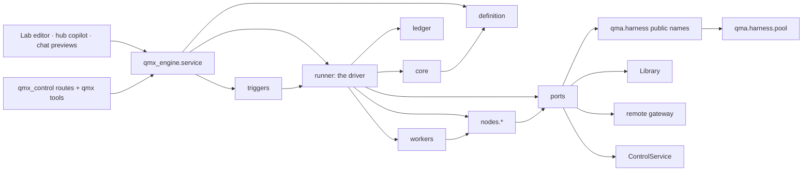
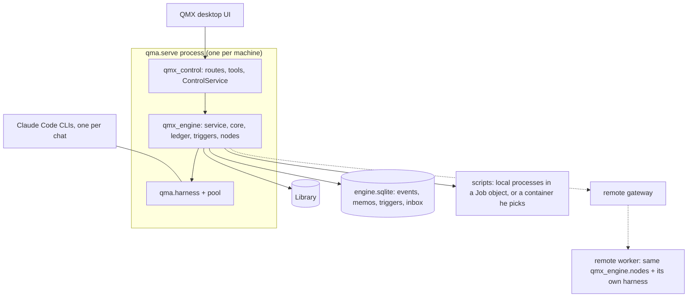
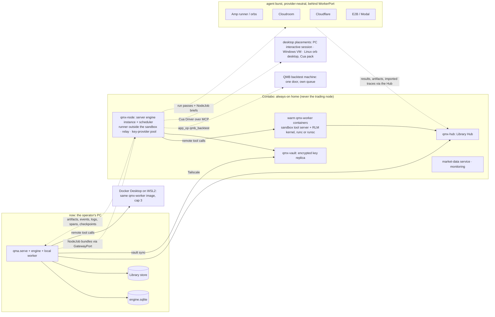
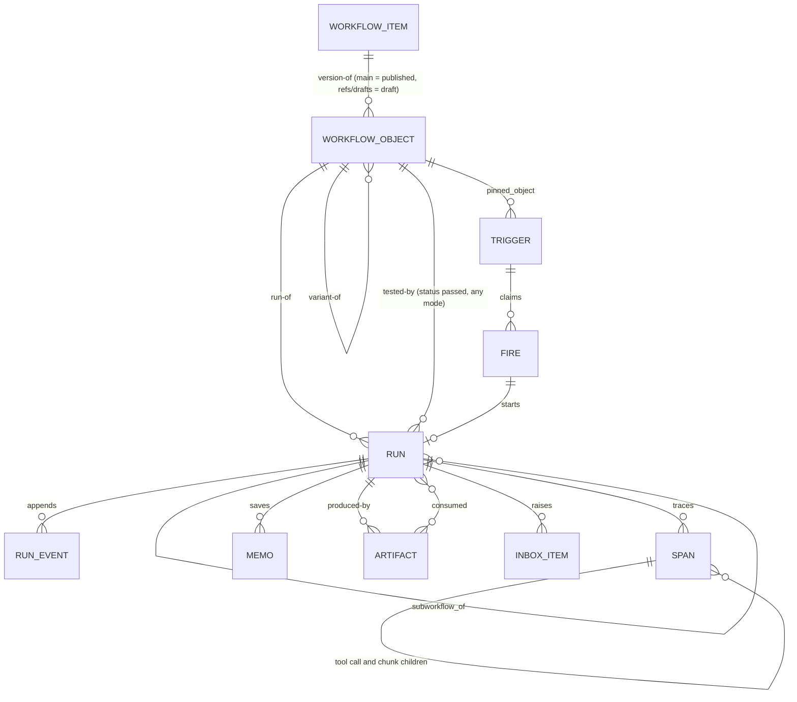

# Architecture Spine — QMX workflow engine

Labels on claims: **[retrieved]** read from a cited file or branch today, **[remembered]** from training knowledge, **[inferred]** reasoned here. Every AD without a label is a decision, not a claim.

## Design Paradigm

**Durable execution** (the Temporal/Inngest shape [remembered, confirmed in `13` section 3 [retrieved]]): workflow control flow is deterministic and replayable; every side effect lives in a node whose result is saved once and returned on replay; failed or changed nodes rerun, finished ones never do. The engine is **hexagonal**: a pure orchestrator core with ports, and adapters for everything that can fail or vary.

| Layer | Namespace | Owns |
| --- | --- | --- |
| Definition | `qmx_engine.definition` | the `qmx.workflow/1` JSON schema, node-kind registry, validator, variant overlay resolver |
| Orchestrator (core) | `qmx_engine.core` | pure scheduling of nodes over the ledger: readiness, joins, loops, memo lookup, replay, drain and pause |
| Ledger | `qmx_engine.ledger` | the append-only event store (SQLite, one writer), memo index, spans |
| Executors | `qmx_engine.nodes.*` | one adapter per node kind; the only places that talk to the harness, scripts, apps or the Library |
| Scheduler | `qmx_engine.triggers` | trigger rows, ticker, fire claims, catch-up, quota hold, preflight, monitors |
| Ports | `qmx_engine.ports` | `HarnessPort`, `LibraryPort`, `MemoryPort`, `InboxPort`, `WorkerPort`, `GatewayPort`, `SettingsPort`, `Clock` |
| Memory | `qmx_engine.memory` | the built-in memory provider (Library `memory-row` objects + FTS5 index), intent keys, consolidation, champion replay |
| Environments | `qmx_engine.workers` | the one sandbox contract: `WorkerPort` → `qmx_remote.ComputeProvider` → the `qmx-worker` image; the runner-side sandbox tool server; local Docker, `qmx-node` on his server, E2B/Modal burst; the egress proxy for the fallback mode; on the PC scripts run as ordinary local processes in a Job object with their own zones (AD-24); a container or a remote placement is his choice per workflow |
| Redaction | `qmx_engine.ledger.redact` | the one redaction function every write seam applies (AD-37); the text scan of AD-36 is retired (retired 2026-10-18, rulings 115-117) |
| Service | `qmx_engine.service` | the one Engine API the surfaces call (drafts, versions, tests, runs, triggers, inbox, explain) |
| Credentials | `qmx_engine.vault` + `qma.harness.relay` (per host, or the central relay on Contabo) | the vault sync from Windows Credential Manager to `qmx-vault` on Contabo, run passes, revocation; a relay is the only key reader on its host, and non-owned placements route to the central relay (ruling 75) |
| Placements | `qmx_engine.workers.placements` | the placement registry (owned, managed VM, managed agent host, serverless, QMB machine, desktop), capacity derived from RAM, preflight states, the three agent modes, provider onboarding from published instructions (ruling 74) |
| Sessions | `qmx_control` session homes (specified here, AD-35) | the write-once `home` of every session, read by every surface |
| Capability packs | `qmx_engine.packs` | optional tool layers a node's scope loads: `cua` (desktop and browser), later browser-only and others |
| Harness extension (provider contracts only) | `qma.harness.pool`, `qma.harness.relay` (the model router), `qma.harness.profiles` (data profiles and the model registry) | the in-house account pool and balancer; the model router that fronts every CLI with four lanes (plan bytes untouched, GPT, key, chat-completions; AD-38); the model registry with wire and capabilities per model (AD-39); the relay reachable on the tailnet with run-pass bearers. Rulings 39, 92, 95, 98, 99: inside this row the harness core (chats, permissions, money gate, launcher) does not change, only the provider contracts do; harness behaviour changes such as `delegate` v2 (AD-41) are separate harness rounds he grants (HARNESS-REQUESTS HG3, HG4) |
| Desktop host | `qmx-desktop` (the app's main process) | process supervision of `qma.serve`, startup card, Docker start, keep-awake, dead-man switch, restart-loop breaker, pre-update snapshots, windows (main, pop-out, HUD); AD-48 |

## Invariants & Rules



Arrows mean "may import or call". Nothing points back up. `core` imports only `definition`, `settings` constants and `qmx_ledger.journal` hashing [retrieved engine/tp4]; it imports no ledger, port, node, worker or adapter, and `definition` imports none of them either. The runner is the driver: it folds the ledger through the pure core and carries the core's commands out through workers and ports (redrawn 2026-10-18, B-12).

### AD-1 — Durable execution, pure orchestrator

- **Binds:** all
- **Prevents:** a second scheduler, a model deciding control flow, two units that disagree on what "resume" means
- **Rule:** `qmx_engine.core` is pure: it takes the definition, the run inputs and the ledger events and returns the next commands (start node, wait, pause, finish). It performs no I/O and imports no adapter. Everything that can fail or vary (model calls, scripts, Library writes, app operations, time) happens inside a node executor and lands in the ledger as a saved result before the core sees it. No LLM output is ever a control-flow edge; a model can only produce data that a `rule` node reads.

### AD-2 — One definition format for every workflow `[ADOPTED]` (rulings 22, 23, 44)

- **Binds:** definition, builder, surfaces, mini-app-contract
- **Prevents:** hand-built templates, a second graph dialect for the Lab, "agent" and "workflow" as two product kinds
- **Rule:** every workflow, template, variant, mini-app workflow and single-agent workflow is one JSON document of schema `qmx.workflow/1`, n8n-shaped: `nodes[]` (id, name, type, typeVersion, position, parameters, credentials refs, retry and on-error options, disabled), `connections` keyed by source node name then output name then target list with edge mapping, `settings`, `pinData`, `inputs`/`outputs` schemas, `meta`. A template is a definition with defaults. A variant is an overlay (`extends` + patches) that the publisher resolves into a complete snapshot. A single-agent workflow is one trigger node plus one `agent` node and is still a workflow. Script-only, mixed and fully agentic workflows are all first-class (ruling 52): a run with no model-bearing node takes the same path as any other and spends no tokens (Hermes `no_agent`). A workflow is a **folder** (ruling 19): `definition.json` plus the files its `*_ref` fields name (`scripts/`, `prompts/`, `schemas/`, `fixtures/`); every ref resolves inside the folder, and the content hash covers the folder's bytes, so a version is one addressable thing.

### AD-3 — The engine runs beside the harness, apart from every chat

- **Binds:** engine, surfaces, harness-boundary
- **Prevents:** engine code inside `qma.harness`, a second door that accepts text into chats, a separate process that cannot start Background chats
- **Rule:** the engine is package `qmx-engine`, imported by `qmx-control` and started by `qma.serve` as its own task group plus worker threads in the same process. It holds the `Harness` object and uses only the names exported by `qma.harness.__init__`; an import of a harness submodule is a CI failure (the chat-kind names `Background` and `Child` arrive with HARNESS-REQUESTS H0; until it is granted, the one adapter module `qmx_engine.ports.harness_adapter` is the only allow-listed importer of exactly those two names from `qma.harness.launch`, and the import-linter rule names that pair, so nothing in the harness changes). From `qma-core` the engine may import exactly `qma.core.barriers.money_path` and `qma.core.barriers.descriptors` (the word lists the built definition lint reads; AD-36's wider scan is retired); any other `qma.core` module is a CI failure. The copilot reaches the engine through `qmx` tools (the `workflow_*` rows of SOLUTION-DESIGN §13, HARNESS-REQUESTS H17; until H17, the existing rows and the draft-save fallback named there) and the UI through REST routes under `qmx_control`, both dispatching to `qmx_engine.service`. No engine operation accepts chat text. One engine codebase runs as **one instance per home**: the PC's `qma.serve` and Contabo's `qmx-node` (AD-30). Each instance has its own ledger and runs only the triggers whose `home_engine` names it (`pc | contabo`, the registry names of AD-30; Contabo is the default for schedules, because it is always on); a trigger has exactly one home, so there is never a second scheduler for one schedule, and every run's summary lands in the one Library either way. *One instance, enforced (40 §5 item 9; L-64, L-70):* at start an engine instance takes an exclusive OS lock on `<home>/engine.lock` for the life of the process (the OS releases it on death); a second instance on the same home refuses to start with one line; an engine object creates exactly one `Scheduler` in its constructor, and a second `serve` on it raises. A check-then-write marker is not a lock.

### AD-4 — The node contract

- **Binds:** definition, nodes.*, builder, remote-worker-contract
- **Prevents:** two node kinds whose results cannot be joined, a node that names a model, an executor that cannot be retried
- **Rule:** every node declares `type`, `typeVersion`, ports (every v1 port carries `data`: a JSON value or an artifact ref; the registry keeps DEC-0418's kind field so `reference`, `event` and `control` can be typed by a later `typeVersion`, and v1 validation checks edges by port name only), `parameters`, `role` (never a model id), `effect` (AD-8), `retry` (max tries, backoff, retryable errors), `timeout` (idle and in-tool only, read by AD-16's stuck detector; no run timeout exists, AD-40), `runs_on` placement, and `credentials` as `qmx/*` refs. An executor implements `run(NodeJob) -> NodeResult` where `NodeResult` is `ok(outputs by port) | failed(error, signature, retryable) | waiting(reason, resume_at) | gate(ask)`. Outputs are JSON values or artifact refs; anything over `settings.inline_limit` is an artifact. The registry entry for a kind fixes its input and output port names, so an editor and an executor never guess: `in` is the default single input and `main` the default single output; `trigger` has no input; `rule` outputs `true` and `false` (one predicate per node; a many-way branch is a chain of rules); `loop` takes `in` (the first value) and `next` (the loop-back, the one cycle a definition may hold) and outputs `body` and `done`; `grader` outputs `pass` and `fail`; `monitor` outputs `changed` and `silent`; `human_gate` has one output per option (ratified from the built registry, B-15). An `agent` node has **no default turn or tool-call ceiling** (AD-40); a `limits` block he wrote on the node or the workflow (`turns`, `tool_calls`, `tokens`, `wall_seconds`) is recorded on `run_created` and honoured as AD-16 says, and the lint refuses only a value below 1 (B-16 superseded). An `agent` node ends with exactly one terminator (`ok` with its output, `failed`, or `waiting`), carries `expected_run_id` on every write it makes, and a build-type agent's default output schema holds `changed_files, verification, dependencies, blocked_reason, retry_notes, residual_risk` (Hermes worker-lane contract). An `agent` node also declares `subagents` (each with a role, so each may resolve to a different provider through the model router, AD-38, with `via: native | delegate` (AD-41); a `native` sub-agent reaches a third-party model only through a registry-generated agent definition passed at launch (AD-38, HARNESS-REQUESTS H38), under a plan main only where probes P1 and P4 passed for that provider and under a key or GPT main only where probe P1k passed (42 N7), otherwise the engine resolves it `via: delegate`; `max_concurrent` is a parallelism setting, default the CLI's own; spawn depth is a setting, default 1; they live in the same chat tree as the node's agent (`native`) or as helper chats (`delegate`), and their tool calls go to the same sandbox, ruling 52 and study 29), `tools_may_create` (an agent may write its own tools; each is saved as an `agent-tool` Library object in state `unreviewed`, runs only inside a sandbox, and never carries an order verb), `isolation` and `agent_mode` (AD-25), and `ask_policy`, which is `reject` for every permission ask (the engine answers through `Harness.answer` at once) except a tool call the registry marks `irreversible_external`; that one raises an inbox item and the attempt waits for the inbox's answer or the harness's unattended window, whichever comes first (ruling 57). Executors are idempotent under the memo key of AD-7.

### AD-5 — The node-kind vocabulary

- **Binds:** definition, nodes.*, surfaces
- **Prevents:** a kind invented per template, Lab and workflow graphs with different palettes
- **Rule:** v1 kinds, closed and extended only by `typeVersion`: `trigger`, `script`, `rule`, `loop`, `join` (`all | any | quorum(n)`), `wait` (time, event, webhook), `human_gate` (allowed only in front of an irreversible external effect, ruling 57; it parks that effect in the inbox; `approval_gate` is the same kind with a timeout and `on_timeout`), `llm` (one model call with a JSON schema), `agent` (a harness Background chat with structured output, optional sub-agents and self-made tools, AD-4; its code-running tools execute in a sandbox, AD-25), `rlm` (a prime-agent-style Python kernel over data and tables: cells in a long-lived namespace inside the node's sandbox, driven over the same remote tool call, `spawn`/`collect` sub-model calls routed through the runner's provider layer so they land as spans, a snapshot after each cell shipped to the Hub as a `checkpoint` blob and restored on retry), `subworkflow` (typed inputs, caller policy, its own ledger namespace), `grader` (`mode: deterministic | llm`: a deterministic check or an LLM judge on the `judge` role, verdict plus feedback), `monitor` (cheap source, hash diff, wake gate), `app_op` (a mini app's exported operation), `library` (read or write a Library kind), `claude_workflow` (the Claude Code Workflow tool for a Claude-only fan-out; off unless the operator enables it per workflow). Edge mapping is `one | zip | broadcast | chunk | keyed-join | cartesian` with cartesian explicit. An edge that carries a list into an `llm` or `agent` node must be `chunk` (ruling 78, AD-34); `broadcast` of a list into those kinds is refused at validation. A capability pack (the Lab pack, `cua`, later others) registers types named `<pack>.<name>`, each with a `base_kind` from this list; the JSON `type` is the pack type, and the validator checks the node against its base kind's contract (ports, effect, role rules), so the vocabulary stays closed. `note` is the one draft-only type (no `base_kind`, refused at publish unless disabled). DEC-0312's kinds map onto these one to one (SOLUTION-DESIGN section 2.3). *Readiness:* a node runs when every source slot it reads has settled, every inbound edge marked `required: true` carried output, and at least one inbound edge carried output; otherwise it is skipped, and so is what only it feeds. `required` defaults to false, so a merge after a `rule` runs on whichever branch fired; an edge that enters a loop body from outside it is context and never makes a body node ready on its own (B-24, B-87). *Subworkflows:* a `subworkflow` names its child either as a block folder inside the parent's folder (`blocks/<name>/`, carried in the parent's bundle and content hash) or as a pinned published object (`workflow_item`, `object_id`); the callee's `caller_policy` is checked at validation whenever the child resolves and again at dispatch; a child that ends `waiting` makes the parent node `waiting(child)`, never failed; cancelling the parent cancels its children (B-27, B-66, B-76). *Nesting:* v1 fans out one level deep; nested fan-out, a loop over fanned input and a loop inside a loop body are refused at validation (`nesting_unsupported`) until the nested fan-out packet, never parked at run time; a kind or mode the registry marks unavailable (the grader's `llm` mode until its packet) is refused at validation too (B-20, B-46).

### AD-6 — Determinism of control flow

- **Binds:** core, nodes.*, builder
- **Prevents:** a replay that takes a different branch than the original run
- **Rule:** the core and the definition layer never read any clock (wall clock, `time.monotonic`, `perf_counter`), randomness or the environment; measurement happens in the runner and the workers (L-20). `now`, seeds, operator answers and external events enter the run only as recorded ledger events (`run_input`, `clock_tick`, `gate_resolved`, `event_received`). A node that needs time reads it from its `NodeJob.now`. Replay feeds the same events and must produce the same commands; a divergence is a bug the ledger makes visible.

### AD-7 — Saved results and node-level replay

- **Binds:** core, ledger, nodes.*, remote-worker-contract
- **Prevents:** Claude-Workflow-style prefix replay that reruns everything after the first failure, double-paid model calls, a resume that silently reruns a finished script
- **Rule:** a node attempt's result is memoised under `(run_id, node_id, iteration, partition, sha256(inputs), sha256(node_definition))` (`partition` is the one spelling in memo keys, events and spans). On resume or rerun the core returns saved results for every valid memo and schedules only nodes without one. A downstream node reruns only when its own input hash changed. In a fan-out each partition has its own memo, so only failed partitions rerun and the join reuses the rest (DEC-0439 join algebra ratified). Editing a draft after a test run invalidates exactly the memos whose node definition hash changed. **Replay fork** (B-82): `service.runs.replay(source_run_id, object, mode: test)` starts a new test run of an edited folder seeded with the source run's recorded events (`run_input`, `clock_tick`, `event_received`, `gate_resolved`) and lets it reuse the source run's memo for every slot whose node definition hash and input hash are unchanged; the first changed node and everything downstream of it rerun on real models; the new run carries a `replay-of` edge to the source (LIBRARY-REQUESTS L20). Memos never cross runs any other way, and never across workflows. *Memo truth (40 §5 item 4; B-19, L-35):* the ledger events decide whether a memo is valid (a `node_finished` with its input and definition hashes, voided only by a later recorded event); `ledger.memo` is a derived index rebuilt from those events (AD-23), and no code reads its `valid` flag as truth.

### AD-8 — Effects are classed by reversibility

- **Binds:** definition, nodes.*, core
- **Prevents:** an automatic retry that sends twice, writes twice or pays twice; a node that places an order
- **Rule:** every node declares `effect: none | reversible | compensable | irreversible | irreversible_external` (the last is the subset of irreversible effects that leave QMX: a message, a post, a webhook, an app operation marked so; ratified from the built registry). `reversible` (run-workspace files) writes only into the attempt's own overlay and is undone by discarding that overlay, so a retry never touches a sibling attempt's files (AD-51; 40 §5 item 2, B-29). `compensable` (Library writes) is undone by supersede or archive, never by delete. `irreversible` (model spend, external sends, webhooks, app operations marked so) receives the idempotency key `run:node:iteration:attempt` in its `NodeJob` and is retried only on a failure that provably happened before the effect. After an `unknown` outcome the two differ: a **model call** is retried once under the ladder (duplicate spend is accepted, ruling 27, and the attempt writes an `info` line), while an `irreversible_external` effect (a message, a post, a webhook, an app operation marked so) is never retried automatically. The model-call exception covers only a model-bearing node whose declared effect is `none`, `reversible` or `compensable`; a model-bearing node that also declares `irreversible` or `irreversible_external` follows that class: after `unknown` it is retried only when it declares `idempotent: true` (its target dedupes on `QMX_IDEMPOTENCY_KEY`), else it goes to the inbox (40 §5 item 5, B-57; agent writes, Appendix G L6). Money acts are not an effect class: agents have no path to money (ruling 116), the harness money gate is unchanged, and the built definition lint keeps its existing money-act rule on node types and parameters as built; AD-36's wider scan is retired.

### AD-9 — Provider limits pause the work; nobody is asked; QMX sets no usage limit of its own `[ADOPTED]` (rulings 27, 90; settled 2026-10-18)

- **Binds:** core, nodes.llm, nodes.agent, triggers, pool
- **Prevents:** `LaunchRefused` plus a `needs_you` block on any send, a run that fails at a usage limit, an operator prompt about usage, a QMX-invented share or budget that pauses work
- **Rule:** before a model-bearing node starts, admission control asks the pool for a lease that fits the node's role (AD-12) and reserves one chat slot from the host's live-chat capacity minus `limits.interactive_reserve` (chat slots are machine capacity derived from RAM, AD-30, so the copilot always has a slot; they are not usage). A provider's closed window, a provider 429 with a reset time, or every allowed account of the role benched or cooling yields no lease. Without a lease the node enters `waiting(resume_at)` and the run drains: running nodes finish, script and rule nodes keep going, no new model node starts. The scheduler wakes the run at the earliest `resume_at` with no human action. A provider rate-limit inside a running node marks that attempt `waiting`, not failed, and keeps no partial output. Work beyond host capacity queues or spills to the next `runs_on` placement; it is never refused. *Held work is a recorded wait (40 §5 item 1; L-60, B-55):* a chunk queued for capacity, or held behind the warm-first gate (the first chunk of a node ends a turn so the rest read its prompt cache), is not started: the gate moves from inside `nodes/agent.py`'s attempt to dispatch, so a held chunk writes no `node_started` until it leaves the queue, and the stuck detector (AD-16) never sees it as an idle attempt. QMX itself never refuses, pauses or ends work on a usage number: there is no background share, no per-chat or per-run USD budget and no token, agent, tool-call, turn or wall-time ceiling by default (AD-40). One inbox item is raised only when every allowed account for the role has been closed longer than `settings.limits.alert_after`.

### AD-10 — Triggers are rows; the scheduler fires at most once per occurrence

- **Binds:** triggers, definition, service
- **Prevents:** a schedule baked into a definition, a backlog of catch-up runs after downtime, a run that spawns schedules
- **Rule:** a trigger is a row outside the definition (DEC-0417 ratified): `cron` with an IANA zone, `interval`, `event` (engine bus), `webhook` (through the gateway), `manual`, `after` (another workflow's completion), each bound to one workflow item and the **exact published object** it pins (`pinned_object`), plus `follow_champion: bool` (when true and the workflow's `self_improve` is `auto`, a fire runs `refs/champions/<item>` provided that champion descends from the pinned object; otherwise the pinned object; never a draft), with `precheck` (a `monitor` or `script` ref), model and effort pins, delivery target, `continuity` (inject the trigger's own last successful outputs as an input, Hermes style), `max_concurrent`, and a `created_by` principal that is never a run. The trigger **source** is pluggable and controls only when a fire is claimed, never execution: the in-process ticker now, a server or cloud trigger provider later. The ticker runs in-process every `settings.scheduler.tick` seconds and claims a fire under a lease with a heartbeat, so two processes never run one occurrence. A fire inside the grace window runs late; past it the backlog collapses into exactly one catch-up run per trigger (ruling 25). A fire into a closed usage window is parked (`quota_hold_until`) and merged with later fires. Preflight (credentials resolve, roles resolve, skills and apps present, delivery target exists) failing sets `blocked_config` with one item whose severity follows AD-17 (`info` when the workflow's own configuration is at fault, `normal` only for a provider failure such as a missing or rejected key) and no model call. A monitor whose source hash is unchanged ends the fire as `silent`. *Wakes (B-63, B-73, L-37):* every `waiting` with a `resume_at` (a usage limit, a time `wait`, a retry backoff, a quota hold) writes one wake row in `engine.sqlite`; the ticker is the only thing that resumes a run on time, and a held run reads `waiting`, never `running`, until its wake fires; every `resume_at` is an RFC 3339 UTC instant compared as an instant. *Enablement (B-68):* a version's `enabled` is derived, never stored: a version is enabled exactly while at least one enabled trigger pins it or follows it as champion, so disabling the last such trigger disables it. A trigger's `role_pins` and `effort_pin` override role resolution for the runs it fires and are recorded on `run_created` (B-60); pins are his, and no run or agent may change them (Hermes per-job pins). *Hermes-shaped additions (37c, 37d):* trigger kinds `event`, `webhook` and `session` (AD-47) join `cron | interval | manual | after` through a forward migration of the kind check; a run whose model node finds its model unreachable before any call is never re-fired: the same run continues with that node `waiting(resume_at)` at 5, 15 and 30 minutes after the first failure, then walks the ladder, so script and `irreversible_external` nodes that already ran in the fire never run twice (41 M5: Hermes' re-run is spend-neutral only because a Hermes fire with no model call has no side effects); a trigger may be created paused with a reason in one write; a run's delivery is its own field next to its status (`delivered | unverified | failed | none`), an adapter ack without evidence reads `unverified`, an empty payload fails closed; a script node may declare failure on its first output line (`[QMX_FAILURE]`) or ask for silence (`[QMX_SILENT]`), and a failure always delivers; repeated failures of one trigger with one masked signature are one **incident** (count, first and last seen, acknowledge until the signature changes, resolved by a passing run; the stored `incident_id` gets this logic); `service.explain_trigger(trigger_id)` answers "why didn't it fire" (ticker heartbeat age, version enabled, next fire, last ten fires with reason, open incident) for the UI, the copilot and the doctor.

### AD-11 — The creation lifecycle and the test gate `[ADOPTED]` (ruling 23)

- **Binds:** service, definition, builder, surfaces, library-contract, mini-app-contract
- **Prevents:** a live run on a mutable draft, a schedule on an untested version, a deleted workflow, a Lab "run this part" that bypasses the engine
- **Rule:** states are `draft -> validated -> tested -> published (version) -> enabled <-> disabled -> archived`. A draft is mutable and may hold free-form note nodes and unconnected nodes (the saved Board). **Drafts never live on `main`:** the operator's draft is the head of `refs/drafts/<item>`, an agent's is `refs/agents/<session_id>/<item>` (Library AD-7), and `main` holds published versions only. A version is **tested** when a `workflow-run` with status `passed` (either mode) ran an object whose definition `content_hash` (SOLUTION-DESIGN §2.2) equals the version's; publish copies the draft's `tested-by` edges onto the published object when the hashes match, and a publish that changes the hash (a non-fast-forward merge) needs a new test before enable. Workflows, mini apps, pods, skills and methodologies that a **run** produces land on `refs/drafts/<item>`, never as a published version (ruling 80: creation is human-driven first); results, artifacts, notes and memory rows still land on `main` without asking (ruling 57, Library AD-18). Every run carries `mode: live | test`, fixed at `run_created` and never changed, and a status from the one shared status table (SOLUTION-DESIGN §3.1, used identically by the Library's AD-15); mode and status are separate fields. Validation checks the DAG, port names, edge mapping, schemas, role names, effect classes and the lint rules (no `settings.write`, no money act, no trigger creation). A draft runs only in **test mode**: pinned data where present, **real models by default**: the cheapest candidate of each role through the plan login (`claude/haiku`; operator ruling of 2026-10-18; ruling 51: "we want to make sure things work"), with OpenRouter and other key rows used in test mode only by a provider-proof lane that names them, the fake provider only as an explicit per-run switch, irreversible *external* effects stubbed while model spend and Library writes are real, the result written on the run's own branch and bound to the draft's content hash as a `test-report`. Only runs with `mode: test` are excluded from the Library's fast-forward into `main`. Publishing freezes a version (immutable, content hash, semver) and is his act (AD-22). Enabling a trigger on a version requires that version to be tested. Live runs refuse drafts. Selected-subgraph runs (an induced DAG of node ids) are allowed on drafts in test mode and on versions in live mode. Archive is the only end state; archived versions keep their runs, lineage and content. *Who starts what (B-44, B-45, L-51, L-53):* `published` means reachable on `main`; a live run starts only through `service.runs.start` on such an object, by a `user` principal, by the scheduler for an enabled trigger, or as the `subworkflow` child of a live run (which inherits the parent's mode); publish, enable and live start are refused in the service itself for `agent` and `workflow` callers; the engine CLI runs folders in test mode only (no `--mode live`), and a `fake: true` run is always `mode: test`. *What the tested mark covers (L-26, L-75):* the definition `content_hash` covers `nodes` (layout `position` excluded), `connections`, `settings`, `inputs`, `outputs`, `pinData`, `meta.needs` and the bytes of every file in the folder, block folders included; a change to any of them drops `tested`. *Per-run overrides (Hermes per-task model):* a `user` principal may start a run (test or live) with a per-node role override (`node_id → candidate`), recorded on `run_created`; a run or an agent may not.

### AD-12 — The account pool and balancer are in-house, per host, and never touch a plan token `[ADOPTED]` (rulings 26, 39, 90, 95, 99)

- **Binds:** pool, relay, nodes.agent, nodes.llm, core, settings, surfaces
- **Prevents:** a third-party pool product in the key path (opencodex, CLIProxyAPI, any hybrid), a QMX process that stores, rewrites or swaps a Claude plan token between accounts, fill-first draining one account, workflows draining his copilot account, a request-level balancer that kills the prompt cache, test keys used for real runs, a share or ceiling QMX invents
- **Rule:** `qma.harness.pool` is in-house code (balancing logic copied as ideas from Hermes credential pools (MIT), CLIProxyAPI session affinity and opencodex's reset-window strategy; no third-party product sits in the key path, ruling 99; no pool was ever built, so nothing is replaced). It owns account rows per provider row of the model registry (AD-39): **Claude plan accounts**, each its own plan home signed in by the CLI's own `/login` (the pool chooses which home launches a chat and never moves a token between homes); **GPT sign-in accounts**, each its own sign-in home, any number (no "capacity one"); **key accounts**, any number per provider. Selection happens once per chat at `start_chat` and once per `(session, provider)` for requests the router sends to another provider (session affinity; engine nodes use `run_id:node_id` so chunks share a cache). Strategies `least_used | round_robin | fill_first | reset_window | random`; **the default for background work is `least_used`** (lowest last reading from the provider's usage hook, the plan meter or the relay journal; ties round-robin); `fill_first` is never a default. Each account row carries `priority` and `background_priority: normal | last`; the account he marks as his copilot daily driver defaults to `last`, so workflows lease it only when every other account of that provider is benched or cooling, and his copilot chats pin it. Per-account `strategy`, `share`, `ceiling`, `concurrency` and `cooldown` overrides exist only as values he sets in Settings (CLIProxyAPI-like in capability, QMX's own look); their defaults are unset, so nothing binds unless he writes it (AD-40). A lease carries the provider's own concurrency (from its tier when known) so parallel nodes spread; that limit is the provider's. Errors arrive through the one classifier (AD-40): a plan or usage-limit 429 cools the account until `reset_at` and rotates at once; a generic 429 retries the same account once, then cools one hour and rotates; 402 cools one hour and rotates; a key 401 benches that key with one inbox item; a GPT 401 refreshes once (under a cross-process file lock that never writes older tokens over newer) and benches the account only when the refresh token itself is rejected; a **plan** 401 seen by the router benches nothing, because the CLI refreshes against Anthropic's sign-in endpoint, which the router never sees: a plan account is benched only on a dead-login signal from the CLI itself (its result or stream says it needs `/login`) or on three consecutive 401s on new requests spread over at least five minutes, and even then his copilot is never moved to another account or provider automatically: its chats show "sign in again" and wait, while workflow roles skip the benched account (Hermes H-24, H-27: rotate only after a failed refresh; 41 H2); a model-entitlement 400 benches that model on that account only; cooldowns are per `(account, model)`; a provider `reset_at` always wins; a `reset_at` already in the past is never waited on: the account turns `probing`, the next real lease is allowed, and that request's answer sets the new state (no synthetic probe request; 40 §5 item 6, L-63); a `probing` request answered by another 429 whose reset is absent or already past is classed a generic 429 (retry the same account once, then the generic one-hour cooldown and rotate) and never returns straight to `probing`, so no resend loop forms (42 N13). A running chat moves account only on a quota or auth error, through `quote` then `apply` (recorded `uncached_resend`), and moves back at the next turn start when the cooldown lifts; an explicit model switch cancels the move back. Status reads are peeks that never refresh or rotate. OpenRouter rows are `test_only` and leased only by provider-proof lanes. Every harness instance runs its own pool. *Two owned hosts, one set of accounts (41 H7):* a key account may be leased by the PC and Contabo alike, so the two pools exchange facts over the tailnet: each publishes `(account, model, state, until, reading, observed_at)` on every cooldown, bench and reading, applies the other's, and the newest provider fact wins; while the link is down each works on its own facts; a provider's own concurrency for a key is shared by live leases: each host publishes its live lease count with its facts, may hold up to the provider's limit minus the peer's live leases, and takes the whole limit when the peer is idle or has not answered for one sync (the provider's limit, never a QMX number; 42 N11). Each GPT sign-in account has exactly **one owner machine**, where its sign-in home lives: a sign-in of an account id already owned elsewhere is refused (account ids compared from the token claims), because two logins of one ChatGPT account share one token family upstream and the older is revoked [retrieved 41, Hermes `credential-pools.md:126`]; other owned hosts reach it through the owner's router: a request for a GPT row whose owner is another host is forwarded over the tailnet to the owner's router with a **host pass** (signed with the pairing key, naming the originating host, chat and GPT account, valid while that chat lives), which the owner's router accepts only from an owned host and only for that account; a PC chat's own per-launch grant never leaves the PC (42 N11). Plan logins stay per machine. Keys reach a host only through AD-28's vault. `UsageLedger` and readings are per account.

### AD-13 — Roles, not models; defaults do not assume Claude first

- **Binds:** definition, nodes.llm, nodes.agent, nodes.grader, settings, router
- **Prevents:** a template pinned to one vendor, a reviewer that quietly runs on the author's model, a default ladder that tries Claude before the providers he uses most, a node sent to a model that lacks a capability it needs
- **Rule:** a node names a role (`planner`, `writer`, `judge`, `doctor`, and the rest of the role table). Settings maps each role to an ordered candidate list of `(profile, model, effort)` per placement, editable in the UI and never in a template. Until he edits a list, its default is **generated from the providers he configured**, by the model registry's capability class (AD-39: `strong | mid | cheap`), in the order `key → gpt → plan` for workflow roles (he uses third-party models more than Claude), and every tier, the strong roles included, carries the Chinese models he configured (Kimi, DeepSeek, GLM, Qwen, MiniMax) as first-class candidates ahead of GPT and Claude; the copilot keeps the model he picks for it. Until the registry packet generates these lists, the built static defaults are brought in line by the **P0 pre-land hygiene** packet (`methodology/40` §3.1 row 0, B-95, B-98): no Fable row, Chinese rows first in every tier including strong, `roles.live_order` `key, gpt, plan`, test mode resolving `claude/haiku` through the plan login first, with tests that pin each (42 N2). Auxiliary roles exist for side work, each `auto` (the chat's main model when it has the capability): `titler`, `compactor`, `curator`, `vision_describer`, `transcriber`, `video_analyst`, `goal_judge`, `reviewer`, `background_review`; the UI warns when an auxiliary role sits on another provider than the main model. Resolution happens at dispatch against pool availability and the node's declared needs: a candidate whose model lacks `tools`, `vision`, `thinking` or a window large enough for the chunk plan is skipped with a span line, never sent. The failure ladder walks the list in order; a pinned candidate never borrows another role's ladder. Every provider runs an `agent` node the same way: a harness Background chat on that profile behind the model router (AD-38). An `llm` node is a one-turn, tool-less Background chat on any profile; the engine never calls a provider key directly, because the relay is the only key reader. A `judge` resolving to the same family as the author is allowed but labelled `same_family`. No default list names Fable (ruling 87). Tests use the cheapest candidate through the plan login (`claude/haiku`); OpenRouter rows only in provider-proof lanes. With one Claude account, test runs and builder tests draw on the same plan window as his copilot (`background_priority: last` orders leases, not pinned test candidates); the Accounts page shows their share as a reading, never a limit (41 M6).

### AD-14 — The Library contract the engine depends on

- **Binds:** library-contract, nodes.library, service
- **Prevents:** two Libraries with opposite rules, a run that cannot be traced to its definition, a deleted version
- **Rule:** there is one Library (ruling 28). The engine uses the Library's own kind names: `workflow` (an item whose versions are its objects; a version is `(item_id, semver annotation, object_id)`, and the semver and the lifecycle are annotations or ref facts, never fields of the stored definition; drafts on `refs/drafts/<item>` or an agent ref, published versions on `main`; there is no separate version kind), `workflow-run` (summary plus trace blob, with `mode`, status, and the placement fields of LIBRARY-REQUESTS L14), `artifact` (content-addressed blob plus typed metadata; a script lists the files it leaves with an optional type from the Library's artifact types `card | source | report | proposal | dataset`, and `run-file` when it names none, LIBRARY-REQUESTS L19), `test-report`, `memory-row` (AD-18), `agent-tool` (AD-4, `review: unreviewed`), `checkpoint` blobs on a `workflow-run` (AD-5 `rlm`), the `intent_key` annotation (AD-27), and the refs `refs/champions/<workflow_item>` and `refs/challengers/<workflow_item>` (AD-26). All of these were granted by the Library (ENGINE-REQUESTS-ANSWERED L1-L14). The engine reaches the Library only through `LibraryPort` and never assumes which store answers: the PC store today, the Hub on his server later (ruling 56); a run writes only on its own branch `refs/runs/<run_id>` with its run token, test runs included, and a workflow's Library writes never wait for a human (ruling 57). It writes typed edges from the closed set `version-of | variant-of | run-of | produced-by | consumed | tested-by | replaces | archived-as | replay-of` (the Library's AD-4 names, `replay-of` requested as LIBRARY-REQUESTS L20; `consumed_by` is read as the reverse of `consumed`, and the earlier engine word `supersedes` is the Library's `replaces`), which the Library design may extend but not loosen. A run's own writes carry the principal `run:<run_id>` (its run pass); only the fast-forward into `main`, landing run-made drafts on `refs/drafts/*`, memory consolidation and champion or challenger moves carry `engine:<store>` (Library AD-7). It reads definitions by pinned object id, artifacts by hash, pinned data by draft; a version's bundle is the whole folder, every block folder a `subworkflow` node names included (LIBRARY-REQUESTS L18). Writes are append-only: a change is a new version or a new edge. The engine keeps no copy of these kinds; the run ledger stores events and memos, the Library stores content and summaries.

### AD-15 — One trace per run, one span per node attempt

- **Binds:** ledger, nodes.*, service, surfaces
- **Prevents:** a run the copilot cannot explain, a cost nobody can attribute
- **Rule:** `trace_id = run_id`; each node attempt is a span with `parent_span` (the run, the loop iteration or the subworkflow call), `kind`, `role`, `profile`, `account`, `model`, tokens in, out, cache read and write, cost estimate, duration, attempt, partition, verdict, effect class and placement; every tool call inside an `agent` or `llm` attempt is a child span of it, and every chunk of a `chunk` edge is its own partition span (AD-34). Spans are ledger events, so the UI run timeline, the watchdog and `service.explain(run_id)` read one source. At run end the trace is exported as a Library `artifact` linked `produced_by` the run. *Event keys (B-18, L-29, L-34):* every node event (`node_scheduled`, `node_started`, `heartbeat`, `log`, `node_finished`, `node_failed`, `node_waiting`, `gate_opened`, `gate_resolved`, `compacted`, `tool_called`, `ladder_step`, `doctor_verdict`) carries the attempt key `node_id, iteration, partition, attempt`; `node_scheduled` also carries the input hash. Span status is derived only: `ok` from `node_finished`, `failed` from `node_failed`, `waiting` from `node_waiting`, `gate` from `gate_opened` until its `gate_resolved`, and `cancelled` from `node_failed` with code `cancelled` or from `run_cancelled`, which closes every span of the run still open. *One trace shape for the copilot and workflows (ruling 92, C-50):* a copilot session is a trace too (`trace_id = session_id`), and every model request the router serves, on any lane, writes one journal row carrying `session_id`, the CLI's `x-claude-code-agent-id` and parent agent id when present [remembered; probe P1 records whether the CLI sends them, 41 L7], request class, lane, provider, account alias, model, tokens in/out, cache read and write, thinking tokens, latency, status class and `uncached_resend`; engine spans and copilot journals share these fields and a correlation id, so one Logs and Analytics view (by component, level, day, model) and one live work dock read both. Each delegated child (AD-41) is a child span with its own live transcript artifact. A "waiting on model, first token" state is emitted when a request has been sent and nothing streamed yet. Health gauges (engine heartbeat age, last good tick, overdue fires, catch-up count, `up`) and absent-series alerts are content-free and feed the desktop host's dead-man switch (AD-48) and the monitoring stack on Contabo. A prompt-surface snapshot test per chat kind and node kind runs in CI, so a change to what a model sees is a reviewed diff.

### AD-16 — The failure ladder and the stuck detector; no usage ceilings

- **Binds:** core, nodes.*, pool, inbox, watchdog
- **Prevents:** a run that fails on a transient error, a doctor that rewrites logic, an agent looping forever on the same call, a stuck node nobody notices, a token, agent, tool-call, turn or wall-time ceiling that stops a big fan-out (rulings 27, 64, 90; settled 2026-10-18)
- **Rule:** on a failed attempt the core walks exactly this ladder: retry (retryable classes only, capped by the node's `retry`), other account (pool rotation), other model (next role candidate; the new candidate re-runs preflight: window, compaction point, chunk fit), run doctor, park. The run doctor is an `llm` node on the `doctor` role that reads the span and classifies `transient | bad_input | bad_output | logic`; it may re-run the node once with a repair hint or a stronger candidate; it may never edit a definition, and a logic finding becomes a challenger for AD-26, never a question for him. Park ends the run `failed` (reason `parked`) with one inbox item whose severity follows AD-17; nothing waits on it: the next trigger occurrence starts a fresh run with `continuity` (ruling 57). Only an attempt in front of an irreversible external effect waits for the inbox. **There is no runaway guard and no usage ceiling** (AD-40). A zero-token **stuck detector** runs every tick and needs no usage number: (a) *no progress*: an attempt with no progress event from its executor past `timeout.idle`, measured on a sleep-aware clock, gets a warning through the steer channel at 80 % of the window, then an interrupt and `timeout.grace`, then ends `stalled` and walks the ladder. Progress is a tool call, a turn, a log line, a chunk event, or **a model request in flight** per the router journal (sent and streaming, or sent and awaiting its first token), so a slow prefill is progress (Hermes H-08); the worker's own heartbeat never counts (B-55). A request that never yields a first token is ended by the router's per-model `first_token_timeout` (AD-50), classed `transport`. While a tool call is open, `timeout.in_tool` counts only time in which the tool's executor shows no CPU and no IO progress (container cgroup counters, Job object accounting on the PC, the sandbox server's own counters), so a 30-minute backtest or training cell never trips it. Recorded waits (a provider wait, a wake row, a capacity queue or the warm-first gate, AD-9; a gate; a child `waiting`) are not attempts in progress and are skipped; (b) *repeat signature*: the same node failing twice with one error signature goes straight to the doctor, a third time parks; (c) *loop*: an agent attempt that issues the same tool call (name and argument digest) with the same **stuck digest** of its result `loop.repeat` times in a row, or whose last `loop.window` turns produced no new stuck digest and no change to its output, is interrupted, gets one tool-less summary turn, and ends `stalled(loop)` with its summary as output. The stuck digest has its own narrow mask: uuids, timestamps, durations and temp paths (the OS temp folder, the attempt overlay root) are masked, while counts, test ids, row values and file paths are kept, so a re-run `pytest` with the same failures matches itself while a fixer whose failures fall (5, then 3, then 1) or an agent paging through rows or reading other files is progress; `ledger.signature`'s wider mask (every digit and path) is used only for whole-attempt failure signatures in (b) and incidents (42 N4); (c2) *no convergence*: an agent attempt whose **error results** (a tool result marked `is_error`, or a command with a non-zero exit) carry the same failing set (the failing test ids, or the error's file and line) in `loop.no_convergence` of its last `loop.window` turns, with a failure count that does not fall, while its edits differ (the flailing fixer that makes a new edit and gets the same failure each turn) gets the same summary turn and ends `stalled(no_convergence)`, then walks the ladder (next model, doctor) (41 H5, 42 N4); (d) *zero-token*: a run whose attempts produce no events and no tokens over `timeout.idle` while not in a recorded wait; (e) *crash loop*: a run whose attempts end `interrupted` by an engine restart three times parks; plus missed fires and lost workers. None of these counts tokens, turns, tool calls or time against a ceiling. *Where it runs:* every engine attempt, every Background and Child chat the harness starts (delegate v2 children, AD-41) and every session loop (AD-47); his Interactive turns, which he watches, get only the router's `first_token_timeout`. A `limits` block he wrote on a workflow or node (`tokens`, `turns`, `tool_calls`, `wall_seconds`) is honoured as a pause with one `info` line, resumable from the run card; it is checked at each turn end and every tick against the spans already landed for in-flight attempts, and `wall_seconds` counts active time only, excluding recorded waits, backoff and host sleep (40 §5 item 7; L-45, L-48); none exists by default, no template ships one, and the builder adds one only when he asks. A failed partition of a fan-out walks this ladder on its own, and its join counts it failed only after that partition parks (B-35). A join timeout waits with reason `join`; `no_progress_rounds` names `direction: up | down`; a partition that fails after its join fired writes one `info` line (B-23).

### AD-17 — The inbox is the one notification channel

- **Binds:** inbox, service, surfaces
- **Prevents:** one message per retry, a parked run that pings forever, a notification path that bypasses the UI
- **Rule:** an inbox item is keyed by `(run_id, error_signature)`; repeats update the item. Severities `info | normal | urgent | black`. `info` goes to the daily digest; `normal` and `urgent` to the inbox; `normal` and above are used **only** for provider failures (a 401, every account of a role closed past `alert_after`), harness or ledger errors, unknown outcomes on irreversible external effects (ruling 77); a park from logic, bad input or bad output, a stall or loop stop (AD-16), a pause at a limit he wrote himself and a preflight `blocked_config` caused by the workflow itself are `info` (digest) plus, for logic, a challenger for AD-26; repeated failures of one trigger with one masked signature are one incident (AD-10), and a failure streak raises one nudge, not one item per run; `black` (watchdog down, ledger corrupt, worker lost with irreversible effects pending) repeats until acknowledged. Phone channels are a later route the item already carries a slot for (ruling 34). Each item carries cause, what was tried, cost so far, the trace link and the actions `retry | stronger model | skip node | open trace | stop | resume`. A `needs_you` chat block is written only when the item belongs to a live chat. *Answers fold (B-32):* `InboxPort.resolve` writes `gate_resolved` (answer, principal) through the ledger writer, and the core folds it: `retry` starts a new attempt, `skip_node` ends the node skipped, `stop` cancels the run, `resume` lifts a pause at a limit he wrote, once he raised it, `stronger_model` moves the node to the next candidate. *Human points are proposals, not inbox items (B-88):* a run that reaches a point where his judgement belongs (sign a promotion, accept a lesson, approve a tightening) ends that branch with a typed `proposal` artifact; nothing waits on it, it shows on the run card and a Library proposals shelf, and the inbox keeps only the classes above. *Proposal actions are a closed enum per proposal type* (36 S13): `publish_draft`, `apply_challenger`, `accept_lesson`, `open_pods_screen` and the like; arguments may name only objects this run produced (its draft, challenger or lesson id); the UI writes each button label from the action, never from model text; "start a paper pod" is never an action, the proposal links to the pods screen where he starts it. Titles, causes and every text field of an item pass the one redaction (AD-37).

### AD-18 — Memory is a port; evidence lives in the Library, recall in a rebuildable index `[ADOPTED]` (ruling 49)

- **Binds:** nodes.agent, nodes.llm, nodes.rlm, core, memory, library-contract
- **Prevents:** two writers on one memory, an agent that repeats a dead end, a memory store that needs its own backups and Hub route, memory text that acts as instructions, unbounded growth
- **Rule:** the engine talks to memory only through `MemoryPort` with the verbs `snapshot(scopes, budget)`, `recall(query, scopes, tags, budget)`, `check_built(intent_key)`, `check_dead_end(intent_key | query)`, `note(row, scope=run)`, `consolidate(run_id, into_scope)`, `feedback(row_ids, outcome)`, `search_runs(query, workflow)`. Every memory row is a Library `memory-row` object (fields from ReMe's experience record: `when_to_use`, `content`, `keywords`, `confidence`, `refs`; annotations `f` retrieved and `u` useful; tag `built | lesson | dead_end | do_not_retry | negative_result | procedure | preference`); a memory provider is only a recall index rebuilt from those objects, never evidence. The built-in provider (Library rows plus SQLite FTS5, no model call on read, ReMe's success-only storage and `u/f` pruning: after 5 retrievals a row with `u/f ≤ 0.5` is archived) is the default; one external provider (Hindsight, ReMe, Mem0) may run beside it per scope binding and returns row ids only. Scopes `run | workflow | home | operator` each map to one Library ref namespace with one writer: `note` is the only write an ordinary node or agent has and lands in `run` scope; `consolidate` is the only path into the other three and applies the four moves create, corroborate, refine, correct; cron and sub-agent contexts never write `home` or `operator` directly. A run reads a frozen snapshot at start (size bounds for context hygiene, not usage: workflow 200 lines, home 400, operator 200; a note past the bound is refused until `consolidate` runs) and recalled text reaches a model only as a tool result or a fenced block, never as system text. The harness's auto memory in the agent's chat workspace is `run`-scope scratch for workflow agents, read by `consolidate` at run end and cleared per run; a run's shared script zone is `<zones_root>/<run_id>/work`, outside the QMX home (AD-24), and each attempt writes only into its own overlay over it (AD-51), the agent chat workspace `<qmx_home>/workspaces/wf-<workflow_id>/` stays the harness's, and a version with agent nodes defaults to `max_concurrent: 1`. *External providers stay inside this rule (37c §13):* Hindsight, when he turns it on, runs with one bank per scope (`qmx-workflow-<id>`, `qmx-home`, `qmx-operator`), `memory_mode: tools` (no auto-inject), `auto_retain: false`, retain called only by `consolidate` with row ids as tags, local embedded mode on Contabo, and `reflect` used only inside `consolidate` to propose merges, never as evidence; the built-in provider ships first and is the default. *Persona:* the copilots' tone and defaults live in one operator-scope Library `persona` item he edits in Settings (slot 1 of every copilot's system text, scanned for injection at load, a hit warns and still loads; paths, commands and project rules are refused in it); workflow agents never load it. Its content is methodology work done with him later (B29); this AD fixes only the slot.

### AD-19 — A mini app is a pack; apps meet only at declared edges; the copilot reaches an app without custom wiring

- **Binds:** mini-app-contract, nodes.app_op, triggers, definition, `qmx` tool server, surfaces
- **Prevents:** an app reaching another app's internals, an app with no archive state, a widget that owns invocation, a second plugin loader inside the harness, an app nobody can tell is broken
- **Rule:** a mini app is a pack folder (`app.toml` plus the Claude-plugin layout for its skills, agents and commands) holding workflows (AD-2 documents), widgets (display only) and tools (an MCP server behind the harness tool path). *Load path (ruling 10, M-3):* the harness keeps its one SHA-locked plugin; an app's tools are served by the in-process `qmx` MCP server as namespaced rows `app.<app_id>.<tool>` with Effects, listed for a session according to that session's pack set (AD-35); its skills are Library `skill` objects the copilot reads through the skill tool (progressive disclosure); its widgets render in chat through transcript directives (AD-45); its agents are delegate targets (AD-41). So enabling an app makes it reachable by the copilot and by engine agents with no harness change. *I/O:* `feeds` and `provides` (JSON schemas), `emits` and `accepts` (events on the engine bus; webhooks through the gateway), external APIs by `qmx/tool/*` refs, model calls through `llm_complete(role, schema)` (served by `Harness.complete` on the key and GPT lanes once HARNESS-REQUESTS H3 is granted; until then by a one-turn, tool-less Background chat under the app's grant, the bound `llm` node shape of AD-13; never a raw key; 41 M13). An app may consume its own output only through a declared `accepts` edge or a trigger on its own event, so a self-feed is a visible loop the stuck detector watches (AD-16). Apps depending on the Lab call Lab services through `app_op` on the Lab pack or through Lab tool rows, never by import. Another app is reached only through an `app_op` node or an event. `app.toml` declares `[provides]`, `[capabilities]` (consent shown again as a delta on update; a kill list refuses a known-bad app), `[settings]` (a form rendered from the schema; state lives outside the install folder) and `[app]` (an application declaration: where a desktop app lives, its version and liveness per OS; availability gates the tools and skills that name it). *Does it work:* `qmx app check` is the doctor and the publish gate: manifest and schema validation, contract tests per declared edge, a shadow run of each workflow on haiku, and a render check of each widget in its four prop states (empty, loading, data, error); the copilot runs it after every build step. *DevOps:* every app has a health probe, a log stream (component `app.<id>`), incidents per signature (AD-10) and usage per tool, shown on its card; the copilot monitors them. The pack lifecycle is AD-11's with `archived` replacing `uninstalled` (archive, never delete). A pack may be a single workflow, a single agent or widgets only.

### AD-20 — Workers and placement

- **Binds:** remote-worker-contract, nodes.*, core, pool
- **Prevents:** a remote worker that returns results the ledger cannot memoise, a plan token shipped to a server, a placement toggle that lies
- **Rule:** every node runs through `WorkerPort.run(job, emit) -> NodeResult` and `WorkerPort.cancel(idempotency_key, reason)`, where `job` is a `NodeJob` and `emit` is the event sink for `log`, `span`, `tool_called` and `heartbeat`; the local adapter holds the runner's executor table and a remote adapter resolves executors on its own side, so no executor crosses the port (L-42). The local worker is an in-process pool (scripts in their AD-24 tier). A remote worker receives the same `NodeJob` as a bundle: the node's definition slice, inputs by content hash, credential scope refs, resources, placement; it returns outputs as artifacts by hash plus events, logs and spans through the gateway port. Placement is a node attribute checked by preflight states `available | configured | authorized | reachable | healthy` (DEC-0428 ratified), never a sticker. An `agent` node placed remote runs on a harness instance on that machine with its own account pool; plan tokens never travel.

### AD-21 — Three surfaces, one Engine API

- **Binds:** surfaces, service
- **Prevents:** a Lab graph that cannot become a workflow, a copilot-built workflow that bypasses validation, logic duplicated in the UI
- **Rule:** the Lab Editor Graph mode, the hub copilot and chat previews all call `qmx_engine.service` (in-process, REST, or the `qmx` tools). The Graph mode and the Code mode are two projections of the one draft document and round-trip through `service.drafts` (a code edit changes the JSON, a graph edit changes the code view; the saved Board is a draft, "simply code", ruling 31). The copilot's draft panels and run cards render from `service` reads. No surface computes readiness, replay or validation itself; the engine returns the state and the surface draws it. Every mutation is idempotent under a client key, and a reconnecting surface gets a snapshot (`inflight`, `open_asks`, queued messages) and an honest terminal status, so a window opened later or a second window shows the same state.

### AD-22 — The copilot builds drafts, the operator publishes

- **Binds:** builder, service, surfaces
- **Prevents:** a workflow enabled without a human, a template cloned by hand, a variant that drifts from its parent silently
- **Rule:** the builder is a copilot skill that runs the loop-me interview (Trigger, Checkpoints pushed as late as possible, Brief) inside BMad's six phases (discover intent, classify, gather requirements, draft, build with a deterministic lint gate, optimise). It writes drafts only, through `service.drafts.put` onto its own agent ref (Library AD-7), then calls validate and a real-model test run on cheap candidates (ruling 51) and shows the result card. Saving a draft and running a test are `DOMAIN_WRITE` tools and never ask him (SOLUTION-DESIGN §13; HARNESS-REQUESTS H17, with the no-harness-edit fallback named there); the built rows still ask once in default mode, which HG3 request H20 removes (B-5). Publish and enable of a new workflow are his acts as a `user` principal (ruling 80: creation is human-driven first; the same holds for a workflow, mini app, pod or skill that a run drafted): the copilot's `workflows_put` and `workflow_triggers_enable` rows return a publish or enable card whose button calls REST as `user`, and the service refuses both acts from `agent` and `workflow` callers (AD-11); after that a champion version (AD-26) runs under the standing rule without a new yes, and nothing in a run waits for him (ruling 57). A template is a published `workflow` version tagged `template` (Library AD-3); "use this template" creates a draft with `derived-from` it. A variant is an overlay over a published workflow object that publish resolves into a full snapshot with a `variant_of` edge, so a run never depends on the parent's later changes. *The builder is core, not an extra (ruling 22, B-17):* QMX creating workflows through the copilot is the reason for one engine, so the builder skill (today a placeholder file) ships as its own packet with the engine's tool rows, the skill authoring guide (AD-46) and E42. *Traces first (A-95):* a new workflow starts loose (one agent node with a brief, or a few steps), its first test traces are read with him, and only then is the graph tightened into script, rule and grader steps; the builder proposes the tightening from the traces. *Known gap (36 S9):* the copilot is an Interactive chat whose own Bash and PowerShell run as him, so "publish, enable and live start are his clicks only" holds for the copilot's tools and for running jobs, not for the copilot's shell; the later OS-account zone closes it.

### AD-23 — One writer per store

- **Binds:** ledger, triggers, inbox, library-contract, pool, settings
- **Prevents:** two processes writing one SQLite file, engine state in the Library, secrets in a definition
- **Rule:** the run ledger is one SQLite file with one writer thread (WAL, readers free) and is the source of truth, because fire claims, leases and memos need transactions; every append from the core, the scheduler, workers and the service goes through the `ledger` module's queue. At run end the trace is exported through the existing `qmx_ledger.RunJournal` (append-only, fingerprint-chained JSONL) so the Library artifact carries its own integrity chain; the harness's per-chat `model_call` rows stay where they are and a span records the chat id to join them. The engine bus is in-process and publishes only events already journaled. Triggers and inbox tables live in the engine's SQLite under the same writer. Definitions, versions, artifacts, run summaries and test reports live in the Library through `LibraryPort`. Settings are read and written only through `ControlService`. Pool state lives in the harness. Secrets appear only as `qmx/*` references; the validator refuses any literal that matches a token shape. Every store has one recovery rule: derived indexes are rebuilt, never repaired; a corrupt file is moved to `quarantine/` with its reason and the store starts from its evidence (Hermes state-DB recovery); every migration step is preceded by a snapshot (AD-48).

### AD-24 — Scripts run locally as ordinary processes by default; a container or a remote placement is his choice (amended 2026-10-18 after B-30, B-31, B-89; forced isolation retired 2026-10-18, rulings 115-117)

- **Binds:** nodes.script, nodes.monitor, nodes.grader, nodes.agent, workers.local, workers.effects, templates, settings
- **Prevents:** a script that outlives the engine and races a rerun; two attempts overwriting each other's files; a script writing into the QMX home or a store; a provider key or the plan login path leaking into a script's environment; a script that cannot tell a test run from a live one; a container, Contabo or a server forced on him as a safety rule
- **Rule:** *Retired 2026-10-18 (rulings 115-117): agents have no path to money and QMX runs on his PC the way Claude Code does, so isolation is not a safety rule.* Gone: provenance tiers and the shipped-template manifest check, `host_confined` and the Windows AppContainer, the separate script runtime and its audit hook, "scripts never bare on the PC", Docker-first start-up and the spill of edited scripts to Contabo, and the forced removal of an engine agent chat's built-in tools. What stays, because each prevents a real bug:
  - *Where scripts run.* By default every script, shipped, edited, imported or model-written, runs on the host of its placement as an ordinary `python -I` process (as built in `nodes/script.py`), like a Claude Code tool call. A workflow or a node may choose `isolation: container` (the `qmx-worker` image, AD-25) or a remote placement (AD-30); that is his option, set per workflow. When a container was chosen and Docker is off, QMX starts Docker Desktop itself and waits for its health with a timeout; if it does not come up, the attempt waits `placement` with one doctor line. Nothing falls back silently and nothing forces a container.
  - *Zones outside the home.* A run's scripts get `<zones_root>/<run_id>/code` (a copy of the folder files, checked against the content hash), the run's shared zone `<zones_root>/<run_id>/work` (read-only to every attempt, `QMX_WORK_SHARED`) and the attempt's own overlay `<zones_root>/<run_id>/attempts/<node>.<iteration>.<partition>.<attempt>/` (the cwd and the only place it writes, `QMX_WORK`), committed into `work/` only when the attempt ends `ok` (AD-51). `<zones_root>` is a per-host setting (`%LOCALAPPDATA%\qmx-zones` on the PC, `/var/lib/qmx-node/zones` on Contabo) that is never the QMX home, never inside it and never above it, so a stray relative path never lands in a store.
  - *Lifetime.* Every process the engine starts on the PC sits in a Job object the engine holds with `KILL_ON_JOB_CLOSE`, so an engine crash kills it; a container, when chosen, runs `--rm --init` with labels `qmx.home`, `qmx.run` and `qmx.attempt`; at engine start, before any resume, a sweep stops labelled containers with no live owner and folds their attempts as `effect_state: unknown` (AD-8) (B-31). An overlay commit writes only inside `work/`, and a junction or symlink in an overlay fails the attempt with `zone_link`, never the engine (L-39, L-40).
  - *Run context.* A script's environment is the allow-list (as built: no provider key, no `CLAUDE_*`, no plan login path) plus `QMX_RUN_ID`, `QMX_NODE_ID`, `QMX_ATTEMPT`, `QMX_MODE` (`live | test`), `QMX_FAKE`, `QMX_NOW` (the recorded clock), `QMX_IDEMPOTENCY_KEY`, `QMX_WORK`, `QMX_WORK_SHARED` and `QMX_CODE`, and the value of any tool key the node declares (a `qmx/tool/<name>` key that a Settings `[credentials.tools]` row declares, resolved into that child and registered with the redactor, AD-37). A script reads engine state only as an input from a `library` node in `engine_view` read mode, never by opening a store. `network: true` is a container setting only; a local process has the host's network. `irreversible_external` nodes stay stubbed in test mode (B-78, B-80, L-84).
  - *Agent chats.* An engine agent chat with `local` isolation keeps its normal built-in tools, as a Claude Code chat does. A node's declared tool list is honoured through HARNESS-REQUESTS H2 (narrowed: a node gets exactly the tools it declares and an `llm` node gets none; a correctness fix, B-51, B-70). In a container or on a remote placement, `runner_outside` (AD-25) serves code tools from the sandbox.

### AD-25 — The harness runs outside the sandbox; the sandbox only executes tool calls

- **Binds:** workers, nodes.agent, nodes.rlm, nodes.script, pool, remote-worker-contract, settings
- **Prevents:** credentials, transcripts or the agent loop inside a box a model can break, a different runtime per placement, the agent server doubling as the trading node, an unbounded fleet
- **Rule:** *Outside every sandbox, always:* the engine core, ledger, scheduler, pool, credentials, permissions, session history, audit and traces, the inbox, and agent-to-agent routing (the Rivet principle, adopted by the lead). A sandbox executes only tool calls that arrive over a remote call. *The contract:* `WorkerPort.run(NodeJob)` is served through `qmx_remote.ComputeProvider` (`provision / start / status / logs / stop / teardown`, brownfield [retrieved]) and every provider boots the same OCI image `qmx-worker` (the sandbox tool server, the RLM kernel, data libraries, the run sidecar of Library AD-13); only the launcher differs; a fresh container per node attempt by default (`warm: true` is a per-agent optimisation whose state lives in the Hub `SessionStore`). *Isolation options* are a node attribute beside `placement`, his choice per workflow and never a safety requirement (forced tiers retired 2026-10-18, rulings 115-117): `local` (the default: an ordinary process on the placement's host, AD-24) · `runc` hardened container (`--read-only`, tmpfs, `--cap-drop ALL`, `no-new-privileges`, `--pids-limit`, `--memory`, `--cpus`, non-root, `/work` only), also for GPU jobs and tools the host lacks · `runsc` (gVisor) where the host has it (Contabo); no Docker socket, host home, `~/.ssh` or `.git` is ever mounted into a container. *Agent modes:* with `local` isolation an agent node is an ordinary harness Background chat with its normal tools, as a Claude Code chat is (AD-24); for a node placed in a container or on a remote placement the default is `runner_outside`: the agent loop is a harness Background chat in the runner process on that placement's host (the PC's `qma.serve`, or `qmx-node`'s on the server), holding its account lease through the harness as today, with the built-in `Bash`, `Write`, `Edit` and `NotebookEdit` tools disabled and the sandbox exposed as MCP tools (`sandbox_bash`, `sandbox_write`, `sandbox_python` for the RLM kernel, `sandbox_tool_<name>` for agent-made tools) that the runner serves and the container executes over the sidecar's remote call; `Read` may stay pointed at a synced read-only copy of `/work`; sub-agents run in the same chat tree and their tool calls reach the same sandbox. The fallback `cli_inside` runs the CLI inside the container; its model traffic carries the run pass to the nearest relay (AD-28), which injects the key, so the egress proxy is only a domain allow-list; it is chosen per node, never with a plan account. A third mode, `host_harness`, exists for providers that host Claude Code or Codex themselves (Cloudroom, Amp threads, an Amp runner in Claude Code mode): the provider's harness runs inside its VM, and the engine treats the whole provider thread as **one leaf node attempt** (AD-30). Trade-offs: `runner_outside` keeps every credential and transcript out of the box and gives the engine one audit path, at the cost of the built-in tools' quality (the sandbox tools must match them, probe E23); `cli_inside` keeps Claude Code's native tools but widens the blast radius to the whole CLI and puts the transcript inside the box; `host_harness` costs nothing to set up and brings the provider's desktop, dashboard and phone apps, but the loop, transcript, permissions and the run pass all sit in a VM the provider controls, so it is allowed only with key-provider accounts (a plan login only on an Amp runner on hardware he owns), never owns a schedule or state, and its traces are imported, not native. *Placements:* the PC (`pc`: local processes by default; Docker Desktop on WSL2 when he picks a container, container concurrency 3, Claude's default); his Contabo server (`contabo`: `qmx-node` = this engine's runner and worker with its own `qma.serve` and key-provider pool, `max_sessions` derived from RAM after the colocated services take their share (AD-30; about 4 on today's 12 GB, 6-core box, ruling 76), Ubuntu + Docker + `runsc`, three systemd units `qmx-hub`, `qmx-node`, `qmx-egress`, joined to the PC by Tailscale; **that server is never the trading node and holds no broker credential**); E2B and Modal through the existing `E2BProvider` and `ModalProvider` as optional burst with the same image, sidecar and run token; E2B Embed is the later upgrade if the server has KVM. Wider fan-out than a node's sub-agents is an engine `chunk` edge (one agent per chunk of items, never per item, AD-34), whose chunks get their own containers and spill to burst placements when the home placement is full. Rivet's objection to workflow engines (an endless agent loop makes replay grow without bound) does not apply: a QMX workflow is a finite run with a ledger that ends; the never-ending agent is the copilot session, which belongs to the QMA v2 harness, not to this engine. Sizing, resources (`memory_mb`, `cpus`, `gpu`; no wall-time resource, AD-40) and the semaphores are Settings.

### AD-26 — Self-improvement runs without him: champion and challenger, replayed, auto-rolled back

- **Binds:** memory, core, service, library-contract, triggers
- **Prevents:** a per-change approval queue, a silent change to `main`, a proposal that edits money, risk, credentials or another workflow
- **Rule:** an `improve` workflow (an ordinary scheduled workflow per workflow or per home) reads the lessons pool and the last N runs and drafts **one** challenger (prompt or brief edit, skill, parameter default, or a node change) as an object on `refs/challengers/<workflow_item>` (owned by `engine:<store>` on the schedule's store, Library AD-7), naming the lessons it acts on. The engine replays the challenger as replay forks (AD-7) against a **fix set** (recent failed runs it claims to fix) and a **guard set** (recent passed runs it must not break) with pinned inputs and real models; scoring is deterministic where it can be, and a model judge is a tiebreak only, never the model that wrote the challenger. If the fix set improves and the guard set holds, the challenger becomes the workflow's **champion**: the pointer `refs/champions/<workflow_item>` moves, `tested-by` points at the replay runs, and the scheduler runs the champion for every trigger with `follow_champion` (AD-10) when the workflow's standing rule `self_improve` is `auto` (set once per workflow; default `auto` for workflows he created or enabled; `propose_only` and `off` exist). Live runs feed `feedback`; if the champion's pass rate over the next K runs falls below the previous version's, the pointer moves back on its own and a `dead_end` row records why. `main` moves only by his click. Hard limits no rule lifts: a challenger may not touch money-path tools, risk or sizing settings, credentials, the deny-list, its own `limits` block, or another workflow (the refusal rules of `qma.core.ports.refinement` are reused; its manual approve stage is not). A `procedure` row with `f ≥ 5` and `u/f > 0.8` is drafted into a `skill` by the same workflow. *For copilot chats (Hermes background review, H-75):* after a turn that ended a task of five or more steps, a `background_review` fork of the session (same model reusing the warm cache, or a cheaper role given a digest) proposes memory rows and skill drafts; it has narrow tools (`memory_note`, `skill_draft`), writes only drafts and `run`-scope rows, never asks him, and `/refine` runs it on demand; the session fork is a probe before build.

### AD-27 — "Already built" is a deterministic check before any model call

- **Binds:** core, nodes.script, nodes.agent, nodes.library, memory
- **Prevents:** a workflow rebuilding what another already built, a model being asked a question the Library can answer exactly
- **Rule:** every build-type node (a `library` write, a data pull, a backtest, an `agent` node that declares `produces: <kind>`) computes an **intent key** `fingerprint(kind, canonical input object ids, canonical parameters, code object id)`, no model involved. The object it produces carries `intent_key` as an annotation. Before the node runs, the core calls `check_built(intent_key)`: a hit on an active object whose producing run passed means **skip and link** (the node returns the existing object and records `consumed_by`); a hit on a `dead_end` row means stop unless the node says `retry_dead_ends: true`. Only on a miss may an agent node use `recall` for near matches, and the agent decides. The check is a node option `reuse: exact | similar | never`, default `exact` for script nodes and offered to agent nodes as the `memory_check` tool; a workflow opts out per node (a nightly refresh says `never`).

### AD-28 — Credentials once, everywhere: one vault, one relay per host, a run pass per attempt `[ADOPTED]` (ruling 61)

- **Binds:** vault, relay, pool, workers, remote-worker-contract, settings, library-contract
- **Prevents:** a raw key on any worker, a key typed twice, a key in a Library object or on the Hub's data path, plan tokens leaving machines he owns, a stolen pass that can reach `main`, keys or money
- **Rule:** *Source of truth:* keys are entered once in Settings on the PC and live in Windows Credential Manager as `qmx/*` entries, as today. *Replication:* `qmx_engine.vault` encrypts each replicable entry under the vault's public key (envelope encryption; the private key lives only in `qmx-vault`'s OS keyring on Contabo) and pushes ciphertext with a `vault_version` to `qmx-vault`, a separate always-on service colocated with the Library Hub but **not a Library object and not on the Hub's data path** (Library AD-12 stays true: secrets never ride the Hub). Replicable: provider keys (`[providers]` rows) and declared tool keys (Firecrawl, data vendors). Never replicable: broker credentials (`qmx/ctrader-*`), the backup payload key, the pairing keys, the Claude plan logins. *One relay per host:* every runner host whose placement row says `relay: local` (the PC's `qma.serve`, `qmx-node` on Contabo, and a relay-only process on any owned machine that opts in) runs the harness relay, which reads keys only from its local keyring or vault copy and is that host's only key reader (DESIGN's rule, now per host); model calls from every worker go to the nearest relay, which injects the key. *Central relay (ruling 75):* each placement row names its relay, `relay: local | central`. `local`: the host runs its own relay over its own vault copy. `central`: the host runs no relay and holds no key; its model calls go over Tailscale, with the run pass, to the relay on Contabo, which is the **central relay machine**. Defaults: the PC stays `local` (its copilots must keep working when Contabo is down, and its plan lane serves only its own plan homes); Contabo is `local` and is itself the central relay; every non-owned placement (managed VMs, managed agent hosts, burst containers) and any further owned machine default to `central`. Trade-off: `central` keeps keys on two machines only (the PC and Contabo), gives one rotation and audit point, and installs nothing key-bearing on burst machines, at the cost of one tailnet hop per model call, Contabo bandwidth, and a single point of failure for remote placements (they go `waiting(placement)` while it is down); `local` removes the hop and survives a Contabo outage, at the cost of a vault copy on every host. A host may be switched per row in Settings. *Run pass:* for each node attempt the owning engine instance mints a pass `owner, run_id, attempt, placement, key_scope, model_scope, write_prefix: refs/runs/<run_id>, data_scope, relay_url, expires, nonce`, signed with the pairing key; it extends the Library AD-12 run token with `model_scope` and `relay_url`, is the bearer for the relay and the Hub alike, expires with the attempt (at most 1 h, renewed by the sidecar heartbeat), and is bound to its placement; every port and the router read the run's scope from one context value that fails closed when absent (Hermes `run_scope`). A new placement pairs with a single-use code (32-character alphabet without look-alikes, 1 h TTL, lockout after five failed tries, never logged). In `cli_inside` the pass is the CLI's auth token and the relay its base URL; in `runner_outside` the chat on the runner host needs no pass for the model (it is a harness chat) and the sandbox tool server carries one for the Hub; in `host_harness` the pass is handed to the provider thread as its only credential. *Claude plan and GPT sign-ins:* a plan login is per machine through the CLI's own `/login`, done once by him on that machine (`qmx node login` opens it), one plan home per Claude account; a GPT sign-in is per machine and per account the same way. Plan and GPT work runs only on machines he owns and has signed in on (the PC, Contabo, an Amp runner on his own hardware), never on a provider VM; Contabo's router serves its GPT lane only to chats and passes of owned placements, and a pass minted for a non-owned placement never lists a GPT provider in its `model_scope` (41 M11); each GPT account has one owner machine (AD-12). Plan traffic passes only through the plan lane of the same machine's router, byte for byte, on loopback (AD-38); it never crosses the tailnet and never reaches a central relay. *Rotation:* a changed key in Settings mints a new `vault_version`; relays resolve the key at request time (the grant re-reads the row, as today), so the next request uses the new key and in-flight streams finish on the old one; *revocation:* deleting a key writes a tombstone that replicates; a revoked pass goes on a short revocation list every relay and the Hub pull on each sync and check per request; rotating the pairing key re-pairs every placement. *Hub or vault unreachable:* every relay keeps its last vault copy, so model calls continue on cached keys; already-issued passes keep working until expiry because they are verified by signature, not by lookup; new passes for a placement whose relay the engine cannot reach are not minted and the placement reads `unreachable`; the sidecar buffers Library writes to the bucket layout (Library FM-3); sync resumes by `vault_version`. *Threat model:* a **stolen pass** is bounded by scope (`model_scope`, `key_scope`, `write_prefix`, `data_scope`), TTL, placement binding and source allow-list (tailnet or declared provider egress), and the revocation list; every pass names its **owner**, either an engine attempt `(run, node, iteration, partition, attempt)` or a `delegate` handle in `control.db` (a `cli` helper the copilot started has no engine run, AD-41), and expires with that owner (the misuse alarm and its `urgent` item are retired 2026-10-18, rulings 115-117: a theft alarm for a pass that reaches no key and no money); it can at most make model calls inside its `model_scope` until it expires or is revoked and write to that run's branch; it cannot read a key, another run, `main`, or anything money. A **compromised worker** holds no key and, in `runner_outside`, no transcript; it holds one pass with the same bounds; `runsc` and the mount rules keep it in `/work`; detection is heartbeat loss and the run's own logs; response is revoke pass, kill container, bench placement. In `cli_inside` and `host_harness` the same worker also holds that run's transcript, which is the accepted exposure of those modes.

### AD-29 — Mixed providers inside one agent: the router resolves every request by model id, the pool leases per provider `[ADOPTED]` (rulings 62, 63, 92, 95; amended by the rerun)

- **Binds:** relay, pool, nodes.agent, nodes.llm, settings, copilot
- **Prevents:** one chat pinned to one vendor, sub-agents that cannot use a cheaper provider, a provider that needs custom code to join, a plan or GPT main whose helpers cannot reach Kimi or Qwen
- **Rule:** a provider is a data profile in the model registry (AD-39), and a model is a registry row with its own wire and capabilities; the pool takes any such row, key or sign-in. Within one chat of **any** main (plan, GPT or key) the router resolves each request's `model` field through the registry to a lane and a provider (AD-38; an unknown third-party id is refused, never guessed; a `claude-*` id on a plan grant follows the built family rule, 41 H3), normalises it for the target model (AD-50), leases that provider's account for `(session, provider)` through the pool, injects the key on the key and chat lanes, and journals usage per provider; a chat's grant or pass carries a `model_scope` listing every provider its node or copilot profile may address, so a plan-main copilot may run sub-agent 1 on Kimi and sub-agent 2 on Qwen, a Kimi-main agent node may run sub-agents on DeepSeek and a judge on GLM, and three or more providers are leased at once. A sub-agent model id reaches the wire unchanged when the sub-agent is defined at launch [retrieved: `scripts/probes/engine/FINDINGS.md:40`, probe E24: an API-key launch with `AgentDefinition(model="kimi-k3")`, a fake key and a throwaway home; `unrecognized_model` appeared on stderr; not yet shown under a plan `/login`, which probe P1 settles (41 C4, L6)]; the `Agent` tool's own `model` argument takes Claude aliases only [remembered], so third-party sub-agents come from registry-generated definitions passed at launch (AD-38, HARNESS-REQUESTS H38). The registry maps a QMX id to each provider's native id (DeepSeek refuses unknown non-`claude` ids; Qwen Token Plan's `auto` is pinned to real ids). Per-sub-agent thinking and effort come from the QMX id's `@effort` suffix or the sub-agent's role, applied by the router to that provider's thinking fields on the key and chat lanes; Claude sub-agents on the plan lane carry their own definition's effort, untouched. Thinking signatures never cross providers (AD-39). OpenCode Go's chat-completions-only models and every other `openai_chat` model join through the in-house chat lane (H12); nothing waits for a third-party translator. The **engine fallback** stays available and is used when a provider lacks a capability for native sub-agents: fan-out across provider-specific `agent` nodes, each role resolving to a different provider (AD-13), or `delegate` v2 helpers (AD-41); `delegate` v2 is also the copilot's and every plan-main chat's path to a provider for which probe P1 or P4 has not passed.

### AD-30 — Placements: Contabo is the always-on home; agent burst is provider-neutral behind `WorkerPort`

- **Binds:** workers, placements, triggers, settings, pool, remote-worker-contract
- **Prevents:** lock-in to one agent host, a scheduler that stops when the PC sleeps, more agent sessions on a box than its RAM holds (a hard-coded count), plan tokens on a provider VM, a provider that needs hand-wiring to join
- **Rule:** *Contabo (owned, always on)* hosts `qmx-hub` (Library), `qmx-vault` (AD-28), the market-data service (study 30), monitoring and health, the server engine instance with its scheduler (AD-3), `qmx-node` as runner and relay, and a few **warm** `qmx-worker` containers; it is never the trading node. *The placement registry* (`settings.toml [placements]`, UI-editable, shown as the Machines list) holds rows `name, kind owned | managed_vm | managed_agent_host | serverless | qmb | desktop, provider adapter, mode runner_outside | cli_inside | host_harness, relay local | central, relay_url, ram_budget_mb, overhead_mb, max_sessions, cost_rate, link_out`; one vocabulary for names: `pc`, `contabo`, `qmb`, plus one row per added provider (the word `local` and the phrase "controlled host" are not placement names; "controlled host" means `pc | qmb`). Every row has the preflight states `available | configured | authorized | reachable | healthy` (DEC-0428 ratified). *Burst* goes through `ComputeProvider` adapters behind `WorkerPort`, provider-neutral and nothing paid for yet: Amp (runner on owned machines at no fee; orbs billed by the minute, E2B microVMs underneath, Linux only), Cloudroom (open source, cloud agents, sub-agents mix models), Cloudflare, E2B, Modal, and any later host; an adapter maps `provision / start / status / logs / stop / teardown` onto the provider and nothing else. *Provider onboarding (ruling 74):* Contabo is the first placement; every other provider (Amp, Cloudroom, E2B, Modal, Cloudflare, later ones) joins without hand-wiring through the `provider-onboarding` copilot flow, an engine template: the copilot reads the provider's own published skill, `llms.txt`, MCP server description or agent instructions **as data, never as instructions to itself**; classifies the provider onto one generic adapter: `ssh` (any VM with SSH and Docker), `http_api` (a declarative `adapter.toml` mapping the six adapter verbs onto the provider's documented endpoints), `host_harness` (thread create, status, result, log) or `dashboard_mcp` (the provider's MCP, for AD-32); and drafts a `[placements]` row, a `KeyProvider` row when the provider sells model access, and the adapter spec, saved as a Library `artifact` of type `provider-adapter`. He applies the rows in Settings with one click (`MANAGE`; agents never write settings, `settings_put` stays out of the agent tool table) and types any key there once; preflight then walks `available → healthy` and a one-node smoke test runs on the new placement. A provider-specific Python adapter is written only when no generic adapter fits, through the normal build lane. *Capacity from RAM:* a Claude Code session is about 1 GB in the light case; admission control reserves `session_mb` (Claude's default 1,536) per agent node in `runner_outside` on the runner host plus the container's `memory_mb`, and a placement's `max_sessions` is always derived as `floor((ram_budget_mb − overhead_mb) / session_mb)`; a hand-set value may only lower it. `overhead_mb` counts every colocated service: on Contabo the Hub, `qmx-vault`, market data, monitoring, the server engine and its warm workers (Claude's default 6,144), which derives **4 sessions on today's 12 GB, 6-core box** (ruling 76; an upgrade is possible in December and only changes `ram_budget_mb`); on the PC Claude's default is 4,096, and the harness's `[budgets] max_live_chats` bounds it too. No session count is a constant anywhere; the PC's `placement.pc.concurrency` (3) is a cap on concurrent worker **containers**, not on agent sessions. Burst placements absorb the overflow: a node lists `runs_on` candidates in order (`contabo`, then burst rows) and spills to the next healthy one instead of waiting. Scraping, RLM and backtests declare `resources.memory_mb` and count fully; backtests go to the QMB machine (AD-31). *Modes per placement:* owned hosts and our containers run `runner_outside` or `cli_inside`; a provider that hosts the harness itself is `host_harness` (AD-25): the engine ships a `NodeJob` as the thread's brief plus a run pass, treats the thread as one leaf attempt, takes its result and artifacts through the Hub, never uses the provider's schedules, webhooks or agent-to-agent features as control flow, and imports the provider's thread log as a trace artifact where it can. *Where plan work runs:* only on owned, signed-in machines (AD-28); every provider VM uses key accounts. *Machines list (37c, 37d):* every placement has a device name, and an agent or workflow seen on two machines shows as `name@machine`; the always-on services on Contabo (Hub, vault, market data, monitoring, engine, router) run as systemd units under one supervisor on the host, with only worker containers per attempt; images keep an immutable install tree and put every mutable byte on one data volume, so an agent's self-improvement writes only there. `host_harness` is allowed as designed (a leaf attempt, key accounts only, never owning schedules or state; OPEN-DECISIONS 2 closed by the rerun): a provider he adds is usable at once, and he removes it from a node's `runs_on` if he wants every transcript on his own machines.

### AD-31 — Backtests run on one dedicated QMB machine that agents call (ruling 68)

- **Binds:** placements, nodes.app_op, nodes.script, pool, library-contract
- **Prevents:** backtests competing with agent sessions for RAM, every agent linking QMB, a backtest that cannot be memoised
- **Rule:** the QMB machine is a placement of kind `qmb` with one door: a `qmb_backtest` operation reached as an `app_op` node (and as a Lab tool for copilots) with typed inputs (spec object id, data snapshot, cost model, splits), queued on that machine with its own semaphore, memoised by intent key (AD-27), returning result objects by hash on the run's branch. It needs no model account, no relay and no agent; it reads market data from the Contabo service and writes only to the Library. Its effect is `none` (memoised compute, retried freely); only a sealed-holdout touch is `irreversible`. The Lab's `QmbPort` uses this door as its default adapter (Lab AD-5); the PC answers as a `qmb` placement only as the developer fallback. Its internals, queue policy and sizing belong to the QMB session.

### AD-32 — Machines are seen through the providers' dashboards; QMX shows natively only what a run card needs (rulings 65, 67)

- **Binds:** surfaces, placements, inbox, service
- **Prevents:** a native fleet view that costs UI latency and load, a run card that cannot say where its node ran or what it cost
- **Rule:** the copilot reaches a provider's own dashboard (Cloudroom, Amp, Cloudflare, others) through its MCP where one exists, else through the Cua pack (AD-33), so he never babysits a fleet. Natively, every run card, span and inbox item shows `placement` (name and kind), `agent_mode` (AD-25), the run's `mode` badge (`live | test`, AD-11), `health` (the preflight state at the time), `cost so far` (tokens and cost estimate from spans, plus machine minutes × `cost_rate` for billed placements) and a `link_out` to the provider's thread, VM or desktop; the Machines list is the placement registry with live preflight states. A native **live view** (a desktop or VM stream) is loaded only when a node declares `watch: true` and he opens it, and it stops when he closes it; nothing streams by default. The UI handoff list gains these rows (ruling 47).

### AD-33 — Cua is an optional capability pack loaded only when a node's scope needs a desktop or a browser (ruling 60; broker proof retired 2026-10-18, rulings 115-117)

- **Binds:** packs, nodes.agent, placements, workers
- **Prevents:** a desktop driver loaded into every agent, two agents driving one desktop, an agent widening its own manifest, an agent driving a live account or signing in to his broker or provider accounts
- **Rule:** the `cua` pack is loaded into an `agent` node only when its `scope` declares `desktop` or `browser` (levels B1-B4 of study 14 kept: read web, act web, read as me, act as me). Under `runner_outside` the Cua Driver is the tool executor on the target desktop and the agent loop stays in the runner; the driver is reached as MCP over the tailnet or SSH. *Placement:* web and Linux apps run on a Linux desktop (an Amp orb or runner desktop, a Cua Linux sandbox); Windows apps (MT5, cTrader, TradingView desktop) run on the PC in the interactive session in background mode, or on a Windows VM from Cua's `windows:2022` image on a KVM host; both are `desktop` placements in the registry. *Bounded manifest per node:* every Cua node carries a manifest the agent cannot widen: apps, file roots, browser origins, profile `isolated | logged_in`, expiry, idle timeout, `one native input at a time per desktop`. *Brokers (Retired 2026-10-18 (rulings 115-117): the five-layer MT5 and cTrader demo proof):* agents use his dedicated demo accounts; live accounts are never in agent scope. He sets up the demo accounts and the terminal or profile that holds them (for MT5 an install he keeps demo-only; for cTrader a demo-only cTrader ID on a Windows `desktop` placement), and a node's manifest names only those; there an agent may set up and test a strategy (install or edit an EA or cBot, set its parameters, run the strategy tester, attach it, turn algorithmic trading on). Agents never sign in to his broker or provider accounts: a login wall or CAPTCHA ends the attempt with an inbox item, never a credential. Live trading starts only by his manual admission after backtest and stress test; withdrawals happen only through his broker in his own browser, and cTrader and MT5 cannot withdraw. Without a Windows desktop placement, cTrader click-through is unavailable; MT5 works on the PC. Browser work (logged-in profiles, leases, take-over, HUD) is AD-44. Every action is logged with a screenshot into the run's trace. Probes (study 31, E46 as narrowed): MT5 control on the PC and cTrader control on a Windows desktop placement; attaching to his real Chrome profile for reads. Permission modes map onto manifests (Hermes computer use): standard, bounded (manifest reviewed once at launch, fails loud), unrestricted only on a desktop with no trading app. Screenshots are evicted in batches at a model's image limit and counted at about 1,500 tokens each.

### AD-34 — Agent-node context discipline: chunked fan-out, early compaction, a cache-stable prompt, per-chat hooks, one span per tool call (ruling 78)

- **Binds:** nodes.agent, nodes.llm, definition, core, ledger, pool
- **Prevents:** one agent per item on a big fan-out, an agent working past 40% of its context, a prompt order that breaks the cache between chunks, a tool call nobody can trace, engine hooks that also fire in copilot chats
- **Rule:** *Chunking.* An edge that carries a list into an `llm` or `agent` node uses `map: chunk` with `chunk: {by: items | tokens, size?, fill?}`. With `by: tokens` the chunk size is `fill × the context window of the resolved model`, read from the model registry (AD-39), never from a run-wide `context_window` setting (`chunk.fill`, Claude's default 0.30: a 1M-context model takes about 300k tokens of items per chunk, a 256k model about 77k, a 128k model about 38k), and the planner checks that brief + chunk + expected output stay under the model's compaction point; token counts come from the provider's `count_tokens` when the model row has it, else from UTF-8 bytes ÷ the row's `chars_per_token` (Claude's default 3, more conservative than the built bytes ÷ 4) with 10 % headroom (40 §5 item 11, B-21); with `by: items` the size is fixed. A fallback to another candidate re-runs this plan for the not-yet-started chunks (the new model's window), and finished chunk memos stand. One agent runs per chunk, never per item; the validator refuses `broadcast` of a list into those kinds (AD-5). The chunk plan is computed deterministically at dispatch from the item list and the resolved model's window, recorded on `node_scheduled` and reused on replay; each chunk is a partition with its own memo (AD-7), so a failed chunk reruns alone and the join reads chunk memos in partition order. *Compaction.* Every agent node compacts at the resolved model's compaction point: `agent.compact_at` (Claude's default 0.40) for windows of 512k and more, and 0.75 below 512k (37a: compacting a 128k-256k model at 40 % throws away most of a small window), both overridable per model row. Mechanism: HARNESS-REQUESTS H15 (a per-chat compaction threshold on `NewChat` for Background and Child chats). Fallback with no harness edit: key-provider rows carry the existing `CLAUDE_CODE_AUTO_COMPACT_WINDOW` quirk; for plan rows the engine watches context from the turn usage it already reads and, at the threshold, injects one instruction to `memory_note` the working state and summarise, then continues the same attempt in a fresh Background chat seeded with an engine-built re-seed (the brief, the frozen memory snapshot, the summary and the open chunk items, in AD-34's cache order; same memo key, same lease). Before any compaction the agent writes its working state with `memory_note` (a PreCompact hook under H16; the injected instruction under the fallback). Each compaction is a span event `compacted{trigger: threshold | auto | restart, at_fraction}`. *Resume of an attempt whose chat never got its task (40 §5 item 10, B-69):* on resume the engine looks in the attempt's session for a user turn carrying the attempt's task marker (`run:node:iteration:partition:attempt`); with none, it sends the full first prompt again in the same chat (brief, snapshot, chunk), never a bare `RESUMED`; with one, the attempt resumes as built or through the re-seed above. *Caching.* The prompt is built in one fixed order: harness system preset → skills → the frozen memory snapshot (AD-18) → node brief → chunk payload last; nothing that varies per chunk comes before the payload. All chunks of one node in one run, and their sub-agents, prefer one account: the pool's affinity key is `run_id:node_id` (AD-12 session affinity extended per node), so chunk 2 onward reads the prompt cache; a rotation forced by a quota error is recorded `uncached_resend: true`. On a model whose registry row says `prompt_cache: none` (Ollama Cloud) every turn is a full resend: the planner prefers fewer, larger chunks up to the compaction point, the brief is kept short, spans mark `uncached`, and the router never adds cache markers; `automatic` caches (DeepSeek, GLM) need no markers; `top_level_only` (Kimi) gets one top-level marker. *Hooks.* Engine agent chats carry per-chat SDK hooks delivered to the engine adapter only: PreToolUse (observe only, appended after the harness money gate, which stays first and unchanged), PostToolUse, PreCompact, Stop and SubagentStop (HARNESS-REQUESTS H16). The global `[claude] hooks` setting is never used for engine work, because it fires in copilot chats too. Fallback with no harness edit: tool calls are read from the `tool` blocks the harness already writes to the session, Stop from the turn end, and PreCompact is replaced by the engine's own threshold check. *Tool calls.* Every tool call is a child span of its attempt (`kind: tool`, name, Effect, sandbox placement, duration, error, chunk), from PostToolUse or, under the fallback, from the session's `tool` blocks; there is no tool-call ceiling (AD-40), and the loop signature of AD-16 reads these spans. A tool result over `inline_limit` spills to an artifact with a pointer, never a silent truncation. Live checks E29-E31 prove this (SOLUTION-DESIGN §18).

### AD-35 — Session homes: a home is fixed at birth on the control session, and every surface can resume the session (ruling 12; BACKLOG B30)

- **Binds:** surfaces, service, memory, `qmx_control` sessions
- **Prevents:** the UI's one-way `absorb()` rewriting a session's origin, a Lab session that cannot be reopened in the hub or back in the Lab, a home stored inside the harness (ruling 24), memory scopes and packs keyed on a guess, a home field nobody owns
- **Rule:** *Owner:* this spine owns the home field, because its surfaces (AD-21) and its `home` memory scope (AD-18) key on it; it lives in `qmx_control`, never in `qma.harness`. *Shape:* `home: {kind: general | lab | portfolio | library | app, project_id: string | null}`, where `project_id` is the Library item id of the subject, pod or app the session was born on, or null; stored in the control table `session_homes(session_id PRIMARY KEY, kind, project_id, set_by, set_at)`. *Birth:* the home is written once, by whoever started the session, before its first turn: the UI right after `POST /api/chats` through `PUT /api/sessions/<session_id>/home` (write-once; a second write is refused `home_fixed`); the engine right after `start_chat` for every Background chat (the home of the workflow that started it); nobody for Child chats, which inherit the parent's home at read time through `parent_id`. A session with no row reads as `general`. The harness keeps writing `origin="qma"` unchanged; an atomic `NewChat.home` would need a harness change and is not requested. *Resume everywhere:* every surface (hub, Lab, Portfolio, Library, an app) lists and opens any session through the same control session id and the same turn routes (`/api/sessions/<session_id>/turns`, `/live`); opening a session elsewhere never changes its home; the hub lists every session with a home badge; "open in its home" is the way back; a combined session (ruling 12) keeps its one home while loading other packs. *Packs mid-session (M-15):* a session's **pack set** lives beside its home on the control session record; adding a pack (the Lab, Portfolio, a workflow, a mini app) is a write to that set, and the `qmx` MCP server announces the new tool list to the running chat (`tools/list_changed`, [remembered] that Claude Code honours it; probe P-PK) and the pack's skills become readable through the skill tool at once; if the probe fails, the new tools join at the next turn by resuming the same session id under the new set (no fork, no new session, context kept). Removing a pack stops its tools at the next turn. MCP servers a pack declares start lazily (registered from a schema cache, connected on first call). On resume in another surface the session shows a short recap of where it stood (Hermes "recap on resume"). *What the home sets:* the default capability packs (the hub loads every pack), the memory scope `refs/memory/home/<kind>` (AD-18), the methodology's autonomy row, and the badge. Nothing else depends on the home.

### AD-36 — Retired 2026-10-18 (rulings 115-117): the money text scan; agents have no path to money

- **Binds:** nothing (retired); the pieces that survive live in AD-23, AD-24 and AD-37
- **Prevents:** (retired) a scan that refuses innocent sentences and blocks templates for a risk that does not exist: agents hold no broker credential and no money tool, live trading starts only by his manual admission, and withdrawals happen only in his own browser
- **Rule:** *Retired:* the fail-closed text-surface scan of every name, note, prompt, script and file; the shared predicate `name_money_act_called`; prose matching; the broker-host literal check; the forbidden-import list and its runtime refusals; the fail-closed broker credential deny set. *Kept elsewhere:* a token-shaped literal is refused in any definition (AD-23, built in `definition/lint.py`); a node names only a declared tool key `qmx/tool/<name>` from Settings, resolved into that child and registered with the redactor (AD-24, AD-37); provider keys stay relay-only (AD-28). *Built, left as built:* the merged definition lint's existing money-act rule on node types and parameters (`definition/lint.py` on `engine/base`) stays because it works; it is not extended and it is not a boundary; a false positive there goes to the backlog.

### AD-37 — One redaction seam: nothing the engine stores or serves carries a secret (2026-10-18; B-39, L-50, L-52, L-58)

- **Binds:** ledger, inbox, service, ports.LibraryPort, nodes.*, trace export, definition
- **Prevents:** a provider message echoing a key into the ledger or the inbox, a script's stderr leaking a resolved credential, explain or REST showing a raw secret, several redactors that drift apart, a key glued to a word slipping past a word-boundary rule
- **Rule:** `qmx_engine.ledger.redact` is the one redaction function. It runs at the write seams, not in executors: the ledger writer applies it to every string in every event's `data` before commit, and the inbox table, written under the same writer (AD-23), passes through it too; the `LibraryPort` adapter applies it to every run summary, trace export, memory row and artifact metadata it writes; the REST serializer applies it to every response field not read from those stores. Two mechanisms: *shapes*: the high-specificity key prefixes (`sk-or-v1-`, `sk-ant-`, `sk-proj-`, `AKIA`, `ghp_`, `gho_`, `ghs_`, `github_pat_`, `xox?-`, `AIza`, JWTs, PEM private keys) match anywhere, glued to a word or not (`key_sk-or-v1-…`, `apikeysk-…`), while the generic `sk-…` shape keeps its digit rule and matches at a word start or right after `key`, `token`, `secret` or `bearer`; and *values*: every secret value the engine process handled (a credential it resolved into a child, a run pass it minted) is registered for that run and replaced by `[redacted:<ref>]` wherever it appears. Because redaction happens before commit, the stored value is the only value: the core reads node outputs only from committed events and output hashes are computed after redaction, so a live run and its replay see the same text. The definition lint's token-shape check (AD-23) uses the same shape list. A span counts its redactions (`redactions: n`) and never records the value. *Four more seams (36 S7):* every result the engine's sandbox tool server returns to an agent chat passes the redactor first (the last point the engine controls before the CLI writes its transcript); the `LibraryPort` adapter redacts every text blob it writes, contents included, and refuses a binary blob containing a registered value; memo rows are written from the redacted event payload only; stream redaction keeps a carry-over buffer as long as the longest key shape, so a key split across two chunks is still caught. Registered values shorter than 12 characters are refused at resolve, so redaction never blanks common words. Keys in encoded forms (base64, reversed, split across fields) pass; that is an accepted miss, as in DESIGN.

### AD-38 — One model router per host: four lanes, plan bytes pass untouched, every chat can mix providers (rulings 92, 95, 98; rerun 2026-10-18)

- **Binds:** relay, harness launch env, pool, delegate, nodes.agent, nodes.llm, copilot, settings, surfaces
- **Prevents:** a plan or GPT main whose sub-agents cannot reach Kimi, Qwen or DeepSeek; a Claude token reaching a non-Anthropic host; a QMX process that stores, logs, rewrites, cloaks or swaps a plan token; Claude requests sent to a third-party pool; a provider joining by new code; copilot and workflows routing differently; a router stall or crash that freezes his copilot; plan bytes routed through QMX when no third-party sub-agent can use them
- **Rule:** *Front door.* Every CLI the harness launches on a key or GPT profile points `ANTHROPIC_BASE_URL` at its own host's router (the existing relay, moved onto its own thread and event loop at a fixed loopback port, 41 H1) with its grant as `ANTHROPIC_AUTH_TOKEN`, as built. A **plan** launch goes through the router only while the plan lane is on for that Claude account (ship gate below); it then gets the router URL, the grant as a header in `ANTHROPIC_CUSTOM_HEADERS` (the CLI keeps its own `/login` credential) and the env that restores first-party behaviour behind a base URL (`ENABLE_TOOL_SEARCH=true` [retrieved `QH/profiles.py`: tool search is off by default behind a base URL]; probe P0 lists any other difference and the launch restores it or the lane does not ship). A `relay: central` placement reaches Contabo's router over the tailnet with a run pass and never carries plan traffic. The router resolves each request's `model` to exactly one lane. **Plan lane:** on a plan grant, any `claude-*` native id or tier alias, by the built family rule (`QH/profiles.py:229-230`), is forwarded to `api.anthropic.com`; an id the registry does not list is journaled, never refused, so a CLI update that sends a new dated id cannot break plan chats (41 H3). The plan lane serves **any method and path** with the body byte for byte and the **raw header list** unchanged (repeated headers and their order kept, `accept-encoding` passed through) except one removal: the router's own `x-qmx-grant` header, which never leaves the machine (41 M1); the router reads only the `model` field and the streamed usage, never logs a header value, never keeps the bearer past the hop and never sends it anywhere else. The router reads `x-qmx-grant` before any bearer check, so a plan request never reaches the Claude-token alarm path, and a test pins it (41 M2). **GPT lane:** a GPT id goes through the built Responses translator with one of his GPT sign-ins (AD-12), after AD-50's normaliser. **Key lane:** a third-party id whose model row says `wire: anthropic` has the incoming bearer dropped, is normalised for that model row (AD-50) and goes out with the leased key. **Chat lane:** a third-party id whose row says `openai_chat` goes through the in-house chat-completions translator (H12) after the same normaliser, with the same lease and journal. A third-party id the registry does not list is refused with 400. A Claude id on a chat with no plan grant (a Kimi-main copilot asking for an Opus helper) is refused in the router and reached through `delegate` v2 on a plan profile (AD-41). *Token canary:* on every non-plan lane the built egress stop runs on the outgoing request; a Claude token there fails the request closed and raises a `black` item. *Same host only:* the plan lane exists only on the router of the machine whose plan home launched the CLI, bound to loopback; plan bytes never cross the tailnet, a central router has no plan lane, and no provider VM ever sees a plan token (AD-28). *How a native sub-agent names another provider (41 C4):* the `Agent` tool's own `model` argument takes Claude aliases only [remembered], and agent definitions reach a chat only at launch, so the harness passes each chat **registry-generated agent definitions** (HARNESS-REQUESTS H38: `NewChat.agents` for Interactive, Background and Child chats): by default one definition per role (`reviewer`, `researcher` and the rest, each resolving through its role list to a model the chat's lanes can reach, a description the main model reads, tools inherited and never widened), and a per-model definition (`kimi-reviewer` with `model: kimi/k3`) only for a model he pins in Settings, so the `Agent` tool's description, which sits in the main's cached prompt, changes only when he asks (42 N21); the generator filters each chat's set by its lanes: a definition whose model the chat cannot reach now (under a plan main whose plan lane is off for any reason, a row whose `plan_main_native` is not `proven`) is left out, and the flip-off relaunch below regenerates the set (42 N7); a model he enables later joins at the next turn by resuming the same session id with the new set. A plan-main copilot or agent node then runs sub-agent 1 on Kimi and sub-agent 2 on Qwen in one process, each through its own lease (option A); a GPT-main chat does the same through its grant (ruling 92's Codex case); a key-main chat likewise (option D); `delegate` v2 (option B, AD-41) adds full helper chats with their own transcripts and steering, Claude helpers under a non-plan main, and external agent CLIs. *Ship gate (41 C1, C4; order fixed after 42 N9):* P0 (parity) and P1 (definitions under a real `/login`) run first, against a test router, before any plan-lane code is written; the router hardening, the normaliser (AD-50) and the plan lane are then built **dark** (off for every account); P4 (normaliser under a plan-main process) and P2 (live billing) run against that dark build; the lane may be turned on only when all four pass, with the exact pass and fail lines of SOLUTION-DESIGN §26.14. If P1 fails, a plan main cannot hold third-party sub-agents at all, so the plan lane is **not shipped** (no plan bytes go through a QMX process for nothing): plan launches stay as built, plan mains get no third-party definitions, and ruling 92's plan-main copilot case runs on `delegate` v2 helper chats, which need no plan lane. **P1 gates plan mains only (42 N7):** a Kimi-main (option D) or GPT-main (Codex-style) chat names third-party sub-agents through H38 with no OAuth and no plan lane, so its definitions are gated by probe **P1k** instead (E24's API-key shape under a key main and under a GPT main, plus P4's egress checks for those mains) and ship whatever P1 shows; ruling 92 holds for those mains on either outcome. If P4 fails for one provider, plan mains reach that provider only through `delegate` v2 (its model row reads `plan_main_native: delegate_only`) until a normaliser rule makes it pass; until P4 passes for the GPT lane, a GPT helper under a plan main is `delegate` v2 only. *Keeping the copilot alive (41 H1):* the router's own loop means engine work or a large body on the host loop cannot stall a plan stream; the desktop host health-checks the router every 5 s; a failed check flips `router.plan_lane` off for every account and relaunches plan chats without a base URL by resuming the same session ids, with one line to him; key and GPT chats wait for the router's restart. *Router supervision (42 N15):* `qma.serve` owns the router thread: a dead or stalled thread is stopped and started again inside the process on the same port, and the boot canary (P1's echo form) re-runs before it serves; key and GPT chats resume on it at once; a Claude account's plan lane turns back on only after three consecutive healthy checks plus a canary pass, and its plan chats move back to the router at their next turn start by resuming the same session ids; at first boot the router takes its configured port or, when that is taken, the next free one, and pins the result in `<home>/router.port`, which every launch reads, so a later collision never splits launches across two ports. *Billing watch (41 M7, 42 N18):* the built `hard_stop` (the plan never draws paid extra usage, `QH/usage.py` `overage_rule`) stays and does the stopping: its rule 1 already stops every plan chat on `using_overage`; the watch keys on the meter's `overage_status` changing while the plan lane is on and the five-hour window is below 100 %, and adds what `hard_stop` cannot: it turns the lane off for that account and one `urgent` item names the plan lane as the likely cause. Both read the provider's own billing state and set no number (AD-40). *Kill switch:* Settings `router.plan_lane: on | off` per Claude account; on only after the ship gate and the boot canary pass; off launches that account's chats with no base URL, as built, and their helpers on other providers go through `delegate` v2 only. *What changes in the harness, plainly (41 M2):* the plan lane changes the launcher (plan launches gain a base URL and a header), the relay's request handling (grant read first, a plan path beside the egress stop, any path) and its threading; the docstrings that say plan traffic never reaches the relay (`relay.py:25-26`, `profiles.py:6-8`, `money.py:1-2`, `launch.py` `PlanLaunch`) are rewritten in the same PR. Chats, permissions and the money gate stay as built (ruling C-60). Why A + B + D is recorded in `methodology/39` §2; the probe gates and the fallbacks in `methodology/39` "Review applied".

### AD-39 — The model registry: wire, capabilities and limits are per model; providers are data

- **Binds:** relay, pool, roles, chunk planner, compaction, multimodal layer, settings, provider onboarding
- **Prevents:** wire as a provider-row flag, a provider that needs code to join, a chunk sized for 200k on a 1M model or for 1M on a 128k model, an image or a tool call sent to a model that cannot take it, a model id guessed, a coding plan barred from workflows, thinking blocks sent to the wrong model
- **Rule:** provider rows are data profiles (`profiles/<name>.toml`, bundled with QMX and overridable by a user profile of the same name): name, aliases, base URL per region, auth style (`bearer | x-api-key`), credential refs, models URL, usage hook, default headers, request overrides (merged one level deep, never the User-Agent), a cheap auxiliary model, `use: any | interactive` (default `any`, ruling 100; an optional knob he sets) and a free-text terms note he may fill (shown, never gating). Model rows: `qmx_id` (stable, provider-qualified, optional `@effort` suffix), provider row, native id per region, `wire: anthropic | openai_chat | responses`, capabilities `tools, vision, pdf, audio, video, thinking (none | optional | forced), budget (honoured | ignored), tool_choice_forcing, prompt_cache (explicit | automatic | top_level_only | none), count_tokens`, `context_window`, `max_output`, `compact_at` (optional override), `class: strong | mid | cheap`, `chars_per_token` (used when there is no `count_tokens`, AD-34), `first_token_timeout_s` plus its increment per 100k prompt tokens (AD-50), and the normaliser fields of AD-50 (`tool_search`, `accepts_betas`, `cache_ttl`, `forward_headers`, `plan_main_native: proven | delegate_only`, the last set by probe P4); precedence is his override, then the profile, then the live catalog (fetched, merged with a curated fallback list). Bundled profiles at first ship: the Claude plan, GPT sign-in, Kimi API and Kimi Code (User-Agent never rewritten), Z.ai GLM, DeepSeek, Qwen pay-as-you-go, Coding Plan and Token Plan (`auto` pinned to real ids), MiniMax (global and China Anthropic routes), OpenCode Zen and Go (wire per model), Ollama Cloud (bearer only, no cache, no `count_tokens`), Meta Muse, OpenRouter (`test_only`). Adding a provider is a profile row drafted by the onboarding flow (AD-30) and applied by him, then a one-token "Test" on the pinned wire; no code. Consumers read capabilities only here: the router (lane, quirks, thinking fields from the `@effort` suffix or the role's effort, cache markers), the chunk planner and compaction (AD-34), the multimodal layer (AD-42) and role resolution (AD-13). The effort sent is shown as sent, clamped to the model's maximum. Thinking signatures never cross providers: each sub-agent's conversation stays on one model, and a fallback to another provider inside one conversation drops earlier thinking blocks (the Pi rule).

### AD-40 — QMX has no usage caps: the providers' limits are the only limits; stuck and loop detection need no usage number (settled 2026-10-18; rulings 27, 64, 90)

- **Binds:** harness budgets, engine admission, ladder, pool, relay passes, settings, templates, builder, surfaces
- **Prevents:** a fixed background share, a per-chat or per-run USD budget, a token, agent, tool-call, turn or wall-time ceiling that pauses or ends work, a `needs_you` block or a question about usage, a big fan-out stopping halfway on a QMX number, a cap coming back as a "guard"
- **Rule:** (1) *Harness:* `[budgets] max_budget_usd`, `background_cap` and the Background and Child `max_turns` accept "unset" and default to unset (HARNESS-REQUESTS H28); an unset value reaches the SDK as no `max_budget_usd` and no `max_turns`, and the harness writes no `needs_you` block for usage on an unattended chat. (2) *Engine:* `runaway.*`, `on_runaway`, the `pool.accounts.*.background_share` default, `agent.max_turns`, `agent.max_tool_calls`, `timeout.agent.run` and `timeout.script.run` leave `settings.DEFAULTS`; a definition may carry a `limits` block he wrote (honoured per AD-16), templates ship none, and the builder adds one only when he asks. Every shipped template's `runaway` block, node `timeout.run_seconds` and agent `max_turns` and `max_tool_calls` are deleted, from the v1 schema's defaults too; an older document's `runaway` folds to nothing with one `info` line, never to `limits`, which only he writes; every shipped template's content hash changes, so each is re-tested and re-tagged in E48 (41 H4; 40 §5 item 12). (3) *Pool:* per-account share, ceiling, strategy and cooldown are his values in Settings, unset by default (AD-12). (4) *Passes:* a run pass is bounded by scope, TTL, placement and source allow-list (AD-28), never by a token allowance or a request rate. (5) *What remains is the providers' or the machine's:* a provider's own window, 429, 402 and concurrency (AD-9, AD-12), and host capacity (RAM-derived sessions and chat slots, AD-30): work past capacity queues or spills, it is never refused; a Background or Child send that finds no free chat slot waits for one instead of raising `ChatTableFull` and writing `needs_you`, while an Interactive chat keeps today's eviction (HARNESS-REQUESTS H28 b; 41 M3); waiting never deadlocks the table, the risk the built guard names ("nothing waits on a slot that only the parent could free", `QH/harness.py:431-432`): a child started by a parent that is blocked in its own send on that child (blocking `delegate`, or a v2 parent waiting for its child's report) borrows the parent's slot, and a parent blocked on its own child does not count against capacity (42 N5). *Money guards that set no number, kept:* the harness `hard_stop` (the plan never draws paid extra usage; it reads the provider's own overage state, `QH/usage.py` `overage_rule`) and the plan-lane billing watch (AD-38) (41 M7). (6) *One classifier:* every provider and router error is mapped once, with zero tokens, to a closed class with hints (`rate_limit`, `plan_quota`, `billing`, `auth`, `model_entitlement`, `context_overflow`, `model_not_found`, `content_policy`, `upstream_5xx`, `transport`) that feed the pool (rotate, cool, bench) and the ladder (retry, next model, compress, park); error bodies reach the CLI unchanged so its own recovery still matches (by default the router sends nothing before the upstream's first event, so a late error keeps its status and headers; only a row with `keepalive` on turns a late error into an SSE `error` event, AD-50 (8), 42 N3). (7) *Surfaces:* the UI shows estimates and the providers' own readings, never a QMX limit bar; the Settings budget rows read "unset (no QMX limit)" and let him set his own.

### AD-41 — `delegate` v2: helpers are full chats that return a handle at once, run in parallel and report back between turns

- **Binds:** harness `delegate`, control store, router, pool, engine agent nodes, surfaces
- **Prevents:** a parent frozen while a helper works, a helper whose result is lost in a restart, a helper bundle that mixes one provider's key with another's URL, a helper that widens its tools, Hermes treated as a model provider
- **Rule:** `mcp__qmx__delegate(task, role? | model? | profile?, effort?, output_schema?, images?, worktree?, group?)` resolves one child runtime bundle (profile, account lease, model, wire, effort, fallback chain) in one function and never mixes fields; it returns a handle at once; any number of children run in parallel (batches of 10 by default with no ceiling; host capacity queues the rest, AD-30); the same tool lists, steers and stops them (a steer is queued for the child's next checkpoint, and a result that missed it says so); a completion is stored in `control.db` before it is announced, claimed once, and delivered between the parent's turns as injected text (a bounded summary plus a Library artifact pointer); a child whose owner died reads `unknown`. Children inherit the parent's tools only, never widen them, and may not delegate (unless role `orchestrator` with a depth setting above its default 1), ask him, write `home` or `operator` memory, send messages or schedule. An `output_schema` gets one correction turn with the errors verbatim, then the raw text with `schema_valid: false`. Up to 8 images are forwarded natively when the child's model has `vision`, else through `vision_describer` (AD-42). Each child's live transcript is a Library trace blob with a manifest (transient retention, Library AD-6). Processes a child started die with it unless handed to the parent. The progress stall monitor of AD-16 applies. Target kinds: `chat` (a harness Child chat on any profile, through the router) and `cli` (an external agent CLI over stdio). *Day-one `cli` targets (42 N17):* only CLIs that take an Anthropic Messages base URL and token from their environment, so the router's existing `/v1/messages` front door serves them (OpenCode CLI through its Anthropic provider settings [remembered], Claude Code itself as a pinned image, Kimi Code only if E52 shows it accepts a base URL); a CLI that speaks only another wire (Codex CLI over Responses, other OpenAI-wire CLIs) is not a target until the router gets an inbound front door for that wire (Deferred, owner: the `delegate` v2 packet). *Where a `cli` target runs (the forced container is Retired 2026-10-18 (rulings 115-117)):* by default a `cli` helper runs on the host as an ordinary local process, like a CLI he starts himself, with its cwd in the helper's worktree or attempt overlay (AD-49, AD-51) and its process owned by the helper, so it dies with it; a container (a `qmx-worker` variant with the binary pinned by hash) or a remote placement is his option per helper role, and a missing image fails that container spawn. Either way its model traffic goes to the nearest router with a run pass whose owner is the helper's `delegate` handle (AD-28) and whose `model_scope` lists the providers it may use, through a front door the router speaks for that CLI's wire, so the pool, the journal and AD-40's classifier see it (a CLI whose wire the router cannot front is not a target). In a copilot chat the first spawn of each CLI binary version is an ask. Engine agent nodes use the same mechanism for sub-agents declared `via: delegate`. Hermes, if ever used, is a `cli` target, never a model provider: it serves an agent, not a model.

### AD-42 — Multimodal input is on by default through one pre-processing layer (ruling 100)

- **Binds:** harness turn routes, composer, engine `library` inputs, roles, model registry, Library artifacts
- **Prevents:** audio or video silently dropped because the Anthropic wire has no such blocks, an image sent to a text-only model, one bad attachment poisoning a chat's history, a full paper read as an abstract only
- **Rule:** an attachment (image, PDF, audio, video, any file, or an `@file`, `@folder` or `@url` reference with line ranges and sensitive-path blocking) arriving on a turn or a node input is stored first as a Library artifact by hash, then reaches the model by the resolved model's capability row: images and PDFs as native blocks when the row says `vision` or `pdf`, else through the `vision_describer` role; audio always through the `transcriber` role (or local Whisper) into a transcript artifact; video always as frames plus transcript (yt-dlp and ffmpeg, the `watch` pattern) through the `video_analyst` role into a timeline artifact (a model that takes video natively outside the CLI may be that role through `Harness.complete` once H3 is granted; until then the role uses frames plus transcript, 41 M13); documents through `doc_read` (text extraction with a scanned-PDF coverage warning and a read-only SQLite preview), which also gives research templates full papers rather than abstracts. The turn carries the derived text plus the artifact pointers. Unsupported image formats are rasterised or replaced by a placeholder; a per-embed byte budget and newest-first replay on rebuilt turns are context hygiene, not limits. Settings name a model per role, each `auto` when the chat's model can do it; the layer is on by default. Delegated children get images per AD-41; the playlist template's visual pass uses the same layer. An image block inside a `tool_result` bound for a model whose row lacks `vision` (a native sub-agent reading a PNG or taking a screenshot) is replaced on the key and chat lanes by a short placeholder naming the artifact, or by a `vision_describer` text when Settings ask for it; the request is never refused as a whole (41 M10).

### AD-43 — Permissions: an answer per context, a floor below every mode, his rules lists, injection hygiene

- **Binds:** harness asks and gate, copilot chats, engine chats, settings, Cua manifests, URL tools
- **Prevents:** an engine run waiting on nobody, an LLM approving money or MANAGE, a destructive shell call that a rule lifted, rules hidden in code, a prompt injection riding a context file or an MCP result, a model changing money or risk settings
- **Rule:** *Answers per context:* engine runs (no human) answer every ask `deny` at once, except an `irreversible_external` step (AD-4); copilot chats wait, with no timeout by default and an optional attended timeout in Settings that fails closed (an expired ask cannot reopen and is not counted as a denial). No "smart" LLM approver exists for money or MANAGE. *Floor:* the money gate stays first and unchanged; below every mode and every rule a destructive floor refuses recursive deletes outside the run's zones, disk and format tools, registry writes, credential-store readers, Windows NT device and UNC paths to unknown hosts, a secret in an outbound command body, and invisible or bidirectional Unicode in a command. *His rules:* a Rules page holds two lists, always-allow and never-allow, globs matched on normalised command candidates, each row with its source (`you | imported from Claude Code | suggested`); suggestions are mined from approvals he gave, never for destructive classes, and never applied by themselves; a first-run import reads his `~/.claude` permissions, MCP servers and skills by digest and never overwrites a local edit; these rules also guard every engine agent chat (his "we have hooks"; hook *scripts* are `script` nodes on bus events, AD-10, not a second hook system). *Locked keys:* money and risk/sizing Settings keys (authority: GitBook and node docs) are immutable to agents and change only by his explicit unlock. *Injection hygiene:* context files and the persona item are scanned at load (a hit warns; his own files still load); MCP results and tool descriptions are stripped of Unicode tag characters; every URL tool has one SSRF guard (private, CGNAT and metadata addresses, redirects re-checked) and one shared website blocklist; a supply-chain advisory check runs in the doctor at start. A YOLO-style auto-approve on any session shows a badge. *Known gap:* the copilot's own shell runs as him (AD-22).

### AD-44 — One browser and desktop layer for the copilot and workflows: his logins by snapshot, a lease per tab, take-over with an epoch, a read-only HUD

- **Binds:** browser pack, Cua pack, copilot tool rows, engine agent nodes, placements, site-login vault, surfaces
- **Prevents:** a copilot that cannot browse as him while he watches, two agents driving one tab, an agent acting while he holds control, a password or card number in a model's context, a HUD that clicks on a broker window, a sandboxed agent's screen falling back to his desktop
- **Rule:** *Browser.* The browser pack drives a QMX Browser profile over local CDP with a supervisor (dialog policy, `closed_by`, frame cap, reconnect limit). Profiles are `isolated` (default) or `logged_in`: a snapshot of his real profile taken by SQLite online backup that copies cookies **only for the sites he ticked** (a per-site allow-list, empty by default), pinned, refreshed on request, deleted when turned off; QMX launches **his real browser binary** on the snapshot folder (a non-default user-data dir), as Hermes does, because on Windows the cookie key is bound to the browser's own binary [remembered; probe P-BR]; banks, payment processors, crypto exchanges and mail providers join the always-deny origins beside broker and prop-firm origins and can never be ticked (41 H8); on Windows the snapshot needs his browser closed, QMX offers to close it only with his approval and otherwise uses a fresh browser and says why. Browser providers (local CDP by default; Browserbase, Browser Use and Firecrawl as optional providers) sit behind one interface, and private URLs always go to the local browser. The copilot gets the browser pack as tool rows (HARNESS-REQUESTS H35), not only engine nodes. *Leases:* one controller per tab; sub-agents and workflows queue for a logged-in tab at levels B1-B4 (study 14). *Watching and take-over:* any browser or agent desktop can be watched live (CDP screencast or the Cua stream) when he opens it; "Take over" gives him a control lease with an epoch, every tool result produced under an older epoch is void, and "Hand back" resumes the agent; a sandboxed agent's screen lives inside its sandbox and never falls back to the host. *Logins:* a site-login vault (masked entry, filled into the page, never shown to the model, TOTP supported) for site logins only; never cards or payment details, never broker logins; a login wall with no vault entry opens take-over, never a credential prompt. *HUD:* a floating, always-on-top chat bar; `read_window_below` returns a screenshot of the window under it as an image block; it never acts on what it reads, over broker windows included. *Desktop apps:* MT5 and cTrader on demo follow AD-33; application declarations (`app.toml [app]`) say where MT5, cTrader and TradingView desktop live, their version and liveness, and availability gates their tools. Recordings (WebM) and per-action screenshots are trace artifacts; each agent's cursor is labelled.

### AD-45 — Output reaches him as rendered explainers and widgets: the model writes data and directives, QMX renders (ruling 7)

- **Binds:** UI chat renderer, contribution registry, mini-app widgets, templates' output schemas, graders, copilot skills
- **Prevents:** walls of text, a model writing raw HTML into chat, a widget crash killing a message, a number shown before it was checked, each mini app inventing its own chat surface
- **Rule:** agents output structured data against an output schema; QMX's fixed renderers turn it into pages, and a `grader` checks the JSON and the numbers before display (the built `render-and-grade`). In chat the model writes a **transcript directive** as a whole paragraph (`::name{k="v"}`); one contribution registry, into which the core and every mini app register the same way, maps it to a component; an unknown directive renders as plain text and a failing component as an error chip. `::preview{artifact=...}` renders an HTML explainer (animated or interactive) in a sandboxed frame with theme tokens, and a control inside it may send a short hidden prompt back (at most 500 characters, one per second, typed result). A file path in a reply becomes an artifact chip. Mini-app widgets reach chat the same way (AD-19). The copilot learns the directive set from a skill. MCP apps (B16) use the same registry when designed. *What counts as evidence for a number (40 §5 item 3; B-84, L-81, L-87):* a number in a rendered output passes the grader only when it appears in, or is computed by a declared deterministic `script` or `rule` node from, the run's **source evidence**: its pinned inputs and the artifacts it fetched or was given (documents, datasets, pages and files read through fetch, `doc_read` or Library reads, and the results of declared scripts that no model in the run wrote, recorded as spans); the output of code an attempt's own model wrote (a `sandbox_python` or `sandbox_bash` call running model-written code, an `agent-tool`) is never evidence, so an agent cannot print a number into the evidence set (42 N12); never the text of any `llm` or `agent` output, the run's own brief or prompt, or the output being checked; timestamps, dates, run ids, hashes and version strings are removed from both sides before matching; a number the output schema marks `estimate` renders with an estimate label instead; a number that fails renders struck through with "unchecked", never silently. What goes on each screen of an explainer is methodology work with him later (B26-B29); this AD fixes the contract only.

### AD-46 — Skills, templates and blueprints are one Library family with one lifecycle and a curator; templates say what they do and ship working (rulings 18, 35, 48, 57, 83, 102)

- **Binds:** Library kinds, engine templates, copilot builder, curator workflow, surfaces
- **Prevents:** a template nobody can read the name of, a template that waits for approval on bulk intake, a shipped template that cannot run, skills that pile up unused, a suggestion that schedules itself
- **Rule:** skills, workflow templates, mini-app templates and blueprints share one lifecycle `draft → check → publish → suggest → enable → stale → archive`. A template is a published workflow tagged `template` with a `slots` schema; "use this template" asks the slots one at a time or as a form, then drafts; installing one only suggests a schedule; a Suggestions list (catalog, blueprints, usage, newly connected accounts) offers schedules, and a dismissal latches. A bundled curator workflow reads usage from runs and loads, marks agent-created items stale at 14 days and archives them at 30, never touches pinned or trigger-referenced items, and leaves consolidation off by default. `/learn` turns a folder, a URL or a chat into a lean skill with one reference per topic; a skill lint and conditional activation (`requires_tools`) run at check; the skill authoring guide (When to use, Quick reference, Procedure, Pitfalls, Verification) ships with the builder. *Names (ruling 35):* a template's id and title are a plain phrase of what it does ("Turn a video, a playlist or saved posts into strategy ideas", never "Fill the Library" or "Build and prove"). *Intake (ruling 57, 64):* expanding a playlist, a channel or a saved collection never asks; bulk intake runs as chunked fan-out (AD-34) with a manual, cron or monitor trigger. *Working (ruling 83):* every shipped template passes a real-model test on haiku before it ships (the E34 and E36 checks are retired, rulings 115-117). Build templates end in a `rule` node that proves the completion contract; Mixture-of-Agents is a template (references without tools, one acting aggregator).

### AD-47 — Copilot standing loops: heartbeat, loop and goal are session state driven by the scheduler

- **Binds:** control session record, engine scheduler, harness `InjectedText`, surfaces
- **Prevents:** loop state inside the harness, a loop that dies with a restart, a ticking prompt that breaks the cache, a loop with a hidden budget
- **Rule:** `heartbeat` (one recurring idle-only prompt in the same session, coalesced, cache-safe), `loop` (a fixed interval, or self-paced with back-off while replies stop changing; ends on `LOOP_COMPLETE`, `--times n` or `--until <judge>`) and `goal` (a `goal_judge` check after each turn against a five-field completion contract, with quality checks and waits on a process) are rows on the control session record (AD-35's table), fired by the engine scheduler as trigger kind `session`, which sends `InjectedText` into the session between turns and survives restart. A session with a standing loop is exempt from the idle reaper. There is no default tick count, turn budget or wall time (AD-40); he may set `--times`. *Stuck loops and goals (41 H5):* AD-16 covers session loops: a fired turn with no progress past `timeout.idle` stalls; a `goal_judge` verdict `blocked` (Hermes) pauses the goal with a card; the same masked judge reason in `loop.no_convergence` of the last `loop.window` checks pauses it as `stalled(no_convergence)`; he resumes from the card. None of these counts turns or time.

### AD-48 — The desktop app owns process supervision, startup and health (rulings 32, 40, 102)

- **Binds:** desktop host, `qma.serve`, engine host, Docker start, updates, windows, dead-man switch
- **Prevents:** QMX dying silently, a Docker dependency that blocks without a try, a crash loop, an update that corrupts a store, a PC sleeping mid-turn, an installer nobody owns
- **Rule:** QMX is one installed desktop application. Its main process `qmx-desktop` starts and watches `qma.serve` (harness, control, engine and router in one process, AD-3) and shows a startup card by stage (stores, harness, router canaries, engine resume and orphan sweep, Docker, Contabo reachability). It restarts a crashed `qma.serve` behind a restart-loop breaker (three quick restarts put QMX in safe mode: UI up, scheduler off, one `black` item); an event-loop watchdog inside `qma.serve` reports stalls; the model router runs on its own thread and loop at a fixed loopback port and is health-checked every 5 s, and a failed check flips the plan lane off and relaunches plan chats without a base URL (AD-38, 41 H1); when a container attempt needs Docker and it is down, it starts Docker Desktop and waits for health with a timeout (AD-24); it keeps the PC awake while a turn or run is in flight (setting, default on) and starts at login (setting, default on). It writes a heartbeat row that a Windows Scheduled Task checks (the PC's dead-man switch, alerting through the UI's notifier) and Contabo runs the matching off-box check. Every store is snapshotted before a migration step (keep three); this is update safety, not a backup design, which stays with the data study (ruling 91). The install tree is immutable; every mutable byte lives under the QMX home, and an update replaces only the install tree. The UI renders in the app's own windows (main, pop-out, HUD, Quick Entry hotkey), never as a web site. The shell framework is chosen by the desktop packet's probe (Deferred); this AD binds its duties.

### AD-49 — Concurrent writers on files get a worktree each; destructive edits are checkpointed; collisions go to a neutral reconciler (rulings 41, 102; BACKLOG B36)

- **Binds:** workers, delegate, Library checkouts, builder, templates
- **Prevents:** two agents editing one folder in place, a hand edit lost to an agent's rollback, a merge that silently picks a side, a worktree pruned with unmerged work
- **Rule:** any agent or child that edits a code folder works in its own working copy on its own branch (`agents/<session>/<item>`): for a real git repository that is a `git worktree`; for a Library item (a workflow draft folder, a mini app), which lives in a content-addressed object store with git-like refs and is not a git repository, it is a folder materialised from the ref's objects with its own shadow-git store for checkpoints, committed back as objects on that ref (Library AD-7, AD-20; 41 M12); its result reports `path, branch, commits, dirty`; a worktree is pruned only with proof (merged or archived). Shared dependency trees are linked into a worktree when the lockfile matches and installed locally otherwise. Before a destructive edit in a run's zone the engine takes a shadow-git checkpoint; restore keeps hand edits and can restore one file. Two branches that collide go to the `reconcile` template: a neutral third agent gets both sides as parents and writes a merge draft, and when it cannot, a Library `merge-conflict` object is minted; a file that keeps colliding is flagged for a split. *Retention (40 §5 item 8, L-43):* attempt overlays are deleted when their attempt is committed or discarded (AD-51); a shadow checkpoint store keeps the last three checkpoints per working copy and goes with the working copy, which is pruned only with proof; a run's zone is deleted after the run ends and its artifacts are committed, except the zone of a parked run, which stays until its inbox item closes, because an inbox `retry` starts a new attempt that may read `work/` (42 N20).

### AD-50 — The router owns every provider quirk, per request, for the target model; process env never decides another provider's wire (41 C1)

- **Binds:** relay (router lanes), profiles and model registry, launch env, GPT translator, chat translator, pool, classifier
- **Prevents:** a plan main's first-party request shape (deferred tools, `context_management`, `strict`, 1-hour cache TTLs, the OAuth beta) reaching Kimi, DeepSeek or OpenRouter and failing 400; his Anthropic account id or `x-claude-code-*` headers reaching a third party; a provider's usage-limit 429 retried ten times into his window; an env quirk meant for one provider changing another's requests; a slow prefill killed by a CLI timeout and resent whole
- **Rule:** on the key, chat and GPT lanes the router normalises each request for the **target model row** before it leaves, whatever the chat's main profile: (1) *tool search:* when the row says `tool_search: false`, the tool-search tool is dropped and every `defer_loading` flag removed, so all tools go out in full [retrieved: OpenRouter's 400 "Deferred custom tools are only supported on Anthropic models" for Kimi K2.5 and DeepSeek, measured through OpenRouter only, `QH/profiles.py:162-168`; direct Moonshot and DeepSeek rows are unprobed, so their `tool_search` stays `false` until P3 and P4 set it (42 N19)]; (2) *betas:* every `anthropic-beta` value not in the row's `accepts_betas` is dropped (the OAuth beta always), with the body fields those betas carry (`context_management`, tool `strict`, `container`, `inference_geo`, a `cache_control.ttl` the row's `cache_ttl` does not take): the built per-host `strip_fields` and `cache_markers` wire quirks, generalised per model; (3) *identity:* `metadata.user_id` and every `x-claude-code-*` header are dropped except the headers the row lists in `forward_headers` (OpenCode's session header); (4) *history:* blocks the target cannot parse are rewritten (`tool_reference`, `server_tool_use`, thinking blocks from another model per the Pi rule, image blocks per AD-42 when the row lacks `vision`); (5) *output:* `max_tokens` is clamped to the row's `max_output`; (6) *thinking and effort* per AD-39; (7) *retries:* a provider's plan-quota or usage-limit 429 is answered with `x-should-retry: false` [remembered: the Anthropic SDKs honour it; P4 checks the CLI does] or, if P4 shows the CLI ignores it, mapped to a non-retryable status carrying the provider's message, so the CLI stops at once under any main (its default is 10 retries [remembered]) and the pool rotates; (8) *slow prefill (41 M4; rewritten after 42 N3 and N16):* by default the router sends the CLI nothing until the upstream's first event, so a late 429, 400 (prompt too long) or 529 still reaches the CLI as a status with its headers and AD-40 (6) holds; the wait is bounded only by the row's `first_token_timeout_s` scaled by prompt size, a no-progress bound (no byte at all, AD-16), which ends it with a `transport` error; every launch that can reach such a row sets the CLI's `API_TIMEOUT_MS` above the largest of those timeouts at the registry's largest window plus 60 s (Claude's defaults of 120 s plus 60 s per 100k give 720 s at 1M, so at least 780 s) [remembered: the CLI's default is 600 s; whether it bounds the whole request or the idle gap is unchecked, and P4 records it]. A row may opt in to `keepalive: true` only after E43's late-error cases pass for it; the router then opens the stream after 10 s with a synthesised `message_start` (the request's model, zero usage) and a `ping` every 15 s, swallows the upstream's own `message_start`, runs the relay's family test on it before any content event goes out (the relay's rule that nothing of a stream reaches the CLI before a `message_start` passes the family test, `QH/relay.py:37-38`, then holds on the upstream event), carries its usage into the first `message_delta`, and turns a late error into an SSE `error` event through AD-40's classifier. The GPT lane is no precedent for synthesis: it pings only after its stream has started and ends a stream with nothing sent after `START_WAIT_S` (`QH/relay.py:139-143, 725-731`). Mid-stream SSE `error` events on any row go through AD-40's classifier, so the pool rotates on them. Today's process-level env quirks (`ENABLE_TOOL_SEARCH`, `CLAUDE_CODE_DISABLE_EXPERIMENTAL_BETAS`, `CLAUDE_CODE_MAX_RETRIES`, `API_TIMEOUT_MS`, `CLAUDE_CODE_MAX_OUTPUT_TOKENS`) stay only as launch defaults for a chat whose main is that provider; they never stand in for this rule, because one chat reaches several providers; the one exception is `API_TIMEOUT_MS`, which every launch sets as (8) says. `CLAUDE_CODE_AUTO_COMPACT_WINDOW` cannot be set per sub-agent, so a native sub-agent under a main of another provider resolves only to a model whose window is at least the window the CLI assumes for an id it does not know (P4 records it); a smaller-window model is reached through `delegate` v2. The plan lane is never normalised (AD-38). Each provider's row reads `plan_main_native: proven` only after P4 passes for it with a plan-main process; until then plan mains reach it through `delegate` v2.

### AD-51 — Attempts write to their own overlay; the run's shared zone changes only by commit (40 §5 item 2, B-29)

- **Binds:** `workers.effects`, `workers.local`, `workers.confine`, `nodes.script`, the sandbox tool server (`agent`, `rlm` tool calls), script env, templates, AD-8, AD-24, AD-49
- **Prevents:** a retry undoing a sibling attempt's files, a reversible restore guessing whose writes were whose, two concurrent attempts silently overwriting one file, a snapshot store that grows without bound
- **Rule:** every attempt that may write files (a `script` node, the sandbox tool calls of an `agent` or `rlm` attempt) gets its own overlay directory `<zones_root>/<run_id>/attempts/<node>.<iteration>.<partition>.<attempt>/` as its cwd and only writable place; the run's shared zone `<zones_root>/<run_id>/work` is read-only to it (`QMX_WORK_SHARED`; a read-only mount in a container; for a local process read-only by contract, and the commit is the only writer of `work/`). When the attempt ends `ok`, the runner commits **only the paths the node declares as outputs** (`outputs.files`, globs relative to `work/`, deletions as declared tombstones); undeclared files in the overlay stay private to the attempt and die with it, so scratch names such as `script.py` or `out.json` never collide (42 N6). Validation refuses two writers that may run concurrently (two partitions of one node, two nodes with no path between them) of one declared path unless the path is partition-templated (`out/<partition>.json`) or the declaration names a merge (`append` or `keyed`, applied by the runner at commit), so concurrent commits never race on a path and a retry never costs a sibling's work. A commit is crash-safe: the declared files are staged under `work/.staging/<attempt>/`, each is renamed into place under the ledger writer, then `zone_committed{paths, sha256}` lands on the attempt's span; on resume a staging folder with no `zone_committed` is rolled forward (the remaining renames are idempotent per path, then the event is written), and a staging folder of an attempt that never reached commit is deleted. A declared path that another attempt committed since this one started can come only from a definition the validator should have refused: the attempt fails non-retryable with code `zone_conflict` and goes to the doctor; nothing is overwritten. When the attempt fails, is cancelled or ends `unknown`, its overlay is deleted; that is the reversible undo of AD-8, so no snapshot of the shared zone is taken and a sibling's committed files are never touched. Files a later node needs still travel best as artifacts by hash (AD-4); the shared zone holds working files within one run. Retention follows AD-49.

## Consistency Conventions

| Concern | Convention |
| --- | --- |
| Naming | ids are lowercase kebab-case strings; node names unique within a definition; node kinds `snake_case`; roles `snake_case`; events `domain.subject.verb` (`library.artifact.created`, `run.finished`); Python modules `qmx_engine.<layer>`; Library edge names from AD-14 only |
| Identity | `run_id`, `trigger_id` and span ids are time-ordered UUIDv7 strings (Python 3.14 `uuid.uuid7()` [remembered]; a vendored helper if absent); `workflow_id` is operator-readable; a version is `(workflow_id, semver, content_hash)`; artifacts are `sha256` hex; memo keys per AD-7 |
| Hashing | one function for JSON values: `qmx_ledger.journal.fingerprint` (sort_keys, compact separators, `allow_nan=False`) [retrieved hp17]; raw `sha256` for artifact and folder bytes; no other canonicalisation anywhere |
| Error signatures | `ledger.signature(code, message)` = `sha256` of the code plus the message with digits, uuids, hashes and paths replaced by placeholders; every executor calls it; inbox dedupe keys on it |
| Engine bus events | envelope `name, at, run_id?, source, data`; an event is journaled (ledger, Library or app journal) before publish; trigger filters address `data` paths only |
| Defaults | every default value lives once in `qmx_engine.settings.DEFAULTS` and reaches code through `SettingsPort`; no literal default elsewhere |
| Schema evolution | `engine.sqlite` carries a `schema_version` row with forward-only migrations; the fold is keyed by the definition's `typeVersion`s, never by the engine build; an event the current core cannot fold parks the run with a `black` item |
| Data & formats | JSON only on every door; timestamps RFC 3339 in UTC with the zone recorded separately where a market or cron zone matters; error shape `error: code, message, signature, retryable`; envelopes `ok`/`failed`/`waiting`/`gate` as in AD-4; sizes over `inline_limit` become artifacts |
| Ledger events | append-only, `seq` monotonic per run, each event carries `run_id`, `at` (from the recorded clock), `kind`, `data`; node events carry the attempt key `node_id, iteration, partition, attempt` (AD-15); never updated or deleted |
| State mutation | runs change only by appending events; drafts change only through `service.drafts.put` with `expected_revision`; versions never change; triggers change only by the operator or the copilot with an approved `MANAGE` call |
| Errors and retries | an error carries a normalised `signature` (type plus first line, secrets redacted); `retryable` is set by the executor, never guessed by the core |
| Logging | one structured line per event, redacted by AD-37's one function at the write seam; no secret ever in a span attribute |
| Config | engine settings live in `settings.toml [engine]` and `[roles]`, read through `ControlService`, every value UI-editable (operator standing rule); read at use through `SettingsPort`, and a run snapshots its run-scoped values (roles, any `limits` he wrote, per-node overrides) on `run_created`, so an edit reaches the next run without a reopen (B-42); no default is a usage cap (AD-40) |
| Test homes and test models | probe and lane scripts run on throwaway homes with their own control token and keys and never read the operator's real `qmx/*` entries (L-71); tests run on haiku through the plan login, and OpenRouter rows only in provider-proof lanes (operator ruling of 2026-10-18) |
| Auth | engine REST routes sit behind the existing `qmx-control` bearer; `caller_kind user | agent | workflow` is recorded on every service call (DEC-0455 ratified) and maps one to one onto the Library principal: `user → operator`, `agent → agent:<session_id>`, `workflow → run:<run_id>`; the engine's own writes (fast-forward, landing run-made drafts, memory consolidation, champion and challenger moves) carry `engine:<store>` |
| Run vocabulary | every run carries `mode: live | test` and one status from the shared table in SOLUTION-DESIGN §3.1, word for word the Library's AD-15 set; no other run status word exists in code, API or UI |
| Placement names | `pc`, `contabo`, `qmb`, plus one registry row per added provider (AD-30); never `local`, `server`, `server-1` or a vendor in a definition |
| Model ids | a definition, a role row and a sub-agent name a QMX model id from the registry (`<provider>/<model>[@effort]`, AD-39); native provider ids appear only inside the registry; the router never guesses an id |
| Error classes | one closed class set from the one classifier (AD-40) on every span, journal row, inbox item and failure card; no component invents its own retry rule |
| Provider quirks | applied per request by the router for the target model row (AD-50); env quirks are launch defaults for a chat whose main is that provider, never a substitute |
| Stuck digests | loop and no-convergence digests use the same masking as `ledger.signature` (AD-16); no detector reads a usage number |
| Script writes | an attempt writes only its overlay; `work/` changes only by commit (AD-51) |
| Time in nodes | `NodeJob.now` is the only clock a node may use for control decisions; wall-clock reads are allowed only for measurement |

## Stack

| Name | Version |
| --- | --- |
| Python | 3.14 (`>=3.14,<3.15`, workspace pin) |
| claude-agent-sdk | 0.2.166 |
| pydantic | 2.13.4 |
| fastapi | 0.142.2 |
| uvicorn | 0.54.0 |
| keyring | 25.7.0 |
| httpx | 0.28.1 |
| sqlite3 (stdlib, WAL) | bundled with Python 3.14 |
| @xyflow/svelte (Lab Graph mode) | 1.6.6 |

All Python pins are ratified from branch `qma/hp17`; the `@xyflow/svelte` pin is confirmed in `QMX-worktrees/ui-review-repair/apps/qmx-ui/package.json` (Svelte 5.57.1) [both retrieved 2026-10-16]; the spine binds no new library. The cron-expression parser is a builder choice (Deferred).

## Structural Seed







```text
qmx-agents/packages/qmx-engine/src/qmx_engine/
  definition/     # schema qmx.workflow/1, node registry, validator, overlay resolver, lint (AD-23)
  core/           # pure orchestrator: readiness, joins, loops, memo, replay, drain, ladder
  ledger/         # sqlite events + memos + spans, one writer thread, redact (AD-37)
  triggers/       # rows, ticker, fire claims, catch-up, quota hold, preflight, monitors
  nodes/          # one executor per kind: script, rule, loop, join, wait, human_gate, llm, agent, rlm,
                  #   subworkflow, grader, monitor, app_op, library, claude_workflow, fake provider
  memory/         # built-in provider (memory-row + FTS5), intent keys, consolidate, champion replay
  ports/          # HarnessPort, LibraryPort, MemoryPort, InboxPort, WorkerPort, GatewayPort, SettingsPort, Clock
  workers/        # ComputeProvider adapters (docker local, qmx-node, amp, cloudroom, cloudflare, e2b, modal,
                  #   qmb, desktop), placement registry + preflight + RAM budget, the runner-side
                  #   sandbox tool server (MCP), egress allow-list (cli_inside), sidecar client,
                  #   confine (Job object via ctypes, zones, orphan sweep; AD-24)
  script_runtime/ # the separate venv's boot module and audit hook (no keyring, qmn, qma, qmx_*)
  vault/          # vault sync (keyring -> qmx-vault ciphertext), run-pass mint/verify, revocation list
  packs/          # optional capability packs loaded by node scope: cua (desktop + browser manifests)
  service/        # the Engine API: drafts, versions, tests, runs, triggers, inbox, explain, events
docker/qmx-worker/Dockerfile                                # the one image every placement boots
services/qmx-vault/                                         # Contabo: the encrypted key replica (systemd unit)
qmx-agents/packages/qma-harness/src/qma/harness/pool.py      # in-house pool and balancer (AD-12)
qmx-agents/packages/qma-harness/src/qma/harness/relay.py     # the model router: plan, GPT, key and chat lanes (AD-38)
qmx-agents/packages/qma-harness/src/qma/harness/profiles/    # data profiles and the model registry (AD-39)
qmx-agents/packages/qma-harness/src/qma/harness/delegate.py  # delegate v2 (AD-41)
qmx-agents/packages/qmx-desktop/                             # the desktop host: supervision, startup, health (AD-48)
```

## Capability → Architecture Map

| Capability / Area | Lives in | Governed by |
| --- | --- | --- |
| 1 Definition format, node kinds | `definition`, `nodes` | AD-2, AD-4, AD-5 |
| 1 Execution model, replay, idempotency, effects | `core`, `ledger` | AD-1, AD-6, AD-7, AD-8 |
| 1 Triggers, scheduler, catch-up, monitors | `triggers` | AD-10, AD-9 |
| 1 Local and remote workers, execution environments | `workers`, `docker/qmx-worker`, `ports.GatewayPort` | AD-20, AD-24, AD-25 |
| 2 Sub-agents, RLM kernels, agent-made tools | `nodes.agent`, `nodes.rlm`, `workers` | AD-4, AD-5, AD-25 |
| 7 Already-built check, self-improvement | `memory`, `core` | AD-27, AD-26 |
| 2 Creation lifecycle, builder, variants | `service`, `definition`, copilot skill | AD-11, AD-22, AD-21 |
| 3 Account pool and balancer | `qma.harness.pool`, relay routing | AD-12, AD-9, AD-29 |
| 3 Credentials once, everywhere | `vault`, relay per host, run passes | AD-28 |
| 1 Hosting placements, RAM budgets, QMB machine | `workers.placements`, adapters | AD-30, AD-31, AD-25 |
| 9 Machines view, live view on demand | run card, inbox, placement registry, provider dashboards | AD-32 |
| 5 Computer use and browser as a pack | `packs.cua` | AD-33 |
| 4 Library contract | `ports.LibraryPort`, `nodes.library` | AD-14, AD-23 |
| 5 Mini apps | pack folder, `nodes.app_op`, `triggers` | AD-19 |
| 6 Observability, failure ladder, watchdog, inbox | `ledger`, `core`, `triggers`, `ports.InboxPort` | AD-15, AD-16, AD-17 |
| 7 Memory | `memory`, `ports.MemoryPort`, consolidation subworkflow | AD-18 |
| 8 Model-agnosticism | `nodes.llm`, `nodes.agent`, settings `[roles]` | AD-13 |
| 9 Surfaces | `service`, `qmx_control` routes and tools, Lab Graph mode | AD-21, AD-3 |
| 2 Chunked fan-out, compaction, caching, hooks, tool-call spans | `definition` (chunk mapping), `nodes.agent`, `nodes.llm`, `ledger`, `qma.harness.pool` affinity | AD-34, AD-5, AD-7, AD-15 |
| 9 Session homes and resume from any surface | `qmx_control` `session_homes`, `service` | AD-35, AD-18, AD-21 |
| 1 Provider onboarding from published instructions | `provider-onboarding` template, `workers.placements`, generic adapters | AD-30 |
| 1 Script processes (zones, Job object lifetime, run context; local by default, a container or remote placement by choice) | `workers.confine`, `nodes.script` | AD-24, AD-25 |
| 6 Redaction and declared tool keys (the money scan is retired, AD-36) | `ledger.redact`, `ports.LibraryPort`, REST serializer | AD-37 |
| 2 Replay fork on an edited folder | `service.runs.replay`, `core` memo lookup | AD-7, AD-26 |
| 3 Mixed providers for copilot and workflows; plan bytes untouched | `qma.harness.relay` lanes, launch env, pool | AD-38, AD-29, AD-12 |
| 3 Model registry, provider profiles, new providers | `qma.harness.profiles`, onboarding template | AD-39, AD-30 |
| 3 No usage caps; one error classifier; stuck and loop detection | harness budgets, `settings.DEFAULTS`, `core.ladder`, `watchdog` | AD-40, AD-16, AD-9 |
| 2 Helpers that run in parallel and report back | `qma.harness.delegate`, `control.db` completions | AD-41 |
| 5 Multimodal input | harness turn routes, composer, roles | AD-42 |
| 6 Permissions, rules, injection hygiene | harness gate and asks, Settings Rules page | AD-43 |
| 5 Browser, take-over, HUD, MT5 and cTrader on demo | browser pack, `packs.cua`, copilot tool rows | AD-44, AD-33 |
| 9 Explainers and widgets in chat | UI registry, graders, output schemas | AD-45 |
| 2 Skills, templates, blueprints, curator, plain names | Library kinds, templates, curator workflow | AD-46, AD-22 |
| 9 Heartbeat, loop and goal in copilot chats | control session rows, scheduler `session` triggers | AD-47 |
| 1 Desktop app supervision, startup, health | `qmx-desktop` | AD-48 |
| 4 Concurrent edits on files | worktrees, checkpoints, `reconcile` template | AD-49 |
| 3 Per-request provider normalisation | `qma.harness.relay` lanes, model registry | AD-50, AD-38, AD-39 |
| 1 Per-attempt write overlays | `workers.effects`, `workers.confine`, sandbox tool server | AD-51, AD-8, AD-24 |

## Deferred

| Decision | Why it can wait |
| --- | --- |
| Cron-expression parser library and the exact ticker implementation | a builder choice inside `triggers`; the contract (at-most-once, lease, catch-up) is bound above |
| E2B Embed (self-hosted Firecracker) on his server, microsandbox on the PC, agentOS sandbox mounting | AD-25 fixes the contract; E2B Embed is gated on KVM on the server, microsandbox on leaving beta (study 29); whether agentOS's sandbox mounting beats the runner-side MCP tool server is probe E23 |
| An external memory provider (Hindsight, ReMe, Mem0) beside the built-in | AD-18 fixes the adapter shape; the bake-off (BACKLOG B40) decides with real cheap models |
| The gateway's own protocol, auth and storage (remote data intermediary) | designed by the Library agent (ruling 43); AD-20 fixes what the engine sends and expects back |
| The Library's storage, knowledge graph, previews, concurrent edits and backups | designed by the Library agent (ruling 41); AD-14 fixes only the engine's contract |
| Phone and chat delivery channels for inbox items | ruling 34; AD-17 keeps a route slot |
| `claude_workflow` node enablement and the `CLAUDE_CODE_DISABLE_WORKFLOWS` flip per chat | off in v1; needs a harness request (HARNESS-REQUESTS H4); the engine's own fan-out covers Claude-only sweeps |
| The QMB machine's internals, queue policy and sizing | the QMB session's area; AD-31 fixes only the door and the placement kind |
| Which burst provider to pay for first, and a native Machines view | nothing is paid for yet (ruling 69); AD-30 keeps adapters neutral and AD-32 keeps the native surface to run-card fields; OPEN-DECISIONS 1 |
| Vault cryptography choice (envelope scheme, key storage on Contabo) | AD-28 fixes the properties (public-key envelope, private key only in the vault's OS keyring, versioned ciphertext, tombstones); the builder picks a vetted library |
| A direct relayed `llm` call without a CLI process | harness request H3, now in round HG4 (decision G) for mini-app `llm_complete` and native video; AD-13, AD-19 and AD-42 work without it on one-turn Background chats |
| Structured output and a per-chat tool allow-list on `NewChat` | harness requests H1 and H2; the engine validates JSON itself until then; H2 is re-asked in HG3, narrowed to correctness (a node gets exactly the tools it declares, an `llm` node none); the security framing, the ask-and-reject fallback and E35 are retired (rulings 115-117); no per-chat `max_turns` is asked (AD-40) |
| Port kinds beyond `data`, and a many-way `switch` kind | every v1 port carries data (AD-4); a later `typeVersion` may type `reference`, `event` and `control` and add a switch, without changing v1 documents |
| The packets that build gate folding, nested fan-out, chunk retry, grader `llm` mode, pinData, ledger-derived run state, the replay fork and `engine_view` reads | the rules are fixed here (AD-5, AD-7, AD-11, AD-16, AD-17, AD-24); SOLUTION-DESIGN §25 sketches each and DOC-CHANGES lists them for ENGINE-PLAN Appendix G |
| A reviewed allow-list for money-scan false positives | Retired 2026-10-18 (rulings 115-117): the scan itself is retired (AD-36) |
| A host tier on Contabo | Retired 2026-10-18 (rulings 115-117): there are no forced tiers; on any host a script runs as an ordinary process unless the workflow picks a container (AD-24) |
| Template content and the methodology (gates, autonomy rows, tighten-only) | out of scope here; they are configurations of this engine; template names and intake are bound by AD-46 |
| The unit and trading-node read adapter facts | read through an adapter the risk session names; the engine sees them as `script` and `library` node outputs |
| Exact default numbers (tick, grace, cooldown, idle timeouts, loop thresholds) | Claude's defaults listed in SOLUTION-DESIGN section 17, all UI-editable, living once in `qmx_engine.settings.DEFAULTS`; none is a usage cap (AD-40) |
| What goes on each screen of an explainer, the methodology, the system prompts and the persona text (B26-B29) | designed later with him (ruling 82); AD-45 fixes the render contract, AD-18 the persona slot, AD-35 names the autonomy row the methodology fills |
| The fifth quant lens | unresolved by him; nothing is built on it; the four confirmed lenses (researcher, trader, developer, portfolio manager, with risk under portfolio) shape journeys and templates |
| The desktop shell framework (Tauri, Electron or another) and the installer format | AD-48 binds the duties; a probe in the desktop packet picks the framework by: hosts the existing Svelte UI, supervises a Python process, always-on-top HUD window, global hotkey, Windows auto-start; its version is verified on the web then |
| `cli` delegate targets that speak only Responses or OpenAI chat-completions (Codex CLI and the like) | the router fronts only Anthropic Messages on `/v1/messages`; AD-41 names the day-one targets; an inbound front door per extra wire is added by the `delegate` v2 packet when he asks for one of those CLIs (42 N17) |
| A managed cron provider (Hermes Chronos) | AD-10 keeps the trigger source pluggable; needed only when a serverless placement must own a schedule |
| LSP diagnostics for builder chats, trajectory export for Lab ML, secret-source plugins (1Password and the like) | value low today; they land behind existing seams (sandbox, Library traces, vault) when asked |
| Phone and chat connectors (Telegram and similar), voice mode | rulings 34 and 85: later; DM pairing rules are reused for the phone connector then |
| Bot logic and pod-block graphs drawn on the same canvas | unit and Lab internals, out of scope; they are not `qmx.workflow/1` documents, and the canvas may host more than one document type |
| An atomic `NewChat.home` inside the harness | AD-35 stores the home in `qmx_control` with a write-once route; the harness keeps `origin="qma"` (ruling 24) |
| The Data track (tick backup, the one ingest path, `qmx-marketdata`) and every backup contract | held by ruling 91 until a deeper data study he hears first; this engine binds only `dataset` cards and `data_scope` through the Library; the 10 GB tick history still has no copy (a known risk, owner: that study) |
| Backup of `engine.sqlite` | the Library agent's backup design (ruling 42); a finished run is fully represented in the Library (summary plus trace), so the ledger is rebuildable except for in-flight runs |
