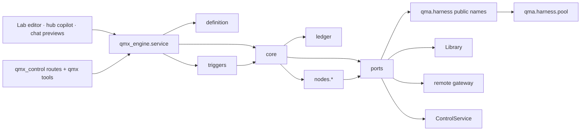
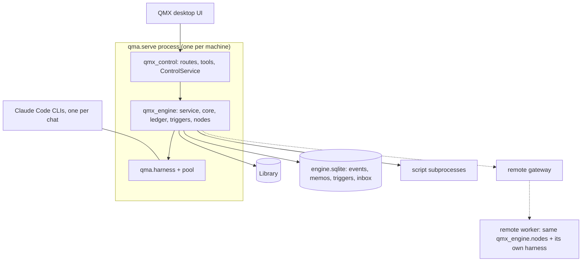
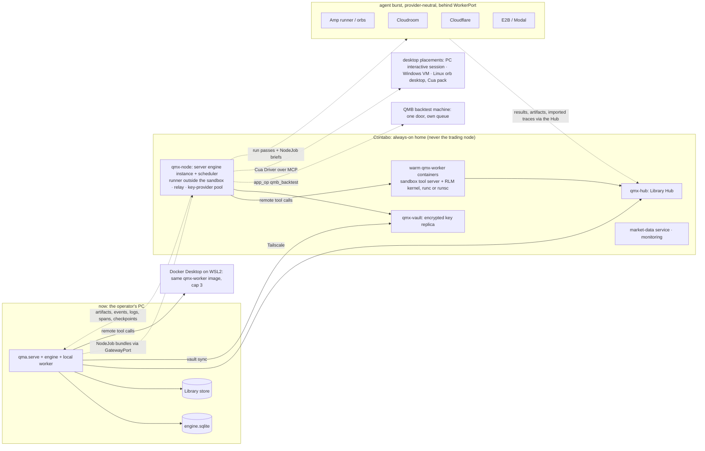
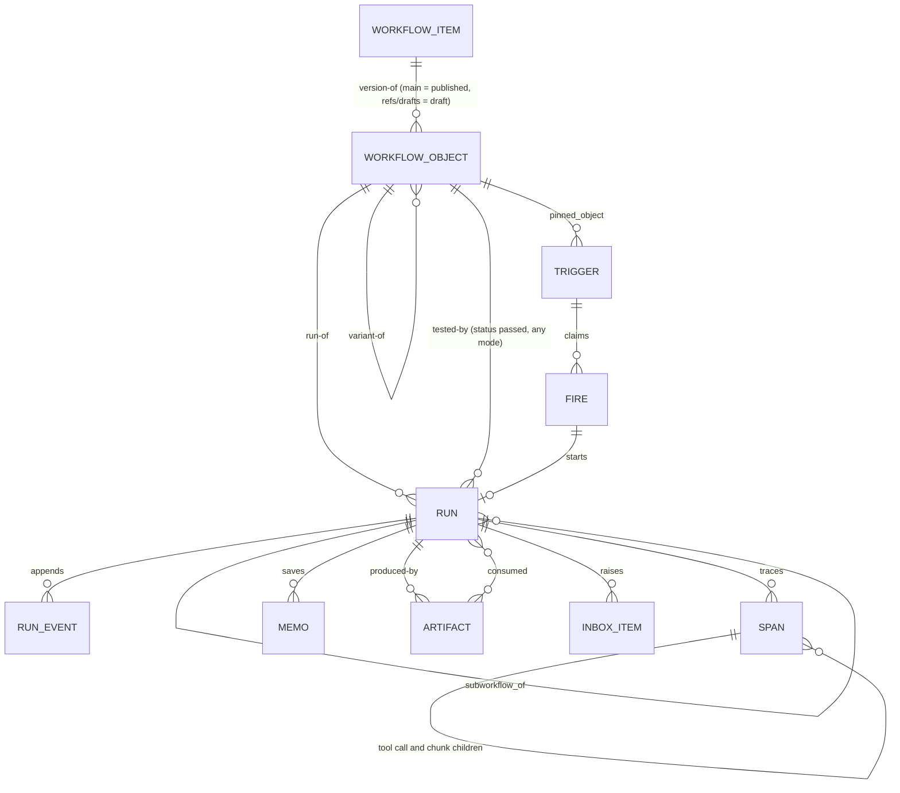

# Architecture Spine — QMX workflow engine

Labels on claims: **[retrieved]** read from a cited file or branch today, **[remembered]** from training knowledge, **[inferred]** reasoned here. Every AD without a label is a decision, not a claim.

## Design Paradigm

**Durable execution** (the Temporal/Inngest shape [remembered, confirmed in `13` section 3 [retrieved]]): workflow control flow is deterministic and replayable; every side effect lives in a node whose result is saved once and returned on replay; failed or changed nodes rerun, finished ones never do. The engine is **hexagonal**: a pure orchestrator core with ports, and adapters for everything that can fail or vary.

| Layer | Namespace | Owns |
| --- | --- | --- |
| Definition | `qmx_engine.definition` | the `qmx.workflow/1` JSON schema, node-kind registry, validator, variant overlay resolver |
| Orchestrator (core) | `qmx_engine.core` | pure scheduling of nodes over the ledger: readiness, joins, loops, memo lookup, replay, drain and pause |
| Ledger | `qmx_engine.ledger` | the append-only event store (SQLite, one writer), memo index, spans |
| Executors | `qmx_engine.nodes.*` | one adapter per node kind; the only places that talk to the harness, scripts, apps or the Library |
| Scheduler | `qmx_engine.triggers` | trigger rows, ticker, fire claims, catch-up, quota hold, preflight, monitors |
| Ports | `qmx_engine.ports` | `HarnessPort`, `LibraryPort`, `MemoryPort`, `InboxPort`, `WorkerPort`, `GatewayPort`, `SettingsPort`, `Clock` |
| Memory | `qmx_engine.memory` | the built-in memory provider (Library `memory-row` objects + FTS5 index), intent keys, consolidation, champion replay |
| Environments | `qmx_engine.workers` | the one sandbox contract: `WorkerPort` → `qmx_remote.ComputeProvider` → the `qmx-worker` image; the runner-side sandbox tool server; local Docker, `qmx-node` on his server, E2B/Modal burst; the egress proxy for the fallback mode |
| Service | `qmx_engine.service` | the one Engine API the surfaces call (drafts, versions, tests, runs, triggers, inbox, explain) |
| Credentials | `qmx_engine.vault` + `qma.harness.relay` (per host, or the central relay on Contabo) | the vault sync from Windows Credential Manager to `qmx-vault` on Contabo, run passes, revocation; a relay is the only key reader on its host, and non-owned placements route to the central relay (ruling 75) |
| Placements | `qmx_engine.workers.placements` | the placement registry (owned, managed VM, managed agent host, serverless, QMB machine, desktop), capacity derived from RAM, preflight states, the three agent modes, provider onboarding from published instructions (ruling 74) |
| Sessions | `qmx_control` session homes (specified here, AD-35) | the write-once `home` of every session, read by every surface |
| Capability packs | `qmx_engine.packs` | optional tool layers a node's scope loads: `cua` (desktop and browser), later browser-only and others |
| Harness extension | `qma.harness.pool` + relay routing | the account pool and balancer, relay routing by model id across providers, relay reachable on the tailnet with run-pass bearers; the only change inside the harness (ruling 39) |

## Invariants & Rules



Arrows mean "may import or call". Nothing points back up. `core` and `definition` import no port and no adapter.

### AD-1 — Durable execution, pure orchestrator

- **Binds:** all
- **Prevents:** a second scheduler, a model deciding control flow, two units that disagree on what "resume" means
- **Rule:** `qmx_engine.core` is pure: it takes the definition, the run inputs and the ledger events and returns the next commands (start node, wait, pause, finish). It performs no I/O and imports no adapter. Everything that can fail or vary (model calls, scripts, Library writes, app operations, time) happens inside a node executor and lands in the ledger as a saved result before the core sees it. No LLM output is ever a control-flow edge; a model can only produce data that a `rule` node reads.

### AD-2 — One definition format for every workflow `[ADOPTED]` (rulings 22, 23, 44)

- **Binds:** definition, builder, surfaces, mini-app-contract
- **Prevents:** hand-built templates, a second graph dialect for the Lab, "agent" and "workflow" as two product kinds
- **Rule:** every workflow, template, variant, mini-app workflow and single-agent workflow is one JSON document of schema `qmx.workflow/1`, n8n-shaped: `nodes[]` (id, name, type, typeVersion, position, parameters, credentials refs, retry and on-error options, disabled), `connections` keyed by source node name then output name then target list with edge mapping, `settings`, `pinData`, `inputs`/`outputs` schemas, `meta`. A template is a definition with defaults. A variant is an overlay (`extends` + patches) that the publisher resolves into a complete snapshot. A single-agent workflow is one trigger node plus one `agent` node and is still a workflow. Script-only, mixed and fully agentic workflows are all first-class (ruling 52): a run with no model-bearing node takes the same path as any other and spends no tokens (Hermes `no_agent`). A workflow is a **folder** (ruling 19): `definition.json` plus the files its `*_ref` fields name (`scripts/`, `prompts/`, `schemas/`, `fixtures/`); every ref resolves inside the folder, and the content hash covers the folder's bytes, so a version is one addressable thing.

### AD-3 — The engine runs beside the harness, apart from every chat

- **Binds:** engine, surfaces, harness-boundary
- **Prevents:** engine code inside `qma.harness`, a second door that accepts text into chats, a separate process that cannot start Background chats
- **Rule:** the engine is package `qmx-engine`, imported by `qmx-control` and started by `qma.serve` as its own task group plus worker threads in the same process. It holds the `Harness` object and uses only the names exported by `qma.harness.__init__`; an import of a harness submodule is a CI failure (the chat-kind names `Background` and `Child` arrive with HARNESS-REQUESTS H0; until it is granted, the one adapter module `qmx_engine.ports.harness_adapter` is the only allow-listed importer of exactly those two names from `qma.harness.launch`, and the import-linter rule names that pair, so nothing in the harness changes). The copilot reaches the engine through `qmx` tools (the `workflow_*` rows of SOLUTION-DESIGN §13, HARNESS-REQUESTS H17; until H17, the existing rows and the draft-save fallback named there) and the UI through REST routes under `qmx_control`, both dispatching to `qmx_engine.service`. No engine operation accepts chat text. One engine codebase runs as **one instance per home**: the PC's `qma.serve` and Contabo's `qmx-node` (AD-30). Each instance has its own ledger and runs only the triggers whose `home_engine` names it (`pc | contabo`, the registry names of AD-30; Contabo is the default for schedules, because it is always on); a trigger has exactly one home, so there is never a second scheduler for one schedule, and every run's summary lands in the one Library either way.

### AD-4 — The node contract

- **Binds:** definition, nodes.*, builder, remote-worker-contract
- **Prevents:** two node kinds whose results cannot be joined, a node that names a model, an executor that cannot be retried
- **Rule:** every node declares `type`, `typeVersion`, typed ports (`reference | data | event | control`, DEC-0418), `parameters`, `role` (never a model id), `effect` (AD-8), `retry` (max tries, backoff, retryable errors), `timeout` (run and idle), `runs_on` placement, and `credentials` as `qmx/*` refs. An executor implements `run(NodeJob) -> NodeResult` where `NodeResult` is `ok(outputs by port) | failed(error, signature, retryable) | waiting(reason, resume_at) | gate(ask)`. Outputs are JSON values or artifact refs; anything over `settings.inline_limit` is an artifact. The registry entry for a kind fixes its input and output port names (`main` is the default single port; `rule` ports are its branches, `grader` has `pass` and `fail`, `monitor` has `changed` and `silent`, `human_gate` ports are its options), so an editor and an executor never guess. An `agent` node also declares `subagents` (`max_concurrent` 3-5, spawn depth fixed at 1, each with a role and `max_turns`, their tokens and tool calls carved from the node's runaway allowance (AD-16); they live in the same chat tree as the node's agent and their tool calls go to the same sandbox, ruling 52 and study 29), `tools_may_create` (an agent may write its own tools; each is saved as an `agent-tool` Library object in state `unreviewed`, runs only inside a sandbox, and never carries an order verb), `isolation` and `agent_mode` (AD-25), and `ask_policy`, which is `reject` for every permission ask (the engine answers through `Harness.answer` at once) except a tool call the registry marks `irreversible_external`; that one raises an inbox item and the attempt waits for the inbox's answer or the harness's unattended window, whichever comes first (ruling 57). Executors are idempotent under the memo key of AD-7.

### AD-5 — The node-kind vocabulary

- **Binds:** definition, nodes.*, surfaces
- **Prevents:** a kind invented per template, Lab and workflow graphs with different palettes
- **Rule:** v1 kinds, closed and extended only by `typeVersion`: `trigger`, `script`, `rule`, `loop`, `join` (`all | any | quorum(n)`), `wait` (time, event, webhook), `human_gate` (allowed only in front of an irreversible external effect, ruling 57; it parks that effect in the inbox; `approval_gate` is the same kind with a timeout and `on_timeout`), `llm` (one model call with a JSON schema), `agent` (a harness Background chat with structured output, optional sub-agents and self-made tools, AD-4; its code-running tools execute in a sandbox, AD-25), `rlm` (a prime-agent-style Python kernel over data and tables: cells in a long-lived namespace inside the node's sandbox, driven over the same remote tool call, `spawn`/`collect` sub-model calls routed through the runner's provider layer so they land as spans, a snapshot after each cell shipped to the Hub as a `checkpoint` blob and restored on retry), `subworkflow` (typed inputs, caller policy, its own ledger namespace), `grader` (deterministic check or LLM judge, verdict plus feedback), `monitor` (cheap source, hash diff, wake gate), `app_op` (a mini app's exported operation), `library` (read or write a Library kind), `claude_workflow` (the Claude Code Workflow tool for a Claude-only fan-out; off unless the operator enables it per workflow). Edge mapping is `one | zip | broadcast | chunk | keyed-join | cartesian` with cartesian explicit. An edge that carries a list into an `llm` or `agent` node must be `chunk` (ruling 78, AD-34); `broadcast` of a list into those kinds is refused at validation. A capability pack (the Lab pack, `cua`, later others) registers types named `<pack>.<name>`, each with a `base_kind` from this list; the JSON `type` is the pack type, and the validator checks the node against its base kind's contract (ports, effect, role rules), so the vocabulary stays closed. `note` is the one draft-only type (no `base_kind`, refused at publish unless disabled). DEC-0312's kinds map onto these one to one (SOLUTION-DESIGN section 2.3).

### AD-6 — Determinism of control flow

- **Binds:** core, nodes.*, builder
- **Prevents:** a replay that takes a different branch than the original run
- **Rule:** the core never reads the wall clock, randomness or the environment. `now`, seeds, operator answers and external events enter the run only as recorded ledger events (`run_input`, `clock_tick`, `gate_resolved`, `event_received`). A node that needs time reads it from its `NodeJob.now`. Replay feeds the same events and must produce the same commands; a divergence is a bug the ledger makes visible.

### AD-7 — Saved results and node-level replay

- **Binds:** core, ledger, nodes.*, remote-worker-contract
- **Prevents:** Claude-Workflow-style prefix replay that reruns everything after the first failure, double-paid model calls, a resume that silently reruns a finished script
- **Rule:** a node attempt's result is memoised under `(run_id, node_id, iteration, partition_id, sha256(inputs), sha256(node_definition))`. On resume or rerun the core returns saved results for every valid memo and schedules only nodes without one. A downstream node reruns only when its own input hash changed. In a fan-out each partition has its own memo, so only failed partitions rerun and the join reuses the rest (DEC-0439 join algebra ratified). Editing a draft after a test run invalidates exactly the memos whose node definition hash changed.

### AD-8 — Effects are classed by reversibility

- **Binds:** definition, nodes.*, core
- **Prevents:** an automatic retry that sends twice, writes twice or pays twice; a node that places an order
- **Rule:** every node declares `effect: none | reversible | compensable | irreversible`. `reversible` (run-workspace files) is undone by the workspace snapshot the core takes before an attempt. `compensable` (Library writes) is undone by supersede or archive, never by delete. `irreversible` (model spend, external sends, webhooks, app operations marked so) receives the idempotency key `run:node:iteration:attempt` in its `NodeJob` and is retried only on a failure that provably happened before the effect. After an `unknown` outcome the two differ: a **model call** is retried once under the ladder (duplicate spend is accepted, ruling 27, and the attempt writes an `info` line), while an `irreversible_external` effect (a message, a post, a webhook, an app operation marked so) is never retried automatically. Money acts are not an effect class: the harness money gate is unchanged and no node kind, parameter or app operation may name a money act (deny-list `qma.core.barriers.money_path`).

### AD-9 — Limits pause the work; nobody is asked `[ADOPTED]` (ruling 27)

- **Binds:** core, nodes.llm, nodes.agent, triggers, pool
- **Prevents:** `LaunchRefused` plus a `needs_you` block on every capped send, a run that fails at a usage limit, an operator prompt about usage
- **Rule:** before a model-bearing node starts, admission control asks the pool for a lease that fits the node's role, reads `Harness.usage()`, and reserves one chat slot from `max_live_chats − settings.limits.interactive_reserve` (the engine counts its own live chats, so it never meets `ChatTableFull`); fan-out width is bound by that reserve. A closed window yields no lease. Without a lease the node enters `waiting(resume_at)` and the run drains: running nodes finish, script and rule nodes keep going, no new model node starts. The scheduler wakes the run at the earliest `resume_at` with no human action. A `rate_limit` rejection inside a running node marks that attempt `waiting`, not failed, and keeps no partial output. One inbox item is raised only when every allowed account for the role has been closed longer than `settings.limits.alert_after`.

### AD-10 — Triggers are rows; the scheduler fires at most once per occurrence

- **Binds:** triggers, definition, service
- **Prevents:** a schedule baked into a definition, a backlog of catch-up runs after downtime, a run that spawns schedules
- **Rule:** a trigger is a row outside the definition (DEC-0417 ratified): `cron` with an IANA zone, `interval`, `event` (engine bus), `webhook` (through the gateway), `manual`, `after` (another workflow's completion), each bound to one workflow item and the **exact published object** it pins (`pinned_object`), plus `follow_champion: bool` (when true and the workflow's `self_improve` is `auto`, a fire runs `refs/champions/<item>` provided that champion descends from the pinned object; otherwise the pinned object; never a draft), with `precheck` (a `monitor` or `script` ref), model and effort pins, delivery target, `continuity` (inject the trigger's own last successful outputs as an input, Hermes style), `max_concurrent`, and a `created_by` principal that is never a run. The trigger **source** is pluggable and controls only when a fire is claimed, never execution: the in-process ticker now, a server or cloud trigger provider later. The ticker runs in-process every `settings.scheduler.tick` seconds and claims a fire under a lease with a heartbeat, so two processes never run one occurrence. A fire inside the grace window runs late; past it the backlog collapses into exactly one catch-up run per trigger (ruling 25). A fire into a closed usage window is parked (`quota_hold_until`) and merged with later fires. Preflight (credentials resolve, roles resolve, skills and apps present, delivery target exists) failing sets `blocked_config` with one item whose severity follows AD-17 (`info` when the workflow's own configuration is at fault, `normal` only for a provider failure such as a missing or rejected key) and no model call. A monitor whose source hash is unchanged ends the fire as `silent`.

### AD-11 — The creation lifecycle and the test gate `[ADOPTED]` (ruling 23)

- **Binds:** service, definition, builder, surfaces, library-contract, mini-app-contract
- **Prevents:** a live run on a mutable draft, a schedule on an untested version, a deleted workflow, a Lab "run this part" that bypasses the engine
- **Rule:** states are `draft -> validated -> tested -> published (version) -> enabled <-> disabled -> archived`. A draft is mutable and may hold free-form note nodes and unconnected nodes (the saved Board). **Drafts never live on `main`:** the operator's draft is the head of `refs/drafts/<item>`, an agent's is `refs/agents/<session_id>/<item>` (Library AD-7), and `main` holds published versions only. A version is **tested** when a `workflow-run` with status `passed` (either mode) ran an object whose definition `content_hash` (SOLUTION-DESIGN §2.2) equals the version's; publish copies the draft's `tested-by` edges onto the published object when the hashes match, and a publish that changes the hash (a non-fast-forward merge) needs a new test before enable. Workflows, mini apps, pods, skills and methodologies that a **run** produces land on `refs/drafts/<item>`, never as a published version (ruling 80: creation is human-driven first); results, artifacts, notes and memory rows still land on `main` without asking (ruling 57, Library AD-18). Every run carries `mode: live | test`, fixed at `run_created` and never changed, and a status from the one shared status table (SOLUTION-DESIGN §3.1, used identically by the Library's AD-15); mode and status are separate fields. Validation checks the DAG, port kinds, edge mapping, schemas, role names, effect classes and the lint rules (no `settings.write`, no money act, no trigger creation). A draft runs only in **test mode**: pinned data where present, **real models by default** through the providers the harness already has (the cheap candidates of each role; OpenRouter rows are allowed in test mode; ruling 51: "we want to make sure things work"), the fake provider only as an explicit per-run switch, irreversible *external* effects stubbed while model spend and Library writes are real, the result written on the run's own branch and bound to the draft's content hash as a `test-report`. Only runs with `mode: test` are excluded from the Library's fast-forward into `main`. Publishing freezes a version (immutable, content hash, semver) and needs the operator's yes once (AD-22). Enabling a trigger on a version requires that version to be tested. Live runs refuse drafts. Selected-subgraph runs (an induced DAG of node ids) are allowed on drafts in test mode and on versions in live mode. Archive is the only end state; archived versions keep their runs, lineage and content.

### AD-12 — The account pool is the one harness extension `[ADOPTED]` (rulings 26, 39)

- **Binds:** pool, nodes.agent, nodes.llm, core
- **Prevents:** a QMX proxy on the plan path, a request-level balancer that kills the prompt cache, a second ChatGPT login, test keys used for real runs
- **Rule:** `qma.harness.pool` owns account rows per provider. A Claude plan account is its own plan home signed in by the CLI's `/login`; QMA never reads a token and plan traffic takes no hop. GPT has capacity one. OpenRouter rows are `test_only` and never leased for a live run. Selection happens once per chat at `start_chat` (session affinity): strategies `fill_first | round_robin | least_used`, where `least_used` means the lowest last five-hour reading in the per-account usage ledger (plan) or relay journal (keys). A lease carries a soft per-account concurrency cap so parallel nodes spread. Cooldown comes from the provider's reset time, else one hour on 429 or 402; a 401 benches the account and raises one inbox item; a running chat moves account only on a quota or auth error, through `quote` then `apply`; it moves back when the cooldown lifts. `UsageLedger` and `BackgroundCap` are keyed per account. Every harness instance runs its own pool and its accounts never leave that machine: the PC's pool holds the plan accounts and key rows and serves copilots and the PC's agent runners (AD-25: the agent loop runs outside the sandbox, so a plan chat may drive sandboxed tools); `qmx-node`'s pool on his server holds key rows only (Kimi, GLM, Ollama Cloud, others; OpenRouter in test mode) and feeds the server's runners (`max_sessions` derived from RAM, AD-30: about 4 on today's 12 GB box, ruling 76), since one plan cannot feed many parallel agents (ruling 55, study 29 Q1). Keys reach a host only through the vault sync of AD-28, and on every host the harness relay is that host's only key reader; a worker holds a run pass, never a key. The relay also routes by model id across providers for one chat (AD-29) and accepts run-pass bearers from the tailnet (AD-28); both are inside the load-balancer exception. Balancing logic is copied from Hermes credential pools and CLIProxyAPI; no cloaking and no token relay, ever.

### AD-13 — Roles, not models

- **Binds:** definition, nodes.llm, nodes.agent, nodes.grader, settings
- **Prevents:** a template pinned to one vendor, a reviewer that quietly runs on the author's model
- **Rule:** a node names a role (`planner`, `writer`, `judge`, `doctor`, and the rest of the role table). Settings maps each role to an ordered candidate list of `(profile, model, effort)`, editable in the UI and never in a template. Resolution happens at dispatch against pool availability; the failure ladder walks the list in order. Every provider runs an `agent` node the same way: a harness Background chat on that profile (plan, `KeyProvider`, `GptPlan`). An `llm` node is a one-turn, tool-less Background chat on any profile; the engine never calls a provider key directly, because the relay is the only key reader. A `judge` role resolving to the same family as the author is allowed but labelled `same_family` in the span.

### AD-14 — The Library contract the engine depends on

- **Binds:** library-contract, nodes.library, service
- **Prevents:** two Libraries with opposite rules, a run that cannot be traced to its definition, a deleted version
- **Rule:** there is one Library (ruling 28). The engine uses the Library's own kind names: `workflow` (an item whose versions are its objects; a version is `(item_id, semver annotation, object_id)`, and the semver and the lifecycle are annotations or ref facts, never fields of the stored definition; drafts on `refs/drafts/<item>` or an agent ref, published versions on `main`; there is no separate version kind), `workflow-run` (summary plus trace blob, with `mode`, status, and the placement fields of LIBRARY-REQUESTS L14), `artifact` (content-addressed blob plus typed metadata), `test-report`, `memory-row` (AD-18), `agent-tool` (AD-4, `review: unreviewed`), `checkpoint` blobs on a `workflow-run` (AD-5 `rlm`), the `intent_key` annotation (AD-27), and the refs `refs/champions/<workflow_item>` and `refs/challengers/<workflow_item>` (AD-26). All of these were granted by the Library (ENGINE-REQUESTS-ANSWERED L1-L14). The engine reaches the Library only through `LibraryPort` and never assumes which store answers: the PC store today, the Hub on his server later (ruling 56); a run writes only on its own branch `refs/runs/<run_id>` with its run token, test runs included, and a workflow's Library writes never wait for a human (ruling 57). It writes typed edges from the closed set `version-of | variant-of | run-of | produced-by | consumed | tested-by | replaces | archived-as` (the Library's AD-4 names; `consumed_by` is read as the reverse of `consumed`, and the earlier engine word `supersedes` is the Library's `replaces`), which the Library design may extend but not loosen. A run's own writes carry the principal `run:<run_id>` (its run pass); only the fast-forward into `main`, landing run-made drafts on `refs/drafts/*`, memory consolidation and champion or challenger moves carry `engine:<store>` (Library AD-7). It reads definitions by pinned object id, artifacts by hash, pinned data by draft. Writes are append-only: a change is a new version or a new edge. The engine keeps no copy of these kinds; the run ledger stores events and memos, the Library stores content and summaries.

### AD-15 — One trace per run, one span per node attempt

- **Binds:** ledger, nodes.*, service, surfaces
- **Prevents:** a run the copilot cannot explain, a cost nobody can attribute
- **Rule:** `trace_id = run_id`; each node attempt is a span with `parent_span` (the run, the loop iteration or the subworkflow call), `kind`, `role`, `profile`, `account`, `model`, tokens in, out, cache read and write, cost estimate, duration, attempt, partition, verdict, effect class and placement; every tool call inside an `agent` or `llm` attempt is a child span of it, and every chunk of a `chunk` edge is its own partition span (AD-34). Spans are ledger events, so the UI run timeline, the watchdog and `service.explain(run_id)` read one source. At run end the trace is exported as a Library `artifact` linked `produced_by` the run.

### AD-16 — The failure ladder and the watchdog

- **Binds:** core, nodes.*, pool, inbox
- **Prevents:** a run that fails on a transient error, a doctor that rewrites logic, a runaway agent that keeps going, a spending cap or a usage question (ruling 27)
- **Rule:** on a failed attempt the core walks exactly this ladder: retry (retryable errors only, capped by the node's `retry`), other account (pool rotation), other model (next role candidate), run doctor, park. The run doctor is an `llm` node on the `doctor` role that reads the span and classifies `transient | bad_input | bad_output | logic`; it may re-run the node once with a repair hint or a stronger candidate inside the runaway guard; it may never edit a definition, and a logic finding becomes a challenger for AD-26, never a question for him. Park ends the run with status `failed` (reason `parked`) and one inbox item whose severity follows AD-17; nothing waits on that item: the next trigger occurrence starts a fresh run with `continuity`, and the item's actions stay available whenever he looks (ruling 57). Only an attempt in front of an irreversible external effect (a message, a post, a webhook, an app operation marked `irreversible_external`) waits for the inbox, and the inbox decides per this ladder. **There is no spending cap (ruling 27).** Each run has a **runaway guard**: soft limits on tokens, agents, tool calls and wall time (no USD figure; defaults set high, SOLUTION-DESIGN §17; USD exists only as an estimate on spans). A breach never asks him: per the workflow's `on_runaway` it either **pauses** (the run goes `waiting(runaway)`, an `info` digest line is written, and the run ends `stopped` with reason `runaway` when the next occurrence starts or after `limits.alert_after` (a manual-only workflow has no next occurrence), unless he raises the guard and resumes it from the run card) or **degrades** (the remaining model nodes resolve to their role's cheapest candidate and the run continues once, then pauses if it breaches again). A zero-token watchdog runs every tick for stuck nodes (no event or heartbeat past the idle timeout), runs past their runaway guard, the same node failing twice with one signature, missed fires and lost workers.

### AD-17 — The inbox is the one notification channel

- **Binds:** inbox, service, surfaces
- **Prevents:** one message per retry, a parked run that pings forever, a notification path that bypasses the UI
- **Rule:** an inbox item is keyed by `(run_id, error_signature)`; repeats update the item. Severities `info | normal | urgent | black`. `info` goes to the daily digest; `normal` and `urgent` to the inbox; `normal` and above are used **only** for provider failures (a 401, every account of a role closed past `alert_after`), harness or ledger errors, unknown outcomes on irreversible external effects, and a stolen or misused run pass (ruling 77); a park from logic, bad input or bad output, a runaway-guard pause and a preflight `blocked_config` caused by the workflow itself are `info` (digest) plus, for logic, a challenger for AD-26; `black` (watchdog down, ledger corrupt, worker lost with irreversible effects pending) repeats until acknowledged. Phone channels are a later route the item already carries a slot for (ruling 34). Each item carries cause, what was tried, cost so far, the trace link and the actions `retry | stronger model | skip node | open trace | stop | resume`. A `needs_you` chat block is written only when the item belongs to a live chat.

### AD-18 — Memory is a port; evidence lives in the Library, recall in a rebuildable index `[ADOPTED]` (ruling 49)

- **Binds:** nodes.agent, nodes.llm, nodes.rlm, core, memory, library-contract
- **Prevents:** two writers on one memory, an agent that repeats a dead end, a memory store that needs its own backups and Hub route, memory text that acts as instructions, unbounded growth
- **Rule:** the engine talks to memory only through `MemoryPort` with the verbs `snapshot(scopes, budget)`, `recall(query, scopes, tags, budget)`, `check_built(intent_key)`, `check_dead_end(intent_key | query)`, `note(row, scope=run)`, `consolidate(run_id, into_scope)`, `feedback(row_ids, outcome)`, `search_runs(query, workflow)`. Every memory row is a Library `memory-row` object (fields from ReMe's experience record: `when_to_use`, `content`, `keywords`, `confidence`, `refs`; annotations `f` retrieved and `u` useful; tag `built | lesson | dead_end | do_not_retry | negative_result | procedure | preference`); a memory provider is only a recall index rebuilt from those objects, never evidence. The built-in provider (Library rows plus SQLite FTS5, no model call on read, ReMe's success-only storage and `u/f` pruning: after 5 retrievals a row with `u/f ≤ 0.5` is archived) is the default; one external provider (Hindsight, ReMe, Mem0) may run beside it per scope binding and returns row ids only. Scopes `run | workflow | home | operator` each map to one Library ref namespace with one writer: `note` is the only write an ordinary node or agent has and lands in `run` scope; `consolidate` is the only path into the other three and applies the four moves create, corroborate, refine, correct; cron and sub-agent contexts never write `home` or `operator` directly. A run reads a frozen snapshot at start (caps: workflow 200 lines, home 400, operator 200; overflow errors, then consolidate) and recalled text reaches a model only as a tool result or a fenced block, never as system text. The harness's auto memory in the agent's chat workspace is `run`-scope scratch for workflow agents, read by `consolidate` at run end and cleared per run; a run's write zone is `runs/<run_id>/` inside `<qmx_home>/workspaces/wf-<workflow_id>/`, the reversible snapshot (AD-8) covers that zone only, and a version with agent nodes defaults to `max_concurrent: 1`.

### AD-19 — A mini app is a pack; apps meet only at declared edges

- **Binds:** mini-app-contract, nodes.app_op, triggers, definition
- **Prevents:** an app reaching another app's internals, an app with no archive state, a widget that owns invocation
- **Rule:** a mini app is a pack folder that is a valid Claude plugin plus `app.toml`, holding workflows (AD-2 documents), widgets (display only) and tools (an MCP server behind the harness tool path). Its I/O is declared: `feeds` and `provides` (JSON schemas), `emits` and `accepts` (events on the engine bus; webhooks through the gateway), external APIs by `qmx/*` credential refs. Another app is reached only through an `app_op` node or an event, never by import. The pack lifecycle is AD-11's with `archived` replacing `uninstalled`. A pack may be a single workflow, a single agent or widgets only.

### AD-20 — Workers and placement

- **Binds:** remote-worker-contract, nodes.*, core, pool
- **Prevents:** a remote worker that returns results the ledger cannot memoise, a plan token shipped to a server, a placement toggle that lies
- **Rule:** every node runs through `WorkerPort.run(NodeJob) -> NodeResult` with streamed `log`, `span` and `heartbeat` events and a `cancel` call. The local worker is an in-process pool (scripts in a scrubbed subprocess, AD-24). A remote worker receives the same `NodeJob` as a bundle: the node's definition slice, inputs by content hash, credential scope refs, resources, placement; it returns outputs as artifacts by hash plus events, logs and spans through the gateway port. Placement is a node attribute checked by preflight states `available | configured | authorized | reachable | healthy` (DEC-0428 ratified), never a sticker. An `agent` node placed remote runs on a harness instance on that machine with its own account pool; plan tokens never travel.

### AD-21 — Three surfaces, one Engine API

- **Binds:** surfaces, service
- **Prevents:** a Lab graph that cannot become a workflow, a copilot-built workflow that bypasses validation, logic duplicated in the UI
- **Rule:** the Lab Editor Graph mode, the hub copilot and chat previews all call `qmx_engine.service` (in-process, REST, or the `qmx` tools). The Graph mode and the Code mode are two projections of the one draft document and round-trip through `service.drafts` (a code edit changes the JSON, a graph edit changes the code view; the saved Board is a draft, "simply code", ruling 31). The copilot's draft panels and run cards render from `service` reads. No surface computes readiness, replay or validation itself; the engine returns the state and the surface draws it.

### AD-22 — The copilot builds drafts, the operator publishes

- **Binds:** builder, service, surfaces
- **Prevents:** a workflow enabled without a human, a template cloned by hand, a variant that drifts from its parent silently
- **Rule:** the builder is a copilot skill that runs the loop-me interview (Trigger, Checkpoints pushed as late as possible, Brief) inside BMad's six phases (discover intent, classify, gather requirements, draft, build with a deterministic lint gate, optimise). It writes drafts only, through `service.drafts.put` onto its own agent ref (Library AD-7), then calls validate and a real-model test run on cheap candidates (ruling 51) and shows the result card. Saving a draft and running a test are `DOMAIN_WRITE` tools and never ask him (SOLUTION-DESIGN §13; HARNESS-REQUESTS H17, with the no-harness-edit fallback named there). Publish and enable of a new workflow are `MANAGE` and require the operator's yes once (ruling 80: creation is human-driven first; the same holds for a workflow, mini app, pod or skill that a run drafted); after that a champion version (AD-26) runs under the standing rule without a new yes, and nothing in a run waits for him (ruling 57). A template is a published `workflow` version tagged `template` (Library AD-3); "use this template" creates a draft with `derived-from` it. A variant is an overlay over a published workflow object that publish resolves into a full snapshot with a `variant_of` edge, so a run never depends on the parent's later changes.

### AD-23 — One writer per store

- **Binds:** ledger, triggers, inbox, library-contract, pool, settings
- **Prevents:** two processes writing one SQLite file, engine state in the Library, secrets in a definition
- **Rule:** the run ledger is one SQLite file with one writer thread (WAL, readers free) and is the source of truth, because fire claims, leases and memos need transactions; every append from the core, the scheduler, workers and the service goes through the `ledger` module's queue. At run end the trace is exported through the existing `qmx_ledger.RunJournal` (append-only, fingerprint-chained JSONL) so the Library artifact carries its own integrity chain; the harness's per-chat `model_call` rows stay where they are and a span records the chat id to join them. The engine bus is in-process and publishes only events already journaled. Triggers and inbox tables live in the engine's SQLite under the same writer. Definitions, versions, artifacts, run summaries and test reports live in the Library through `LibraryPort`. Settings are read and written only through `ControlService`. Pool state lives in the harness. Secrets appear only as `qmx/*` references; the validator refuses any literal that matches a token shape.

### AD-24 — The host-tier envelope: trusted scripts without a container, nothing model-written

- **Binds:** nodes.script, nodes.monitor, nodes.grader, workers.local
- **Prevents:** a script reading a provider key or the plan login, a script that outlives its run, model-written code running bare on the host
- **Rule:** `host` is the weakest isolation tier (AD-25) and exists only on the PC. In it a trusted script (from a Library version, never model-written) runs as `python -I` (or the declared runtime) in a subprocess whose environment is built from an allow-list with the same banned fragments as `qma.boot`, plus only the credentials the node declares, resolved by ref into that child; cwd is the run's write zone; run and idle timeouts; the process tree is killed on cancel or timeout; the money deny-list applies to declared hosts and command text. It is the fallback when Docker Desktop is off, for script-family nodes only: `agent`, `rlm` and `agent-tool` tool calls never execute `host`; without a sandbox they go `waiting(placement)` with a "Docker is off" doctor line. (The earlier premise "no Docker on this PC" was wrong: Docker Desktop and WSL2 are installed, study 29 [retrieved].)

### AD-25 — The harness runs outside the sandbox; the sandbox only executes tool calls

- **Binds:** workers, nodes.agent, nodes.rlm, nodes.script, pool, remote-worker-contract, settings
- **Prevents:** credentials, transcripts or the agent loop inside a box a model can break, a different runtime per placement, a mistake that reaches the host, the agent server doubling as the trading node, an unbounded fleet
- **Rule:** *Outside every sandbox, always:* the engine core, ledger, scheduler, pool, credentials, permissions, session history, audit and traces, the inbox, and agent-to-agent routing (the Rivet principle, adopted by the lead). A sandbox executes only tool calls that arrive over a remote call. *The contract:* `WorkerPort.run(NodeJob)` is served through `qmx_remote.ComputeProvider` (`provision / start / status / logs / stop / teardown`, brownfield [retrieved]) and every provider boots the same OCI image `qmx-worker` (the sandbox tool server, the RLM kernel, data libraries, the run sidecar of Library AD-13); only the launcher differs; a fresh container per node attempt by default (`warm: true` is a per-agent optimisation whose state lives in the Hub `SessionStore`). *Isolation tiers* are a node attribute beside `placement`: `host` (AD-24, PC, trusted scripts only) · `runc` hardened (`--read-only`, tmpfs, `--cap-drop ALL`, `no-new-privileges`, `--pids-limit`, `--memory`, `--cpus`, non-root, `/work` only) for trusted scripts and GPU jobs · `runsc` (gVisor) for anything a model wrote; no Docker socket, host home, `~/.ssh` or `.git` is ever mounted. *Agent modes:* the default for any node that runs model-written code is `runner_outside`: the agent loop is a harness Background chat in the runner process on that placement's host (the PC's `qma.serve`, or `qmx-node`'s on the server), holding its account lease through the harness as today, with the built-in `Bash`, `Write`, `Edit` and `NotebookEdit` tools disabled and the sandbox exposed as MCP tools (`sandbox_bash`, `sandbox_write`, `sandbox_python` for the RLM kernel, `sandbox_tool_<name>` for agent-made tools) that the runner serves and the container executes over the sidecar's remote call; `Read` may stay pointed at a synced read-only copy of `/work`; sub-agents run in the same chat tree and their tool calls reach the same sandbox. The fallback `cli_inside` runs the CLI inside the container; its model traffic carries the run pass to the nearest relay (AD-28), which injects the key, so the egress proxy is only a domain allow-list; it is chosen per node, never with a plan account. A third mode, `host_harness`, exists for providers that host Claude Code or Codex themselves (Cloudroom, Amp threads, an Amp runner in Claude Code mode): the provider's harness runs inside its VM, and the engine treats the whole provider thread as **one leaf node attempt** (AD-30). Trade-offs: `runner_outside` keeps every credential and transcript out of the box and gives the engine one audit path, at the cost of the built-in tools' quality (the sandbox tools must match them, probe E23); `cli_inside` keeps Claude Code's native tools but widens the blast radius to the whole CLI and puts the transcript inside the box; `host_harness` costs nothing to set up and brings the provider's desktop, dashboard and phone apps, but the loop, transcript, permissions and the run pass all sit in a VM the provider controls, so it is allowed only with key-provider accounts (a plan login only on an Amp runner on hardware he owns), never owns a schedule or state, and its traces are imported, not native. *Placements:* the PC (`pc`: Docker Desktop on WSL2, concurrency 3, Claude's default); his Contabo server (`contabo`: `qmx-node` = this engine's runner and worker with its own `qma.serve` and key-provider pool, `max_sessions` derived from RAM after the colocated services take their share (AD-30; about 4 on today's 12 GB, 6-core box, ruling 76), Ubuntu + Docker + `runsc`, three systemd units `qmx-hub`, `qmx-node`, `qmx-egress`, joined to the PC by Tailscale; **that server is never the trading node and holds no broker credential**); E2B and Modal through the existing `E2BProvider` and `ModalProvider` as optional burst with the same image, sidecar and run token; E2B Embed is the later upgrade if the server has KVM. Wider fan-out than a node's sub-agents is an engine `chunk` edge (one agent per chunk of items, never per item, AD-34), whose chunks get their own containers and spill to burst placements when the home placement is full. Rivet's objection to workflow engines (an endless agent loop makes replay grow without bound) does not apply: a QMX workflow is a finite run with a ledger that ends; the never-ending agent is the copilot session, which belongs to the QMA v2 harness, not to this engine. Sizing, resources (`memory_mb`, `cpus`, `gpu`, `timeout`) and the semaphores are Settings.

### AD-26 — Self-improvement runs without him: champion and challenger, replayed, auto-rolled back

- **Binds:** memory, core, service, library-contract, triggers
- **Prevents:** a per-change approval queue, a silent change to `main`, a proposal that edits money, risk, credentials or another workflow
- **Rule:** an `improve` workflow (an ordinary scheduled workflow per workflow or per home) reads the lessons pool and the last N runs and drafts **one** challenger (prompt or brief edit, skill, parameter default, or a node change) as an object on `refs/challengers/<workflow_item>` (owned by `engine:<store>` on the schedule's store, Library AD-7), naming the lessons it acts on. The engine replays the challenger against a **fix set** (recent failed runs it claims to fix) and a **guard set** (recent passed runs it must not break) with pinned inputs and real models; scoring is deterministic where it can be, and a model judge is a tiebreak only, never the model that wrote the challenger. If the fix set improves and the guard set holds, the challenger becomes the workflow's **champion**: the pointer `refs/champions/<workflow_item>` moves, `tested-by` points at the replay runs, and the scheduler runs the champion for every trigger with `follow_champion` (AD-10) when the workflow's standing rule `self_improve` is `auto` (set once per workflow; default `auto` for workflows he created or enabled; `propose_only` and `off` exist). Live runs feed `feedback`; if the champion's pass rate over the next K runs falls below the previous version's, the pointer moves back on its own and a `dead_end` row records why. `main` moves only by his click. Hard limits no rule lifts: a challenger may not touch money-path tools, risk or sizing settings, credentials, the deny-list, its own runaway guard, or another workflow (the refusal rules of `qma.core.ports.refinement` are reused; its manual approve stage is not). A `procedure` row with `f ≥ 5` and `u/f > 0.8` is drafted into a `skill` by the same workflow.

### AD-27 — "Already built" is a deterministic check before any model call

- **Binds:** core, nodes.script, nodes.agent, nodes.library, memory
- **Prevents:** a workflow rebuilding what another already built, a model being asked a question the Library can answer exactly
- **Rule:** every build-type node (a `library` write, a data pull, a backtest, an `agent` node that declares `produces: <kind>`) computes an **intent key** `fingerprint(kind, canonical input object ids, canonical parameters, code object id)`, no model involved. The object it produces carries `intent_key` as an annotation. Before the node runs, the core calls `check_built(intent_key)`: a hit on an active object whose producing run passed means **skip and link** (the node returns the existing object and records `consumed_by`); a hit on a `dead_end` row means stop unless the node says `retry_dead_ends: true`. Only on a miss may an agent node use `recall` for near matches, and the agent decides. The check is a node option `reuse: exact | similar | never`, default `exact` for script nodes and offered to agent nodes as the `memory_check` tool; a workflow opts out per node (a nightly refresh says `never`).

### AD-28 — Credentials once, everywhere: one vault, one relay per host, a run pass per attempt `[ADOPTED]` (ruling 61)

- **Binds:** vault, relay, pool, workers, remote-worker-contract, settings, library-contract
- **Prevents:** a raw key on any worker, a key typed twice, a key in a Library object or on the Hub's data path, plan tokens leaving machines he owns, a stolen pass that can reach `main`, keys or money
- **Rule:** *Source of truth:* keys are entered once in Settings on the PC and live in Windows Credential Manager as `qmx/*` entries, as today. *Replication:* `qmx_engine.vault` encrypts each replicable entry under the vault's public key (envelope encryption; the private key lives only in `qmx-vault`'s OS keyring on Contabo) and pushes ciphertext with a `vault_version` to `qmx-vault`, a separate always-on service colocated with the Library Hub but **not a Library object and not on the Hub's data path** (Library AD-12 stays true: secrets never ride the Hub). Replicable: provider keys (`[providers]` rows) and declared tool keys (Firecrawl, data vendors). Never replicable: broker credentials (`qmx/ctrader-*`), the backup payload key, the pairing keys, the Claude plan logins. *One relay per host:* every runner host whose placement row says `relay: local` (the PC's `qma.serve`, `qmx-node` on Contabo, and a relay-only process on any owned machine that opts in) runs the harness relay, which reads keys only from its local keyring or vault copy and is that host's only key reader (DESIGN's rule, now per host); model calls from every worker go to the nearest relay, which injects the key. *Central relay (ruling 75):* each placement row names its relay, `relay: local | central`. `local`: the host runs its own relay over its own vault copy. `central`: the host runs no relay and holds no key; its model calls go over Tailscale, with the run pass, to the relay on Contabo, which is the **central relay machine**. Defaults: the PC stays `local` (its copilots must keep working when Contabo is down, and plan traffic takes no relay anyway); Contabo is `local` and is itself the central relay; every non-owned placement (managed VMs, managed agent hosts, burst containers) and any further owned machine default to `central`. Trade-off: `central` keeps keys on two machines only (the PC and Contabo), gives one rotation and audit point, and installs nothing key-bearing on burst machines, at the cost of one tailnet hop per model call, Contabo bandwidth, and a single point of failure for remote placements (they go `waiting(placement)` while it is down); `local` removes the hop and survives a Contabo outage, at the cost of a vault copy on every host. A host may be switched per row in Settings. *Run pass:* for each node attempt the owning engine instance mints a pass `run_id, attempt, placement, key_scope, model_scope, write_prefix: refs/runs/<run_id>, data_scope, relay_url, expires, nonce`, signed with the pairing key; it extends the Library AD-12 run token with `model_scope` and `relay_url`, is the bearer for the relay and the Hub alike, expires with the attempt (at most 1 h, renewed by the sidecar heartbeat), and is bound to its placement. In `cli_inside` the pass is the CLI's auth token and the relay its base URL; in `runner_outside` the chat on the runner host needs no pass for the model (it is a harness chat) and the sandbox tool server carries one for the Hub; in `host_harness` the pass is handed to the provider thread as its only credential. *Claude plan:* a plan login is per machine through the CLI's own `/login`, done once by him on that machine (`qmx node login` opens it); plan work runs only on machines he owns and has signed in on (the PC, Contabo, an Amp runner on his own hardware), never on a provider VM, and plan traffic still takes no relay. *Rotation:* a changed key in Settings mints a new `vault_version`; relays resolve the key at request time (the grant re-reads the row, as today), so the next request uses the new key and in-flight streams finish on the old one; *revocation:* deleting a key writes a tombstone that replicates; a revoked pass goes on a short revocation list every relay and the Hub pull on each sync and check per request; rotating the pairing key re-pairs every placement. *Hub or vault unreachable:* every relay keeps its last vault copy, so model calls continue on cached keys; already-issued passes keep working until expiry because they are verified by signature, not by lookup; new passes for a placement whose relay the engine cannot reach are not minted and the placement reads `unreachable`; the sidecar buffers Library writes to the bucket layout (Library FM-3); sync resumes by `vault_version`. *Threat model:* a **stolen pass** is bounded by scope (`model_scope`, `key_scope`, `write_prefix`, `data_scope`), TTL, placement binding and source allow-list (tailnet or declared provider egress), a per-pass token cap the relay enforces from the run's runaway guard (a token limit, not a spending cap), and the revocation list; it can at most use that run's remaining token allowance and write to that run's branch; it cannot read a key, another run, `main`, or anything money. A **compromised worker** holds no key and, in `runner_outside`, no transcript; it holds one pass with the same bounds; `runsc` and the mount rules keep it in `/work`; detection is egress anomalies, pass rate caps and heartbeat loss; response is revoke pass, kill container, bench placement, one `urgent` inbox item. In `cli_inside` and `host_harness` the same worker also holds that run's transcript, which is the accepted exposure of those modes.

### AD-29 — Mixed providers inside one agent: the relay routes by model id, the pool leases per provider `[ADOPTED]` (rulings 62, 63)

- **Binds:** relay, pool, nodes.agent, nodes.llm, settings
- **Prevents:** one chat pinned to one vendor, sub-agents that cannot use a cheaper provider, a provider that needs custom code to join
- **Rule:** a provider is any Anthropic-compatible base URL plus a key, a `KeyProvider` row (Kimi, GLM, DeepSeek, MiniMax, Meta Muse, Ollama Cloud, OpenRouter, OpenCode and others), with no login; the pool takes any such row. Within one chat the relay resolves each request's `model` field against the provider table (`resolve_model` extended from a family refusal to a model-to-provider map; unknown ids are refused, never guessed), leases that provider's account for the chat through the pool, injects that key, and journals usage per provider; a chat's pass carries a `model_scope` listing every provider its node may address, so a main agent on Kimi K3 may run sub-agents on DeepSeek V4 and a judge on GLM in one process, with three or more providers leased at once. The Claude plan is never mixed into a relayed chat (plan traffic takes no relay) and GPT is reached only through the GPT lane. Whether a Claude Agent SDK sub-agent's `model` field carries a full non-Claude id to the wire unchanged is [inferred] from the `model` field accepting "a full id" (study 29 §1.1 [retrieved]); probe E24 settles it, and until then the **engine fallback** always works: fan-out across provider-specific `agent` nodes, each role resolving to a different provider (AD-13). OpenCode Go's GLM and Kimi models are served only in OpenAI chat-completions format [retrieved `25` §5.4]; they join either through a translator lane that reuses the GPT lane's `translate.py` (HARNESS-REQUESTS H12) or by reaching Z.ai and Moonshot directly; until then they are not candidates.

### AD-30 — Placements: Contabo is the always-on home; agent burst is provider-neutral behind `WorkerPort`

- **Binds:** workers, placements, triggers, settings, pool, remote-worker-contract
- **Prevents:** lock-in to one agent host, a scheduler that stops when the PC sleeps, more agent sessions on a box than its RAM holds (a hard-coded count), plan tokens on a provider VM, a provider that needs hand-wiring to join
- **Rule:** *Contabo (owned, always on)* hosts `qmx-hub` (Library), `qmx-vault` (AD-28), the market-data service (study 30), monitoring and health, the server engine instance with its scheduler (AD-3), `qmx-node` as runner and relay, and a few **warm** `qmx-worker` containers; it is never the trading node. *The placement registry* (`settings.toml [placements]`, UI-editable, shown as the Machines list) holds rows `name, kind owned | managed_vm | managed_agent_host | serverless | qmb | desktop, provider adapter, mode runner_outside | cli_inside | host_harness, relay local | central, relay_url, ram_budget_mb, overhead_mb, max_sessions, cost_rate, link_out`; one vocabulary for names: `pc`, `contabo`, `qmb`, plus one row per added provider (the word `local` and the phrase "controlled host" are not placement names; "controlled host" means `pc | qmb`). Every row has the preflight states `available | configured | authorized | reachable | healthy` (DEC-0428 ratified). *Burst* goes through `ComputeProvider` adapters behind `WorkerPort`, provider-neutral and nothing paid for yet: Amp (runner on owned machines at no fee; orbs billed by the minute, E2B microVMs underneath, Linux only), Cloudroom (open source, cloud agents, sub-agents mix models), Cloudflare, E2B, Modal, and any later host; an adapter maps `provision / start / status / logs / stop / teardown` onto the provider and nothing else. *Provider onboarding (ruling 74):* Contabo is the first placement; every other provider (Amp, Cloudroom, E2B, Modal, Cloudflare, later ones) joins without hand-wiring through the `provider-onboarding` copilot flow, an engine template: the copilot reads the provider's own published skill, `llms.txt`, MCP server description or agent instructions **as data, never as instructions to itself**; classifies the provider onto one generic adapter: `ssh` (any VM with SSH and Docker), `http_api` (a declarative `adapter.toml` mapping the six adapter verbs onto the provider's documented endpoints), `host_harness` (thread create, status, result, log) or `dashboard_mcp` (the provider's MCP, for AD-32); and drafts a `[placements]` row, a `KeyProvider` row when the provider sells model access, and the adapter spec, saved as a Library `artifact` of type `provider-adapter`. He applies the rows in Settings with one click (`MANAGE`; agents never write settings, `settings_put` stays out of the agent tool table) and types any key there once; preflight then walks `available → healthy` and a one-node smoke test runs on the new placement. A provider-specific Python adapter is written only when no generic adapter fits, through the normal build lane. *Capacity from RAM:* a Claude Code session is about 1 GB in the light case; admission control reserves `session_mb` (Claude's default 1,536) per agent node in `runner_outside` on the runner host plus the container's `memory_mb`, and a placement's `max_sessions` is always derived as `floor((ram_budget_mb − overhead_mb) / session_mb)`; a hand-set value may only lower it. `overhead_mb` counts every colocated service: on Contabo the Hub, `qmx-vault`, market data, monitoring, the server engine and its warm workers (Claude's default 6,144), which derives **4 sessions on today's 12 GB, 6-core box** (ruling 76; an upgrade is possible in December and only changes `ram_budget_mb`); on the PC Claude's default is 4,096, and the harness's `[budgets] max_live_chats` bounds it too. No session count is a constant anywhere; the PC's `placement.pc.concurrency` (3) is a cap on concurrent worker **containers**, not on agent sessions. Burst placements absorb the overflow: a node lists `runs_on` candidates in order (`contabo`, then burst rows) and spills to the next healthy one instead of waiting. Scraping, RLM and backtests declare `resources.memory_mb` and count fully; backtests go to the QMB machine (AD-31). *Modes per placement:* owned hosts and our containers run `runner_outside` or `cli_inside`; a provider that hosts the harness itself is `host_harness` (AD-25): the engine ships a `NodeJob` as the thread's brief plus a run pass, treats the thread as one leaf attempt, takes its result and artifacts through the Hub, never uses the provider's schedules, webhooks or agent-to-agent features as control flow, and imports the provider's thread log as a trace artifact where it can. *Where plan work runs:* only on owned, signed-in machines (AD-28); every provider VM uses key accounts.

### AD-31 — Backtests run on one dedicated QMB machine that agents call (ruling 68)

- **Binds:** placements, nodes.app_op, nodes.script, pool, library-contract
- **Prevents:** backtests competing with agent sessions for RAM, every agent linking QMB, a backtest that cannot be memoised
- **Rule:** the QMB machine is a placement of kind `qmb` with one door: a `qmb_backtest` operation reached as an `app_op` node (and as a Lab tool for copilots) with typed inputs (spec object id, data snapshot, cost model, splits), queued on that machine with its own semaphore, memoised by intent key (AD-27), returning result objects by hash on the run's branch. It needs no model account, no relay and no agent; it reads market data from the Contabo service and writes only to the Library. Its effect is `none` (memoised compute, retried freely); only a sealed-holdout touch is `irreversible`. The Lab's `QmbPort` uses this door as its default adapter (Lab AD-5); the PC answers as a `qmb` placement only as the developer fallback. Its internals, queue policy and sizing belong to the QMB session.

### AD-32 — Machines are seen through the providers' dashboards; QMX shows natively only what a run card needs (rulings 65, 67)

- **Binds:** surfaces, placements, inbox, service
- **Prevents:** a native fleet view that costs UI latency and load, a run card that cannot say where its node ran or what it cost
- **Rule:** the copilot reaches a provider's own dashboard (Cloudroom, Amp, Cloudflare, others) through its MCP where one exists, else through the Cua pack (AD-33), so he never babysits a fleet. Natively, every run card, span and inbox item shows `placement` (name and kind), `agent_mode` (AD-25), the run's `mode` badge (`live | test`, AD-11), `health` (the preflight state at the time), `cost so far` (tokens and cost estimate from spans, plus machine minutes × `cost_rate` for billed placements) and a `link_out` to the provider's thread, VM or desktop; the Machines list is the placement registry with live preflight states. A native **live view** (a desktop or VM stream) is loaded only when a node declares `watch: true` and he opens it, and it stops when he closes it; nothing streams by default. The UI handoff list gains these rows (ruling 47).

### AD-33 — Cua is an optional capability pack loaded only when a node's scope needs a desktop or a browser (ruling 60)

- **Binds:** packs, nodes.agent, placements, workers, money-boundary
- **Prevents:** a desktop driver loaded into every agent, two agents driving one desktop, an agent widening its own manifest, a broker window reachable from a workflow
- **Rule:** the `cua` pack is loaded into an `agent` node only when its `scope` declares `desktop` or `browser` (levels B1-B4 of study 14 kept: read web, act web, read as me, act as me). Under `runner_outside` the Cua Driver is the tool executor on the target desktop and the agent loop stays in the runner; the driver is reached as MCP over the tailnet or SSH. *Placement:* web and Linux apps run on a Linux desktop (an Amp orb or runner desktop, a Cua Linux sandbox); Windows apps (MT5, cTrader, TradingView desktop) run on the PC in the interactive session in background mode, or on a Windows VM from Cua's `windows:2022` image on a KVM host; both are `desktop` placements in the registry. *Bounded manifest per node:* every Cua node carries a manifest the agent cannot widen: apps, file roots, browser origins, profile `isolated | logged_in`, expiry, idle timeout, `one native input at a time per desktop`, and a deny-list that always includes broker, MT5, cTrader and prop-firm windows and origins (the money gate extends to desktop actions); `logged_in` attachment to his real Chrome profile is allowed only on the PC behind an explicit grant and never unattended on a server. Every action is logged with a screenshot into the run's trace; a login wall or CAPTCHA ends the attempt with an inbox item, never a credential. Probes (study 31): cTrader and MT5 control exposure on the PC; attaching to his real Chrome profile for reads.

### AD-34 — Agent-node context discipline: chunked fan-out, early compaction, a cache-stable prompt, per-chat hooks, one span per tool call (ruling 78)

- **Binds:** nodes.agent, nodes.llm, definition, core, ledger, pool
- **Prevents:** one agent per item on a big fan-out, an agent working past 40% of its context, a prompt order that breaks the cache between chunks, a tool call nobody can trace, engine hooks that also fire in copilot chats
- **Rule:** *Chunking.* An edge that carries a list into an `llm` or `agent` node uses `map: chunk` with `chunk: {by: items | tokens, size?, fill?}`. With `by: tokens` the chunk size is `fill × the context window of the resolved model` (`chunk.fill`, Claude's default 0.30: a 1M-context model takes about 300k tokens of items per chunk, a 200k model about 60k); with `by: items` the size is fixed. One agent runs per chunk, never per item; the validator refuses `broadcast` of a list into those kinds (AD-5). The chunk plan is computed deterministically at dispatch from the item list and the resolved model's window, recorded on `node_scheduled` and reused on replay; each chunk is a partition with its own memo (AD-7), so a failed chunk reruns alone and the join reads chunk memos in partition order. *Compaction.* Every agent node compacts at `agent.compact_at` (Claude's default 0.40 of the model's context). Mechanism: HARNESS-REQUESTS H15 (a per-chat compaction threshold on `NewChat` for Background and Child chats). Fallback with no harness edit: key-provider rows carry the existing `CLAUDE_CODE_AUTO_COMPACT_WINDOW` quirk; for plan rows the engine watches context from the turn usage it already reads and, at the threshold, injects one instruction to `memory_note` the working state and summarise, then continues the same attempt in a fresh Background chat seeded with that summary (same memo key, same lease). Before any compaction the agent writes its working state with `memory_note` (a PreCompact hook under H16; the injected instruction under the fallback). Each compaction is a span event `compacted{trigger: threshold | auto | restart, at_fraction}`. *Caching.* The prompt is built in one fixed order: harness system preset → skills → the frozen memory snapshot (AD-18) → node brief → chunk payload last; nothing that varies per chunk comes before the payload. All chunks of one node in one run, and their sub-agents, prefer one account: the pool's affinity key is `run_id:node_id` (AD-12 session affinity extended per node), so chunk 2 onward reads the prompt cache; a rotation forced by a quota error is recorded `uncached_resend: true`. *Hooks.* Engine agent chats carry per-chat SDK hooks delivered to the engine adapter only: PreToolUse (observe only, appended after the harness money gate, which stays first and unchanged), PostToolUse, PreCompact, Stop and SubagentStop (HARNESS-REQUESTS H16). The global `[claude] hooks` setting is never used for engine work, because it fires in copilot chats too. Fallback with no harness edit: tool calls are read from the `tool` blocks the harness already writes to the session, Stop from the turn end, and PreCompact is replaced by the engine's own threshold check. *Tool calls.* Every tool call is a child span of its attempt (`kind: tool`, name, Effect, sandbox placement, duration, error, chunk), from PostToolUse or, under the fallback, from the session's `tool` blocks; every agent node has a `max_tool_calls` runaway limit (Claude's default 200, AD-16). Live checks E29-E31 prove this (SOLUTION-DESIGN §18).

### AD-35 — Session homes: a home is fixed at birth on the control session, and every surface can resume the session (ruling 12; BACKLOG B30)

- **Binds:** surfaces, service, memory, `qmx_control` sessions
- **Prevents:** the UI's one-way `absorb()` rewriting a session's origin, a Lab session that cannot be reopened in the hub or back in the Lab, a home stored inside the harness (ruling 24), memory scopes and packs keyed on a guess, a home field nobody owns
- **Rule:** *Owner:* this spine owns the home field, because its surfaces (AD-21) and its `home` memory scope (AD-18) key on it; it lives in `qmx_control`, never in `qma.harness`. *Shape:* `home: {kind: general | lab | portfolio | library | app, project_id: string | null}`, where `project_id` is the Library item id of the subject, pod or app the session was born on, or null; stored in the control table `session_homes(session_id PRIMARY KEY, kind, project_id, set_by, set_at)`. *Birth:* the home is written once, by whoever started the session, before its first turn: the UI right after `POST /api/chats` through `PUT /api/sessions/<session_id>/home` (write-once; a second write is refused `home_fixed`); the engine right after `start_chat` for every Background chat (the home of the workflow that started it); nobody for Child chats, which inherit the parent's home at read time through `parent_id`. A session with no row reads as `general`. The harness keeps writing `origin="qma"` unchanged; an atomic `NewChat.home` would need a harness change and is not requested. *Resume everywhere:* every surface (hub, Lab, Portfolio, Library, an app) lists and opens any session through the same control session id and the same turn routes (`/api/sessions/<session_id>/turns`, `/live`); opening a session elsewhere never changes its home; the hub lists every session with a home badge; "open in its home" is the way back; a combined session (ruling 12) keeps its one home while loading other packs. *What the home sets:* the default capability packs (the hub loads every pack), the memory scope `refs/memory/home/<kind>` (AD-18), the methodology's autonomy row, and the badge. Nothing else depends on the home.

## Consistency Conventions

| Concern | Convention |
| --- | --- |
| Naming | ids are lowercase kebab-case strings; node names unique within a definition; node kinds `snake_case`; roles `snake_case`; events `domain.subject.verb` (`library.artifact.created`, `run.finished`); Python modules `qmx_engine.<layer>`; Library edge names from AD-14 only |
| Identity | `run_id`, `trigger_id` and span ids are time-ordered UUIDv7 strings (Python 3.14 `uuid.uuid7()` [remembered]; a vendored helper if absent); `workflow_id` is operator-readable; a version is `(workflow_id, semver, content_hash)`; artifacts are `sha256` hex; memo keys per AD-7 |
| Hashing | one function for JSON values: `qmx_ledger.journal.fingerprint` (sort_keys, compact separators, `allow_nan=False`) [retrieved hp17]; raw `sha256` for artifact and folder bytes; no other canonicalisation anywhere |
| Error signatures | `ledger.signature(code, message)` = `sha256` of the code plus the message with digits, uuids, hashes and paths replaced by placeholders; every executor calls it; inbox dedupe keys on it |
| Engine bus events | envelope `name, at, run_id?, source, data`; an event is journaled (ledger, Library or app journal) before publish; trigger filters address `data` paths only |
| Defaults | every default value lives once in `qmx_engine.settings.DEFAULTS` and reaches code through `SettingsPort`; no literal default elsewhere |
| Schema evolution | `engine.sqlite` carries a `schema_version` row with forward-only migrations; the fold is keyed by the definition's `typeVersion`s, never by the engine build; an event the current core cannot fold parks the run with a `black` item |
| Data & formats | JSON only on every door; timestamps RFC 3339 in UTC with the zone recorded separately where a market or cron zone matters; error shape `error: code, message, signature, retryable`; envelopes `ok`/`failed`/`waiting`/`gate` as in AD-4; sizes over `inline_limit` become artifacts |
| Ledger events | append-only, `seq` monotonic per run, each event carries `run_id`, `node_id?`, `attempt?`, `at` (from the recorded clock), `kind`, `data`; never updated or deleted |
| State mutation | runs change only by appending events; drafts change only through `service.drafts.put` with `expected_revision`; versions never change; triggers change only by the operator or the copilot with an approved `MANAGE` call |
| Errors and retries | an error carries a normalised `signature` (type plus first line, secrets redacted); `retryable` is set by the executor, never guessed by the core |
| Logging | one structured line per event, redacted with the harness redaction rules; no secret ever in a span attribute |
| Config | engine settings live in `settings.toml [engine]` and `[roles]`, read through `ControlService`, every value UI-editable (operator standing rule) |
| Auth | engine REST routes sit behind the existing `qmx-control` bearer; `caller_kind user | agent | workflow` is recorded on every service call (DEC-0455 ratified) and maps one to one onto the Library principal: `user → operator`, `agent → agent:<session_id>`, `workflow → run:<run_id>`; the engine's own writes (fast-forward, landing run-made drafts, memory consolidation, champion and challenger moves) carry `engine:<store>` |
| Run vocabulary | every run carries `mode: live | test` and one status from the shared table in SOLUTION-DESIGN §3.1, word for word the Library's AD-15 set; no other run status word exists in code, API or UI |
| Placement names | `pc`, `contabo`, `qmb`, plus one registry row per added provider (AD-30); never `local`, `server`, `server-1` or a vendor in a definition |
| Time in nodes | `NodeJob.now` is the only clock a node may use for control decisions; wall-clock reads are allowed only for measurement |

## Stack

| Name | Version |
| --- | --- |
| Python | 3.14 (`>=3.14,<3.15`, workspace pin) |
| claude-agent-sdk | 0.2.166 |
| pydantic | 2.13.4 |
| fastapi | 0.142.2 |
| uvicorn | 0.54.0 |
| keyring | 25.7.0 |
| httpx | 0.28.1 |
| sqlite3 (stdlib, WAL) | bundled with Python 3.14 |
| @xyflow/svelte (Lab Graph mode) | 1.6.6 |

All Python pins are ratified from branch `qma/hp17`; the `@xyflow/svelte` pin is confirmed in `QMX-worktrees/ui-review-repair/apps/qmx-ui/package.json` (Svelte 5.57.1) [both retrieved 2026-10-16]; the spine binds no new library. The cron-expression parser is a builder choice (Deferred).

## Structural Seed







```text
qmx-agents/packages/qmx-engine/src/qmx_engine/
  definition/     # schema qmx.workflow/1, node registry, validator, overlay resolver, lint
  core/           # pure orchestrator: readiness, joins, loops, memo, replay, drain, ladder
  ledger/         # sqlite events + memos + spans, one writer thread
  triggers/       # rows, ticker, fire claims, catch-up, quota hold, preflight, monitors
  nodes/          # one executor per kind: script, rule, loop, join, wait, human_gate, llm, agent, rlm,
                  #   subworkflow, grader, monitor, app_op, library, claude_workflow, fake provider
  memory/         # built-in provider (memory-row + FTS5), intent keys, consolidate, champion replay
  ports/          # HarnessPort, LibraryPort, MemoryPort, InboxPort, WorkerPort, GatewayPort, SettingsPort, Clock
  workers/        # ComputeProvider adapters (docker local, qmx-node, amp, cloudroom, cloudflare, e2b, modal,
                  #   qmb, desktop), placement registry + preflight + RAM budget, the runner-side
                  #   sandbox tool server (MCP), egress allow-list (cli_inside), sidecar client
  vault/          # vault sync (keyring -> qmx-vault ciphertext), run-pass mint/verify, revocation list
  packs/          # optional capability packs loaded by node scope: cua (desktop + browser manifests)
  service/        # the Engine API: drafts, versions, tests, runs, triggers, inbox, explain, events
docker/qmx-worker/Dockerfile                                # the one image every placement boots
services/qmx-vault/                                         # Contabo: the encrypted key replica (systemd unit)
qmx-agents/packages/qma-harness/src/qma/harness/pool.py   # the one harness extension
```

## Capability → Architecture Map

| Capability / Area | Lives in | Governed by |
| --- | --- | --- |
| 1 Definition format, node kinds | `definition`, `nodes` | AD-2, AD-4, AD-5 |
| 1 Execution model, replay, idempotency, effects | `core`, `ledger` | AD-1, AD-6, AD-7, AD-8 |
| 1 Triggers, scheduler, catch-up, monitors | `triggers` | AD-10, AD-9 |
| 1 Local and remote workers, execution environments | `workers`, `docker/qmx-worker`, `ports.GatewayPort` | AD-20, AD-24, AD-25 |
| 2 Sub-agents, RLM kernels, agent-made tools | `nodes.agent`, `nodes.rlm`, `workers` | AD-4, AD-5, AD-25 |
| 7 Already-built check, self-improvement | `memory`, `core` | AD-27, AD-26 |
| 2 Creation lifecycle, builder, variants | `service`, `definition`, copilot skill | AD-11, AD-22, AD-21 |
| 3 Account pool and balancer | `qma.harness.pool`, relay routing | AD-12, AD-9, AD-29 |
| 3 Credentials once, everywhere | `vault`, relay per host, run passes | AD-28 |
| 1 Hosting placements, RAM budgets, QMB machine | `workers.placements`, adapters | AD-30, AD-31, AD-25 |
| 9 Machines view, live view on demand | run card, inbox, placement registry, provider dashboards | AD-32 |
| 5 Computer use and browser as a pack | `packs.cua` | AD-33 |
| 4 Library contract | `ports.LibraryPort`, `nodes.library` | AD-14, AD-23 |
| 5 Mini apps | pack folder, `nodes.app_op`, `triggers` | AD-19 |
| 6 Observability, failure ladder, watchdog, inbox | `ledger`, `core`, `triggers`, `ports.InboxPort` | AD-15, AD-16, AD-17 |
| 7 Memory | `memory`, `ports.MemoryPort`, consolidation subworkflow | AD-18 |
| 8 Model-agnosticism | `nodes.llm`, `nodes.agent`, settings `[roles]` | AD-13 |
| 9 Surfaces | `service`, `qmx_control` routes and tools, Lab Graph mode | AD-21, AD-3 |
| 2 Chunked fan-out, compaction, caching, hooks, tool-call spans | `definition` (chunk mapping), `nodes.agent`, `nodes.llm`, `ledger`, `qma.harness.pool` affinity | AD-34, AD-5, AD-7, AD-15 |
| 9 Session homes and resume from any surface | `qmx_control` `session_homes`, `service` | AD-35, AD-18, AD-21 |
| 1 Provider onboarding from published instructions | `provider-onboarding` template, `workers.placements`, generic adapters | AD-30 |

## Deferred

| Decision | Why it can wait |
| --- | --- |
| Cron-expression parser library and the exact ticker implementation | a builder choice inside `triggers`; the contract (at-most-once, lease, catch-up) is bound above |
| E2B Embed (self-hosted Firecracker) on his server, microsandbox on the PC, agentOS sandbox mounting | AD-25 fixes the contract; E2B Embed is gated on KVM on the server, microsandbox on leaving beta (study 29); whether agentOS's sandbox mounting beats the runner-side MCP tool server is probe E23 |
| An external memory provider (Hindsight, ReMe, Mem0) beside the built-in | AD-18 fixes the adapter shape; the bake-off (BACKLOG B40) decides with real cheap models |
| The gateway's own protocol, auth and storage (remote data intermediary) | designed by the Library agent (ruling 43); AD-20 fixes what the engine sends and expects back |
| The Library's storage, knowledge graph, previews, concurrent edits and backups | designed by the Library agent (ruling 41); AD-14 fixes only the engine's contract |
| Phone and chat delivery channels for inbox items | ruling 34; AD-17 keeps a route slot |
| `claude_workflow` node enablement and the `CLAUDE_CODE_DISABLE_WORKFLOWS` flip per chat | off in v1; needs a harness request (HARNESS-REQUESTS H4); the engine's own fan-out covers Claude-only sweeps |
| The QMB machine's internals, queue policy and sizing | the QMB session's area; AD-31 fixes only the door and the placement kind |
| Which burst provider to pay for first, and a native Machines view | nothing is paid for yet (ruling 69); AD-30 keeps adapters neutral and AD-32 keeps the native surface to run-card fields; OPEN-DECISIONS 1 |
| Vault cryptography choice (envelope scheme, key storage on Contabo) | AD-28 fixes the properties (public-key envelope, private key only in the vault's OS keyring, versioned ciphertext, tombstones); the builder picks a vetted library |
| A direct relayed `llm` call without a CLI process | optional harness request H3; AD-13 works without it |
| Structured output, per-chat tool allow-list and `max_turns` on `NewChat` | harness requests H1 and H2; the engine validates JSON itself until then |
| Template content, names and the methodology (gates, autonomy rows, tighten-only) | out of scope here; they are configurations of this engine |
| The unit and trading-node read adapter facts | read through an adapter the risk session names; the engine sees them as `script` and `library` node outputs |
| Browser leases for agent nodes | the browser broker design (14, 18) binds the lease; an `agent` node passes the lease level as a parameter |
| Exact default numbers (tick, grace, cooldown, caps) | Claude's defaults listed in SOLUTION-DESIGN section 17, all UI-editable, living once in `qmx_engine.settings.DEFAULTS` |
| The output renderer (animated and interactive explainer documents, ruling 7) | an output-layer design: the engine delivers artifacts and run chrome; a `grader` node checks a report's JSON before delivery |
| Steerable async sub-agents beyond the SDK's own (Deep Agents, ruling 8) | AD-4 caps sub-agents inside the node's chat tree; cross-container steering is an engine map node, not a sub-agent feature |
| Bot logic and pod-block graphs drawn on the same canvas | unit and Lab internals, out of scope; they are not `qmx.workflow/1` documents, and the canvas may host more than one document type |
| An atomic `NewChat.home` inside the harness | AD-35 stores the home in `qmx_control` with a write-once route; the harness keeps `origin="qma"` (ruling 24) |
| The Data track (tick backup, the one ingest path, `qmx-marketdata`) | rulings 58 and 81 put data first; whether study 30 §4-§5 is the binding design is the operator's call (OPEN-DECISIONS C); this engine binds only `dataset` cards and `data_scope` through the Library |
| Backup of `engine.sqlite` | the Library agent's backup design (ruling 42); a finished run is fully represented in the Library (summary plus trace), so the ledger is rebuildable except for in-flight runs |
