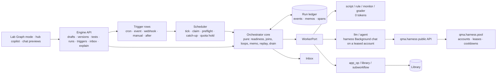
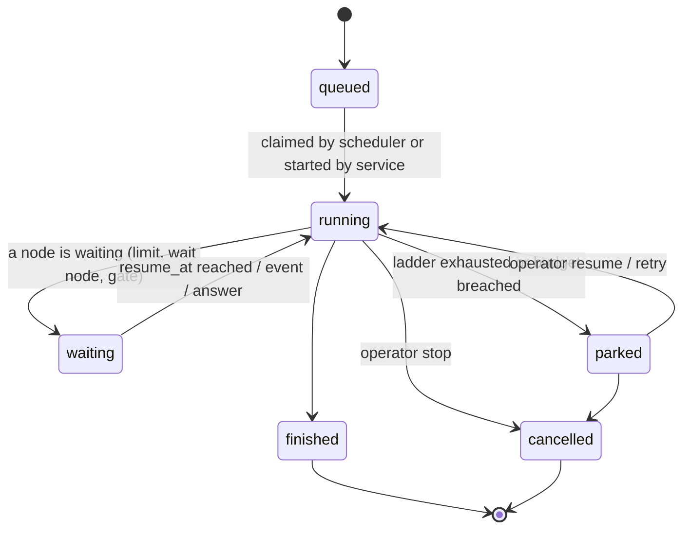
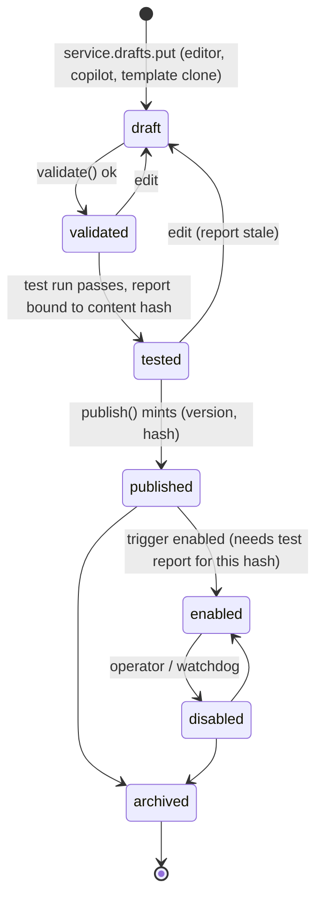
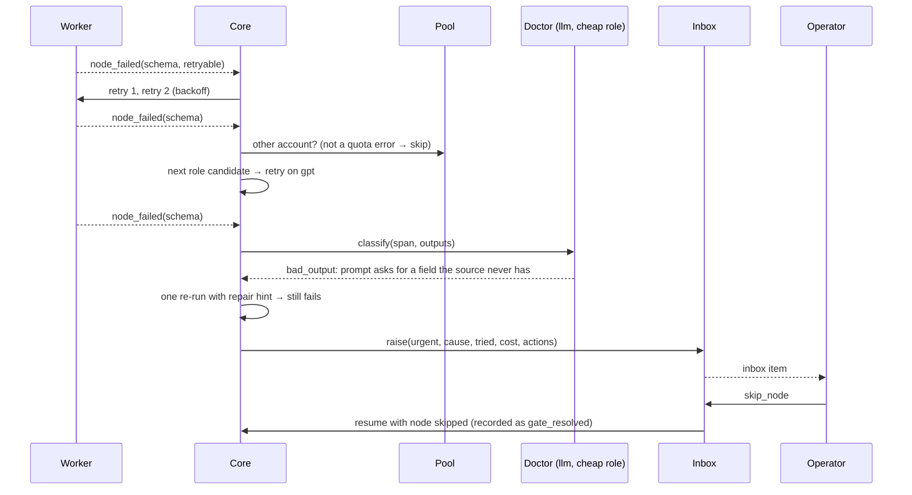
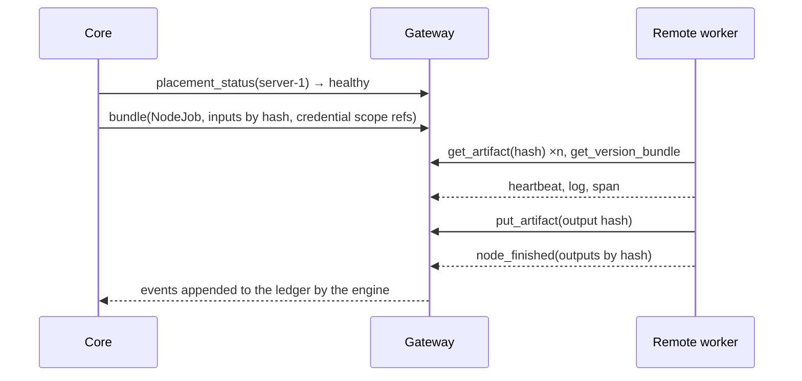

# QMX workflow engine — solution design

Projection of `ARCHITECTURE-SPINE.md` (the binding spine) into contracts, data models, sequence flows and failure modes. Written 2026-10-16, headless, from the memlog. Where this file and the spine disagree, the spine wins. The rulings file `methodology/26` outranks both.

Labels: **[retrieved]** read today from a cited file or branch; **[remembered]** training knowledge, not re-verified; **[inferred]** reasoned here. Numbers marked **Claude's default** are placeholders the operator changes in Settings.

---

## 1. What the engine is, in one picture



The core decides *what runs next* from the ledger alone. Executors do the work and write results back. The scheduler decides *when a run starts*. The pool decides *which account* a model-bearing node uses. The Library keeps *what was made*. The inbox tells the operator *only what needs him*.

---

## 2. Workflow definition format (`qmx.workflow/1`)

### 2.1 Shape [retrieved: n8n `IWorkflowBase` in `25` section 2.1; QMX additions inferred]

```json
{
  "schema": "qmx.workflow/1",
  "id": "paper-scout",
  "name": "Paper scout: new q-fin papers to a research note",
  "version": "1.2.0",
  "content_hash": "sha256:…",
  "extends": null,
  "inputs":  { "type": "object", "properties": { "topics": { "type": "array", "items": { "type": "string" } } } },
  "outputs": { "type": "object", "properties": { "note": { "$ref": "#/artifact" } } },
  "settings": {
    "timezone": "Europe/London",
    "budget": { "tokens": 400000, "cost_usd": 3.0, "agents": 12, "wall_seconds": 7200 },
    "on_error": "park",
    "error_workflow": null,
    "caller_policy": "any | workflows_only | none",
    "inline_limit_bytes": 65536,
    "memory": { "scopes": ["run", "workflow"] },
    "claude_workflow_enabled": false
  },
  "nodes": [
    { "id": "n1", "name": "Every 6 hours", "type": "trigger", "typeVersion": 1, "position": [0, 0],
      "parameters": { "kinds": ["cron", "manual"] } },
    { "id": "n2", "name": "New paper ids?", "type": "monitor", "typeVersion": 1, "position": [220, 0],
      "parameters": { "source": "scripts/feed_ids.py", "wake_when": "changed" }, "effect": "none", "role": null },
    { "id": "n3", "name": "Triage titles", "type": "llm", "typeVersion": 1, "position": [440, 0],
      "role": "triage", "effect": "irreversible",
      "parameters": { "prompt_ref": "prompts/triage.md", "schema_ref": "schemas/triage.json", "max_items": 8 },
      "retry": { "max_tries": 3, "backoff_seconds": [30, 120, 600], "retry_on": ["transient", "schema"] },
      "timeout": { "run_seconds": 600, "idle_seconds": 120 } },
    { "id": "n4", "name": "Read each paper", "type": "agent", "typeVersion": 1, "position": [660, 0],
      "role": "reader", "effect": "irreversible",
      "parameters": { "skills": ["paper-question-battery"], "tools": ["Read", "WebFetch"], "max_turns": 12,
                      "output_schema_ref": "schemas/paper_card.json", "browser_level": "none" },
      "runs_on": "local" },
    { "id": "n5", "name": "Citations check", "type": "grader", "typeVersion": 1, "position": [880, 0],
      "parameters": { "mode": "deterministic", "script": "scripts/citation_check.py" }, "effect": "none" },
    { "id": "n6", "name": "Promote to a Lab test?", "type": "human_gate", "typeVersion": 1, "position": [1100, 0],
      "parameters": { "prompt": "These papers look testable. Start a Lab test?", "options": ["yes", "later", "no"] } },
    { "id": "n7", "name": "Save note", "type": "library", "typeVersion": 1, "position": [1320, 0],
      "parameters": { "op": "write", "kind": "artifact", "artifact_type": "research_note" }, "effect": "compensable" }
  ],
  "connections": {
    "Every 6 hours":     { "main": [[ { "node": "New paper ids?", "port": "in", "map": "one" } ]] },
    "New paper ids?":    { "changed": [[ { "node": "Triage titles", "port": "in", "map": "one" } ]] },
    "Triage titles":     { "main": [[ { "node": "Read each paper", "port": "in", "map": "broadcast" } ]] },
    "Read each paper":   { "main": [[ { "node": "Citations check", "port": "in", "map": "keyed-join", "key": "paper_id" } ]] },
    "Citations check":   { "pass": [[ { "node": "Promote to a Lab test?", "port": "in", "map": "one" } ]],
                           "fail": [[ { "node": "Save note", "port": "in", "map": "one" } ]] },
    "Promote to a Lab test?": { "yes": [[ { "node": "Save note", "port": "in", "map": "one" } ]],
                                "later": [[ { "node": "Save note", "port": "in", "map": "one" } ]] }
  },
  "pinData": { "New paper ids?": { "changed": [ { "ids": ["2610.01234", "2610.01999"] } ] } },
  "meta": { "created_by": "copilot", "created_in_session": "…", "lifecycle": "draft", "tested_hash": null }
}
```

### 2.2 Field rules

| Field | Rule |
| --- | --- |
| `id` | stable, operator-readable; a variant has its own `id` and `extends` |
| `version` / `content_hash` | assigned at publish; a draft has `version: null`; the hash covers `nodes`, `connections`, `settings`, `inputs`, `outputs` and the bytes of every `*_ref` file, never `position` or `meta` |
| `extends` | `{ "workflow_id", "version", "patches": [...] }` (RFC 6902 operations over the parent snapshot); publish resolves it to a full snapshot and records `variant_of` |
| `nodes[].type` / `typeVersion` | from the AD-5 registry; an unknown type or version fails validation; old versions keep working after a kind changes |
| `nodes[].role` | required on `llm`, `agent` and LLM-mode `grader`; forbidden elsewhere; must exist in Settings `[roles]` |
| `nodes[].effect` | required; the registry supplies a default per kind that validation accepts |
| `nodes[].credentials` | `qmx/*` refs only; a literal matching a token shape fails validation |
| `nodes[].runs_on` | `local` (default) or a placement name registered with the gateway |
| `connections` | source node **name** → output port name → list of target lists; each target names `node`, `port`, `map` and for `keyed-join` the `key`; `cartesian` needs `"explicit": true` |
| `pinData` | per node, per output port, the items a test run returns instead of executing; ignored in live mode |
| `settings.caller_policy` | who may invoke this workflow as a `subworkflow` |
| `settings.error_workflow` | optional workflow id that receives `run.failed` events for this workflow |

### 2.3 Node kinds [spine AD-5]

| Kind | Executor does | Tokens | Default effect | DEC-0312 / DEC-0418 name it ratifies |
| --- | --- | --- | --- | --- |
| `trigger` | marks the entry; parameters say which trigger kinds may bind | 0 | none | (Routine, DEC-0328, stays outside the definition) |
| `script` | runs a declared script in the AD-24 subprocess; stdout JSON or files become outputs | 0 | reversible | `deterministic_script` |
| `rule` | evaluates a safe expression over inputs; routes by output port | 0 | none | `conditional` |
| `loop` | repeats a body subgraph; stop = typed condition (max iterations, budget, predicate, no-progress rounds) | 0 | none | `loop` with iteration law |
| `join` | waits for `all`, `any` or `quorum(n)` inbound partitions; late arrivals after watermark are late, not merged | 0 | none | `join`, DEC-0439 algebra |
| `wait` | parks until a time, an engine event or a webhook; no compute while parked | 0 | none | (n8n Wait) |
| `human_gate` | parks with an ask in the inbox; `timeout` makes it an approval gate that resolves on timeout with `on_timeout` | 0 | none | `human_gate`, `approval_gate` |
| `llm` | one model call with a JSON schema, through a one-turn tool-less harness Background chat on the leased account | low | irreversible | `task` |
| `agent` | a harness Background chat with skills, tool allow-list, `max_turns`, structured output; session id saved for resume; in `runner_outside` mode (default) its code-running tools are sandbox MCP tools and the built-in Bash/Write/Edit are off; optional SDK sub-agents (depth 1, 3-5 concurrent, same chat tree and sandbox, budget carved from the node); may write its own tools (`agent-tool`, `unreviewed`, no order verb) | high | irreversible | `agent` |
| `rlm` | a prime-agent-style Python kernel (`execute / interrupt / snapshot / restore` over newline JSON) inside the node's sandbox, driven by the runner as the `sandbox_python` tool, with data fetched by hash into `/work/in`; `spawn`/`collect` sub-model calls are routed back to the runner's provider layer and land as spans; a `dill` snapshot after each cell is shipped by the sidecar as a `checkpoint` blob and restored on retry; cached sub-call results are never repaid; `resources.memory_mb` 4-8 GiB; `runsc` by default, `runc` when file I/O suffers | high | irreversible | — (ruling 52) |
| `subworkflow` | invokes another workflow version with typed inputs; own ledger namespace; `await` or fire-and-forget | varies | per callee | DEC-0455 nested invoke |
| `grader` | deterministic check (script) or LLM judge on the `judge` role; outputs `verdict` + `feedback` on `pass`/`fail` ports | 0 or low | none | (Deep Agents rubric, `03`) |
| `monitor` | runs a cheap source (script or URL), hashes it, fires `changed` with the diff or ends `silent` | 0 | none | (Hermes monitor, `25` section 1.4) |
| `app_op` | invokes a mini app's exported operation through `ControlService.apps_call` with a `caller_kind: workflow` envelope | varies | declared by the op | DEC-0452/0455 invoke |
| `library` | reads a kind by id/hash or writes an artifact, edge or run summary through `LibraryPort` | 0 | compensable (write) | `artifact_dependency` (read) |
| `claude_workflow` | launches the Claude Code Workflow tool inside one plan chat for a Claude-only fan-out; stores `runId`; off unless `settings.claude_workflow_enabled` and HARNESS-REQUESTS H4 is granted | high | irreversible | — |

`parallel_branch` of DEC-0312 is not a node: fan-out is a `broadcast` edge plus a `join`.

### 2.4 Validation (the `validated` state)

1. Schema: the document parses against `qmx.workflow/1`; every `*_ref` resolves inside the workflow folder.
2. Graph: exactly one `trigger`; every edge joins declared ports of compatible kinds; no cycles except through `loop` bodies; every node reachable; `cartesian` explicit; a `keyed-join` names a key.
3. Roles, effects, placements and credentials resolve against Settings, the registry, the gateway and the keyring **by name** (preflight checks reachability later).
4. Lint: no node calls `settings.write`; no parameter names a money act (deny-list `qma.core.barriers.money_path`); no node creates triggers; secrets by ref; budget present when any `llm`/`agent` node exists; `agent` nodes have `max_turns`.
5. Note nodes (`type: note`) and unconnected nodes are allowed in a draft and refused at publish unless `disabled: true`.

---

## 3. Execution model

### 3.1 States



Node attempt states: `scheduled → started → (ok | failed | waiting | gate) `; a `failed` attempt may be followed by a new attempt under the ladder. Run state is derived from node states and never stored separately: `running` if any node started and none parked; `waiting` if the only unfinished nodes are waiting; `parked` if an inbox item with `blocks_run: true` is open. The JobHandle vocabulary of DEC-0439 maps as `queued | running | done=finished | failed=parked-with-failure | cancelled | aborted=cancelled by watchdog | unknown=attempt with no terminal event and a dead worker`.

### 3.2 Ledger events (append-only, one writer)

| Event | Data | Written by |
| --- | --- | --- |
| `run_created` | workflow id, version, content hash, inputs hash, trigger id or caller, mode `live | test`, budget | service or scheduler |
| `run_input` | the inputs document (or artifact ref) | same |
| `clock_tick` | `now` supplied at start and at every resume | scheduler |
| `node_scheduled` | node id, iteration, partition, input hash, memo key | core |
| `node_started` | attempt, worker, placement, lease (account), resolved `(profile, model, effort)` | worker |
| `heartbeat` | attempt, progress note | worker |
| `log` | attempt, level, redacted line | worker |
| `node_finished` | attempt, outputs by port (inline or artifact refs), output hash, span | worker |
| `node_failed` | attempt, error code, signature, retryable, effect state `before | after | unknown` | worker |
| `node_waiting` | attempt, reason `limit | wait | gate`, `resume_at`, event name | core |
| `gate_opened` / `gate_resolved` | ask text, options, inbox item id; answer, principal, at | core / service |
| `event_received` | engine-bus event name and payload hash | scheduler |
| `ladder_step` | attempt, step `retry | account | model | doctor | park`, reason | core |
| `doctor_verdict` | classification, proposal ref | nodes.llm (doctor role) |
| `run_paused` / `run_resumed` | reason, earliest `resume_at` | core |
| `run_finished` / `run_cancelled` | outputs hash, totals (tokens, cost estimate, duration, agents) | core |
| `memory_written` | scope, rows added, size after | nodes.library |

Every event carries `seq` (monotonic per run), `run_id`, `at` (from the recorded clock), `kind`, `data`. A `span` is derived from `node_started`/`node_finished|failed|waiting` pairs and stored as its own row for fast timelines.

Why SQLite and not the existing `qmx_ledger.RunJournal` (per-run fingerprint-chained JSONL) [retrieved hp17]: fire claims, leases and memo lookups need transactions and indexes across runs. The two meet at run end: the trace export is written through `RunJournal`, so the Library artifact carries the fingerprint chain, and the harness's per-chat `model_call` rows are joined by the chat id a span records. All JSON hashing uses `qmx_ledger.journal.fingerprint`; error signatures come from `ledger.signature`.

### 3.3 Replay algorithm [spine AD-7]

```text
resume(run):
  events = ledger.read(run_id)
  state  = core.fold(definition, events)          # pure
  for node in core.ready(state):                   # all inbound partitions satisfied per join rule
     key = memo_key(run, node, iteration, partition, hash(inputs), hash(node_def))
     if memo.has(key) and memo.valid(key):         # valid = not invalidated by an edited node def
         core.apply(node_finished from memo)       # no executor call, no spend
     else:
         admission = pool.lease(node.role) if node.model_bearing else Ok
         if admission is Closed: emit node_waiting(limit, resume_at); continue
         emit node_scheduled; worker.run(NodeJob(...))
```

Only nodes whose memo is missing or invalid run. A `broadcast` fan-out produces one memo per partition; the `join` reads partition memos, so a retry of one failed partition never touches the others.

### 3.4 Effects, idempotency and workspace snapshots [spine AD-8]

- Before any attempt of a `reversible` node, the worker snapshots the run workspace (hard links or a copy under `workspaces/wf-<id>/runs/<run_id>/.snap/<attempt>`) and restores it before a retry.
- A `compensable` node's write produces a new Library version or edge; compensation is `supersedes` or `archived_as`, never delete.
- An `irreversible` node receives `idempotency_key = run:node:iteration:attempt` and must pass it to the external side (the harness chat title carries it; an app op receives it in the envelope). After a failure with `effect_state: unknown` (worker died mid-call) the core does **not** retry; it parks with an inbox item that offers "retry (may duplicate)" with the key shown.
- A model call is spend and therefore irreversible, but its *result* is memoised, so a rerun of a later node never repays it.

### 3.5 Loops, joins, subworkflows

- `loop`: the body is an induced subgraph; each iteration mints node attempts with `iteration = k`; the stop condition is typed (`max_iterations`, `budget`, `predicate` over the last iteration's outputs, `no_progress_rounds` over a named metric); iteration state lives in the ledger, never in a node result (DEC-0312 iteration law ratified).
- `join`: expected cardinality comes from the fan-out partition count; `all` waits for every partition, `any` fires on the first and marks the rest `late`, `quorum(n)` fires at n; watermark `all-expected | timeout | failed-aggregation`; late arrivals are recorded, not merged.
- `subworkflow`: one nested run with its own `run_id`, `parent_run_id`, `call_depth` (ceiling in Settings); the parent node waits or continues; the callee's `caller_policy` is checked at validation and at dispatch; merging two live runs is refused (DEC-0455 ratified).

### 3.6 Drain and pause [spine AD-9]

```text
on Closed admission for node N:
   emit node_waiting(N, limit, resume_at = earliest reset among allowed accounts)
   run.drain = True             # no new model-bearing node starts; scripts/rules/monitors continue
   when no node is running: emit run_paused(reason=limit, resume_at)
scheduler: at resume_at + slack: emit clock_tick, run_resumed; core.resume(run)
```

An inbox item is raised only if `now - first_waiting_at > settings.limits.alert_after`.

---

## 4. Triggers and the scheduler [spine AD-10]

### 4.1 Trigger row

```text
trigger: id, workflow_id, version, kind cron|interval|event|webhook|manual|after,
         spec (cron expr + IANA zone | seconds | event name + filter | webhook route id | workflow id),
         enabled, precheck_ref, role_pins {role: (profile, model, effort)}, effort_pin,
         delivery {inbox|digest|silent}, continuity (inject own last successful outputs),
         catch_up merged|record_only, max_concurrent (default 1 when agent nodes exist),
         source ticker|<provider> (pluggable; controls claiming only), created_by principal (never a run),
         next_fire_at, last_status ok|silent|blocked_config|failed|delivery_failed|unknown,
         failure_streak, quota_hold_until, incident_id
fire:    id, trigger_id, occurrence_at, claimed_by, claimed_at, lease_until, status
```

### 4.2 Tick algorithm (every `settings.scheduler.tick` seconds, Claude's default 60)

1. Load due triggers (`next_fire_at <= now`, enabled, version enabled, not on hold).
2. For each, claim the occurrence: insert `fire` with a lease (`settings.scheduler.lease_seconds`, Claude's default 300) and heartbeat (60 s); a second process finds the row and skips. At most one fire per occurrence.
3. If `now - occurrence_at > grace` (Claude's default 15 min), collapse: one fire with `occurrence_at = the latest missed`, the others recorded `skipped: downtime`. **One catch-up run per trigger after downtime.**
4. Preflight: roles resolve, credentials resolve, placement healthy, skills and apps present, delivery target exists. Any failure → `blocked_config`, one inbox item (keyed by trigger + signature), no run.
5. Admission: if every allowed account for the trigger's roles is closed, set `quota_hold_until = reset + slack` and merge later fires into this one (Hermes `quota_hold`, `25` section 1.4 [retrieved]).
6. Start the run with `clock_tick(now)`, `run_input` from the trigger and the precheck's context.
7. A run cannot create, edit or enable triggers: `service.triggers.*` refuses `caller_kind: workflow`.

`event` triggers subscribe to the engine bus (`library.*`, `run.*`, `app.*` events); `webhook` triggers are routes the gateway exposes and signs; `after` triggers fire on `run.finished` of another workflow and receive its outputs.

---

## 5. Workers [spine AD-20]

### 5.1 NodeJob and NodeResult

```text
NodeJob:   run_id, node_id, iteration, partition, attempt, memo_key, idempotency_key,
           node_definition (slice), inputs (inline or artifact refs), now, budget_remaining,
           resolved_model (profile, model, effort, account lease) | null,
           credentials (refs the node declared), workspace (path or remote mount id),
           placement, timeouts, mode live|test, pinned outputs (test mode)
NodeResult: ok(outputs by port, output_hash, artifacts[], span)
          | failed(code, message, signature, retryable, effect_state before|after|unknown, span)
          | waiting(reason, resume_at | event, span)
          | gate(ask, options, span)
```

### 5.2 Local worker (the PC)

A `ComputeProvider` adapter over Docker Desktop on WSL2 (installed on this PC, study 29 [retrieved]) that boots the same `qmx-worker` image per node attempt, concurrency 3 (Claude's default). Script-family nodes of `host` tier spawn the AD-24 subprocess instead. Model-family nodes run as harness Background chats in the local runner (this process): they first take a chat slot from `max_live_chats − interactive_reserve` (the engine's own count, so `ChatTableFull` never fires), then call `HarnessPort` (section 8.4) on the engine's event loop; their code-running tools are served by the runner-side sandbox tool server and executed in the container over the sidecar's remote call (section 5.4). `app_op` calls `ControlService.apps_call`; `library` calls `LibraryPort`. Heartbeats every 10 s from the sidecar while an attempt runs; cancel kills the container or the process tree, or calls `Harness.interrupt`. When Docker Desktop is off: scripts fall back to `host`, model-written-code tool calls wait with `waiting(placement)` and a "Docker is off" doctor line.

### 5.3 Remote worker (engine side of the gateway)

The remote worker is the same `qmx_engine.nodes` code running on another machine with its own `qma.serve`, so model-bearing nodes use *that* machine's accounts and plan tokens never travel. The engine ships a **bundle** per node attempt and expects results back through `GatewayPort`:

| Direction | What | Form |
| --- | --- | --- |
| out | `NodeJob` minus local paths | JSON; inputs as artifact hashes; credential **scope refs** only (the worker resolves them from its own keyring) |
| out | artifacts the inputs reference | fetched by the worker from the gateway by hash |
| out | the node's `*_ref` files | by the version's content hash (the worker fetches the version bundle once) |
| in | outputs | artifacts by hash, pushed to the gateway, plus the inline `NodeResult` |
| in | events | `heartbeat`, `log`, `span`, `node_finished | failed | waiting`, appended to the ledger by the engine, not by the worker |
| in | traces | the attempt's span tree |
| control | cancel, lease renewal, placement health | gateway calls |

This matches the existing `qmx_remote.RunBundle` shape (`kind`, `definition_hash`, `inputs`, `credentials_scope`, `resources`, `files` by digest) [retrieved hp17], so the gateway designer can extend it rather than invent a new one. What the gateway must provide to the engine: `put_artifact(hash, bytes)`, `get_artifact(hash)`, `get_version_bundle(workflow_id, version)`, `events(run_id)` stream, `cancel(attempt)`, `placement_status(name) -> available|configured|authorized|reachable|healthy`, and Library read/write proxies with the same `LibraryPort` signatures. The Library agent's Hub (Library AD-11, AD-12, AD-13) is that gateway: per-run capability tokens with `write_prefix: refs/runs/<run_id>` and a `key_scope`, and the run sidecar that heartbeats, streams logs and traces, puts artifacts by hash and mirrors SDK transcripts through a `SessionStore` adapter.

### 5.4 Execution environments: the harness outside, the sandbox executes tool calls [spine AD-25; study 29; Rivet principle]

```mermaid
flowchart LR
  subgraph OUT["outside every sandbox (runner host: the PC or qmx-node)"]
    E[Engine core · ledger · scheduler · inbox · traces]
    R[Runner: harness Background chat<br/>account lease · permissions · transcript]
    T[Sandbox tool server (MCP)<br/>sandbox_bash · sandbox_write · sandbox_python · sandbox_tool_*]
    P[Pool + relay: keys never leave here]
    E --> R
    R --> T
    R --> P
  end
  T -- remote call over the sidecar --> K[qmx-worker container<br/>tool executor · RLM kernel · /work]
  K --> SC[sidecar: heartbeat 10 s, logs, traces, artifacts by hash, refs/runs/<id> only]
  K -.-> X[qmx-egress: fallback cli_inside only]
```

| Concern | Rule |
| --- | --- |
| What never enters a sandbox | the engine core, ledger, scheduler, pool, credentials, permissions, session history, audit and traces, the inbox, agent-to-agent routing. A sandbox executes only tool calls that arrive over a remote call (Rivet; the lead adopted it, revising study 29's "the whole worker goes inside the box") |
| Image | one OCI image `qmx-worker`: the sandbox tool executor, the RLM kernel, the sidecar, Python data libraries; built once, tagged by the engine version, the same digest on the PC, the server and the burst providers. In `cli_inside` mode the image also carries the Agent SDK with its bundled CLI |
| Lifetime | fresh container per node attempt (matches AD-7 memo and retry rules); `warm: true` per agent keeps one container across its steps as an optimisation only, state in the Hub `SessionStore` |
| Isolation tier (node attribute beside `placement`) | `host` (PC, trusted scripts only, AD-24) · `runc` hardened for trusted scripts and GPU jobs · `runsc` (gVisor) for anything a model wrote |
| Hardened `runc` flags | `--read-only`, `--tmpfs /tmp`, `--cap-drop ALL`, `--security-opt no-new-privileges`, seccomp, `--pids-limit 256`, `--memory`, `--cpus`, non-root user, `/work` bind only (the existing `SSHProvider` recipe [retrieved hp17 `qmx_remote/providers.py`]) |
| Mounts never made | the Docker socket, the host home, `~/.ssh`, any `.git` read-write (Sandcastle issue #1010 lesson), the plan home |
| **Agent mode `runner_outside` (default for model-written code)** | the agent loop is a harness Background chat in the runner on that placement's host, holding its account lease through the harness as today (plan on the PC, keys on the server); the chat's built-in `Bash`, `Write`, `Edit`, `NotebookEdit` are disabled (HARNESS-REQUESTS H2/H8); the runner serves an MCP tool server `sandbox_bash`, `sandbox_write`, `sandbox_python` (the RLM kernel), `sandbox_tool_<name>` (agent-made tools) whose calls execute inside the container over the sidecar's remote call; `Read` may stay pointed at a synced read-only copy of `/work`; sub-agents are SDK sub-agents in the same chat tree, their tool calls reach the same container. Rivet notes Claude Code and Codex do not support this natively; agentOS adds it through sandbox mounting (probe E23 compares the two routes) |
| **Agent mode `cli_inside` (fallback, per node)** | the Agent SDK and CLI run inside the container; model traffic leaves through `qmx-egress`, which holds the domain allow-list and injects the key-provider key the pool leased; key accounts only, never a plan account; the transcript lives inside the box and is mirrored out by the sidecar |
| Trade-offs between the modes | `runner_outside`: every credential, permission decision and transcript stays outside; one audit path; the blast radius is the container's `/work`; cost: the sandbox tools must match the built-in tools' quality and latency (probe E23). `cli_inside`: Claude Code's native tools and their polish; cost: the whole CLI is inside the blast radius, a second key path (egress) exists, the transcript sits in the box, and plan accounts are excluded |
| Keys | in `runner_outside` they never leave the harness relay on the runner host; in `cli_inside` the egress proxy injects per lease; in neither mode does a key enter the container's environment or files |
| Network | containers on an internal network: in `runner_outside` their only peer is the sidecar's remote-call endpoint (plus declared data hosts); in `cli_inside` their only exit is `qmx-egress` |
| RLM kernel | a process in the container started by the first `sandbox_python` call; its sub-model calls (`spawn`/`collect`) go back to the runner, never to a key from inside |
| Agent-made tools | the agent writes `tools/<name>.py` with a declared schema through `sandbox_write`; the runner registers it as `sandbox_tool_<name>` on the next turn; it executes only inside `runsc`; saved to the Library as `agent-tool`, state `unreviewed`; the money deny-list applies; no order verb exists off the PC harness |
| Agent folder | fetched by hash into `/work/agent`, writable inside the container only; changes (new tools, memory, skills) return as new objects on `refs/runs/<id>` and the Library versions them (ruling 57) |
| PC placement | Docker Desktop (WSL2 backend, Linux containers), same image, hardened `runc` (gVisor is not a supported setup there), concurrency 3; the UI shows "Docker is off" when it is |
| Server placement | Ubuntu LTS, Docker Engine, gVisor as runtime `runsc`, Tailscale to the PC; three systemd units: `qmx-hub` (Library Hub), `qmx-node` (this engine's runner and worker with its own `qma.serve` and key-provider pool, semaphore 20), `qmx-egress` (fallback mode); **never the trading node, holds no broker credential**; sizing about 32-48 GiB RAM and 8+ cores for 20 concurrent agent nodes; under 32 GiB cap the semaphore at 10 |
| Burst placement | `E2BProvider` and `ModalProvider` (exist on hp17) boot the same image with the same sidecar and run token; the runner stays on `qmx-node` and reaches the burst container over the same remote call; GPU to Modal or to the server's card under `runc --gpus`; E2B Embed on the server later if `/dev/kvm` exists and pause/resume/fork or heavy RLM data work needs it |
| Why Rivet's objection to workflow engines does not apply | Rivet argues an endless agent loop makes a workflow engine's replay grow forever. A QMX workflow is a finite run: it starts on a trigger, walks a DAG, and ends with `run_finished`; its ledger is bounded by the definition's nodes, loop caps and budgets. The never-ending agent is the copilot session, which lives in the QMA v2 harness, not in this engine |
| Sync back | artifacts by hash, events, logs, spans, checkpoints; a sync-back size cap (Hermes `sync_back_max_bytes` idea, 2 GiB Claude's default); orphan and idle reapers on every placement |
| Blast radius | fork bomb / `rm -rf`: read-only root, `/work` only, pids and memory limits · escape: `runsc` for model tiers, no sensitive mounts · exfiltration: nothing to steal in the box in `runner_outside`; egress allow-list in `cli_inside` · spend: `max_budget_usd`, `maxTurns`, sub-agent caps, engine budgets before each retry · stuck: sidecar heartbeat, watchdog, idle timeout 600 s, hard run timeout · Library garbage: writes land only on `refs/runs/<id>` and are versioned · one bad node: the semaphore isolates it; its failure parks only its own run |

---

## 6. Creation lifecycle, the Board and the builder [spine AD-11, AD-21, AD-22]

### 6.1 State machine



### 6.2 Test mode

A test run is a run with `mode: test`: `pinData` outputs replace execution for pinned nodes; `llm`/`agent`/`rlm`/`grader(llm)` nodes use **real models** through the providers the harness already has, resolved from each role's cheap candidates, with OpenRouter rows admitted in test mode (ruling 51: "we don't want to assume, we want to make sure things work"); the **fake provider** (an executor that returns the pinned output, a recorded transcript, or a schema-valid canned document) is an explicit per-run switch for a no-spend dry run; `irreversible_external` nodes (messages, posts, webhooks, app ops marked so) are stubbed and log what they would have sent, while model spend and Library writes are real; the run writes on its own branch `refs/runs/<run_id>` like any run, with status `test`, and the Library's auto-fast-forward excludes test runs (LIBRARY-REQUESTS L9). The report binds to the draft's `content_hash`; any edit that changes the hash marks it stale.

### 6.3 The saved Board

The Board is a draft (ruling 31): note nodes, charts and runnable sections live in one document. "Run just this part" is a selected-subgraph test run on the draft. Promotion is `publish`. Nothing about layout is client-only any more (DOC-CHANGES 1).

### 6.4 The builder, from a rough description

```mermaid
sequenceDiagram
  participant O as Operator
  participant C as Hub copilot (builder skill)
  participant E as Engine API
  O->>C: "Scan new q-fin papers every 6 hours and give me a note when something is testable"
  C->>C: loop-me interview: Trigger? Checkpoints (pushed late)? Brief?
  C-->>O: 3 numbered questions, each with a recommended answer ("yes" accepts)
  O->>C: yes, yes, weekly instead of 6h
  C->>C: BMad phases: classify (routine), requirements (folder dominion, roles, budget), draft
  C->>E: drafts.put(definition JSON)
  E-->>C: draft_id, revision, validate() findings
  C->>E: tests.run(draft_id)   # real cheap models by default (ruling 51)
  E-->>C: test_report (pass), run card
  C-->>O: draft panel in chat + run card; "Publish as v1.0.0 and enable weekly?"
  O->>C: yes
  C->>E: publish(draft_id) → version; triggers.create (asks MANAGE approval)
  E-->>O: inbox: enabled, next fire
```

The copilot never edits the ledger, never enables without the operator's yes, and writes only through the API, so a copilot-built workflow passes the same validation and test gate as a hand-built one.

### 6.5 Template → variant

A template is a published version in the Library shelf "Templates". "Make a variant" creates a draft with `extends: {workflow_id, version, patches: []}`; the editor shows the parent greyed and the patches live; publish resolves the overlay to a full snapshot (so the variant never changes when the parent does) and writes `variant_of`. The methodology layer may add rules (tighten-only gates for agent-made variants); the engine records, it does not judge.

---

## 7. Account pool and load balancer — the harness extension [spine AD-12]

### 7.1 Data model

```text
account:  id, provider (claude|gpt|<key provider name>), label, kind plan|gpt|key,
          home (plan: <qmx_home>/claude/<id>/; key: n/a), credential_ref (key rows),
          weight, enabled, test_only, state ready|cooldown|benched|needs_login,
          cooldown_until, last_error_signature, last_reading {window, utilization, resets_at, at}
lease:    id, account_id, session_id, acquired_at, released_at, role, caller run_id|chat
pool settings (per provider): strategy fill_first|round_robin|least_used, soft_cap_per_account,
          cooldown_default_seconds (1h), rebind_on quota|auth
```

### 7.2 Where it sits in the harness [retrieved: profiles.py, home.py, usage.py, harness.py on hp17]

| Today | Extension |
| --- | --- |
| `PLAN` is one fixed name; `ClaudePlan` has no account field | `ClaudePlan(name="claude", account=AccountId)`; profile rows may list several accounts; the pool resolves `profile → account` |
| one plan home `<qmx_home>/claude` | one plan home per plan account `<qmx_home>/claude/<account>/`, each signed in by the CLI's own `/login`; `projects/` junction per home into one shared transcript folder, as today |
| `UsageLedger` keyed by window | keyed by `(account, window)`; `PlanWatch` records the account from the chat's launch |
| `BackgroundCap.refusal(ledger)` | `refusal(ledger, account)`; the 50 % cap applies per account |
| `NewChat(profile=...)` | `NewChat(profile=..., account=None)`: `None` lets the pool pick; a set value pins (affinity) |
| `Harness.start_chat` | calls `pool.acquire(profile, role, affinity)`; a `Lease` is stored on the `ChatRecord`; `close`/reap release it |
| `relay` grants per key profile | unchanged; a key account is a `KeyProvider` row with its own `credential_ref`; the relay journal already tees usage per session, the pool sums it per account |
| `siwc` one ChatGPT account | unchanged: GPT capacity one |
| `quote`/`apply` for provider switch | reused for account rotation of a running chat on quota/auth error (resends uncached, warned in the span) |

### 7.3 Selection and the error ladder [retrieved: Hermes credential pools, CLIProxyAPI config, `25` sections 1.6 and 4.2]

```text
acquire(profile, role, affinity):
  candidates = accounts(provider=profile) where enabled and not test_only (unless run.mode == test)
                and state == ready and leases(account) < soft_cap
  if affinity in candidates: return lease(affinity)
  strategy: fill_first → first by weight; round_robin → next after the last leased;
            least_used → min(last_reading.utilization) then round_robin on ties
  none → Closed(resume_at = min(cooldown_until, last_reading.resets_at) over the provider)
on error from a leased chat:
  plan/usage limit reached → cooldown_until = resets_at (+60 s slack); rotate at once, no retry
  generic 429 → retry same account once, then cooldown 1 h and rotate
  402 → cooldown 1 h, rotate
  401 → bench, state needs_login, one inbox item ("sign in again to <label>"), rotate
  provider reset_at always overrides the default cooldown
  all accounts closed → Closed → the engine parks the node as waiting (AD-9), never the chat
switch back: a chat moved off its first account checks each turn and moves back when its cooldown lifts
```

The pool never touches a request body, never relays a plan token and never changes a user agent. Leases spread parallel engine nodes across accounts; sub-agents inside one CLI inherit their chat's account (the cache stays warm).

**Placement-aware pools (rulings 55, 39).** Each harness instance has its own pool and its accounts never leave that machine: the PC's holds the plan accounts plus key rows; `qmx-node` on the server holds key rows only (Kimi, GLM, Ollama Cloud, DeepSeek, MiniMax, others; OpenRouter flagged `test_only`). Because the agent loop runs outside the sandbox (AD-25 `runner_outside`), a PC agent node may use a plan account: the chat is a normal harness chat on the host and only its tool calls enter the container. The server's twenty runners are fed by key providers by design; the role tables in Settings carry separate candidate lists per placement (`pc` and `server`). Only the fallback `cli_inside` mode routes model traffic through `qmx-egress`, and it is never leased a plan account.

### 7.4 Interface the engine uses

`HarnessPort.start_chat(NewChat(..., kind=Background(), account=None))` returns the session and the lease; `HarnessPort.usage()` returns per-account windows; the engine reads `Closed.resume_at` from the `LaunchRefused` subclass the pool raises **before** any send, so the harness's `_needs_you` path is never hit for a cap. For a `cli_inside` node the engine asks the same pool for a key-account lease and hands the egress proxy the lease id; the proxy resolves the key from the keyring and injects it; the container's SDK sees only the proxy address. Everything else is the public API as it stands.

---

## 8. Ports

### 8.1 `LibraryPort` (the contract, AD-14)

```text
get_version(workflow_id, version) -> definition bytes + files by hash
get_draft(draft_id) -> definition + revision
put_draft(draft_id|None, definition, expected_revision) -> draft_id, revision      # first save omits id
publish(draft_id, semver) -> (workflow_id, version, content_hash)
put_artifact(bytes|path, type, metadata, intent_key?) -> hash     # on the run's branch refs/runs/<run_id>
get_artifact(hash) -> bytes|path
put_run_summary(run_id, workflow_id, version, status live|test|..., totals, trace_artifact_hash) -> ok
put_test_report(draft_hash, report) -> ok
put_checkpoint(run_id, node_id, attempt, bytes) -> hash           # rlm snapshots
put_agent_tool(run_id, tool) -> object_id                          # state unreviewed
link(from_ref, edge, to_ref) -> ok                                 # edge in the closed set
find_by_intent(intent_key) -> [object_id]                          # exact, no model (AD-27)
list_runs(workflow_id, version?) -> [summary]
champion(workflow_item) -> object_id | None ; set_champion(workflow_item, object_id)   # refs/champions/*
events() -> stream of library.* events for triggers
```

Kinds and edges registered: see spine AD-14; the additions (`memory-row`, `agent-tool`, `checkpoint`, `intent_key`, `refs/champions/*`, test-run status) are requests in LIBRARY-REQUESTS.md. Every write lands on the run's own branch with its run token (Library AD-7, AD-12); the engine never assumes the PC store answers (the Hub answers for remote runs and, later, as primary, ruling 56). The Library agent owns storage, knowledge graph, previews, concurrent-edit logic and backups (rulings 41-42); this port is what the engine will compile against.

### 8.1a `MemoryPort` (AD-18) and the provider adapter

```text
MemoryPort
  snapshot(scopes, budget_tokens)        -> Snapshot{text, version, row_ids}   # frozen at run start
  recall(query, scopes, tags?, budget)   -> [Hit{row_id, text, tag, refs, score, provenance}]
  check_built(intent_key)                -> [LibraryObjectId]                  # exact, no model
  check_dead_end(intent_key | query)     -> [Hit]                              # exact first, then recall
  note(row, scope=run)                   -> row_id                             # the only write a node or agent has
  consolidate(run_id, into_scope)        -> {added, merged, corrected, pruned} # consolidation step only
  feedback(row_ids, outcome)             -> ()                                 # engine-called at run end: f += 1, u += 1 on pass
  search_runs(query, workflow?)          -> [RunHit]                           # FTS5 over workflow_run summaries and transcripts, no model

MemoryProvider (one external beside the built-in, per scope binding)
  name, is_available()                   # no network
  open(config) / close()
  index(rows: [memory-row])              # called by the Library watcher; idempotent by object id
  forget(row_ids)                        # on archive
  recall(query, scopes, tags, budget)    # row ids + scores; text always comes from the Library
  snapshot(scopes, budget)               # optional; the built-in renders one if missing
  reflect(question, scopes)              # optional (Hindsight)
  rebuild(all_rows)                      # wipe and reindex from the Library
```

Agents see three tools from the first turn: `memory_recall`, `memory_note`, `memory_check` (built and dead-end). Everything handed to a provider passes the harness redaction first. Scopes and their one writer: `run` → `refs/runs/<run_id>` rows (the run); `workflow` → `refs/memory/wf/<workflow_item>` (the workflow's `consolidate` step at run end); `home` → `refs/memory/home/<home>` and `operator` → `refs/memory/operator` (the home's or operator's `consolidation` subworkflow). Caps apply to the snapshot (hot set); rows behind recall are unbounded but pruned by the `u/f` rule.

### 8.2 `InboxPort`

`raise(item) -> id` (upserts by `(run_id, signature)`), `resolve(id, action, principal)`, `list(open=True)`; item schema in section 10.4.

### 8.3 `SettingsPort`

Reads `[engine]`, `[roles]`, `[scheduler]`, `[limits]`, `[budgets]` through `ControlService.settings_get`; never writes.

### 8.4 `HarnessPort` (adapter over the public names only)

`start_chat(NewChat)`, `send(sid, InjectedText)`, `wait_turn(sid)` (see HARNESS-REQUESTS H1; until then: poll `GET /api/chats/{sid}` for `turn: idle` and read the last `text` block from `ControlService` sessions), `live(sid)`, `answer(ask, Reject|Answers)`, `interrupt(sid)`, `usage()`, `quote/apply`. The adapter marks every prompt `InjectedText` (verbatim, never a slash command), sets `NewChat.workspace = workspaces/wf-<id>/` and tells the agent its write zone `runs/<run_id>/`. Permission asks from an `agent` chat reach the engine as `permission` blocks; the adapter answers `Reject("unattended run")` at once for every ask except a tool the registry marks `irreversible_external`, for which it raises an inbox item and forwards the inbox's answer; if the harness's `unattended_ask_seconds` passes first the ask expires and the attempt continues without that tool (recorded on the span). Nothing else in a run ever waits for the operator (ruling 57). In `runner_outside` mode the adapter also passes the node's sandbox tool server as the chat's extra MCP server and disables `Bash`, `Write`, `Edit` and `NotebookEdit` (HARNESS-REQUESTS H2, H8).

---

## 9. Model-agnosticism [spine AD-13]

| Role (Settings `[roles]`) | Default tier | Candidates (ordered, example) |
| --- | --- | --- |
| `triage`, `clarifier`, `scanner`, `doctor`, `judge` | cheap | kimi/k3 → claude/haiku (any account) |
| `reader`, `searcher`, `writer`, `extractor` | mid | claude/sonnet → glm → gpt |
| `planner`, `synthesiser`, `builder`, `reviewer` | strong | claude/opus → claude/fable → gpt |

Resolution at dispatch: walk the candidate list for the node's placement (`pc` lists may name plan accounts; `server` lists name key providers only; `cli_inside` nodes skip plan rows), ask the pool for a lease per candidate's profile, take the first `ready`; the chosen `(profile, model, effort, account)` is written on `node_started`. Test mode admits `test_only` rows (OpenRouter) and prefers the cheap end of each list. Provider matrix for `agent` nodes: plan → `PlanLaunch`; Kimi, GLM, DeepSeek, MiniMax, Meta Muse, Ollama Cloud, OpenRouter (test only) → `KeyProvider` through the relay; GPT → `GptPlan` lane. OpenCode's chat-completions-only models need a translator lane that does not exist today [retrieved `25` section 5.4]; they are not candidates until one does (Deferred). The fake provider is an engine executor selected by `mode: test`.

---

## 10. Observability and recovery [spine AD-15, AD-16, AD-17]

### 10.1 Span record

`span_id, trace_id = run_id, parent_span_id, node_id, iteration, partition, attempt, kind, role, profile, account, model, effort, placement, started_at, ended_at, status ok|failed|waiting|gate|cancelled, tokens {in, out, cache_read, cache_write}, cost_estimate_usd, effect, idempotency_key, error_signature, verdict (grader), same_family (judge)`.

### 10.2 The ladder, as the core runs it

```text
on node_failed(attempt):
  if effect_state == unknown and effect == irreversible: park("unknown outcome; retry may duplicate")
  if retryable and tries < retry.max_tries: step retry (backoff from retry.backoff_seconds)
  elif error is quota|auth and pool has another ready account: step account (new lease, same model)
  elif role has a next candidate: step model
  elif doctor not yet consulted for this node: step doctor
       doctor (llm, role doctor) reads span + last outputs → transient|bad_input|bad_output|logic
       transient → one retry; bad_input → re-run upstream rule/script once if effect none; bad_output → one re-run with repair hint or next candidate
       logic → a challenger object on the engine's agent branch for the improve workflow (AD-26) + park
  else: park
budget check before every step; breach → park("budget")
park: one inbox item, run parked, nothing waits; the next trigger occurrence starts a fresh run with continuity
```

Human gates: only an attempt in front of an `irreversible_external` effect may wait for the inbox (ruling 57); validation refuses a `human_gate` anywhere else. Library writes, model spend and compensable effects never ask.

### 10.3 Watchdog rules (zero tokens, every tick)

| Condition | Action |
| --- | --- |
| attempt with no `heartbeat`/event past `timeout.idle_seconds` | cancel attempt; `failed(signature=stalled, retryable=true)` → ladder |
| run past `settings.budget.wall_seconds` or tokens/cost/agents | `run_paused(budget)` + inbox `urgent` |
| same node, same signature, 2 failures | skip retries, go to doctor |
| fire with an expired lease and no run | `unknown`, inbox `normal`, no auto re-fire |
| worker placement not `healthy` | nodes on it `waiting(placement)`, inbox after `alert_after` |
| ledger write error | `black` inbox item; scheduler stops claiming |

### 10.4 Inbox item

`id, run_id, trigger_id?, node_id?, severity, signature, title, cause, tried [ladder steps], cost_so_far, trace_link, actions [retry|stronger_model|skip_node|open_trace|stop|resume], blocks_run, first_raised_at, last_raised_at, count, acknowledged_by?, resolved_by?, resolution`.

---

## 11. Memory, the already-built check and self-improvement [spine AD-18, AD-26, AD-27; study 28]

### 11.1 Scopes

| Scope | Library ref namespace | Writer | Readers | Snapshot cap (Claude's default) |
| --- | --- | --- | --- | --- |
| `run` | `refs/runs/<run_id>` (rows inside the `workflow_run`) | the run (`note`) | that run | budget only |
| `workflow` | `refs/memory/wf/<workflow_item>` | the workflow's `consolidate` step at run end | later runs of that workflow | 200 lines |
| `home` (lab, portfolio, …) | `refs/memory/home/<home>` | the home's `consolidation` subworkflow | copilots and workflows of that home | 400 lines |
| `operator` | `refs/memory/operator` | the `consolidation` subworkflow, operator namespace | everything | 200 lines |
| global built-registry | no ref: `produced_by` edges plus the `intent_key` annotation | whoever produced the object | every workflow | n/a |

The `memory-row` object: identity `scope, tag, intent_key?, when_to_use, content, refs[]`; annotations `keywords[], confidence, f, u, source_run_ids[], learned_at, occurred_at` (annotations update without a new version); tags `built | lesson | dead_end | do_not_retry | negative_result | procedure | preference`; relations `mentions`, `derived_from → workflow_run`, `replaces → older memory-row`. A correction is a new row with `replaces`; pruning archives. A write that would breach the snapshot cap fails and the node must consolidate first (Hermes rule [retrieved `25` section 1.5]). `dead_end` rows are read by the builder and by `loop` stop predicates (`no_progress_rounds` ignores known dead ends). Harness auto memory in a workflow agent's chat workspace is `run`-scope scratch: `consolidate` reads it at run end and the folder is cleared per run; copilots keep it as their own memory.

What goes where: a dataset, backtest, bot, model or report is a Library object (a `built` row points at it only when the intent key alone is not enough); why an idea failed is a `dead_end` row with refs to the run and result; how to do a recurring step is a `procedure` row while young and a `skill` once proven; operator preferences are `preference` rows; risk limits, sizing and credentials are never memory; raw transcripts and logs are blobs on the `workflow_run`; live execution state is the engine's SQLite.

### 11.2 The already-built check (AD-27)

```text
intent_key = fingerprint(kind, canonical input object ids, canonical parameters, code object id)
before a build-type node runs:
  hits = library.find_by_intent(intent_key)        # exact, no model
  active hit whose producing run passed → skip and link (consumed_by edge; node returns the object)
  dead_end hit → stop, unless node.retry_dead_ends
  miss → run; an agent node may first recall("build <description>") for near matches and decide
node option reuse: exact (default for scripts) | similar (agent accepts a near match, never automatic) | never (nightly refreshes)
```

### 11.3 The self-improvement loop (AD-26, no human in the path)

```text
runs → note() rows → consolidate → lessons pool
        → nightly improve workflow (per workflow or home): one challenger on refs/agents/<engine>/<workflow_item>
        → replay against fix set (recent failed runs) + guard set (recent passed runs), pinned inputs, real models
        → gate passes? no → archive challenger + dead_end row
                      yes → refs/champions/<workflow_item> moves; tested_by → replay runs; scheduler runs it under self_improve: auto
        → live feedback() over the next K runs; pass rate below the previous version → pointer moves back + dead_end row
main moves only by his click; a review card per champion change is tidying, not a gate
standing rule per workflow: self_improve auto (default for workflows he created or enabled) | propose_only | off
hard limits no rule lifts: money-path tools, risk and sizing settings, credentials, the deny-list, own budget, other workflows
promotion: a procedure row with f ≥ 5 and u/f > 0.8 is drafted into a skill; rows with f ≥ 5 and u/f ≤ 0.5 are archived
```

Scoring the replay: deterministic checks first (schemas, numbers, graders); a model judge only as a tiebreak and never the proposer's model (the self-judgement refusal in `qma.core.ports.refinement` is reused [retrieved hp17]). Default provider: the QMX built-in (Library rows + FTS5; optional `sqlite-vec` reordering later). Plug-ins by order: Hindsight (MIT, runs on the server beside the Hub), ReMe (Apache-2.0, file-native), Mem0 OSS; the B40 bake-off with real cheap models decides, shipping the built-in unless a plug-in wins by 5 points on action tasks with zero leaks.

---

## 12. Mini apps [spine AD-19]

```text
apps/<app-id>/
  .claude-plugin/plugin.json      name, version, description, dependencies
  app.toml                        kind screens|headless|both, risk shows|runs|money,
                                  [io] feeds, provides, emits, accepts
                                  [health] probe, interval
                                  [lifecycle] state draft|validated|tested|published|enabled|disabled|archived, replaced_by, archived_reason
                                  qmx_api = "2026-10"
  workflows/*.json                qmx.workflow/1 documents (may be one)
  widgets/                        display-only panels bound to ops or streams
  server.py + .mcp.json           the app's tools as a stdio MCP server
  tests/ evals/ fixtures/
```

I/O: another app's operation is an `app_op` node; data flows as artifacts by hash; events ride the engine bus (`app.<id>.<event>`), which `event` triggers subscribe to; `accepts` webhook routes are gateway-signed and start `webhook` triggers; external APIs use `qmx/*` credential refs declared on the node. An app never imports another app. Lifecycle changes go through `apps_*` control operations (brownfield) with `archived` as the end state; "Remove" in the UI becomes "Archive".

---

## 13. Surfaces and the Engine API [spine AD-21]

| Service method | REST (under `qmx_control`) | `qmx` tool (exists on hp17) | Used by |
| --- | --- | --- | --- |
| `drafts.get/put/validate` | `GET/PUT /api/workflows/{id}/draft`, `POST …/validate` | `workflows_get`, `workflows_put`, `workflows_validate` | Lab Graph mode, builder |
| `tests.run(draft, subgraph?, real_models?)` | `POST /api/workflows/{id}/test` | `workflows_run` (mode test) | editor, builder |
| `versions.publish/list/archive` | `POST /api/workflows/{id}/publish` … | `workflows_put` (publish flag) | editor, builder (operator yes) |
| `runs.start/get/list/cancel/resume/explain` | `/api/runs/*` | `run_job`, `runs_get`, `runs_list`, `runs_cancel`, `runs_resume`, `job_status`, `job_logs` | all three |
| `triggers.list/create/enable/disable/run_now` | `/api/triggers/*` | `jobs_list`, `jobs_cancel` (+ `MANAGE` approval) | editor, builder |
| `inbox.list/resolve` | `/api/inbox/*` | `sessions_list` (needs_you) | UI inbox, copilot |
| `events.stream` | `GET /api/engine/events` (SSE) | — | UI timelines, job panel |

The Lab Graph mode binds the editor's node palette to the AD-5 registry (`service.registry()`), typed ports to port kinds, and "Run" to `tests.run` on a draft or `runs.start` on a version. Chat previews are `service.runs.explain` and `drafts.get` rendered as cards. The hub copilot calls the same tools from any session home.

---

## 14. Sequence flows

### 14.1 A scheduled run with a monitor gate and an agent node

```mermaid
sequenceDiagram
  participant S as Scheduler
  participant C as Core
  participant L as Ledger
  participant W as Worker
  participant P as Pool
  participant H as Harness
  S->>S: tick; claim fire; preflight ok
  S->>L: run_created, run_input, clock_tick
  S->>C: resume(run)
  C->>W: NodeJob(monitor)
  W-->>L: node_finished(changed, diff)
  C->>P: lease(role=reader)
  P-->>C: Lease(account=claude/b)
  C->>W: NodeJob(agent, lease)
  W->>H: start_chat(Background, account=b, workspace=wf-paper-scout) ; send(InjectedText)
  H-->>W: turn ended, JSON result
  W-->>L: node_started … node_finished(outputs, span)
  C->>W: NodeJob(grader) … NodeJob(library write)
  C->>L: run_finished(totals)
  C-->>S: emit run.finished on the bus
```

### 14.2 Pause at a usage limit and resume on its own

```mermaid
sequenceDiagram
  participant C as Core
  participant P as Pool
  participant L as Ledger
  participant S as Scheduler
  C->>P: lease(role=writer)
  P-->>C: Closed(resume_at=14:05)
  C->>L: node_waiting(limit, 14:05); run_paused
  Note over C,L: scripts and rules already running finish; nothing is sent to a model
  S->>S: at 14:05 + slack
  S->>L: clock_tick; run_resumed
  S->>C: resume(run)
  C->>P: lease(role=writer)
  P-->>C: Lease(account=claude/a)
  Note over C: no inbox item unless the wait exceeded alert_after
```

### 14.3 A failed node walks the ladder and parks



### 14.4 A node placed on a remote worker



---

## 15. Failure modes

| Failure | Detected by | Engine response | Operator sees |
| --- | --- | --- | --- |
| Usage window closed on every account for a role | pool `Closed` before send | node `waiting`, run drains and pauses, auto-resume at reset | nothing, unless longer than `alert_after` |
| 429 mid-turn | harness turn error | attempt `waiting`, no partial output, rotate account on next attempt | nothing |
| 401 on an account | harness/relay error | bench account, rotate, inbox `normal` "sign in again" | one item |
| Schema-invalid model output | executor validation | retry (retry_on schema), then candidates, then doctor | item only if parked |
| Script non-zero exit | subprocess | `failed(retryable=false unless declared)` → ladder | item if parked |
| Worker dies mid irreversible call | watchdog: no heartbeat, no terminal event | attempt `unknown`; **no auto retry**; park with "retry may duplicate" | `urgent` item with the idempotency key |
| Engine process crash | boot | ledger fold on restart; running attempts with dead workers → `unknown`; fires with expired leases → `unknown`; everything else resumes | `normal` digest line |
| Downtime over several cron occurrences | tick grace | one merged catch-up fire per trigger | nothing |
| Preflight failure (missing key, role, app) | scheduler | `blocked_config`, no run, one item keyed by signature | one item until fixed |
| Budget breach | core before each step | pause + `urgent` item | one item |
| Same node fails twice with one signature | watchdog | straight to doctor | item if parked |
| Human gate waits for days | nothing (by design) | run stays `waiting`; `approval_gate` resolves on timeout per `on_timeout` | the ask in the inbox |
| Definition edited while a run is live | versions are immutable | the run keeps its pinned version; the draft is separate | nothing |
| Library unavailable | `LibraryPort` error | `library` nodes `waiting(placement)`; `black` if it is the local store | item |
| Ledger disk error | writer | scheduler stops claiming; `black` item | repeating item |
| Two engines on one ledger (misconfiguration) | fire-claim lease | the second never claims; `black` doctor line | doctor line |
| Remote worker unreachable | `placement_status` | nodes on it `waiting(placement)` | item after `alert_after` |
| Prompt-cache loss on account rotation | known cost | span marks `uncached_resend: true` | cost in the span |
| Docker Desktop off on the PC | `placement_status(local) != healthy` | scripts fall back to `host`; model-written-code tool calls `waiting(placement)` | doctor line "Docker is off" |
| Model runs `rm -rf`, a fork bomb, or fills the disk | container limits | read-only root, `/work` only, pids/memory/cpu limits, workspace quota, sync-back cap; the tool call fails and the attempt walks the ladder | item if parked |
| Container escape attempt by model-written code | gVisor tier | `runsc` for `agent`/`rlm`/`agent-tool` tool calls; no sensitive mounts, no Docker socket; in `runner_outside` there is no credential or transcript in the box to take | nothing |
| Key exfiltration from a container | design | `runner_outside`: no key exists inside; `cli_inside`: egress allow-list, a request to a non-listed domain is refused and logged | `normal` item on repeated attempts |
| Sandbox tool server unreachable from the runner | sidecar heartbeat | the tool call fails `retryable`; the attempt walks the ladder; the container is replaced | nothing unless parked |
| Champion version regresses | `feedback` over K runs | pointer moves back automatically; `dead_end` row | review card, no action needed |
| Sub-agent fan-out inside one node hits provider rate limits | SDK stall watchdog + pool | caps 3-5 per node; wider fan-out is an engine edge across containers | nothing |
| Agent-made tool misbehaves | runs only in `runsc`; money deny-list; `unreviewed` state | tool errors feed the ladder; a grader may later promote or archive the tool | nothing |
| Server down or unreachable over Tailscale | `placement_status(server)` | nodes `waiting(placement)`; burst providers may be chosen per node | item after `alert_after` |

---

## 16. Candidate designs considered

| Decision | Candidates | Chosen | Why (label) |
| --- | --- | --- | --- |
| Engine shape | LangGraph-style state graph; Claude Workflow tool; n8n item pipeline; durable execution (Temporal/Inngest) | durable execution | the only one that is model-agnostic, pauses at caps under the SDK and replays by node [inferred from `03` §10, `13` §3 retrieved] |
| Engine seat | separate process over REST; inside `qma.harness`; in-process beside the harness | beside the harness | Background chats and `InjectedText` have no REST door today [retrieved routes.py]; harness untouched [ruling 39] |
| Definition format | YAML (file 19); n8n-shaped JSON | JSON | editor and import/export are JSON; byte-stable hashes [inferred] |
| Fan-out | modifier on a node (19 C2); edge mapping + join (n8n, DEC-0418) | edge mapping | the editor can draw it; ratifies the docs [retrieved DEC-0418] |
| `llm` node transport | direct key call from the engine; relayed call without a CLI; one-turn Background chat | one-turn Background chat | the relay is the only key reader [retrieved DESIGN]; H3 can lower the cost later |
| Replay | prefix replay (Claude Workflow); node-level memo with input hash | memo with input hash | reruns only failed/changed nodes [ruling 21 ask; `25` point 6] |
| Pause at cap | fail and alert; ask the operator; drain and auto-resume | drain and auto-resume | ruling 27 |
| Account selection | per request (CLIProxy default); per session | per session | prompt cache survives [retrieved Hermes warning, `25` §1.6]; `01-requirements:117` says sessions not requests |
| Trigger storage | inside the definition (n8n trigger node holds the schedule); separate rows | rows | ratifies DEC-0417; lets one version carry many schedules [inferred] |
| Catch-up | record only (DEC-0328); one run per missed slot; one merged run | one merged run | ruling 25 (Hermes) [retrieved `25` §1.4] |
| Test step | none (docs today); pinned data + fake provider | pinned + fake | ruling 23; n8n pin data [retrieved `25` §2.8] |
| Library | two stores (today); one Library with closed edges | one Library | ruling 28; the engine binds only its contract (coordinator update) |
| Memory for agents | engine-owned store only; reuse harness auto memory per workspace | both, workspace keyed by workflow | no harness change [retrieved home.py `agent-memory/<ws>`] |
| Doctor powers | may patch definitions; may only re-run and propose | re-run and propose | logic changes are never silent [retrieved `13` §4] |
| Remote agent nodes | ship the plan token; run a harness per machine | harness per machine | plan tokens never travel [retrieved DESIGN; `25` point 16] |
| Execution environment | Sandcastle; Convex; Claude Code Bash sandbox only; Docker + runc; Docker + gVisor; Kata; Firecracker raw; E2B Embed; Daytona; one contract over providers | one contract, `qmx-worker` image, Docker per attempt, gVisor for model-written code, E2B/Modal burst, E2B Embed later | Sandcastle is a TS git-centred orchestrator with rough Windows support; Convex is a database, not a sandbox; the Bash sandbox covers the shell only; Daytona OSS is archived; Docker+runsc is 80 % coded in `SSHProvider` and runs identically on the PC [retrieved study 29] |
| Where the agent loop runs | (a) the whole worker inside the box: SDK + CLI + tools in the container, keys via an egress proxy (study 29); (b) the harness outside, the sandbox executes only tool calls over a remote call, built-in Bash/Write/Edit off, sandbox MCP tools on (Rivet principle); (c) agentOS sandbox mounting (Rivet names it as the native route for Claude Code and Codex) | (b) as the default `runner_outside`; (a) kept as the per-node fallback `cli_inside`; (c) a probe (E23) | (b) keeps credentials, permissions, transcripts and traces outside anything a model can break and gives one audit path; (a) keeps the built-in tools' polish at the cost of blast radius, a second key path and plan-account exclusion; (c) is unverified here [relayed by the coordinator; the Rivet post was not read in this run] |
| Test-run models | fake provider by default; real models by default | real by default, fake as a switch | ruling 51 |
| Sub-agents | engine-level only; SDK sub-agents inside the chat tree, capped | SDK sub-agents, depth 1, 3-5 per node | ruling 52; a context boundary not a security one, so their tool calls share the node's sandbox [retrieved study 29 §1.1] |
| Memory evidence | provider-owned store; Library rows with providers as indexes | Library rows (`memory-row`) | backups, Hub route, one writer per ref come for free [retrieved study 28 §7.1] |
| Self-improvement approval | per change; never; one standing rule plus replay gate and rollback | standing rule + gate + rollback | ruling 57; `main` untouched (Library OPEN-6 respected) |
| Already built | fuzzy recall only; exact intent key first | intent key first | deterministic before fuzzy [retrieved study 28 §7.6] |

---

## 17. Defaults (Claude's defaults, every one UI-editable)

| Setting | Default |
| --- | --- |
| `scheduler.tick` | 60 s |
| `scheduler.lease_seconds` / heartbeat | 300 s / 60 s |
| `scheduler.grace` | 15 min |
| `limits.alert_after` | 6 h |
| `limits.slack` | 60 s after a reset |
| `pool.cooldown_default` | 1 h |
| `pool.soft_cap_per_account` | 2 live chats |
| `pool.strategy` | `least_used` for workflows, `fill_first` for copilots |
| `budget` per run (when the template sets none) | 200k tokens, $2 estimate, 8 agents, 2 h |
| `retry.max_tries` | 3, backoff 30 / 120 / 600 s |
| `timeout.run_seconds` / `idle_seconds` for `agent` | 1800 / 300 |
| `agent.max_turns` | 12 |
| fan-out width | `max_live_chats − 2` |
| `memory` caps | workflow 200 lines, home 400, operator 200 |
| `inline_limit_bytes` | 64 KiB |
| `placement.pc.concurrency` / `placement.server.semaphore` | 3 / 20 (10 under 32 GiB RAM) |
| `agent.mode` | `runner_outside` (`cli_inside` per node) |
| `agent.subagents.max_concurrent` / spawn depth | 3-5 / 1 |
| sidecar heartbeat / idle timeout / hard run timeout | 10 s / 600 s / per node `timeout.run_seconds` |
| `rlm.resources.memory_mb` | 4096-8192 |
| sync-back cap | 2 GiB |
| `self_improve` default / K live runs watched | `auto` for workflows he created or enabled / 10 |
| `memory.prune` | archive after 5 retrievals with `u/f ≤ 0.5`; promote to skill at `f ≥ 5`, `u/f > 0.8` |

---

## 18. Live checks that prove the invariants (for the builder, one per PR, light verification rule)

| Id | Invariant | Check |
| --- | --- | --- |
| E1 | AD-1/AD-6 determinism | fold the same event log twice; commands identical; a node that reads `time.time()` in control flow is caught by lint |
| E2 | AD-7 node-level replay | 5-node run, fail node 3, resume: nodes 1-2 not re-executed (no new `node_started`), node 3 reruns, 4-5 run once |
| E3 | AD-7 fan-out partitions | broadcast 6, fail 2, resume: exactly 2 new attempts; join output unchanged order by partition id |
| E4 | AD-8 unknown outcome | kill the worker mid `agent` call; restart; no automatic retry; inbox item carries the idempotency key |
| E5 | AD-9 pause | feed a `rejected` five-hour reading on every account; the next `llm` node goes `waiting` with `resume_at`; no `needs_you` block appears; feed a reset; the run resumes alone |
| E6 | AD-10 at-most-once + catch-up | stop the engine across 4 cron occurrences; restart; exactly one fire with `skipped: downtime` ×3 |
| E7 | AD-11 drafts never run live | `runs.start` on a draft → refused; `tests.run` on it → runs with the fake provider; enable without a test report → refused |
| E8 | AD-12 pool | two plan homes; 20 Background chats; leases spread by `least_used`; a 429 on one account cools it and the next chat lands on the other; a running chat keeps its account |
| E9 | AD-13 roles | a node names `writer`; Settings lists kimi first; the span records kimi; disable kimi; the next run records the second candidate |
| E10 | AD-14 Library | after a run: `workflow_run` summary, trace artifact, `run_of` and `produced_by` edges exist; no engine table holds the definition |
| E11 | AD-16 ladder order | force failures; `ladder_step` events read retry, retry, model, doctor, park in that order |
| E12 | AD-17 one item per incident | 5 retries of one signature produce one inbox item with `count: 5` |
| E13 | AD-20 remote | a `script` node with `runs_on: server-1` produces outputs by hash through the gateway stub; events land in the local ledger |
| E14 | AD-24 script envelope | a script prints `env`; no provider key, no `CLAUDE_CONFIG_DIR`, no plan path appears |
| E15 | AD-3 boundary | import-linter: `qmx_engine` imports only `qma.harness` top-level names |
| E16 | AD-25 one image, nothing sensitive inside | run one `agent` node on the PC in Docker and one on `qmx-node`; both report the same image digest; `env` and the filesystem inside each container show no key, no transcript, no plan path; in `runner_outside` the container's only peer is the sidecar endpoint |
| E17 | AD-25 tiers | an `agent-tool` call refuses to execute in `host` or `runc`; a trusted script runs in `host` when Docker is off and agent tool calls wait with the doctor line |
| E18 | AD-4 sub-agents | an agent node with `subagents.max_concurrent: 3` spawns 5; only 3 run at once; a sub-agent's attempt to spawn is refused (depth 1); the node's budget is debited for all; their tool calls land in the node's container |
| E19 | AD-27 already built | two workflows request the same build (same intent key); the second skips, links `consumed_by`, spends no tokens; a `dead_end` hit stops the node unless `retry_dead_ends` |
| E20 | AD-26 champion | seed 3 failed and 3 passed runs; the improve workflow proposes; replay passes; `refs/champions/*` moves; force 10 failing live runs; the pointer moves back with a `dead_end` row; `main` is unchanged throughout |
| E21 | AD-11 real-model tests | a draft test run resolves a cheap real candidate (OpenRouter allowed), writes on `refs/runs/<id>` with status `test`, and is excluded from auto-fast-forward; with the fake switch no provider is called |
| E22 | AD-5 rlm | an `rlm` node runs three cells through `sandbox_python`; kill the container after cell two; a fresh container restores the snapshot and reruns only cell three; cached sub-calls are not repaid |
| E23 | AD-25 runner outside (probe, before the agent-node packet) | run the Claude Agent SDK with built-in `Bash`, `Write`, `Edit`, `NotebookEdit` disabled and the sandbox MCP tools enabled on a 10-task coding and data set; measure task pass rate, turns and wall time against the same tasks with the built-in tools in `cli_inside`; record whether the SDK honours the disallow list and the extra server per chat (H2, H8). Separately, try agentOS's sandbox mounting on the same tasks and record whether it gives native-tool quality with the harness outside; adopt it as the `runner_outside` transport if it wins and its licence and Windows support allow |
