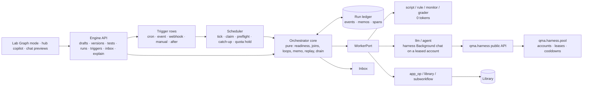
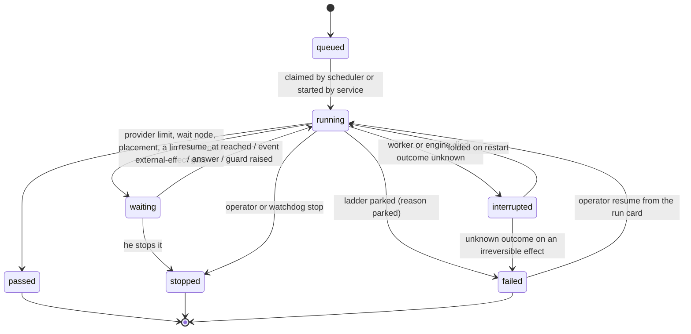
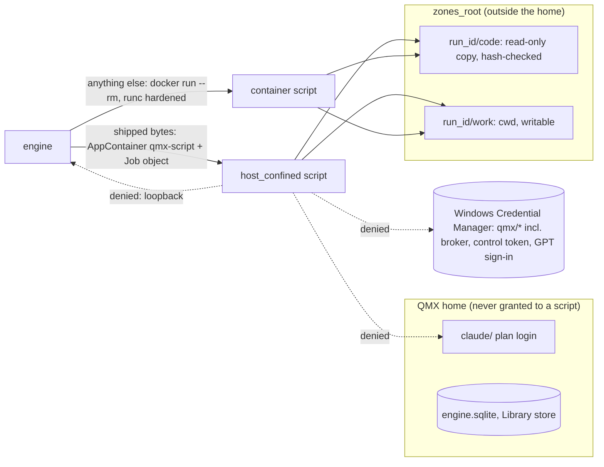
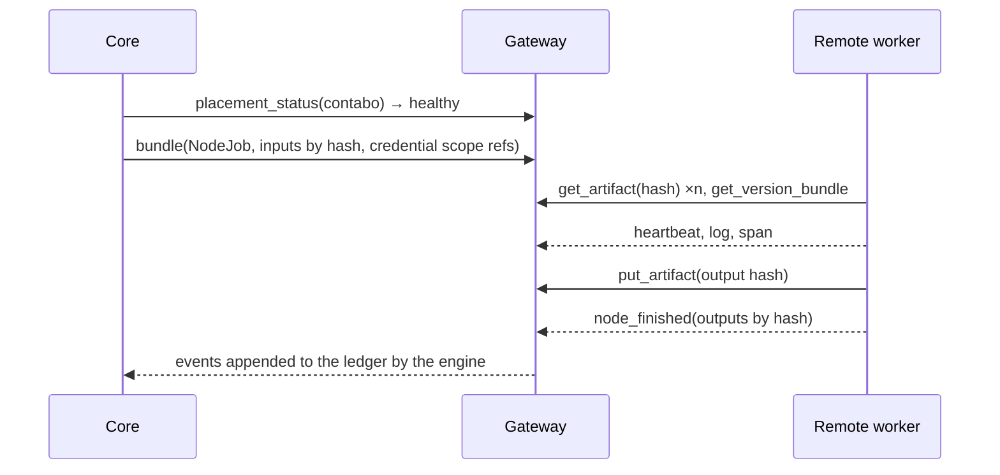
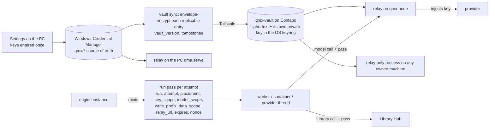
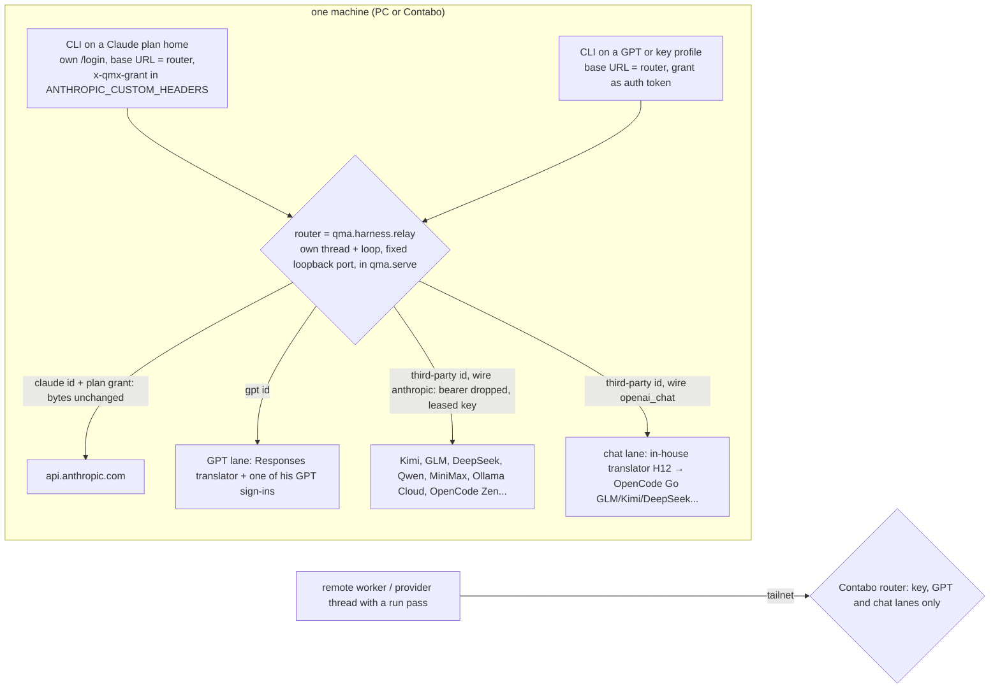
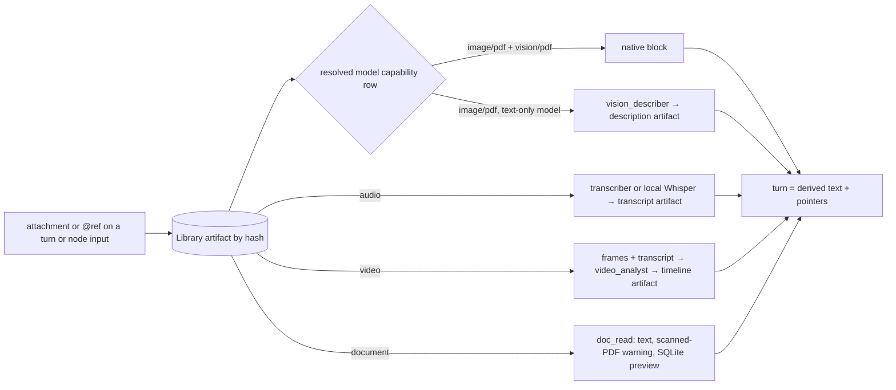
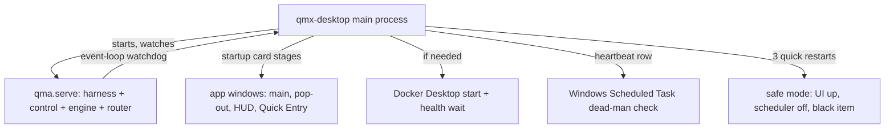

# QMX workflow engine — solution design

Projection of `ARCHITECTURE-SPINE.md` (the binding spine) into contracts, data models, sequence flows and failure modes. Written 2026-10-16, headless, from the memlog; amended 2026-10-18 after the first build run (§5.5, §25, E33-E41 and the rows marked with backlog ids; record in `methodology/35`). Amended again the same evening by the rerun pass (§26, and §7, §17, §18, §20, §24 rows: routing lanes, no usage caps, Hermes adoptions; record in `methodology/39`). Where this file and the spine disagree, the spine wins. The rulings file `methodology/26` outranks both.

Labels: **[retrieved]** read today from a cited file or branch; **[remembered]** training knowledge, not re-verified; **[inferred]** reasoned here. Numbers marked **Claude's default** are placeholders the operator changes in Settings.

---

## 1. What the engine is, in one picture



The core decides *what runs next* from the ledger alone. Executors do the work and write results back. The scheduler decides *when a run starts*. The pool decides *which account* a model-bearing node uses. The Library keeps *what was made*. The inbox tells the operator *only what needs him*.

---

## 2. Workflow definition format (`qmx.workflow/1`)

### 2.1 Shape [retrieved: n8n `IWorkflowBase` in `25` section 2.1; QMX additions inferred]

```json
{
  "schema": "qmx.workflow/1",
  "id": "paper-scout",
  "name": "Paper scout: new q-fin papers to a research note",
  "extends": null,
  "inputs":  { "type": "object", "properties": { "topics": { "type": "array", "items": { "type": "string" } } } },
  "outputs": { "type": "object", "properties": { "note": { "$ref": "#/artifact" } } },
  "settings": {
    "timezone": "Europe/London",
    "limits": {},   // optional, only values he writes (AD-40); templates ship none
    "on_error": "park",
    "error_workflow": null,
    "caller_policy": "any | workflows_only | none",
    "inline_limit_bytes": 65536,
    "memory": { "scopes": ["run", "workflow"] },
    "claude_workflow_enabled": false
  },
  "nodes": [
    { "id": "n1", "name": "Every 6 hours", "type": "trigger", "typeVersion": 1, "position": [0, 0],
      "parameters": { "kinds": ["cron", "manual"] } },
    { "id": "n2", "name": "New paper ids?", "type": "monitor", "typeVersion": 1, "position": [220, 0],
      "parameters": { "source": "scripts/feed_ids.py", "wake_when": "changed" }, "effect": "none", "role": null },
    { "id": "n3", "name": "Triage titles", "type": "llm", "typeVersion": 1, "position": [440, 0],
      "role": "triage", "effect": "irreversible",
      "parameters": { "prompt_ref": "prompts/triage.md", "schema_ref": "schemas/triage.json", "max_items": 8 },
      "retry": { "max_tries": 3, "backoff_seconds": [30, 120, 600], "retry_on": ["transient", "schema"] },
      "timeout": { "idle_seconds": 120 } },
    { "id": "n4", "name": "Read each paper", "type": "agent", "typeVersion": 1, "position": [660, 0],
      "role": "reader", "effect": "irreversible",
      "parameters": { "skills": ["paper-question-battery"], "tools": ["Read", "WebFetch"],
                      "output_schema_ref": "schemas/paper_card.json", "browser_level": "none" },
      "runs_on": "pc" },
    { "id": "n5", "name": "Citations check", "type": "grader", "typeVersion": 1, "position": [880, 0],
      "parameters": { "mode": "deterministic", "script": "scripts/citation_check.py" }, "effect": "none" },
    { "id": "n6", "name": "Testable enough?", "type": "rule", "typeVersion": 1, "position": [1100, 0],
      "parameters": { "expr": "items.score >= 0.7" }, "effect": "none" },
    { "id": "n7", "name": "Save note", "type": "library", "typeVersion": 1, "position": [1320, 0],
      "parameters": { "op": "write", "kind": "artifact", "artifact_type": "research_note" }, "effect": "compensable" }
  ],
  "connections": {
    "Every 6 hours":     { "main": [[ { "node": "New paper ids?", "port": "in", "map": "one" } ]] },
    "New paper ids?":    { "changed": [[ { "node": "Triage titles", "port": "in", "map": "one" } ]] },
    "Triage titles":     { "main": [[ { "node": "Read each paper", "port": "in", "map": "chunk", "chunk": { "by": "tokens", "fill": 0.3 } } ]] },
    "Read each paper":   { "main": [[ { "node": "Citations check", "port": "in", "map": "keyed-join", "key": "paper_id" } ]] },
    "Citations check":   { "pass": [[ { "node": "Testable enough?", "port": "in", "map": "one" } ]],
                           "fail": [[ { "node": "Save note", "port": "in", "map": "one" } ]] },
    "Testable enough?":  { "true": [[ { "node": "Save note", "port": "in", "map": "one" } ]] }
  },
  "pinData": { "New paper ids?": { "changed": [ { "ids": ["2610.01234", "2610.01999"] } ] } },
  "meta": { "created_by": "copilot", "created_in_session": "…" }
}
```

### 2.2 Field rules

| Field | Rule |
| --- | --- |
| `id` | stable, operator-readable; a variant has its own `id` and `extends` |
| `version` / `content_hash` | neither is stored in the document. `version` (semver) is a Library annotation set at publish (Library AD-3), so setting it mints no new object; lifecycle is a ref fact (`refs/drafts/*` vs `main`), never a field. `content_hash` is computed, never stored: it covers `nodes`, `connections`, `settings`, `inputs`, `outputs` and the bytes of every `*_ref` file, never `position` or `meta`. "Tested" keys on this hash (spine AD-11) |
| `extends` | `{ "workflow_item", "object_id", "patches": [...] }` (RFC 6902 operations over the parent snapshot); publish resolves it to a full snapshot and records `variant-of` |
| `nodes[].type` / `typeVersion` | from the AD-5 registry; an unknown type or version fails validation; old versions keep working after a kind changes |
| `nodes[].role` | required on `llm`, `agent` and LLM-mode `grader`; forbidden elsewhere; must exist in Settings `[roles]` |
| `nodes[].effect` | required; the registry supplies a default per kind that validation accepts |
| `nodes[].credentials` | `qmx/*` refs only, and only refs a Settings `[credentials.tools]` row declares; broker, venue, provider-key, control-token, GPT sign-in, pairing and backup refs are refused whatever the kind (AD-36); a literal matching a token shape fails validation |
| `nodes[].runs_on` | a placement name from the registry (`pc` default, `contabo`, `qmb`, or an added provider row) or an ordered list of them; the first healthy one with free capacity takes the node (AD-30) |
| `connections` | source node **name** → output port name → list of target lists; each target names `node`, `port`, `map`, optional `required: true` (the target is skipped when this edge carried no output, AD-5) and for `keyed-join` the `key`; `cartesian` needs `"explicit": true`; a list into an `llm` or `agent` node must use `"map": "chunk"` with `chunk: {by: items | tokens, size?, fill?}` (AD-34) |
| `pinData` | per node, per output port, the items a test run returns instead of executing; ignored in live mode; part of the content hash, so a pin change drops `tested` (AD-11); a node is pinned on every output port or on none |
| `nodes[].parameters.network` | `true` lets a script reach the network (AppContainer `internetClient` or the container's declared egress hosts, AD-24); default off |
| `nodes[].parameters.artifacts` | files or folders (ending `/`) the script leaves in `work/`; each entry may be `{path, type}` with a Library artifact type (`card`, `source`, `report`, `proposal`, `dataset`); `run-file` when untyped (AD-14) |
| `settings.caller_policy` | who may invoke this workflow as a `subworkflow` |
| `settings.error_workflow` | optional workflow id that receives `run.failed` events for this workflow |
| `settings.limits` | optional limits he writes himself (`tokens`, `turns`, `tool_calls`, `wall_seconds`), honoured as a pause (AD-16); absent by default and in every template; no USD field exists (AD-40). The old `settings.runaway` key folds to nothing with one `info` line (never to `limits`, which only he writes), and the lint refuses it in new documents; shipped templates carry no `runaway`, node `timeout.run_seconds`, `max_turns` or `max_tool_calls` (41 H4) |

### 2.3 Node kinds [spine AD-5]

| Kind | Executor does | Tokens | Default effect | DEC-0312 / DEC-0418 name it ratifies |
| --- | --- | --- | --- | --- |
| `trigger` | marks the entry; parameters say which trigger kinds may bind | 0 | none | (Routine, DEC-0328, stays outside the definition) |
| `script` | runs a declared script in its AD-24 tier (`host_confined` on the PC when byte-identical to the shipped manifest, the hardened container otherwise); inputs on stdin, stdout JSON or listed files become outputs | 0 | reversible | `deterministic_script` |
| `rule` | evaluates one safe predicate over inputs; outputs `true` and `false` (a many-way branch is a chain of rules) | 0 | none | `conditional` |
| `loop` | repeats a body subgraph; stop = typed condition (max iterations, predicate, no-progress rounds, or a token `budget` only when he wrote one, AD-40) | 0 | none | `loop` with iteration law |
| `join` | waits for `all`, `any` or `quorum(n)` inbound partitions; late arrivals after watermark are late, not merged | 0 | none | `join`, DEC-0439 algebra |
| `wait` | parks until a time, an engine event or a webhook; no compute while parked; a time hold writes a wake row the ticker honours (AD-10) | 0 | none | (n8n Wait) |
| `human_gate` | parks with an ask in the inbox; `timeout` makes it an approval gate that resolves on timeout with `on_timeout` | 0 | none | `human_gate`, `approval_gate` |
| `llm` | one model call with a JSON schema, through a one-turn tool-less harness Background chat on the leased account | low | irreversible | `task` |
| `agent` | a harness Background chat with skills, tool allow-list, structured output, no default turn or tool-call ceiling (AD-40); session id saved for resume; in `runner_outside` mode (default) its code-running tools are sandbox MCP tools and the built-in Bash/Write/Edit are off; optional sub-agents per role, each may resolve to another provider through the router (`via: native`, same chat tree and sandbox) or run as `delegate` v2 helpers (`via: delegate`); depth 1 by default; may write its own tools (`agent-tool`, `unreviewed`, no order verb) | high | irreversible | `agent` |
| `rlm` | a prime-agent-style Python kernel (`execute / interrupt / snapshot / restore` over newline JSON) inside the node's sandbox, driven by the runner as the `sandbox_python` tool, with data fetched by hash into `/work/in`; `spawn`/`collect` sub-model calls are routed back to the runner's provider layer and land as spans; a `dill` snapshot after each cell is shipped by the sidecar as a `checkpoint` blob and restored on retry; cached sub-call results are never repaid; `resources.memory_mb` 4-8 GiB; `runsc` by default, `runc` when file I/O suffers | high | irreversible | — (ruling 52) |
| `subworkflow` | invokes a child named as a block folder `blocks/<name>/` inside the parent or as a pinned published object, with typed inputs; own ledger namespace; `await` (a waiting child makes the node `waiting(child)`) or fire-and-forget; cancel cascades | varies | per callee | DEC-0455 nested invoke |
| `grader` | `mode: deterministic` (a script check) or `mode: llm` (a judge on the `judge` role, refused at validation until the grader-llm packet, §25); outputs `verdict` + `feedback` on `pass`/`fail` ports | 0 or low | none | (Deep Agents rubric, `03`) |
| `monitor` | runs a cheap source (script or URL), hashes it, fires `changed` with the diff or ends `silent` | 0 | none | (Hermes monitor, `25` section 1.4) |
| `app_op` | invokes a mini app's exported operation through `ControlService.apps_call` with a `caller_kind: workflow` envelope | varies | declared by the op | DEC-0452/0455 invoke |
| `library` | reads a kind by id/hash or writes an artifact, edge or run summary through `LibraryPort` | 0 | compensable (write) | `artifact_dependency` (read) |
| `claude_workflow` | launches the Claude Code Workflow tool inside one plan chat for a Claude-only fan-out; stores `runId`; off unless `settings.claude_workflow_enabled` and HARNESS-REQUESTS H4 is granted | high | irreversible | — |

`parallel_branch` of DEC-0312 is not a node: fan-out is a `broadcast` edge (or a `chunk` edge into a model-bearing node, AD-34) plus a `join`.

**Pack types** (spine AD-5). A capability pack registers node types `<pack>.<name>` (for example `qmb.run`, `pod.sim`, `lab.cell`), each with a `base_kind` from the table above. In the JSON the node's `type` is the pack type; the validator looks up its `base_kind` and checks ports, effect default and role rules against that kind's contract; an unregistered pack type fails validation like an unknown kind. `note` is the one draft-only type: it has no base kind and is refused at publish unless `disabled: true`.

### 2.4 Validation (the `validated` state)

1. Schema: the document parses against `qmx.workflow/1`; every `*_ref` resolves inside the workflow folder.
2. Graph: exactly one `trigger`; every edge joins declared port names (every v1 port carries data, AD-4); fan-out nests one level only (`nesting_unsupported` otherwise, AD-5); `rule` and `loop` predicates pass `expr.check` with the names the definition may use (B-90); no cycles except through `loop` bodies; every node reachable; `cartesian` explicit; a `keyed-join` names a key.
3. Roles, effects, placements and credentials resolve against Settings, the registry, the gateway and the keyring **by name** (preflight checks reachability later).
4. Lint: no node calls `settings.write`; the one text-surface scan of AD-36 finds no money act in any name, note, parameter, setting, `meta`, port name, `pinData` key, script, prompt or other folder file (the harness gate's matcher, call-shaped), no forbidden import and no credential ref outside the allow-list; no node creates triggers; secrets by ref; no field may name a USD cap, and a `limits` block is accepted only as values he wrote (AD-40); `agent` nodes have no `max_turns` or `max_tool_calls` and no run timeout (AD-40); a `limits` value he wrote below 1 is refused; a list edge into an `llm`/`agent` node is `chunk`, never `broadcast`; a `human_gate` sits only in front of an `irreversible_external` effect.
5. Note nodes (`type: note`) and unconnected nodes are allowed in a draft and refused at publish unless `disabled: true`.

---

## 3. Execution model

### 3.1 States: run mode and the one shared run status table

Every run has two separate fields. **`mode: live | test`** is fixed at `run_created` and never changes (a test run is a real run on real models, ruling 51; spine AD-11). **`status`** comes from the table below, which is the one status vocabulary for runs in QMX: the engine ledger, the engine API, the Library's `workflow-run` objects (Library AD-15) and the UI all use these exact words, and no other run status word exists.

| Status | Meaning | Terminal? | Engine derives it from | Library fast-forward into `main` (AD-18) |
| --- | --- | --- | --- | --- |
| `queued` | created, no node started yet | no | `run_created` with no `node_started` | no |
| `running` | at least one node started and the run is not waiting or ended | no | node events | no |
| `waiting` | only waiting nodes remain: usage limit, `wait` node, retry backoff, placement full or unhealthy, a pause at a limit he wrote, a join timeout, a waiting child run, an irreversible external step waiting for the inbox; resumes on its own (a wake row, AD-10) or on the answer (a `reason` field says which) | no | `node_waiting` / `run_paused` | no |
| `passed` | every node ended ok or skipped and `run_finished` was written | yes | `run_finished` | yes, when `mode: live` and the workflow's `publish` rule is `auto`; never when `mode: test` |
| `failed` | the ladder parked the run (`reason: parked`), or a grader failure ended it; he may resume it from the run card, which appends a new `running` status | yes, unless he resumes it | ladder step `park` | no |
| `stopped` | ended by him or by the stuck detector (`reason: operator | watchdog | stalled | loop`) | yes | `run_cancelled` | no |
| `interrupted` | the engine or a worker died with an attempt of unknown outcome; folded on restart and either resumed (`running`) or ended `failed` | until folded | an attempt with no terminal event and a dead worker | no |

A workflow version is **tested** when a `tested-by` edge links it to a `workflow-run` whose status is `passed`, in either mode. Only `mode: test` excludes a passed run from the fast-forward.



Node attempt states: `scheduled → started → (ok | failed | waiting | gate) `; a `failed` attempt may be followed by a new attempt under the ladder. Run status is derived from node states and the run events and is never stored separately in the ledger; the Library receives it as a new `workflow-run` object per change. The JobHandle vocabulary of DEC-0439 maps as `queued | running | done=passed | failed=failed | cancelled=stopped | aborted=stopped(reason watchdog) | unknown=interrupted`.

### 3.2 Ledger events (append-only, one writer)

| Event | Data | Written by |
| --- | --- | --- |
| `run_created` | workflow item, pinned object id, content hash, inputs hash, trigger id or caller, mode `live | test` (fixed for the run), any `limits` he wrote | service or scheduler |
| `run_input` | the inputs document (or artifact ref) | same |
| `clock_tick` | `now` supplied at start and at every resume | scheduler |
| `node_scheduled` | node id, iteration, partition (a chunk index on a `chunk` edge, with the chunk plan: item ranges, token estimate, resolved window), input hash, memo key | core |
| `node_started` | attempt, worker, placement, lease (account), resolved `(profile, model, effort)` | worker |
| `heartbeat` | attempt, progress note | worker |
| `log` | attempt, level, redacted line | worker |
| `node_finished` | attempt, outputs by port (inline or artifact refs), output hash, span | worker |
| `node_failed` | attempt, error code, signature, retryable, effect state `before | after | unknown` | worker |
| `node_waiting` | attempt, reason `limit | wait | backoff | gate | placement | own_limit | join | child`, `resume_at` (RFC 3339 UTC), event name; a `resume_at` writes one wake row | core |
| `gate_opened` / `gate_resolved` | ask text, options, inbox item id; answer, principal, at | core / service |
| `event_received` | engine-bus event name and payload hash | scheduler |
| `ladder_step` | attempt, step `retry | account | model | doctor | park`, reason | core |
| `doctor_verdict` | classification, proposal ref | nodes.llm (doctor role) |
| `run_paused` / `run_resumed` | reason, earliest `resume_at` | core |
| `run_finished` / `run_cancelled` | outputs hash, totals (tokens, cost estimate, duration, agents, tool calls), final status and reason | core |
| `compacted` | attempt, trigger `threshold | auto | restart`, context fraction at compaction (AD-34) | worker |
| `memory_written` | scope, rows added, size after | nodes.library |

Every event carries `seq` (monotonic per run), `run_id`, `at` (from the recorded clock), `kind`, `data`. Every node event above (from `node_scheduled` to `doctor_verdict`, plus `tool_called`) carries the attempt key `node_id, iteration, partition, attempt` in `data` (one spelling, `partition`; AD-15). Span status `gate` derives from `gate_opened` until `gate_resolved`; `cancelled` from `node_failed{code: cancelled}` or from `run_cancelled`, which closes every open span. Every string in `data` passes AD-37's redaction in the writer before commit. A `span` is derived from `node_started`/`node_finished|failed|waiting` pairs and stored as its own row for fast timelines.

Why SQLite and not the existing `qmx_ledger.RunJournal` (per-run fingerprint-chained JSONL) [retrieved hp17]: fire claims, leases and memo lookups need transactions and indexes across runs. The two meet at run end: the trace export is written through `RunJournal`, so the Library artifact carries the fingerprint chain, and the harness's per-chat `model_call` rows are joined by the chat id a span records. All JSON hashing uses `qmx_ledger.journal.fingerprint`; error signatures come from `ledger.signature`.

### 3.3 Replay algorithm [spine AD-7]

```text
resume(run):
  events = ledger.read(run_id)
  state  = core.fold(definition, events)          # pure
  for node in core.ready(state):                   # all inbound partitions satisfied per join rule
     key = memo_key(run, node, iteration, partition, hash(inputs), hash(node_def))
     if memo.has(key) and memo.valid(key):         # valid = not invalidated by an edited node def
         core.apply(node_finished from memo)       # no executor call, no spend
     else:
         admission = pool.lease(node.role) if node.model_bearing else Ok
         if admission is Closed: emit node_waiting(limit, resume_at); continue
         emit node_scheduled; worker.run(NodeJob(...))
```

Only nodes whose memo is missing or invalid run. A `broadcast` or `chunk` fan-out produces one memo per partition (one per chunk on a `chunk` edge; the chunk plan is recorded on `node_scheduled` and reused on replay, so a resume never re-chunks); the `join` reads partition memos, so a retry of one failed partition never touches the others.

### 3.4 Effects, idempotency and workspace snapshots [spine AD-8]

- A `reversible` attempt writes only into its own overlay `<zones_root>/<run_id>/attempts/<node>.<iteration>.<partition>.<attempt>/`; `work/` is read-only to it; on `ok` only the node's declared output paths are committed into `work/` (staged, then renamed under the ledger writer; undeclared files die with the overlay; validation refuses two possibly-concurrent writers of one declared path unless it is partition-templated or a merge, so a `zone_conflict` at commit is a definition bug, non-retryable; 42 N6), on failure the overlay is deleted, which is the undo; a junction or symlink in an overlay fails the attempt `zone_link` (AD-24, AD-51; replaces the `.snap` snapshot after 40 §5 item 2, B-29).
- A `compensable` node's write produces a new Library version or edge; compensation is `replaces` or `archived-as`, never delete.
- An `irreversible` node receives `idempotency_key = run:node:iteration:attempt` and must pass it to the external side (the harness chat title carries it; an app op receives it in the envelope). After a failure with `effect_state: unknown` (worker died mid-call) an `irreversible_external` effect is **not** retried; the run parks with an `urgent` item that offers "retry (may duplicate)" with the key shown.
- A model call is spend and therefore irreversible, but its *result* is memoised, so a rerun of a later node never repays it. After an `unknown` outcome a model call **is** retried once under the ladder (duplicate spend is accepted, ruling 27) and writes an `info` line; it never pages him (ruling 77). This holds only for a model-bearing node whose declared effect is `none`, `reversible` or `compensable`; one that declares `irreversible` or `irreversible_external` follows that class unless it declares `idempotent: true` (AD-8, B-57).

### 3.5 Loops, joins, subworkflows

- `loop`: ports `in` (the first value) and `next` (each later value, handed back by the body; an edge into `next` is the one cycle a definition may hold), and `body` (the value while iterating) and `done` (the value once a stop fires) (settled in EP6). The body is the induced subgraph its `body` port reaches; each iteration mints node attempts with `iteration = k`; the stop condition is typed (`max_iterations`, `budget` (tokens the body's attempts reported, only when he wrote one), `predicate` over the last value handed back, `no_progress_rounds` over a named metric); iteration state lives in the ledger, never in a node result (DEC-0312 iteration law ratified).
- `join`: expected cardinality comes from the fan-out partition count; `all` waits for every partition, `any` fires on the first and marks the rest `late`, `quorum(n)` fires at n; watermark `all-expected | timeout | failed-aggregation`; late arrivals are recorded, not merged.
- `subworkflow`: one nested run with its own `run_id`, `parent_run_id`, `call_depth` (ceiling in Settings); the child is a block folder `blocks/<name>/` inside the parent (carried in its bundle and content hash) or a pinned published object `(workflow_item, object_id)`; the parent node waits (`waiting(child)` while the child waits) or continues; cancelling the parent cancels its children; the callee's `caller_policy` is checked at validation whenever the child resolves and at dispatch; merging two live runs is refused (DEC-0455 ratified).
- Readiness of a node with several inputs (AD-5): it runs when every source slot has settled, every `required: true` edge carried output, and at least one edge carried output; else it is skipped. An edge from outside a loop body into the body is context only.
- `join` words: a timeout waits with reason `join`; `no_progress_rounds` takes `direction: up | down`; a partition failing after its join fired writes one `info` line.

### 3.6 Drain and pause [spine AD-9]

```text
on Closed admission for node N:
   emit node_waiting(N, limit, resume_at = earliest reset among allowed accounts)
   run.drain = True             # no new model-bearing node starts; scripts/rules/monitors continue
   when no node is running: emit run_paused(reason=limit, resume_at)
scheduler: at resume_at + slack: emit clock_tick, run_resumed; core.resume(run)
```

An inbox item is raised only if `now - first_waiting_at > settings.limits.alert_after`.

---

## 4. Triggers and the scheduler [spine AD-10]

### 4.1 Trigger row

```text
trigger: id, workflow_item, pinned_object, follow_champion, home_engine pc|contabo, kind cron|interval|event|webhook|manual|after,
         spec (cron expr + IANA zone | seconds | event name + filter | webhook route id | workflow id),
         enabled, precheck_ref, role_pins {role: (profile, model, effort)}, effort_pin,
         delivery {inbox|digest|silent}, continuity (inject own last successful outputs),
         catch_up merged|record_only, max_concurrent (default 1 when agent nodes exist),
         source ticker|<provider> (pluggable; controls claiming only), created_by principal (never a run),
         next_fire_at, last_status ok|silent|blocked_config|failed|delivery_failed|unknown,
         failure_streak, quota_hold_until, incident_id
fire:    id, trigger_id, occurrence_at, claimed_by, claimed_at, lease_until, status
```

### 4.2 Tick algorithm (every `settings.scheduler.tick` seconds, Claude's default 60)

1. Load due triggers (`next_fire_at <= now`, enabled, version enabled, not on hold).
2. For each, claim the occurrence: insert `fire` with a lease (`settings.scheduler.lease_seconds`, Claude's default 300) and heartbeat (60 s); a second process finds the row and skips. At most one fire per occurrence.
3. If `now - occurrence_at > grace` (Claude's default 15 min), collapse: one fire with `occurrence_at = the latest missed`, the others recorded `skipped: downtime`. **One catch-up run per trigger after downtime.**
4. Preflight: roles resolve, credentials resolve, placement healthy, skills and apps present, delivery target exists. Any failure → `blocked_config`, one item keyed by trigger + signature whose severity follows §10.4 (`info` when the workflow's own configuration is at fault, `normal` for a provider failure), no run.
5. Admission: if every allowed account for the trigger's roles is closed, set `quota_hold_until = reset + slack` and merge later fires into this one (Hermes `quota_hold`, `25` section 1.4 [retrieved]).
6. Start the run with `clock_tick(now)`, `run_input` from the trigger and the precheck's context.
7. A run cannot create, edit or enable triggers: `service.triggers.*` refuses `caller_kind: workflow`.

`event` triggers subscribe to the engine bus (`library.*`, `run.*`, `app.*` events); `webhook` triggers are routes the gateway exposes and signs; `after` triggers fire on `run.finished` of another workflow and receive its outputs.

---

## 5. Workers [spine AD-20]

### 5.1 NodeJob and NodeResult

```text
NodeJob:   run_id, node_id, iteration, partition, attempt, memo_key, idempotency_key,
           node_definition (slice), inputs (inline or artifact refs), now,
           resolved_model (profile, model, effort, account lease) | null,
           credentials (refs the node declared), workspace (path or remote mount id),
           placement, timeouts, mode live|test, pinned outputs (test mode)
NodeResult: ok(outputs by port, output_hash, artifacts[], span)
          | failed(code, message, signature, retryable, effect_state before|after|unknown, span)
          | waiting(reason, resume_at | event, span)
          | gate(ask, options, span)
```

### 5.2 Local worker (the PC)

A `ComputeProvider` adapter over Docker Desktop on WSL2 (installed on this PC, study 29 [retrieved]) that boots the same `qmx-worker` image per node attempt, concurrency 3 (Claude's default). Script-family nodes run in their AD-24 tier: `host_confined` (an AppContainer process in a Job object) for shipped scripts, this container for every other one. Model-family nodes run as harness Background chats in the local runner (this process): they first take a chat slot from `max_live_chats − interactive_reserve` (the engine's own count, so `ChatTableFull` never fires), then call `HarnessPort` (section 8.4) on the engine's event loop; their code-running tools are served by the runner-side sandbox tool server and executed in the container over the sidecar's remote call (section 5.4). `app_op` calls `ControlService.apps_call`; `library` calls `LibraryPort`. Heartbeats every 10 s from the sidecar while an attempt runs; cancel kills the container or the process tree, or calls `Harness.interrupt`. When Docker Desktop is off: shipped scripts still run `host_confined` (§5.5); every other script and every model-written-code tool call waits with `waiting(placement)` and a "Docker is off" doctor line; nothing falls back to a bare host process (AD-24).

### 5.3 Remote worker (engine side of the gateway)

The remote worker is the same `qmx_engine.nodes` code running on another machine with its own `qma.serve`, so model-bearing nodes use *that* machine's accounts and plan tokens never travel. The engine ships a **bundle** per node attempt and expects results back through `GatewayPort`:

| Direction | What | Form |
| --- | --- | --- |
| out | `NodeJob` minus local paths | JSON; inputs as artifact hashes; credential **scope refs** only (the worker resolves them from its own keyring) |
| out | artifacts the inputs reference | fetched by the worker from the gateway by hash |
| out | the node's `*_ref` files | by the version's content hash (the worker fetches the version bundle once) |
| in | outputs | artifacts by hash, pushed to the gateway, plus the inline `NodeResult` |
| in | events | `heartbeat`, `log`, `span`, `node_finished | failed | waiting`, appended to the ledger by the engine, not by the worker |
| in | traces | the attempt's span tree |
| control | cancel, lease renewal, placement health | gateway calls |

This matches the existing `qmx_remote.RunBundle` shape (`kind`, `definition_hash`, `inputs`, `credentials_scope`, `resources`, `files` by digest) [retrieved hp17], so the gateway designer can extend it rather than invent a new one. What the gateway must provide to the engine: `put_artifact(hash, bytes)`, `get_artifact(hash)`, `get_version_bundle(workflow_item, object_id)`, `events(run_id)` stream, `cancel(attempt)`, `placement_status(name) -> available|configured|authorized|reachable|healthy`, and Library read/write proxies with the same `LibraryPort` signatures. `GatewayPort` fronts **two** services on Contabo (Library AD-11): the Library Hub (`get_version_bundle`, artifacts by hash, `events(run_id)`, the Library proxies, and the run sidecar that heartbeats, streams logs and traces, puts artifacts by hash and mirrors SDK transcripts through a `SessionStore` adapter) and `qmx-node` (`placement_status`, `cancel(attempt)`, lease renewal), which is colocated with the Hub but is not the Library. Both accept the run pass of AD-28 (`write_prefix: refs/runs/<run_id>`, `key_scope`, `model_scope`); no key travels in a bundle.

### 5.4 Execution environments: the harness outside, the sandbox executes tool calls [spine AD-25; study 29; Rivet principle]

```mermaid
flowchart LR
  subgraph OUT["outside every sandbox (runner host: the PC or qmx-node)"]
    E[Engine core · ledger · scheduler · inbox · traces]
    R[Runner: harness Background chat<br/>account lease · permissions · transcript]
    T[Sandbox tool server (MCP)<br/>sandbox_bash · sandbox_write · sandbox_python · sandbox_tool_*]
    P[Pool + relay: keys never leave here]
    E --> R
    R --> T
    R --> P
  end
  T -- remote call over the sidecar --> K[qmx-worker container<br/>tool executor · RLM kernel · /work]
  K --> SC[sidecar: heartbeat 10 s, logs, traces, artifacts by hash, refs/runs/<id> only]
  K -.-> X[qmx-egress: fallback cli_inside only]
```

| Concern | Rule |
| --- | --- |
| What never enters a sandbox | the engine core, ledger, scheduler, pool, credentials, permissions, session history, audit and traces, the inbox, agent-to-agent routing. A sandbox executes only tool calls that arrive over a remote call (Rivet; the lead adopted it, revising study 29's "the whole worker goes inside the box") |
| Image | one OCI image `qmx-worker`: the sandbox tool executor, the RLM kernel, the sidecar, Python data libraries; built once, tagged by the engine version, the same digest on the PC, the server and the burst providers. In `cli_inside` mode the image also carries the Agent SDK with its bundled CLI |
| Lifetime | fresh container per node attempt (matches AD-7 memo and retry rules); `warm: true` per agent keeps one container across its steps as an optimisation only, state in the Hub `SessionStore` |
| Isolation tier (node attribute beside `placement`) | `host_confined` (PC only, scripts byte-identical to the shipped template manifest, AppContainer + Job object, AD-24, §5.5) · `runc` hardened for every other script and GPU jobs · `runsc` (gVisor) for anything a model wrote; on the PC, model-written code runs in hardened `runc` with no network |
| Hardened `runc` flags | `--read-only`, `--tmpfs /tmp`, `--cap-drop ALL`, `--security-opt no-new-privileges`, seccomp, `--pids-limit 256`, `--memory`, `--cpus`, non-root user, `/work` bind only (the existing `SSHProvider` recipe [retrieved hp17 `qmx_remote/providers.py`]) |
| Mounts never made | the Docker socket, the host home, `~/.ssh`, any `.git` read-write (Sandcastle issue #1010 lesson), the plan home, the QMX home; a script container mounts only `<zones_root>/<run_id>/code` (read-only) and `work/` |
| **Agent mode `runner_outside` (default for model-written code)** | the agent loop is a harness Background chat in the runner on that placement's host, holding its account lease through the harness as today (plan on the PC, keys on the server); the chat's built-in `Bash`, `Write`, `Edit`, `NotebookEdit` are disabled (HARNESS-REQUESTS H2/H8); the runner serves an MCP tool server `sandbox_bash`, `sandbox_write`, `sandbox_python` (the RLM kernel), `sandbox_tool_<name>` (agent-made tools) whose calls execute inside the container over the sidecar's remote call; `Read` may stay pointed at a synced read-only copy of `/work`; sub-agents are SDK sub-agents in the same chat tree, their tool calls reach the same container. Rivet notes Claude Code and Codex do not support this natively; agentOS adds it through sandbox mounting (probe E23 compares the two routes) |
| **Agent mode `cli_inside` (fallback, per node)** | the Agent SDK and CLI run inside the container; model traffic carries the run pass to the nearest relay (AD-28, H11), which injects the key; `qmx-egress` holds only the domain allow-list; key accounts only, never a plan account; the transcript lives inside the box and is mirrored out by the sidecar |
| Trade-offs between the modes | `runner_outside`: every credential, permission decision and transcript stays outside; one audit path; the blast radius is the container's `/work`; cost: the sandbox tools must match the built-in tools' quality and latency (probe E23). `cli_inside`: Claude Code's native tools and their polish; cost: the whole CLI is inside the blast radius, the transcript sits in the box, and plan accounts are excluded |
| Keys | in `runner_outside` they never leave the harness relay on the runner host; in `cli_inside` the relay named by the pass injects the key; in neither mode does a key enter the container's environment or files |
| Network | containers on an internal network: in `runner_outside` their only peer is the sidecar's remote-call endpoint (plus declared data hosts); in `cli_inside` their only exit is `qmx-egress` |
| RLM kernel | a process in the container started by the first `sandbox_python` call; its sub-model calls (`spawn`/`collect`) go back to the runner, never to a key from inside |
| Agent-made tools | the agent writes `tools/<name>.py` with a declared schema through `sandbox_write`; the runner registers it as `sandbox_tool_<name>` on the next turn; it executes only inside `runsc`; saved to the Library as `agent-tool`, state `unreviewed`; the money deny-list applies; no order verb exists off the PC harness |
| Agent folder | fetched by hash into `/work/agent`, writable inside the container only; changes (new tools, memory, skills) return as new objects on `refs/runs/<id>` and the Library versions them (ruling 57) |
| PC placement | Docker Desktop (WSL2 backend, Linux containers), same image, hardened `runc` (gVisor is not a supported setup there), concurrency 3; the UI shows "Docker is off" when it is |
| Server placement (`contabo`) | Ubuntu LTS, Docker Engine, gVisor as runtime `runsc`, Tailscale to the PC; systemd units `qmx-hub` (Library Hub), `qmx-vault`, `qmx-node` (this engine's runner and worker with its own `qma.serve`, key-provider pool and the central relay), `qmx-egress` (fallback mode), plus market data and monitoring; **never the trading node, holds no broker credential**; today 6 cores, 12 GB RAM, 200 GB SSD (ruling 76); concurrent agent sessions are derived from RAM after those services take their share (AD-30, §21): about 4 today; burst placements absorb the overflow |
| Burst placement | `E2BProvider` and `ModalProvider` (exist on hp17) boot the same image with the same sidecar and run token; the runner stays on `qmx-node` and reaches the burst container over the same remote call; GPU to Modal or to the server's card under `runc --gpus`; E2B Embed on the server later if `/dev/kvm` exists and pause/resume/fork or heavy RLM data work needs it |
| Why Rivet's objection to workflow engines does not apply | Rivet argues an endless agent loop makes a workflow engine's replay grow forever. A QMX workflow is a finite run: it starts on a trigger, walks a DAG, and ends with `run_finished`; its ledger is bounded by the definition's nodes and its loop stop conditions. A Lab paper soak is therefore a chain of daily runs, never one week-long run (Lab AD-12). The never-ending agent is the copilot session, which lives in the QMA v2 harness, not in this engine |
| Sync back | artifacts by hash, events, logs, spans, checkpoints; a sync-back size cap (Hermes `sync_back_max_bytes` idea, 2 GiB Claude's default); orphan and idle reapers on every placement |
| Blast radius | fork bomb / `rm -rf`: read-only root, `/work` only, pids and memory limits · escape: `runsc` for model tiers, no sensitive mounts · exfiltration: nothing to steal in the box in `runner_outside`; egress allow-list in `cli_inside` · loops and stalls: the stuck detector of AD-16 (no usage ceiling, AD-40) · stuck: sidecar heartbeat, watchdog, idle timeout 600 s with no progress (no run timeout exists, AD-40; 42 N1) · Library garbage: writes land only on `refs/runs/<id>` and are versioned · one bad node: the semaphore isolates it; its failure parks only its own run |

### 5.5 Script isolation on the PC: defence in depth [spine AD-24, AD-36, AD-37; amended 2026-10-18 after B-30, B-31, B-89]

The first build ran host scripts as his user with the run's zone under the QMX home, so `../../../../claude` reached the plan login and `import keyring` reached every `qmx/*` entry, broker ones included [retrieved EP7 check, TP3 check B1]. Each layer below stops a different mistake; none is trusted alone.



| Layer | What it is | What it stops | Status |
| --- | --- | --- | --- |
| 1 Zones outside the home | `<zones_root>/<run_id>/code` (read-only copy of the folder files) and `work/` (cwd); `zones_root` never the home, inside it or above it | a relative path reaching the plan login or a store | design; replaces `<home>/workspaces/wf-<id>/runs/<run_id>` [retrieved `runner.workspace`] |
| 2 Provenance picks the tier | `host_confined` only when every `.py` file in the folder is byte-identical to the shipped template manifest (sha256 per file, inside the engine package); else the hardened `runc` container | edited, imported, run-made or challenger code on the host | design |
| 3 OS boundary | `host_confined`: AppContainer profile `qmx-script` (no capabilities; `internetClient` only with `network: true`; loopback blocked), ACL grants on the script runtime, `code/` and `work/` only. Container: `--read-only`, `--cap-drop ALL`, non-root, `code/` and `work/` mounts only, internal network unless egress hosts are declared | reading files and keyring entries outside the grant, calling QMX on loopback | design; probe E33 decides AppContainer (fallback: the container tier for shipped scripts too) |
| 4 Lifetime | Job object with `KILL_ON_JOB_CLOSE`, active-process and memory limits, UI restrictions; containers `--rm --init` with `qmx.home`, `qmx.run`, `qmx.attempt` labels; start-up sweep before any resume | a script outliving the engine and racing a rerun (B-31); a fork bomb; clipboard reads | design |
| 5 Separate script runtime | its own venv with only the shipped data libraries (no `keyring`, `qmn`, `qma`, `qmx_*`, `pywin32`); a boot module installs an audit hook refusing AD-36's imports and `subprocess`, `os.system`, `ctypes` and `winreg` events | `import keyring`, `import qmn`, dynamic imports, shelling out | design; today scripts run on the engine's own interpreter [retrieved `nodes/script.py:178`] |
| 6 Text scan before run | AD-36: imports, call-shaped money verbs, credential allow-list | a money verb in code or a prompt; a broker ref; a forbidden import that would only fail at run time | design |
| 7 Redaction at the write seams | AD-37 | a secret printed to stderr or echoed by a provider reaching the ledger, inbox, Library or REST | design |
| 8 Agent chats | built-in `Bash`, `Write`, `Edit`, `NotebookEdit` removed per chat (H2); until then an ask the engine rejects, proven by E35 | an agent's own shell reaching the plan login or keyring (B-70) | H2 requested in HG3 |

Launch of one `host_confined` attempt, in order: check the scan memo for the folder hash (AD-36); copy the read files into `code/` and verify every `.py` file's hash against the shipped manifest; create the AppContainer profile once per install and grant its SID on the runtime, `code/` and `work/`; build the environment (allow-list plus run context, AD-24); `CreateProcess` suspended with the AppContainer security capabilities; assign it to the attempt's Job object nested in the engine's job; resume; stream stdout and stderr through the redactor; on cancel or timeout close the job, which kills the tree.

What stays out on purpose: a separate low-privilege Windows user (an admin step and a stored password, which is one more secret; AppContainer gives the same file and credential separation without them); Windows Sandbox (not on Windows 11 Home [retrieved session environment]); a host tier on Contabo (containers only there).

---

## 6. Creation lifecycle, the Board and the builder [spine AD-11, AD-21, AD-22]

### 6.1 State machine

```mermaid
stateDiagram-v2
  [*] --> draft: service.drafts.put (editor, copilot, template clone)
  draft --> validated: validate() ok
  validated --> draft: edit
  validated --> tested: test run passes, report bound to content hash
  tested --> draft: edit (report stale)
  tested --> published: publish() sets the semver annotation; tested-by copied when content_hash matches
  published --> enabled: trigger enabled (needs test report for this hash)
  enabled --> disabled: operator / watchdog
  disabled --> enabled
  published --> archived
  disabled --> archived
  archived --> [*]
```

### 6.2 Test mode

A test run is a run with `mode: test`: `pinData` outputs replace execution for pinned nodes; `llm`/`agent`/`rlm`/`grader(llm)` nodes use **real models** through the providers the harness already has, resolved from each role's cheap end through the plan login (`claude/haiku`; operator ruling of 2026-10-18), with OpenRouter rows admitted only in a provider-proof lane that names them (ruling 51: "we don't want to assume, we want to make sure things work"); the **fake provider** (an executor that returns the pinned output, a recorded transcript, or a schema-valid canned document) is an explicit per-run switch for a no-spend dry run; `irreversible_external` nodes (messages, posts, webhooks, app ops marked so) are stubbed and log what they would have sent, while model spend and Library writes are real; the run writes on its own branch `refs/runs/<run_id>` like any run, with `mode: test` and an ordinary status from §3.1; the Library's fast-forward excludes `mode: test` runs even when they pass (LIBRARY-REQUESTS L9), and a passed test run makes the draft **tested**. The report binds to the draft's `content_hash`; any edit that changes the hash marks it stale (the hash covers `pinData`, `meta.needs` and every folder file too, AD-11). A `fake: true` run is always `mode: test`, and the engine CLI runs folders in test mode only; a live run starts only through `service.runs.start` on a published object by a `user` principal or the scheduler.

### 6.3 The saved Board

The Board is a draft (ruling 31): note nodes, charts and runnable sections live in one document. "Run just this part" is a selected-subgraph test run on the draft. Promotion is `publish`. Nothing about layout is client-only any more (DOC-CHANGES 1).

### 6.4 The builder, from a rough description

```mermaid
sequenceDiagram
  participant O as Operator
  participant C as Hub copilot (builder skill)
  participant E as Engine API
  O->>C: "Scan new q-fin papers every 6 hours and give me a note when something is testable"
  C->>C: loop-me interview: Trigger? Checkpoints (pushed late)? Brief?
  C-->>O: 3 numbered questions, each with a recommended answer ("yes" accepts)
  O->>C: yes, yes, weekly instead of 6h
  C->>C: BMad phases: classify (routine), requirements (folder dominion, roles), draft
  C->>E: drafts.put(definition JSON)
  E-->>C: draft_id, revision, validate() findings
  C->>E: tests.run(draft_id)   # real cheap models by default (ruling 51)
  E-->>C: test-report (pass), run card
  C-->>O: draft panel in chat + run card; "Publish as v1.0.0 and enable weekly?"
  C-->>O: publish card + enable card (buttons call REST as user)
  O->>E: clicks publish → version; clicks enable → trigger enabled
  E-->>O: run card: enabled, next fire
```

The copilot never edits the ledger, never publishes or enables (those are his clicks as `user`, AD-11, AD-22), and writes only through the API, so a copilot-built workflow passes the same validation and test gate as a hand-built one.

### 6.5 Template → variant

A template is a published `workflow` version tagged `template`, shown on the Library shelf "Templates" (the Library's `template` kind is kept for non-workflow templates only, Library AD-3). "Use this template" creates a new workflow draft with `derived-from` the template. "Make a variant" creates a draft with `extends: {workflow_item, object_id, patches: []}`; the editor shows the parent greyed and the patches live; publish resolves the overlay to a full snapshot (so the variant never changes when the parent does) and writes `variant_of`. The methodology layer may add rules (tighten-only gates for agent-made variants); the engine records, it does not judge.

---

## 7. Account pool and load balancer — the harness extension [spine AD-12]

### 7.1 Data model

```text
account:  id, provider (claude|gpt|<key provider name>), label, kind plan|gpt|key,
          home (plan: <qmx_home>/claude/<id>/; key: n/a), credential_ref (key rows),
          weight, enabled, test_only, state ready|cooldown|benched|needs_login,
          cooldown_until, last_error_signature, last_reading {window, utilization, resets_at, at}
lease:    id, account_id, session_id, acquired_at, released_at, role, caller run_id|chat
          priority, background_priority normal|last, copilot_daily_driver bool,
          his overrides (all unset by default): strategy, share, ceiling, concurrency, cooldown
pool settings (per provider): strategy least_used|round_robin|fill_first|reset_window|random
          (default least_used for background work, AD-12), provider concurrency (from its tier),
          cooldown_default_seconds (1h), rebind_on quota|auth; cooldowns keyed (account, model)
```

### 7.2 Where it sits in the harness [retrieved: profiles.py, home.py, usage.py, harness.py on hp17]

| Today | Extension |
| --- | --- |
| `PLAN` is one fixed name; `ClaudePlan` has no account field | `ClaudePlan(name="claude", account=AccountId)`; profile rows may list several accounts; the pool resolves `profile → account` |
| one plan home `<qmx_home>/claude` | one plan home per plan account `<qmx_home>/claude/<account>/`, each signed in by the CLI's own `/login`; `projects/` junction per home into one shared transcript folder, as today |
| `UsageLedger` keyed by window | keyed by `(account, window)`; `PlanWatch` records the account from the chat's launch |
| `BackgroundCap.refusal(ledger)` | removed with the cap (AD-40, HARNESS-REQUESTS H28); a share applies only if he sets one on an account |
| `NewChat(profile=...)` | `NewChat(profile=..., account=None)`: `None` lets the pool pick; a set value pins (affinity) |
| `Harness.start_chat` | calls `pool.acquire(profile, role, affinity)`; a `Lease` is stored on the `ChatRecord`; `close`/reap release it |
| `relay` grants per key profile | unchanged; a key account is a `KeyProvider` row with its own `credential_ref`; the relay journal already tees usage per session, the pool sums it per account |
| `siwc` one ChatGPT account | one sign-in home per GPT account, any number (HARNESS-REQUESTS H33); refresh under a cross-process file lock |
| `quote`/`apply` for provider switch | reused for account rotation of a running chat on quota/auth error (resends uncached, warned in the span) |

### 7.3 Selection and the error ladder [retrieved: Hermes credential pools, CLIProxyAPI config, `25` sections 1.6 and 4.2]

```text
acquire(profile, role, affinity):
  candidates = accounts(provider=profile) where enabled and not test_only (unless run.mode == test)
                and state in (ready, probing) and leases(account) < provider_limit − peer_live_leases(account)
                # the peer's count from the last fact sync; peer idle or silent for one sync → the whole limit (42 N11);
                # soft_cap only if he set one
  if affinity in candidates: return lease(affinity)
  order candidates by priority, then background_priority (the copilot daily driver is `last` for background work)
  strategy (default least_used): least_used → min(last_reading.utilization) then round_robin on ties;
            round_robin → next after the last leased; reset_window → soonest upcoming reset first;
            fill_first → first by priority (only when he picks it); random
  none → Closed(resume_at = min(cooldown_until, last_reading.resets_at) over the provider)
on error from a leased chat:
  plan/usage limit reached → cooldown_until = resets_at (+60 s slack); rotate at once, no retry
  generic 429 → retry same account once, then cooldown 1 h and rotate
  402 → cooldown 1 h, rotate
  401 on a key → bench that key, one inbox item, rotate
  401 on a GPT sign-in → refresh once under the file lock; bench (needs_login) only if the refresh token is rejected
  401 on a plan account (router-seen) → nothing; bench (needs_login, "sign in again to <label>") only on the CLI's own
        needs-/login signal or 3 consecutive 401s on new requests over >= 5 min; the copilot waits, never moved (41 H2)
  provider reset_at always overrides the default cooldown; a reset_at already past → state probing (next real lease decides)
  429 on a probing request with no reset or a past reset → generic 429 (retry once, cooldown 1 h, rotate); never straight
        back to probing, so no resend loop (42 N13)
  every change → publish (account, model, state, until, reading, observed_at, live_leases) to the other owned host's pool (41 H7)
  all accounts closed → Closed → the engine parks the node as waiting (AD-9), never the chat
switch back: a chat moved off its first account checks each turn and moves back when its cooldown lifts
```

The pool never touches a request body, never moves a plan token between plan homes and never changes a user agent (the plan lane forwards the CLI's own bearer untouched, AD-38). Leases spread parallel engine nodes across accounts; sub-agents inside one CLI inherit their chat's account (the cache stays warm). For engine nodes the affinity key is `run_id:node_id`: every chunk of one node in one run asks for the same account first, so chunk 2 onward reads the prompt cache (AD-34); a different node spreads to the next account.

**Placement-aware pools (rulings 55, 39; amended after 41 H7).** Each harness instance has its own pool; a key account held on both owned hosts is coordinated by the fact exchange above and its provider concurrency is shared by live leases (each host may hold the provider's limit minus the peer's live leases, the whole limit when the peer is idle or silent; 42 N11); each GPT account has one owner machine and another owned host reaches it by forwarding the request to the owner's router with a host pass (signed with the pairing key, naming the originating host, chat and account; the owner's router accepts it only from an owned host and only for that account; 42 N11); plan logins stay on their machine: the PC's holds its plan accounts plus key rows; `qmx-node` on the server holds key rows (Kimi, GLM, Ollama Cloud, DeepSeek, MiniMax, others; OpenRouter flagged `test_only`) plus any plan home or GPT sign-in he signed in there himself (AD-28). Because the agent loop runs outside the sandbox (AD-25 `runner_outside`), a PC agent node may use a plan account: the chat is a normal harness chat on the host and only its tool calls enter the container. The server's runners (`max_sessions` derived from RAM, about 4 on today's box, AD-30) are fed by key providers by design; the role tables in Settings carry separate candidate lists per placement (`pc` and `contabo`). Only the fallback `cli_inside` mode routes model traffic through `qmx-egress`, and it is never leased a plan account.

### 7.4 Interface the engine uses

`HarnessPort.start_chat(NewChat(..., kind=Background(), account=None))` returns the session and the lease (`Background` and `Child` are imported from the public package once HARNESS-REQUESTS H0 is granted; until then only `qmx_engine.ports.harness_adapter` imports them from `qma.harness.launch` under an allow-listed lint rule); `HarnessPort.usage()` returns per-account windows; the engine reads `Closed.resume_at` from the `LaunchRefused` subclass the pool raises **before** any send, so the harness's `_needs_you` path is never hit for a cap. For a `cli_inside` node the engine mints a run pass whose `relay_url` is the nearest relay; the container's CLI uses the pass as its token and the relay as its base URL; no key enters the container or the egress proxy (the relay leases the key-provider account through the same pool). Everything else is the public API as it stands.

**The harness `[budgets]` settings and engine work** [retrieved engine/base `qma/harness/launch.py:221-261, 518-519`, `harness.py:362-385`]. Rewritten by the rerun (AD-40). `background_cap`, `max_budget_usd` and the Background/Child `max_turns` are **unset by default** and accept unset (HARNESS-REQUESTS H28; today `parse_budgets` accepts only a positive finite number and the defaults are 0.5, 5.0 and 50); with them unset the SDK gets no budget and no turn cap and the harness never writes a usage `needs_you`. `max_live_chats` is machine capacity, derived from RAM on each host (AD-30: `floor((ram_budget_mb − overhead_mb) / session_mb)`, the hand-set value may only lower it); engine width is that minus `limits.interactive_reserve` (2), and chunks past it queue or spill, never fail. If he sets any of these himself, the engine treats an `error_max_budget_usd` or a cap refusal as a pause at his limit (AD-16), never as a question.

---

## 8. Ports

### 8.1 `LibraryPort` (the contract, AD-14)

```text
get_object(object_id) -> definition bytes + files by hash              # a pinned published version (or a champion)
get_draft(item, ref) -> definition + revision                          # ref = refs/drafts/<item> or refs/agents/<sid>/<item>
put_draft(item|None, ref, definition, expected_revision) -> item, revision   # never onto main; first save omits item
publish(item, from_ref, semver) -> object_id                           # merges the draft into main, sets the semver annotation, copies tested-by when content_hash matches (MANAGE, his yes once)
land_draft(item, from_run) -> object_id                                # run-made workflow/mini-app/pod/skill/methodology -> refs/drafts/<item>
put_artifact(bytes|path, type, metadata, intent_key?) -> hash     # on the run's branch refs/runs/<run_id>
get_artifact(hash) -> bytes|path
put_run_summary(run_id, workflow_item, object_id, mode live|test, status (§3.1), totals, placement fields (L14), trace_artifact_hash) -> ok
put_test_report(draft_hash, report) -> ok
put_checkpoint(run_id, node_id, attempt, bytes) -> hash           # rlm snapshots
put_agent_tool(run_id, tool) -> object_id                          # state unreviewed
link(from_ref, edge, to_ref) -> ok                                 # edge in the closed set
find_by_intent(intent_key) -> [object_id]                          # exact, no model (AD-27)
list_runs(workflow_id, version?) -> [summary]
champion(workflow_item) -> object_id | None ; set_champion(workflow_item, object_id)   # refs/champions/*
events() -> stream of library.* events for triggers
```

Kinds and edges registered: see spine AD-14; the additions (`memory-row`, `agent-tool`, `checkpoint`, `intent_key`, `refs/champions/*`, `refs/challengers/*`, `refs/drafts/*`, the `mode` field) were granted by the Library (ENGINE-REQUESTS-ANSWERED L1-L14). Every write lands on the run's own branch with its run token (Library AD-7, AD-12); the engine never assumes the PC store answers (the Hub answers for remote runs and, later, as primary, ruling 56). The Library agent owns storage, knowledge graph, previews, concurrent-edit logic and backups (rulings 41-42); this port is what the engine will compile against.

### 8.1a `MemoryPort` (AD-18) and the provider adapter

```text
MemoryPort
  snapshot(scopes, budget_tokens)        -> Snapshot{text, version, row_ids}   # frozen at run start
  recall(query, scopes, tags?, budget)   -> [Hit{row_id, text, tag, refs, score, provenance}]
  check_built(intent_key)                -> [LibraryObjectId]                  # exact, no model
  check_dead_end(intent_key | query)     -> [Hit]                              # exact first, then recall
  note(row, scope=run)                   -> row_id                             # the only write a node or agent has
  consolidate(run_id, into_scope)        -> {added, merged, corrected, pruned} # consolidation step only
  feedback(row_ids, outcome)             -> ()                                 # engine-called at run end: f += 1, u += 1 on pass
  search_runs(query, workflow?)          -> [RunHit]                           # FTS5 over workflow-run summaries and transcripts, no model

MemoryProvider (one external beside the built-in, per scope binding)
  name, is_available()                   # no network
  open(config) / close()
  index(rows: [memory-row])              # called by the Library watcher; idempotent by object id
  forget(row_ids)                        # on archive
  recall(query, scopes, tags, budget)    # row ids + scores; text always comes from the Library
  snapshot(scopes, budget)               # optional; the built-in renders one if missing
  reflect(question, scopes)              # optional (Hindsight)
  rebuild(all_rows)                      # wipe and reindex from the Library
```

Agents see three tools from the first turn: `memory_recall`, `memory_note`, `memory_check` (built and dead-end). Everything handed to a provider passes the harness redaction first. Scopes and their one writer: `run` → `refs/runs/<run_id>` rows (the run); `workflow` → `refs/memory/wf/<workflow_item>` (the workflow's `consolidate` step at run end); `home` → `refs/memory/home/<home>` and `operator` → `refs/memory/operator` (the home's or operator's `consolidation` subworkflow). Size bounds apply to the snapshot (hot set; context hygiene, not usage); rows behind recall are unbounded but pruned by the `u/f` rule.

### 8.2 `InboxPort`

`raise(item) -> id` (upserts by `(run_id, signature)`), `resolve(id, action, principal)`, `list(open=True)`; item schema in section 10.4.

### 8.3 `SettingsPort`

Reads `[engine]`, `[roles]`, `[scheduler]`, `[limits]`, `[budgets]` through `ControlService.settings_get`; never writes.

### 8.4 `HarnessPort` (adapter over the public names only)

`start_chat(NewChat)`, `send(sid, InjectedText)`, `wait_turn(sid)` (see HARNESS-REQUESTS H1; until then: poll `GET /api/chats/{sid}` for `turn: idle` and read the last `text` block from `ControlService` sessions), `live(sid)`, `answer(ask, Reject|Answers)`, `interrupt(sid)`, `usage()`, `quote/apply`. The adapter marks every prompt `InjectedText` (verbatim, never a slash command), sets `NewChat.workspace = workspaces/wf-<id>/` and tells the agent its write zone `runs/<run_id>/`. Permission asks from an `agent` chat reach the engine as `permission` blocks; the adapter answers `Reject("unattended run")` at once for every ask except a tool the registry marks `irreversible_external`, for which it raises an inbox item and forwards the inbox's answer; if the harness's `unattended_ask_seconds` passes first the ask expires and the attempt continues without that tool (recorded on the span). Nothing else in a run ever waits for the operator (ruling 57). In `runner_outside` mode the adapter also passes the node's sandbox tool server as the chat's extra MCP server and disables `Bash`, `Write`, `Edit` and `NotebookEdit` (HARNESS-REQUESTS H2, H8). For context discipline (AD-34) it sets the per-chat compaction threshold and hooks (H15, H16) or, until they are granted, watches context from turn usage, restarts the attempt in a fresh chat at `agent.compact_at`, and reads tool calls from the session's `tool` blocks. It writes the session's home (AD-35) right after `start_chat`.

---

## 9. Model-agnosticism [spine AD-13]

| Role (Settings `[roles]`) | Default tier | Candidates (ordered, example) |
| --- | --- | --- |
| `triage`, `clarifier`, `scanner`, `doctor`, `judge` | cheap | kimi/k2.7-code → deepseek (cheap row) → minimax/MiniMax-M2.7-highspeed → qwen (cheap row) → gpt (cheap) → claude/haiku (plan) |
| `reader`, `searcher`, `writer`, `extractor` | mid | glm → qwen → deepseek → kimi → gpt → claude/sonnet |
| `planner`, `synthesiser`, `builder`, `reviewer` | strong | kimi/k3 → deepseek/deepseek-v4-pro → glm (strong row) → qwen (strong row) → gpt → claude/opus (no default list names Fable, ruling 87; he may add a row in Settings) |

The lists above are examples of the generated default with every provider configured (AD-13 after 42 N2): order `key → gpt → plan`, and the Chinese models are first-class in every tier, the strong roles included; a provider he has not configured is skipped (resolution already skips a profile the harness lacks). Code owner: the **P0 pre-land hygiene** packet (`methodology/40` §3.1 row 0: B-95, B-98) brings the built static lists in line (`QE/settings.py:20-22` `_CHEAP`, `_MID`, `_STRONG` without `claude/fable` and with Chinese rows first in every tier; `:71-72` `roles.test_order` resolving `claude/haiku` through the plan first and `roles.live_order` `key, gpt, plan`; `QE/roles.py:85-86` sorting to match), with tests that no default list names Fable, that test mode resolves `claude/haiku` first, and that a live strong role tries a Chinese key row first; the registry packet later replaces the static lists with registry-generated ones.

Resolution at dispatch: walk the candidate list for the node's placement (`pc` lists may name the PC's plan accounts; `contabo` lists may name Contabo's own plan homes and GPT sign-ins (AD-28); burst lists name key providers only; `cli_inside` nodes skip plan rows), ask the pool for a lease per candidate's profile, take the first `ready`; the chosen `(profile, model, effort, account)` is written on `node_started`. Test mode resolves each role's cheap end through the plan login (`claude/haiku`, operator ruling of 2026-10-18) and admits `test_only` rows (OpenRouter) only in a provider-proof lane that names them. Provider matrix for `agent` nodes: plan → `PlanLaunch`; Kimi, GLM, DeepSeek, MiniMax, Meta Muse, Ollama Cloud, OpenRouter (test only) → `KeyProvider` through the relay; GPT → `GptPlan` lane. OpenCode's chat-completions-only models join through the in-house chat lane (H12, AD-38) once it ships [retrieved `25` section 5.4: no translator exists today]; until then they are not candidates. The fake provider is an explicit per-run switch (`fake: true`) for a no-spend dry run; `mode: test` alone never selects it (ruling 51).

---

## 10. Observability and recovery [spine AD-15, AD-16, AD-17]

### 10.1 Span record

`span_id, trace_id = run_id, parent_span_id, node_id, iteration, partition (chunk index on a chunk edge), attempt, kind (node | tool | chunk), role, profile, account, model, effort, placement, mode, started_at, ended_at, status ok|failed|waiting|gate|cancelled, tokens {in, out, cache_read, cache_write}, cost_estimate_usd (an estimate, never a cap), effect, idempotency_key, error_signature, verdict (grader), same_family (judge), uncached_resend, events [compacted{trigger, at_fraction}]`. A `tool` span carries `name, Effect, sandbox placement, duration, error` and is a child of its attempt span (AD-34): from PostToolUse under HARNESS-REQUESTS H16, or from the `tool` blocks the harness already writes to the session until then.

### 10.2 The ladder, as the core runs it

```text
on node_failed(attempt):
  if effect_state == unknown and effect is irreversible_external: park("unknown outcome; retry may duplicate")   # urgent
  if effect_state == unknown and model call: one retry under the ladder, info line (duplicate spend accepted)
  if retryable and tries < retry.max_tries: step retry (backoff from retry.backoff_seconds)
  elif error is quota|auth and pool has another ready account: step account (new lease, same model)
  elif role has a next candidate: step model
  elif doctor not yet consulted for this node: step doctor
       doctor (llm, role doctor) reads span + last outputs → transient|bad_input|bad_output|logic
       transient → one retry; bad_input → re-run upstream rule/script once if effect none; bad_output → one re-run with repair hint or next candidate
       logic → a challenger object on refs/challengers/<workflow_item> for the improve workflow (AD-26) + park
  else: park
stuck detector every tick (AD-16; no usage ceilings, AD-40): no progress past timeout.idle (sleep-aware) → warn at 80 % through the steer channel → interrupt → grace → stalled → ladder;
  repeated identical tool call + identical result loop.repeat times, or no new result in loop.window turns → one tool-less summary turn → stalled(loop) → ladder;
  same node failing twice with one signature → doctor; three times → park; three restarts interrupting the run → park (crash loop)
  a limit he wrote (limits.*) → pause waiting(own_limit) + info line; resume from the run card
a failed fan-out partition walks this ladder on its own; its join counts it failed only after it parks
park: status failed (reason parked), one inbox item (severity per §10.4), nothing waits; the next trigger occurrence starts a fresh run with continuity
```

Human gates: only an attempt in front of an `irreversible_external` effect may wait for the inbox (ruling 57); validation refuses a `human_gate` anywhere else. Library writes, model spend and compensable effects never ask.

### 10.3 Watchdog rules (zero tokens, every tick)

| Condition | Action |
| --- | --- |
| attempt with no executor progress event (tool call, log line, turn, chunk event, or a model request in flight per the router journal) past `timeout.idle_seconds`; the worker's liveness heartbeat never counts; recorded waits (capacity queue, warm-first gate, provider wait, wake row, gate) are skipped; an open tool call counts against `timeout.in_tool` only while its executor shows no CPU and no IO (rewritten after 41 H5 and 40 §5 item 1) | warning at 80 %, interrupt, grace, `failed(signature=stalled, retryable=true)` → ladder |
| an agent repeating one identical tool call with an identical **stuck digest** of its result (its own narrow mask: uuids, timestamps, durations, temp paths; counts, test ids, row values and file paths kept; 42 N4) `loop.repeat` times, or no new stuck digest in `loop.window` turns | interrupt, one tool-less summary turn, end `stalled(loop)`, walk the ladder; one `info` digest line; never an ask |
| an agent whose error results (`is_error`, or a non-zero exit) carry one failing set (failing test ids, or error file and line) in `loop.no_convergence` of its last `loop.window` turns, with a failure count that does not fall, while its edits differ (42 N4) | the same summary turn, end `stalled(no_convergence)`, ladder (next model, doctor) |
| a session goal whose judge says `blocked`, or repeats one masked reason in `loop.no_convergence` of `loop.window` checks | pause the goal with a card (AD-47) |
| same node, same signature, 2 failures | skip retries, go to doctor |
| fire with an expired lease and no run | `unknown`, inbox `normal`, no auto re-fire |
| worker placement not `healthy` | nodes on it `waiting(placement)`, inbox after `alert_after` |
| ledger write error | `black` inbox item; scheduler stops claiming |

### 10.4 Inbox item

`id, run_id, trigger_id?, node_id?, severity, signature, title, cause, tried [ladder steps], cost_so_far, trace_link, placement, agent_mode, run mode, health, link_out, actions [retry|stronger_model|skip_node|open_trace|stop|resume], blocks_run, first_raised_at, last_raised_at, count, acknowledged_by?, resolved_by?, resolution`.

Severity policy (ruling 77, spine AD-17): `normal`, `urgent` and `black` only for provider failures (a 401; every account of a role closed past `alert_after`; a placement unhealthy past `alert_after`), harness or ledger errors, an unknown outcome on an irreversible external effect, and a stolen or misused run pass. A park from logic, bad input or bad output, a stall or loop stop, a pause at a limit he wrote, a preflight failure caused by the workflow's own configuration, and a regressed champion are `info` lines in the daily digest. The notification channels themselves (toasts, phone, digest layout) are designed by the UI session. Human points inside a run (sign a promotion, accept a lesson, approve a tightening) are never inbox items: the run ends that branch with a typed `proposal` artifact whose actions he takes as `user` from the run card or the Library's proposals shelf (AD-17, LIBRARY-REQUESTS L19). Every text field of an item is written through AD-37's redaction.

---

## 11. Memory, the already-built check and self-improvement [spine AD-18, AD-26, AD-27; study 28]

### 11.1 Scopes

| Scope | Library ref namespace | Writer | Readers | Snapshot size bound (Claude's default) |
| --- | --- | --- | --- | --- |
| `run` | `refs/runs/<run_id>` (rows inside the `workflow-run`) | the run (`note`) | that run | the snapshot's token size only |
| `workflow` | `refs/memory/wf/<workflow_item>` | the workflow's `consolidate` step at run end | later runs of that workflow | 200 lines |
| `home` (lab, portfolio, …) | `refs/memory/home/<home>` | the home's `consolidation` subworkflow | copilots and workflows of that home | 400 lines |
| `operator` | `refs/memory/operator` | the `consolidation` subworkflow, operator namespace | everything | 200 lines |
| global built-registry | no ref: `produced_by` edges plus the `intent_key` annotation | whoever produced the object | every workflow | n/a |

The `memory-row` object: identity `scope, tag, intent_key?, when_to_use, content, refs[]`; annotations `keywords[], confidence, f, u, source_run_ids[], learned_at, occurred_at` (annotations update without a new version); tags `built | lesson | dead_end | do_not_retry | negative_result | procedure | preference`; relations `mentions`, `derived-from → workflow-run`, `replaces → older memory-row`. A correction is a new row with `replaces`; pruning archives. A write that would pass the snapshot size bound is refused until the node consolidates (Hermes rule [retrieved `25` section 1.5]). `dead_end` rows are read by the builder and by `loop` stop predicates (`no_progress_rounds` ignores known dead ends). Harness auto memory in a workflow agent's chat workspace is `run`-scope scratch: `consolidate` reads it at run end and the folder is cleared per run; copilots keep it as their own memory.

What goes where: a dataset, backtest, bot, model or report is a Library object (a `built` row points at it only when the intent key alone is not enough); why an idea failed is a `dead_end` row with refs to the run and result; how to do a recurring step is a `procedure` row while young and a `skill` once proven; operator preferences are `preference` rows; risk limits, sizing and credentials are never memory; raw transcripts and logs are blobs on the `workflow-run`; live execution state is the engine's SQLite.

### 11.2 The already-built check (AD-27)

```text
intent_key = fingerprint(kind, canonical input object ids, canonical parameters, code object id)
before a build-type node runs:
  hits = library.find_by_intent(intent_key)        # exact, no model
  active hit whose producing run passed → skip and link (consumed_by edge; node returns the object)
  dead_end hit → stop, unless node.retry_dead_ends
  miss → run; an agent node may first recall("build <description>") for near matches and decide
node option reuse: exact (default for scripts) | similar (agent accepts a near match, never automatic) | never (nightly refreshes)
```

### 11.3 The self-improvement loop (AD-26, no human in the path)

```text
runs → note() rows → consolidate → lessons pool
        → nightly improve workflow (per workflow or home): one challenger on refs/challengers/<workflow_item> (engine:<store>)
        → replay forks (AD-7: unchanged memos reused) against fix set (recent failed runs) + guard set (recent passed runs), pinned inputs, real models
        → gate passes? no → archive challenger + dead_end row
                      yes → refs/champions/<workflow_item> moves; tested_by → replay runs; scheduler runs it under self_improve: auto
        → live feedback() over the next K runs; pass rate below the previous version → pointer moves back + dead_end row
main moves only by his click; a review card per champion change is tidying, not a gate
standing rule per workflow: self_improve auto (default for workflows he created or enabled) | propose_only | off
hard limits no rule lifts: money-path tools, risk and sizing settings, credentials, the deny-list, its own `limits` block, other workflows
promotion: a procedure row with f ≥ 5 and u/f > 0.8 is drafted into a skill; rows with f ≥ 5 and u/f ≤ 0.5 are archived
```

Scoring the replay: deterministic checks first (schemas, numbers, graders); a model judge only as a tiebreak and never the proposer's model (the self-judgement refusal in `qma.core.ports.refinement` is reused [retrieved hp17]). Default provider: the QMX built-in (Library rows + FTS5; optional `sqlite-vec` reordering later). Plug-ins by order: Hindsight (MIT, runs on the server beside the Hub), ReMe (Apache-2.0, file-native), Mem0 OSS; the B40 bake-off with real cheap models decides, shipping the built-in unless a plug-in wins by 5 points on action tasks with zero leaks.

---

## 12. Mini apps [spine AD-19]

```text
apps/<app-id>/
  .claude-plugin/plugin.json      name, version, description, dependencies
  app.toml                        kind screens|headless|both, risk shows|runs|money,
                                  [io] feeds, provides, emits, accepts
                                  [health] probe, interval
                                  [lifecycle] state draft|validated|tested|published|enabled|disabled|archived, replaced_by, archived_reason
                                  qmx_api = "2026-10"
  workflows/*.json                qmx.workflow/1 documents (may be one)
  widgets/                        display-only panels bound to ops or streams
  server.py + .mcp.json           the app's tools as a stdio MCP server
  tests/ evals/ fixtures/
```

I/O: another app's operation is an `app_op` node; data flows as artifacts by hash; events ride the engine bus (`app.<id>.<event>`), which `event` triggers subscribe to; `accepts` webhook routes are gateway-signed and start `webhook` triggers; external APIs use `qmx/*` credential refs declared on the node. An app never imports another app. Lifecycle changes go through `apps_*` control operations (brownfield) with `archived` as the end state; "Remove" in the UI becomes "Archive".

---

## 13. Surfaces and the Engine API [spine AD-21]

The hp17 signatures of `workflows_put` and `workflows_run` have no publish flag and no mode, both are `MANAGE` (they always ask), and `runs_*`, `run_job` and `jobs_*` already mean **remote compute runs** [retrieved `qmx_control/service.py:518-617, 916-930`, `QH/tools.py:121-168`]. So the engine gets its own rows, and the two existing `workflows_*` rows are re-scoped to the two acts that should ask:

| Service method | REST (under `qmx_control`) | `qmx` tool | Effect | Used by |
| --- | --- | --- | --- | --- |
| `drafts.get` / `drafts.put` / `drafts.validate` | `GET/PUT /api/workflows/{id}/draft`, `POST …/validate` | `workflow_drafts_get` (new), `workflow_drafts_put` (new), `workflows_validate` (exists) | READ / **DOMAIN_WRITE** / READ | Lab Graph mode, builder |
| `tests.run(draft, subgraph?, fake?)` | `POST /api/workflows/{id}/test` | `workflow_tests_run` (new) | **DOMAIN_WRITE** | editor, builder |
| `versions.publish` | `POST /api/workflows/{id}/publish` | `workflows_put` (exists, re-scoped: returns a publish card, never publishes) | `user` principal only (ruling 80; refused for `agent` and `workflow` callers, AD-11) | editor; the builder shows the card |
| `versions.list` / `versions.archive` | `GET /api/workflows/{id}/versions`, `POST …/archive` | `workflow_versions_list` (new), `workflow_versions_archive` (new) | READ / MANAGE | editor, builder |
| `runs.start` (live, a published version) | `POST /api/workflow-runs` | `workflows_run` (exists, re-scoped to live runs only) | MANAGE | editor, copilot |
| `runs.get/list/explain` | `GET /api/workflow-runs/*` | `workflow_runs_get`, `workflow_runs_list`, `workflow_runs_explain` (new) | READ | all three |
| `runs.cancel/resume` | `POST /api/workflow-runs/{id}/cancel|resume` | `workflow_runs_cancel`, `workflow_runs_resume` (new) | MANAGE | UI, copilot |
| `triggers.list` / `triggers.create/enable/disable/run_now` | `/api/triggers/*` | `workflow_triggers_list` (new) / `workflow_triggers_create`, `…_enable` (returns an enable card), `…_disable`, `…_run_now` (new) | READ / MANAGE; enable is `user` only; a version's enabled state is derived from its enabled triggers (AD-10) | editor, builder |
| `runs.replay(source_run_id, object, mode test)` | `POST /api/workflow-runs/{id}/replay` | `workflow_runs_replay` (new) | DOMAIN_WRITE (a test run) | Lab RV, improve workflow (AD-7, AD-26) |
| `inbox.list/resolve` | `/api/inbox/*` | `workflow_inbox_list` (new) | READ (resolve is UI-only) | UI inbox, copilot |
| mini-app archive (AD-19) | `POST /api/apps/{id}/archive` | `apps_archive` (new) | MANAGE | UI, copilot |
| `events.stream` | `GET /api/engine/events` (SSE) | — | — | UI timelines, job panel |

`runs_*`, `run_job`, `job_*` and `jobs_*` keep their remote-compute meaning. `DOMAIN_WRITE` runs without asking while `settings.toml [agents] domain_write = "allow"` (the harness default), so saving a draft and running a test never ask him; publishing, enabling and live runs ask once. Every new row is an `AGENT_OPERATIONS` entry in the harness and needs his grant (HARNESS-REQUESTS H17, together with the Library and Lab rows).

**Amended 2026-10-18 (AD-11, AD-22; B-5, B-44, B-45, B-65, L-53).** Publish, enable and live start are `user` acts: the service refuses them for `agent` and `workflow` callers, and the copilot's `workflows_put`, `workflow_triggers_enable` and `workflows_run` rows return a card whose button calls REST as `user`. qmx-control cannot yet tell a REST call from a tool call (B-65), so until HG3 request H24 lands these three acts are served only by the engine host's own REST routes, which no `qmx` tool row dispatches to, behind the UI bearer. Draft saves and test runs still ask once in default mode today (B-5); HG3 request H20 makes `DOMAIN_WRITE` rows really never ask.

**Until H17 is granted (no harness edit):** the builder saves a draft with the existing `library_save` (DOMAIN_WRITE) as a `workflow` object on the chat's own agent ref; the engine's Library watcher (Library AD-5) sees the new draft object, refuses any object that is not of kind `workflow`, runs `validate` first and, when its `meta.test_requested` nonce changed and validation passed, starts a test run on it; the copilot reads the result with `workflows_get`, `workflows_validate`, `library_get` and `library_search` (READ). Publish stays `workflows_put` and a live run stays `workflows_run`, which ask once, as they should. Enabling a schedule and archiving an app are done by him in the UI over REST. Nothing in that path asks him for a draft save or a test run.

The Lab Graph mode binds the editor's node palette to the AD-5 registry (`service.registry()`), ports by name (every v1 port carries data, AD-4), and "Run" to `tests.run` on a draft or `runs.start` on a version. Chat previews are `service.runs.explain` and `drafts.get` rendered as cards. The hub copilot calls the same tools from any session home.

---

## 14. Sequence flows

### 14.1 A scheduled run with a monitor gate and an agent node

```mermaid
sequenceDiagram
  participant S as Scheduler
  participant C as Core
  participant L as Ledger
  participant W as Worker
  participant P as Pool
  participant H as Harness
  S->>S: tick; claim fire; preflight ok
  S->>L: run_created, run_input, clock_tick
  S->>C: resume(run)
  C->>W: NodeJob(monitor)
  W-->>L: node_finished(changed, diff)
  C->>P: lease(role=reader)
  P-->>C: Lease(account=claude/b)
  C->>W: NodeJob(agent, lease)
  W->>H: start_chat(Background, account=b, workspace=wf-paper-scout) ; send(InjectedText)
  H-->>W: turn ended, JSON result
  W-->>L: node_started … node_finished(outputs, span)
  C->>W: NodeJob(grader) … NodeJob(library write)
  C->>L: run_finished(totals)
  C-->>S: emit run.finished on the bus
```

### 14.2 Pause at a usage limit and resume on its own

```mermaid
sequenceDiagram
  participant C as Core
  participant P as Pool
  participant L as Ledger
  participant S as Scheduler
  C->>P: lease(role=writer)
  P-->>C: Closed(resume_at=14:05)
  C->>L: node_waiting(limit, 14:05); run_paused
  Note over C,L: scripts and rules already running finish; nothing is sent to a model
  S->>S: at 14:05 + slack
  S->>L: clock_tick; run_resumed
  S->>C: resume(run)
  C->>P: lease(role=writer)
  P-->>C: Lease(account=claude/a)
  Note over C: no inbox item unless the wait exceeded alert_after
```

### 14.3 A failed node walks the ladder and parks

```mermaid
sequenceDiagram
  participant W as Worker
  participant C as Core
  participant P as Pool
  participant D as Doctor (llm, cheap role)
  participant I as Inbox
  participant O as Operator
  W-->>C: node_failed(schema, retryable)
  C->>W: retry 1, retry 2 (backoff)
  W-->>C: node_failed(schema)
  C->>P: other account? (not a quota error → skip)
  C->>C: next role candidate → retry on gpt
  W-->>C: node_failed(schema)
  C->>D: classify(span, outputs)
  D-->>C: bad_output: prompt asks for a field the source never has
  C->>C: one re-run with repair hint → still fails
  C->>I: raise(info, cause, tried, cost, actions)   # bad_output is not a provider or harness failure (ruling 77)
  I-->>O: digest line; the next occurrence already starts fresh
  O->>I: skip_node (whenever he looks)
  I->>C: resume with node skipped (recorded as gate_resolved)
```

### 14.4 A node placed on a remote worker



---

## 15. Failure modes

| Failure | Detected by | Engine response | Operator sees |
| --- | --- | --- | --- |
| Usage window closed on every account for a role | pool `Closed` before send | node `waiting`, run drains and pauses, auto-resume at reset | nothing, unless longer than `alert_after` |
| 429 mid-turn | harness turn error | attempt `waiting`, no partial output, rotate account on next attempt | nothing |
| 401 on an account | harness/relay error | bench account, rotate, inbox `normal` "sign in again" | one item |
| Schema-invalid model output | executor validation | retry (retry_on schema), then candidates, then doctor | item only if parked |
| Script non-zero exit | subprocess | `failed(retryable=false unless declared)` → ladder | item if parked |
| Worker dies mid irreversible call | watchdog: no heartbeat, no terminal event | attempt `unknown`; for an `irreversible_external` effect **no auto retry**, park with "retry may duplicate"; for a model call one retry under the ladder (duplicate spend accepted) | `urgent` item with the idempotency key only for `irreversible_external`; for a model call an `info` line (the memoised result is lost, the attempt is retried once) |
| Engine process crash | boot | ledger fold on restart; running attempts with dead workers → `unknown`; fires with expired leases → `unknown`; everything else resumes | `normal` item (a harness-level error, ruling 77) |
| Downtime over several cron occurrences | tick grace | one merged catch-up fire per trigger | nothing |
| Preflight failure (missing key, role, app) | scheduler | `blocked_config`, no run, one item keyed by signature | one item until fixed, severity per §10.4 (`normal` for a missing or rejected key, `info` for the workflow's own configuration) |
| Stuck or looping attempt (no progress, repeated identical call, zero tokens) | watchdog every tick (AD-16) | warning, interrupt, grace, then `stalled` or `stalled(loop)` and the ladder; no usage ceiling exists (AD-40) | one `info` digest line |
| Same node fails twice with one signature | watchdog | straight to doctor | item if parked |
| Human gate waits for days | nothing (by design) | run stays `waiting`; `approval_gate` resolves on timeout per `on_timeout` | the ask in the inbox |
| Definition edited while a run is live | versions are immutable | the run keeps its pinned version; the draft is separate | nothing |
| Library unavailable | `LibraryPort` error | `library` nodes `waiting(placement)`; `black` if it is the local store | item |
| Ledger disk error | writer | scheduler stops claiming; `black` item | repeating item |
| Two engines on one ledger (misconfiguration) | fire-claim lease | the second never claims; `black` doctor line | doctor line |
| Remote worker unreachable | `placement_status` | nodes on it `waiting(placement)` | item after `alert_after` |
| Prompt-cache loss on account rotation | known cost | span marks `uncached_resend: true` | cost in the span |
| Docker Desktop off on the PC | `placement_status(pc) != healthy` | shipped scripts run `host_confined`; every other script and model-written-code tool call `waiting(placement)` | doctor line "Docker is off" |
| A script tries to read the plan login, a keyring entry or QMX on loopback | AppContainer access check; audit hook; import scan at validate | access denied, the script fails, the attempt walks the ladder; an import of `keyring`/`qmn` never validates | item only if parked |
| The engine crashes while scripts run | Job object closes | every confined process dies with it; labelled containers are stopped by the start-up sweep; their attempts fold `unknown` | `normal` item (harness-level error) |
| A provider error echoes a key | redaction at the ledger writer | the stored text reads `[redacted…]`; the span counts the redaction | nothing |
| Model runs `rm -rf`, a fork bomb, or fills the disk | container limits | read-only root, `/work` only, pids/memory/cpu limits, workspace quota, sync-back cap; the tool call fails and the attempt walks the ladder | item if parked |
| Container escape attempt by model-written code | gVisor tier | `runsc` for `agent`/`rlm`/`agent-tool` tool calls; no sensitive mounts, no Docker socket; in `runner_outside` there is no credential or transcript in the box to take | nothing |
| Key exfiltration from a container | design | `runner_outside`: no key exists inside; `cli_inside`: egress allow-list, a request to a non-listed domain is refused and logged | `normal` item on repeated attempts |
| Sandbox tool server unreachable from the runner | sidecar heartbeat | the tool call fails `retryable`; the attempt walks the ladder; the container is replaced | nothing unless parked |
| Champion version regresses | `feedback` over K runs | pointer moves back automatically; `dead_end` row | review card, no action needed |
| Sub-agent fan-out inside one node hits provider rate limits | SDK stall watchdog + pool | parallelism is the CLI's own default (`max_concurrent`, a setting, not usage); a provider 429 cools and rotates (AD-12); wider fan-out is an engine edge across containers | nothing |
| Agent-made tool misbehaves | runs only in `runsc`; money deny-list; `unreviewed` state | tool errors feed the ladder; a grader may later promote or archive the tool | nothing |
| Server down or unreachable over Tailscale | `placement_status(contabo)` | nodes `waiting(placement)` or spill to the next `runs_on` candidate; `central`-relay placements also wait, because their relay is on Contabo (AD-28) | item after `alert_after` |
| Contabo full (sessions or RAM at `max_sessions`) | admission | the node spills to the next healthy `runs_on` candidate (a burst row); with none listed it waits `placement` | nothing |
| One chunk of a `chunk` edge fails | its partition memo | only that chunk walks the ladder; finished chunks are never rerun; the join waits per its rule | item only if parked |
| An agent's context passes `agent.compact_at` | turn usage | compaction at the threshold (H15), or under the fallback a `memory_note`, a summary and a fresh chat for the same attempt | nothing; a `compacted` span event |
| Chunk 2 onward misses the prompt cache | span `cache_read == 0` | recorded `uncached_resend`; affinity `run_id:node_id` retried for the next chunk | cost in the span |
| `qmx-vault` or the Hub unreachable from a runner host | vault sync fails; Hub calls fail | the host's relay keeps serving on its cached vault copy; issued passes keep working to expiry; no new pass for that placement; the sidecar buffers Library writes to the bucket layout | doctor line "vault sync stale since …"; item after `alert_after` |
| A run pass is stolen | relay sees a pass from a non-allow-listed source, or a pass used outside its scope | refuse; put the pass on the revocation list; kill the attempt; bench the placement until he looks | `urgent` item with the pass id, run and placement |
| A worker is compromised | egress anomalies, the pass misuse alarm on facts (AD-28: a request from outside the placement, for an owner that is not open, or started after the owner ended; 42 N1, N8), heartbeat loss | revoke its pass, kill the container, bench the placement; damage bounded by the pass's `model_scope`, TTL and that run's branch (plus that run's transcript in `cli_inside` / `host_harness`) | `urgent` item |
| A provider key is rotated while streams are live | `vault_version` changes | in-flight streams finish on the old key; the next request uses the new one; a 401 after rotation benches the row and raises one item | one item only on failure |
| A provider-hosted thread (`host_harness`) never returns | the adapter's `status` and log: no new thread event past `timeout.idle` (AD-16; no attempt timeout exists, AD-40) | the attempt fails `unknown` outcome; no auto-retry if its effect was irreversible; the provider thread is stopped through the adapter | item with `link_out` to the provider thread |
| A managed host hits its spawn pacing or quota | adapter `provision` refusal | the placement reads `configured` not `available`; nodes wait or pick another placement by `runs_on` candidates | item after `alert_after` |
| RAM budget exhausted on a host | admission | nodes `waiting(placement)` until a session ends; no OOM kill | nothing unless prolonged |
| The QMB machine is busy | its queue | the `qmb_backtest` attempt waits in that queue; memoised by intent key so repeats never requeue | nothing |
| Two agents want one desktop | Cua `one native input at a time` | the second waits; browser tabs may proceed in the background | nothing |
| A login wall or CAPTCHA in a Cua node | the driver | the attempt ends; inbox item; never a credential typed | one item |

---

## 16. Candidate designs considered

| Decision | Candidates | Chosen | Why (label) |
| --- | --- | --- | --- |
| Engine shape | LangGraph-style state graph; Claude Workflow tool; n8n item pipeline; durable execution (Temporal/Inngest) | durable execution | the only one that is model-agnostic, pauses at provider limits under the SDK and replays by node [inferred from `03` §10, `13` §3 retrieved] |
| Engine seat | separate process over REST; inside `qma.harness`; in-process beside the harness | beside the harness | Background chats and `InjectedText` have no REST door today [retrieved routes.py]; harness untouched [ruling 39] |
| Definition format | YAML (file 19); n8n-shaped JSON | JSON | editor and import/export are JSON; byte-stable hashes [inferred] |
| Fan-out | modifier on a node (19 C2); edge mapping + join (n8n, DEC-0418) | edge mapping | the editor can draw it; ratifies the docs [retrieved DEC-0418] |
| `llm` node transport | direct key call from the engine; relayed call without a CLI; one-turn Background chat | one-turn Background chat | the relay is the only key reader [retrieved DESIGN]; H3 can lower the cost later |
| Replay | prefix replay (Claude Workflow); node-level memo with input hash | memo with input hash | reruns only failed/changed nodes [ruling 21 ask; `25` point 6] |
| Pause at a provider limit | fail and alert; ask the operator; drain and auto-resume | drain and auto-resume | ruling 27 |
| Account selection | per request (CLIProxy default); per session | per session | prompt cache survives [retrieved Hermes warning, `25` §1.6]; `01-requirements:117` says sessions not requests |
| Trigger storage | inside the definition (n8n trigger node holds the schedule); separate rows | rows | ratifies DEC-0417; lets one version carry many schedules [inferred] |
| Catch-up | record only (DEC-0328); one run per missed slot; one merged run | one merged run | ruling 25 (Hermes) [retrieved `25` §1.4] |
| Test step | none (docs today); pinned data + fake provider; pinned data + real cheap models | pinned + real cheap models; fake only as a per-run switch | rulings 23, 51; n8n pin data [retrieved `25` §2.8] |
| Library | two stores (today); one Library with closed edges | one Library | ruling 28; the engine binds only its contract (coordinator update) |
| Memory for agents | engine-owned store only; reuse harness auto memory per workspace | both, workspace keyed by workflow | no harness change [retrieved home.py `agent-memory/<ws>`] |
| Doctor powers | may patch definitions; may only re-run and propose | re-run and propose | logic changes are never silent [retrieved `13` §4] |
| Remote agent nodes | ship the plan token; run a harness per machine | harness per machine | plan tokens never travel [retrieved DESIGN; `25` point 16] |
| Execution environment | Sandcastle; Convex; Claude Code Bash sandbox only; Docker + runc; Docker + gVisor; Kata; Firecracker raw; E2B Embed; Daytona; one contract over providers | one contract, `qmx-worker` image, Docker per attempt, gVisor for model-written code, E2B/Modal burst, E2B Embed later | Sandcastle is a TS git-centred orchestrator with rough Windows support; Convex is a database, not a sandbox; the Bash sandbox covers the shell only; Daytona OSS is archived; Docker + gVisor is the target on both hosts [retrieved study 29]. Correction (27b N2, F10): `SSHProvider` has the hardened `runc` flags only, no `--runtime=runsc`, still passes secrets as `--env`, and works over SSH; a local Docker Desktop provider does not exist yet, so packet sizing counts a new local provider and the `runsc` and run-pass changes |
| Where the agent loop runs | (a) the whole worker inside the box: SDK + CLI + tools in the container, keys via an egress proxy (study 29); (b) the harness outside, the sandbox executes only tool calls over a remote call, built-in Bash/Write/Edit off, sandbox MCP tools on (Rivet principle); (c) agentOS sandbox mounting (Rivet names it as the native route for Claude Code and Codex) | (b) as the default `runner_outside`; (a) kept as the per-node fallback `cli_inside`; (c) a probe (E23) | (b) keeps credentials, permissions, transcripts and traces outside anything a model can break and gives one audit path; (a) keeps the built-in tools' polish at the cost of blast radius, a second key path in its original egress-proxy form (removed since: the relay injects keys for `cli_inside` too, 27d S-4) and plan-account exclusion; (c) is unverified here [relayed by the coordinator; the Rivet post was not read in this run] |
| Test-run models | fake provider by default; real models by default | real by default, fake as a switch | ruling 51 |
| Sub-agents | engine-level only; SDK sub-agents inside the chat tree with a parallelism setting | SDK sub-agents, depth 1, the CLI's own parallelism | ruling 52; a context boundary not a security one, so their tool calls share the node's sandbox [retrieved study 29 §1.1] |
| Memory evidence | provider-owned store; Library rows with providers as indexes | Library rows (`memory-row`) | backups, Hub route, one writer per ref come for free [retrieved study 28 §7.1] |
| Self-improvement approval | per change; never; one standing rule plus replay gate and rollback | standing rule + gate + rollback | ruling 57; `main` untouched (Library AD-18: challengers never touch `main`) |
| Already built | fuzzy recall only; exact intent key first | intent key first | deterministic before fuzzy [retrieved study 28 §7.6] |
| Credentials across machines | (a) copy keys to every worker's env (today's `credentials_scope` over stdin); (b) a central secrets service every worker calls per request; (c) one vault replica on Contabo, one relay per host as the only key reader, short-lived run passes for workers | (c) | (a) puts raw keys on every worker and in every provider VM; (b) makes every model call depend on one service and still hands the key to the caller; (c) keeps DESIGN's "relay is the only key reader" per host, survives a Hub outage on cached keys, and bounds theft to one run's model scope, TTL and branch [inferred; Amp's "sign in once, served everywhere" is the behaviour matched, study 32 retrieved] |
| Where the vault lives | inside the Library Hub as objects; a separate service beside the Hub | separate service `qmx-vault` | Library AD-12 "secrets never ride the hub" stays true; the operator's "key vault in the Hub" is met by colocation [inferred] |
| Mixed providers in one agent | (a) one provider per chat, fan-out across nodes only; (b) relay routes by model id within one chat, pool leases per provider; (c) a provider-side mixer (Cloudroom-style) | (b) with (a) as the always-available fallback | (b) keeps one audit path and the pool's leases; (a) is model-agnostic and needs no harness change; (c) belongs to `host_harness` placements only [inferred; SDK `model` field retrieved study 29 §1.1; wire pass-through of a non-Claude id inferred, probe E24] |
| Agent hosting | Contabo for everything; a managed agent host for everything; Contabo always-on plus provider-neutral burst adapters | Contabo + neutral burst | rulings 66, 69: cheap and reliable, nothing paid for yet, no lock-in; Amp, Cloudroom, Cloudflare, E2B, Modal are adapters behind one port [retrieved studies 32, 33] |
| Provider hosts the harness | refuse such providers; let them run whole workflows (Amp threads, Cloudroom threads); treat one thread as one leaf node attempt with a run pass | leaf attempt (`host_harness`) | whole-workflow use would make a second engine and move state and traces to the provider (ruling 22; study 32); refusing loses the cheapest "place to live" (ruling 69); a leaf attempt keeps the ledger, scheduler and Library in QMX and accepts the Rivet trade-off explicitly [inferred] |
| Machines view | a native fleet view; provider dashboards through the copilot; both | provider dashboards first, native fields on the run card only, live view on demand | ruling 67: optional and only if necessary; UI latency and load [retrieved] |
| Computer use layer | OpenCUA model (dropped 10-13); Playwright/Stagehand only; Cua Driver as an MCP tool executor under the harness | Cua pack, Playwright kept for headless research | Cua is MIT, model-agnostic, has bounded manifests and background input, fits the Rivet split [retrieved study 31]; Spaces and Bots are FSL, not adopted |
| Big fan-out over many items (ruling 78) | one agent per item (`broadcast`); one agent over everything; chunks sized by a share of the resolved model's window | chunks (`map: chunk`, `fill` 0.30) | per-item agents waste the cache and the window; one agent drowns past 40 % of context; chunks keep both bounded and replay per chunk [inferred from ruling 78] |
| Compaction control | the CLI's default auto-compaction; a provider env quirk only; a per-chat threshold (H15) with an engine restart fallback | per-chat threshold at 0.40, fallback restart-with-summary | ruling 78 names 40 %; plan rows have no quirk today [retrieved `QH/profiles.py:75,141`] |
| Hooks for engine chats | the global `[claude] hooks` setting; per-chat SDK hooks (H16); none, reading session blocks | per-chat hooks, session blocks as the fallback | the global setting fires in copilot chats too [retrieved `QH/home.py:244-251`] |
| Relay topology (ruling 75) | a relay on every host; one central relay for everything; a relay on the PC and Contabo, every other placement routed to Contabo's | the third | keys on two machines only, nothing key-bearing on burst machines, the PC keeps working when Contabo is down; the cost is one tailnet hop and Contabo as a single point for remote placements [inferred] |
| Server capacity | a fixed semaphore (20, then 10); derived from RAM after colocated services | derived (`overhead_mb` 6,144 on Contabo → 4 on 12 GB) | ruling 76: 12 GB, about 4-6 sessions; a constant goes stale at the December upgrade [inferred] |
| Run status vocabulary | engine words and Library words mapped at the port; one shared table plus a separate `mode` | one shared table + `mode` | one field held both mode and outcome, so a test run could never make a workflow "tested" (27b B3) |
| Where drafts live | `fields.stage = draft` on `main`; `refs/drafts/<item>` with `main` published-only | `refs/drafts/<item>` | a scheduled run falling back to `main` would otherwise run a draft (27b B4) |
| Owner of the session home | the harness (`origin`); the Library (sessions as a kind); `qmx_control` sessions, specified by the engine spine | `qmx_control`, AD-35 | no harness change (ruling 24); sessions are not Library objects (Library Deferred) |
| Provider onboarding (ruling 74) | a hand-written adapter per provider; a copilot flow over the provider's published instructions onto generic adapters | copilot flow + generic adapters, his one click to apply | no hand-wiring; agents never write settings [retrieved `QH/tools.py` `OPERATIONS_LEFT_OUT`] |
| Script OS boundary on the PC (2026-10-18, B-30) | env scrub only; a separate low-privilege Windows user; a Job object only; AppContainer; Docker/WSL hardened `runc`; Windows Sandbox | AppContainer + Job object for shipped scripts, hardened `runc` for everything else, Job objects for every process | the env scrub was proven insufficient [retrieved B-30]; a second user needs admin and a stored password; a Job object bounds lifetime, not reach; Windows Sandbox is absent on Windows 11 Home [retrieved]; AppContainer denies files, credentials and loopback without a second secret [retrieved Microsoft Learn; the credential and loopback rows are probe E33] |
| Where script zones live | under the QMX home (built); move the plan login out of the home; a separate `zones_root` | separate `zones_root` | the harness owns `<home>/claude` (ruling 24) and a same-user process reaches any path; with a boundary that grants only the zone, the zone must not sit under the home [inferred] |
| Money lint over scripts and prompts | bare identifier scan; a second engine matcher; the harness gate's own matcher, call-shaped | the gate's matcher, call-shaped (AD-36) | a bare scan flags `open_positions` and `promotion` [retrieved TP3 check]; `descriptors.name_money_act` already catches `placeorder`, `flatten`, `set_leverage` [retrieved probe] |
| Redaction | per executor; at read (explain, REST); at the write seams | write seams (AD-37) | per-executor redaction missed the inbox and explain [retrieved L-50, L-52]; read-time redaction leaves the secret on disk |
| Who publishes and enables | the MANAGE ask through the copilot; `user` only, with cards | `user` only | the service accepted `Caller("workflow")` [retrieved L-53] and qmx-control cannot tell REST from a tool call [retrieved B-65] |
| Multi-input readiness | any input (built); all live inputs by default; `required` per edge | `required` per edge, default off | merges after a `rule` keep working; a gated data input can be required [retrieved B-24, B-87] |
| Human points in a run | inbox decision cards; a waiting `human_gate`; typed proposal artifacts | proposals | ruling 77 keeps the inbox for provider and harness failures; ruling 57 says nothing waits |
| Replay of a past run on an edited folder | prefix replay; a fresh test run on recorded inputs; a fork reusing unchanged memos | fork (AD-7) | reruns only what the edit changed, so the fix and guard sets cost only the changed suffix [inferred] |
| Runaway defaults (**superseded**: no runaway guard exists, AD-40) | `settings.py` 400k / 12 / 2 h; SD §17 2M / 16 / 1,000 / 4 h | none (was SD §17, cache reads not counted) | a chunked fan-out over 400k tokens of input would trip 400k by itself; counting cache reads tripped it after 20-25 turns [retrieved B-49] |

---

## 17. Defaults (Claude's defaults, every one UI-editable)

| Setting | Default |
| --- | --- |
| `scheduler.tick` | 60 s |
| `scheduler.lease_seconds` / heartbeat | 300 s / 60 s |
| `scheduler.grace` | 15 min |
| `limits.alert_after` | 6 h |
| `limits.slack` | 60 s after a reset |
| `pool.cooldown_default` | 1 h |
| `pool.soft_cap_per_account` | unset; the provider's own concurrency spreads leases, and he may set a value (AD-12; was 2 live chats, removed after the 41 review as a QMX number) |
| `roles.live_order` | `key, gpt, plan` for workflow roles (third-party models first); the copilot keeps the model he picks; tests use `roles.test_order` (the plan's `claude/haiku` first, OpenRouter only in provider-proof lanes) |
| `pool.strategy` | `least_used` for background work; copilot chats pin the account he marks as daily driver (that account is `background_priority: last`); never `fill_first` by default |
| usage limits (`runaway.*`, `on_runaway`, `background_share`, `max_budget_usd`, `background_cap`, `max_turns`, `max_tool_calls`, run wall-time timeouts) | **none** (AD-40); a `limits` block he writes is honoured as a pause; the rows below are stuck detection only |
| stuck detector | `timeout.idle` 300 s (agent; a model request in flight is progress) and 600 s (script, no output and no CPU), `timeout.in_tool` 1,200 s of no CPU and no IO inside the open tool, warning at 80 %, `timeout.grace` 120 s, `loop.repeat` 5 identical calls with identical stuck digests, `loop.window` 8 turns with no new stuck digest and no output change, `loop.no_convergence` 6 of the last 8 turns with one failing set and a failure count that does not fall (42 N4), crash loop 3 restarts, sleep-aware clock |
| router `first_token_timeout_s` | per model row; Claude's default 120 s plus 60 s per 100k prompt tokens (a no-progress bound: no upstream byte at all); the router sends nothing before the upstream's first event unless the row opted in to `keepalive` after E43's late-error cases (AD-50 (8), 42 N3) |
| CLI `API_TIMEOUT_MS` on every launch | above the largest row `first_token_timeout_s` at the registry's largest window plus 60 s (at least 780 s with the defaults) (AD-50, 42 N16) |
| row `keepalive` | false (opt-in per row after E43) |
| `chars_per_token` | per model row when it has no `count_tokens`; Claude's default 3, with 10 % headroom (AD-34) |
| router health check | every 5 s from the desktop host; a failed check turns the plan lane off (AD-38, AD-48) |
| `retry.max_tries` | 3, backoff 30 / 120 / 600 s |
| `timeout.run_seconds` for `agent` | unset (no wall-time ceiling, AD-40); idle per the stuck detector row |
| `roles.test` | the cheap end of each role through the plan login (`claude/haiku`); OpenRouter rows only in provider-proof lanes |
| `zones_root` | `%LOCALAPPDATA%\qmx-zones` on the PC, `/var/lib/qmx-node/zones` on Contabo; never the QMX home, inside it or above it |
| script `network` | off unless the node declares `network: true` |
| `host_confined` job limits | active processes 8, memory `resources.memory_mb` (Claude's default 1,024), UI restrictions on |
| fan-out width | host capacity (`max_live_chats` derived from RAM) minus `interactive_reserve` (2); further chunks queue or spill to `runs_on` placements |
| `chunk.fill` | 0.30 of the resolved model's context window from the model registry |
| `agent.compact_at` | 0.40 for windows of 512k and more, 0.75 below 512k; per-model override in the registry |
| `memory` snapshot size bounds (context hygiene, not usage) | workflow 200 lines, home 400, operator 200 |
| `inline_limit_bytes` | 64 KiB |
| `placement.pc.concurrency` | 3 |
| `agent.mode` | `runner_outside` (`cli_inside` per node) |
| `agent.subagents.max_concurrent` / spawn depth | the CLI's own default (parallelism, not usage, AD-4) / 1 |
| sidecar heartbeat / idle timeout | 10 s / 600 s; no hard run timeout (removed after 41 H4, AD-40) |
| `rlm.resources.memory_mb` | 4096-8192 |
| sync-back cap | 2 GiB |
| `self_improve` default / K live runs watched | `auto` for workflows he created or enabled / 10 |
| `memory.prune` | archive after 5 retrievals with `u/f ≤ 0.5`; promote to skill at `f ≥ 5`, `u/f > 0.8` |
| `placement.session_mb` / `overhead_mb` | 1,536 / 4,096 on the PC, 6,144 on Contabo (Hub, vault, market data, monitoring, server engine, warm workers), so today's 12 GB Contabo derives 4 sessions; `max_sessions` is always derived and may only be lowered by hand |
| placement `relay` | `local` on `pc` and `contabo`; `central` (Contabo's relay) on every other row |
| run pass `expires` / renew | the attempt's end, at most 1 h per pass / renewed by each sidecar heartbeat |
| vault sync interval / revocation pull | 60 s / every sync and on every pass refusal |
| run pass misuse alarm | revoke and one `urgent` item on a request from outside the pass's placement, for an owner (engine attempt or `delegate` handle) that is not open, or started after the owner ended; a stream or background call begun before the end is not misuse (AD-28; no rate threshold, 41 M8, 42 N8) |
| `router.plan_lane` | on per Claude account only once probes P0, P1, P4 and P2 and the boot canary pass (AD-38); never built if P1 fails; back on after a flip-off only after 3 healthy checks and a canary pass (42 N15) |
| router port | the configured loopback port, or the next free one at first boot, pinned in `<home>/router.port` (42 N15) |
| `delegate` batch | 10 children per batch, no ceiling; depth 1 |
| multimodal roles | `vision_describer`, `transcriber`, `video_analyst` = `auto` (the chat model when capable) |
| attended ask timeout | off (copilot waits); engine runs deny at once (AD-43) |
| curator | stale at 14 days, archive at 30 (agent-created items only), consolidation off |
| keep awake / start at login | on / on (AD-48) |
| warm workers on Contabo | 2 |
| `host_harness` leaf attempt | no wall-time timeout (AD-40); stuck detection reads the provider thread's status and log: no new thread event past `timeout.idle` stalls it (removed the 1 h default after 41 H4) |
| Cua manifest `expiry` / `idle_timeout` | the attempt's end / 10 min with no desktop action and no model request in flight |
| demo account check interval | 60 s during a Cua attempt on a QMX demo install (AD-33) |

---

## 19. Credentials once, everywhere [spine AD-28; ruling 61; Library AD-11, AD-12]



| Topic | Rule |
| --- | --- |
| Source of truth | `qmx/*` entries in Windows Credential Manager, entered once in Settings (unchanged); Settings shows per entry `replicable: yes/no`, `vault_version`, last sync |
| Replicable set | provider keys (`[providers]` rows), declared tool keys (Firecrawl, data vendors). Never: `qmx/ctrader-*`, the backup payload key, pairing keys, Claude plan logins |
| Vault | `qmx-vault`, a systemd unit beside the Hub on Contabo; stores ciphertext only; decrypts with a private key held in Contabo's OS keyring; serves keys only to relays on the tailnet that present the pairing credential; not a Library object, not on the Hub's data path (Library AD-12 holds) |
| Relay per host, or the central relay | the harness relay on each `relay: local` host reads keys from its local keyring (PC) or vault copy (Contabo, opted-in owned machines); it is the only key reader on that host; plan traffic passes only its own host's plan lane, untouched (AD-38), and never a central relay. Every `relay: central` placement (the default for non-owned placements) runs no relay, holds no key, and sends model calls with its run pass over Tailscale to Contabo's relay, the central relay machine of ruling 75 |
| Run pass | minted by the owning engine instance per node attempt; extends the Library AD-12 run token with `model_scope` and `relay_url`; signed with the pairing key; verified by signature at the relay and the Hub (no lookup needed); TTL = until its owner ends, each pass at most 1 h and renewed by the sidecar heartbeat (a credential expiry, never a work limit: renewal continues while the attempt runs); bound to `placement` and checked against a source allow-list (tailnet addresses, or the declared egress of a managed provider) |
| How each mode uses the pass | `runner_outside`: the chat on the runner host needs no pass for models (it is a harness chat on a leased account); the sandbox tool server and the sidecar carry the pass for the Hub. `cli_inside`: the pass is the CLI's `ANTHROPIC_AUTH_TOKEN`, the relay URL its base URL; the egress allow-list is the only proxy. `host_harness`: the pass is handed to the provider thread as its only credential, as the thread's provider base URL + token; the thread's own model calls still go to our relay |
| Plan logins | per machine via the CLI's `/login`; `qmx node login <placement>` opens it there once; allowed machines: the PC, Contabo (`qmx-node`), an Amp runner on hardware he owns; a plan row in the pool carries `machine`; preflight refuses a plan account on any provider VM |
| Rotation | a changed key in Settings → new `vault_version` → sync within 60 s; relays resolve keys at request time, so the next request uses the new key; in-flight streams finish on the old; the UI shows "key rotated, N relays updated" from sync acks |
| Revocation | delete in Settings → tombstone replicates; relays refuse within one sync; revoked passes go on a signed revocation list every relay and the Hub pull per sync and on every refusal; the pairing key rotates by re-pairing every placement (a Settings action that shows which placements re-paired) |
| Hub or vault unreachable | relays serve from their cached copy; passes already issued verify by signature; no new pass for a placement the engine cannot reach (it reads `unreachable`); sidecars buffer Library writes to the bucket layout (Library FM-3) and the PC pulls later; sync resumes by `vault_version` with tombstones winning |
| Stolen pass (threat) | bounded by: scope (`model_scope`, `key_scope`, `write_prefix refs/runs/<id>`, `data_scope`), TTL, placement binding, source allow-list, the misuse alarm (a request from outside the placement, for an owner that is not open, or started after the owner ended; AD-28 after 41 M8 and 42 N8), and the revocation list. It cannot read any key, another run, `main`, or money (the Hub refuses tokens naming broker entries; no order verb off the PC harness). Worst case: model calls inside its `model_scope` until expiry or the alarm revokes it, and junk on that run's branch |
| Compromised worker (threat) | holds no key and in `runner_outside` no transcript; one pass with the bounds above; `runsc` and no sensitive mounts; detection = egress anomalies, the pass misuse alarm (facts only, AD-28; 42 N1), heartbeat loss; response = revoke pass, kill container, bench placement, one `urgent` item. In `cli_inside` and `host_harness` the run's transcript is also exposed: the listed trade-off of those modes |
| Reconciliation with DESIGN.md | "the relay is the only reader of provider keys at run time" becomes "the relay on each host is that host's only key reader; keys reach a host only through the vault sync"; this, the tailnet-reachable relay and model-id routing are the load-balancer exception (ruling 39) |

## 20. Mixed providers inside one agent [spine AD-29; rulings 62, 63]

```text
request from a chat (any mode) → relay
  bearer: chat grant (runner_outside) or run pass (cli_inside / host_harness)
  model = body.model
  provider = provider_table.resolve(model)          # exact id or declared alias; unknown → 400, never guessed
  check provider ∈ bearer.model_scope               # the node's allowed providers
  lease = pool.acquire(provider, affinity=session)  # one lease per (session, provider); kept for the session
  key   = local keyring | vault copy [lease.account.credential_ref]
  forward with the vendor's auth header and wire quirks; tee usage per (session, provider)
```

- A node's `model_scope` is derived from its role candidates plus its sub-agents' roles; the main agent, each sub-agent and the judge may each resolve to a different provider; three or more leases per session are normal.
- The SDK's `AgentDefinition.model` accepts a full model id (study 29 §1.1 [retrieved]); that the CLI forwards a non-Claude id such as `deepseek-v4` unchanged, and that the tier env aliases do not rewrite it, is [inferred] until probe E24. The harness today refuses non-family ids behind a key by design (family guard) and must learn the provider table (HARNESS-REQUESTS H10).
- Fallback that needs no harness change: fan-out across provider-specific `agent` nodes (one role per provider), joined by the engine; the Lab editor shows it as three nodes instead of one.
- Any provider joins as a `KeyProvider` row: base URL + `qmx/*` key ref + four tiers + quirks; no code. OpenCode Go (OpenAI chat-completions format for GLM and Kimi) needs the translator lane (H12, reusing `qma/gpt/translate.py`'s shape) or direct Z.ai / Moonshot rows.
- Rewritten by the rerun: every chat, plan, GPT or key main, may mix providers through the router (AD-38, §26.1); plan bytes pass only the plan lane of the same host, untouched; GPT ids only through the GPT lane; `test_only` rows (OpenRouter) only in provider-proof lanes; OpenCode Go and other `openai_chat` models through the in-house chat lane (H12).

## 21. Hosting placements and RAM budgets [spine AD-30; rulings 55, 66, 69]

| Placement kind | Examples | Mode | Who holds what | Cost |
| --- | --- | --- | --- | --- |
| `owned` always-on (`contabo`) | Contabo (6 cores, 12 GB, 200 GB SSD today): `qmx-hub`, `qmx-vault`, market data, monitoring, server engine + scheduler, `qmx-node` runner + the central relay, warm `qmx-worker` containers; about 4 agent sessions after those services (derived) | `runner_outside` (default), `cli_inside` | keys in the vault copy, read by the relay; plan login allowed (his machine); transcripts on the runner | fixed monthly |
| `owned` PC (`pc`) | Docker Desktop, interactive desktop | `runner_outside`, `host_confined` scripts (shipped bytes only, AD-24) | keyring, plan logins, its own relay | none |
| `managed_vm` | Amp orbs (E2B microVMs, Linux), E2B, Modal, Cloudflare containers | `runner_outside` with the runner on Contabo and the container remote; or `cli_inside` | only a run pass in the VM; model calls go to the central relay | per minute / per second; nothing committed |
| `managed_agent_host` | Cloudroom threads, Amp threads, an Amp runner in Claude Code mode | `host_harness` | the provider's harness runs the loop inside its VM with the run pass; key accounts only (plan only on an owned Amp runner) | free tiers exist; nothing committed |
| `qmb` | the dedicated backtest machine | `app_op` door | no model account; Library + market data only | owned |
| `desktop` | PC interactive session, Windows VM (KVM), Linux orb desktop | Cua pack under `runner_outside` | driver on the desktop, loop in the runner | per placement |

Capacity from RAM: `max_sessions = floor((ram_budget_mb − overhead_mb) / session_mb)`, always derived; a hand-set value may only lower it. `session_mb` 1,536 (the light case is about 1 GB; scraping, tool calls and backtests add more); `overhead_mb` counts every colocated service, 6,144 on Contabo, so today's box gives `floor((12,288 − 6,144) / 1,536) = 4` sessions (ruling 76: "about 4-6 at most"; the December upgrade changes only `ram_budget_mb`); a node's `resources.memory_mb` counts fully on top; backtests never run on a runner host (AD-31). The scheduler of the owning engine instance admits by placement: a node whose placement's sessions or RAM are exhausted spills to the next healthy `runs_on` candidate (`contabo`, then the burst rows he added) and waits `placement` only when none is free, so burst absorbs the overflow without a code change.

**Provider onboarding from published instructions (ruling 74).** The `provider-onboarding` template is a copilot flow, not a hand-written integration:

1. He names a provider (or the copilot proposes one when Contabo is full too often). The copilot fetches what the provider publishes for agents: an agent skill, `llms.txt`, an MCP server description, CLI or API docs. That text is untrusted data; nothing in it is executed or obeyed as an instruction.
2. The copilot classifies the provider onto one generic adapter: `ssh` (a VM with SSH and Docker: Contabo, Hetzner, a GPU box), `http_api` (a declarative `adapter.toml` mapping `provision / start / status / logs / stop / teardown` onto documented endpoints, with the auth header named by a `qmx/*` key ref), `host_harness` (create thread, status, result, thread log: Cloudroom, Amp threads), or `dashboard_mcp` (the provider's own MCP, used by AD-32 only).
3. It drafts a `[placements]` row (`kind`, agent `mode`, `relay: central`, `ram_budget_mb`, `overhead_mb`, `cost_rate`, `link_out`), a `KeyProvider` row if the provider sells model access, and the adapter spec, saved as a Library `artifact` of type `provider-adapter` on the chat's ref.
4. He applies the rows in Settings with one click (`MANAGE`) and types any key there once; agents never write settings (`settings_put` is outside the agent tool table).
5. Preflight walks `available → configured → authorized → reachable → healthy`, then a one-node smoke test (a `script` node echoing the image digest, then one cheap `agent` node) runs on the new placement; the card shows the result and the placement joins `runs_on` lists.

A provider-specific Python adapter is written only when no generic adapter fits, as ordinary code in the build lane. Warm workers on Contabo are a Settings count (Claude's default 2) and serve `warm: true` agents. Spawn pacing and quotas of managed hosts surface as the `configured` preflight state, never as failures.

`host_harness` in detail: the adapter opens one provider thread per node attempt with a brief rendered from the `NodeJob` (inputs by Hub reference, the run pass, the output schema, the Library write prefix), polls `status`, and on completion fetches the result and artifacts from the Hub (the thread wrote them with its pass) and the provider's thread log as a trace artifact; the engine records one span; the provider's own schedules, webhooks, automations and agent-to-agent features are not used as control flow (one engine, ruling 22); a thread with no new event past `timeout.idle` is stopped through the adapter and recorded `unknown` (stuck detection, AD-16; no attempt timeout exists, AD-40).

## 22. The QMB backtest machine [spine AD-31; ruling 68]

One placement of kind `qmb`, one door: `qmb_backtest(spec_object_id, data_snapshot, cost_model, splits) -> result object ids`, reached as an `app_op` node by workflows and as a Lab tool by copilots. It queues on the machine with its own semaphore, needs no model account, no relay and no agent, reads market data from the Contabo service, and writes results on the run's branch. The engine memoises it by intent key (AD-27), so a repeated request returns the existing result. Sizing, queue policy and internals belong to the QMB session.

## 23. Machines: provider dashboards first, native fields always [spine AD-32; rulings 65, 67]

| Surface | Shows |
| --- | --- |
| Run card and span | `placement` (name, kind), `agent_mode` (AD-25), the run's `mode` badge (`live | test`), `health` at the time, `cost so far` (tokens, cost estimate, machine minutes × `cost_rate`), `link_out` to the provider's thread / VM / desktop |
| Inbox item | the same four fields plus the pass id when the item is about a placement |
| Machines list (Settings) | the placement registry with live preflight states, sessions in use / `max_sessions`, RAM in use, vault sync age, last error |
| Provider dashboards | reached by the copilot through the provider's MCP where one exists, else through the Cua pack; never re-implemented natively |
| Native live view | only when a node declares `watch: true` and he opens it: a Cua Space or desktop stream, a container log tail; stops on close; nothing streams by default (UI load) |

## 24. The Cua capability pack [spine AD-33; ruling 60; study 31]

```text
node.scope: { desktop: true | false, browser: none | B1 read_web | B2 act_web | B3 read_as_me | B4 act_as_me }
manifest (per node, agent cannot widen):
  apps: [...]                      # window titles / app ids allowed
  file_roots: [/work/...]
  origins: [...]                   # browser origins allowed
  profile: isolated | logged_in    # logged_in only on the PC, explicit grant, never unattended on a server
  expiry: the attempt's end; idle_timeout: 10 min
  input: one_native_input_at_a_time_per_desktop
  deny (always): broker origins, prop-firm windows and origins, every live account window, and every window of his own
                 MT5 or cTrader installs, matched by process image path  # AD-33, AD-44
  demo_account: {app: mt5 | ctrader, install_path, ref: one row of his locked Settings list}
                 # proven by the QMX read-only script or cBot, never read from the window (AD-33 after 41 C3; SD §26.7)
placement: desktop row (PC interactive session | Windows VM windows:2022 on KVM | Linux orb/runner desktop | Cua Linux sandbox)
executor: Cua Driver (MIT) on the desktop as the MCP tool executor; loop in the runner (Rivet split)
trace: every action with a screenshot; login wall or CAPTCHA → attempt ends, inbox item
probes (before any build): cTrader and MT5 control exposure on the PC; real Chrome profile attach for reads
```

Playwright and Stagehand stay for headless, logged-out research and cheap replays (study 18); the Cua pack is loaded only when `scope` asks for a desktop or a browser level above `none`.

## 18. Live checks that prove the invariants (for the builder, one per PR, light verification rule)

| Id | Invariant | Check |
| --- | --- | --- |
| E1 | AD-1/AD-6 determinism | fold the same event log twice; commands identical; a node that reads `time.time()` in control flow is caught by lint |
| E2 | AD-7 node-level replay | 5-node run, fail node 3, resume: nodes 1-2 not re-executed (no new `node_started`), node 3 reruns, 4-5 run once |
| E3 | AD-7 fan-out partitions | broadcast 6, fail 2, resume: exactly 2 new attempts; join output unchanged order by partition id |
| E4 | AD-8 unknown outcome | kill the worker mid `app_op` marked `irreversible_external`; restart; no automatic retry; the `urgent` item carries the idempotency key. Kill the worker mid `agent` call: the attempt is retried once and only an `info` line appears |
| E5 | AD-9 pause | feed a `rejected` five-hour reading on every account; the next `llm` node goes `waiting` with `resume_at`; no `needs_you` block appears; feed a reset; the run resumes alone |
| E6 | AD-10 at-most-once + catch-up | stop the engine across 4 cron occurrences; restart; exactly one fire with `skipped: downtime` ×3 |
| E7 | AD-11 drafts never run live | `runs.start` on a draft → refused; `tests.run` on it → runs on a real cheap candidate with `mode: test`; enable on a version that is not tested → refused; after a passing test run, publishing the unchanged draft gives a `main` object with the same `content_hash`, which reads as tested (the `tested-by` edge is copied); a publish whose merge changed the hash reads as untested |
| E8 | AD-12 pool | setup: `[budgets] max_live_chats ≥ 8`; two plan homes; 8 Background chats across the two accounts; leases spread by `least_used`; a 429 on one account cools it and the next chat lands on the other; a running chat keeps its account |
| E9 | AD-13 roles | a node names `writer`; Settings lists kimi first; the span records kimi; disable kimi; the next run records the second candidate |
| E10 | AD-14 Library | after a run: `workflow-run` summary with `mode` and a §3.1 status, trace artifact, `run-of` and `produced-by` edges exist; no engine table holds the definition; a run that produced a new workflow lands it on `refs/drafts/<item>`, not on `main` |
| E11 | AD-16 ladder order | force failures; `ladder_step` events read retry, retry, model, doctor, park in that order |
| E12 | AD-17 one item per incident | 5 retries of one signature produce one inbox item with `count: 5` |
| E13 | AD-20 remote | a `script` node with `runs_on: contabo` produces outputs by hash through the gateway stub; events land in the local ledger |
| E14 | AD-24 script envelope | a script prints `env`; no provider key, no `CLAUDE_CONFIG_DIR`, no plan path, no home path appears; `QMX_RUN_ID`, `QMX_MODE`, `QMX_FAKE`, `QMX_NOW`, `QMX_WORK` and `QMX_CODE` do |
| E15 | AD-3 boundary | import-linter: `qmx_engine` imports only `qma.harness` top-level names |
| E16 | AD-25 one image, nothing sensitive inside | run one `agent` node on the PC in Docker and one on `qmx-node`; both report the same image digest; `env` and the filesystem inside each container show no key, no transcript, no plan path; in `runner_outside` the container's only peer is the sidecar endpoint |
| E17 | AD-25 tiers | an `agent-tool` call refuses to execute in `host_confined` or `runc`; a shipped script runs `host_confined` when Docker is off, while an edited copy of it and agent tool calls wait with the doctor line |
| E18 | AD-4 sub-agents | an agent node with `subagents.max_concurrent: 3` spawns 5; only 3 run at once; a sub-agent's attempt to spawn is refused (depth 1); their spans are children of the node's span; their tool calls land in the node's container; a sub-agent naming a Kimi id is routed to Kimi by the router |
| E19 | AD-27 already built | two workflows request the same build (same intent key); the second skips, links `consumed_by`, spends no tokens; a `dead_end` hit stops the node unless `retry_dead_ends` |
| E20 | AD-26 champion | seed 3 failed and 3 passed runs; the improve workflow proposes; replay passes; `refs/champions/*` moves; force 10 failing live runs; the pointer moves back with a `dead_end` row; `main` is unchanged throughout |
| E21 | AD-11 real-model tests | a draft test run resolves the cheapest candidate through the plan login (`claude/haiku`), writes on `refs/runs/<id>` with `mode: test`, ends `passed`, makes the draft tested, and is excluded from the fast-forward into `main`; OpenRouter rows are used only by a named provider-proof lane; with the `fake: true` switch no provider is called |
| E22 | AD-5 rlm | an `rlm` node runs three cells through `sandbox_python`; kill the container after cell two; a fresh container restores the snapshot and reruns only cell three; cached sub-calls are not repaid |
| E24 | AD-29 mixed providers (probe, before the agent-node packet) | one chat with a Kimi main agent, a sub-agent whose `AgentDefinition.model` is a full DeepSeek id and a judge on GLM; the relay journal shows three providers leased for one session, each request routed by its `model` field; record whether the CLI forwards the full id unchanged; if not, the same workflow built as three provider-specific agent nodes passes |
| E25 | AD-28 run pass bounds | mint a pass for run A; use it against run B's branch, against `main`, against a model outside its `model_scope`, after expiry, and after revocation: every call refused; a stolen pass replayed from a non-allow-listed source is refused; a request naming an attempt that is not open, or arriving after the attempt ended, trips the misuse alarm, revokes the pass and raises one `urgent` item; a large legitimate chunked fan-out never trips it (41 M8) |
| E26 | AD-28 vault and outage | rotate a provider key in Settings; the next relayed request on Contabo uses the new key within one sync; delete a key: relays refuse within one sync; stop `qmx-vault` and the Hub: in-flight runs on Contabo keep calling models on cached keys, already-issued passes keep working, no new pass is minted for that placement and it reads `unreachable` |
| E27 | AD-30 RAM budget and host_harness | set `contabo` to `ram_budget_mb` 12,288 and `overhead_mb` 6,144 so `max_sessions` derives to 4; dispatch 6 agent nodes with `runs_on: [contabo]`: 4 run, 2 wait `placement`; with `runs_on: [contabo, <burst row>]` the 2 spill to the burst row; a `host_harness` node on a managed host receives only a run pass, returns artifacts through the Hub and its trace is imported; a plan account requested on a provider VM is refused at preflight |
| E28 | AD-33 Cua manifest | an agent node with `scope: browser B3` and a manifest naming two origins: a navigation to a third origin and to a broker domain is refused by the driver and the money gate; actions appear as screenshots in the trace; a second node asking for the same desktop waits (one native input at a time) |
| E23 | AD-25 runner outside (probe, before the agent-node packet) | run the Claude Agent SDK with built-in `Bash`, `Write`, `Edit`, `NotebookEdit` disabled and the sandbox MCP tools enabled on a 10-task coding and data set; measure task pass rate, turns and wall time against the same tasks with the built-in tools in `cli_inside`; record whether the SDK honours the disallow list and the extra server per chat (H2, H8). Separately, try agentOS's sandbox mounting on the same tasks and record whether it gives native-tool quality with the harness outside; adopt it as the `runner_outside` transport if it wins and its licence and Windows support allow |
| E29 | AD-34 chunking | a list of 50 paper abstracts (about 400k tokens) into an `agent` node with `map: chunk, by: tokens, fill: 0.3`, resolved to a 1M-context model: the chunk plan on `node_scheduled` has ⌈400k / 300k⌉ = 2 partitions, so 2 attempts run, not 50; the same input resolved to a 200k model gives 7; fail chunk 2 and resume: only chunk 2 reruns; a `broadcast` of the same list into the node is refused at validation. Fallback: none needed, this is engine-only code with no harness dependency |
| E30 | AD-34 caching and lease affinity | the run of E29 on a 200k model: chunks 2-7 hold the same account lease as chunk 1 (affinity `run_id:node_id`) and each span from chunk 2 onward shows `cache_read > 0`; a forced quota rotation on chunk 4 records `uncached_resend: true` on that span only. Fallback if a provider reports no cache fields: assert the prompt prefix hash is identical across chunks and the lease journal shows one account |
| E31 | AD-34 compaction and hooks | an agent node fed past 40 % of its window emits a `compacted{trigger: threshold}` span event preceded by a `memory_note` row on `refs/runs/<id>`; its tool calls appear as `tool` child spans from PostToolUse; a copilot chat open at the same time receives none of the engine hooks. Fallback (H15/H16 not granted): on a plan account the engine records `compacted{trigger: restart}`, the `memory_note`, a summary, and a second chat for the same attempt with the same memo key; on a key-provider row the provider's `CLAUDE_CODE_AUTO_COMPACT_WINDOW` quirk fires instead; tool spans come from the session's `tool` blocks |
| E32 | ruling 83 templates run | every template shipped as a working default (engine, hub and Lab templates) passes one real-model test run (`mode: test`, cheap candidates) on the engine before it is listed on the Templates shelf; a template whose test fails is not listed |
| E33 | AD-24 AppContainer boundary (probe, before the script-isolation packet) | start the script runtime's `python` in the `qmx-script` AppContainer with grants on the runtime, `code/` and `work/` only: it imports the standard library; opening `<home>/claude/.credentials.json` is denied; `CredReadW` on a throwaway `qmx/probe-*` entry fails; a connection to `127.0.0.1:<qmx-control port>` fails; HTTPS to a public host fails without `internetClient` and works with it; killing the engine process with `taskkill /F` kills the script (Job object); also denied (36 S1): a file under `%USERPROFILE%`, a file under `D:` worktrees, the Docker named pipes, the WSL share, a tailnet `100.x` address and the LAN gateway with `internetClient`; `CheckNetIsolation LoopbackExempt -s` does not list `qmx-script`; two concurrent attempts cannot read each other's `work/` (per-attempt profiles, S2). Any failing row switches `host_confined` off; shipped scripts then take the container tier |
| E34 | AD-24 provenance | an unedited shipped template's script runs `host_confined`; change one byte and the same node runs in the `runc` container; with Docker off the edited copy waits `placement` with "Docker is off" |
| E35 | AD-24 agent built-in tools | with his real Settings (remembered "always allow" rows included), an engine agent chat asked to run `Bash`, `PowerShell`, `Monitor`, `Write`, `Edit`, `NotebookEdit` or `WebFetch` either has no such tool (H2 through the SDK `tools` list) or raises an ask the engine rejects; no such call executes; no allow rule matches a shell tool in any `wf-*` workspace; a resumed chat behaves the same (B-70, 36 C1) |
| E36 | AD-36 scan | plant TP3's evidence set in a copy of a template: `broker.place_order('EURUSD', 1)` in a script, `client.close_position(42)`, `import qmn.orders`, `importlib.import_module("keyring")`, "Then place a market order to buy EURUSD" in a prompt, "Call close_all_positions" in a prompt, `credentials: {broker: qmx/ctrader-live}`, a node named `flatten_all`: each is refused with its file and line. `open_positions`, a variable named `promotion`, `rank_positions(...)` and a fixture saying "investors sell bonds" pass |
| E37 | AD-37 redaction | a provider error echoing `key_sk-or-v1-…`, a script printing a resolved tool key to stderr, and an inbox item built from that failure: the ledger, the inbox title and cause, `explain`, REST and the Library run summary all show `[redacted…]`; the span counts the redactions |
| E38 | AD-11 who starts what | `python -m qmx_engine run --mode live` is a usage error; `versions.publish`, `triggers.enable` and `runs.start` by an `agent` or `workflow` caller are refused; the copilot's publish tool returns a card; a `--fake` run reads `mode: test` |
| E39 | AD-7 replay fork | edit node 4 of a passed 5-node run and replay it: nodes 1-3 write no `node_started` and reuse the source memos, nodes 4-5 run on haiku, the new run is `mode: test` with a `replay-of` edge |
| E40 | AD-10 wakes | a run held on `wait seconds: 90` writes a wake row, reads `waiting` while held, and resumes on the tick after 90 s with no human action; a retry backoff does the same |
| E41 | AD-16 stuck detection (the no-caps proof is E43 only, 41 L9; a converging fixer, 5 → 3 → 1 failed, and a pager reading other rows and files must not stall, 42 N4) | an agent repeating one identical tool call with an identical stuck digest 5 times ends `stalled(loop)` after one summary turn; a flailing-agent fixture (a new edit each turn, the same failing test set and count) ends `stalled(no_convergence)` and walks the ladder (41 H5); a fake upstream that takes 400 s to its first token is not stalled (request in flight) and a 30-minute CPU-busy sandbox cell is not stalled (in-tool CPU); held chunks behind the warm-first gate never read `stalled` (40 §5 item 1); a run asleep 3 h in a `wait` resumes on its own; a run with a `limits.tokens` he wrote pauses at it with one `info` line and resumes from the run card |

## 25. Later packets found by the first build run (sketches; rules in the spine)

Planned work, not hardening: each closes a LATER-PACKET row of `methodology/34`. DOC-CHANGES row 27 lists them for ENGINE-PLAN Appendix G (now `archive/2026-10-18-engine-program/ENGINE-PLAN.md`; the live program is `HARDENING-PLAN.md`). Order is the triage's: security first.

| Packet | Closes | Sketch |
| --- | --- | --- |
| Script isolation | B-30, B-31, B-89/B-93, B-17, B-39, L-25, L-39, L-40, L-50, L-52, L-58, B-78, B-80, B-44, B-45 | §5.5 layers 1-7: zones root, shipped manifest, `workers.confine` (AppContainer + Job object through `ctypes`), script runtime venv and boot audit hook, `definition.scan` over the descriptors matcher, `ledger.redact` at the three write seams, run-context env, CLI test-only, user-only publish and enable. Probe E33 first; live checks E14, E17, E33-E38 |
| Gate folding | B-28, B-32 | `InboxPort.resolve` appends `gate_resolved{answer, principal}` through the ledger writer and wakes the run; the core folds `retry` (new attempt, same idempotency key shown), `skip_node` (node ends `skipped`, downstream readiness per AD-5), `stop` (`run_cancelled`), `resume` (lift a pause at a limit he wrote, after he raised it), `stronger_model` (next candidate); an `unknown` outcome on an `irreversible_external` step waits on its gate instead of forever |
| Nested fan-out | B-20 | partitions become paths (`"3/1"`), the memo key and spans carry the path, a join closes the innermost level, a loop inside a loop body carries an iteration path; validation allows depth `fanout.max_depth` (Claude's default 2) and refuses deeper |
| Chunk retry under the ladder | B-35 | a failed partition walks retry, account, model and doctor on its own while its siblings' memos stand; the join's watermark waits while any partition has ladder steps left; only a parked partition counts as failed for `all`, and `any`/`quorum` proceed without it |
| Grader `llm` mode | B-46, B-81 | deterministic checks first; on pass, one `llm` attempt on the `judge` role with a rubric schema `{verdict, score, feedback}`; refused when the resolved model id equals the producing node's (labelled `same_family` for the same family); routes by verdict to `pass`/`fail` |
| pinData | B-47, L-26 | in test mode a node pinned on every output port ends `node_finished{source: pinned}` without running and without spend; pins are checked against the node's output schema at validation; live mode ignores them; pins are in the content hash |
| Ledger-derived run state | B-40, B-73, L-68 | `status_of(run_id)` is a pure fold over the run's events plus the worker's live-attempt set; at engine start every attempt with `node_started` and no ending is `interrupted` until folded (AD-8); `workflow_runs_list` reads the fold, never a cache, so in-flight runs show and a held run reads `waiting` |
| Replay fork | B-82 | `service.runs.replay` per AD-7: seed the new test run with the source's recorded events, let the memo lookup consult the source run's memos for unchanged `(node definition hash, input hash)`, write `replay-of`; AD-26's fix and guard sets and the Lab's RV use it |
| `engine_view` reads | B-80, L-84 | the `library` kind's read mode `engine_view` returns this workflow's runs (status, mode, totals), inbox items and spans through `service` reads, as JSON on `main`; a template such as RV's `week.py` takes them as an input instead of opening `InboxTable` |

---

## 26. The rerun amendment (2026-10-18 evening): routing, no caps, Hermes adoptions [spine AD-38 to AD-49 and the ADs amended in place]

Record and reasons: `research/methodology/39-architecture-rerun.md`. Where this section and an earlier one disagree, this section wins; the spine wins over both.

### 26.1 The model router: four lanes on every host [AD-38, AD-29]



```text
on request(grant, headers, body):
  check grant (per launch; 401 before the body is read)
  grant read from x-qmx-grant first (plan) or the bearer (others); a plan request never reaches _token_bearer
  model = body.model
  if grant.kind == plan and family(model) is claude: lane = plan        # any claude-* or tier alias; unknown ids journaled, never refused (41 H3)
  else: row = registry.resolve(model)                                    # unknown third-party id → 400, never guessed
  lane = plan   if grant.kind == plan and family(model) is claude and grant.host == this host
         gpt    if row.wire == responses
         key    if row.wire == anthropic and row.provider != claude_plan
         chat   if row.wire == openai_chat
         refuse otherwise (a claude id on a non-plan grant → 400 "use delegate to a plan profile")
  check row.provider ∈ grant.model_scope
  plan:  any method and path; remove only the router's own x-qmx-grant header; forward the body byte for byte and
         the raw header list (order, repeats, accept-encoding kept) to api.anthropic.com; stream back unchanged;
         read usage from the stream; journal one row (no header values, no body); nothing else touches the request
  other: drop incoming Authorization/x-api-key ; egress stop (Claude token anywhere → 400 + black item)
         lease = pool.acquire(row.provider, affinity = grant.affinity or session)   # (session, provider)
         body', headers' = normalise(row, body, headers)       # AD-50: tool search/defer_loading, betas + fields,
                                                                #   metadata.user_id, x-claude-code-*, history blocks,
                                                                #   tool_result images on text-only rows, max_tokens
         body' += thinking(row, effort from @suffix or role)    # never User-Agent
         forward with lease key; send nothing to the CLI before the upstream's first event, bounded by
         row.first_token_timeout (→ transport error; launches set API_TIMEOUT_MS above it); only a row with
         keepalive opt-in: synthesised message_start + pings after 10 s, the upstream message_start swallowed,
         family-tested and its usage carried into the first message_delta (42 N3, N16);
         classify errors and mid-stream SSE errors (AD-40); usage-limit 429 → x-should-retry: false; journal one row
```

| Main agent of the chat | Native sub-agent on Kimi / Qwen | Claude helper | GPT helper | Third-party helper with its own transcript |
| --- | --- | --- | --- | --- |
| Claude plan (copilot Opus, plan agent node) | yes, router key lane (A), only for providers whose P1 and P4 passed (definitions from H38); else `delegate` v2 | native, plan lane | `delegate` v2 until P4 passes for the GPT lane, then native | `delegate` v2 |
| GPT sign-in (Codex-style main) | yes, router key lane, gated by P1k, whatever P1 shows (42 N7) | `delegate` v2 to a plan profile | native | `delegate` v2 |
| Key provider (Kimi or GLM main, D) | yes, gated by P1k, whatever P1 shows (42 N7) | `delegate` v2 to a plan profile | native, GPT lane | `delegate` v2 |
| Any, with `router.plan_lane: off` on that Claude account, or P1 failed (lane never built) | Claude main: `delegate` v2 only, and its H38 set carries no third-party definitions; Kimi and GPT mains unaffected | — | — | `delegate` v2 |

**Launch env per profile (the provider-contract changes; H27 changes the launcher and the relay path, said plainly):** plan launches, only while that account's plan lane is on, gain `ANTHROPIC_BASE_URL` = router, `ANTHROPIC_CUSTOM_HEADERS: x-qmx-grant: <secret>`, `ENABLE_TOOL_SEARCH=true` and anything else P0 finds needed for first-party parity, and no credential variable (the saved login stays the active credential); every chat gets its registry-generated sub-agent definitions through H38; key and GPT launches are unchanged except for `CLAUDE_CODE_GATEWAY_HINT_HEADERS=1`, which adds request class and agent type to their requests for the journal. The plan lane sees `x-claude-code-session-id` and `x-claude-code-agent-id` the CLI sends anyway; it adds nothing.

**Failure paths.** Router stalled or crashed (41 H1: the plan lane makes the copilot depend on the router for the first time, so this is a new single point of failure and is treated as one): the router runs on its own thread and loop at a fixed loopback port; the desktop host checks its health every 5 s; a failed check flips `router.plan_lane` off for every account and relaunches plan chats with no base URL by resuming the same session ids, with one line to him; key and GPT chats wait for the router's restart: `qma.serve` restarts the router thread on the same pinned port and re-runs the canary; a Claude account's plan lane comes back after three healthy checks and a canary pass, and its plan chats move back at their next turn start (42 N15). H38 definitions are regenerated on every relaunch, filtered by the chat's lanes (42 N7). Canary fails at boot (P1 rerun as a self-test with local echo upstreams): the plan lane stays off for every Claude account, plan chats launch with no base URL as built, and one `black` item says why. Anthropic answers 401 through the plan lane: forwarded unchanged so the CLI's own refresh runs (against Anthropic's sign-in endpoint, which the router never sees); nothing is benched on a router-seen 401; only a dead-login signal from the CLI, or three consecutive 401s on new requests over five minutes, benches the account, and then his copilot shows "sign in again to <label>" and waits, never moved to another account or provider (41 H2). A sub-agent's provider lacks tools or vision: the registry refuses that model for a node that declared the need (AD-13), and inside a chat the router refuses a request that needs `tools` from a tool-less model with a 400 naming the missing capability, so the CLI reports a failed sub-agent and the parent continues; images to a text-only model go through `vision_describer` first (AD-42), and an image block inside a `tool_result` is replaced by a placeholder rather than refusing the request (41 M10). A provider's usage-limit 429 under a plan main: answered `x-should-retry: false` so the CLI's default of 10 retries [remembered] does not hammer his window; the pool rotates (AD-50). Overage use rising on a plan account while its five-hour window is below 100 %: the plan lane turns off for that account with one `urgent` item (41 M7).

### 26.2 The model registry and data profiles [AD-39]

```toml
# profiles/kimi.toml (bundled; a user file of the same name overrides it)
name = "kimi"            aliases = ["moonshot"]
base_url = { intl = "https://api.moonshot.ai/anthropic" }
auth = "bearer"          credentials = ["qmx/kimi-1", "qmx/kimi-2"]
use = "any"              terms_note = ""             # he may write one; never gating
usage_hook = "none"      cheap_aux = "kimi/k2.7-code"
request_overrides = {}   # merged one level deep; User-Agent is never rewritten

[[models]]
qmx_id = "kimi/k3"       native = "kimi-k3[1m]"      wire = "anthropic"
context_window = 1_000_000  max_output = 32_000      class = "strong"
tools = true  vision = true  pdf = false  audio = false  video = false
thinking = "optional"  budget = "ignored"  tool_choice_forcing = true
prompt_cache = "top_level_only"  count_tokens = true

[[models]]
qmx_id = "kimi/k2.7-code" native = "kimi-k2.7-code"  wire = "anthropic"
context_window = 256_000  class = "cheap"  thinking = "forced"  prompt_cache = "top_level_only"
```

| Bundled profile | Wire per model | Notes the registry carries |
| --- | --- | --- |
| Claude plan | anthropic (plan lane) | one home per account; ids `claude/opus`, `claude/sonnet`, `claude/haiku` |
| GPT sign-in | responses (GPT lane) | one sign-in home per account |
| Kimi API, Kimi Code | anthropic | top-level cache marker only; K2.7 Code forces thinking; Kimi Code: never touch User-Agent |
| Z.ai GLM | anthropic | thinking and tool fields unconfirmed until P3 |
| DeepSeek | anthropic | native ids mapped (`claude-opus*` style ids map to `deepseek-v4-pro`); budget ignored; automatic cache |
| Qwen PAYG, Coding Plan, Token Plan | anthropic | Token Plan `auto` pinned to real ids; `use` default `any` (ruling 100) |
| MiniMax | anthropic | global and China base URLs; `MiniMax-M2.7`, `-highspeed` as cheap aux |
| OpenCode Zen, OpenCode Go | per model: anthropic or openai_chat | Go's GLM, Kimi and DeepSeek go through the chat lane; own User-Agent; session header forwarded |
| Ollama Cloud | anthropic | bearer only; `prompt_cache = none`; no `count_tokens`; no tool-choice forcing |
| Meta Muse | per its docs at onboarding | added through the onboarding flow |
| OpenRouter | anthropic | `test_only`: provider-proof lanes only |

### 26.3 Removing the caps: every limit, its fate, where it lives today [AD-40, AD-9, AD-16]

| Limit today | Where [retrieved engine/base 132169c7] | Fate | Replacement |
| --- | --- | --- | --- |
| `max_budget_usd` 5.0 per Background/Child chat | `qma/harness/launch.py:232`, applied `:519` | removed (default unset; H28) | nothing; he may set one |
| `background_cap` 0.5 of the plan window | `launch.py:229`; `harness.py:378` `BackgroundCap` + `needs_you` | removed (default unset; H28) | the provider's own window (AD-9) |
| harness `max_turns` 50 for Background/Child | `launch.py:231`, `:518` | removed (default unset) | loop signature and no-progress (AD-16) |
| `pool.accounts.*.background_share` 0.5 | `qmx_engine/settings.py`, `admission.py:43` fallback | default removed | his per-account value, unset by default |
| `runaway.tokens` 400k, `.agents` 12, `.wall_seconds` 7,200, `on_runaway` | `settings.py`, `core/ladder.py`, `runner.py:161-180, 481, 525, 696`, `core/commands.py`, `core/fold.py`, `core/ready.py`, `core/simulate.py`, `core/state.py`, `definition/model.py:73-89`, `definition/lint.py:200-206`, the v1 JSON schema, `nodes/base.py`, `nodes/llm.py:122-123`, `ports/inbox.py`, `roles.py:95-110` [41 H6] | removed | stuck detector; his `limits` block if he writes one |
| template `runaway` blocks (34 definition files), node `timeout.run_seconds` (28 templates), agent `max_turns` 4 and 20 | `templates/*/definition.json`, three `_shared` folders, read by `nodes/agent.py:193-203` [41 H4] | deleted from every template and from the schema defaults; an old document's `runaway` folds to nothing with an `info` line | stuck detector; every template re-tested and re-tagged in E48 |
| `agent.max_turns` 12, `agent.max_tool_calls` 200 | `settings.py`, `nodes/agent.py:193-255` | removed | loop signature (AD-16) |
| `timeout.agent.run` 1,800 s, `timeout.script.run` 600 s | `settings.py` | removed | idle timeouts (progress-based, sleep-aware) |
| per-pass token cap | design only (AD-28) | removed | misuse alarm on facts, no rate (41 M8) |
| `hard_stop` (stop every plan chat when the plan would draw paid extra usage) | `QH/usage.py:204-209`, `overage_rule` | **kept: money guard** that reads the provider's own overage state and sets no number (41 M7) | plus the plan-lane billing watch (AD-38) |
| `ChatTableFull` refusal with `needs_you` | `QH/harness.py:397-423` | Background and Child sends wait for a slot; Interactive keeps eviction (H28 b, 41 M3) | the capacity queue |
| `pool.soft_cap_per_account` 2 | SD §17 | default unset | the provider's own concurrency |
| `host_harness` 1 h, sidecar hard run timeout | SD §17 | removed | stuck detection on the provider thread's events |
| `pool.strategy = "fill-first"` | `settings.py:46` | default changed | `least_used`; copilot account `background_priority: last` |
| `limits.interactive_reserve` 2, `max_live_chats` 6 | `settings.py`, harness `[budgets]` | kept, re-based | chat slots are machine capacity derived from RAM; they queue work, never refuse it |
| provider concurrency, 429, 402, windows | providers | kept | the only limits (AD-9, AD-12) |

Kept on purpose, none a usage number: idle timeouts with a warning and grace (a model request in flight counts as progress), the loop signature on masked digests (`loop.repeat` 5, `loop.window` 8), the no-convergence detector (`loop.no_convergence` 6 of 8), repeat error signatures, zero-token runs, the crash-loop counter, lost workers and missed fires; and two money guards that read the provider's billing state (`hard_stop`, the plan-lane billing watch).

### 26.4 `delegate` v2 [AD-41]

```text
tool mcp__qmx__delegate
  start(task, role? | model? | profile?, effort?, output_schema?, images[≤8]?, worktree?: bool, group?, target: chat | cli = chat)
        → {handle, child_session_id?, resolved: {profile, account_alias, model, wire, effort}}
  list(group?) → [{handle, state: queued|running|done|failed|stalled|unknown, elapsed, last_activity, provider, model}]
  steer(handle, text) → {queued_for_checkpoint: true}        # result later says delivered | missed_steer
  stop(handle, reason)
completions (control.db): handle, parent_session, state, summary (bounded), artifact_id, schema_valid, delivered_at
slots (42 N5): a send with no free slot waits; a child of a parent blocked on it borrows the parent's slot; a parent
  blocked on its own child does not count against capacity
  stored before announce; delivered once between parent turns as InjectedText; owner gone → unknown
child rules: tools ⊆ parent's; no delegate (unless role orchestrator and depth setting > 1), no clarify/ask,
  no home/operator memory writes, no send_message, no scheduling; processes die with the child unless handed off
target cli (41 C2): container only (qmx-worker-cli image, binary pinned by hash; contabo runsc by default, PC runc
  under Docker with a doctor line); mounts: the child's worktree or attempt overlay only; no host home, keyring,
  ~/.codex or own login; model traffic: run pass (owner = the delegate handle) → the router's /v1/messages front door
  (journal, pool, classifier); day one: only CLIs that take an Anthropic base URL and token from env (42 N17);
  egress: qmx-egress, broker-host list denied; no container → spawn fails, never bare; copilot: first spawn of each
  binary version asks
```

### 26.5 Multimodal pre-processing [AD-42]



### 26.6 Permissions and rules [AD-43]

| Context | Ask answer | Floor |
| --- | --- | --- |
| Engine run (Background, no human) | `deny` at once; `irreversible_external` steps go to the inbox (AD-4) | money gate first, destructive floor, his never-allow list |
| Copilot chat (Interactive) | waits; optional attended timeout, fail-closed | same |
| Delegated child | never asks (its asks are denied) | same, inherited, never widened |

Rules page rows: `pattern, list (allow | deny), source (you | imported | suggested), added_at, last_matched`. Locked keys: money and risk/sizing keys are refused to agents in the Settings validator and need his unlock.

### 26.7 Browser, desktop, take-over, HUD, MT5 on demo [AD-44, AD-33]

```text
take-over:  agent holds lease(epoch = n) → he clicks Take over → lease(epoch = n+1, holder = operator)
            → every agent tool result stamped epoch n is void → he signs in → Hand back → lease(epoch = n+2, holder = agent)
HUD:        bar position → window under it → read_window_below() → screenshot image block → model; never an input event
MT5 demo (redesigned after 41 C3):
  install:  QMX-created portable MT5 (%LOCALAPPDATA%\qmx-demo\mt5-<broker>, title "QMX DEMO"), never held a live/prop login;
            his own terminals on the always-deny list by process image path
  pin:      Settings `trading.demo_accounts` [{login, server, company}], locked key, written only by him; manifest names one
  input:    before every click: image path of the window under the point == the pinned install; before every keystroke:
            image path of the foreground window == the pinned install; else refused
  proof:    QMX read-only MQL5 script (hash-pinned, no trade call) → MQL5\Files\qmx_account.json
            {trade_mode, login, server, company}; checked before toggle, before attach, every 60 s
            pass = trade_mode == DEMO and (login, server) ∈ his list; else stop input, toggle algo trading off, black item
  guard:    every EA compiled by the driver calls qmx_demo_guard() first in OnInit and before each trade call (lint-checked);
            the guard refuses unless DEMO and the account is on the compiled-in list
  exit:     algo trading off and EAs detached unless manifest keep_running: true; recorded; start-up re-check of every QMX install
cTrader:    only on a Windows desktop placement signed into a demo-only cTrader ID; read-only QMX cBot reports Account.IsLive,
            number, broker; QMX cBot base class is the guard; same checks; unavailable with no Windows desktop placement
order tickets: on the deny list; a missed refusal on a proven demo account costs no money
```

### 26.8 Output directives [AD-45]

```text
::chart{run="<run_id>" metric="equity"}          → registered component, inline
::preview{artifact="<sha256>"}                   → sandboxed srcdoc frame, theme tokens; talk-back ≤500 chars, ≤1/s, typed
::app.<app_id>.<widget>{...}                     → a mini app's widget through the same registry
unknown directive → plain text; component error → error chip
```

### 26.9 Template names and intake [AD-46; ruling 35]

Rule for all 31: the id and title are a plain phrase; code prefixes leave the ids (`rs1-paper-scout` → `paper-scout-to-research-note`). Proposed titles for the ones that do not say what they do (editable defaults; he edits them with the copilot as he uses QMX, ruling 83):

| Today | Proposed |
| --- | --- |
| A "Fill the Library, funnel stages 1 to 7" | "Turn a video, a playlist or saved posts into strategy ideas" |
| B "Build and prove, funnel stages 8 to 12" | "Turn a strategy idea into a tested strategy, ending on paper" |
| RS0 "Idea grill to term sheet" | "Question a rough idea until it is a clear test plan" |
| DB "Desk brief" | "Morning market brief before each session" |
| DM "Demo monitor and execution quality" | "Watch demo trades and check fill quality" |
| T7 "Trade journal review in R" | "Review my trade journal in risk units" |
| GW "Guard watchdogs" | "Check that the trading guards are alive" |
| PP "Proposal pack he signs" | "Bundle a change for me to approve" |
| L1 "Idea to first result" | "Get a first backtest result from an idea" |
| RS8 "Big-data question" | "Answer a question over a large table" |
| D9 "Mini-app-to-mini-app pipeline" | "Connect one mini app's output to another" |

Template A also gains: playlist, channel and saved-collection expansion without asking; a chunked fan-out edge over the expanded list; the visual pass through AD-42; a cron or monitor trigger available; Instagram saves and TradingView rows through the browser pack (AD-44) when he turns `logged_in` on. The Firecrawl worked example (a scraped site → sort and categorise → ideation → plan → macro research) is §26.13 scenario S3.

### 26.10 Copilot loops [AD-47]

`session_loops(session_id, kind heartbeat|loop|goal, spec json, state, next_at, created_by, created_at)` in `qmx_control`; the engine ticker fires trigger kind `session` → `InjectedText` between turns; a coalesced fire never stacks.

### 26.11 Desktop host [AD-48]



### 26.12 Worktrees and checkpoints [AD-49]

A child with `worktree: true` editing a **real git repository** gets `git worktree add <zones_root>/wt/<session>/<item> -b agents/<session>/<item>`; editing a **Library item** it gets a folder materialised from its ref's objects at the same path, committed back as objects (the Library is not a git repository, 41 M12); either way its result carries `path, branch, commits, dirty` and pruning requires the branch merged or archived. Checkpoints are a shadow git store per working copy (last three kept), taken before a destructive edit. Script and sandbox writes inside a run use attempt overlays (AD-51, §26.16), not worktrees.

### 26.13 Scenarios the design must survive

| # | Scenario | What happens |
| --- | --- | --- |
| S1 | His copilot (Opus on the plan) says "have Kimi and Qwen each review this paper" (under a Kimi or GPT main the native path needs only P1k, 42 N7) | **if P1 and P4 passed for both:** the main picks the registry-generated agents `kimi-reviewer` and `qwen-reviewer` (H38); their requests reach the router, are normalised for each model row (AD-50: no `defer_loading`, betas, `metadata.user_id` or `x-claude-code-*` headers leave the machine) and go to each key lane with its own lease; thinking stays per provider; journal rows carry the agent ids; the live dock shows both; Opus requests go out on the plan lane untouched. **If P1 failed (or P4 for either provider):** the copilot calls `delegate` v2 twice; two helper chats run on Kimi and Qwen profiles in parallel with their own transcripts and report back between turns; the plan lane is not involved |
| S2 | A whole YouTube playlist (300 videos) through template A on a Kimi main | expansion without asking; captions, frames and transcripts through AD-42; a chunk edge sized from Kimi's 1M window (fill 0.30); chunks run up to host capacity on `contabo`, spill to burst rows, queue otherwise; no QMX ceiling; a 429 cools one Kimi key and the next chunk takes the other; finished chunk memos stand through any restart |
| S3 | Firecrawl scrape of a site's articles → sort and categorise → ideation → plan → macro research | Firecrawl key under `qmx/tool/firecrawl` declared in `[credentials.tools]`; a `script` node scrapes (network declared, container tier); a chunked `agent` node categorises; an `agent` node ideates on GLM; a planner on DeepSeek; a macro research node fans out by topic; each stage memoised; the run ends `passed` and its results fast-forward to `main` (Library AD-18) |
| S4 | Provider 429 mid-chunk | the attempt waits with `resume_at` from the provider; the pool cools that `(account, model)` and rotates the next lease; no partial output kept; the chunk re-runs alone on another account or after the reset (`uncached_resend`) |
| S5 | 402 (no balance) on a key | the classifier says `billing`; the account cools one hour and rotates; if every account of the provider is out, the role's next candidate (another provider) takes the chunk; one inbox item only when every allowed account for the role is closed past `alert_after` |
| S6 | 401 on the plan through the plan lane | forwarded unchanged; the CLI refreshes its own token; a routine expired token or a refresh race ends there and nothing is benched; only a CLI "needs `/login`" signal or three consecutive 401s on new requests over five minutes benches the account; his copilot then shows "sign in again" and waits, never moved to another account or provider; workflow roles skip the benched account (41 H2) |
| S7 | Crash mid-chunk (PC power cut) | at restart the desktop host starts `qma.serve`; the orphan sweep folds open attempts `unknown`; model calls are retried once (duplicate spend accepted, AD-8), finished chunk memos stand, irreversible external steps go to the inbox |
| S8 | Mixed providers in one run where one sub-agent's model lacks tools | the registry marks the model `tools = false`; a node declaring tools never resolves to it; inside a chat the router refuses the request naming the capability, the parent sees a failed sub-agent and continues or re-delegates |
| S9 | A sub-agent on a text-only model is sent an image | `delegate` forwards a description from `vision_describer` instead of pixels (AD-41, AD-42) |
| S10 | Every Kimi and GLM account exhausted overnight | nodes wait with the earliest provider reset; the run drains; it resumes by itself; one inbox item after `alert_after` (6 h) |
| S11 | The PC is offline overnight | schedules whose `home_engine` is `contabo` keep firing; PC-homed schedules get one catch-up run on wake (AD-10); Contabo runs only key, GPT-on-Contabo and Contabo-plan work |
| S12 | Contabo unreachable | central-relay placements wait `placement`; PC work continues on the PC router; model-written code falls back to the PC's hardened `runc` with a doctor line (AD-25) |
| S13 | His copilot account is busy all day | workflows lease it last; with two Claude accounts they use the other; with one, background Claude roles lease it only when every other candidate is closed, but test runs and builder tests (pinned to `claude/haiku` on the plan) do draw on his copilot window; the Accounts page shows their share as a reading, not a limit (41 M6) |
| S14 | An agent sets up an EA on MT5 demo | in the QMX portable demo install only: the read-only script proves trade mode DEMO and a login and server on his list; the EA compiles only with the demo guard; algo trading goes on; a click on any window of his own terminal, an order ticket, a prop-firm demo server or a mid-run login switch is refused; at exit algo trading goes off and the EA is detached unless `keep_running` (§26.7, 41 C3) |
| S15 | An agent's browser hits a 2FA page | an inbox item opens the agent's screen; he takes over (epoch n+1), signs in, hands back; tool results from the old epoch are void |

### 26.14 New live checks and probes

| Id | Proves | Check |
| --- | --- | --- |
| P0 | AD-38 first-party parity behind a base URL (**build gate**; runs first, with P1, before any plan-lane code, 42 N9) | the same haiku turn with one `qmx` MCP tool call, run twice under his real plan `/login` (tests on haiku via the plan login): once with no base URL, once through a pass-through test router that records bytes; **pass:** the two requests are equal on every header and every body field (the method, the path, every header name and value in order, `anthropic-beta`, tool shapes with `defer_loading` present in both when tool search is on, `system`, `metadata`, `thinking`, `max_tokens`, `messages`, cache markers), excluding only `host`, `content-length`, `x-qmx-grant` and per-request ids (`x-claude-code-session-id`'s value, request ids, `metadata.user_id`'s value but not its presence) (42 N10), and the turn succeeds; a difference is acceptable only if a launch env value restores it and the re-run is green; **fail:** a difference no env value restores, and then the plan lane does not ship |
| P1 | AD-38, H38 native third-party sub-agents under a real plan login (**build gate**; rewritten after 41 C4) | a haiku main under his real `/login`, launched with `agents={"kimi-reviewer": AgentDefinition(model="kimi/k3", ...)}` through a test router whose Kimi upstream is an echo; the main is told to use `kimi-reviewer`; **pass:** the CLI spawns the sub-agent, a request with `model: kimi/k3` reaches the router carrying `x-claude-code-agent-id` [remembered, recorded here], the echo's answer comes back as the sub-agent's result, the main's own requests reach the plan path with the OAuth bearer, and the router records every method and path the CLI used in the session (41 M1) and keeps the raw incoming sub-agent request for P4's egress checks; P1 tests CLI behaviour only, so what leaves the router (no `sk-ant-` value, `metadata.user_id` or grant header at an upstream) is P4's line, not P1's (42 N10); **fail:** the CLI refuses or rewrites the definition's model under OAuth, stops on `unrecognized_model`, or never sends the request; every outcome is one of the two; **if it fails:** the plan lane is not built, S1 runs on `delegate` v2 and plan mains get no third-party H38 definitions; H38 stays for key and GPT mains, gated by P1k (42 N7). Its echo form runs at every boot as the canary |
| P1k | H38 under key and GPT mains (**gate for those mains only**, 42 N7) | E24's shape with a real key: a Kimi main and a GPT main, each launched with registry-generated definitions naming a DeepSeek and a Qwen sub-agent through a test router with echo upstreams; **pass:** each sub-agent spawns, its request reaches the router with its model id unchanged, the result returns, and P4's egress lines hold for those mains; **fail:** the CLI refuses or rewrites the id, and then those mains reach third parties through `delegate` v2 only |
| P4 | AD-50 normaliser under a plan-main process (**build gate**, restored after 41 C1; runs against the dark-built lane, 42 N9) | a haiku main under his real `/login` with `ENABLE_TOOL_SEARCH=true` and the `qmx` MCP tools deferred, sub-agents on Kimi K3, DeepSeek, GLM, Qwen, MiniMax and OpenRouter-Kimi (provider-proof lane), plus a GPT helper; each runs a three-turn tool loop with thinking on; a tee records the bytes that leave the router; **pass per provider:** every turn 2xx; at egress no `defer_loading`, no tool-search tool, no `context_management`, no `anthropic-beta` value outside the row's list, no `metadata.user_id`, no `x-claude-code-*` header outside `forward_headers`; no `sk-ant-` value, `metadata.user_id` or grant header reaches any upstream (moved here from P1, 42 N10); a forced usage-limit 429 from a fake upstream is retried 0 times by the CLI (through `x-should-retry: false`, else through the mapped status); a late 429 after 15 s and a late prompt-too-long 400 from a slow fake upstream lead to 0 CLI retries and no full resend, with the main's context accounting correct afterwards (42 N3); the CLI's assumed window for an unknown id is measured as the context size at which the CLI fires auto-compaction on a growing conversation with that id (the compaction event's pre-compaction token count) (42 N10); whether `API_TIMEOUT_MS` bounds the whole request or the idle gap is recorded (42 N16); **fail for a provider:** any 400 on a field the normaliser should handle, or any listed field at egress; that provider's row stays `plan_main_native: delegate_only` |
| P2 | AD-38 plan lane, live (**build gate**; runs against the dark-built lane, 42 N9) | real plan login (haiku main) and a real Kimi key, turns through the plan lane until the five-hour utilisation the router reads from Anthropic's `anthropic-ratelimit-unified-*` response headers [remembered] changes (at most 20 turns; a probe bound, not a product limit); **pass:** the five-hour reading moves, the overage reading does not, a Kimi journal row carries the agent id, no 401, `cache_read_input_tokens` > 0 on the main's third turn; **fail:** the five-hour reading is unchanged after 20 turns (the traffic may not be billed to the plan window), overage moves while the window is below 100 %, or caching breaks; every outcome is one of the two (42 N10); on fail the plan lane does not ship |
| P3 | AD-39 per provider as a sub-agent | Kimi K3, K2.7 Code, GLM, DeepSeek, Qwen, Ollama Cloud, OpenCode Go (chat lane): a **ten-turn** tool loop with thinking on, under a key main; the chat lane's thinking and `reasoning_content` round trip and translator-owned signatures hold (41 M9); record quirks into the bundled profiles and the normaliser fields |
| P5 | AD-41 delegate v2 | a plan copilot starts three helpers (Kimi, DeepSeek, Qwen) and keeps working; handles return at once, results arrive between turns, a restart mid-run delivers each completion exactly once |
| P7 | AD-12 pool | two Kimi keys, 429 with `retry-after: 30` on key 1: key 1 cools 30 s, affinity moves the next request to key 2, switch-back after the cooldown, classifier `rate_limit` |
| P-PK | AD-35 packs mid-session | add a mini app's pack to a running chat; the chat lists the new tools without a restart (`tools/list_changed`), else at the next turn on the same session id |
| P-FK | AD-26 copilot background review | the SDK forks a Background copy of a finished session and writes only drafts |
| E42 | AD-22 builder | the copilot builds, validates and test-runs a three-node workflow from a one-line request with no harness ask; the draft lands on its agent ref |
| E43 | AD-40 no caps | a two-chunk 600k-token run on a 1M model and a six-hour run both end `passed` with no pause; a fake upstream with a 400 s prefill and another with a 900 s prefill on a 1M prompt are not resent (the launch's `API_TIMEOUT_MS` sits above the row timeout, 41 M4, 42 N16); on a `keepalive` row a late 429 after 15 s and a late prompt-too-long are retried 0 times, not resent and leave context accounting correct (42 N3); a Background parent that delegates under `max_live_chats = 1` finishes (42 N5); `[budgets]` unset reaches the SDK as no budget and no turn cap; no `needs_you` appears; a Background send past chat capacity waits for a slot (H28 b) |
| E44 | AD-42 multimodal | an MP3 and an MP4 dropped on a turn produce transcript and timeline artifacts; a PNG to a text-only model goes through the describer; the turn sends only when both are ready |
| E45 | AD-44 take-over and logged-in profiles | an agent's tool result under epoch n arriving after he took over is void; hand back resumes the agent; a `logged_in` snapshot holds cookies only for ticked sites, a non-ticked logged-in origin opens signed out, a bank or mail origin is refused (41 H8) |
| P-BR | AD-44 snapshot decrypts | on his Windows PC, a snapshot of two ticked sites opened by his real browser binary on a non-default user-data dir over CDP is signed in on both; **fail:** signed out, and `logged_in` stays off until fixed |
| E46 | AD-33/AD-44 MT5 and cTrader demo (rewritten after 41 C3; MetaEditor input refused, a swapped `.ex5` or guard include refused at attach, an account file without the current nonce is no proof, 42 N14) | in a QMX portable MT5 demo install: the read-only script reports DEMO and a listed login; a click aimed at a window of a second MT5 install is refused by image path; an order ticket is refused; a demo account not on his list (a prop-style demo server) is refused before the toggle; a login switch mid-run is caught within 60 s, input stops, algo trading goes off, one `black` item; an EA source without the guard does not compile through the driver; the guard refuses to trade on a non-listed account; at exit algo trading is off and the EA detached; cTrader the same on a Windows desktop placement with a demo-only cTrader ID |
| E47 | AD-45 directives | an unknown directive renders as text; a throwing component renders an error chip; a preview's talk-back is capped |
| E48 | AD-46 templates | all 31 shipped templates pass E34 and E36 and a haiku test run; renamed ids resolve; template A expands a playlist fixture without an ask |
| E49 | AD-48 desktop host | kill `qma.serve` three times quickly: safe mode, one `black` item; Docker down + an edited script: Docker starts, the attempt runs; stall the router's loop: within 10 s the plan lane is off and a plan chat continues with no base URL on the same session id (41 H1) |
| E50 | AD-51 overlays | two concurrent attempts of one run write different files, one fails and retries: the sibling's committed files survive; two chunks both write a scratch `script.py` and `out.json`: nothing collides, only declared outputs commit; two concurrent writers of one undeclared-merge path are refused at validation; a crash between the renames and `zone_committed` rolls forward on resume (40 §5 item 2, 42 N6) |
| E51 | AD-45 evidence | a grader fed a report whose number appears only in an agent's intermediate output fails it; the same number present in a fetched source passes; a year that appears only in a timestamp does not count as evidence; a number an agent printed from its own `sandbox_python` code fails (40 §5 item 3, 42 N12) |
| E52 | AD-41 `cli` targets | records which CLIs accept an Anthropic base URL and token from env (Kimi Code included, 42 N17); a `cli` helper's pass names its `delegate` handle and its first and background requests raise no misuse alarm, while a new request after the handle ended does (42 N8); a `cli` helper on the PC without Docker fails to spawn; in a container it cannot read the keyring or `%USERPROFILE%`, never reaches a broker host, and its model calls appear in the router journal under its run pass (41 C2) |
| E53 | AD-12 two hosts | a 429 cooldown on Kimi key 1 on the PC is applied by Contabo's pool within one sync; a second sign-in of an owned GPT account on another machine is refused (41 H7); a PC chat's GPT request for an account owned by Contabo is forwarded with a host pass and served; with Contabo idle the PC takes the key's whole provider concurrency (42 N11); a 429 with a past reset on a probing request does not loop (42 N13) |

### 26.15 Packets this amendment adds (for the next plan; nothing ships from this pass)

**Probe gate first (41 C1, C4; order fixed after 42 N9):** P0 and P1 (CLI behaviour, test router) run before any plan-lane code is written and decide whether the router packet carries a plan lane at all; P1k decides H38 for key and GPT mains; the router hardening, the normaliser and the plan lane are then built dark; P4 and P2 run against the dark build; only then is the lane turned on (§26.14). **P0 pre-land hygiene** (`methodology/40` §3.1 row 0) owns the role-default code rows of DOC-CHANGES 35: no Fable in any default list, Chinese rows first in every tier including strong, `roles.live_order` `key, gpt, plan`, test mode on `claude/haiku` through the plan login first (§9, 42 N2). Router and plan lane (P0, P1, P4, P2 first; the router's own thread and loop, the normaliser AD-50, the misuse alarm; **not** "one relay mode": per-request routing replaces `RelayGrant.profile`'s one-profile grant, `relay.py:162-170`, and touches `QH/home.py` (one plan home today) and `test_chat.py:1021-1032`, 41 H6) · model registry and data profiles (P3) · pool (L2, now with priorities, per-model cooldowns and the two-host fact exchange) · caps removal (**not hygiene-size**, 41 H6: harness H28 in `launch.py`, `harness.py`, `usage.py:250-280` `BackgroundCap`/`cap_note`, the usage page at `harness.py:624`, `qma/console.py`; engine `settings.py`, `admission.py`, `core/ladder.py`, `runner.py`, `core/commands.py`, `core/fold.py`, `core/ready.py`, `core/simulate.py`, `core/state.py`, `definition/model.py`, `definition/lint.py`, the v1 JSON schema, `nodes/base.py`, `nodes/llm.py`, `nodes/agent.py`, `ports/inbox.py`, `ports/settings.py`, `roles.py`, `watchdog.py`, `templates/rv-weekly-review/scripts/lint_edits.py` and all 31 templates' definitions; tests `test_ladder`, `test_agent`, `test_lint`, `test_settings`, `test_definition`, `test_watchdog`, `planted.py`, a workflow fixture, `test_change`, `test_console`, `test_delegate`, `test_launch`, `test_table`, `test_usage`, `test_admission`; live checks `x08_watchdog.py`, `s10_usage.py`, `hp11_lanes.py`, probe `p_limits.py`; it ships with the stuck detector in the same PR) · attempt overlays (AD-51: `workers/effects.py`, `workers/local.py`, `workers/confine`, the sandbox tool server, script env, templates whose scripts read earlier files from the cwd) · chat lane translator (H12) · `delegate` v2 (P5) · multimodal layer · permissions and rules · browser pack for copilot and workflows · output directives (with the UI session) · skills/templates lifecycle, curator and template renames · copilot loops · desktop host · worktrees and reconcile · copilot builder skill. The spec-gap code rows 36 S10 lists that were not budgeted (`required` edges, enable derived from triggers, event keys, the `WorkerPort.run(job, emit)` shape, proposal artifacts in pp and dm) join a "2b spec-gap code" step; the rows about the runaway guard (B-49, L-48, L-46, `runaway.tool_calls`) are dropped with the guard.

### 26.16 Review applied (41 and 40 §5): the pieces that are new here [AD-50, AD-51, AD-45, AD-12]

**Per-request normalisation (AD-50).** One function `normalise(row, body, headers) -> (body, headers)` in the router, run on the key, chat and GPT lanes before thinking and translation; table-driven from the model row (`tool_search`, `accepts_betas`, `cache_ttl`, `forward_headers`, `max_output`), so a provider's quirk is data, never a branch. The built per-host `HOST_QUIRKS` wire quirks (`strip_fields`, `cache_markers`) become the first rows of that table; the env quirks stay as launch defaults for a chat whose main is that provider.

**Attempt overlays (AD-51).**

```text
<zones_root>/<run_id>/code/                       read-only copy of the folder (hash-checked)
<zones_root>/<run_id>/work/                       the run's shared zone: read-only to attempts (QMX_WORK_SHARED)
<zones_root>/<run_id>/attempts/<n>.<i>.<p>.<a>/   one attempt's cwd and only writable place (QMX_WORK)
ok      → commit only the node's declared outputs (outputs.files): stage under work/.staging/<attempt>/, rename each
          into place under the ledger writer, apply declared tombstones, zone_committed{paths, sha256};
          undeclared overlay files die with the attempt; resume rolls a staged commit forward (42 N6)
validate → two possibly-concurrent writers of one declared path are refused unless <partition>-templated or a merge
          (append | keyed); a zone_conflict at commit is a definition bug: non-retryable, to the doctor
failed / cancelled / unknown → delete the overlay (the reversible undo); work/ untouched
```

**Number evidence (AD-45).** The grader builds an evidence set per run from pinned inputs, fetched and read artifacts, and the results of declared scripts no model in the run wrote, recorded as spans; output of model-written code (`sandbox_python`, `sandbox_bash` running model-written code, `agent-tool`) is excluded (42 N12); it removes timestamps, dates, run ids, hashes and version strings from both sides; a number passes when it is in the set or produced by a declared deterministic `script` or `rule` node from it; `llm` and `agent` outputs and the run's own prompt are never in the set; `estimate` fields render labelled.

**Two owned hosts, one set of accounts (AD-12).** The pools exchange `(account, model, state, until, reading, observed_at)` over the tailnet on every change; newest provider fact wins; a key's provider concurrency is shared by live leases (the provider's limit minus the peer's live leases, the whole limit when the peer is idle or silent); each GPT account has one owner machine, and others forward to the owner's router with a host pass it accepts only from owned hosts (42 N11); a second machine sign-in of an owned GPT account id is refused.
