> STATUS 2026-10-16 (rubric walk): SUPERSEDED. See 27-rubric-walk.md. Rulings in 26 win.

# 07 — Central pieces, dependencies, and what can start today

Written 2026-10-16 by a Fable design agent. Companion to `06-five-quant-lenses.md`. The tickets named in backticks live in `tracker/qma-v2/wayfinder/tickets/`.

For the operator, `19-centralized-design.md` supersedes this file: its section 4 holds the eleven central contracts, section 7 the template catalogue, and section 8 the waves and what the UI session can wire in each.

Updated by `12-design-synthesis.md` (second pass): the map now has 44 tickets, 15 on the frontier; the plugin ticket is "plugins as the contract to mini apps"; capability packs replace modes; the strategy funnel, the research harness, the methodology builder, the mini-app data contract, the browser, the account-guard lock-out and the risk-session placeholder are new; section 5 here is extended by `12` section (j), which lists the UI mismatches to fix today. Run `python frontier.py` in the wayfinder folder for the live frontier.

Claim labels: `[retrieved]` from a file, `[remembered]` from training, `[inferred]` reasoned here.

## 1. The shape in one sentence

The methodology is the roof. The organogram, the workflow system, the output method and the memory method are the four rooms under it. Six central pieces are the foundation; everything in the rooms leans on at least one of them. A dozen pieces are independent and can start today.

## 2. The six central pieces

A piece is central when three or more other pieces cannot be decided without it.

| Central piece | Ticket | What it fixes | Who leans on it | Today `[retrieved]` 05 |
|---|---|---|---|---|
| Workflow engine contract | `workflow-engine-contract` | What a workflow file is, the node kinds, state and reducers, checkpoints, human gates, pause and resume. | Loop spec, triggers, pause-at-cap, templates, Lab loop, Board object, trader agents, delegation, traces, memory scopes. | Nothing survives D1; `workflows_*` are 501 stubs; the Claude Workflow tool is off and Claude-only. |
| Session homes | `session-homes` | What a home is (`{kind, project_id}`), how a session gets one, what a home loads. | Copilot roster, plugins per home, memory scopes, system prompts, the UI badge. | Sessions carry only `origin="qma"` and `parent_id`. |
| Plugin unit and loading | `plugin-unit-and-loading` | What a plugin is (tools, skills, agents, hooks, model preferences), signing, trust ladder, loading more than one. | Mini apps as plugins, Lab and Portfolio plugins, agent-as-a-folder, self-improving skills. | Exactly one SHA-locked plugin; the harness refuses any other. |
| Skill format and QMX verbs | `skill-format-and-verbs` | The one unit for every agent, workflow and tool, in the open Agent Skills format, with five QMX verbs instead of host tool names. | Every skill, the builder, evals, agent folders, the mini-app skills, model-agnosticism. | Three skills exist and all say "Pending authoring". |
| Role-to-model table | `role-to-model-table` | Named roles (copilot, lab worker, judge, review panel, researcher, scanner, grader) mapped to provider profiles in Settings. | Every `llm` and `agent` node, `delegate`, evals, the usage page, the 50% cap. | Profiles exist (`settings.toml [providers]`, `resolve_model`); `delegate({profile, prompt})` names a profile, not a role. |
| Autonomy policy | `autonomy-policy` | The standing rule: what proceeds, what parks with a default, what never runs; per home. | Every gate, every template, trader agents, the Lab's freedom, the approval UI. | The effect table exists (READ, DOMAIN_WRITE, MANAGE, PROPOSE_MONEY) and the money hook; nothing says what a Lab or Portfolio session may do unattended. |

The methodology umbrella (`methodology-umbrella`) is not a seventh central piece. It is the roof that compiles the six plus the room decisions into one small constitution and a set of data tables the engine reads. It is the last ticket before the build plan.

## 3. Dependency view

```mermaid
graph TD
  subgraph CENTRAL["Central pieces (frontier today)"]
    ENG[Workflow engine contract]
    HOME[Session homes]
    PLUG[Plugin unit and loading]
    SKILL[Skill format and verbs]
    ROLE[Role-to-model table]
    AUTO[Autonomy policy]
  end

  subgraph INDEP["Independent (frontier today)"]
    GATES[Strategy pipeline gates]
    OUT[Output methodology]
    LIB[Library read contract]
    MAA[Model-agnostic audit]
    OPM[Operator-mode skill]
    MEMF[Memory candidates facts]
  end

  subgraph WF["Workflow system"]
    LOOP[Loop spec]
    TRIG[Triggers and scheduler]
    CAP[Pause at cap]
    DELEG[Async delegation and fan-out]
    TRACE[Trace shape]
    TMPL[First templates]
    BUILDER[Workflow builder]
  end

  subgraph ORG["Organogram"]
    ROSTER[Copilot roster and freedom]
    PORT[Portfolio copilot purpose]
    AGENTF[Agent as a folder]
    TRADER[Trader-agent methodology]
    SYSP[System-prompt design]
  end

  subgraph LAB["Lab"]
    BOARD[Experimentation Board object]
    LABT[Lab agent tools]
    LABL[Lab overnight loop]
  end

  subgraph MEM["Memory and improvement"]
    MEMS[Memory scopes and lessons]
    SELF[Self-improvement loop]
    EVAL[Evals harness]
  end

  subgraph APPS["Library and apps"]
    MINI[Mini-app lifecycle]
  end

  ROOF[Methodology umbrella]
  PLAN[Build plan into QMA v2]

  ENG --> LOOP
  ENG --> TRIG
  ENG --> CAP
  ENG --> DELEG
  ENG --> TRACE
  ENG --> BOARD
  ENG --> MEMS
  ENG --> TMPL
  AUTO --> TRIG
  AUTO --> ROSTER
  AUTO --> LABT
  AUTO --> TRADER
  HOME --> ROSTER
  HOME --> MEMS
  HOME --> SYSP
  PLUG --> AGENTF
  PLUG --> MINI
  SKILL --> AGENTF
  SKILL --> MINI
  SKILL --> EVAL
  SKILL --> BUILDER
  SKILL --> SELF
  ROLE --> EVAL
  ROLE --> TMPL
  ROLE --> SYSP
  GATES --> TMPL
  GATES --> TRADER
  GATES --> LABL
  LOOP --> BUILDER
  LOOP --> TRADER
  LOOP --> LABL
  TRIG --> TRADER
  LABT --> LABL
  ROSTER --> PORT
  ROSTER --> SYSP
  MEMF --> MEMS
  MEMS --> SELF
  EVAL --> SELF

  ENG --> ROOF
  HOME --> ROOF
  PLUG --> ROOF
  SKILL --> ROOF
  ROLE --> ROOF
  AUTO --> ROOF
  GATES --> ROOF
  OUT --> ROOF
  MEMS --> ROOF
  ROSTER --> ROOF
  LOOP --> ROOF
  TRIG --> ROOF
  ROOF --> PLAN
  TMPL --> PLAN

  subgraph EXT["Other sessions (out of this map)"]
    RISK[Risk and sizing session]
    STRATS[Strats v2 session]
    UI[UI wiring session]
    MERGE[HP stack merge]
  end
  RISK -.-> PORT
  RISK -.-> GATES
  STRATS -.-> LIB
  UI -.-> HOME
  MERGE -.-> ENG
```

Dotted lines are inputs from sessions this map does not own. Solid lines are blocking edges inside the map.

## 4. Central, dependent, independent

### Central (decide first; each unblocks three or more)

| Order `[inferred]` | Piece | Why this order |
|---|---|---|
| 1 | Workflow engine contract | Nine tickets wait on it. It also decides whether the Claude Workflow tool is a node or nothing. |
| 2 | Autonomy policy | Cheap to decide (most rulings exist); unblocks the roster, Lab tools, triggers and trader agents. |
| 3 | Session homes | The organogram and memory cannot start without it; the UI session today wants the field name. |
| 4 | Skill format and verbs | AFK work; facts are in `01` and `02`; unblocks the builder, evals and both agent-folder and mini-app tickets. |
| 5 | Role-to-model table | Needs his view on which roles may use key providers; unblocks templates and evals. |
| 6 | Plugin unit and loading | Hardest technically (signing, trust, composition); only the apps side waits on it, so it can go last among the six. |

### Dependent (wait for at least one central piece)

| Piece | Blocked by | Room |
|---|---|---|
| Loop spec | Engine | Workflow system |
| Triggers and scheduler | Engine, autonomy | Workflow system |
| Pause at cap (drain, park, resume) | Engine | Workflow system |
| Async delegation and fan-out | Engine | Workflow system |
| Trace shape | Engine | Workflow system |
| First templates | Engine, gates, roles | Workflow system |
| Workflow builder (loop-me) | Loop spec, skills | Workflow system |
| Copilot roster and freedom | Homes, autonomy | Organogram |
| Portfolio copilot purpose | Roster; risk session | Organogram |
| Agent as a folder | Skills, plugins | Organogram |
| Trader-agent methodology | Autonomy, gates, loop spec, triggers | Organogram |
| System-prompt design | Roster, roles, homes | Organogram |
| Experimentation Board object | Engine | Lab |
| Lab agent tools | Autonomy | Lab |
| Lab overnight loop | Loop spec, gates, Lab tools | Lab |
| Memory scopes and lessons | Homes, engine, memory facts | Memory |
| Self-improvement loop | Memory scopes, skills, evals | Memory |
| Evals harness | Skills, roles | Memory |
| Mini-app lifecycle | Plugins, skills | Apps |
| Methodology umbrella | The six central pieces plus gates, output, memory scopes, roster, loop spec, triggers | Roof |
| Build plan into QMA v2 | Umbrella, first templates | Roof |

### Independent (can start today, in parallel, no decision pending)

| Piece | Type | What starts now | Why it is safe |
|---|---|---|---|
| Strategy pipeline gates | Grilling (HITL), content | Port the ml4t gates (Apache-2.0 Markdown) into a gate table; list which numbers are his. | Content, no engine. Gates become `script` nodes later. Sizing numbers wait for the risk session. |
| Output methodology | Prototype (HITL) | Three variants of a run-result card and a catch-up screen, built on the existing 14 block kinds. | Uses only `UI-NOTES` §2 block kinds; nothing new in the backend. |
| Library read contract | Research (AFK) | Inventory the nodes and edges that parse for free across the five stores; write the read interface agents need. | Read-only study; feeds the Strats session instead of waiting for it. |
| Model-agnostic audit | Research (AFK) | For each Claude-only piece (Workflow tool, TS-only hooks, auto memory, subagent files) name the fallback. | Facts only. |
| Operator-mode skill | Task (AFK) | Run `automate-me` over past sessions; write the standing-orders file pasted into every spawn. | Needs no backend. Makes every later agent session cheaper. |
| Memory candidates facts | Research (AFK) | Finish B51: MemoryProvider interface, scopes, Hindsight, Mem0, files. | Facts only. |
| Workflow engine contract | Grilling (HITL) | The first decision session. | It is central and has no blocker. |
| Session homes | Grilling (HITL) | Second decision session; the UI session wants its field name. | No blocker. |
| Autonomy policy | Grilling (HITL) | Mostly collecting existing rulings into one table. | No blocker. |
| Skill format and verbs | Task (AFK) | Write the format spec and a validator script. | Facts in `01` and `02`. |
| Role-to-model table | Grilling (HITL) | The role list and his defaults. | No blocker. |
| Plugin unit and loading | Grilling (HITL) | The plugin unit, signing and trust ladder. | No blocker. |

Easy wins outside the map, from `05`, that a coding session could take any day `[retrieved]`: an `apps_delete` and `disable` route; trust set from the approval record instead of the caller; a `kind` field on `POST /api/chats` so a Background chat can be started over REST; an `approvals` SSE topic.

## 5. What the UI session starting today can wire safely

Safe means the backend already has it (HP8-HP17 built, awaiting merge `[retrieved]` memory `agent-system-map`) or the field is additive and defaults to empty.

| Wire now | Backed by | Note |
|---|---|---|
| Chat and sessions screen on the 14 block kinds, durable plus live SSE | HP6, HP9, HP15 | Decided in `UI-NOTES` §2. |
| Approval cards as events, with the five answers and "expired" after restart | HP9 | Add the `approvals` topic as an additive change. |
| Usage page with plan windows, the 50% background cap bar, estimates banner | HP10, HP14 | Cap is editable in Settings. |
| One `agents` card per child session; click opens the child | HP13 `delegate` | Depth is 1 today; the card shape should allow a tree. |
| Model, provider and effort switch with the cost warning | HP12 | |
| Money-hook refusals shown in the session and the log | HP8 | |
| Export button per session | HP15 console proves it | |
| A `home` field on every session event, `{kind, project_id}`, shown as a badge, empty until the backend writes it | Nothing yet; additive | Reserve the name now so `session-homes` does not force a UI change later. Recommended kinds: `general`, `lab`, `portfolio`, `library`, `app`. |
| "What it did" card first, raw log one click down | Nothing; pure UI | This is the first half of `output-methodology`. |

| Do not wire yet | Why |
|---|---|
| Workflow run views, node status, node editor run state | No engine, no event kinds. |
| Lab copilot tool buttons (`qmb.sweep` and friends) | No backend tool exists; `run_backtest` takes only pre-registered configs. |
| Portfolio copilot tools (`pod.bring_from_lab`, `risk.explain`) | No backend. |
| A Board object, drafts, "run this section" | Waits for `experimentation-board-object`. |
| Role-to-model settings screen | Show profiles only; roles wait for the ticket. |
| Plugin install cards for mini apps | Waits for `plugin-unit-and-loading`. |

## 6. Build waves `[inferred]`

| Wave | Content | Gate to the next wave |
|---|---|---|
| 0, now | The twelve independent starters in section 4. The UI session wires the safe list. | The engine contract, homes and autonomy policy are ratified. |
| 1, foundation | Engine runtime (checkpoints, gates, drain), homes on the control session, autonomy table, skill validator, role table in Settings. | One template runs end to end on the fake model. |
| 2, rooms | Loop spec and triggers, first five templates, roster and modes, memory scopes, Lab agent tools, trace view. | The hill-climb template runs three nights unmanaged inside the cap and produces a brief. |
| 3, roof | Methodology umbrella compiled from the tables; system prompts derived from it; build plan handed to the orchestrator session as numbered packets. | His sign-off. |
| 4, H2 | Board object, mini-app lifecycle, evals, self-improvement, plugin composition. | Per packet. |

## 7. What needs the operator (collected)

Every HITL ticket carries its recommended answer. The ones that only he can settle, because they are money, vocabulary he cares about, or irreversible scope:

| Decision | Recommended answer |
|---|---|
| Engine node vocabulary and whether the Claude Workflow tool is a node | Adopt `03 §9`; Workflow tool is one node kind for Claude-only fan-outs. |
| Home kinds and whether a session can change home | Five kinds; a session never changes home silently; "move to Main" copies the view, not the context. |
| Which roles may use key providers, and the defaults | Judge, review panel and scanner on OpenRouter; copilot, Lab worker and builder on the Claude plan; grader deterministic first. |
| Lab freedom and Portfolio instruction levels | Lab: reversible work never asks. Portfolio: every write asks; reads and sims never ask. General: Lab rules in Lab homes, Portfolio rules in Portfolio homes. |
| Paper length and promotion thresholds | His numbers; the ladder is adopted now, numbers later. |
| Portfolio copilot purpose | Watcher and monitor now; allocator after the risk session. |
| Board as a backend object | Yes, small; it overrides the docs' client-only rule. |
| Memory store | Files plus a namespaced SQLite store with hard size limits; bake-off later. |
