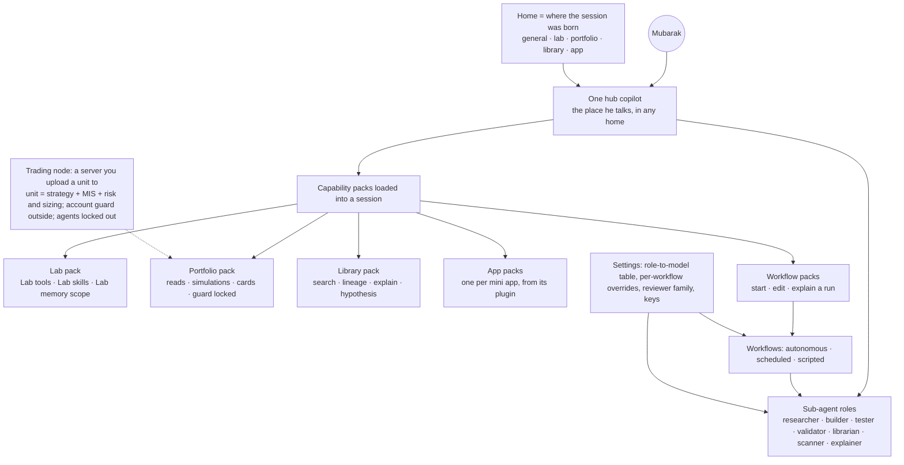

> STATUS 2026-10-16 (rubric walk): SUPERSEDED. See 27-rubric-walk.md. Rulings in 26 win.

# 12 — Design synthesis (second pass, after the operator's corrections)

Written 2026-10-16 by a Fable design agent. Charting, not ratification. Inputs: `05` to `11` in this folder, the operator's corrections 1-13 and the later corrections A-K, and the Wayfinder map in `../../wayfinder/`. Studies `13` to `18` landed after this file; `19-centralized-design.md` folds them in and supersedes this file for the operator. Sections marked "see 19" below point to the central piece that now holds the answer.

Claim labels: `[retrieved]` from a file, `[remembered]` from training, `[inferred]` reasoned here. Plain words; a term is defined where it first appears. Where this file and `06` or `07` disagree, this file wins.

---

## Decisions for Mubarak

At most ten. One line each. "Yes" accepts the recommendation. Ordered by what unblocks the most.

| # | Decision | Recommended answer |
|---|---|---|
| 1 | Engine contract: node kinds, one inspectable log per run, every workflow a clean folder. | Yes to section (c). Node kinds script, rule, model, agent, human, subflow, grader, fanout; `rlm` optional; the hub copilot can read any run's log. |
| 2 | Lab rule: nothing in the Lab asks except money (always read-only) and publishing outside the Lab; Lab-scoped schedules run under a standing allow rule bounded by the usage cap. | Yes. Bends the letter of the 10-13 "schedule asks" ruling for the Lab only; flagged in section (j). |
| 3 | Plugins are the contract to mini apps, and apps exchange data by typed artifacts (inputs, outputs, external APIs and webhooks through the app's own tools). | Yes to sections (g) and (h). Core plugin stays SHA-locked; app plugins come from an approved registry. |
| 4 | One hub copilot plus composable capability packs (Lab, Portfolio, Library, each app, each workflow); a session keeps its birth home and is continuable in the hub and in its home with its packs intact. | Yes to section (b). The UI's one-way `absorb()` is replaced. |
| 5 | Template one is the strategy funnel, built fresh on QMB with overfit guards; the old WF1, WF2, the Stats folder and `strats-video-populate` are reference only. | Yes to section (d). |
| 6 | The Experimentation Board is vibe coding for trading: its design goal is "from a rough idea to the thing he meant in the fewest iterations", with BMad-style elicitation, a spec card and gates up front. | Yes to section (e). |
| 7 | Output: agents emit JSON, QMX renders fixed animated explainer templates, a grader checks first, and chat gets widgets and preview modes for these documents. | Yes to section (f). |
| 8 | Models and reviewers are configured in Settings, per role and per workflow, keys allowed, reviewer on another family where one exists; no roster is hard-coded. | Yes. Today Claude, then ChatGPT through the GPT lane, then Chinese models on keys as workhorses. |
| 9 | Portfolio stays human-driven; a combined session may change Portfolio from Lab or app output only with his approval; the unit (strategy plus MIS plus risk and sizing) lives inside the trading node, which is a server you upload a unit to; agents are locked out of the account guard now. | Yes. Node internals stay out of this map (premature). |
| 10 | User-creatable methodology: he and the copilot can build new agents, workflows, skills and packs with a QMX builder modelled on BMad's builder plus a skill writer; nothing is a fixed set. | Yes to section (i). |

Also his, smaller: the Library is called Strats and the docs' ban is lifted (ticket `library-name-strats`); the browser scope (section (k), ticket `browser-for-copilot-and-workflows`).

---

## (a) The five quant journeys, redone and situational

Vocabulary. **Hub copilot**: the one chat he talks to; it is always present as the place he talks, whichever home the session was born in. **Sub-agent**: a helper the hub or a workflow spawns for one task, with its own context, named by role. **Workflow**: a run the engine drives without him; **autonomous** (an agent loop with a stop rule), **scheduled** (cron or event), or **scripted** (no model).

Not every journey needs all three. The tables mark the mix per journey: **C** copilot only, **C+S** copilot with sub-agents, **W** workflow alone (the copilot only shows the result), **C+W** the copilot starts or edits a workflow.

### Researcher

| Journey | Mix | What happens | He |
|---|---|---|---|
| "Is this idea any good?" (advice) | C | The hub grills in numbered rounds, checks the Library for prior work and dead ends, answers with a term-sheet card. No helper, no run. | Answers "yes" or edits |
| Turn a hint into a term sheet | C | Same conversation, ends in a saved card with mechanism, kill criteria, capacity. | Approves the card |
| Fill the Library from sources | W | Nightly batch: intake, capture, triage, understand, extract, audit, write. The hub only shows the scorecard. | Drops sources; approves channel expansion |
| Build and prove one card | C+W | The hub starts "Build and prove" for the card; the workflow builds, backtests, gates, improves, writes negative results. | Picks the weekly short list; sets thresholds once |
| Explain a result | C | The hub reads the run log and the result card and explains what could fake the number. | Reads |
| Deep read of one paper | C+S | The hub spawns readers with batched questions and a citation checker, then synthesises. | Asks the question |
| Watch new papers | W | Paper scout every 6 hours, wakes only on new IDs. | Reads the explainer when one appears |

### Trader

| Journey | Mix | What happens | He |
|---|---|---|---|
| Morning brief | W | Scheduled, silent if nothing changed. | Reads one screen |
| Why did this alert fire | C | The hub reads the incident, the watchdog output and the source, and explains. | Reads |
| Watch a paper pod | W | Autonomous monitor loop with evidence and a stop rule; the watchdog cron underneath. | Signs the promotion card first |
| Prepare a promotion or demotion card | C+S | The hub spawns a simulation runner (read-only) and an explainer; writes the card. | Signs or rejects |
| Kill switch, live promotion | He | No agent path. | Clicks |

### Developer

| Journey | Mix | What happens | He |
|---|---|---|---|
| "How would I build an app that does X?" | C | The hub answers from the plugin and app docs. | Reads |
| Build a mini app | C+S | Interview, prototype variants, builder with tests first, reviewer on another family, road stages. | Describes roughly; approves install |
| Build a workflow from a rough description | C+S | The workflow builder interview ends in a folder: recipe, scripts, prechecks, a fake-model test. | Describes roughly; "yes" accepts |
| Overnight builder on a ticket list | W | Scheduled; each ticket a tracer-bullet build with tests. | Reads the change cards |
| Weekly harness review | W | Clusters failures, reruns evals, proposes a diff. | Approves the diff |

### Portfolio manager

| Journey | Mix | What happens | He |
|---|---|---|---|
| What does the book look like | C | The hub draws the book picture from scripts (correlation, drawdown against budget). | Reads |
| Should this unit enter the book | C+S | A combined session reads the Lab's evidence and the app's output, runs a read-only simulation, writes a decision card. | Approves; nothing changes in Portfolio without his click |
| Watchdog | W | Scripted every 5-15 minutes; zero tokens unless a rule trips. | Only on an alert |
| Sizing and allocation | parked | Waits for the risk session and the self-configuring unit. | |

### Risk quant (assumed fifth)

| Journey | Mix | What happens | He |
|---|---|---|---|
| Did it pass, and why | C | The hub reads the gate verdicts and the trace. | Reads the scorecard |
| Independent validation of a card or a bot | C+S | A validator on another family re-opens the evidence and tries to disprove; a citation checker; a judge with a rubric. | Only when a gate is contested |
| Re-validate live pods | W | Weekly scheduled; drift against the term sheet. | Reads the red/amber list |
| Loosen a limit | He | No agent path; limits are scripts. | Signs |

### What crosses all five

- The copilot is the place; packs give it reach. The same session can hold Lab, Portfolio, a workflow and an app at once (section b).
- A workflow's first node is a zero-token precheck; its last node is a grader before a page renders.
- Sub-agents write artifacts and return references; the hub reads artifacts, not transcripts.
- He appears at drop and pick, sign, and set thresholds.

---

## (b) Organogram, final draft: one hub, composable capability packs

| Part | Final draft | Open |
|---|---|---|
| Hub copilot | One. It is a place, not a persona. What it can do is the sum of the packs loaded in the session. It must be able to hold every Lab and Portfolio capability at once. | None |
| Capability packs | A pack is a plugin-shaped folder: tools (MCP), skills, agent folders, hooks, views, a memory scope, an autonomy row. Packs compose; they do not split the agent. The Lab pack is loaded in every Lab-born session and stays loaded when that session is opened in the hub. | Pack format follows the plugin ticket |
| Homes | Where a session was born: general, lab, portfolio, library, app. The home sets the default packs and the autonomy row. A session is listed and continuable in the hub and in its home; its packs and context travel with it. | None |
| Sub-agent roles | Seven starter roles, each an agent folder (persona, capabilities, dominion, memory pointer). The set is editable; the builder makes new ones (section i). | Agent folder ticket; see `19` C1, C6, C11 |
| Workflows | Each workflow is a clean folder (recipe, scripts, prechecks, tests, settings). Starter templates in section (d); the set is editable. | See `19` C1 (folders), C6 (browser), C11 (apps) for the folder framework |
| Models and reviewers | Configured in Settings: a role-to-model table, per-workflow and per-step overrides, reviewer family rule, keys. No hard-coded roster. | Defaults are his |
| Where it runs | Each workflow and node shows local, his server, or a rented box. A long run can be sent to the server with its checkpoint. | Server packet (B44) |
| Portfolio | Human-driven. A combined session may propose a Portfolio change from Lab or app output; it lands as a card he approves. Sizing parks behind the risk session. | Risk session |
| Trading node and unit | The node is a server environment: upload a unit (strategy plus MIS plus risk and sizing), give it connections, it trades. Same mental model as putting an agent on a server. The account guard sits around it; agents cannot touch the guard. Node internals are premature and out of this map. | B9 session |

No mini app gets its own copilot; the UI's per-app answerer becomes the hub with that app's pack loaded (10 mismatch 11).

---

## (c) The workflow engine in plain words, and its contract

### Plain words

A workflow is a recipe in a folder. Each step is a node. Scripts cost nothing; a model call is one bounded step; an agent works with tools until done; a human node is a question for him; a subflow runs another recipe. The engine saves its place after every step, waits at questions with no time limit, and at the usage cap finishes the step, parks the run, and continues after the window resets. Every run writes a log he or the hub can open to see what happened, which model did it, what it cost and what each gate decided. Claude is one worker, not the engine. LangGraph's ideas (graph, checkpoints, human gates) and Hermes's (cron, script-only jobs, pre-check before waking a model) are copied; the products are not used.

### Contract

| Part | Rule |
|---|---|
| Folder | `workflows/<name>/`: `workflow.yaml`, `scripts/`, `prechecks/`, `tests/`, `settings.toml` (model per step, effort, budget, runs_on), `README.md`. One writer per folder. See `19` C1 (folders), C6 (browser), C11 (apps) for the shared folder framework with agents. |
| Node kinds | `script` (0 tokens), `rule` (0 tokens), `model` (one relay call with a JSON schema and retries), `agent` (Claude Agent SDK or relay agent; tool allow-list; max turns; session id stored), `human` (parks with no time limit, shown in the UI), `subflow` (own checkpoint namespace), `grader` (deterministic first, model second), `fanout` (modifier: per-item state and timeout, `all` or `any` join, finished items kept). Optional `rlm`: a recursive language-model step for big data-heavy research; not in QMA v2 code, only in the August docs; off until a template needs it. See `19` C2 (failure ladder, watchdog, doctor, notifications). |
| State | Typed keys with reducers (`replace`, `append`, `merge`, `max`). Large outputs go to the content-addressed store; state holds references. |
| Checkpoints | Append-only event log per run in SQLite plus a snapshot at every step boundary, sync by default. A finished node never reruns; a running node restarts from the top, so side-effecting scripts carry an idempotency key `run_id:node_id:attempt`. |
| Gates | A `human` or `grader` node bound to the graph's content hash; a prompt cannot skip or loosen one. Thresholds are his numbers in Settings. |
| Pause | Admission control before every `model` or `agent` node; at the cap `drain_requested`; running nodes finish; the run shows `paused` with a countdown; scripts keep running; a 429 inside a node marks it `waiting`. |
| Triggers | Rows, not nodes: `cron`, `event`, `after`, `manual`, each with a precheck script. A run cannot create a trigger. Missed fires merge. Preflight validates keys, skills and delivery before any model call. |
| Memory | Scopes `run`, `workflow` (its own last output), `home`, `operator`. One writer per scope. Hard size limits that error instead of truncating. Negative results and lessons are tagged rows. |
| Logging and observability | A run is a trace; a node a span with role, resolved model, provider, tokens, cost estimate, cache hits, duration, attempt, wake decision, gate verdict, artifact references. The UI shows a run as a timeline with gates and the paused reason. The hub has `runs.explain(run_id)` to answer "what happened and why" from the log without re-running. Incidents keyed by error signature; a failure streak nudges him. |
| Failure recovery, who writes, monitors and notifies | See `19` C2 (failure ladder, watchdog, doctor, notifications). Placeholder: the engine writes the log; a monitor script watches heartbeats and streaks; notifications go through delivery targets with `[SILENT]` on quiet success. |
| Determinism | No wall-clock or randomness in control flow. The Claude `Workflow` tool is one optional node kind for Claude-only fan-outs. |
| Where it runs | Each node has `runs_on`; a whole run can move to the server with its checkpoint. |
| Model-agnostic | At the node. Nodes name a role; Settings resolves it; a workflow may override per step. |

---

## (d) The strategy funnel, built fresh on QMB, and the starter templates

"Pour in garbage, out come paper-trade candidates." The old WF1, WF2, the Stats folder design and the `strats-video-populate` skill are reference only; their useful ideas (source first, vanilla faithful to the source, tests diagnose and never invent variants, registration late, an item ledger with gates, a fresh-context audit) are kept. WF2's useful core is the only thing carried whole: iterate against QMB until real results come out, without overfitting. Two templates that hand off.

### Template A: Fill the Library (unattended batches)

| Stage | Node kind | What | Gate | Human point | Memory | Output |
|---|---|---|---|---|---|---|
| 1 Intake | script | Normalise URLs, list playlists, de-duplicate, hash; a scope mode per item | Every item has a row | Approve channel or account expansion | Ledger | Inventory rows |
| 2 Capture | script | Captions first, Whisper fallback (Groq key) in transcript mode; PDF to Markdown; Pine source and thread; notes as written; TradingView and playlist pages through the QMX browser (section k) | Raw transcript stored and labelled | None | Locators and hashes | Immutable transcript, coverage gaps |
| 3 Triage | script, then one cheap model call | Pre-filter on duration and keywords; buckets useless, hint, component, full strategy, knowledge; time map | A reason per verdict; `no_output` kept | Optional bulk table | Verdicts | Buckets |
| 4 Understand | agent + fanout model | Section map; section workers; visual passes only on flagged windows; Pine by script | Coverage map | None | Claims with locators, tagged source-stated, visual, inferred, unresolved | Claim list |
| 5 Extract cards | agent | Strategy cards with their holes kept (exits never invented), component cards, knowledge notes, hint cards | Template check | None | Cards | Cards |
| 6 Audit | agent, fresh context, other family | Re-open the evidence windows, not the card; try to disprove | Accepted and rejected claims with reasons | Only logins, overwrite, delete, dictionary edits, meaning-changing ambiguity | Rejections as negative results | Audited cards |
| 7 Library entry | script | One writer: IDs, files, catalog, index | Commit gate | None | Lineage source to card | Strats entries |

Precheck: new inventory rows, else silent. Caps per run on items and frames, his numbers. Pilot: four items.

### Template B: Build and prove (per chosen card)

| Stage | Node kind | What | Gate (overfit guards in bold) | Human point | Memory | Output |
|---|---|---|---|---|---|---|
| Pick | script, human | Rank cards by class, evidence, market fit | | Weekly short list of 5-10 | | Queue |
| 8 Build | agent, script | Vanilla: source logic only, house risk and sizing stripped; spiced optional as a labelled child; missing exits get a house policy labelled `external_policy` | Compile; composition check | None | Lineage card to bot | Bot version |
| 9 Backtest | script | One experiment spec: code ref, config, **data snapshot**, **costs on**, seed, lineage; QMB | Memo key | None | QMB ledger row | Report |
| 10 Robustness | script (grader) | Monte Carlo, **walk-forward**, **untouched holdout**, cost stress, regime and session breakdown, **deflated Sharpe over every variant tried** | Editable defaults: at least 100 trades; OOS Sharpe at least half IS; MC 95th-percentile drawdown inside his limit; deflated Sharpe above 0; profitable after 1.5x costs | Sets once | Failures as negative results with run id and variant count | Pass or fail |
| 11 Improve | agent + script, bounded loop | Diagnose weakness buckets; hypotheses about why; 3-4 structurally different children; back through 9 and 10 | **3 generations x 4 children; stop after 2 with no gain; every child counts; holdout touched once** | Sets the budget | Every child, dead ones too | Survivors |
| 12 Paper | human, script, monitor | Promotion card; demo account; monitor loop; watchdog | At least 2 weeks and 30 trades; inside the Monte Carlo band; re-paper once | His click into paper; live always his click | Paper journal beside the evidence | Paper-trade candidates |

The promoted noun is "unit" as a placeholder until the risk session settles it.

### Starter template set (editable; nothing is fixed)

| Template | Quant layer | Trigger | Precheck | Model use | Output |
|---|---|---|---|---|---|
| A Fill the Library | Research | Nightly, manual drop | New rows | Cheap triage; agents for understand, extract, audit | Batch scorecard |
| B Build and prove | Research, risk | Manual, from A or the paper scout | Card picked | Builder; scripts for every gate; improve loop | Funnel scorecard |
| Paper scout (11 T2) | Research from papers | Every 6 hours | arXiv q-fin RSS and alphaXiv hot-feed ID diff | Cheap triage; N readers on batched questions; citation grader | Explainer; proposes B |
| Morning brief (11 T1) | Daily routine | Weekday cron | Anything changed, else silent | One call; grader | Dashboard card |
| Macro snapshot (11 T4) | Macro | Daily or calendar release | Release fetched | Research harness, 3 searchers; grader | Scrollytelling page |
| Portfolio watchdog (11 T5) | Portfolio | Every 5-15 minutes | None | Zero tokens; explainer on a trip | Alert, incident |
| Weekly harness review (11 T6) | Developer | Weekly | Traces collected | Cluster; rerun evals; propose a diff | Change card, parked |

Per-pair or per-topic versions (for example macro analysis for one pair) are made by the builder (section i), not by hand. Research harnesses need the most thought: the Anthropic shape (lead plans, 3-5 searchers with one objective each, synthesiser reads findings files, citation checker, judge, per-run budget) as engine steps, alphaXiv MCP on a key, free feeds as prechecks. Own ticket.

---

## (e) The Experimentation Board: vibe coding for trading, in the fewest iterations

Design goal: a non-technical person goes from a rough idea to the thing he meant in as few iterations as possible. Each iteration is one round trip where he looks at something and says "not that". The board's job is to cut those round trips.

| Lever | How the board cuts iterations | Source |
|---|---|---|
| Elicitation up front | Numbered question rounds with a recommended answer each; "yes" accepts; facts are looked up, never asked; questions stop when the frontier is empty. | Pocock grilling; BMad intent-before-ingestion |
| A "what I understood" card before anything runs | The board shows the term sheet as a card (mechanism, rules, universe, timeframe, exits or their absence, kill criteria). He corrects the card, not the code. | BMad spec gates |
| Options, not drafts | When a choice is open, the board shows two or three structurally different variants side by side (arena) and he picks; divergence means the idea is under-specified, so back to one question. | pstack arena; his "options plus click-through" rule |
| Gates that run themselves | Compile, costs on, holdout, deflated Sharpe run on every "run this section"; he sees pass or fail, not a log. | ml4t gates |
| Run scope | Run one step, a section or the whole board; drafts never run live. | `run_scope` from revision 1 |
| Memory of his taste | The operator memory scope records what he rejected and why; the next board does not propose it again. | BMad distillate with rejected ideas |
| Templates from past boards | A board that reached paper becomes a template; the next idea starts from it. | Lab "Start something new" |
| Iteration counter | The board counts round trips per idea and shows it; the weekly harness review lowers it. | pstack hillclimb (one metric) |

Shape: the board is a small backend object (notes, questions, charts and unfinished pieces next to runnable sections; a workflow draft with run scope). Promotion out of the board goes through template B's gates only. Overrides the docs' client-only rule.

---

## (f) Output methodology

Not pictures. Animated, interactive explainer documents that render inside the QMX UI, including what the agent did, so he never reads a block of text. UI demo data shows the shape only; its specifics are not binding.

| Rule | Detail |
|---|---|
| Agents emit JSON, never pages | Claims, numbers with source pointers, chart specs, Mermaid source, step order, citations. |
| QMX renders fixed templates | Dashboard card, explainer document, scrollytelling story, scorecard or funnel, short motion explainer (later), one-line alert. |
| A grader runs first | Schema valid; every number resolves to a source; Mermaid parses; headless render without errors; screenshot kept. |
| The receipt rule stays | Headline on screen; tool calls, helpers, changes and reports fold into "What it did". |
| Chat gets widgets and preview modes | A document renders inline as a widget (scrollable, animated) and opens in the drawer's preview as a full page; a job panel shows status, next fire, incidents; play, scrub and "show all" controls; reduced motion respected. |
| Readable without reading | One headline per screen; the diagram carries the argument; progressive reveal; drill-down instead of length; provenance on click; consistent colours. |
| Refusal is an output | "Could not check" with what is missing. Claims labelled retrieved, remembered, inferred. |

| Situation | Format |
|---|---|
| Is anything wrong, what changed | Dashboard card |
| What did you find | Explainer document |
| Why did this happen, how does it work | Scrollytelling or explainer with an animated diagram |
| Did it pass | Scorecard or funnel |
| Show someone else | Motion explainer (later) |
| Something broke | One-line alert plus incident |

UI additions (`10` §4 gaps): a safe Markdown renderer; diagram parts in the panel catalog (Flow, Mermaid, Steps, Candles, EquityFan, EntityCard, Image or Video); an ordered `steps[]` reveal format; an explainer artifact viewer and an inline widget mode; run-status chrome around every report; provenance on click; freshness stamps. Growing the catalog and the renderer is pure UI work and can start today.

---

## (g) Mini-app lifecycle through plugins

| Rule | Detail |
|---|---|
| Plugin is the contract | Every mini app ships as a Claude-Agent-SDK-style plugin: `plugin.toml`, MCP tools, skills, agent folders, hooks, views. The hub and any workflow reach the app through the plugin with no custom wiring. |
| Core stays locked | The shipped QMX plugin keeps its SHA constant in code. App plugins live in a registry row (id, version, sha256, trust, enabled, homes) he approved. The harness composes core plus enabled app plugins per session and verifies every hash. |
| Trust from approval | The approval record sets trust; the caller never does. Agent-built apps install disabled. |
| Archive, never delete | Routes `apps_archive` and `apps_disable`; no delete. An archived app keeps versions, evidence, logs and artifacts and leaves the active set. |
| DevOps | Road-to-live evidence, box (runs on, budget, allow-list, breaker), logs as spans in the same trace store, breaker trips as incidents, "ask why" through the hub, backups. |
| Depends on the Lab | Most apps read Lab objects (runs, bots, datasets, models, units); the Lab is the producer; apps declare what they feed on. |
| No per-app copilot | The hub with the app's pack loaded. |

Steps: create (interview, variants, tests-first build, review on another family; no ask), test (road stages; no ask), publish and install (install card; always asks), maintain (retro and correct; no ask), edit (new version; publish asks), improve (weekly review proposes; a card parks), archive or disable (a card with door type and blast radius; asks). Platform analogues (Shopify apps, VS Code extensions) see `19` C1, C6, C11.

---

## (h) The mini-app data contract

Apps take input from and give output to other apps, internal pieces and external APIs or webhooks.

| Direction | Mechanism | Rule |
|---|---|---|
| App to app | `provides` and `feeds` JSON schemas already in the manifest; the host validates, hashes and copies an immutable artifact into the consumer's volume (`05` §1). | Pass by artifact reference, never by shared files. A consumer declares the producer and the schema version. |
| Internal pieces to app | Lab, Library, runs and Portfolio reads through the control door's MCP tools, scoped by the app's `data_reads` and its home. | Reads need no ask; Portfolio writes are proposals (cards). |
| App to internal pieces | The app's outputs are artifacts with a kind; the Library indexes them; a workflow can `inputs_from` them with an optional wait. | Typed outputs; a run never consumes an unvalidated artifact. |
| External APIs in | The app's own MCP server calls out through its `network` allow-list; secrets through `qmx/<name>` keyring entries. | Allow-list per app; no key in chat or logs. |
| External webhooks in | A control-door route `POST /api/apps/{id}/hooks/{name}` with a signed secret; the body is untrusted data, written as an artifact, then a trigger fires. | A webhook starts a run only through a trigger row he approved. |
| External out | The app posts through its allow-list; delivery is redacted; an unconfirmed delivery is marked unverified. | Money endpoints are never on an allow-list; the hook refuses. |
| Combined session changing Portfolio | Lab or app output becomes a proposal card in the session; approval writes it. | His approval, every time. |

---

## (i) User-creatable methodology: the QMX builder

Nothing is a fixed set. He and the copilot can make a new agent, workflow, skill or pack, for example "macro analysis for one pair".

| Builder | Modelled on | Flow | Gate |
|---|---|---|---|
| Agent builder | BMad agent builder; agent-as-a-folder | Discover intent by natural questions (does it need memory, should it act while you are away), capabilities, dominion, draft, build | Lint script; trigger evals |
| Workflow builder | Pocock loop-me; BMad workflow builder | Grill until trigger, checkpoints pushed late and brief are set; pick a template as the base; write the folder | Fake-model run; grader on the output |
| Skill writer | Anthropic skill-creator; pstack authoring playbook | Capture intent, draft, 2-3 test prompts with and without, viewer where he clicks good or bad | Eval across two families where available |
| Pack builder | BMad module builder | Group agents, workflows and skills into one installable pack with a `plugin.toml` | Validate: no orphan entries, no duplicate menu codes |
| Methodology version | BMad customize.toml layering | A new methodology is a pack that overrides the constitution's tables (gates, roles, autonomy rows) by value shape; never a fork | The umbrella's audit only shrinks |

Modes: guided (soft gates), YOLO (draft everything, then refine), headless (for the weekly review). Inputs: a rough idea, an existing folder to edit, a foreign skill to convert. Every builder output is a versioned folder in the registry, installed disabled until he enables it.

---

## (j) What changes in QMA v2 and in the UI

### QMA v2

| Change | Why | Size `[inferred]` |
|---|---|---|
| Plugin registry and composition; core locked plus approved app packs | Corrections 2, F | Medium |
| `home` on the control session and `NewChat`; child inherits; packs travel with the session | Corrections 5, F | Small |
| `kind` on `POST /api/chats`; `approvals` topic | Scheduler and UI | Small |
| Engine runtime: folders, event log, snapshots, gates, drain, triggers, `runs.explain` | Correction 8 | Large; own packets |
| Account guard lock-out: deny rule plus canary test | Corrections 6, A | Small, now |
| `apps_archive`, `apps_disable`, trust from approval, webhook route with signed secret | Corrections 3, G | Small |
| Settings: role-to-model table, per-workflow overrides, reviewer family, keys | Corrections 7, H | Medium |
| Send a run to the server with its checkpoint | Correction 7 | Medium, after B44 |
| QMX browser profile for read-only capture; shared-browser watching | Corrections 9, K | Small first step; see `19` C1, C6, C11 |
| Lab tools for agents | Correction 4 | Medium, with the Lab layer |
| Builder skills (agent, workflow, skill, pack) | Correction D | Medium |

### UI (today's session)

| # | Fix | From |
|---|---|---|
| 1 | Block shape `{type, content}`; rename `tools→tool`, `changes→changed`, `cards→entity`, `ask→question`; add `needs_you`; decide one call or batch for `tool` | 10 §6.1 |
| 2 | Reserve `home: {kind, project_id}`; Main→general, Mini apps→app; badge | 10 §6.2 |
| 3 | Replace `absorb()`: "view in hub" keeps home and packs; add "open in its home"; handoff says "born in the Lab" | 10 §6.3; corrections 5, F |
| 4 | Status words: add `failed`, `cancelled`, `expired` | 10 §6.4 |
| 5 | Approval answers: the five plus "expired, re-run from here"; drop "for this errand" until the backend has it | 10 §6.5 |
| 6 | Develop with demo off; demo data is shape only | 10 §6.17; correction J |
| 7 | Terminal labelled read-only | 10 §6.13 |
| 8 | Missing harness features: effort, compaction, stop and steer, model-switch warning, usage page, export | 10 §6.12 |
| 9 | Treat the old backend docs in the UI repo as history | 10 §6.15 |
| 10 | Per-app copilot becomes "hub with <app> pack" | 10 §6.11 |
| 11 | Mini apps: Remove becomes Archive; add Disable; show versions | Correction 3 |
| 12 | Chat widgets and a preview mode for explainer documents; start the catalog's diagram parts and the Markdown renderer | Corrections 10, J |
| 13 | Settings: reviewer and model choices per role and per workflow (fields only, read from `[providers]` today) | Correction H |

Safe to wire now: chat on the 14 kinds, approval cards, `agents` card per child, usage page with the cap bar, money-hook refusals, export, the receipt card, the home badge. Do not wire Lab tool buttons, the Editor run state, Pods, Portfolio tools or mini-app install yet.

---

## (k) Browser

He wants to watch the copilot work in a shared browser (Hermes demo style) using his logged-in profiles (YouTube playlists, TradingView). In most harnesses only the main agent has the browser. Browser access for sub-agents and workflows is a design question. See `19` C1 (folders), C6 (browser), C11 (apps) for the stack. What this map fixes now: a QMX browser profile separate from his personal one; the first use is read-only page capture for the funnel (TradingView, playlists) by a script under one job at a time; the full un-hold (clicking agents, concurrency, compute) waits for B17a's design and study 14.

---

## (l) Conflicts flagged

| Correction | Settled ruling it touches | Recommendation |
|---|---|---|
| 4: the Lab asks only for money and publishing outside | 10-13 Q1: schedule and manage ask unless an allow rule permits | A standing allow rule "Lab-scoped schedules may run inside the background cap". His call. |
| 9, K: browser for the funnel and shared watching | B17a: browser and computer use on hold | Scoped first step (profile, read-only capture, one job); the full un-hold waits for 14 and B17a. His call. |
| 2, F: plugin rule and packs | DESIGN.md kept one SHA-locked plugin | Core locked plus a registry; no agent-writable settings. |
| 7, H: keys, Chinese models, configurable rosters | "No API spend" (Anthropic or OpenAI API) | Keys for OpenRouter, Kimi, GLM, MiniMax were already accepted; ChatGPT rides the GPT lane. No conflict. |
| 13: Strats | Docs ban "STRATS" | Lift the ban; correct the docs. Ticket. |
| A: unit inside the node | DEC-0261 (no per-bot paper on the node) and the 09 reading that the node merges nowhere | Record his model; keep node internals out of scope; the risk session reopens DEC-0261. |
| I: funnel built fresh | Earlier seed 9 said reuse `strats-video-populate` | Reuse its ideas (ledger, gates, state machine), not the skill. |
