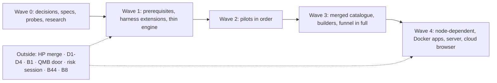

> STATUS 2026-10-16 (rubric walk): PARTLY-STALE. See 27-rubric-walk.md. Rulings in 26 win.

# 19 — QMX methodology: the centralized design

Written 2026-10-16 by a Fable design agent; revised the same day to apply `21-lead-verdict.md` (which rules on `20-review-a-operator-fit.md` and `20-review-b-feasibility.md`). This is the agents' reference. It pulls every idea from `01` to `18` into one place, names the contracts everything leans on, deduplicates the building blocks, lists the templates with their wave, and says what can start today. The operator gets a separate explainer page built from `22-explainer-brief.json`. Charting, not ratification.

Labels: `[retrieved]` from a file in this folder, `[inferred]` reasoned here. Every number that Mubarak did not set is marked **Claude's default** and changes in Settings. Risk thresholds are marked **from the GitBook, or to be set**; none ship as Claude's.

Naming: research templates are **RS**, risk **RK**, trader **T**, Lab **L**, developer **D**, portfolio **P**, the strategy funnel **A** (Fill the Library) and **B** (Build and prove). Central pieces are **C0-C11**. Cost tiers are words (free, tiny, small, fan-out, heavy); browser levels are words (none, read web, act web, read as me, act as me). "B" alone means the funnel's second half.

---

## 1. Decisions for Mubarak

Seven yes-or-no questions and one number, plus one channel question. Everything else in this file is Claude's call, listed as an assumption he can overrule (section 2).

| # | Question for Mubarak | Recommended |
|---|---|---|
| 1 | Inside the Lab, may agents start and schedule their own jobs without asking you, as long as background use stays under your 50% cap? (This changes your 10-13 rule that scheduling always asks.) | Yes |
| 2 | When something proven in the Lab goes into Strats, should QMX just tell you instead of asking first? | Yes |
| 3 | Agents must ask you before one run spends more than $___ on paid keys such as OpenRouter. What number? (Or say "always ask".) | Always ask, until you pick a number |
| 4 | Lift the browser hold for one first step: a separate QMX browser you log into once and can watch live, which agents use to read pages, one job at a time, with no clicking? | Yes |
| 5 | Rules like "a run may not skip a check" bind agents only. You can drop any check in your own workflows, and the result shows a badge. Agree? | Yes |
| 6 | May the Experimentation Board be saved on the backend, so a board survives restarts and workflows can run it? (This changes two docs that say the Board lives only in the browser.) | Yes |
| 7 | Build order: a small paper scout runs first, only as a quiet test that the engine works. Then the Lab and Board (the first thing built for you), then one mini app as a plugin. The morning brief and Portfolio reports come later. Agree? | Yes |
| 8 | Urgent alerts: which phone channel may QMX send to, if any? (Until you pick one, everything goes to the in-app inbox.) | Inbox only, until you pick a channel |

---

## 2. Claude's assumptions (overrule any)

These were decisions in the earlier draft. Review A showed they are technical calls or his own earlier words, so they are recorded here as assumptions, each editable.

| # | Assumption | Where it lives |
|---|---|---|
| A1 | The engine's step kinds are script, rule, model, agent, human, subflow, grader, with fan-out as a modifier; `rlm` is optional and off. | C2 |
| A2 | A finished step's result is saved and never re-run; after one automatic retry a failure goes to one inbox item; logic changes are proposed, never silent. | C2 |
| A3 | Every agent, workflow, skill, pack, app and methodology is one folder shape, a valid Claude plugin plus `qmx.toml`; the core plugin stays SHA-locked; approved folders load from a registry; archive, never delete. | C1 |
| A4 | A session keeps its birth home and is continuable in the hub and in its home; packs compose; the stricter autonomy row wins. (His own words on 10-16.) | C3 |
| A5 | Settings shows four model tiers (cheap, mid, strong, reviewer) with an advanced fold for per-role and per-workflow overrides; a reviewer on another family means a paid key. | C4 |
| A6 | Agents emit JSON; QMX renders six fixed formats; a grader checks numbers and sources first; R before $. | C5 |
| A7 | Gate defaults: costs on, out-of-sample, minimum trades, deflated Sharpe. Numbers in section 9, all Claude's. | C8 |
| A8 | Two iterations per idea on the Board is Claude's starting goal; his word was "fewest". The Board shows a counter. | Section 6 |
| A9 | Portfolio is human-driven; the unit lives inside the trading node; agents never write the guard. (His own words on 10-16.) | C7, section 11 |
| A10 | The Library is called Strats; the docs ban is lifted. (His own words, BACKLOG B8.) | Section 10 |
| A11 | One heavy job per night, chosen by a script; calibration on at most 5 headline claims per run; the wave 2 exit gate is one clean night, measured before promising three. | C4, section 8 |
| A12 | Budget tiers, fan-out widths, reader and searcher caps, loop caps, variant caps: section 9, all Claude's. | C4, section 9 |

---

## 3. The whole system on one page

```mermaid
flowchart TB
  OP((Mubarak)) -->|talks, picks, signs| HUB
  SET[Settings: four model tiers · gates and thresholds · spend cap · keys] --> ENG
  SET --> HUB

  subgraph HARNESS["QMA v2 harness (built: HP8-HP17; extensions in wave 1)"]
    CHAT[Chats: interactive · background · child]
    APPR[Approvals and effect table · money hook]
    RELAY[Relay to key providers · GPT lane]
    USAGE[Usage governor · 50% background cap]
  end

  subgraph ENG["Workflow engine (QMX code, inside qma.serve)"]
    STEPS[Steps: script · rule · model · agent · human · grader · subflow · fan-out]
    LEDGER[Run ledger: saved step results · checkpoints · one trace per run]
    TRIG[Triggers and night planner · precheck]
    DOC[Watchdog · inbox]
  end
  HARNESS --> ENG

  subgraph REG["Registry of folders (one shape, each a valid plugin)"]
    METH[methodology/]
    AG[agents/]
    WF[workflows/ and variants]
    SK[skills/]
    PK[packs/]
    AP[apps/]
  end
  REG --> ENG
  REG --> HUB

  subgraph SESS["Session homes and capability packs"]
    HOME[Home = birth place: general · lab · portfolio · library · app]
    PACKS[Packs set at launch: Lab · Portfolio · Library · app · workflow · browser]
  end
  HUB[Hub copilot: the place he talks] --- SESS
  HUB --> SUB[Sub-agents: researcher · builder · tester · validator · librarian · scanner · explainer]
  HUB --> RUNS[Workflows: autonomous · scheduled · scripted]
  RUNS --> SUB
  ENG --> RUNS

  subgraph ROOMS["Rooms"]
    LAB[Lab and Board: QMB · trial ledger · holdout · iteration counter]
    LIB[Library (Strats): cards · lineage · dead ends · knowledge]
    PORT[Portfolio: broker reads · simulations · proposal cards]
    APPS[Mini apps: plugin · app check · archive]
    BROW[QMX Browser: broker over a pipe · read-only first · watch pane]
  end
  RUNS --> ROOMS
  SUB --> ROOMS
  NODE[Trading node, outside this map: unit = strategy + MIS + risk and sizing<br/>account guard: agents read facts, never write] -.->|read adapter| PORT

  ROOMS --> OUT[Output renderer: JSON in · six formats out · grader first]
  OUT --> UI[QMX UI: chat widgets · preview · inbox · run timeline · job panel]
  UI --> OP
```

How to read it. Settings and the harness sit at the top because every run reads them. The engine runs recipes stored as folders in the registry. A session is born in a home and loads packs at launch; the hub copilot is the place he talks, and it spawns sub-agents or starts workflows. Rooms are where work lands. The trading node is outside the map; templates reach it only through a read-only adapter. Every output goes through the renderer before he sees it. Arrows mean "reads from" or "starts"; dotted means read-only.

---

## 4. Central pieces: the contracts everything leans on

Each piece has a **now** paragraph (the weight waves 1 and 2 need) and a **later** list (the full shape, built when a template needs it). If a later session changes a piece, it re-checks every template in section 7 that names it.

### C0. Methodology

**Now.** A methodology is a pack (shape C1) that sets the autonomy rows, the gate defaults, the model tiers per role, the organogram (hub, sub-agent roles, menus) and the starter templates. QMX ships one default methodology. He or the copilot copies it and edits it with the builder; a methodology version is a new folder version; old versions are kept and archived, never deleted. A methodology overrides the constitution's tables by value shape (BMad `customize.toml` layering), never by fork. A variant of a template may tighten a gate and never loosen it, and that rule binds agents only: in a workflow he builds himself he may drop any check, and the output carries a "check removed" badge (decision 5).
**Later.** The methodology builder (agent, workflow, skill and pack builders behind one `build` skill), evals on every methodology version, a diff card when the default methodology moves.

### C1. One folder shape for agents, workflows, skills, packs, apps and methodologies

**Now.** Every folder is a valid Claude plugin (`.claude-plugin/plugin.json` with name, semver, description, dependencies) plus `qmx.toml` (kind, model tier per role, budgets, browser level, home, lifecycle state) and a `README.md`; every other slot is optional. The file path is the name; defaults use the same slots; tests sit beside the code. Versions are semver plus a content hash; a published version is never overwritten; nothing is deleted, only archived with a reason. The shipped core plugin stays SHA-constant in code; every other folder loads from a registry row (path, sha256, trust, enabled, homes) he approved; agent-built folders install disabled. Safety rules from review B: app and workflow folders may not carry `hooks/`, `monitors/`, `bin/`, `settings.json` or in-process `tools/*.py`; their tools run as stdio MCP servers through the harness tool path, inside the money gate; `pending/` (agent-written edits waiting for approval) lives in host state, outside the hashed folder. MCP tool names use the harness form (`mcp__lab__run`), not dots. `qmx agent info` and `qmx workflow info` list what loaded and what failed. `[retrieved]` `14` §1-2, `20-review-b` findings 4 and 28.
**Later.** Variant overlays (`variant.toml`, `overrides.toml`), `SOUL.md`, `knowledge/` as OKF, required `evals/`, the full `app.toml` additions (`[ui.targets]`, `[io]` with `emits` and `accepts`, `[health]`, `[lifecycle]`, `qmx_api`), the 12-line `qmx app check`.

### C2. The engine: step kinds, failure, recovery and monitoring

**Now.** A workflow is `workflow.yaml` plus scripts, run by engine code inside the `qma.serve` process so it calls the harness directly and no new door accepts injected text. Step kinds: `script` and `rule` (zero tokens), `model`, `agent`, `human` (parks with no time limit, shown in the UI), `grader` (deterministic first, model second), `subflow`, and `fanout` as a modifier whose width is capped by the harness chat slots (`max_live_chats` minus an interactive reserve; Claude's default reserve 2). A `model` step on the Claude plan is a one-turn, no-tool Background chat through the SDK (a process start plus the Claude Code system prompt; its token floor is measured by probe 1); on a key provider it is a direct call. An `agent` step is a Background chat with structured JSON output, a tool allow-list and `max_turns` (the harness extensions of section 8, wave 1). Every finished step writes its result to the run ledger under `run id + step id + input hash`; on resume the engine returns saved results and starts at the first step without one; `model` results on key profiles are cached by `(model, prompt hash, params)`. Agent steps write only to their workspace and return JSON; the workspace is rolled back by file checkpointing before a retry; script steps commit results with an idempotency key `run_id:node_id:attempt`; the engine never repeats an irreversible effect on its own. Failure: one automatic retry for transient errors (429, timeout, network; a usage-cap hit marks the step `waiting`), then `escalate`, which parks the run with one inbox item (cause, what was tried, cost so far, buttons: retry, bigger model, skip step, open trace, stop). Unattended asks never wait 300 seconds; they go to the inbox and the run parks. MANAGE acts (run a job, schedule, app actions) are performed by the engine as script steps under the standing allow rule of decision 1; agents inside the Lab only return proposals; MANAGE stays as it is for chats. A zero-token watchdog looks for stuck runs, over-budget runs, repeated failures of one step and missed fires. Triggers are rows (`cron`, `event`, `after`, `manual`) with a precheck script; a run cannot create a trigger; cron fires only while the PC is awake and QMX is running, so missed fires merge into one and nothing safety-critical lives in QMX schedules; preflight validates keys, skills, MCP servers and delivery before any model call. Pause at the cap uses the harness's `rate_limit_event` frames and `resets_at` (the Python SDK has no usage report); a parked run resumes at `resets_at` with one short probe turn; each agent step gets a small `max_turns` so a step that started under the cap cannot run away. One trace per run, one span per step with role, model, provider, tokens, cost estimate, duration, attempt and gate verdict; `runs.explain(run_id)` lets the hub answer "what happened" from the log. Time comes in as trigger inputs; no wall-clock in control flow. The run ledger is one SQLite file with one writer connection on one thread (BACKLOG B1 is a wave 1 prerequisite). There is no sandbox on this PC (Windows 11 Home, no Docker running), so `rlm`, unattended L4 and model-written Lab code run attended only until probe 6 passes. `[retrieved]` `13` §4, `20-review-b` findings 2, 3, 9, 10, 11, 12, 20.
**Later.** The `rlm` step kind (a Python kernel with `spawn` and `collect`, snapshots, cached sub-calls, research sandbox only); the run doctor's local repair (fork at the step, replay the suffix, bigger model or cleaned input); CRO-style testing of logic edits (fix set and guard set); four-layer monitoring; `runs_on` as more than a field (after B44). The Claude Code `Workflow` tool is dropped from the contract (off in QMA, Claude-only).

### C3. Session homes and capability packs

**Now.** `home = {kind, project_id}` is stored on the control session at start and never changes; kinds are general, lab, portfolio, library, app. The home sets the default pack set and the autonomy row. A pack is a folder of shape C1 with an autonomy row; the pack set is part of the launch config; "add a pack" is a quote-and-apply relaunch with `resume` (the uncached-resend warning applies), or a preloaded MCP server toggled on. Packs, workspace and history travel with the session wherever it is opened; "view in hub" keeps the home; "open in its home" is the way back; child sessions inherit the home. When two packs disagree on autonomy, the stricter row wins. The autonomy table: Lab does everything without asking except account money (never) and publishing outside the Lab; Portfolio reads and simulates without asking and every write is a card; general applies Lab rules on Lab objects and Portfolio rules on Portfolio objects; background and child inherit. Pack instructions ride in the append-system-prompt and must stay under the Windows command-line limit (DESIGN open question 4, `--append-system-prompt-file`, is settled before packs ship). `[retrieved]` `20-review-b` findings 16, 17.
**Later.** Per-pack memory scopes; hot-swapping packs.

### C4. Model tiers, reviewer rule, spend and usage

**Now.** Settings shows four tiers: cheap, mid, strong, reviewer. Each role maps to a tier; an advanced fold holds per-role and per-workflow overrides (model and effort per step, budget). The reviewer tier means a paid key provider; a reviewer on another family runs as its own engine `model` or `agent` step on a key profile, never as a native sub-agent inside a Claude CLI (one CLI holds one provider). If no key is configured, the review is a fresh context on the same family and the output chip says "same family"; that may pass demo, never live. The 50% background governor is his; one per-run spend cap for keys is decision 3 (always ask until he picks). The usage reading is the last `rate_limit_event` plus `resets_at`; his own claude.ai use shows up at the next reading. A night planner (a script) picks at most one heavy job per night; the rest queue and show in the job panel. Cost tiers as words: free (scripts), tiny (one short plan turn or one cheap key call), small (a few calls), fan-out (several children within the chat-slot cap), heavy (Lab or agent work with the per-run cap and a pre-flight estimate). `[retrieved]` `20-review-a` findings 14, 16; `20-review-b` findings 7, 8, 9.
**Later.** Reserve-then-refund per call; the family-rule lint; the full role list of section 5.6 as advanced settings.

### C5. Output: JSON in, fixed formats out

**Now.** Agents emit structured JSON and never pages. Six formats: dashboard card, explainer document, scroll story, scorecard (including the funnel scorecard), alert, decision card; the other kinds in `16` §4.12 are variants of these. Every output carries run chrome (template, version, trigger, models per step, cost, grader results, gate decisions, trace link, freshness stamp). Before display a grader checks: schema valid, every number resolves to a source row, Mermaid parses. Claims are labelled retrieved, remembered or inferred; "could not check" is a valid section and a filler section fails. R before $. Structured output from agents on relay providers is unproven (probe 10); the grader keeps a JSON repair retry. The UI renders the six formats with a fixed component set, shows a document inline as a widget and in the drawer as a preview, and opens the source of any number on click.
**Later.** Headless render plus screenshot as a grader line; motion explainers; the full output-kind list; provenance on every chart.

### C6. The browser: QMX Browser, broker and leases

**Now (after decision 4 and probe 5).** One QMX-owned headed Chrome with its own `--user-data-dir`, started by the broker over `--remote-debugging-pipe` so there is no open debug port an agent with Bash could reach. He signs in to YouTube and TradingView there himself, once; his everyday profile is never automated or copied (App-Bound Encryption blocks moving it anyway). The broker serves one proxied CDP endpoint per lease behind a per-lease token and filters targets to the leased tab; Playwright MCP points at that endpoint. First step: read-only (read web on an isolated context, read as me on the logged-in profile), one job at a time, no clicking, no submitting. The money gate extends to browser navigation: broker, MT5 web terminal and prop-firm domains are denied, with the host list kept in one place. A watch pane streams frames by CDP screencast behind the same bearer gate as the UI, never stored, only while the pane is open. A login wall or CAPTCHA stops and asks him; page text is untrusted; every action is logged with a screenshot. `[retrieved]` `14` §3, `18`, `20-review-b` findings 6, 23, 24.
**Later.** Act-web and act-as-me levels with per-action approval, a visible queue, TTLs, Playwright `--codegen` scripts as the no-model replay (Stagehand only on a key profile), a cloud backend (Steel self-hosted first) for isolated work, a WebRTC viewer on a Linux server after B44.

### C7. The unit read adapter and the guard reader

**Now.** Templates never read unit fields; they ask the adapter for named facts (`unit.id`, `stage`, `instruments`, `sessions`, `condition_needs[]`, `journal_R()`, `backtest_baseline()`, `signed_profile`, `lineage`, `content_hash`, and others as the risk session names them). A fact the unit lacks returns `unknown` and the template renders "could not check"; it never guesses. The adapter is read-only. Account-guard facts (equity, positions, stops, guard state, config hash, the prop-firm rule table) are read through the same reader by zero-token scripts; agents may read guard facts; no agent has a write path to the guard, ever, and the canary test checks exactly that. Until a node read model exists, P2 pilots on `qmx-broker` reads only and renders guard fields as "could not check". `[retrieved]` `16` §4.1-4.2, `21` A5, B5.
**Later (waits on the risk session).** Any write such as `unit.tighten`, the direction table, auto-revert, demo trade counts, kill-line thresholds and cadences; see section 11.

### C8. The gate and threshold store

**Now.** Gate thresholds live in Settings, versioned; every change is logged with a diff and shown in run chrome, and a gate verdict records the threshold version it used and binds to the graph's and the candidate's content hashes (a changed hash makes it stale). Three or four default gates ship: costs on, out-of-sample (walk-forward), minimum trades, deflated Sharpe over the trial count; numbers in section 9 are Claude's defaults. The engine lint refuses any workflow step that calls `settings.write` and the loop's allow-list has no Settings write; this is a speed bump, not a lock, because an agent with Bash can reach the REST door, so loosening is made visible rather than impossible. Variants may tighten and never loosen; that binds agents only (decision 5). `[retrieved]` `20-review-b` finding 22.
**Later.** The other overfit tests (PBO, noise, permutation, random benchmark, parameter neighbourhood, cost stress, sanity flags) once B runs for real and probe 9 measures their compute on his PC.

### C9. The trial ledger, the holdout and the cost model

**Now.** The family ledger records every agent-run trial in a lineage family, passed or not, dead ones included, with spec hash, parent and change label; it serves the trial count and the deflated Sharpe. Board tweaks he makes himself are not counted; only agent-run variants are (decision 5). One sealed holdout per family, later than every other window, unlocked once by `holdout-touch` and logged; a second look is a new counted trial with a new window. Cost model version 0 comes from the broker's symbol specs and measured spreads (`qmx-broker` `symbol_info` and `quotes`), because real fills exist only after a unit trades on demo. `[retrieved]` `20-review-b` finding 13.
**Later.** The demo monitor replaces the cost model from real fills, logging the version change.

### C10. Memory and lessons

**Now.** Two scopes: `run` (working state) and `operator` (rejected ideas and why, taste, his numbers, the lessons table, sections he ignores). One writer per scope; hard size caps that raise an error rather than truncate; curated files under 200 lines (Claude's default) outside the agent folder; session logs curated, never loaded. Tagged rows: `negative_result`, `do_not_retry`, `lesson`.
**Later.** `workflow` and `home` scopes (seen ids, cost model, scenario library, replication ledger, creators rated); `calibration_outcome` and `triage_miss` rows; a lesson seen three times auto-proposing a check; the memory bake-off.

### C11. App I/O

**Now.** One mini app as a plugin reading one Lab output: `feeds` and `provides` JSON schemas with artifacts validated, hashed and copied by reference; internal reads through the control door scoped by the app's `data_reads` and home; the app's tools run as a stdio MCP server inside the money gate; money endpoints never on an allow-list. The pilot app runs at a trust level that needs no Docker, or waits for probe 6. `qmx app check` ships as the manifest, secrets-and-paths, tests and load-check lines; the render check follows. Any Portfolio change from app or Lab output lands as a card he approves.
**Later.** `emits` and `accepts` with a separate webhook listener behind a tunnel and rate limits (event triggers may start only templates with no MANAGE or money effects, a speed bump until U10), external out with redaction, the full 12-line check, the Shopify-style targets for widgets.

---

## 5. Shared building blocks: one catalogue, stable names

Blocks are not templates. Every template in section 7 is assembled from these; a name here is the name in the folder.

### 5.1 Sub-workflows

| Name | What it does | Used by |
|---|---|---|
| `grill-to-card` | Pre-check facts, then a draft card with at most five numbered questions whose recommended answers are already written in; a grader on fields; one human look. | RS0, L1, build component, mini app, workflow builder |
| `arena-readings` | When an open answer changes the logic, two or three structurally different readings side by side; pick, never average. | L1, D4, mini app prototypes |
| `research-harness` | Clarifier (attended only), planner, 3-5 searchers in fan-out within the slot cap, synthesiser over findings files, citation checker, judge, per-run budget. | RS1 deep read, RS4, T4, macro variants |
| `paper-read` | One batched `answer_pdf_queries` call per paper; page-tagged output kept as evidence. | RS1, RS2, RS3, RS4 |
| `understand-extract` (was RS5) | Source to located claims and typed cards with holes kept; transcript first, frames only on flagged windows; Pine parsed by script. | A stages 4-5, RS2, RS3 |
| `calibrate` (was RS7) | Basis labels from pointer checks, K candidate answers, agreement, rerun spread; confidence rule; on at most 5 headline claims per run; a low claim cannot be a headline. | RS1, RS3, RS4, RS6, L4, D3, proposal pack |
| `audit-other-family` | A fresh context (on a key profile where configured, else same family labelled) re-opens the evidence, not the summary, and tries to disprove. | A stage 6, RS3, model-validation, proposal pack |
| `model-validation` (was RK7) | Blind evidence pack, checklist (mechanism, data, implementation, outcomes, use limits, monitoring), findings with evidence and severity, judge. | Proposal pack, B stage 12 |
| `library-write` (absorbs L3) | One writer lease: ids, files, catalog lines, lineage edges in the CT-07 vocabulary, index rebuild; promotion gate by class. | A stage 7, RS2, RS3, RS6, L4, build component |
| `render-and-grade` | Schema valid, numbers resolve, Mermaid parses; JSON repair retry. | The last step of every template |
| `spec-compile` (was D2) | Resolve version, data snapshot, cost model, splits with the sealed holdout, point-in-time checks, register through the QMB door, smoke run, memo key. | L1, L4, D3, D4, D6, B |
| `lab-run` | Run a compiled spec on QMB and record the ledger row. | RS2, RS3, B, L1, L4, D3, D4 |
| `overfit-gates` (was RK4) | The default gates of C8 (more later), verdict bound to the hash, "what could fake this" explainer. | B stage 10, RS3, L4, D3 |
| `family-ledger` | Record every agent-run trial; serve the trial count and the deflated Sharpe. | L4, D3, D4, D6, B, RS6 |
| `holdout-touch` | One-time unlock of the family's sealed window, logged. | L4, D3, D6, B, RS3 |
| `plateau-detect` | Best validated score over the last K trials; plateau yes or no. | L4, D3 |
| `scope-run` (was L2) | Resolve scope (one step, a section, all), freshness walk by memo key, run in scope, diff against the last run; cheap sanity checks only inside the Lab. | The Board, L1 |
| `test-first-build` | Scaffold, tests first, code, `no-future-test`, lint, types, speed, Graph and Code round-trip. | Build component, mini app, weekly review |
| `no-future-test` | Compute on data truncated at t and on full data; values at t must match. | Build component, weekly review, library-write |
| `app-check` | The `qmx app check` lines (minimal now, 12 later). | Mini app, D9 |
| `tighten-card` | A proposal card whose options can only tighten. | Decay, RK5, guard watchdogs, proposal pack |
| `decision-card` | Recommendation, default, consequence of silence, expiry, evidence links, door type, blast radius. | Desk brief, proposal pack, L4, RS6, every escalation |
| `book-sim` | Load out-of-sample and paper streams only, align, combine by the method list, stress, marginal value with bands. | P1, proposal pack |
| `unit-stats` | The R-journal statistics library. | Demo monitor, T7, RK2, decay, guard watchdogs |
| `cut-rules` | No source, no claim, and the analyst is named; a single-analyst flag is cut unless on the exception list. | T4, RS4 |
| `night-planner` | A script that picks at most one heavy job per night from the queue, under the governor's headroom, and shows the rest in the job panel. | Every scheduled heavy template |

### 5.2 Pre-checks (zero tokens; wake only when true)

`preflight`, `headroom`, `continuity`, `feed_diff`, `new_rows`, `data_available`, `library_dup`, `creator_new_uploads`, `fresh_upstream`, `evidence_complete`, `schema_compat`, `lab_changed`, `book_status`, `event_maps_to_unit`. Definitions as in `15`, `16` and `17`; unchanged.

### 5.3 Graders and rules

`number-trace`, `label-check`, `refusal-ok`, `citation-check`, `significance`, `hash-bind`, `spec-check`, `lookahead-flag`, `family-rule`. Unchanged.

### 5.4 Script libraries

`guard-reader` (read-only, C7), `unit-adapter` (C7), `cost-model` (C9, version 0 from broker specs), `trial-ledger` (C9), `calendar-fetch`, `pine-parse`, `transcript-capture` (`yt-dlp` captions through the `watch` skill, Whisper fallback on a Groq key for uncaptioned items only), `night-planner`.

### 5.5 Skills

Ported from ml4t (Apache-2.0): `lookahead-bias`, `point-in-time`, `survivorship-bias`, `transaction-costs`, `data-leakage`, `purging-embargo`, `deflated-sharpe`, `walk-forward-cv`, `cpcv`, `backtest-overfitting`, `research-operator`, `term-sheet`. Research: `paper-question-battery`, `evidence-tiers`, `replication-spec`, `pine-reader`, `brief-template`. Lab and developer: `spec-card`, `search-space`, `structural-children`, `weakness-buckets`, `component-test-battery`, `ml-leakage`, `hillclimb-honest`, `build-mini-app`, `build-workflow`, `debug-app`. Trader and risk: `scalper-types`, `cut-rules`, `book-reading`, `model-validation-checklist`. Operator: `mubarak-standing-orders`, `qmx-output`. The three empty QMX skills are rewritten after D1, in the packet that bumps the plugin hash.

### 5.6 Model roles (advanced settings; Settings shows four tiers)

Cheap: `triage`, `section-reader`, `clarifier`, `rlm-sub`, `scanner`, `explainer`, `judge`, `doctor`. Mid: `reader`, `searcher`, `extractor`, `miner`, `writer`, `analyst`, `generator`, `researcher`, `vision-reader`. Strong: `planner`, `synthesiser`, `reconciler`, `builder`, `rlm-root`, `grill`, `coordinator`, `diagnoser`, `proposer`. Reviewer (a key profile; same family labelled if none): `validator`, `citation-checker`, `judge` when it differs from the author.

### 5.7 Notification severities

Info goes to the digest; normal to the inbox; red to the inbox plus the phone channel of decision 8 (inbox only until he picks); black (guard config hash mismatch, watchdog down) repeats until acknowledged. One message per incident. `[SILENT]` success is kept for audit.

---

## 6. The Experimentation Board and the builder

The Board's goal is the fewest iterations from a rough idea to the thing he meant. Two is Claude's starting goal, not his; the Board shows a counter. Levers: `grill-to-card` with recommended answers, a "what I understood" card before any run, `arena-readings` instead of another question, `scope-run` with only cheap sanity checks inside the Lab (costs on, lookahead flag, minimum trades), the full gates only when something leaves the Lab, an operator memory of rejected ideas, templates from boards that reached paper. The Board is a small backend object (notes, questions, charts, runnable sections, a workflow draft, the counter) once decision 6 says yes; promotion out of it goes through B's gates for agent-run work; his own tweaks are not trials.

The minimal workflow builder (wave 2): he describes a routine, the copilot writes the folder (recipe, scripts, prechecks, a fixture), a fake-model dry run follows, the result card shows, and the workflow installs disabled until he says yes. The agent, skill, pack and methodology builders come in wave 3 (C0).

---

## 7. The template catalogue (merged)

Mode is the default; the hub picks the mode by situation (advice is copilot only, building is copilot plus sub-agents, routines are workflows alone, long Lab work is copilot plus workflow). Blocks are not listed here. "Node" marks a template whose core input is a running unit's journal, fills or the guard; those wait for a node read model and sit in wave 4.

| Id | Template | Merged from | Quant type | Default mode | Central pieces | Wave |
|---|---|---|---|---|---|---|
| A | Fill the Library (funnel stages 1-7) | | Researcher | W | C1, C2, C5, C10 | 3 (pilot slice in 2) |
| B | Build and prove (funnel stages 8-12) | | Researcher, risk | C+W | C2, C5, C7, C8, C9 | 3 (B-lite in 2) |
| RS0 | Idea grill to term sheet | | Researcher | C | C3, C5, C10 | 2 |
| RS1 | Paper scout to research note | | Researcher | W | C2, C4, C5 | 2 (first pilot) |
| RS2 | Source to component card | RS2 + RS5 | Researcher | C+W | C2, C5, C9 | 3 |
| RS3 | Source to a Lab test | RS3 + T8 | Researcher, trader | C+W | C2, C8, C9 | 3 |
| RS4 | Literature review on a topic | | Researcher | C+S or W | C2, C4, C6 | 3 |
| RS6 | Hypotheses from dead ends | | Researcher | W then C | C9, C10 | 3 |
| RS8 | Big-data question (RLM) | | Researcher | C+W | C2 `rlm` | 4 (probe 6) |
| RV | Weekly review | RS9 + D10 | Researcher, developer | W | C2, C8, C10 | 3 |
| DB | Desk brief (morning, pre-session, end of day) | T1 + T2 + T10 | Trader | W | C2, C5, C7 | 3 (node facts "could not check") |
| T3 | News and macro calendar watch | | Trader | W, script-first | C2, C5 | 3 |
| T4 | Research desk overnight | | Trader | W | C2, C4, C5 | 3 |
| DM | Demo monitor and execution quality | T5 + T9 | Trader | W | C7, C9 | 4, node |
| T7 | Trade journal review in R | | Trader | W, C | C7, C10 | 4, node |
| GW | Guard watchdogs (kill-line distance, tighten-only check) | RK1 + RK6 | Risk | W, script-only | C7 | 4, node (belongs with the node; QMX reads a heartbeat) |
| RK2 | Correlation and exposure drift | | Risk | W | C7 | 4, node |
| DC | Decay and limit report | RK3 + P3 | Risk, PM | W | C7, C9 | 4, node |
| RK5 | Stress tests | | Risk | W | C7, C8 | 4, node |
| RK8 | Incident post-mortem | | Risk | W then C | C2, C10 | 4, node |
| L1 | Idea to first result (the Board) | | Lab | C+W | C2, C3, C5, C9 | 2 (second pilot, B-lite) |
| L4 | Overnight Lab loop | | Lab | W | C2, C8, C9 | 3 (attended until probe 6) |
| BC | Build a component or indicator | D1 + D5 | Developer | C+W | C1, C2 | 3 |
| D3 | Iterate against QMB with overfit guards | | Developer | W | C2, C8, C9 | 3 (QMB door) |
| D4 | Variant generation and comparison | | Developer | C+W | C9, C5 | 3 |
| D6 | ML training run with a holdout | | Developer | C+W | C2, C9 | 3 (attended) |
| MA | Mini app: create, check, maintain, archive | D7 + D8 | Developer | C+S | C1, C11, C5 | 2 (one app as a plugin), rest 4 |
| D9 | Mini-app-to-mini-app pipeline | | Developer | C+W | C11, C2 | 4 |
| P1 | Portfolio combination study | | PM | C+W | C7, C9 | 4, risk session |
| P2 | Daily book report (script-only, broker reads) | | PM | W | C7, C5 | 2 (if cheap) |
| PP | Proposal pack he signs | T6 + P4 | Trader, PM | C+S | C5, C7, C9 | 4, risk session |

Thirty-one user-facing templates (2 funnel halves, 8 research, 5 trader, 5 risk, 2 Lab, 6 developer, 3 portfolio) plus the workflow builder as a tool. Every one ends with `render-and-grade`; every scheduled one starts with `preflight` and a pre-check; the trader and risk ones have a script-only fallback.

---

## 8. Dependency layers and build waves (the lead's merged order)



### Wave 0: now, all in parallel

| Item | Type | Output |
|---|---|---|
| The eight decisions (section 1) | his | Rulings |
| C0 methodology spec | spec | What a methodology pack holds; the default pack's table of contents |
| C1 folder format with the slot refusals | spec plus validator | `FOLDER-FORMAT.md`, `validate_folder.py` |
| C5 output schemas, six formats | spec | JSON schemas and run chrome |
| C7 read adapter facts and the guard read/no-write split | spec | Fact list, `unknown` rule, the deny rule's wording |
| C8 gate table, 3-4 defaults | content | Defaults labelled Claude's; ml4t gates ported into `skills/` |
| C9 ledger and holdout, cost model version 0 | spec | Tables, touch log, broker-spec cost model |
| Guard "no write path, ever" lock | code, small | Deny rule plus canary test; reads through C7 allowed |
| Review B's probes as scripts under `scripts/live/`, no harness edits | code | Probes 1, 2, 3, 4, 7, 10, 11 (section 12) |
| Research tickets | research | Library read contract, model-agnostic audit, memory facts |
| Mubarak's standing orders skill | task | One short file pasted into every brief |

UI in wave 0 starts only after the HP stack merges (B12 waits for the event protocol). Then: the block renames (`{type, content}`; `tools` to `tool`, `changes` to `changed`, `cards` to `entity`, `ask` to `question`; add `needs_you`), the reserved `home` badge, the `absorb()` fix with a way back, status words, the **four** approval answers (`allow_once` with optional edited input, `allow_always` as a workspace rule, `reject` with a message, `answers`) plus "expired, re-run from here", demo mode off, terminal read-only, the missing harness features, the receipt card, a Markdown renderer and the catalog's diagram parts. Not yet: Lab tool buttons, Editor run state, Pods, Portfolio tools, app install, the explainer viewer.

### Wave 1: prerequisites, harness extensions, thin engine

| Step | Contents | Gate |
|---|---|---|
| 1a prerequisites (outside this map) | The HP stack merged; D1-D4 run; B1 fixed (one writer per SQLite file). No harness source edits before this (`DELETION-PLAN.md:43`). | His merge click |
| 1b harness extensions (packets, one builder at a time) | A `home` field and origin on the session and on `NewChat`; structured JSON output per chat (`output_format`); per-chat tool allow-list and `max_turns`; an app-plugin registry of approved hashes beside the SHA-locked core, with the slot refusals; REST start for background chats; packs as launch config. | 1a |
| 1c thin engine core, inside `qma.serve` | Ledger on one writer; steps script, rule, model, agent, human, grader, subflow; fan-out capped by slots; triggers with prechecks; preflight; pause-at-cap on `rate_limit_event`; watchdog; inbox; night planner. The folder loader. The C5 renderer with `render-and-grade`. C8, C9 and C10 (minimal) stores. | 1b |

UI in wave 1 builds against recorded fixtures until the engine emits events: the run timeline, the job panel, the inbox with decision cards, Settings with four tiers and the threshold table, pack badges, the explainer viewer and inline widgets.

### Wave 2: pilots, in this order

| Order | Pilot | Proves |
|---|---|---|
| 1 | RS1 paper scout with headline-only calibrate (no money, no browser, no QMB) | The engine, fan-out within the slot cap, pause-at-cap, the grader, the explainer format |
| 2 | L1 the Board on one real idea, on B-lite (pre-registered QMB configs until the QMB door closes) | The Board object, the iteration counter, `scope-run`, the renderer, decisions 5 and 6 |
| 3 | One mini app as a plugin, reading one Lab output, then archived | C1 registry, C11 `feeds`/`provides`, archive, the load check |
| 4 | The minimal workflow builder | Describe, write the folder, fake-model dry run, install disabled |
| 5 | The combined-session pilot: a Lab-born session loads a workflow pack and the pilot app's pack, is opened in the hub, keeps its Lab home, and shows a Portfolio proposal as a card only | C3 packs and homes, the stricter-row rule, the proposal card |
| 6 | P2 daily book report on broker reads only, if cheap | The renderer on live reads; guard fields as "could not check" |

Also in wave 2 when ready: A's pilot slice with `yt-dlp` captions and WebFetch (no browser; the X thread waits), RS0. Exit gate: one clean night unmanaged inside the cap, measured before promising three.

### Wave 3

The rest of the merged catalogue (RS2, RS3, RS4, RS6, RV, DB, T3, T4, BC, D3, D4, D6, L4 attended); the agent, skill, pack and methodology builders (C0); funnel A and B in full once the QMB door closes; browser read-as-me after decision 4 and probe 5 (C6); `rlm` and unattended L4 only after probe 6. UI: variant rebase cards, the watch pane, the catalog's remaining formats.

### Wave 4

Node-dependent templates (DM, T7, GW, RK2, DC, RK5, RK8, P1, PP) after a node read model and the risk session; mini apps needing Docker (the rest of MA, D9) after probe 6; server runs and `runs_on` after B44; the cloud browser; the Library lineage tab after Strats v2 (B8); RS8.

---

## 9. Defaults (every number here is Claude's default; change in Settings)

| Area | Default |
|---|---|
| Spend per run on keys | Always ask, until he picks a number (decision 3) |
| Board | Two iterations as the starting goal; counter shown |
| Gates (C8) | Costs on; walk-forward efficiency at least 0.5 over 6 folds; minimum trades 200 in-sample and 100 out-of-sample for scalpers; deflated Sharpe probability at least 0.95 (`08` proposed "above 0"; both are Claude's) |
| Demo evidence | 2 weeks and 100 trades for scalpers, 30 for swing units, inside the Monte Carlo band; **waits on the risk session** |
| Improve loop (D3) | 3 generations of 4 children, stop after 2 with no gain, 20 turns per builder |
| Overnight loop (L4) | 200 trials, 6 revolutions, 3 search-space restarts, plateau after 30, holdout on the top 3, deadline as a trigger input; attended until probe 6 |
| Variants (D4) | At most 12 per run, 4 builder-made |
| Dead-end mining (RS6) | Wake at 5 new dead ends; at most 10 clusters; short list of 5 |
| Calibration | At most 5 headline claims per run, 3 samples each |
| Research | Readers 3 per tick at 10 calls; searchers 5-15 calls, hard stop 20 calls or 100 sources; multi-agent reviews monthly |
| Fan-out | Width = chat slots minus 2 |
| Night planner | One heavy job per night |
| Memory | Curated files under 200 lines; a lesson seen 3 times proposes a check (later) |
| Journal review (T7) | At least 20 new trades; at most 3 lessons |
| Watchlist | FX majors plus XAUUSD |
| Calendar and news | Official feeds plus one free aggregator, cross-checked |
| Time | UTC stored; sessions in the market's timezone; broker server timezone per account |
| Risk thresholds (GW, RK2, DC, RK5, RK8 cadences and levels) | **From the GitBook, or to be set by the risk session.** None ship as Claude's. |

---

## 10. Conflicts with earlier rulings, each with a proposed resolution

| New position | Earlier ruling or document | Proposed resolution |
|---|---|---|
| Agents start and schedule Lab jobs without asking (decision 1) | 10-13 Q1: schedule and manage ask unless an allow rule permits; MANAGE always asks in the harness | The engine performs MANAGE acts as script steps under the standing allow rule stored in the trigger row; agents only propose; MANAGE stays as it is for chats. His yes is decision 1. |
| Promotion to Strats notifies, never asks (decision 2) | Publishing outside the Lab asks; Strats is its own room and session | His yes is decision 2; the docs ban on "STRATS" is lifted (his words). |
| Checks bind agents only; he may drop any check (decision 5) | Gates cannot be loosened | The gate still binds every agent-run step; his own workflows carry a badge; his Board tweaks are not trials. |
| The Board on the backend (decision 6) | ADR-0022 and ADR-0024 keep it client-only | Override the docs on his yes; update ADR-0024 in the next docs pass. |
| The QMX Browser as a read-only first step (decision 4) | B17a holds browser control and computer use | Pipe-owned Chrome, lease proxy, origin deny list, authenticated watch pane; clicking, concurrency and cloud wait. |
| Core plugin locked plus a registry of approved folders | DESIGN.md kept one SHA-locked plugin; the harness refuses any other plugin, command or agent at init | A wave 1 harness packet rewrites the three checks; folders may not carry hooks, monitors, `bin/` or in-process tools; `pending/` lives outside the hash. |
| A cheap `model` step | DESIGN: no QMX process on the plan path; the relay mints grants for key providers only | On the plan a `model` step is a one-turn, no-tool Background chat; on keys a direct call; the tiny tier is defined by probe 1's measured floor. |
| Reviewers on another family | DESIGN rules out cross-provider sub-agents inside one CLI | Reviewer steps run as engine steps on a key profile; same family labelled when none is configured. |
| Pause-at-cap on usage reports | The Python SDK has no usage report | Rate-limit events plus `resets_at`; small `max_turns` per agent step; probe 2 measures the overrun. |
| Deflated Sharpe at least 0.95; 100 demo trades | `08` proposed "above 0" and 30 trades | Both are Claude's proposals; shipped as defaults labelled so; demo numbers wait on the risk session. |
| The unit lives inside the trading node | DEC-0261 and the earlier reading of `09` | Record his model; node internals, writes and thresholds move to section 11. |
| Keys for Chinese models; ChatGPT through the GPT lane | "No API spend" | The ruling covers Anthropic and OpenAI APIs; keys for OpenRouter, Kimi, GLM and MiniMax were already accepted; the GPT lane is unproven (DESIGN open question 10). |
| The funnel built fresh on QMB | An earlier seed said reuse `strats-video-populate` | Reuse its ideas; do not port the skill. |
| `rlm` as a step kind | RLM only in August docs | Optional, off, attended only, research sandbox only after probe 6. |

---

## 11. What waits on the risk-sizing session, and what is deliberately out

### Waits on the risk-sizing session (moved out of this design)

The noun and parts of the unit; the meaning of pod; the identity rule (variant, new strategy, profile version); where the router lives; paper per unit (DEC-0261); `unit.tighten`, the direction table and auto-revert; whether a script may upload a signed unit to a demo node; demo evidence counts; kill-line, drawdown and decay thresholds and cadences (the earlier 30%/3R and 10%/1R levels were Claude's and are withdrawn); live tightening cards and defaults; override of a validation reject; the sizing method list for P1 (shipped as "study only"); MIS ownership; the venue list; PP cards beyond tighten-only; any allocation or sizing suggestion.

### Parked inside the map

RS8 and the `rlm` kernel; the cloud browser backend; act-web and act-as-me levels; server runs before B44; the doctor's local repair and CRO replay; the self-improvement loop beyond the weekly review; Hermes-style profile copying; computer use for native apps; webhooks in before a tunnel exists.

### Out of this map

Building Strats v2 (B8; this map wrote the read contract); QMB review (B7; the QMB door is a ticket for that session); trading node internals and venue adapters; wiring the UI itself (B12; section 8 says what each wave can wire); the old-code deletion program and the HP stack merge (prerequisites, named, not owned); WF1 and WF2 as pipelines; paid Anthropic or OpenAI APIs, LangGraph, LangSmith, Grok, sandboxes by default, a factory lane, Claude in Chrome as the product browser; voice mode.

---

## 12. Probes before building (from review B; one session each, scripts under `scripts/live/`, no harness edits)

1. Engine-in-harness spike: a Background chat with `output_format`, `max_turns=5` and a tool allow-list, on the plan and on Kimi; record the JSON, the first request's tokens and the wall time.
2. Cap telemetry over one 5-hour window: log every `rate_limit_event` and how far a turn runs past the cap.
3. Two plugins at once through `plugins`: the init list, `dependencies`, `.mcp.json` under `strict_mcp_config`, whether a plugin hook can beat the money gate's deny.
4. Pack relaunch: resume with a different plugin set; seconds and uncached tokens; `toggle_mcp_server` on preloaded servers.
5. CDP broker: `--remote-debugging-pipe`, one proxied endpoint per lease, Playwright MCP against it; tab clobbering by two sub-agents; agent Bash trying to reach Chrome; `browser_navigate` to a cTrader web URL.
6. Sandbox on Windows 11 Home: WSL2 and Docker Desktop; a model-written Python cell with no keyring and no network; whether the SDK `sandbox` setting does anything on native Windows.
7. SQLite under engine load: parallel steps plus a watchdog, per-call connections versus one writer; `pysqlite3-binary` on Windows.
8. Fan-out under the slot cap: 4 slots, an open interactive chat, a 6-wide fan-out; kill a Background chat mid fan-out.
9. QMB door: can an agent-written spec be registered and run; time 200 trials and one full gate battery on his PC (needs the QMB session's go).
10. Relay providers: Kimi and GLM with `output_format` and 60 or more MCP tools; schema compliance and context cost.
11. Agent-step retry: kill the CLI after a `library_save` call; resume; count duplicate rows.
12. Server lane (B44): the harness on Linux in Docker with a key profile only.

---

## 13. Where the detail lives

| Topic | File |
|---|---|
| Ground truth of the code and UI | `05-qmx-today.md`, `10-ui-depth.md` |
| Engine research and the failure ladder | `03-workflow-engines.md`, `13-failure-and-rlm.md` |
| Folders, mini apps, browser | `14-folders-miniapps-browser.md`, `18-browser-harnesses.md` |
| Funnel history and the unit | `08-strategy-funnel-lineage.md`, `09-self-configuring-unit.md` |
| Research harness and animated documents | `11-references.md` |
| Template cards, field by field (pre-merge ids) | `15-templates-researcher.md`, `16-templates-trader-risk.md`, `17-templates-dev-pm-lab.md` |
| The reviews and the verdict applied here | `20-review-a-operator-fit.md`, `20-review-b-feasibility.md`, `21-lead-verdict.md` |
| The explainer content for the operator | `22-explainer-brief.json` |
| The decision tickets | `../../wayfinder/MAP.md` and `tickets/` |

---

## Changelog

- 2026-10-16, revision 2 (applies `21`): decisions replaced by review A's seven questions plus the spend number and a phone-channel question; the earlier technical decisions moved to "Claude's assumptions"; C0 Methodology added; every contract split into "now" and "later" at review A's wave 1-2 weight; review B's feasibility fixes applied (engine inside `qma.serve`, `model` step as a one-turn plan chat or a key call, MANAGE performed by the engine under decision 1, folder slot refusals and `pending/` outside the hash, pipe-owned Chrome with a lease proxy and the money gate on navigation, reviewers as engine steps on keys, pause-at-cap on rate-limit events, fan-out within the slot cap, one SQLite writer, no sandbox on this PC, cost model version 0, the `Workflow` tool dropped, four approval answers); node depth removed and listed under "waits on the risk session"; guard split into read through C7 and no agent write path ever; every invented number labelled Claude's default; templates merged from 48 to 31 user-facing plus the builder, with RS5, RS7, RK4, RK7, D2, L2 and L3 as blocks; node-dependent templates moved to wave 4; waves replaced by the lead's merged order with prerequisites named; the night planner added; probes listed; section pointers and the template count fixed.
- 2026-10-16, revision 1: first centralized draft from `01` to `18`.
