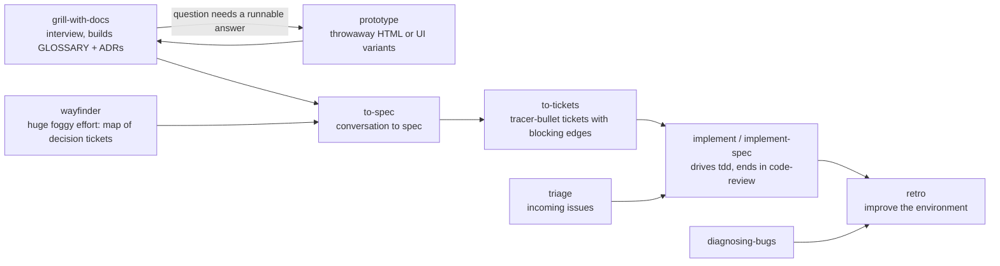

> STATUS 2026-10-16 (rubric walk): KEEP-AS-SOURCE. See 27-rubric-walk.md. Rulings in 26 win.

# Methodology research 02: Matt Pocock skills, pstack, and other skill collections

Date: 2026-10-16. Read in the built-in browser, page by page, on GitHub (no bulk pulls). Subject: what QMX should borrow for its copilots, Lab, strategy research, mini-apps, autonomous workflows and output presentation.

Sources read (all public):

- Matt Pocock skills: README https://github.com/mattpocock/skills , router https://github.com/mattpocock/skills/blob/main/skills/engineering/ask-matt/SKILL.md , plus each SKILL.md linked below.
- pstack (poteto, Cursor plugin): https://github.com/cursor/plugins/tree/main/pstack , mode file https://github.com/cursor/plugins/blob/main/pstack/skills/poteto-mode/SKILL.md , playbooks https://github.com/cursor/plugins/tree/main/pstack/skills/poteto-mode/playbooks , guide https://github.com/cursor/plugins/tree/main/pstack/docs/guide
- Anthropic skills: https://github.com/anthropics/skills , skill-creator https://github.com/anthropics/skills/blob/main/skills/skill-creator/SKILL.md
- Open Agent Skills standard: https://agentskills.io/home and https://agentskills.io/specification
- Trading collections: https://github.com/ml4t/skills , https://github.com/quantskills/quantskills

---

## 1. Matt Pocock skills (mattpocock/skills)

### What it is

About 30 small skills in buckets: `engineering/`, `productivity/`, `misc/`, `in-progress/` (beta), `deprecated/` (empty; retired skills are deleted). Pitched as "small, easy to adapt, and composable", working "with any model", and explicitly positioned against frameworks like BMAD that "own the process" (README).

### The core idea: two kinds of skill

- **User-invoked** skills (`disable-model-invocation: true`) only fire when the human types them. Their job is to orchestrate. They cost no context, but the human must remember them.
- **Model-invoked** skills keep a description so the agent can reach for them on its own. They hold reusable discipline (grilling, tdd, domain-modeling, codebase-design).
- Rule: a user-invoked skill may call model-invoked skills, never another user-invoked one. When user-invoked skills pile up, a **router skill** (`ask-matt`) names them and when to use each. Source: https://github.com/mattpocock/skills/blob/main/skills/productivity/writing-for-agents/SKILL-MECHANICS.md

### The main flow (idea to ship)

From `ask-matt`:



- Steps 1 to 3 (grill, spec, tickets) stay in one context window. Each implement run starts fresh from a ticket.
- "Smart zone": about 150k tokens of sharp reasoning. Compact at phase boundaries, not mid-phase.
- `retro` turns mistakes into deterministic checks first, coding standards second, steering text last.

### Skills that matter most for QMX

| Skill | Shape | Why it matters for QMX |
|---|---|---|
| `grilling` https://github.com/mattpocock/skills/blob/main/skills/productivity/grilling/SKILL.md | Design tree; ask the whole "frontier" of unblocked questions per round; each question numbered with a recommended answer; word it so "yes" accepts the recommendation; facts are the agent's job, decisions are the human's; done when frontier is empty. | Best known pattern for turning a vague strategy idea into a decided one, with minimal effort from a non-technical operator ("yes" accepts). |
| `grill-with-docs` | Grilling plus `domain-modeling`: updates GLOSSARY.md and ADRs inline. | Builds a shared trading vocabulary the agents then reuse; cuts verbosity. |
| `wayfinder` https://github.com/mattpocock/skills/blob/main/skills/engineering/wayfinder/SKILL.md | One "map" issue (Destination, Notes, Decisions so far, Not yet specified = fog, Out of scope) plus child decision tickets typed research (AFK), prototype (HITL), grilling (HITL), task (HITL or AFK). Resolve one ticket per session. Refer to tickets by name, never by number. | Directly fits a long strategy research effort: explicit HITL vs AFK typing, fog of war, one decision per session. |
| `prototype` https://github.com/mattpocock/skills/blob/main/skills/engineering/prototype/SKILL.md | Two branches: a single double-clickable HTML file that drives a state model "a non-developer can drive", or several radically different UI variants on one route switched by a URL param. Surface the full state after every action. Keep on a throwaway branch. | Template for Lab sketches and mini-app UI options. Matches the operator's "options + click-through" preference. |
| `improve-codebase-architecture` + `HTML-REPORT.md` https://github.com/mattpocock/skills/blob/main/skills/engineering/improve-codebase-architecture/HTML-REPORT.md | Output is one self-contained HTML file (Tailwind + Mermaid via CDN). Before/after diagrams carry the weight. "If the diagram needs a paragraph to be understood, redraw the diagram." Wins bullets 6 words max. | The single best spec found for "visual, not text" agent output. Copy its rules for QMX reports. |
| `pr` https://github.com/mattpocock/skills/blob/main/skills/engineering/pr/SKILL.md | Summary as the smallest visual (pseudocode, call tree, file tree, Mermaid, diff-sketch), Evidence before/after (screenshots S-tier, test output A-tier), Merge Danger (one-way or two-way door, blast radius). Credits humanlayer/skills `show-me`. | Shape for any agent "here is what changed" card, e.g. strategy version change. |
| `to-tickets` | Vertical tracer-bullet slices with blocking edges; quiz the user on granularity; publish to local files or tracker. | Breaking a strategy build into verifiable slices. |
| `implement-spec` | Tickets as a task graph; run implementers on the ready frontier in parallel; merge into one integration branch; one code-review at the end. Communicate through context pointers, not pasted text. | Model for autonomous workflow graphs (frontier-driven). |
| `research` | Background agent; primary sources only; one cited Markdown file saved where the repo keeps notes. | Already how QMX does research. |
| `wait-what` | Re-pitch the last message in ASD-STE100 Simplified English, using GLOSSARY.md terms. | One-button "explain that again simply" for the operator. |
| `writing-for-agents` https://github.com/mattpocock/skills/blob/main/skills/productivity/writing-for-agents/SKILL.md | Context pointers, two loads (context vs cognitive), information ladder, completion criteria (clear + demanding), leading words, prompt the positive not the negation, prune no-ops. | The house style for writing QMX skills. |
| `retro` | Classify each mistake: mechanical gets a deterministic check; judgement gets a coding standard; AGENTS.md kept to pointers. | Self-improvement loop for QMX agents. |
| `loop-me` (beta) https://github.com/mattpocock/skills/blob/main/skills/in-progress/loop-me/SKILL.md | Stateful grilling whose only output is workflow specs in `workflows/*.md`. Vocabulary: **Trigger** (event or schedule), **Checkpoint** (human verifies or decides), **Push right** (defer the checkpoint as late as possible), **Brief** (decision-ready summary with link down to the asset, never raw output). Done when an implementer could build it without one question. | The best found pattern for "describe a workflow roughly and have it built". |
| `chief-of-staff` (beta) https://github.com/mattpocock/skills/blob/main/skills/in-progress/chief-of-staff/SKILL.md | One long session owns a goal; all work in background subagents; think tactical and strategic; improve the environment every turn. | Shape for the Portfolio copilot or a standing desk agent. |
| `handoff`, `to-questionnaire`, `teach`, `wizard` | Portable handoff doc; async questionnaire for someone else; multi-session teaching; bash wizard for human-only steps. | `teach` fits an operator learning trading concepts; `wizard` fits broker setup steps. |

### How Pocock handles the human and the output

- Human in the loop: grilling rounds with recommended answers; HITL vs AFK ticket types; quiz the user before publishing tickets; "do not act until the user confirms shared understanding".
- Output: visual first (HTML report, Mermaid, diff-sketches), plain English, glossary terms only.

### Model-agnostic status

High. Skills are plain SKILL.md. Claude-specific bits: `disable-model-invocation` frontmatter, "call the Skill tool with X", subagent wording. Codex gets a sidecar `agents/openai.yaml` per skill (`display_name`, `short_description`, `policy.allow_implicit_invocation`), e.g. https://github.com/mattpocock/skills/blob/main/skills/productivity/writing-for-agents/agents/openai.yaml . Install paths exist for Claude Code, Codex, Copilot, Gemini CLI and "any other agent".

---

## 2. pstack (cursor/plugins/pstack, by poteto / Lauren Tan)

### Layout

```
pstack/
  .cursor-plugin/plugin.json   name, version 0.15.25, "skills": "./skills/", "agents": "./agents/"
  agents/poteto-agent.md       delegate subagent; must read poteto-mode SKILL.md first
  agents/comment-sicko.md      read-only comment reviewer
  skills/                      ~55 skills: poteto-mode + 23 playbooks, 24 principle-* skills, tools
  automations/benny/           dormant Slack triage + repro/fix automation pack
  docs/guide/01..10            the human guide
```

### Methodology

One mode skill (`/poteto-mode`) is the entry point. It:

1. Matches the task to one of 23 playbooks and opens a todo list whose first items are the playbook steps copied verbatim. A skipped step stays in the list with `skip: <reason>`.
2. Routes to helper skills as steps fire (how, why, architect, arena, swarm, interrogate, unslop, tdd, principles).
3. Ends every playbook with a reply in a fixed shape: short declarative sentences, impact for the consumer and maintainer first, every claim labelled measured / inferred / guess.

Key triggers in the mode file:

- **Before asking the human a "which approach" question, classify it.** If the answer is a fact you could observe by running something, prototype it and let the result decide. Ask only genuine product or preference calls.
- **Autonomy:** reversible work proceeds without asking. Always pause for irreversible writes (force-push, deploys, data deletion, customer messages). Session overrides ("going to bed", "run until done") keep it going.
- **Subagents:** fresh subagent per new piece of work with "consolidated scope"; explicit model per role; "you own every subagent's work"; a second opinion is the same prompt on a different model, and agreement is high signal.
- **No is an acceptable answer.** Candor over sycophancy.

### Playbooks worth knowing (all under `skills/poteto-mode/playbooks/`)

| Playbook | Core loop | QMX relevance |
|---|---|---|
| `hillclimb.md` https://github.com/cursor/plugins/blob/main/pstack/skills/poteto-mode/playbooks/hillclimb.md | Fix one metric + direction + stop predicate (target AND minimum attempts). Build and freeze the measurement harness, prove it is sensitive. Decision log row per attempt: hypothesis, change, before, after, delta, verdict kept/reverted. One change, one measurement, keep or revert. Push past plateaus; never relax the predicate. | Maps almost exactly onto strategy iteration. Must be paired with overfitting controls (see ml4t below), or it will hill-climb a backtest into a curve fit. |
| `autonomous-run.md` | State exit condition as a checkable predicate; wake on events or heartbeat; smallest change per iteration; checkpoint every iteration; stop only on predicate or genuine dead end. "A duration is not a finish condition." | Template for unattended Lab runs and scheduled workflows. |
| `eval.md` | Blind candidates (no "eval", "judge", "benchmark" words they can see); one organic prompt; N candidates on different models; one blinded judge on a different model family; verify from transcripts, not self-report. | How QMX should test a new skill or prompt change before promoting it. |
| `figure-it-out` https://github.com/cursor/plugins/blob/main/pstack/skills/figure-it-out/SKILL.md | When no playbook fits: Frame (falsifiable done predicate, scope, rigor level), Design the workflow (units, riskiest first, harness before work), Run the loop (each unit an experiment; verdict VERIFIED / NOT VERIFIED / INCONCLUSIVE), Keep the trail, Verify and hand back. | The generic "design a bespoke workflow" step that an autonomous QMX agent can run. |
| `orchestrate.md` https://github.com/cursor/plugins/blob/main/pstack/skills/poteto-mode/playbooks/orchestrate.md | Coordinator never writes code. Store with one writer per file: `preferences.md` (standing orders pasted into every spawn), `units.tsv`, `ledger.tsv`, `gates.md` (parked human questions with default), `status.md` derived, never narrated. Brief template GOAL / SCOPE / CONTEXT / ACCEPTANCE / VERIFY / TIMEBOX / FORBIDDEN / REPORT / STANDING. Escalate only irreversible actions and true preference calls. | Pattern for the QMA orchestrator and any multi-agent research program. The brief template is directly reusable. |
| `prototype.md`, `investigation.md`, `feature.md`, `bug-fix.md`, `pause-safely.md`, `session-pickup.md` | Standard engineering loops. Pause safely + session pickup give clean suspend/resume. | Pause/resume matter for long Lab runs. |
| `authoring-a-skill.md` | Use the host's skill authoring tool; validate frontmatter and links; "when in doubt, delete". | Skill-building flow. |

### Helper skills

| Skill | What it does |
|---|---|
| `arena` https://github.com/cursor/plugins/blob/main/pstack/skills/arena/SKILL.md | N candidates on the same prompt (prompt is the contract), rubric of 3 to 6 criteria hidden from candidates, cross-judge on another model family, pick a base, graft 1 to 2 good parts from each loser, verify. If candidates wildly diverge, the framing was wrong: reframe, do not average. |
| `architect` | Ground (how/why), sketch types and signatures via arena, "design it twice", optional human checkpoint, implement against the sketch, scrap when friction patterns repeat. |
| `interrogate` https://github.com/cursor/plugins/blob/main/pstack/skills/interrogate/SKILL.md | One reviewer per configured model; adversarial signal comes from model diversity, not personas. Lead judge buckets findings: Act on / Consider / Noted / Dismissed, plus an agreement map. |
| `swarm` | Fan out N workers (partition or race), each report PASS / ISSUES / BLOCKED with evidence; a gap is not a pass; one consolidated report. |
| `show-me-your-work` https://github.com/cursor/plugins/blob/main/pstack/skills/show-me-your-work/SKILL.md | Append-only TSV decision log: ts, phase, decision, why, evidence (pointer), result. Audit the log against the transcript at the end. A different model family reviews the trail; reply ends with an "Attention" section. |
| `ketchup` https://github.com/cursor/plugins/blob/main/pstack/skills/ketchup/SKILL.md | Catch-up after time away: under 150 words, pictures first (screenshots, Mermaid, charts, at most 6 boxes, 8 words each), one plain line per thing asked, then action items with recommendation and "what happens if you do not answer". A Markdown table is not a visual. Never invent a number. |
| `bro`, `in-your-own-words`, `sharpen` | Plain-language restate; restate the user's goal; pre-task "how would a top expert approach this, plus one outside check". |
| `correct` https://github.com/cursor/plugins/blob/main/pstack/skills/correct/SKILL.md | Find repeated agent mistakes; fix each class at the highest level (architecture, then types, then lint naming the fix, then test, docs last); keep a rule table pairing each rule with its enforcer. |
| `automate-me` https://github.com/cursor/plugins/blob/main/pstack/skills/automate-me/SKILL.md | Mine recent transcripts in slices with parallel subagents; keep patterns seen in 2+ slices; ask 1 to 2 multi-choice questions; cluster; draft a `<handle>-mode` skill; iterate; land via PR. |
| `setup-pstack` https://github.com/cursor/plugins/blob/main/pstack/skills/setup-pstack/SKILL.md | Detect available models; ask a budget (unlimited / large / medium / small); write one always-applied rule mapping each role (feature, judgment and prose, arena runners, interrogate reviewers, swarm workers...) to a model. Skills read roles, never hard-coded models. |
| `make-bot-ui` | A clickable local page whose buttons POST JSON to a webhook routine that wakes a bot. Secret stays server-side; body treated as untrusted data. |
| `create-verification-skill`, `benchmark-checklist`, `blast-radius` | Project-local "drive the app like a user"; vet a measured number; find what a change can break beyond the diff. |
| `principle-*` (24) | One rule each, e.g. `principle-explain-the-number` https://github.com/cursor/plugins/blob/main/pstack/skills/principle-explain-the-number/SKILL.md : ask "why not double?", name the limiter, list what else the number could be measuring (errors, skipped or cached work, untuned side, noise), keep run count and spread with the number. Others: prove-it-works, never-block-on-the-human, experience-first, laziness-protocol, build-the-lever, encode-lessons-in-structure. |

### Overnight guidance (guide page 07)

https://github.com/cursor/plugins/blob/main/pstack/docs/guide/07-overnight.md . Earn trust before looping (done it once by hand, the agent has your tools, every stage can stop the line, repeated failures turned into checks). The overnight contract: goal, finish condition, permissions, escape hatch. Automated lines: every stage can stop the line, and every stage hands over evidence.

### Cursor-specific vs portable

| Cursor-specific | Portable |
|---|---|
| `/loop`, Cursor Projects, cloud agents, `environment: "cloud"`, `run_in_background`, Task tool `subagent_type`, `AskQuestion` tool, `~/.cursor/rules/*.mdc` always-applied rules, `.cursor-plugin/plugin.json`, Cursor built-ins `create-skill`, `babysit`; `make-bot-ui` webhook routines; slugs like `grok-4.7-xhigh-fast` | Playbook texts, principles, arena / interrogate / swarm logic, decision log, brief template, ketchup output rules, role-to-model indirection, autonomy policy (reversible proceeds, irreversible pauses) |

The design already leans portable: skills read a **role** ("judgment and prose", "swarm workers") and a rule file maps roles to models, with `inherit-parent` / `auto` as fallbacks. QMX can keep that exact indirection and point roles at any provider.

---

## 3. Other collections (short)

- **Anthropic skills** https://github.com/anthropics/skills : the reference set (docx, pdf, pptx, xlsx, frontend-design, web-artifacts-builder, webapp-testing, mcp-builder, theme-factory, canvas-design, skill-creator). `skill-creator` is the strongest "build a skill" loop: capture intent (extract from the conversation if possible), interview, write SKILL.md with a slightly "pushy" description, write 2 to 3 realistic test prompts, run with-skill and baseline in parallel, draft assertions while runs go, grade, show an HTML viewer with Outputs and Benchmark tabs where the user leaves feedback, iterate, then optimize the description for triggering. Advice: explain the why instead of MUSTs; bundle scripts that every test run reinvented.
- **Agent Skills open standard** https://agentskills.io/specification : `name` (lowercase, hyphens, matches folder), `description` (what + when, max 1024 chars), optional `license`, `compatibility`, `metadata`, experimental `allowed-tools`. Folders `scripts/`, `references/`, `assets/`. Progressive disclosure: metadata ~100 tokens always, body < 5000 tokens on activation, resources on demand. References one level deep. This is the model-agnostic format QMX should store skills in.
- **ml4t/skills** https://github.com/ml4t/skills : 61 Markdown-only quant skills (Apache-2.0) from "Machine Learning for Algorithmic Trading, 3rd ed." Every skill: Problem, WRONG code, CORRECT code, Guardrails, optional production handoff, Checklist, max 120 lines. Concepts: backtest-overfitting, lookahead-bias, data-leakage, point-in-time, survivorship-bias, transaction-costs, regime-awareness. Validation: cpcv, deflated-sharpe, purging-embargo, walk-forward-cv. Workflows: `strategy-workflow` (7 stages with quality gates: Hypothesis term sheet with mechanism and kill criteria before any code, Data, Features, Model, Backtest net of costs, Paper trade, Live; guardrail "Sharpe > 2.0 on daily data: assume lookahead until proven otherwise") https://github.com/ml4t/skills/blob/main/workflows/strategy-workflow/SKILL.md . `research-operator` https://github.com/ml4t/skills/blob/main/advanced-ai/research-operator/SKILL.md : a thin loop with a small typed tool set (list_skills, read_skill, read_file, query_registry, run_bash in sandbox, edit_file, done), must read skills before acting, checkpoint state after every tool call, allows a negative-result conclusion. Very close to what a QMX Lab agent should be.
- **quantskills** https://github.com/quantskills/quantskills : a community directory (218 assets, 10 categories, mostly Chinese markets) with skill and agent templates and a workflow map (data, research signal, portfolio validation, monitoring and trading, orchestration). Useful as a catalogue to mine, not as a methodology.
- Also seen in search, not read in depth: Superior-Trade/superior-skills (Hyperliquid build/backtest/deploy), MantaDigital/stingray-agent-skills. humanlayer/skills `show-me` is the origin of Pocock's `pr` shape.

---

## 4. The methodology each collection encodes

| | Vague idea to verified result | Human in the loop | Output presentation |
|---|---|---|---|
| Pocock | Grill (shared language) → optional prototype → spec → tracer-bullet tickets → TDD build → two-axis review → retro. Huge efforts: wayfinder map of decision tickets. | Grilling rounds with recommended answers ("yes" accepts); HITL vs AFK ticket types; human owns decisions, agent owns facts. Checkpoints pushed right (loop-me). | HTML reports with before/after diagrams; smallest visual summary; plain English in glossary terms; `wait-what` re-pitch. |
| pstack | Mode picks a playbook; frame a falsifiable predicate; build and freeze a harness; hypothesis loop (one change, one measurement, keep or revert); decision log; verify on the real artifact; cross-model review. | Reversible work never waits; ask only preference calls no experiment can settle; parked gates with defaults; irreversible actions always pause. | Fixed reply shapes; ketchup (pictures first, under 150 words, action items with recommendation and default); TSV decision trail with an "Attention" section. |
| ml4t | Hypothesis term sheet with kill criteria → data → features → model → cost-aware backtest → paper → live, each behind a numeric gate. | Gates define "do not proceed"; agent governance and approvals in advanced-ai skills. | Tearsheets; checklist per skill. |
| Anthropic skill-creator | Intent → draft → test prompts → with/without runs → assertions → viewer → feedback → iterate. | Human reviews outputs in a browser viewer and types feedback per case. | Self-contained HTML viewer. |

---

## 5. How a skill becomes model-agnostic

1. **Store in the open Agent Skills format** (agentskills.io): plain SKILL.md, `name` + `description`, `scripts/`, `references/`, `assets/`. Keep host extras in `metadata` or sidecar files (Pocock's `agents/openai.yaml` pattern).
2. **Name roles, not models.** Copy pstack's `setup-pstack` indirection: skills say "judgment model", "worker model", "review panel"; one QMX settings table maps roles to any provider (UI-editable, matching the operator rule "configurable = UI-editable").
3. **Name capabilities, not tool names.** Replace "call the Skill tool", "Task tool with subagent_type", "AskQuestion", "/loop", "run_in_background" with QMX verbs: `load_skill`, `spawn_worker`, `ask_operator(question, options, default)`, `schedule(trigger)`. The harness binds each verb to LangGraph nodes or the host's tool.
4. **Strip host paths and built-ins.** `~/.cursor/rules`, `agent-transcripts/`, `.claude/`, Cursor `create-skill` / `babysit`, Claude Code `disable-model-invocation`. Replace invocation flags with a QMX `metadata.invocation: user | model` field.
5. **Keep the prose plain and positive** (writing-for-agents): leading words, clear completion criteria, no reliance on one model's quirks (e.g. skill-creator's note that Claude "undertriggers" so descriptions are pushy is Claude-specific tuning; QMX should tune descriptions per model via evals).
6. **Test across models with the pstack `eval` playbook**: same organic prompt, candidates on different model families, blinded judge on another family.

---

## 6. "Describe a skill roughly and have it built" patterns

| Pattern | Source | Shape |
|---|---|---|
| skill-creator | Anthropic | Capture intent from conversation → interview → draft → test prompts → with/without runs → HTML viewer feedback → iterate → description tuning. Most complete, eval-driven. |
| automate-me | pstack | Mine history in slices, keep patterns seen twice, 1 to 2 multi-choice questions, draft a personal mode skill, vibe-check. Best for "work the way I work". |
| loop-me | Pocock (beta) | Grill until a workflow spec has Trigger, Checkpoints (pushed right), and Brief, and an implementer could build it with zero questions. Best for workflows. |
| authoring-a-skill playbook + correct + retro | pstack, Pocock | Validate frontmatter/links; delete what does not change a decision; promote repeated corrections to checks. Best for maintenance. |
| writing-for-agents | Pocock | The style guide every generated skill should pass. |

QMX should combine them: **loop-me interview → skill-creator test loop → writing-for-agents style pass → eval playbook across two model families → publish to the Library**.

---

## 7. Skill → QMX use → adopt / adapt / skip

| Skill (source) | QMX use | Verdict |
|---|---|---|
| grilling (Pocock) | Every copilot's "clarify the idea" step; Lab and strategy ideation | Adopt |
| grill-with-docs + domain-modeling (Pocock) | Keep a QMX trading GLOSSARY and decision records per strategy | Adapt (glossary per workspace/strategy) |
| ask-matt router (Pocock) | Plain copilot's "what can I do here" menu | Adapt (as a visual skill picker, not text) |
| wayfinder (Pocock) | Long strategy research programs: map of decision tickets, HITL vs AFK | Adapt (tickets live in QMX, not GitHub) |
| prototype (Pocock) + Prototype playbook (pstack) | Lab sketches; mini-app UI variants with a switcher | Adopt |
| to-spec / to-tickets (Pocock) | Strategy build plan as vertical slices; mini-app build plan | Adapt |
| implement / implement-spec (Pocock) | Mini-app build; frontier-driven workflow graph | Adapt |
| tdd (Pocock) | Mini-app code; strategy code unit tests at agreed seams | Adopt for mini-apps |
| code-review (Pocock), interrogate (pstack) | Review strategy code and mini-apps with two model families | Adapt |
| improve-codebase-architecture HTML-REPORT (Pocock) | Template rules for all QMX visual reports | Adopt the format rules |
| pr (Pocock) | "What changed" card for a strategy version or mini-app update (door + blast radius) | Adapt |
| wait-what (Pocock), bro, in-your-own-words (pstack) | One-click "say it simpler" and "what do you think I want" | Adopt |
| research (Pocock) | Background research agent writing cited notes into the repo | Adopt |
| retro (Pocock), correct (pstack) | Weekly self-improvement: turn repeat mistakes into checks | Adopt |
| loop-me (Pocock beta) | Autonomous workflow designer (Trigger, Checkpoint, Push right, Brief) | Adopt (core of workflow builder) |
| chief-of-staff (Pocock beta) | Portfolio copilot as a standing goal owner | Adapt (with stricter instructions) |
| teach (Pocock) | Operator learning trading concepts | Adapt (later) |
| wizard (Pocock) | Human-only steps: broker linking, VPS setup | Adapt (as UI wizard, not bash) |
| handoff (Pocock), pause-safely + session-pickup (pstack) | Suspend/resume long runs across sessions and models | Adopt |
| poteto-mode (pstack) | Pattern for each QMX copilot: a mode that picks a playbook and copies its steps into a visible todo | Adapt (one mode per copilot) |
| hillclimb playbook (pstack) | Strategy iteration loop (one change, one backtest, keep or revert) | Adapt: add ml4t gates (deflated Sharpe, walk-forward, holdout untouched, trial count logged) |
| autonomous-run playbook (pstack) | Unattended Lab runs and scheduled workflows | Adopt |
| figure-it-out (pstack) | Autonomous agent designs a bespoke workflow when none fits | Adopt |
| orchestrate playbook (pstack) | QMA orchestrator; multi-agent research programs | Adapt (brief template, gates.md, standing orders) |
| eval playbook (pstack), skill-creator (Anthropic) | Testing skills and prompts across models before promoting to Library | Adopt |
| arena (pstack) | Generate 2 to 3 competing strategy variants or mini-app designs, judge, graft | Adapt |
| swarm (pstack) | Parameter or market sweeps with PASS/ISSUES/BLOCKED reports | Adapt |
| architect (pstack) | Mini-app design before code | Adapt (mini-apps only) |
| show-me-your-work (pstack) | Decision trail for every autonomous run, rendered as a table/timeline in the UI | Adopt |
| ketchup (pstack) | Operator catch-up after time away, pictures first | Adopt (high priority) |
| sharpen (pstack) | Pre-task framing step inside copilots | Adopt |
| automate-me (pstack) | "Mubarak-mode": capture the operator's preferences into a mode skill | Adopt |
| setup-pstack (pstack) | Role-to-model settings screen | Adapt (UI-editable roles, any provider) |
| principle-explain-the-number, prove-it-works, never-block-on-the-human (pstack) | Guardrails for backtest numbers and agent autonomy | Adopt |
| make-bot-ui (pstack) | Mini-app buttons that wake an agent with JSON | Adapt idea; skip Cursor webhook/Tailscale specifics |
| benny automation (pstack) | Template for a staged automated line (triage, repro, fix, each stage can stop the line) | Adapt pattern |
| no-comments, typescript-best-practices, worktree-cleanup, babysit, shipping, autopilot-* (pstack) | Engineering-only | Skip for copilots (keep for QMX dev) |
| ml4t strategy-workflow, backtest-overfitting, deflated-sharpe, walk-forward-cv, lookahead-bias, transaction-costs, point-in-time (ml4t) | Validation gates for the strategy pipeline | Adopt (Apache-2.0) |
| ml4t research-operator, agent-governance, agent-state-memory (ml4t) | Lab agent architecture: small typed tool set, skills read first, checkpoint each call | Adopt pattern |
| frontend-design, web-artifacts-builder, theme-factory (Anthropic) | Mini-app and report visuals | Adapt |
| docx/pdf/pptx/xlsx (Anthropic) | Export reports | Skip for now (source-available, not open) |

---

## 8. Ideas for QMX

1. **One skill format, QMX verbs.** Store every QMX skill in the open Agent Skills format. Replace host tool names with five QMX verbs (`load_skill`, `spawn_worker`, `ask_operator`, `schedule`, `publish_view`). The LangGraph harness binds them. This is what makes skills model-agnostic.
2. **Roles, not models, in a UI table.** Copy setup-pstack: roles such as Copilot, Lab worker, Judge, Review panel, Researcher. The operator picks a provider per role in Settings. Skills never name a model.
3. **Each copilot is a "mode" with playbooks.** Plain copilot = router (ask-matt style) shown as a visual menu. Lab copilot = more freedom: prototype, arena, hillclimb, autonomous-run. Portfolio copilot = more instruction: ml4t gates, chief-of-staff, always-pause on anything touching money. A mode copies the playbook steps into a visible checklist the operator can watch.
4. **Strategy pipeline = Pocock flow + ml4t gates.** Grill the idea → hypothesis term sheet (mechanism, kill criteria, capacity) → prototype/storyboard → tracer-bullet build → backtest net of costs → validation gates (walk-forward, deflated Sharpe, untouched holdout) → paper → portfolio. Each gate is a deterministic node; the agent cannot skip it.
5. **Hillclimb with an overfitting brake.** Use pstack's hillclimb loop for strategy iteration, but log every trial, compute deflated Sharpe over the trial count, and keep a holdout the loop never sees. "Sharpe > 2 on daily data: assume lookahead" becomes an automatic red flag.
6. **Explain-the-number on every result card.** Each backtest number shows run count, spread, and what could fake it (costs off, lookahead, survivorship). From principle-explain-the-number.
7. **Grilling as the default question style.** Questions come in rounds, numbered, each with a recommended answer, worded so "yes" accepts. Facts are looked up by the agent, never asked. Shown as clickable cards, not text.
8. **Ketchup as the home screen after time away.** Under 150 words, pictures first, one line per thing he asked for, action items with a recommendation and "what happens if you do not answer". Matches the operator's dislike of text blocks.
9. **Visual report standard from HTML-REPORT.md.** Every agent report is one HTML view: diagrams carry the weight, before/after side by side, wins in 6 words, no paragraphs. "If the diagram needs a paragraph, redraw the diagram."
10. **Workflow builder = loop-me.** The operator describes a routine roughly; the agent grills until the spec has a Trigger, Checkpoints pushed right, and a Brief, then builds it as a deterministic/agentic/mixed graph. Done when a builder could implement it without one question.
11. **Skill builder = loop-me interview + skill-creator test loop + eval playbook.** Draft, run 2 to 3 realistic prompts with and without the skill on two model families, show results in a viewer where he clicks good/bad, iterate, then publish to the Library.
12. **Decision trail on every autonomous run.** show-me-your-work TSV, rendered as a timeline in the UI, reviewed by a second model family, with an "Attention" box on top.
13. **Autonomy policy as a standing rule.** Reversible work proceeds; anything irreversible or money-touching parks in a gates list with a default. Pocock HITL/AFK typing marks which workflow nodes need him.
14. **Wayfinder for big research themes.** A map per theme (Destination, Decisions so far, Fog, Out of scope) with typed tickets, one decision per session, tickets named not numbered.
15. **Arena for ideation.** For a new strategy idea, generate 2 to 3 structurally different variants on different models, judge against a rubric, graft. Wild divergence means the idea is under-specified: go back to grilling.
16. **Mini-app lifecycle.** Create: grill → prototype UI variants with a switcher → tracer-bullet build with TDD → review. Maintain: retro/correct turn repeat bugs into checks. Delete: a pr-style card stating door type (one-way/two-way) and blast radius before removal.
17. **Mubarak-mode.** Run automate-me over past sessions to capture his standing rules (plain English, visuals, no re-asking settled decisions) into one mode skill every QMX agent loads.
18. **Mine ml4t and quantskills, do not copy blindly.** ml4t is Apache-2.0 Markdown and directly reusable for validation gates. quantskills is a catalogue to browse for ideas; check each licence.
