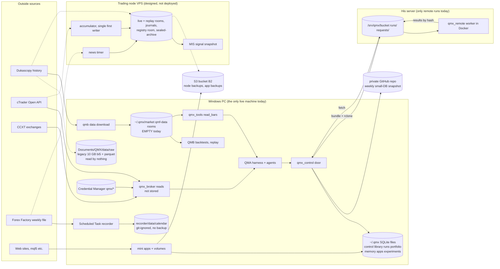
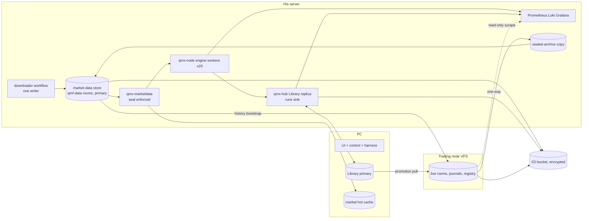

# 30 - Data and DevOps: how QMX handles every kind of data, and what changes

Date: 2026-10-16. Research only. Nothing here is decided. Asked for by ruling 58 (file 26, section G), read with rulings 41-43 and 55-57.

How this was read:
- Code is branch `qma/hp17` (head `584a7f41`), read with `git show` and `git grep`. Paths below are on that branch.
- Docs are `C:\Users\Mubarak\Desktop\QMX\docs\`.
- Disk facts are read-only checks on this PC.
- Plans are `architecture/library-and-data/`, `architecture/workflow-engine/`, and files 09 and 29.

Tags: **[code]** read in code, **[docs]** read in ratified docs, **[disk]** seen on this PC, **[plan]** from the two new architectures or file 29, **[inferred]** my reasoning.

---

## 0. The answer in eight lines

1. QMX has a well-designed **market-data store** (qmf-data rooms: Parquet raw archive, DuckDB views, SQLite registry, JSONL journals) **[code]**. On this PC it holds **no market data**. `~/.qmx` is 181 KB **[disk]**.
2. The real history (EURUSD and USDJPY ticks, 2003 to 2026-08-10, **about 10 GB**) sits in an old-era layout under `Documents\QMX\data\raw`. No current code reads it, and no backup job covers it **[disk]**.
3. Live market data exists only in the **trading node** design, and the node is not deployed (no VPS yet) **[docs]**.
4. Small app state is spread over **about twelve SQLite files** in `~/.qmx`. Several open a new connection per call, which is the B1 risk **[code]**.
5. Backups use **four separate mechanisms**, and none of them covers market data on the PC **[code]**.
6. **A Library of objects is not a tick database.** Keep market data in the qmf-data rooms. Give the Library only small `dataset` cards that point at them, so lineage works.
7. **Move the market-data store to his server**, next to the Library Hub. Remote runs read it by reference: a read-only mount on the server, fetch-by-hash with a cache elsewhere. The PC keeps a hot cache.
8. **DevOps:** one observability stack on the server (reuse the node's Prometheus, Loki and Grafana set), engine spans as the trace model, the Hub sidecar for remote runs, one backup table with drills for every store.

---

## 1. Data inventory

"Lives today" means where it physically is on 2026-10-16. "Designed" means code exists but nothing runs it yet.

### 1a. Market data

| Data | Source | Format | Store | Writer(s) | Readers | Size | Retention | Lives today |
|---|---|---|---|---|---|---|---|---|
| Historical ticks (governed path) | Dukascopy, download-once, personal-use licence tag (`packages/qmf-data/src/qmf/data/dukascopy.py:1-25`) | CT-10 observations, bid and ask kept apart, never a mid (`ticks.py:1-12`), then one Parquet file per artifact, `<fp1>.parquet`, atomic rename (`store/engines/parquet.py:1-5,44-60`) | `EvidenceStore(root)/<world>/immutable-raw-archive/` (`store/facade.py:98-101`), partitioned by (source, instrument, window) (`partitions.py:1-12`) | `qmb data download` on the PC (`qmb/src/qmb/data/download.py:256`). On the node: `just node-data-bootstrap` (`qmn/src/qmn/data/bootstrap.py:1-8`) | QMB catalog, gap check, verify, replay (`qmb/src/qmb/host/replay.py:211`). Agents through `qmx_tools.read_bars` at `~/.qmx/market`, replay world (`qmx-agents/packages/qmx-tools/src/qmx_tools/service.py:257-265`) | **Zero today.** `~/.qmx` has no `market/` and no `datasets.json` **[disk]** | Forever (raw and lineage). Views are deletable only if no result cites them (`retention.py:1-20`; DEC-0118) | Nowhere. Designed but empty |
| Legacy deep history | Dukascopy, fetched by the old QMX | Hive folders `venue=FOREX/platform=CTRADER/instrument=X/resolution=tick/date=D/`: 215,068 `.bi5` (4.04 GB), 10,640 per-day `.parquet` (5.92 GB), 21,280 manifests **[disk]** | `C:\Users\Mubarak\Documents\QMX\data\raw\external-deep-history\` | Old QMX, now dead | **None.** Only `archive/recovery/...` notes mention it | ~10 GB. EURUSD and USDJPY, 2003-05-04 to 2026-08-10 **[disk]** | None stated | PC only. **Not in any backup job** |
| Live ticks, trendbars, depth | cTrader Open API (`qmn/src/qmn/venue/live.py:1-15`) | CT-10 observations plus the verbatim wire payload (`qmn/src/qmn/data/observation_sink.py:1-6`) | Node live-world rooms. Code: `EvidenceStore($QMX_STATE/evidence)` (`qmn/src/qmn/host/_supervision.py:525`). Docs: `/var/lib/qmx/rooms/<world>` and `/evidence/<world>` (`docs/components/trading-node.md:121`) | Only the node's accumulator, the "single first writer" (`qmn/src/qmn/data/intake.py:1-12`; TN-13) | Node loop, MIS, reconciliation; replay through the one replay import port (DEC-0229) | Unknown. "Measured at the soak, never estimated" (TN-13) | Forever. Hot rooms purge only after a verified sealed-archive copy AND a verified off-host copy (DEC-0253) | **Not running.** No VPS (memory `qmx-trading-node-sitting`) |
| Recent-gap bridge | cTrader tick history | CT-10, kept apart from Dukascopy, `corroborates` and `disagrees-with` edges | Node raw archive | Node bootstrap only | Node | Capped at one week (TN-13) | Forever | Not running |
| Ad hoc broker reads | cTrader (`ProtoOAGetTrendbarsReq`, spots, trader, reconcile) and CCXT exchanges (`qmx-agents/packages/qmx-broker/src/qmx_broker/adapters.py:20-27,36-172,177-250`) | JSON documents, returned to the caller | **Not stored** | None | Copilot and agents through the broker MCP. Bars are capped at 1000 per call (`service.py:141-162`) | Per call | None | PC, in memory only |
| Spot paper state | Node spot-paper venue | SQLite `paper.sqlite` per account scope, with a writer lock file (`qmn/src/qmn/venue/spot_paper.py:205-216`) | Node state root | Node (one writer, locked) | Node | Small | Unstated | Not running |

### 1b. News, macro and other APIs

| Data | Source | Format | Store | Writer(s) | Readers | Size | Retention | Lives today |
|---|---|---|---|---|---|---|---|---|
| News calendar, PC recorder | Forex Factory free weekly JSON and XML (`recorder/fetch_calendar.py:33-34`) | Raw files plus `manifest.jsonl` and `recorder.log` (`fetch_calendar.py:49-52`) | `C:\Users\Mubarak\Desktop\QMX\recorder\data\calendar\` | Windows Scheduled Task `QMX-Calendar-Recorder`, state Ready. Last fetch 2026-10-15 15:00Z **[disk]** | Nothing in current code | 2.9 MB **[disk]** | Unstated | PC only. **Git-ignored** (`.gitignore:15`) and **in no backup** |
| News calendar, node recorder | Same feed (`qmn/src/qmn/data/news_calendar_recorder.py:1-6`) | CT-10 via CT-15 intake, revisioned (`packages/qmf-data/src/qmf/data/calendar_feed.py:1-17`) | Node rooms | `qmn-news-calendar.timer` | Node blackout gate, fail-closed (TN-13) | Small | Forever | Not running |
| Macro data | No macro feed in core code. The `macro-daily-bias` mini app reads through the control door with a token and asks a model (`examples/apps/macro-daily-bias/app.toml`; `macro_bias.py:101`) | App-defined | That app's volume | The app | The app, its agent | Small | App-defined | Example app only |
| Web sources (articles, exchange status) | `mql5-articles` (network `www.mql5.com`), `exchange-status` | App-defined; `Store(QMX_VOLUME)` (`examples/apps/mql5-articles/collector.py:406`) | `~/.qmx/apps/<id>/` volume with `app.db` and `memory.db` (`qmx_apps/volume.py:47`) | The app (one per volume) | The app; the Library only if the app publishes | Small | App-defined | PC |

### 1c. Governed records, journals and results

| Data | Format | Store | Writer(s) | Readers | Lives today |
|---|---|---|---|---|---|
| Registry records (bots, bindings, results, promotion) | fp1-canonical bytes in SQLite plus lineage JSONL (`store/engines/sqlite_meta.py:1-20`; `facade.py:99-110`) | `<world>/registry-room/records.sqlite` and `lineage/` | Registry room, append-only | QMB `registryread`, the node | Designed. Node not running |
| CT-13 journals (decision, order, fill, risk transition, promotion, data quality, control action) | JSONL per writer stream, rotated by size (`facade.py:103-108`) | `<world>/journal/` | One stream per `WriterId` | Node folds; Book, BMS and bot journals as read-time projections (DEC-0145) | Designed |
| Exit records with `realized_r` (CT-29) | Journal-backed | Node | Node | Alpha decay, bench counter (`docs/lenses/data/data-layer.md:144`) | Designed. **This is the unit's "journal in R"** |
| Analytics views | DuckDB, rebuildable only (`store/engines/duckdb_views.py:1-17`) | `<world>/processed/views.duckdb` | Store | QMB catalog | Designed |
| QMB orchestrator ledger | One `ledger.jsonl` fragment per (machine, role, slot), fsync appends (`qmb/src/qmb/orchestrator/ledger.py:1-7,56`) | QMB run root | Orchestrator only | QMB | PC when QMB runs |
| QMB research bytes | Canonical Stage 0 bytes keyed by `research_ref` (`qmb/src/qmb/host/research_store.py:1-7`) | Research root | QMB host | QMB | PC |
| MIS signal snapshot | Per-instant, versioned, in-process; the shadow stream has its own manifest prefix (TN-19) | Node memory plus journal | Six rule-based labelers plus `liquidity_stress_v1` (`qmn/src/qmn/mis/catalog.py:1-8`) | Book door and KSA only. **Bots never read it** (DEC-0204) | Designed |
| Strategy research DB (Stats) | SQLite | `C:\Users\Mubarak\Desktop\Stats\backend\strats.sqlite`, 651 KB **[disk]** | Stats scripts | `research-corpus` plugin (`qmx-agents/plugins/research-corpus/daemon/plugin.py:42`) | PC |

### 1d. App and agent state (all under `~/.qmx`, from `qmx_control/server.py:262-263`)

| File | Writer(s) | Notes |
|---|---|---|
| `control.db` (49 KB **[disk]**) | `qmx_control/service.py:168`, new connection per call | Settings and app state |
| `library.db` (110 KB) plus `artifacts/<sha256>` | `qmx_control/library.py:64`, new connection per call | "Library B". To be replaced (library AD-1) |
| `runs.db` (20 KB) | `qmx_control/runs.py:22,31,143` **and** `qmx_control/service.py:458` | **Two modules write one file** |
| `runs/<chat>/journal.jsonl` | Harness (`qma/harness/usage.py:346`) | Usage and transcript journal |
| `journals/remote-<id>.jsonl` | `qmx_remote/runs.py:180` | Remote run journal |
| `portfolio.db` (WAL) | `qmx_broker/service.py:107-112,176` | Unsigned order proposals only |
| `copilot/memory.db`, `apps/<id>/memory.db` | `qmx_agents/memory.py:196-207` | Agent memory |
| `copilot/tasks/<run>/threads.db` | `qmx_agents/tasks.py:125` | Per-task threads |
| `apps.db`, `artifacts.db`, `apps/<id>/app.db` | `qmx_apps/supervisor.py:109`, `artifacts.py:32`, `store.py:18` | App catalog, artifacts index, per-app data |
| `experiments.db` | `qmx_ledger/experiments.py:65` | Append-only experiment notebook |
| `settings.toml` | Control | Holds broker identities and `qmx/*` references, never secrets (`qmx_broker/models.py:1`) |
| Planned: `engine.sqlite` | One writer thread (engine AD-17 at `workflow-engine/ARCHITECTURE-SPINE.md:194`) | Events, memos, spans, triggers, inbox |
| Planned: `library/` (objects, blobs, refs, edges, `catalog.db`) | `qmx_library` only (library LLD section 1) | The one Library |

### 1e. Remote runs, secrets, observability, backups (today)

| Thing | Where | Cite |
|---|---|---|
| Remote run bundle | `RunBundle`: definition, inputs, `files` by digest, credential scope refs, resources. **No data mount and no `data_ref`** | `qmx_remote/models.py:67-78` |
| Remote results | Bucket `vps:/srv/qmx/bucket/runs/<id>/` (blobs first, then `manifest.json`), `requests/<id>`, through `rclone` | `models.py:103-104,122-124`; `store.py:33-43,68-76`; `runs.py:97` |
| Remote worker state | `state.db` (LangGraph `AsyncSqliteSaver`), `journal.jsonl` | `qmx_remote/worker.py:88,107,150` |
| Secrets | Windows Credential Manager `qmx/*` through `keyring` | `qmx_broker/credentials.py:9-16`; memory `qmx-broker-credentials-location` |
| Node logs | JSON lines to journald, never journals | `qmn/src/qmn/observability/logging.py:1-6` |
| Node metrics | Prometheus `qmn_` families on the evidence door `/metrics` | `observability/metrics.py:1-6` |
| Node alerts | Closed allow-list generated from `FAILURES.md`; three push classes | `observability/alerts.py:1-8` |
| Node liveness | Outbound alive-ping to an off-VPS watcher, zero authority | `observability/liveness.py:1-9` |
| Node stack | Prometheus, Grafana, Loki, Promtail containers, pinned; the only containers allowed on the VPS | `qmn/deploy/observability/stack.py:1-6,58-75` |
| Backup 1, node | `qmn-backup.timer`, ChaCha20Poly1305, rclone to B2, nightly sample restore, monthly full restore, host-loss rehearsal | `qmn/src/qmn/data/backup.py:1-10`; `backup_run.py:1-8`; TN-13 |
| Backup 2, control | Weekly snapshot of small DBs to a **private GitHub repo**; skips `artifacts`, `blobs`, `data` | `qmx_control/backup.py:1,18-26,121` |
| Backup 3, apps | SQLite backup API, then `rclone sync`, then a download restore test | `qmx_apps/backup.py:96-161` |
| Backup 4, apps (optional) | Litestream 0.5.17 sidecar per app container | `qmx_apps/docker.py:171,275-302` |
| Planned backup 5, Library | PC to server after each commit, server to bucket nightly, drills | library LLD section 10 |

---

## 2. Today's data flows

Dotted lines are designed and not running. Note that **no arrow reaches the remote worker from any market data**.

---

## 3. Problems

1. **The only real history is trapped and orphaned.** About 10 GB of ticks sit on the PC in the old layout. No code reads it, nothing backs it up, and it is on the small disk (ruling 42) **[disk]**.
2. **The designed store is empty.** `qmx_tools.read_bars` and QMB replay point at rooms that hold nothing on this PC. The agent "data tools" therefore work only in tests **[disk, code]**.
3. **Three copies of the same history are on the way.** These are the legacy folder, `qmb data download` on the PC, and `node-data-bootstrap` on the node. Each downloads Dukascopy separately. fp1 identity includes the partition window (`partitions.py:1-12`), so two downloads with different windows become different artifacts of the same facts **[inferred]**.
4. **Two news recorders.** The PC Scheduled Task writes raw files outside any store, git-ignored and unbacked. The node timer writes governed CT-10 data. They poll the same free feed, which has a download budget (TN-13) **[disk, docs]**.
5. **Broker reads have no lineage.** Agent bar reads through `qmx_broker` are returned and forgotten. Any analysis built on them cannot be reproduced or cited **[code]**.
6. **cTrader session and token clash, once the node is live.** The node owns the one live session and the one refresh token. A workstation tool must never refresh a credential the VPS owns (`tracker/trading-node-notes.md:49,90`). Today `qmx_broker` on the PC opens its own cTrader sessions from the same `qmx/*` entries **[code, docs]**.
7. **Too many SQLite files and per-call connections (B1).** Python 3.14.6 here bundles SQLite 3.50.4, which has the WAL-reset bug. `runs.db` has two writer modules, and `library.db` and `control.db` open a connection per call (BACKLOG B1) **[code]**.
8. **Four backup mechanisms with four targets.** These are GitHub weekly, per-app rclone, optional Litestream, and node B2. The PC market data, the legacy history, the recorder data, the Stats DB and the QMB ledgers are covered by none of them **[code]**.
9. **Remote runs cannot reach market data.** `RunBundle` has no data reference (`models.py:67-78`), the bucket has no data area, and QMB refuses a provider fetch inside a run (`qmb/src/qmb/data/policy.py:12`). So a backtest on his server has no history to read **[code]**.
10. **The engine and Library plans also skip market data.** The Library keeps "market-data rooms (stay qmf-data)" out of scope (library HLD section 8; AD-10). The engine passes inputs only by content hash (engine AD-20). Nobody yet owns "how a remote run reads ticks" **[plan]**.
11. **Observability is in three disconnected places.** These are the node's Prometheus, Loki and Grafana; the engine's spans in its ledger; and remote runs' `journal.jsonl` flushed through rclone. The PC has no data-freshness or disk metrics at all **[code, plan]**.
12. **The word "hub" means two things.** The passive file-sync hub (`qmb/src/qmb/registryread/hub.py:1-8`; DEC-0165, DEC-0188) is a write-only inbox. The new Library Hub (`qmx_hub`) is an HTTPS service. Agents will confuse them **[code, plan]**.
13. **Node code and node docs may differ on the tree layout.** Code opens one `EvidenceStore($QMX_STATE/evidence)` (`_supervision.py:525`), while TN-3 names separate `rooms/` and `evidence/` trees under `/var/lib/qmx`. Check this before the node build **[inferred; verify]**.

---

## 4. Proposed data architecture

### 4a. One rule for what goes where

There are four kinds of store. Each does one job.

| Store | Holds | Engine | Why not the Library |
|---|---|---|---|
| **Market-data store** (qmf-data rooms, unchanged) | Ticks, bars, depth, news observations, MIS processed views, per world | Parquet raw archive, DuckDB views, SQLite registry, JSONL journals (DEC-0117) | Ticks are billions of rows, read by time range and column. The Library is content-addressed objects with refs and edges, built for thousands of versioned things, not range scans. **A Library of objects is not a tick database.** |
| **Library** (`qmx_library`, one) | Units, strategies, bots, workflows, runs, artifacts, notes, papers, **plus small `dataset` cards** | Objects, blobs, refs, edges, `catalog.db` | It is the right home for versioned things and lineage |
| **Process-local state** (one SQLite per process, one writer) | Engine ledger, control settings, agent memory, app data | SQLite WAL, one writer thread | Live, transactional, rebuildable or backed up as snapshots |
| **Node evidence** (the trading node's own rooms) | Live world, journals, registry room, sealed archive | qmf-data on the node | Trust boundary (DEC-0188). Money lives here |

**The `dataset` card** is the only bridge. It is a Library object of kind `dataset`. Its fields are source, instrument list, window, world, split manifest fp (CT-12), licence tag, and the list of partition digests. A backtest result gets the edge `consumed -> dataset`. The ticks stay in the store; the card makes them citable. This also fixes problem 5 for anything that runs through QMB.

### 4b. What stays on the PC, what moves to the server

| Item | PC | His server | Node (VPS) |
|---|---|---|---|
| Market-data store, research worlds | **Hot cache** only (recent months, chosen instruments, UI-editable) | **Primary.** Full history, all downloads, all imports | - |
| Legacy 10 GB | Deleted from the PC only after two verified remote copies (library AD-10 rule) | Re-ingested into the store | - |
| Live-world rooms, journals, registry room | Read-only mirror of projections | Copy of `sealed-archive` (research replay source) | **Primary** (TN-3, TN-13) |
| Library | Primary for now (library OPEN-1) | Hub: full replica, the remote-run writer | Mirror of governed records only (OPEN-2) |
| Engine ledger | Local runs | Remote node's own ledger | - |
| News recorder | **Retire** the Scheduled Task | Research recorder (timer) | Its own governed recorder (fail-closed authority stays local) |
| Observability stack | None. The UI reads Hub health and engine traces | **One stack** | Its own zero-authority stack (TN-15), viewed from the server's Grafana |
| Secrets | Credential Manager, the source of truth | Its own keyring for model keys only (file 29 section 8.2) | systemd-creds, provisioned by the wizard (TN-12) |

Rough size for the server [inferred from the 2-pair measurement]: about 3 GB of Parquet plus 2 GB of bi5 per FX pair for 23 years of ticks. 28 pairs would be about 140 GB. That is cheap on his server (ruling 42).

### 4c. One ingest path

- **One downloader.** `qmb data download` becomes an engine `script` workflow placed on the server and scheduled there. It writes only the server store. The PC never downloads history again; it pulls into its cache.
- **Legacy import, once.** Re-ingest from the `.bi5` files (the provider's own bytes) through the Dukascopy adapter and CT-15 intake, licence-tagged personal-use. Ignore the old per-day Parquet; it has no CT-10 identity. Then copy the legacy folder to the bucket as cold evidence. Never delete it without two verified copies.
- **Node bootstrap.** Let `node-data-bootstrap` take its history from the server store (same bytes, hash-verified) with Dukascopy as a fallback. This needs a one-line change to TN-13's "downloads once through the Dukascopy adapter" wording. It avoids a third download and keeps one fp1 per fact.
- **Live data into research.** Node live recordings reach research only through the sanctioned path: node, then `sealed-archive`, then the replay import port (DEC-0229). The server keeps a copy of `sealed-archive` for that read.
- **Broker reads for chat stay ad hoc.** They are fine for a quick look. Anything that feeds a backtest, a unit or a result must come from the store through a `dataset` card. Extend QMB's "runs never fetch" rule (`policy.py:12`) to engine runs.

### 4d. How remote workflow runs get historical data

Add one field and one service. No new database.

1. **`data_ref` on the node job.** A workflow node that needs market data names a `dataset` card fp1 or a CT-12 split fingerprint, the same way it names inputs by hash (engine AD-20). The preflight checks that the data exists where the job is placed. Placement states stay `available | configured | authorized | reachable | healthy` (DEC-0428).
2. **A market-data service on the server** (`qmx-marketdata`, a systemd unit beside `qmx-hub`). It is a thin HTTP reader over the qmf-data read boundary. **It applies the 12-month seal on the server side**, because the seal must hold at every read boundary (DEC-0119). It serves Parquet partitions by digest, since they are already content-addressed (`parquet.py:1-5`). Optionally it can serve a DuckDB query over a split. The Hub run token gets a `data_scope` naming the allowed `data_ref`s (extends library AD-12).
3. **Three placements, one interface** (the `MarketDataPort` the worker sees):

| Where the run is | How it reads | Cost |
|---|---|---|
| His server (the about-20 workers) | Read-only bind mount of the store into the container (`/data:ro`), with qmf-data's reader enforcing the seal in-process | Zero copy |
| E2B, Modal or other burst | Fetch partitions by digest from `qmx-marketdata` over HTTPS, cache by digest in the sandbox | Pays egress once per partition |
| The PC | Local hot cache. On a miss, pull from the server by digest | PC disk only for what he uses |

4. **Results go back as Library objects** on `refs/runs/<id>`, carrying `consumed -> dataset`. Nothing writes back into the market store from a run, except the server-side downloader workflow, which is that store's one writer.

**Considered and not picked now:** a dedicated tick database (ArcticDB, QuestDB, ClickHouse, TimescaleDB). DEC-0117 says no database server, and DuckDB over Parquet covers 2 to 30 pairs comfortably [inferred]. Revisit if the store passes about 1 TB, or if 20 concurrent readers on the server measure slow.

### 4e. How the trading node gets its data

Mostly unchanged from TN-13:
- **Live:** cTrader, through the accumulator, into the live rooms. One writer, recording before interpretation.
- **History:** from the server store (proposed above) or Dukascopy, into the raw archive.
- **News:** its own timer, fail-closed.
- **Units:** governed records arrive by the click-gated promotion pull of registry as-of sets (DEC-0188). The Library mirrors them (library OPEN-2). A unit's strategy, risk profile and MIS config are fp1 objects, so the node runs exactly what the Lab tested.
- **Going back up:** journals, exit records and `sealed-archive` flow node, then server, then PC. The unit's **journal in R is a projection over CT-29 exit records** (`realized_r`), not a new store. The Library gets a `unit-journal` read model (a rebuildable view) so Portfolio and the Lab see it.
- **Self-tuning risk profiles in live** (file 09): each retune is a new risk-profile version written as a registry record with a `supersedes` edge. It is never a mutable row. "Tighten only" is a check on that write.

### 4f. How units read MIS data

- **On the node**, MIS stays a per-instant signal snapshot with a closed consumer set: the Book door and the KSA. Bots never read it (DEC-0204). The cleanest fit for the "unit" is this: **the unit declares its condition needs, and its gate reads the snapshot.** The gate is the Book door or router part of the unit. The strategy code never reads raw MIS. This keeps TN-19 intact. If the risk session rules that strategy code reads MIS directly, that is a TN-19 change and needs a ruling.
- **Per-unit MIS config** (MIS per scalper type, file 09) is a Library object `mis-config`. Its fp enters the unit's identity and the node's `composition_fp`. Candidate configs run in the shadow lane first (TN-19 seam).
- **In research and backtests**, the same deterministic labelers run in QMB over the historical rooms, frontier-bound, so backtest equals live. Their outputs are processed views (rebuildable), keyed by labeler version. A result that cites them keeps them forever (DEC-0117).
- **Training** (`regime_classifier_v1` and later) is an engine workflow that reads the market store through a `dataset` card, with its seed and window recorded. The trained model is a versioned Library artifact that becomes authoritative only by fresh ratification (DEC-0262). Whether it runs on the PC or the server is open question 9.

### 4g. Target picture

---

## 5. DevOps

### 5a. Telemetry: one shape, reused

- **Traces:** the engine's model is the standard. `trace_id = run_id`, and one span per node attempt with tokens, cost, account, placement and verdict (engine AD-15). Remote runs ship the same spans through `qmx-run-sidecar` to the Hub (library AD-13). At run end the trace becomes a Library artifact. Use no second tracing product (no Langfuse). Add Grafana Tempo later only if he wants trace search across runs.
- **Logs:** JSON lines everywhere, in the node's format (`ts`, `level`, `logger`, `event`, `correlation_id`, refusal fields; `logging.py`). On Linux they go to journald, then Promtail, then Loki. Remote containers send logs through the sidecar to the Hub, and the Hub writes them where Promtail reads. Logs are never evidence (DEC-0200).
- **Metrics:** Prometheus text format, reusing the node's pinned images (`stack.py:58-75`) for the server stack.

### 5b. What to measure

| Area | Metrics |
|---|---|
| Market data | Last ingested partition age per (source, instrument); gap-check findings; store bytes per room; downloader failures; seal refusals served |
| Library and Hub | Replication lag PC to server; bucket push age; disk free; object counts (already on `/v1/healthz`, library LLD section 9) |
| Engine and runs | Runs running, parked or waiting; semaphore use of 20; per-account token spend; heartbeat misses; watchdog parks |
| Backups | Age of the last good backup per store; last sample and full drill results |
| Node | TN-15 `qmn_` families, unchanged |
| PC | Disk headroom for the cache and the Library; Docker Desktop up or down |

### 5c. Alerting

- **One inbox for workflows and data** (engine AD-16 severities):
  - Data staler than its configured bound (UI-editable): `normal`.
  - A backup missing for more than 36 h, or a drill failed: `urgent`.
  - Disk headroom breached on the server: `urgent`.
- **The node keeps its own push tier** (three classes, generated from `FAILURES.md`). It is not merged.
- **Server liveness:** copy the node's pattern (`liveness.py`). An outbound ping goes to an off-server free watcher, so a dead server is noticed while the PC sleeps (ruling 57).

### 5d. Backups and restore drills, one table

All bucket copies are encrypted with the one CT-14 payload key `qmx/backup-payload-key` (library OPEN-3 extended to market data). The server pushes; the PC never pushes the bucket.

| Store | Method | Target | Drill |
|---|---|---|---|
| Market store (raw archive, journals, registry, research door) | Nightly encrypted rclone of committed prefixes, reusing `qmn.data.backup_run` code. Processed views excluded unless cited | Server to bucket | Nightly sample restore, monthly full restore (reuse `qmn.data.restore_sample` and `restore_full`) |
| Legacy 10 GB | One-time upload, then frozen | PC to server to bucket | One full hash check after upload |
| Library | library LLD section 10, unchanged | PC to server continuous; server to bucket nightly | As designed |
| Engine ledgers | Nightly SQLite backup-API snapshot (never copy a live `.db`) | Host to server to bucket | Monthly open-and-fold test |
| PC small SQLites (control, memory, apps, experiments, portfolio) | Backup-API snapshot, then rclone to the server. Keep the weekly GitHub snapshot as an extra copy, minus `library.db` | PC to server | Monthly restore into scratch |
| Mini-app volumes | Existing `qmx_apps` backup plus restore test. Litestream only for apps hosted on the Linux server (not on Windows) | As today | As today |
| Node | TN-13, unchanged | Node to bucket | TN-13 three drills |
| Server host loss | Rebuild runbook: provision, restore from the bucket with the escrowed key, rebuild indexes, compare counts | Bucket to a clean host | Once before relying on the server, then after every rebuild |

### 5e. Deployment

- **Server:** Ubuntu with systemd units `qmx-hub`, `qmx-marketdata`, `qmx-node` (engine worker), `qmx-egress` and `qmx-observability`, plus Docker and gVisor (file 29 section 8.2). Deploy by pinned commit into `/opt/qmx/<commit>` with a `current` symlink and a declared prune depth, copying TN-16's pattern. Use one `just server-install` recipe. Tailscale joins the PC and the server.
- **Node:** TN-16, unchanged.
- **PC:** the desktop app (ruling 40).
- **B1 fix inside this work:** one writer per SQLite file. Fold `runs.db` writes into one module, keep a long-lived writer connection per file, and require SQLite 3.51.3 or later (the floor the apps code already checks, `docker.py:171`).

---

## 6. Open questions, each with a recommendation

1. **Does the trading node run on his own server or on a separate VPS?** *Recommend:* a separate small VPS near the broker, as ratified (DEC-0188). File 29 also says "the agent server must not be the trading node". If he wants one box, treat it as the single-machine variant (GAP-0058): separate service user, no Docker socket, pinned CPU for the node.
2. **Where is the market store's primary?** *Recommend:* his server, with a PC hot cache. The PC disk is small (ruling 42), and remote runs need it always on (ruling 55).
3. **Import the legacy 10 GB?** *Recommend:* yes. Re-ingest from the `.bi5` files under the personal-use tag, keep the folder cold in the bucket, and delete from the PC only after two verified copies.
4. **Which instruments and how much depth?** *Recommend:* start with EURUSD and USDJPY (already held). Add pairs on demand through a UI-editable list. The downloader workflow fills them on the server.
5. **A dedicated tick database?** *Recommend:* not now. DuckDB over Parquet behind `qmx-marketdata`. Revisit at about 1 TB or measured slow reads.
6. **How do burst sandboxes get data?** *Recommend:* fetch by digest from `qmx-marketdata` over HTTPS with a run token limited to that run's `data_ref`, and enforce the seal on the server.
7. **PC broker reads once the node is live?** *Recommend:* never share the node's refresh token. Either register a second Open API app for PC research reads, or read account and positions through the node's read-only evidence door over Tailscale. Decide at node deploy.
8. **Record agents' ad hoc broker reads?** *Recommend:* no for chat. Every backtest, unit or result must cite a `dataset` card from the store.
9. **Where does MIS training run?** DEC-0262 says "his own machine". *Recommend:* treat his server as his machine, and run it as an engine workflow reading the store. Ask once, because the docs say "laptop script".
10. **Do units read MIS directly?** *Recommend:* no. The unit declares conditions, and its gate (Book door or router) reads the snapshot, so TN-19 stays intact. Hand this to the risk-sizing session as a constraint.
11. **Retire the PC news recorder now?** *Recommend:* add `recorder/data` to a backup today, and retire the Scheduled Task when the server timer runs.
12. **One observability stack or two?** *Recommend:* two. The node keeps its own stack (independence, zero authority). The server stack scrapes it read-only over Tailscale for one Grafana view.
13. **The "hub" name clash?** *Recommend:* keep "Library Hub" for `qmx_hub`. Call DEC-0165's passive hub "registry drop" in the next DOC-CHANGES pass.
14. **Node tree layout, code versus TN-3?** *Recommend:* check `_supervision.py:525` against TN-3's `rooms/` and `evidence/` split before the node build packet. Code-only fix; no ruling needed.
