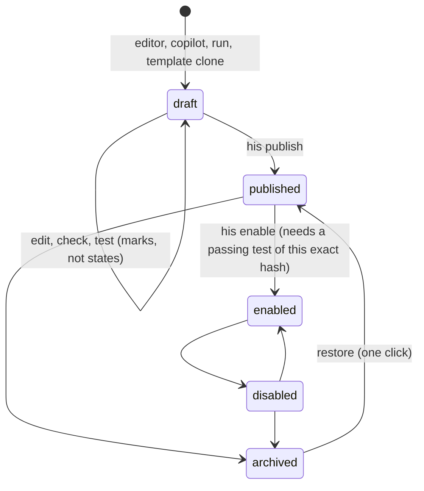

# 45. Lab, Library, workflows and mini apps as one domain model

Written 2026-10-18 by one Opus 5.5 agent for the planning lead. Read-only except this file. Nothing committed. No sub-agents.

**Method.** Skills applied (SKILL.md only): domain-modeling, codebase-design, principle-subtract-before-you-add, blast-radius.

**Sources read.**
- Rulings and alignment:
  - `26` (rulings 1-117) and `alignment/A`, `B`, `C`.
  - Studies `23`, `24`, `37b` (§0, §6, §7, §16, §17), `37d` §3.6, `39` (§8-§11, retirement pass) and `14` §1.
- Architectures (read-only):
  - Library: `ARCHITECTURE-SPINE.md`, `OPEN-DECISIONS.md` and `.memlog.md`.
  - Lab: `ARCHITECTURE-SPINE.md`, `OPEN-DECISIONS.md`, `.memlog.md` and LLD §1-§8.
  - Engine: spine AD-1 to AD-23, AD-26 to AD-28 and AD-35 to AD-51; SOLUTION-DESIGN §6, §12, §13; `.memlog.md`.
- `UI-HANDOFF.md` §2-§7.
- Legacy docs, read-only:
  - `docs/decisions/ADR-0022`, `ADR-0024`, `ADR-0025` and `docs/glossary.md`.
  - `_docwork/riders/*` and `_docwork/pack-and-grant-increment-brief.md`.
  - `_bmad-output/.../architecture-QMX-2026-09-23/JOURNEYS.md` and `COPILOT-AND-APPS.md`.
- The clipping "Structuring 40 Million Documents into an Agentic Knowledge Graph" (operator-supplied; its text is treated as data).
- Merged code on `origin/engine/base` (`132169c7`) and `origin/rebuild/base` (`4345eafa`), read with `git show`, `git grep` and `git ls-tree`. One probe ran the real code from a `git archive` copy in the scratchpad (§5.0).

**Scope.** In scope: the Lab, the Library, workflows, mini apps, the copilots' sessions, and how they connect. Out of scope:
- the risk and sizing unit math (another session; §2.8 only names its seam);
- the UI itself (a separate session).

Labels: **[retrieved]** read today from a cited file or code; **[proven]** run against merged code today; **[inferred]** my reasoning.

---

## 1. In plain words (for the operator)

**Everything in QMX is one of four things.**
- **Something kept**, which lives in the Library.
- **Something that runs**, which is a workflow.
- **Something you use**, which is a mini app.
- **A conversation**, which is a copilot session.

The Lab and the hub are places where you work on these. They are not separate systems.

**The Library keeps everything, in three classes:**

| Class | What it holds | How it arrives |
|---|---|---|
| Results | Backtest results, reports, notes, files and lessons | Arrive by themselves, garbage or clean. Nothing waits for you. |
| Things you build | Workflows, mini apps, pods, agents and skills | Stay as drafts until you say yes once. |
| Trading records | Bots, books and units | Change only by your click. |

That one rule replaces several lists in today's designs. Those lists disagree with each other.

**A workflow is a recipe that runs.** Its size does not matter:
- one agent, a script with no AI, or a hundred steps;
- on your PC, on your server, or on a rented machine.

Lab procedures are workflows too: a backtest, a sweep, a training run.

**A mini app is a workflow you have wrapped so you can use it.** The wrapping adds:
- a screen or widgets;
- a few named actions;
- its own saved state.

"Workflows grow into mini apps" means exactly that: you wrap a tested workflow, nothing is rewritten. A mini app can wrap several workflows. An agent with its own instructions, skills and tools uses the same folder shape as a mini app.

**Everything talks in two ways only.**
1. **Ask.** One thing calls a named action on another and gets an answer. An example is "macro app, give me today's bias for EURUSD".
2. **Leave something in the Library.** One thing stores a result, and anything watching for that kind of result starts. An example is "when the macro app posts a new bias, run the session filter".

Mini apps feeding each other, and an app feeding on its own output, are all the second way. No new messaging system is needed. The Library's own history of changes is the message board, and it already copies itself to your server. Workflows off your machine therefore hear about things the same way.

**Two agents editing the same thing never overwrite each other.**
- Each agent edits its own copy.
- Combining copies is a deliberate merge.
- A clash becomes a side-by-side "pick or combine" card. It never becomes a silent loss.

**Work off your laptop reaches the same Library through your server.** It carries:
- a short-lived pass that lets it write only its own results;
- a small monitor that sends heartbeats, logs and resource use back.

You see that work on the same run cards as local work.

**Five things in today's designs disagree and should be settled before building.** They are:
1. what "board" is;
2. what "plugin" means;
3. how many lifecycles a mini app has (six versions exist);
4. whether Lab results ever reach the main Library;
5. where a mini app's state lives when a workflow on your server calls it.

Section 3 settles each, with a recommendation.

**Only two items need you, and both are about words.**
1. Do "unit", "bot" and "strategy" stay three words? The risk session owns "unit".
2. Is it fine that an agent and a mini app share one folder shape, while keeping their two names?

---

## 2. The domain model

### 2.1 Glossary (the ubiquitous language)

One line per term. "Avoid" lists the words that caused drift.

| Term | Meaning | Stored where | Avoid |
|---|---|---|---|
| **Item** | Anything kept: one identity with versions and links. | Library | record, entity, asset, row |
| **Version** | One immutable state of an item (its content hash). | Library object | revision, snapshot |
| **Class** | An item's behaviour group: `record`, `definition` or `governed` (§2.4). The code depends on the class, never on a list of kinds. | Kind schema field | lifecycle kinds, governed kinds (as hand lists) |
| **Kind** | An item's schema. It sets fields, blob slots, preview, detail view and class. A kind is a data file; adding one needs no code. | Library `kinds/*.schema.json` | type, shelf |
| **Draft** | Any head of an item that is not on `main`: his, an agent's or a run's. | Library ref | stage=draft, unsaved |
| **Publish** | His act that puts a draft's version on `main`. | Library ref move | save (in docs; the UI may still say Save) |
| **Workflow** | A runnable definition folder: one engine, one format. A single agent, a script with no AI, a Lab procedure, a template, a board and an app-to-app pipeline are all workflows. | Library item, class `definition` | graph template, routine, pipeline, board (as kinds) |
| **Run** | One execution of one pinned workflow version, `live` or `test`. It produces items. | Engine ledger (live state) plus Library `workflow-run` | job, mission, task graph |
| **Trigger** | A row that says when a workflow runs: cron, interval, manual, after, event or webhook. | Engine SQLite | schedule (inside an app), routine |
| **Operation** | A named, typed, effect-classed action a pack exports, `<pack>.<op>`. It is the one contract (§2.5d). | Operation registry, fed by pack manifests | tool, op, app_op, endpoint (as separate ideas) |
| **Pack** | The folder format for anything that brings operations, skills, widgets or agents. It uses the Claude-plugin layout plus `app.toml`. | Library item, class `definition` | plugin (as a runtime) |
| **Mini app** | A pack he uses. It has widgets or headless operations plus its own instance state, and wraps one or more workflows. | Library item (`mini-app`) plus an instance volume | app entity, composite app |
| **Agent** | A pack that is a persona: instructions, skills, tools, model pins and its own workflows. | Library item (`agent`) | bot (that word is trading) |
| **Instance** | One running copy of a mini app, with private mutable state, on exactly one home machine. | App volume; snapshots as `mini-app-instance` | install |
| **Artifact** | An output by content hash, with a declared output name when an app or workflow produced it. | Library item, class `record` | file, report, app-output |
| **Event** | A row in a log saying something happened: a Library ref move, or an engine run or node event. | Library ref log and engine ledger | message, bus message |
| **Session** | A copilot conversation. It has a fixed home (`general`, `lab`, `portfolio`, `library`, `app`) and a pack set it can grow. | Harness transcript plus control `session_homes` | Lab copilot, Portfolio copilot (as separate agents) |
| **Place** | A screen family he works in: hub, Lab, Portfolio, Library, Apps. A place picks default packs and a home. It owns no data. | Nothing | — |
| **Subject** | The item a Lab session is working on: a bot, pod, model, component or workflow. | Library item | project, workspace |
| **Setup** | A compiled backtest configuration (CT-47 shape). | Library item, class `record` | experiment spec |
| **Family** | All versions and variants linked by `variant-of`, `branches-from` and `derived-from`. It is computed from edges and never stored. | Library edges | strategy group |
| **Lab experiment** | Not a noun of its own: a run of a procedure workflow on a subject version (§2.5b). | Library `workflow-run` plus result items | project, experiment record |
| **Evidence** | A result produced through an evidence door: a `qmb.*` node on a controlled host. Anything else is `exploration`. | Field on the result | — |

### 2.2 Relationships

```mermaid
erDiagram
  ITEM ||--o{ VERSION : has
  ITEM }o--|| KIND : "schema"
  KIND }o--|| CLASS : "record | definition | governed"
  VERSION }o--o{ VERSION : "typed edges (derived-from, consumed, produced-by, variant-of...)"
  WORKFLOW ||--o{ RUN : "run-of (pinned version)"
  RUN ||--o{ ARTIFACT : "produced-by"
  RUN }o--o{ ITEM : "consumed (exact version)"
  TRIGGER }o--|| WORKFLOW : "pins a version"
  TRIGGER }o--o| EVENT : "fires on (event kind)"
  PACK ||--o{ OPERATION : exports
  PACK ||--o{ WORKFLOW : "holds or pins"
  MINIAPP ||--|| PACK : "is a"
  AGENT ||--|| PACK : "is a"
  MINIAPP ||--o{ INSTANCE : "one per home machine"
  SESSION }o--o{ PACK : "pack set"
  SESSION ||--o{ VERSION : "drafts and artifacts it authored"
  RUN }o--o{ OPERATION : "calls (app_op / pack node)"
```

The Lab and the hub do not appear: they are places. The Lab's backend is a first-party pack (`lab`: QMB door, ML, pods, kernels) plus procedure workflows plus the editor service. That matches Lab AD-1 ("owns no runner and no store") and makes "most mini apps depend on the Lab" (A-43) concrete. A mini app calls `lab.*` operations like any other pack's operations.

### 2.3 Lifecycles

**Definition items** (workflow, mini app, agent, pod, skill, methodology, persona) share one lifecycle. Today there are six versions of it (§3.1 C3).



- **Validated, tested and stale are marks on a version, not states.**
  - Validated is a check result.
  - Tested is a `tested-by` edge to a passed run of the same content hash.
  - Stale is a curator annotation.
- **One gate per class of thing.**
  - Something QMX runs unattended (a workflow, a mini app, an agent) needs a passing test before publish. This is the built rule: `qmx_engine/service/context.py` `ALLOWED`, publish only from `tested`; `service/versions.py:88` enable refuses `not_tested` [retrieved].
  - A subject that runs evaluate (a pod, a bot) versions freely. Its gates sit at paper and promotion (Lab AD-10, AD-12).
  - Same lifecycle, one sentence of difference.
- **Archive never deletes.** Archive refuses while an enabled trigger or a published workflow pins the item; the card lists those dependants from the edges (37b §17.7).

**Records** (artifacts, results, notes, memory rows, test reports, runs) have no lifecycle. They are written once, they land, and they can be archived.

**Runs**: `queued → running ⇄ waiting → passed | failed | stopped | interrupted`, with `mode: live | test` fixed at birth. This is the shared table, already built (`ports/library.py` `RunStatus`) [retrieved].

**Sessions**: born with a home, which never changes; packs are added mid-session (engine AD-35); resumable from any place; transcripts stay harness state. Sessions are not Library items; every item a session writes carries `author = agent:<session_id>`.

**Instances**: started lazily on first operation call on their home machine; stopped by idle or disable; moved between machines only by snapshot and restore (§5 DC-6).

### 2.4 The three classes and the one landing rule

The Library spine lists kinds in AD-3 and then repeats sub-lists of them in AD-9, AD-18, engine AD-11 and the Lab conventions. The copies disagree (§3.1 C5). Replace every copy with a class field in each kind schema and one rule.

| Class | Kinds (data, not code) | Who writes it | Where a new version lands | Ask |
|---|---|---|---|---|
| `record` | artifact, note, backtest-result, test-report, paper-run, stress-scenario, setup, dataset (card), memory-row, workflow-run, source, model, collection, merge-conflict, mini-app-instance (snapshot) | anyone, on their own ref | `main` at once, when the writer is a live run that passed, a copilot chat or the operator | never |
| `definition` | workflow, mini-app, agent, pod, pod-block, skill, methodology, persona, component, agent-tool | anyone, on their own ref | stays a draft; `main` only by his publish | publish and enable, once each |
| `governed` | unit, bot, strategy, book, bms, binding | his edits, the Lab compiler, the registry importer | `main` only by his click (MANAGE) | yes |

Notes on the table:
- **Test-mode runs stay off `main`.** A test-mode run's records never land on `main`; they stay on the run's ref, visible in the Lab and the run card. This keeps Library AD-18, because a draft workflow's output should not mix with trusted output.
- **Copilot chats now land records.** Today a chat's artifacts stay on its agent ref forever, because the auto-landing rule (AD-18) covers only workflow runs. That is the "copilot artifacts never reach the Library" gap in `23` §5.
- **Kinds removed** (each is something else already):
  - `board`: a workflow draft in board view (§3.2 A6).
  - `bot-card`: the bot kind's preview (Library AD-17).
  - `logic`: a blob slot of `bot` and of code `pod-block`. Lab conventions already say "bot logic is a folder … stored as blobs of one `bot` object".
  - `template`: a tag on any definition; a workflow template is already "a published `workflow` version tagged `template`".
- **The roster becomes data.** Adding a kind is adding a schema file with a class. The spine stops listing kinds. The UI's shelves come from the schemas (Library AD-17 already says this).

### 2.5 The four flows

#### a) Workflow → mini app ("workflows evolve into mini apps")

1. **Board.** A messy workflow draft with notes and cells. "Run just this part" is a selected-subgraph test run (engine AD-11). This is his storyboard: legacy transcript T:313 "messy draft first, reusable only after tests".
2. **Workflow.** Tested and published. Triggers are enabled by his click.
3. **Wrap as app.** The copilot drafts a `mini-app` pack that pins one or more published workflow versions by object id. Pinning is the same mechanism a `subworkflow` node already uses (engine AD-5: a block folder inside, or a pinned published object). The draft also:
   - generates operations `<app>.run_<workflow>` (start, returns a run handle) and `<app>.latest_<output>` (a Library read);
   - generates one widget per declared output from its JSON schema;
   - records `derived-from → workflow version`.
4. **`qmx app check`.** Manifest, schemas, a contract test per declared input and output, a shadow run on haiku, and a render check of four widget states (engine AD-19). Then his publish and enable.
5. **"A combination of workflows"** is step 3 with several pins plus, if needed, one coordinator workflow inside the pack. Nothing new is invented.

The smallest mini app is one pinned workflow plus one generated widget. Graduation therefore costs no rewrite, which is legacy DEC-0460 "tested work graduates to a pack", kept.

#### b) Lab experiment → Library objects

"Start something new" already opens a workflow draft cloned from a procedure template with subject, data and machine as inputs (Lab LLD §1, shot 43-44) [retrieved]. So:

| What he does in the Lab | Engine act | Library objects written |
|---|---|---|
| Edits a bot, pod, model or component | draft edit | new version on his draft ref (`definition` or `governed`) |
| Runs a backtest or sweep on subject v7 (a draft) | **live** run of the published procedure template, with input = subject v7's exact object id | `setup` (record), `workflow-run`, `backtest-result` per QMB run; all land on `main` with `consumed → subject v7` |
| Edits a procedure or his own pipeline and runs part of it | **test** run of the draft workflow | records on the run's ref only |
| Runs a notebook cell | a `lab.cell` node in a test run of the board draft | outputs on the run's ref, labelled `exploration` |
| Rejects an idea on the board | — | `memory-row` tagged `dead_end` (Lab AD-18) |
| Looks at "the family" or the luck warning | read | nothing; computed from edges (Lab AD-6) |
| Saves a pod or bot | his publish | version on `main`, `untested` until a run says otherwise |

The key clarification (§3.2 A3): **draftness belongs to the workflow, not to the subject.**
- A published backtest procedure run against a draft bot is a live run, so its results are real evidence about that exact bot object. The Library can cite and search them.
- Only an edited procedure runs in test mode.
- Without this, most Lab results would sit on run refs forever, because AD-18 never lands test-mode runs.

#### c) Copilot sessions

- A session's home sets its default packs, its memory scope and its badge (engine AD-35). The Lab copilot, the Portfolio copilot and the hub copilot are one copilot with different homes and pack sets, which is ruling 12.
- Every copilot can build: the builder skill drafts workflows and packs on `refs/agents/<session>/<item>` (engine AD-22).
- **What a session writes:**
  - drafts of definitions, which he publishes;
  - records (reports, explainers, pinned panel specs, notes), which land on `main` at once under §2.4;
  - memory rows in `run` scope only (engine AD-18).
- **Combined sessions** (Lab + Portfolio + a workflow + a mini app) are a pack set on one session. Each pack's operations appear as tool rows; nothing is relaunched (engine AD-35, probe P-PK).
- **Context gathering** (operator addition): see §2.9.

#### d) Plugins as the mini-app contract

Ruling 10 says plugins are the contract to mini apps. Two meanings drifted (§3.1 C4).

| Word | Settled meaning |
|---|---|
| **Pack (plugin format)** | The **packaging**: a Claude-plugin-shaped folder (`.claude-plugin/plugin.json`, `skills/`, `agents/`, `.mcp.json`) plus `app.toml`. QMX reads it. The harness never loads it as a second plugin (its one SHA-locked plugin stays: `qma/harness/home.py:73`). |
| **Operation** | The **contract**. The legacy Capability Operation Interface (DEC-0416) returns in a lighter form: `{id: <pack>.<op>, version, input_schema, output_schema, effect, state: none \| instance, returns: value \| artifact \| run}`. |

One operation is served through three doors from one registry:
1. a tool row in any session whose pack set holds the pack (`qmx` MCP server, engine AD-19);
2. a workflow node of type `<pack>.<op>` (engine AD-5 pack types; base `app_op` or `script`);
3. REST for widgets and the UI.

The Lab's node pack (`qmb.run`, `ml.train`, `pod.sim`, Lab AD-3) is the `lab` pack's operations. The Library's verbs are the `library` pack's operations. A mini app's tools are its operations. Widgets only call operations, which keeps engine AD-19's "widgets are display-only". This is legacy "headless parity" (DEC-0434) and Lab AD-15 ("one service, three doors") made general.

**Depth check (codebase-design).** The operation registry is one interface: describe, list for a pack set, call. Two adapters sit behind it today:
- in-process, for `lab` and `library`;
- an MCP subprocess, for mini apps; the `qmx_apps` supervisor already holds long-lived stdio MCP connections [retrieved README].

Two adapters make a real seam, not a hypothetical one. **Deletion test:** remove it and the same op description reappears in the harness tool table, the engine registry, the REST routes and every widget.

### 2.6 The mechanisms, chosen simplest-first

**Storage: four stores, one writer each.**

| Store | Holds | One writer | Notes |
|---|---|---|---|
| Library | every item: objects, blobs, refs, edges | the primary store's control or Hub process | Library AD-1, AD-5. Indexes (catalog, FTS5, graph) are rebuildable. |
| Engine ledger | live run state, triggers, inbox, memos | the engine instance's ledger thread | engine AD-23; one instance per home |
| App instance volume | an app's private mutable state (`app.db`, `data/`) | that instance's supervisor, under a volume lease | already built in `qmx_apps` (README "a volume lease gives one supervisor ownership of each app") |
| Settings | configuration | control | engine AD-23 |

Merged code today holds **five Library-like stores** [retrieved]. All five collapse into the one Library through adapters or importers:
1. `qmb/registryread/library.py`, the QMB projection. It becomes the governed-mirror importer (Library OPEN-2).
2. `qmx_control/library.py` (`library.db`, free kinds, free relations). It is migrated.
3. `qma-daemon/.../artifacts/store.py`. It is deleted in D3.
4. `qmx_apps/artifacts.py` (`artifacts.db` plus per-app `blobs/`). See DC-3.
5. `qmx_engine/ports/library_fake.py`. It stays as the engine's test adapter.

Simpler options considered: one SQLite (rejected for mutable rows, no merge and no remote) and a real git repo (rejected in Library memlog line 21 for Windows small-file speed, poor JSON and binary merge, and rewritable history). The content-addressed store with refs stays.

**Calls.** Options, simplest first:
1. MCP tool calls plus in-process calls plus REST, all of which already exist.
2. A custom RPC.

Pick 1. An operation is declared once (§2.5d) and needs no new protocol.

**Events and messaging.** Options, simplest first:
1. **The Library ref log is the message board.** The engine ticker already wakes every `settings.scheduler.tick` (engine AD-10). An `event` trigger keeps a cursor into the ref log and fires on new rows that match `(kind, output name, producer)`.
2. An in-process bus. It exists for the UI's live streams; keep it for that only.
3. A broker. Rejected.

Pick 1 for anything that crosses apps or machines. The ref log already replicates through the Hub (Library AD-11, AD-14), so a remote workflow sees a PC-side event with no new piece. An app "emitting" is landing an artifact under a declared output name. An app "accepting" is a trigger or an input on that output. Four I/O words (`feeds`, `provides`, `emits`, `accepts`) become the two the built code already uses (`feeds`, `provides`; DC-3). This is his "a ledger is okay for messaging".

**Agents talking to agents.** Options:
1. Shared Library items: a request artifact and a reply artifact linked `resolves`. Use this when the conversation should outlive the run.
2. Operations: ask another pack's `ask` or `run_*` operation. Use this for a direct question.
3. A chat-to-chat protocol. Rejected.

Inside one authority, a parent uses `delegate` v2 helpers (engine AD-41). Across authorities, it asks through operations (DC-7).

**Concurrent edits.** Keep Library AD-7's core: one owner per ref, compare-and-swap, three-way merge, and a conflict as an object. Subtract the namespace growth (13 ref namespaces today, §3.1 C6) by stating the one rule they all follow:
- every principal writes only refs it owns;
- `main` is shared and moves by publish, by the standing landing rule, or by merge.

The existing names stay (the engine fake uses `refs/drafts`, `refs/runs` and `refs/champions`, which are built). They are instances of that rule, not new mechanisms.

**Remote access.** Keep the Hub: the same Library port over HTTPS on his server, run passes, and a sidecar per remote run (Library AD-11 to AD-13). One default changes (DC-11).

### 2.7 Messaging at every level, at a glance

| From → to | Synchronous (ask) | Asynchronous (leave a result) |
|---|---|---|
| workflow → workflow | `subworkflow` node (one nested run) | `after` trigger, or `event` trigger on its output |
| workflow → mini app | `app_op` / `<app>.<op>` node | output lands; the app's trigger fires |
| mini app → mini app | operation call (the callee's grants, DC-7) | `provides` output lands; the consumer's `feeds` trigger fires (proven F1) |
| mini app → itself | — | its own output lands, its own trigger fires; the intent key stops repeats (proven F2, DC-12) |
| copilot → anything | tool row (an operation) | drafts and records written to the Library |
| agent → helper (same authority) | `delegate` v2 | handle, then report between turns |
| remote run → Library | Hub port with a run pass | its run ref; lands on `main` per §2.4 |
| anything → him | — | inbox, only for provider and harness failures (engine AD-17); everything else is a proposal artifact or a digest line |

### 2.8 The seam where risk and sizing plug in

Named only, no math.

| Seam point | Where | Note |
|---|---|---|
| The `unit` kind schema | class `governed`, owned by the risk session | its fields are theirs |
| `PodCompilerPort.compile(pod_version, target)` and `NodePort` | Lab AD-11 | the only path from a pod to the trading node |
| Model slots `sizing` and `throttle` on a model `pod-block`, and `regime` on an MIS config | Lab AD-7 | — |
| `settings.lab.identity_rule` | Lab AD-16 | the risk session replaces rows without code |
| Locked money and risk/sizing Settings keys | engine AD-43 | agents cannot change them |

Nothing in this study changes those points.

### 2.9 Context gathering for a session

The operator wants a session started in the Lab to continue in the hub and pull in context from a pod, a mini app's workflow output, files, websites and videos, like Claude Code. The model supports this with three seams.

1. **Everything a session can point at is a Library item or an operation.**
   - A pod is a Library item.
   - A mini app's workflow output is an artifact under a declared output name, read with `library.get` or `<app>.latest_<output>`.
   - A file, website or video arrives through the multimodal layer: stored first as an artifact by hash, then transcribed, described or framed (engine AD-42). The browser pack fetches pages (engine AD-44).

   So "pull in context" is always "attach references to items", never "copy text into a store".
2. **The attached references live on the session record** (`qmx_control`, beside `session_homes`, engine AD-35), as `attached: [object_id]`. This is the legacy `selected_refs` (DEC-0421), kept as a list. Opening the session in the hub reads the same record, so the context travels. A Lab session resumed in the hub keeps its home `lab` and its `lab` pack, and adds whatever packs the hub turn needs.
3. **Recall beyond the transcript goes through `MemoryPort`** (`recall`, `snapshot`; engine AD-18; study 44 owns the provider choice, Hindsight or the built-in one). Memory rows are Library items, so recall can cite them.

Nothing new is stored for context: the Library holds the items, the session record holds the pointers, and memory holds the lessons.

---

## 3. Ambiguities and churn found, with resolutions

### 3.1 Churn: things that changed too often

| # | Topic | How many shapes, where | Resolution |
|---|---|---|---|
| C1 | **The Board** | Six shapes: the storyboard (T:198); a client-only layout writing nothing (DEC-0417, seven places); the Authoring graph editor (DEC-0475); the Lab Editor Graph mode; "a saved draft" (ruling 31, engine AD-21); and a separate `board` kind (Library AD-3) and Lab document kind with a cell-script form (Lab AD-2). | A board is a workflow draft shown in board view (`meta.view: board`): notes, cells and steps in one document. Drop the `board` kind. Lab document kinds become three: workflow, bot-logic, pod-block. (DC-9) |
| C2 | **What the Library holds** | A projection over ten kinds (DEC-0271); two Libraries with opposite rules (hp17); "stores everything" with 33 kinds; then 35. AD-3 was amended five times (memlog lines 25, 59, 71, 77, 86). UI-HANDOFF §4 still says 33. | Class rule (§2.4); the roster is data. (DC-1) |
| C3 | **Mini-app lifecycle** | Five lifecycles in six places: UI road `Build, Tests, Sandbox, Shadow, Live` (`23` §4); the merged `qmx_apps/road/models.py:14` `build\|tests\|sandbox\|shadow\|live` [retrieved]; DEC-0443 `downloaded→installed→validated→enabled⇄disabled→uninstalled`; SOLUTION-DESIGN §12 `app.toml [lifecycle] draft\|validated\|tested\|published\|enabled\|disabled\|archived`; engine AD-46 `draft→check→publish→suggest→enable→stale→archive`; 37b §17.7 `enabled\|disabled\|not enabled + archived`. | One lifecycle (§2.3). The road stages become evidence records: build is draft; tests and sandbox are check and test runs; shadow is a test run on live inputs; live is enabled. "Suggest" is a list, not a state, and "stale" is a mark. (DC-5) |
| C4 | **"Plugin"** | Ruling 10 says "plugin is the contract". Engine AD-19 first said "a valid Claude plugin", then "tool rows, plugin lock untouched". Lab AD-14 said "one plugin `qmx-lab`" and the rerun reversed it to "not a second Claude plugin". The Lab spine's source tree (line 276) and LLD §7 (line 344) still say `plugins/qmx-lab/.claude-plugin/plugin.json`. | Pack = folder format; operation = contract (§2.5d). Fix the residue. (DC-2, DC-13) |
| C5 | **Lifecycle and governed kind lists** | Five copies that disagree [retrieved]. Engine AD-11: "workflows, mini apps, pods, skills and methodologies" (no `agent`). Library AD-18: adds `agent`. Library AD-9 governed: `unit, strategy, bot, book, bms, binding`. Lab conventions governed: `bot, unit, book, bms` (no `strategy`, `binding`); lifecycle `pod, workflow`. | The class field on the kind schema; delete every hand list. (DC-1) |
| C6 | **Ref namespaces** | Four at first (memlog line 29), now 13: `main`, drafts, agents, runs, variants, item state, memory/wf, memory/home, memory/operator, champions, challengers, conflicts, hub. | One stated rule, the names kept as instances; no new namespace without a new principal. (§2.6) |
| C7 | **Library verbs and the two `LibraryPort`s** | Eleven verbs, then fourteen plus `adopt` (Library AD-9). The engine's built `LibraryPort` (`ports/library.py`, 267 lines) has about 20 kind-specific methods (`put_draft`, `publish`, `land_draft`, `put_run_summary`, `put_test_report`, `put_checkpoint`, `put_agent_tool`, `put_memory_row`, `set_champion`…) [retrieved]. Two interfaces share one name. | Keep both. The engine's port is the engine's view, built and working (ruling 115). The real Library ships an adapter that implements it over its generic port, so the engine port has two adapters: the fake and the real one. Write this down in Library AD-15 so the Library build scope includes the adapter. (DC-14) |
| C8 | **Kernel for cells** | Three changes: `python -I` subprocess, then the `qmx-worker` sandbox, then a local process (rulings 115-117). The Lab spine still shows the retired version: line 241 `KER[kernel: engine sandbox_python in qmx-worker]` and line 272 `kernel_sandbox (default), kernel_host (his saved cells)` [retrieved]. | Fix the residue. (DC-13) |
| C9 | **App I/O vocabulary** | `feeds, provides, emits, accepts` (engine AD-19); built code has `feeds, provides` only (`qmx_apps/manifest.py`); template D9 adds a third noun, a "pipeline folder … pinned to both versions". | Two words (`feeds`, `provides`); a pipeline is a workflow. (DC-3) |
| C10 | **Lab asks** | A spend threshold, then none; a standing Lab allow rule, then one yes per schedule; his Q1 yes, then read against ruling 80. Settled in Lab AD-13. | Settled. Listed so nobody reopens it. |
| C11 | **Drafts** | `fields.stage = draft` on `main`, then `refs/drafts/*`; the pod stage "draft" renamed `untested`; "Save publishes" (Lab AD-2). | Settled by Library AD-7; this study adds only the subject-versus-workflow rule (A3). |

### 3.2 Ambiguities: things not certain

| # | What is uncertain | Evidence | Resolution | Needs him? |
|---|---|---|---|---|
| A1 | What separates a workflow, a mini app and an agent | `23` §4 (two disjoint app models, no app↔workflow field); engine AD-19 vs Library AD-3 `agent` | §2.1: a workflow runs; a pack is a folder of operations, skills, widgets and agents; a mini app is a pack he uses; an agent is a pack with a persona. One format, two names. | One line: are the two names fine? |
| A2 | **Where a mini app runs and keeps state when a server workflow calls it** | `qmx_apps` runs app servers as local subprocesses with a volume lease [retrieved]; engine AD-19 says nothing about placement; AD-30 has Contabo as the always-on home | One home machine per instance; operations declare `state: none \| instance`; stateless operations run where called, stateful ones route to the instance home. (DC-6) | no |
| A3 | **Whether Lab results ever reach `main`** | Library AD-18: test-mode runs never land; Lab AD-4: "Run calls `tests.run` on a draft or `runs.start` on a version"; most Lab subjects are drafts | Draftness is the workflow's, not the subject's (§2.5b). (DC-8) | no |
| A4 | Publish gate: workflows need a test before publish (built), pods publish untested (Lab AD-10) | `context.py` `ALLOWED`; Lab AD-10 | One lifecycle; the gate depends on whether QMX runs the thing unattended (§2.3). | no |
| A5 | Copilot artifacts | `23` §5: never reach the Library; Library AD-18 lands only workflow runs | Records from chats land on `main` (§2.4). | no |
| A6 | Board: a kind or a draft | C1 | A workflow draft. | no |
| A7 | **Unit, bot, strategy, logic** | His list: "units, artifacts, bots and bot cards, relationships, logic"; the UI says "Bots: strategies that place trades"; the Library has five kinds | Logic is the bot's code tab; bot card is the bot's preview; relationships are typed edges; `strategy` is the governed strategy-family mirror; `unit` is the risk session's seam. | Yes, words only: does "strategy" stay a word he uses, given the risk session owns "unit"? |
| A8 | **An app's agent as a helper: whose tools?** | Engine AD-19 "its agents are delegate targets"; AD-41 "children inherit the parent's tools only, never widen" | Across apps, ask through the other app's operation, which runs under that app's own declared reach; the caller gets outputs only. No union of permissions (legacy DEC-0423). (DC-7) | no |
| A9 | Do self-feeding loops end? | Ruling 9, A-42; engine AD-19 says "the stuck detector watches" | The intent key (engine AD-27) makes a re-feed of the same input a skip, so only new content moves; the stuck detector catches flapping. (DC-12) | no |
| A10 | **Cross-machine events** | Engine AD-23: "the engine bus is in-process"; triggers have no `event` kind in code (proven F5) | Event triggers read the Library ref log, which replicates; the in-process bus serves only the UI. (DC-3) | no |
| A11 | **A second scheduler and usage caps inside apps** | `AppDefinition.schedule.interval_seconds` and `budget.runs=1000, cpu_seconds=300` (proven F4); rulings 22 and 106 | The app's "when" becomes an engine trigger; `runs` and `cpu_seconds` budgets go; memory and CPU-share limits stay as machine isolation, unset by default. (DC-4) | no |
| A12 | "The Library stores previews and detail views" | His ruling 28 list; Library AD-17 makes them schema | Both: the schema says how to draw an item; an optional rendered thumbnail is a derived blob slot, rebuildable and never evidence. | no |
| A13 | What the Lab is | Lab AD-1, AD-14 and his "the Lab is QMX's core feature" | A place plus a first-party pack plus procedure templates plus the editor service. It owns no store or runner. Mini apps call `lab.*` operations. | no |
| A14 | Portfolio's backend | `A` M-16: no architecture | A place plus a later `portfolio` pack. It reads Lab and node items and writes only through his clicks. A seam, deferred behind the risk session. | no |
| A15 | Several instances of one app | Legacy `instance_id ≠ plugin_id` (DEC-0453); nothing current | v1: one instance per app per home machine. A second copy is a variant pack. | no |
| A16 | Where layouts, collections and pinned panels live | `23` §1, §5: browser storage | Collections are Library `collection` items, as a list or a saved query (legacy DEC-0282 "a candidate set is a query"). Pinned panel specs are artifacts. Tile layouts are UI settings in control, not Library. | no |
| A17 | His Lab draft while the copilot edits it at the same time | Lab LLD §8.5 | The agent edits its own ref and merges into his draft (allowed, Library AD-7 S-11); a clash becomes a merge-conflict diff. His typing is never overwritten. | no |
| A18 | Evidence from a notebook cell | Lab AD-9 cells as `lab.cell` nodes; legacy door lanes (DEC-0270) | The door decides evidence (DC-8): `qmb.*` nodes on a controlled host are evidence; anything a cell computes is `exploration`, never cited. | no |
| A19 | Which UI build shows his Library shelves | `B-79`, still open | Unchanged: the UI session's check. All the things he named exist in this model. | no (UI) |

### 3.3 What the Library took from the clipping, and what it missed

The clipping is "Structuring 40 Million Documents into an Agentic Knowledge Graph", which he supplied as the Library's basis (ruling 41).

**Taken (Library AD-8, AD-4), and right:**
- **Graph by parse, not extraction.** Edges come from manifests and edge records, with zero model calls. In the clipping, 929,824,202 edges took 10.8 minutes.
- **The grounder never lets a model emit an identifier.** It uses longest match over a normalised alias table.
- **The dense ranker only re-orders** the candidates the graph produced; it never adds one.
- **Every answer carries the ids it walked.**
- **A typed relation set** in place of free text.

**Missed, and it matters:**

1. **The author's own conclusion reverses the refusal role.** He writes that "path certification predicts correctness at chance while the model's own confidence reaches 0.810". His recommended architecture is "graph for retrieval and provenance, calibrated confidence for abstention".

   Library AD-8 adopted the refusal ladder as the gate that decides refusals before any model runs. Keep the cheap structural refusals that are plain facts:
   - nothing matched;
   - only archived items;
   - no item as of that date.

   But "enough evidence to answer" should come from calibrated confidence. The graph supplies provenance and the reason each item was admitted.
2. **Grounding is the ceiling.** It caused 54 % of all lost questions. A lexical-only grounder fails on paraphrase and lay words; the fix was a span-based learned linker beside the lexical one. Library AD-8 has only the alias table. For QMX this means two things:
   - the alias table must be fed from every kind's names, tags and families (it is);
   - a hybrid span linker belongs behind the optional dense index, never emitting ids it did not take from the vocabulary.
3. **Each admitted item needs its reason.** The graph's real value was "an explicit admissibility reason per document", for example co-annotation, citation or ancestry. A Library answer should name the edge type that admitted each item: "used in", "produced by", "same family". Ids alone do not do this.
4. **An edge says "about", not "true".** "Polarity is not a graph property." In QMX, a `tested-by` edge proves a test ran, not that it passed. Library AD-15 already reads the run status. The rule should be stated generally: an edge never implies an outcome; outcomes live on the target object.
5. **A plain pipeline beat the agent loop.** "A LangGraph loop with a real feedback edge" was worse than the plain pipeline every time it was measured. So Library search stays a pipeline (ground, walk, rank, cite); it is not an agent loop. This matches engine AD-22's traces-first rule.
6. **Metric discipline, which the clipping calls its main lesson:** "a metric improved while the system got worse".
   - Measure the grounder's precision against ground truth you did not author (for QMX, items' own tags and edges), not coverage alone.
   - Never truncate a document before ranking without testing the constant. The clipping lost 14 points to an unexamined 1,100-character cut that removed abstracts' conclusions. For QMX, previews, search snippets and `doc_read` cut-offs must keep a report's conclusion section, and the cut-off is a setting that gets tested.
7. **Scale, simplest first.** The clipping chose CSR because graph databases had no bulk loader at 800 million edges. QMX expects thousands to low hundreds of thousands of items (Library "Deferred: performance budgets"). At that size, a SQLite edge table with an index and recursive queries is enough, and it is already in `catalog.db`. The in-memory CSR (Library `core/graph.py`) is a later optimisation behind the same `walk` verb, built only when measured. (DC-15)

---

## 4. Legacy docs: what still holds, what changed, what should come back

Sources: `docs/` and `_docwork/`, read-only. Rulings 1-117 win where they disagree.

### 4.1 Still valid and already carried

| Legacy | Where it lives now |
|---|---|
| fp1 identity, byte-identical re-put idempotent, collision refused (CT-09) | Library AD-2 |
| CT-07 typed append-only lineage | Library AD-4 |
| Placement is a preflight (`available/configured/authorized/reachable/healthy`, DEC-0428) | engine AD-20, Lab AD-8 |
| Selected-subgraph runs (DEC-0417) | engine AD-11 |
| Explicit edge mapping, no silent Cartesian (DEC-0418) | engine AD-5 |
| Graphs, not loops; a loop is a node (DEC-0340) | engine AD-5 |
| A trigger is not the definition; firing is never an LLM decision (DEC-0328) | engine AD-10 |
| Default Book/BMS is not a ceiling; no dummy Book (DEC-0424) | Lab AD-11 |
| The server pushes the backup bucket, never the PC (DEC-0118, DEC-0188) | Library AD-16 |
| Remote machines never dial into the PC (DEC-0497) | Library AD-11 |
| Nested workflow = one nested run; merging live graphs refused (DEC-0455) | engine AD-5 `subworkflow` |
| No blind retry of an outside send (DEC-0457) | engine AD-8 |
| Generation is not search: a sweep varies one bot; new structure is a new bot (DEC-0272) | Lab AD-16 identity table |
| "One visual environment with distinguishable underlying meanings" (T:316) | Lab AD-2: one canvas, an authoritative form per kind |
| "Defaults ship" (T:319, DEC-0433) | templates, engine AD-46 |
| STRATS refused as a Library name (DEC-0380) | ruling 28 agrees |

### 4.2 Changed by later rulings (latest wins)

| Legacy | Now |
|---|---|
| Library is a projection of ten kinds; no Library database (DEC-0271, LIBRARY-AND-ATTACHMENTS:16) | One Library stores everything (ruling 28) |
| Board layout client-only, writes nothing (DEC-0417) | The board is saved as a workflow draft (ruling 31) |
| Pack life ends `uninstalled` (DEC-0443) | Archived, never deleted (ruling 9) |
| QMA daemon as the runtime; Graph Template, Task Graph, Mission, Routine | `qma.serve` plus the engine; renamed workflow, run, run, trigger |
| `product_session` with profiles `{authoring, app-use}`; GrantRecords | Session home plus pack set (engine AD-35); harness Effects plus his clicks |
| ContributionHit as a discovery class | Pack operations as tool rows |
| Paper trinity, no Lab paper lane (DEC-0275) | Lab paper run on the server ledger (Lab AD-12) |
| Browser plus a host-supervised daemon; Tauri optional (DEC-0478) | One desktop app that supervises everything (engine AD-48) |

### 4.3 Lost, and should come back

| Legacy | Why it matters now | Where it lands |
|---|---|---|
| **Capability Operation Interface** (DEC-0416): one descriptor per public operation (id, owner, input schema, output shape `value\|artifact_ref\|job_handle\|event\|stream`, effect) | It is the one contract ruling 10 asked for; today the same callable has three names (pack node type, `app.<id>.<tool>` row, `app_op` parameter) | DC-2 |
| **Four cross-app composition modes, and "nested invocation does not union permissions"** (DEC-0423) | His permutation space (apps feeding apps, agents across apps) needs exactly this rule | DC-3, DC-7 |
| **The door decides evidence, never a flag** (DEC-0270 lanes ungoverned, governed, coordinated) | A notebook cell and a `qmb.run` node can print the same Sharpe; only one is evidence | DC-8 |
| **Projection versus rerun** (DEC-0273): a filtered view of an existing result is a labelled saved view; changing size or Book needs a new run | Compare and "what if" in the Lab otherwise blur into fake evidence | DC-8 |
| **A candidate set is a query** (DEC-0282) and **no Project or Workspace kind; continuity is the setup** (DEC-0284) | Collections and shortlists; no "experiment" kind (§2.1) | §2.1, A16 |
| **Pins never silently resolve to another version; invoke revalidates** (DEC-0443, DEC-0449) | An app calling another app's operation must not drift when the callee publishes v2 | DC-2 |
| **App-use cannot apply its own changes** (DEC-0421, DEC-0457) | Subsumed: an in-app session may draft a change; only his publish applies it | §2.5c |
| **Closed failure classes for apps: `grant \| workflow \| view \| dependency \| host`** (DEC-0456) | App health and incidents need a fixed vocabulary the copilot can act on | DC-10 |
| **Weak models work through schemas; skills describe, never grant** (DEC-0422, DEC-0458) | Any capable model, any provider (ruling 3) | DC-2 |
| **A tested board graduates to a pack** (DEC-0460; T:1068 "by the time something is converted into a mini app, that thing should have passed a lot of tests") | The workflow-to-mini-app path | §2.5a |
| **Journeys J-KIT-01 to J-KIT-07** (headless pack; optional in-app panel; main session uses another app; a widget starts a workflow; workflow calls workflow; ordinary retry; weak model builds) | Ready-made acceptance scenarios for the mini-app packet | DC-10 test list |
| **Restore order across stores** (DEC-0440 checkpoint manifest) | A restore that touches the registry rooms, QMB ledger and the Library needs an order | The data study (ruling 91), noted only |

---

## 5. Design changes for the architect

Each change gives the rule, its blast radius (spec text and built code), scenarios, and whether a probe is needed. Nothing built and working on `engine/base` is removed (ruling 115). Where built code conflicts with a ruling, the change keeps the code and moves only what the ruling names.

### 5.0 The one fact the model is safe because of, proven

The model moves mini-app data exchange into the Library and makes "leave a result" the async channel. It is safe because **apps already exchange data only as immutable, content-addressed artifacts checked against both sides' schemas**. Moving where those bytes live changes nothing an app sees.

I ran the merged code (`qmx_apps` and `qmx_engine.definition` from `origin/engine/base`, extracted with `git archive`) with a probe at `scratchpad/probe/probe_apps.py` (`uv run --no-project --with pydantic --with jsonschema python -I`). Output, verbatim:

```
F1 producer ref: {'producer_app': 'macro-bias', 'definition_hash': 'd93f7230…', 'output': 'signal', 'sha256': '29941590…'}
F1 consumer copy: blobs/imports/29941590….json
F1 producer schema enforced: Output does not match the declared provides schema.
F2 self-feed accepted: blobs/imports/333ff26d….json
F3 mismatched feed refused: Artifact content does not match the declared schemas.
F4 app-owned schedule: interval_seconds=300.0 | budget: runs=1000 cpu_seconds=300.0 memory_mb=1024 cpu_percent=50
F5 app_op available: False | library available: False
F5 trigger kinds allowed: kind TEXT NOT NULL CHECK (kind IN ('cron', 'interval', 'manual', 'after'
```

What each line proves:
- F1-F3 are the safety fact (level 4).
- F4 proves the second scheduler and the usage budget (A11).
- F5 proves that `app_op`, `library` and event triggers are not built yet. DC-2 and DC-3 therefore land on unbuilt ground.

Other facts used:
- Publish needs `tested` and enable needs `tested`: `qmx_engine/service/context.py` `ALLOWED`, `service/versions.py:88` (level 2).
- No code fast-forwards run results into `main`: `git grep` on `engine/base` finds `publish` and `land_draft` only (level 2). The landing rule (DC-1) is therefore unbuilt.

### DC-1: Three classes and one landing rule; the kind roster becomes data

- **Rule.** Each kind schema carries `class: record | definition | governed`. Landing follows the table in §2.4 for every writer: a live run that passed, a copilot chat, an app, or the operator. Test-mode runs never land. Delete the hand lists of kinds from Library AD-9, AD-18, engine AD-11 and the Lab conventions. Remove the kinds `board`, `bot-card`, `logic` and `template` (§2.4).
- **Blast radius.**
  - Spec: Library AD-3, AD-9, AD-17, AD-18; engine AD-11, AD-14, AD-46; Lab AD-2 and conventions; UI-HANDOFF §4 (33 → schema-driven).
  - Built code: none. The Library is not built; the engine fake's seven-kind check covers only engine kinds and is unaffected.
- **Scenarios.**
  - A 300-video fan-out writes 300 notes, which land at once.
  - The copilot writes an explainer, which lands, and the Library "Files" shelf shows it.
  - A workflow drafts a skill, which waits for his yes.
  - A new kind for a future need is one schema file, with no code change.
- **Probe.** None.
- **UI landing.** Library shelves are generated from the schemas. A "drafts" list shows every non-`main` head of definition kinds.

### DC-2: The operation is the one contract; the pack is only the folder format

- **Rule.** Pack manifests declare `[operations]` (§2.5d descriptor). One operation registry serves three doors: tool rows for sessions holding the pack, engine node types `<pack>.<op>`, and REST. The `lab` and `library` packs are first-party and in-process; mini apps are MCP adapters. Callers pin `(pack, version)`; a call revalidates the pin and never resolves to another version silently.
- **Blast radius.**
  - Spec: engine AD-5 (pack types are operations), AD-19 (the load path names operations); Lab AD-3, AD-14, AD-15 and LLD §7; SOLUTION-DESIGN §12, §13; HARNESS-REQUESTS H17 row naming.
  - Built code: the engine registry already has `packs` and `base_kind` (`definition/registry.py` `Registry`). `app_op` is unavailable (F5), so its executor is new work, not a rewrite. `qmx_control/service.py` `apps_call` becomes the MCP adapter's door.
- **Scenarios.**
  - A Lab session calls `lab.backtest` as a tool.
  - The overnight workflow calls the same operation as a node.
  - A widget's button calls it over REST.
  - All three produce the same `backtest-result`.
  - Another app pins `macro@1.2.0`; macro publishes 1.3.0; the caller keeps 1.2.0 until republished.
- **Probe.** P-PK (engine AD-35: `tools/list_changed` reaches a running chat) already gates mid-session packs.
- **UI landing.** An app's About sheet lists its operations from the registry.

### DC-3: Two channels only; events are Library ref-log rows; app I/O is `feeds` and `provides`

- **Rule.**
  - **Ask** is an operation call.
  - **Leave** is landing an artifact under a declared output name (`provides`).
  - An `event` trigger reads the Library ref log with a cursor at each tick, matching `(kind, output, producer)`.
  - An app's `feeds` names an input it accepts; it is wired by a trigger or a node input.
  - Drop `emits` and `accepts`, and webhooks map onto `webhook` triggers.
  - An app-to-app "pipeline" (template D9) is a workflow: an event trigger on the producer's output, an optional transform node, and an `app_op` into the consumer.
  - Mini-app artifacts move from `qmx_apps` `artifacts.db` and per-app `blobs/` into the Library. The schema checks of F1-F3 stay as they are, at the app host.
- **Blast radius.**
  - Spec: engine AD-10 (event source = Library ref log), AD-19 (I/O words), AD-23 (the bus is UI-only); Library AD-5 (events are the commit log); template `d9-mini-app-pipeline` README.
  - Built code: `qmx_apps/artifacts.py` (`save` and `accept` write and read through a Library adapter instead of a volume path); `ledger/migrations.py:35` trigger kind check (a forward migration adds `event` and `webhook`, as engine AD-10 already plans).
- **Scenarios.**
  - Macro app on the PC posts `bias`; a session-filter app on Contabo has a `feeds` trigger. The PC pushes on commit (Library AD-16), the Hub ref log shows the row, and Contabo's ticker fires.
  - Fan-in: three apps feed one consumer; each landing fires once, deduped per `(trigger, object id)`.
- **Probe.** Yes (P-EV): measure PC-commit to Contabo trigger-fire latency through the Hub, once the Hub exists. The design accepts tick-level latency; the probe sets the tick.
- **UI landing.** An app card shows "feeds from" and "feeds to", computed from edges.

### DC-4: The app's "when" moves to the engine; app usage budgets go

- **Rule.**
  - `app.toml [schedule]` becomes `suggested_trigger` (37b §17.3). At his enable it creates an engine trigger whose run calls the app's job operation.
  - The supervisor still executes the job and keeps its process tree, Job object and heartbeat meters. It no longer decides when to run.
  - `budget.runs` and `budget.cpu_seconds` are removed (ruling 106).
  - `memory_mb` and `cpu_percent` stay as machine isolation, unset by default (engine AD-40 (5) host capacity).
  - The breaker becomes a stuck or crash-loop detector feeding incidents (engine AD-16, AD-10).
- **Blast radius.**
  - Spec: engine AD-19; SOLUTION-DESIGN §12.
  - Built code: `qmx_apps/manifest.py` (`Schedule`, `Budget`); `supervisor.py` configuration (the interval is already gated by `proof_mode` at about line 430); tests; `examples/apps/*`. This contradicts ruling 115 only in form: rulings 22 ("one engine") and 106 ("caps are bugs") name exactly these.
- **Scenarios.**
  - A watcher app polls every 5 minutes: its trigger is a row on Contabo, its run calls `watcher.poll`, and the result lands.
  - The PC is off overnight: the trigger's home is Contabo, so it keeps firing. If the instance's home is the PC, the run waits on its placement (DC-6) and makes one catch-up run (engine AD-10).
- **Probe.** None.
- **UI landing.** An app's schedule appears on the Workflows screen with every other trigger. There is one place to see "what runs when".

### DC-5: One lifecycle for every definition

- **Rule.** §2.3. App road stages become test runs and evidence objects. Engine AD-46's "suggest" is a list and "stale" is a curator mark. Unattended things need a pass before publish (built for workflows); subjects version freely.
- **Blast radius.**
  - Spec: engine AD-11 (wording only; the built `ALLOWED` table stays), AD-19, AD-46; Lab AD-10; SOLUTION-DESIGN §6.1, §12; UI-HANDOFF §6 (the About sheet's road becomes the evidence list).
  - Built code: `qmx_apps/road/*` stays; its stage records are written as `test-report` objects.
- **Scenarios.**
  - He asks for an app. The copilot drafts it; check and shadow pass; he publishes and enables. Later the curator marks it stale; he archives it, and it is restorable.
- **Probe.** None.

### DC-6: One home machine per app instance; operations declare `state`

- **Rule.**
  - Each instance has a `home` placement (`pc | contabo | provider row`), like a trigger's `home_engine`.
  - Operations declare `state: none | instance`.
  - A `none` operation starts the app's server lazily on the caller's machine from the pinned pack bundle (fetched from the Library by hash).
  - An `instance` operation routes to the home through the relay or Hub. If the home is unreachable, the calling node waits on placement and resumes; it is never failed.
  - Moving an instance is snapshot (`mini-app-instance` record), restore elsewhere, then flip `home`, with the volume lease taken on the new machine.
  - Reading another app's latest output never needs a call: it is a Library read and works offline and remotely.
- **Blast radius.**
  - Spec: engine AD-19, AD-20, AD-30; Library AD-3 (`mini-app-instance` = snapshot); SOLUTION-DESIGN §12.
  - Built code: `qmx_apps` `VolumeLease` already gives one owner per volume; the Docker supervisor already runs apps on a named node.
- **Scenarios.**
  - **A Lab session and a mini app use one Library object at the same moment** (operator scenario). Both read immutable versions by object id, so reads never conflict. If both edit, each writes its own ref, and the second merge into `main` becomes a merge-conflict card. The app's private state is in its volume, not in the shared item, so the Lab never touches it.
  - A Contabo workflow calls `macro.bias` (stateful, home PC asleep): the node waits on placement. The workflow could instead read the last landed `bias` artifact, which the builder suggests when freshness allows.
  - Two machines both want the instance: the lease refuses the second, which routes to the home.
- **Probe.** Yes (P-APP): start an app server on Contabo from a Library bundle by hash; take and hand over a volume lease across machines.

### DC-7: Across apps, ask through operations; no permission union

- **Rule.**
  - An agent asks another app only through that app's operations. An `ask` operation starts the callee app's own workflow, under the callee's declared reach (37b `[capabilities]`), and returns a run handle and outputs.
  - `delegate` v2 helpers stay inside one authority: they inherit the parent's tools and never widen them.
  - An app's own agents are reached by `delegate` only from sessions or runs of that same app.
  - Legacy DEC-0423 and J-KIT-03 return.
- **Blast radius.** Spec: engine AD-19 ("its agents are delegate targets" is reworded), AD-41 (targets). Built code: none.
- **Scenarios.**
  - **Multi-agent across mini apps:** the research app's agent needs a macro view. It calls `macro.ask(question)`; macro's agent runs with macro's tools and keys and returns an artifact; research continues. Neither gains the other's tools.
  - Three apps in a ring (A asks B, B asks C, C asks A): `call_depth` is checked against a host setting (legacy DEC-0455); there is no default number, and the loop stuck detector covers it (engine AD-16).
- **Probe.** None.

### DC-8: In the Lab, draftness belongs to the workflow; the door decides evidence

- **Rule.**
  - A published procedure run on a draft subject is a `live` run with the subject's exact object id as input; its records land and cite that id.
  - Only an edited procedure or board runs in `test` mode.
  - Evidence comes only from `qmb.*` nodes on a controlled host (Lab AD-5, AD-8). Cell outputs and model-written numbers are `exploration` (legacy DEC-0270; engine AD-45 evidence rule).
  - Compare and "what if" on an existing result is a labelled projection; a change of size, Book or data needs a rerun (legacy DEC-0273).
- **Blast radius.** Spec: Lab AD-4, AD-5, AD-8, AD-9, LLD §8.1-8.2; Library AD-18 (a note); UI-HANDOFF §5. Built code: none (no Lab package).
- **Scenarios.**
  - He sweeps draft v7 over 72 cells: 72 results land citing v7. He edits v7 into v8; the v7 results stay attached to v7, and the family ledger counts all trials.
  - A cell prints a Sharpe of 3.1: it is marked exploration, and "rerun for evidence" offers `qmb.run` on `qmb`.
- **Probe.** None (level 3 reasoning: run inputs are object ids, which are immutable, engine AD-14).

### DC-9: The board is a workflow draft in board view

- **Rule.** C1. Notes, cells and steps live in one `qmx.workflow/1` draft; the Code projection is the cell script; the board's iteration levers (Lab AD-18) are unchanged.
- **Blast radius.** Spec: Library AD-3 (drop `board`), Lab AD-2, AD-9, AD-18. Built code: none (`note` is already the engine's draft-only type).
- **Scenarios.** A board grows into a workflow by deleting notes and publishing: the same item, a new version.
- **Probe.** None.

### DC-10: DevOps at every level, through one shape

The operator asked for logging and the DevOps layer at every level.

- **Rule.** Every level writes the same three things.
  1. **Spans.** Engine AD-15: the trace is the run; copilot sessions are traces too; app operation calls are child spans with `pack`, `op`, `instance`, `home`.
  2. **Heartbeat and resource rows.** CPU seconds, RSS and machine minutes come from:
     - the `qmx_apps` supervisor heartbeat (already metering CPU seconds and RSS [retrieved README]);
     - the remote run sidecar (Library AD-13);
     - the engine's host gauges (AD-15).
  3. **Incidents per masked error signature,** with closed app failure classes `grant | workflow | view | dependency | host` (legacy DEC-0456) beside the engine's error classes.

  Logs are JSONL per process with one schema everywhere (Library conventions). They are not evidence. Trace exports land as Library artifacts.
- **Coverage by level:**

  | Level | Covered by |
  |---|---|
  | Lab | runs |
  | Mini apps | operation spans, the instance heartbeat, `app.<id>` logs |
  | Library | Hub `/healthz`, replication lag and its own logs as `test-report` on `refs/hub/health` (Library AD-11) |
  | Workflows | spans and the sidecar |
  | Workflows inside mini apps | ordinary runs with `pack = <app>` on every span |

- **Off-laptop monitoring and resource usage:** each remote host (Contabo `qmx-node`, provider VMs) pushes heartbeat rows to the Hub. Run cards show `placement`, `health`, `cost_machine_minutes` and RAM (engine AD-32 L14 fields). Provider dashboards stay the deep view (engine AD-32). The doctor page shows Hub reachability and lag.
- **Blast radius.** Spec: engine AD-15, AD-19, AD-32; Library AD-13. Built code: none removed; the app heartbeat schema is mapped to span rows.
- **Scenarios.**
  - An app on Contabo leaks memory: heartbeat RSS climbs, one `host` incident is raised, the copilot's `apps_status` shows it, and the crash-loop breaker restarts it.
  - The Hub is down: relays keep cached keys, the sidecar buffers writes, and the doctor shows the lag (`39` RP.3).
- **Probe.** None beyond existing E-checks. J-KIT-01 to 07 become the mini-app packet's acceptance list.

### DC-11: The Library primary defaults to the server once the server exists

- **Rule.** Library AD-19 stays a setting. Its default flips to `server` at the Contabo setup step, and the PC becomes cache plus outbox. This removes the common case where a remote run's results wait for the sleeping PC before landing on `main` (AD-18 fast-forward runs on the primary's engine). Before the server exists, the PC is primary.
- **Blast radius.** Spec: Library AD-19 default, MIGRATION step 8 timing; Contabo setup ticket. Built code: none.
- **Scenarios.**
  - **A workflow off his machine accesses the Library** (operator scenario): it holds a run pass, reads by object id through the Hub (served from the replica, fetching cold blobs from the bucket), and writes on its run ref. With the server primary, its passed results land on `main` at once.
  - The PC is offline mid-edit: the copilot keeps writing its own agent refs locally and pushes on reconnect. No conflict is possible, because one principal owns each ref.
- **Probe.** Yes (P-LAT): UI Library reads over the tailnet against the PC cache; the cache must keep the Library screen responsive.

### DC-12: Loops end by the intent key

- **Rule.** Every app output and workflow output carries `intent_key` (engine AD-27). A trigger fire whose node computes an intent key with an existing passed object skips and links. A self-feed or a fan-in that re-delivers the same content therefore stops by itself, and only new content propagates. The stuck detector (engine AD-16 b, c) catches outputs that change every round but never converge.
- **Blast radius.** Spec: engine AD-19 (self-feed text), AD-27. Built code: `MemoryStub.check_built` exists; the real check is the memory packet.
- **Scenarios.** A summariser app feeds its own summary back for refinement: round 2 differs and runs; round 3 equals round 2, so the intent key hits and the loop stops.
- **Probe.** A unit test with the memory packet: the same input gives the same key, and the run skips.

### DC-13: Remove residue that contradicts settled ADs

Documentation only:
- Lab spine line 241 (kernel in `qmx-worker`) and line 272 (`kernel_sandbox (default), kernel_host`) contradict amended Lab AD-9.
- Lab spine line 276 and Lab LLD line 344 (`.claude-plugin/plugin.json` for `qmx-lab`) contradict Lab AD-14.
- UI-HANDOFF §4 says 33 kinds where the spine has 35. With DC-1 the number disappears.
- Engine AD-11's lifecycle-kind list lacks `agent`. With DC-1 the list disappears.

No probe.

### DC-14: The engine's built `LibraryPort` is an adapter target the Library must ship

- **Rule.** Record in Library AD-15 that `qmx_library` ships `EngineLibraryAdapter`, which implements the engine's built port (`ports/library.py`) over `LibraryPort`. Two adapters then sit behind the engine's seam: the fake and the real one. The engine changes nothing.
- **Blast radius.** Library build scope. No probe; the engine's own tests against the fake become the adapter's contract tests ("replace, don't layer").

### DC-15: Library search, corrected against the clipping

- **Rule.** §3.3:
  - structural refusals only for plain facts;
  - an abstain decision from calibrated confidence;
  - an admission reason (edge type) per item in every answer;
  - "an edge is about, not true" as a rule;
  - search stays a pipeline, not an agent loop;
  - grounder precision measured against items' own tags and edges;
  - no untested truncation constant;
  - a SQLite edge table first, CSR only when measured.
- **Blast radius.** Spec: Library AD-8, the `core/graph.py` and `gates.py` plan. Built code: `qmx_control/library.py` FTS5 search stays until migration.
- **Probe.** Yes (P-SRCH): a small labelled question set over his real items. Measure precision and coverage together, the clipping's discipline.

### 5.16 Cross-domain scenarios the operator named

| Scenario | Simplest mechanism that holds | Changes |
|---|---|---|
| The Lab uses a Library object that a mini app is using at the same time | Versions are immutable and both read by object id; each writer edits its own ref; the second merge into `main` becomes a merge-conflict card; app private state is in its volume | DC-6, Library AD-7 |
| Mini apps give input and output to each other | `provides` lands an artifact; a `feeds` trigger or an operation call; schema checks at both ends (proven F1-F3) | DC-3, DC-7 |
| Library version control for concurrent agents (branches, merges, history) | One owner per ref, compare-and-swap, three-way merge per field and blob type, merge-conflict objects, the ref log as history; restore is a ref move | Library AD-7, §2.6 |
| Workflows off his machine reach the Library | Hub port with a run pass; reads by hash; writes to its own run ref; server primary | DC-11, Library AD-11 to AD-13 |
| Monitoring apps and workflows not on his laptop, with resource use | Heartbeat and resource rows through the Hub; spans; incidents; run cards; provider dashboards for depth | DC-10 |
| Scheduling and scheduling conflicts | Triggers are rows with one home each; fire claims under a lease (no double fire); `max_concurrent`; capacity queues or spills, never refuses (engine AD-9, AD-10, AD-30); an instance's stateful operations serialize at its home through the volume lease (DC-6); two runs writing one item resolve by merge, never by order | DC-4, DC-6 |
| Logging and DevOps at every level | One span shape, one log schema, incidents per signature | DC-10 |
| Workflows fully agentic, mixed or not agentic at all | One format and one engine; a run with no model node spends no tokens (engine AD-2); an app operation can be a script, a workflow or an agent behind the same descriptor | DC-2 |
| A copilot session pulls context from a pod, an app's output, files, sites and videos, and continues in the hub | References on the session record, items in the Library, the multimodal layer and browser for outside sources, `MemoryPort` for recall | §2.9 |

### 5.17 Probes this study asks for

| Probe | What it settles | Gates |
|---|---|---|
| P-EV | Latency from a PC commit to a Contabo event-trigger fire through the Hub | DC-3 tick setting |
| P-APP | An app server started on Contabo from a Library bundle by hash; a volume lease handed across machines | DC-6 |
| P-LAT | Library screen responsiveness with the server as primary and the PC as cache | DC-11 default flip |
| P-SRCH | Grounder precision and coverage on his real items; the truncation constant | DC-15 |
| P-PK (existing) | A pack added mid-session reaches a running chat | DC-2 |

---

## 6. Not decided here, and the two words he owns

- **Not decided here:** the risk and sizing unit (its seam is §2.8); the UI's shapes; the data and backup design (ruling 91); the memory provider (study 44); the fifth quant lens.
- **The two questions for him, both vocabulary:**
  1. Does "strategy" stay a word he uses, given that the risk session owns "unit" and the Library shows bots? (A7)
  2. Is "one folder shape, two names" (mini app and agent) fine? (A1)

Everything else in this file follows from his rulings and can be folded in by the architect without asking him.
