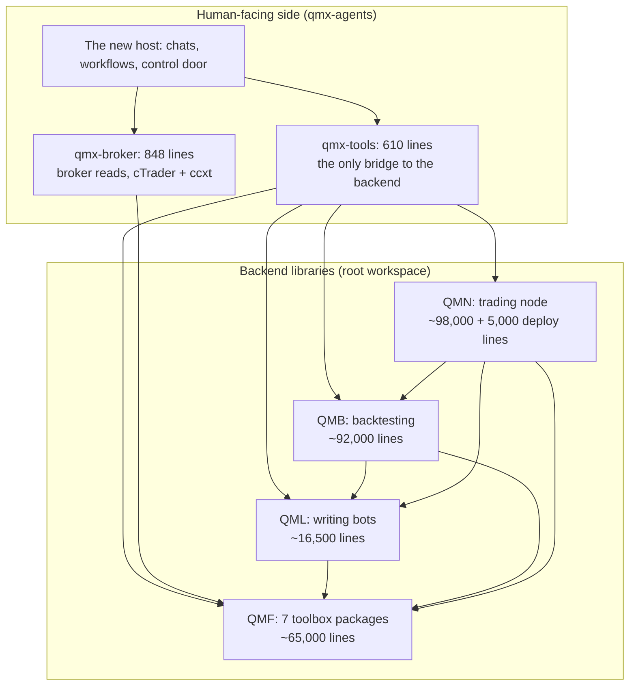
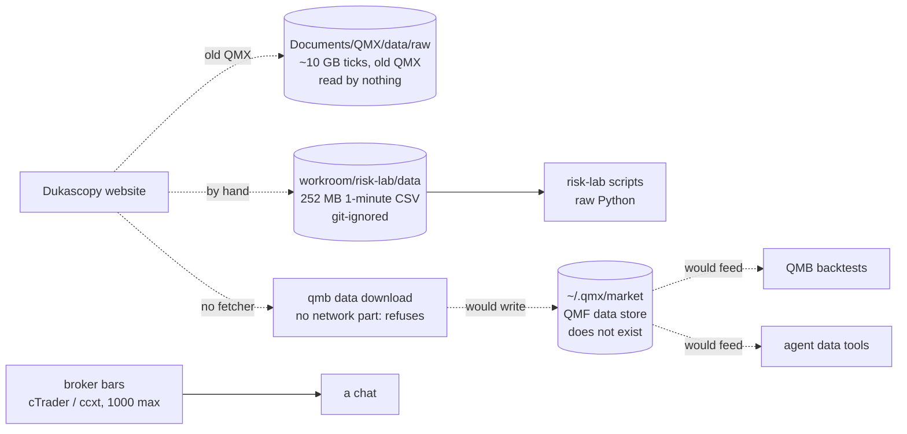

# 50 — The four backend packages and every data path, as they are today

Date: 2026-10-21. Read-only survey. Nothing was changed, merged or committed.

**How this was read.** Code is `origin/engine/base` at `6b16e461` (it holds everything from `integration` plus the 42 build PRs), read with `git show`, `git grep`, `git ls-tree` and `git log`. No checkout. Paths below are paths in that commit unless they start with `C:` or `~`. Disk facts were checked read-only on this PC today. Older intent comes from `C:\Users\Mubarak\Desktop\QMX\docs\`. Newer intent comes from `tracker/qma-v2/architecture/library-and-data/`, study `30-data-and-devops.md` (16 Oct, read against an older branch; this file re-checks it against today's code), rulings file `26-operator-rulings-and-alignment.md`, and `LAUNCH-AND-CLEANUP-MAP.md`.

**One reminder on dates.** The git history of these folders starts on 21 August 2026 (QMF), 23 August (QML), 24 August (QMB) and 31 August (the trading node). The last real code changes to all four were between 26 September and 12 October. If you remember shipping parts in May, that work came into this repo in August.

---

## 0. The answer in ten lines

1. The backend is four Python libraries: **QMF** (seven small toolbox packages), **QMB** (backtesting), **QML** (writing bots) and **QMN** (the trading node). Together they are about 270,000 lines of code, plus about 145,000 lines of tests.
2. They are well built and well tested, but **nothing in the running app uses them for real work today.** The new host starts, but the agent tools that should reach them return nothing or refuse.
3. **There is no historical market data in the system.** The store that should hold it is empty. The code has **no working downloader**: the Dukascopy reader exists, but nobody wrote the part that actually fetches from the internet.
4. Your real price history sits in **two orphaned places** on this PC: about 10 GB of Dukascopy ticks from the old QMX, and 252 MB of 1-minute CSV bars in the risk-lab folder. Nothing in the app reads either, and nothing backs them up.
5. News comes from one free feed, fetched by **three separate pieces of code**: a Windows scheduled task (still running today), the trading node's recorder (never run), and a workflow template.
6. There are **five "Libraries"** in code with different rules, plus a sixth one drawn by the UI from demo data.
7. **Uploads do not exist.** There is no way to hand QMX a book, a PDF or a file. The Library takes JSON only through its door.
8. A backtest in QMB reads prices from a **local folder**, by fingerprint. The 12-month holdout lock works only when the caller switches it on. The agent data tools never switch it on.
9. The trading node is about 98,000 lines. It has **never been deployed**. Roughly a third of it is proof and test campaigns, an ML training pipeline, and install planners, rather than the live trading path.
10. Logs and observability are spread over about ten places on the PC. Nothing is sent anywhere, and there is no single view.

---

## 1. The four packages

### 1.1 The picture

Who depends on whom (from each `pyproject.toml`):

| Package | Uses |
|---|---|
| QMF core | nothing |
| QMF data, indicators, structure, risk, venue | QMF core (data also uses pyarrow and duckdb; indicators uses ta-lib) |
| QMF registry | QMF core and QMF data |
| QML | QMF core, registry, risk |
| QMB | QMF core, registry, data, indicators, structure, risk; QML; optuna |
| QMN | QMF core, data, registry, risk, venue; QMB; QML |
| qmx-tools (agent bridge) | QMF data, QMB, QML, QMN, qmx-control |
| qmx-broker | QMF venue, ccxt |

So the node sits on top of everything, QMB sits on QML and QMF, and QMF is the floor. One rule from the docs is already broken: QMF venue's README says only the trading node may use it, but `qmx-broker` uses it too (`packages/qmf-venue/README.md`; `qmx-agents/packages/qmx-broker/pyproject.toml`).

### 1.2 QMF — the toolbox (seven packages)

**What the docs said it was meant to be.** A toolbox, not an application: exact money and time types, fingerprints, data rules, indicators, chart structures, risk rules, and the broker connection. No loops, no schedules, no screens. Everything else (backtests, the node, the agents, the UI) must use it instead of re-doing it (`docs/AGENTS.md:52-57`; `docs/architecture/overview.md:16-19`).

**What it does in code today, package by package.**

| Package | What it does, in plain words | Lines (code) | Alive? |
|---|---|---|---|
| `qmf-core` | Exact money, prices and time (no rounding errors), a single fingerprint function every package uses, and a standard "refused, and why" answer | 4,594 | Used by everything. Last change 1 Oct. |
| `qmf-data` | The market-data store: folders per "world" (live, replay), raw price files kept forever, rebuildable views, journals, train/test splits, the 12-month holdout lock, backup and restore helpers, the Dukascopy reader and the news-calendar reader | 15,678 | The code works in tests. **The store holds no data on this PC.** Last change 4 Oct. |
| `qmf-indicators` | Indicators (wrapping TA-Lib), in batch and streaming mode, checked against a reference | 7,352 | Used by QMB. |
| `qmf-structure` | Chart objects that never peek ahead (swings, zones and the like) | 5,044 | Used by QMB. |
| `qmf-registry` | Records for bots, books, bindings and results, each named by its fingerprint, with "this came from that" links and a human-signed promotion path | 3,844 | Used by QML, QMB, QMN. Its records live inside the data store. |
| `qmf-risk` | The rulebook: Book, BMS, sizing, exits, paper mode, kill controls, performance in R | 17,704 | Used by QML, QMB, QMN. Your risk-sizing session is rethinking this area (`workroom/risk-lab-2026-10-05/`, git-ignored). |
| `qmf-venue` | The cTrader connection: messages, encoding, connection handling, commands, events | 10,963 | Used by the node and by `qmx-broker` (reads only). |
| `extensions/qmf-calendar-forex` | Forex market hours | small | Used for gap checks and splits. |

Evidence: package READMEs under `packages/*/README.md`; module headers in `packages/qmf-data/src/qmf/data/` (`seal.py`, `splits.py`, `dukascopy.py`, `calendar_feed.py`, `rooms.py`, `store/facade.py`).

**A word trap.** In QMF, a "Book" is a trading rulebook, not a book you read. A "world" is live or replay data kept apart. Neither has anything to do with your uploads.

### 1.3 QMB — backtesting

**Meant to be.** One pure library plus the `qmb` command line. It runs a bot against its Book's own rules on recorded history (`world = replay`) and publishes one result file per run. Thin doors: a Python door now, an agent (MCP) door "after CLI v1". It must never fetch data during a run, never keep a second data store, and never promote anything on its own (`docs/components/qmb.md`).

**Does in code today.**

- Runs a bot over recorded bars, slice by slice, with warm-up and no look-ahead (`qmb/src/qmb/runloop/`, 5,418 lines).
- Simulates fills, spread, slippage, costs and financing (`execution/`, 10,774).
- Optimises parameters with optuna, always with a training split and a separate testing split (`optimize/`, 8,204).
- Robustness tests: trade shuffle, candle perturbation, rule significance, walk-forward (`robustness/`, 6,589).
- Sweeps, ranking, a run ledger, result files, charts and comparisons (`sweep/`, `orchestrator/`, `results/`, `analysis/`).
- Data commands: download, verify, gap check, catalogue, synthetic data generation, licence checks (`data/`, 10,875).
- A read of registry records shaped as "Library kinds" (`registryread/`, 3,573). This is one of the five Libraries.
- A big `host/` folder (12,219 lines) that glues QMB to the old agent daemon (operator "alternative" studies, replays, a sandbox runner for untrusted bot code).
- The command line `qmb` with groups `backtest`, `data`, `optimize`, `sweep`, `robustness`, `ledger`, `library`, `analysis`, `config`, `host` (`qmb/src/qmb/doors/cli/__init__.py`). Since PR #122 (approved, not merged), `qmb host start` also starts the new agent host.

**Alive vs dead.**

- The library works in its tests (1.77 MB of test code).
- `qmb data download` **cannot download.** It needs an injected "provider adapter" and says "qmb never opens a provider socket itself" (`qmb/src/qmb/data/download.py:236-241`). The Dukascopy adapter takes injected bytes and also never opens a socket (`qmb/src/qmb/data/dukascopy.py:1-6`). No code anywhere in the repo fetches from Dukascopy's servers (no file names the Dukascopy URL).
- The agent (MCP) door is a placeholder: "scaffolded, not shipped" (`qmb/src/qmb/doors/mcp/__init__.py`).
- About 4,000 lines in `host/operator_*` serve the old daemon, which is due for deletion.

Size: 92,255 lines of code in 136 files; 243 commits; last change 12 Oct.

### 1.4 QML — writing bots

**Meant to be.** The library for authoring a bot. A governed bot is two things: a declaration (what it is, its parameters, what data it needs) and plain Python logic. QML checks the bot conforms, fingerprints it, and hands it to QMB or the node. It never runs anything itself (`docs/components/qml.md`).

**Does in code today.** Exactly that: the declaration types, parameter templates, the "footprint" (which data streams and indicators a bot reads, and how much warm-up it needs), the runtime contract a bot must follow (receive evidence, return intents, never size, never send orders, never read a clock), two conformance gates, logic fingerprinting, strategy families, and a "Stage 0" research mill for hypotheses (`qml/src/qml/*/__init__.py`).

**Alive vs dead.** Works in tests. There is one example bot (`qml/examples/conformant_bot/`). **No real bot is registered anywhere.** 16,485 lines; last change 7 Oct.

### 1.5 QMN — the trading node

**Meant to be.** One supervised process on a Linux server near the broker. Paper or live. It records the broker stream, runs bots through QMB's loop, applies the Book's rules, kill switches (the KSA, five levels from green to black), a kill line per account, reconciles with the broker, and backs everything up. No command line: you control it from the desktop UI (`docs/components/trading-node.md`).

**Does in code today.** All of that is written. Details are in section 6. 98,063 lines in 203 files, plus 5,203 lines of install and deployment planners; 204 commits; last change 7 Oct.

**Alive vs dead.** Never deployed. There is no server running it. The install, switch and demo "recipes" are planners that run in check mode against fixture folders; they say so in their own headers (`qmn/deploy/install.py`, `switch.py`, `demo.py`, `lifecycle.py`).

### 1.6 Other backend pieces

| Piece | What it is | State |
|---|---|---|
| `qmx-broker` (agent side) | Reads accounts, positions, quotes, bars (at most 1,000 per call), symbol info from cTrader or any ccxt exchange; writes unsigned order proposals | Works when a broker is set up in Settings and its key is in the Windows vault. Your real home has no `settings.toml`, so none is set up. Nothing it reads is stored. (`qmx-agents/packages/qmx-broker/README.md`, `service.py`) |
| `recorder/` | A Windows scheduled task that fetches the free Forex Factory weekly calendar | **Alive.** Task `QMX-Calendar-Recorder` is Ready and last ran today 18:00. 126 files, 3 MB in `C:\Users\Mubarak\Desktop\QMX\recorder\data\`, git-ignored, in no backup. Nothing reads it. |
| Market-data service, Library Hub | A server that would hand out data to remote runs | Designed only (study 30 section 4d; library HLD). No code. |
| Old agent daemon (`qma-core`, `qma-daemon`, `qma-wire`) | The old agent system | About 119,000 lines, still in the tree, due for deletion (DEL2/DEL3). It imports QMF 374 times; the new system barely does. |
| Example mini apps | `exchange-status`, `macro-daily-bias`, `mql5-articles`, `weekend-watcher` | Examples. They keep their own data in their own app folder. |

---

## 2. Every data path today, as journeys

Each journey says where data enters, where it lives, who reads it, and what is duplicated or missing.

### 2.1 Historical market data (ticks and bars)

- **Enters:** today, only by hand. The old QMX downloaded about 10 GB of EURUSD and USDJPY ticks (2003 to 10 Aug 2026) into `C:\Users\Mubarak\Documents\QMX\data\raw\external-deep-history\` (study 30, section 1a; folder still present today). The risk-lab session put Dukascopy 1-minute bars for EURUSD and BTCUSD (2021-2025) as CSV into `workroom/risk-lab-2026-10-05/data/`; its own ledger says the 2025 EURUSD ask file is incomplete (`ledger.md:64-66`).
- **Designed entry:** `qmb data download` into the QMF data store, and on the node `just node-data-bootstrap`. Neither can fetch: both take injected bytes and no real fetcher exists (`qmb/src/qmb/data/download.py:236-241`; `qmn/src/qmn/data/bootstrap.py:1-8`; `qmn/deploy/data_bootstrap.py:67,152`).
- **Lives:** designed home is `~/.qmx/market/` (raw price files as Parquet named by fingerprint, DuckDB views, SQLite records, JSONL journals) plus a `~/.qmx/datasets.json` list (`qmx-agents/packages/qmx-tools/src/qmx_tools/service.py:242-265`). **Neither exists**: `~/.qmx` today holds only `control.db`, `library.db`, `runs.db` and one artifact (checked today).
- **Read by:** QMB backtests (by fingerprint from a folder), the agent data tools, the node's history bootstrap. The risk-lab scripts read the CSVs directly (`workroom/risk-lab-2026-10-05/engine/market.py`, `sim.py`), which is a backtest path outside QMB.
- **Live bars for a chat:** `qmx-broker` reads bars from cTrader or ccxt, hands them to the chat, and forgets them. No record of what data a conclusion used.
- **Duplicates:** three history copies are planned or present (old 10 GB, risk-lab CSV, the store), plus a fourth download designed on the node. Two copies of the same days would get different fingerprints because the window is part of the fingerprint (study 30, problem 3).
- **Gaps:** no fetcher; no import of the 10 GB; no backup of any market data; the store is empty; the CSVs are outside git and outside any backup.

### 2.2 News and the economic calendar

- **Enters:** one free source, `nfs.faireconomy.media` (Forex Factory weekly file). It has forecasts and previous values, **no actual results**, so no "surprise" can be found live (`.../templates/t3-news-calendar-watch/README.md`, "Left out").
- **Three fetchers of the same feed:**
  1. The Windows scheduled task `recorder/fetch_calendar.py` → raw files in `recorder/data/calendar/` (alive, unread, unbacked).
  2. The node's recorder `qmn/src/qmn/data/news_calendar_recorder.py` (the only real `urlopen` in the backend) → the node's data store, journaled, used for news blackouts. Never run.
  3. The workflow template "News and macro calendar watch" `t3-news-calendar-watch/scripts/calendar.py` fetches the same file each day and keeps only that day's strip as the run's result in the Library.
- **The parser:** `packages/qmf-data/src/qmf/data/calendar_feed.py` is the proper reader with revisions and fail-closed rules; only the node uses it.
- **Read by:** nothing today. The template's watchlist is hard-coded to EURUSD and USDJPY "until the trading node exists".
- **Gaps:** no headline news source, no central-bank feeds, no actuals; three copies of one feed with three formats.

### 2.3 Your uploads (books, PDFs, files)

- **Enters:** **nowhere.** The new host has no upload route. The Library's save door takes a title, a kind and JSON content (`qmx_control/service.py:643`, `LibraryInput`). The only REST routes outside the generated catalogue are app signing, events, health and webhooks (`qmx_control/server.py:135-183`; `qmx_host/host.py:481`).
- **What happens instead:** a chat agent can open a file on your disk with its `Read` tool, because every chat gets Claude Code's own file tools (`qma/harness/surface.py:160`, per the launch map). Nothing records that the file was used.
- **Designed:** the new Library stores any file once by fingerprint and has an "Import" path in its design (library HLD section 1). The PDF-to-text tool and the vision pass are listed as "left out" in the video template (`a-fill-the-library/README.md`).
- **Gaps:** no upload, no PDF or book import, no place for your files, no link from a file to what was learned from it.

### 2.4 Data agents bring in (web pages, video transcripts, research)

- **In a chat:** web pages via the browser and search tools the chat has (for example the Firecrawl tools). The text lives in the chat transcript (Claude Code's own JSONL under `~/.qmx/claude/projects/` once you log in). Each chat also gets one `session` card in the new Library (`qmx_host/sessions.py`). Anything the agent chooses to save goes through `library_save` into the old Library file and, mirrored, into the new store (section 3).
- **In a workflow:** "Turn a video, a playlist or saved posts into strategy ideas" fetches captions with `yt-dlp`, triages, extracts strategy cards, audits them, and writes one file per card and source. At run end those files go into the new Library as `run-file` artifacts linked to the run (`a-fill-the-library/README.md` step 8; `qmx_engine/trace_export.py`). No Whisper for videos without captions, no logged-in sources (Instagram, X, TradingView), no frames.
- **Paper scout, literature review, source-to-card templates** follow the same pattern: inputs fetched in scripts, results land as run files.
- **Mini apps:** `mql5-articles` scrapes articles into its own `app.db` in its app folder (`examples/apps/mql5-articles/collector.py`). App outputs register in `~/.qmx/artifacts.db`; their landing in the Library "waits" because the host never attaches the Library sink (`qmx_apps/artifacts.py:1-11`; launch map APP2a).
- **Old research:** the `research-corpus` plugin reads your old Stats database `C:\Users\Mubarak\Desktop\Stats\backend\strats.sqlite`, which ruling 28 put out of scope (`qmx-agents/plugins/research-corpus/`).
- **Gaps:** chat finds are saved only if the agent decides to; raw pages and transcripts are not kept as sources; mini-app finds do not reach the Library.

### 2.5 Workflow and Lab outputs

- **Workflow runs:** the engine keeps live state in `~/.qmx/engine/engine.sqlite` (events, spans) and a run folder `~/.qmx/engine/runs/<run_id>/` (the workflow copy, `trace-<seq>.jsonl`). At the end of each drive it writes a `workflow-run` card, a `trace` artifact and every listed file as `run-file` artifacts into the new Library (`qmx_engine/trace_export.py:1-17`). Passed runs land on `main` by the standing rule.
- **When the engine runs on its own** (outside the host) it falls back to a private Library file `~/.qmx/engine/library-fake.sqlite` (`qmx_engine/ports/library_fake.py:1-2,116`).
- **Lab:** there is no Lab code. The Lab and pods exist as an architecture (`tracker/qma-v2/architecture/lab-and-pods/`). One template script is named `lab.py` (`rs3-source-to-lab-test`), and it waits for the QMB door.
- **Backtest outputs from QMB itself:** one result file per run in a run output folder, plus ledger fragments `ledger.jsonl` per machine and role (`qmb/src/qmb/results/ct32.py`; `orchestrator/ledger.py`). These do not reach the Library.
- **Backtest outputs through the agent tool:** saved as kind `backtest` into the **old** Library file (`qmx_tools/service.py:191-230`). None exist.
- **Gaps:** QMB results and agent backtests go to two different places, neither is the new Library; the risk-lab simulation reports live in `workroom/risk-lab-2026-10-05/reports/`, outside git.

### 2.6 Artifacts (bots and units, reports, screenshots)

- **Bots and units:** a governed bot is a registry record (QMF registry) plus its Python logic. The registry lives inside a QMF data store; on this PC there is none. The new Library has kinds `bot`, `unit`, `strategy`, `book`, `bms`, `binding` and an importer from the registry (`qmx_library/kinds/`; `migrate/from_registry.py`), but nothing writes them yet. The "unit" itself is still a design in the risk session.
- **Reports:** workflow reports land as run files in the new Library. Agent tool results larger than 16 KB are saved as `tool-result` artifacts in the old Library (`qmx_tools/service.py:166-171`).
- **Screenshots:** no code handles screenshots. Browser and computer use are designed, not built.
- **Gaps:** bots have no home until the registry or the Library is chosen as theirs (Library open decision OPEN-2).

### 2.7 Logs and observability

| What | Where | Leaves the PC? |
|---|---|---|
| Host process log | `~/.qmx/control.log` (`qmx_host/host.py:530`) | No |
| Heartbeats (CPU, memory, capacity per class) | `~/.qmx/logs/heartbeat-<day>.jsonl` plus `heartbeat-latest.json` (`qmx_engine/heartbeat.py:8-36`) | No |
| Workflow spans and events | `~/.qmx/engine/engine.sqlite`; trace JSONL per run, copied into the Library | No |
| Chat usage journal | `~/.qmx/runs/<chat>/journal.jsonl` (`qmx_host/host.py`, `harness usage`) | No |
| Mini-app logs | `logs/` inside each app folder (`qmx_apps`) | No |
| Remote run journals | `~/.qmx/journals/remote-<id>.jsonl`, results via rclone to a bucket on your server (`qmx_remote/`) | Only remote runs |
| QMB run ledger and log | ledger fragments in the run root (`qmb/src/qmb/orchestrator/log.py`, `ledger.py`) | No |
| Node logs, metrics, alerts, liveness ping | journald, Prometheus, Grafana, Loki on the node; an outbound alive-ping (`qmn/src/qmn/observability/`; `qmn/deploy/observability/`) | Designed; node not running |
| Memory engine database | `C:\Users\Mubarak\.pg0\instances\hindsight` (launch map section 6) | No |

**Gaps:** no single view, no data-freshness or disk alerts on the PC, no off-PC copy of any log.

### 2.8 Backups today

Four separate mechanisms: a weekly snapshot of small databases to a private GitHub repo (`qmx_control/backup.py`), per-app rclone backup with a restore test (`qmx_apps/backup.py`), an optional Litestream sidecar for app containers, and the node's encrypted nightly backup (not running). **None covers market data, the 10 GB history, the risk-lab CSVs, the calendar recorder files or the Stats database.**

---

## 3. What the Library holds vs what QMF data holds

### 3.1 The five Libraries in code (plus one in the UI)

| # | Where | Rules | State |
|---|---|---|---|
| A | QMB's view over registry records (`qmb/src/qmb/registryread/library.py`) | Only ten trading kinds; refuses workflows, skills, apps | Code only; no registry data on the PC |
| B | The control door's `~/.qmx/library.db` plus `~/.qmx/artifacts/` (`qmx_control/library.py`) | Any kind name, JSON only, free-text links | **The truth today.** Every chat save and every agent tool save goes here. 110 KB; 16 of its items are test junk (launch map) |
| C | The new Library store `~/.qmx/library/` (`qmx_library/store.py`) | Content-addressed objects and files, versions, branches, fixed link words, 37 kinds | Opened by the host. Gets every save from B as a mirror, plus all workflow outputs and chat session cards. Not primary until seven clean nightly comparisons |
| D | The engine's stand-alone fallback `~/.qmx/engine/library-fake.sqlite` | Same shape as C | Only when the engine runs without the host |
| E | Mini-app outputs `~/.qmx/artifacts.db` (`qmx_apps/artifacts.py`) | Hash plus contract name | Landing into C is never wired |
| F | QMF registry room (inside a QMF data store) | Governed records with human-signed promotion | Code only; meant to live on the node |
| — | The UI rebuild | 15 shelves drawn from demo arrays | No backend calls |

### 3.2 QMF data holds

Ticks, bars, quotes, depth, news observations, journals of decisions, orders, fills and risk changes, train/test split definitions, the holdout lock, and the registry room. All per "world" (live or replay), all kept forever, all named by fingerprint (`packages/qmf-data/README.md`; `rooms.py`).

### 3.3 Where they overlap

- **Governed records** (bots, books, bindings, results) can live in the QMF registry (F), in QMB's view of it (A) and as new Library kinds (C). The design recommends C *mirrors* F (library `OPEN-DECISIONS.md`, OPEN-2), but no sync code runs.
- **Datasets.** The new Library has a `dataset` card kind meant to point at data in QMF (source, instruments, window, split, licence, partition fingerprints) (`qmx_library/kinds/dataset.schema.json`). **Nothing writes one**, except the importer that turns registry split records into dataset cards (`migrate/from_registry.py:38`). The agent tools keep their own separate dataset list in `datasets.json`.
- **Backtest results** live as QMB result files, as kind `backtest` in B, and as kind `backtest-result` in C. Three shapes.
- **Fingerprints.** Library C uses the same fingerprint function as QMF, so a governed record keeps its id in both (`ARCHITECTURE-SPINE.md:69,238`). That part matches.
- **The rule on paper:** market data stays out of the Library; the Library only cites it through a dataset card (spine line 437). In code, nothing yet connects the two.

---

## 4. How QMB gets data for a backtest today

### 4.1 The mechanics

1. A **split definition** cuts history into named, time-ordered, non-overlapping parts, by default `train`, `validation` and `sealed-test`. Its id is its fingerprint (`packages/qmf-data/src/qmf/data/splits.py`).
2. The **holdout lock** ("seal") covers the newest window, about 12 months, set by the setting `historical_holdout_months`. Any read into it is refused, never silently empty. One authorised final look is allowed (`seal.py`).
3. QMB's replay reader takes **a local folder path** (`store_root`), a list of raw-file fingerprints, and optionally a split definition plus the lock (`qmb/src/qmb/host/replay.py:143-195`). It refuses anything not in the replay world.
4. **In-sample and out-of-sample:** optimisation runs every trial twice, once on the training split (which scores it) and once on the testing split (recorded, never scored) (`qmb/src/qmb/optimize/splits.py`). Walk-forward is a chain of in-sample and out-of-sample split pairs, each a separate run (`robustness/walkforward.py`).
5. **Runs never fetch.** A backtest that tries to fetch from a provider is refused (`qmb/src/qmb/data/policy.py`).
6. A run config cites its data by the split fingerprint (`qmb/src/qmb/data/derived.py`; `host/replay_request.py`).

### 4.2 What is true about the lock today

- The store applies the lock **only if someone passes it in** when opening the store (`store/facade.py:59-125`; `append_store.py:128-162`: "With no seal wired, `at` is irrelevant and the read proceeds").
- QMB's governed replay requires the lock when a split is named (`host/replay.py:180-195`).
- **The agent data tools open the store without the lock** (`qmx_tools/service.py:257-265`, `EvidenceStore(root / "market")` with no seal). If data existed, an agent could read the holdout months.
- The risk-lab scripts read CSVs directly, with no split and no lock.

### 4.3 Could QMB ask one central source instead?

What the code already makes easy:
- QMB asks for data **by fingerprint**, not by file name, and the raw files are named by their fingerprint. A central source that hands out the same pieces by fingerprint would give byte-identical input.
- The store's engines sit behind swappable interfaces (`packages/qmf-data/README.md`, "each is swappable"). Today only local engines exist (Parquet, DuckDB, SQLite, JSONL files).
- QMB already refuses to fetch on its own, so it already expects data to be prepared elsewhere.

What stands in the way today:
- The reader takes a **local folder path** (`store_root`). There is no network reader.
- The lock is applied in the reader on the caller's side. A central source would have to apply it itself, or a caller could skip it.
- Remote runs carry no data reference at all (`qmx_remote/models.py:67-79`, `RunBundle` has no data field).
- There is no central source to ask: the market-data service is a design in study 30 only.

---

## 5. What the agent tools expose per package, and why they return nothing

The catalogue (`qmx-agents/packages/qmx-control/src/qmx_control/catalog.py:204-226`) has these backend rows:

| Package | Tool rows | What happens in the running host |
|---|---|---|
| QMF data | `data.instruments`, `data.bars`, `data.features`, `data.calendar` | instruments returns an empty list; the three reads raise "No data store configured; inject a host-owned QMF AppendStore" |
| QMB | `backtest.run`, `backtest.status`, `backtest.results`, `backtest.compare` | run raises "Unknown config_ref; ask the host to register a recorded QMB run configuration"; the other three look up saved backtests in the old Library and find none |
| QML | `research.qml_run` | raises "Unknown bot_ref; ask the host to register a QML HostedBot with recorded surfaces" |
| QMN | `node.state` | raises "No node configured; inject the host's QMN DoorRuntime" (`qmx_tools/functions.py:227-231`) |
| QMF venue (via qmx-broker) | `broker_read.accounts`, `account_state`, `positions`, `quotes`, `symbol_info`, `bars`, and `node.propose_order` | Work only with a broker in Settings and a key in the vault. None set up on your real home |
| QMF indicators, structure, risk, registry | none | No rows |
| QMB optimise, sweep, robustness, walk-forward, data download | none | No rows; QMB's own agent door is a placeholder |

**Why they refuse.** All four reasons are one gap: nothing fills the tools' context at start-up.

1. The harness builds the tools' context with only a home folder: `DomainContext(root=home.root)` (`qma/harness/harness.py:403`). No store, no datasets, no backtests, no bots, no node.
2. The other way to fill it, `DomainContext.from_environment()`, reads `~/.qmx/datasets.json` and `~/.qmx/market/` (`qmx_tools/service.py:242-265`). The harness does not call it, and both are missing anyway.
3. A "registered backtest" is a raw Python argument dictionary for `qmb.runloop.run`, and a "registered bot" is a live Python object. Nothing at start-up builds either, and there is no tool to add one.
4. The node door is an in-process object that exists only inside a running node. The node's own doors listen on localhost and a Unix socket on the node's machine (`qmn/src/qmn/doors/http/evidence.py`, `powers.py`). Nothing connects it back to your PC.

The launch map proved all four answers by running the merged code (`LAUNCH-AND-CLEANUP-MAP.md` section 4). The workflow templates agree: 7 wait on "qmb-door" and about 8 on "trading-node" (`qmx_engine/templates/catalog.py:62-63,166-319`). Meanwhile every chat has Claude Code's `Bash`, `Read` and `Write`, so an agent that wants a backtest today would write raw Python against the libraries.

---

## 6. The trading node today

### 6.1 What it does, part by part

| Part | Plain words | Lines |
|---|---|---|
| `venue/` | The live cTrader client: records every broker message before acting on it, reconnects and fills gaps, checks the connection, reads positions and balances | 7,478 |
| `loop/` | One writer per broker stream records prices, then calls QMB's loop once per completed bar | 1,349 |
| `order/` | Order identity, refuses an order without a protective stop already at the broker, timing, and "unknown" handling (if the outcome of an order is unknown, the whole account stream blocks) | 5,178 |
| `protection/` | Kill switch levels (green to black), news blackout windows, one place that decides between competing controls | 3,150 |
| `capital/` | The kill line per account (flatten and stand down at the loss floor), the breakeven ratchet, benching a bot after a qualifying loss | 1,168 |
| `ledger/` | An exact "virtual" ledger per Book binding, positions, treasury | 5,516 |
| `reconcile/` | Compares what the node thinks with what the broker says: reconciled, drift, unknown, out of range | 1,207 |
| `seats/` | Hosts bots: deadlines, memory limits, quarantine on a breach | 3,872 |
| `mis/` | The market-state signals (six rule-based labelers plus liquidity stress), read only by the Book door and the kill switch, plus a shadow lane, **plus a full ML regime-classifier pipeline** (corpus, design, labels, training, evaluation, registration: about 8,700 lines) | 12,654 |
| `data/` | Live intake, history bootstrap (cannot fetch), news recorder, sealed archive, encrypted backup and restore drills | 7,160 |
| `paper/` | Paper as a Book state routed to a paired demo account, protective demotions | 2,788 |
| `promotion/` | Human-only promotion, a "silent battery", next-day activation, a write-only inbox | 3,122 |
| `config/` | Builds the node's settings from roster, BMS, Book and defaults | 3,605 |
| `doors/` | In-process API, localhost HTTP evidence (read only), Unix-socket "powers" for operator and ops | 2,014 |
| `observability/`, `time/`, `secrets/`, `journal_dispatch.py` | Logs, metrics, alerts, liveness ping; the clock and calendars; the secret store; "write the journal before acting" | about 4,700 |
| `replay/` | Replays a recorded day off the node and diffs decisions | 3,521 |
| `bench/` | Speed and memory benchmarks | 2,291 |
| `host/` | Start-up ceremony and supervision, **plus proof campaigns**: golden scenarios, runtime risk gate, failure campaign, lifecycle campaign, readiness packet, verdict packet, QA-debt matrix, shakedown, security probes, plus a hand-over "fencing" protocol and Windows deployment reading | 26,602 |
| `deploy/` | Install, switch, rollback, demo, lifecycle, CI, observability stack, systemd units: planners that run in check mode | 5,203 |

### 6.2 Live-trading critical

These carry money safety and would be needed by any node that runs trusted bots: the cTrader client and reconnect (`venue/live.py`, `reconnect.py`, `verify.py`), the recording loop (`loop/`), order identity, the protective-stop rule and unknown handling (`order/`), the kill switch and news windows (`protection/ksa.py`, `windows.py`, `dispatch.py`), the kill line (`capital/kill_line.py`), reconciliation (`reconcile/`), the virtual ledger (`ledger/`), bot seats and quarantine (`seats/`), the MIS signal snapshot and labelers (`mis/signal_snapshot.py`, `labelers.py`, `liquidity.py`, `catalog.py`), live intake (`data/intake.py`, `observation_sink.py`), journal-before-act (`journal_dispatch.py`), the clock (`time/`), the secret store (`secrets/`), supervision and start-up (`host/_supervision.py`, `boot_ceremony.py`), and health, metrics and liveness (`observability/`).

### 6.3 Looks obsolete or heavy given your simplification

Your words: "a trading node is just a server where trusted bots live, with the MIS and kill switches, connecting back to his machine." Measured against that, these parts look like candidates to drop, move or shrink. This is a reading of today, not a decision.

- **Proof and QA campaigns inside the runtime** (about 11,000 lines in `host/`: `golden_scenarios.py`, `runtime_risk_gate.py`, `failure_campaign.py`, `lifecycle_campaign.py`, `readiness.py`, `verdict.py`, `qa_debt_matrix.py`, `shakedown.py`, `security_probes.py`) and `bench/`. They prove the node; they are not the node.
- **The MIS training pipeline** (`mis/regime_corpus.py`, `regime_design.py`, `regime_labels.py`, `regime_train.py`, `regime_eval.py`, `regime_register.py`, about 8,700 lines). Training is research work; the node only needs to run a trained model. The docs already say training is last (`docs` DEC-0262, memory "MIS training last").
- **Ceremony around trust:** human-only promotion with a silent battery and next-day activation (`promotion/`), sequential hand-over fencing between owners (`host/fencing.py`), the write-only inbox, Book-level paper routing to a paired demo account (`paper/`). If bots arrive already trusted, much of this collapses.
- **Install planners that never touch a server** (`deploy/` in check mode) and the Windows deployment reader (`host/_windows_deployment.py`) for a Linux-only node.
- **A second news recorder and a second history downloader** (`data/news_calendar*.py`, `data/bootstrap.py`) that duplicate PC-side paths.
- **Replay off the node** (`replay/`) duplicates what QMB does.
- **The missing piece is the opposite of obsolete:** nothing connects the node back to your machine. Its doors are localhost and a Unix socket, and the agent tool needs the node in the same process.

Also note that the risk layer the node enforces (Book, BMS, binding, seat from `qmf-risk`, 17,704 lines) is what your risk-sizing session is rethinking as the "unit". How much of `ledger/`, `paper/`, `config/` and `host/decision_root.py` survives depends on that.

A name clash to know about: `qmx_control/node.py` and `node-bootstrap.sh` set up an Ubuntu **worker** machine for remote workflows (Docker, Tailscale). That "node" is not the trading node.

---

## 7. Duplicates and gaps in one list

**Duplicates**
1. History: old 10 GB ticks, risk-lab CSVs, an empty designed store, and a designed node download.
2. News: one free feed fetched by a scheduled task, the node recorder and a workflow template.
3. Libraries: five in code plus one in the UI.
4. Backtest results in three shapes (QMB result files, old Library `backtest`, new Library `backtest-result`).
5. Backtest engines: QMB and the risk-lab scripts.
6. Dataset lists: the agent tools' `datasets.json` vs the Library's `dataset` cards.
7. Backups: four mechanisms with four targets.
8. "Node" means both the trading node and a remote worker; "hub" means both QMB's passive inbox and the planned Library server.

**Gaps**
1. No working downloader for any historical data.
2. No market data in the system; real history orphaned and unbacked.
3. No upload path for your files.
4. The agent tools reach no real data, backtest, bot or node.
5. The holdout lock is optional and the agent path skips it.
6. Remote runs cannot read market data.
7. Mini-app outputs never reach the Library.
8. QMB results never reach the Library.
9. No central log view; nothing leaves the PC.
10. The node cannot talk to your PC.

---

## 8. Questions a data redesign must answer

Not answered here. Each is a question, in no ranked order.

**Market data**
1. Where does history live first: your PC, your Contabo server, the S3 bucket, or a mix with a PC cache?
2. Who fetches it, and with what? Dukascopy only, or also crypto via ccxt, and broker history from cTrader?
3. Do we import the old 10 GB and the risk-lab CSVs, and as what (raw ticks, or bars too)?
4. Which instruments, how far back, which bar sizes, and who can add more?
5. Is there one store everyone reads (PC, server workers, the node, the risk lab), and how does each one reach it?
6. Does QMB keep reading a local folder, or ask a data service by fingerprint?
7. Where is the holdout lock enforced so no caller can skip it, and do agents ever see the locked months?
8. Do agent chats read stored bars only, or also live broker bars, and are those recorded?
9. How does live data recorded by the node come back into research?
10. Is the QMF data store design (worlds, raw files forever, fingerprints) kept as is, or simplified?

**News and other feeds**
11. Which news sources (free calendar only, a source with actuals, headlines, central banks), fetched by whom, stored where?
12. Which of the three calendar fetchers survives?

**Your files and agents' finds**
13. How do you hand QMX a file, a book or a folder, and where do the bytes live?
14. Are web pages, transcripts and papers kept as sources in the Library, or only what was learned from them?
15. Do mini-app outputs and QMB results land in the Library?

**The Library and QMF**
16. Which of the five Libraries survive, and which one is the truth?
17. Do bots, books and units live in the Library, the QMF registry, or both kept in sync?
18. Who writes a dataset card, and when?

**The node**
19. What is the smallest node that still has the MIS, kill switches and kill line?
20. How does it connect back to your PC, and what can the PC see or do?
21. How do trusted bots get onto it, and what replaces promotion and activation?
22. Does MIS training stay in the node package or move to research?

**Operations**
23. One backup plan for every store, including market data: where to, how often, how proven?
24. One place for logs and health across PC, server and node?
25. How do the agent tools get filled at start-up, and do they become QMB's real agent door?

---

## Evidence index

- Package sizes: `git grep -c ''` over `*/src/*.py` excluding tests, at `origin/engine/base`.
- Agent bridge: `qmx-agents/packages/qmx-tools/src/qmx_tools/service.py`, `functions.py`; `qmx-agents/packages/qmx-control/src/qmx_control/catalog.py:204-226`; `qmx-agents/packages/qma-harness/src/qma/harness/harness.py:403`, `tools.py:493-515`.
- Host and Library: `qmx-agents/packages/qmx-host/src/qmx_host/host.py:1-20,326-334`; `qmx-agents/packages/qmx-library/src/qmx_library/store.py`, `kinds/dataset.schema.json`, `migrate/from_registry.py`; `qmx-agents/packages/qmx-control/src/qmx_control/library.py`, `service.py:643-778`.
- Engine: `qmx-agents/packages/qmx-engine/src/qmx_engine/trace_export.py`, `ports/library_fake.py`, `heartbeat.py`, `templates/catalog.py`, `templates/t3-news-calendar-watch/`, `templates/a-fill-the-library/`.
- Data: `packages/qmf-data/README.md`, `src/qmf/data/{seal,splits,dukascopy,calendar_feed,rooms}.py`, `store/{facade,append_store}.py`; `qmb/src/qmb/data/{download,dukascopy,policy,derived}.py`; `qmb/src/qmb/host/replay.py`; `qmb/src/qmb/optimize/splits.py`; `qmb/src/qmb/robustness/walkforward.py`.
- Node: `qmn/src/qmn/*/__init__.py` headers; `qmn/src/qmn/host/*.py` headers; `qmn/deploy/*.py` headers; `qmn/src/qmn/data/news_calendar_recorder.py:74`.
- Broker: `qmx-agents/packages/qmx-broker/README.md`, `service.py`, `adapters.py`.
- Disk (read-only, 2026-10-21): `~/.qmx` (control.db, library.db, runs.db, artifacts); `C:\Users\Mubarak\Documents\QMX\data\raw\external-deep-history\`; `C:\Users\Mubarak\Desktop\QMX\recorder\data\` (126 files, 3 MB); scheduled task `QMX-Calendar-Recorder` (Ready, last run 2026-10-21 18:00); `C:\Users\Mubarak\Desktop\QMX\workroom\risk-lab-2026-10-05\data\` (CSV and JSON bars); `C:\Users\Mubarak\Desktop\Stats\backend\strats.sqlite`.
- Planning: `tracker/qma-v2/LAUNCH-AND-CLEANUP-MAP.md` sections 3-6; `tracker/qma-v2/research/methodology/30-data-and-devops.md`; `tracker/qma-v2/architecture/library-and-data/{PLAIN-WORDS,HLD,OPEN-DECISIONS,ARCHITECTURE-SPINE}.md`; rulings 28, 42, 56, 68, 81, 91, 111 in `26-operator-rulings-and-alignment.md`.
- Docs intent: `C:\Users\Mubarak\Desktop\QMX\docs\components\{qmb,qml,trading-node,qmf-*}.md`, `docs\lenses\data\data-layer.md`, `docs\AGENTS.md:52-57`, `docs\architecture\overview.md:16-19`.
