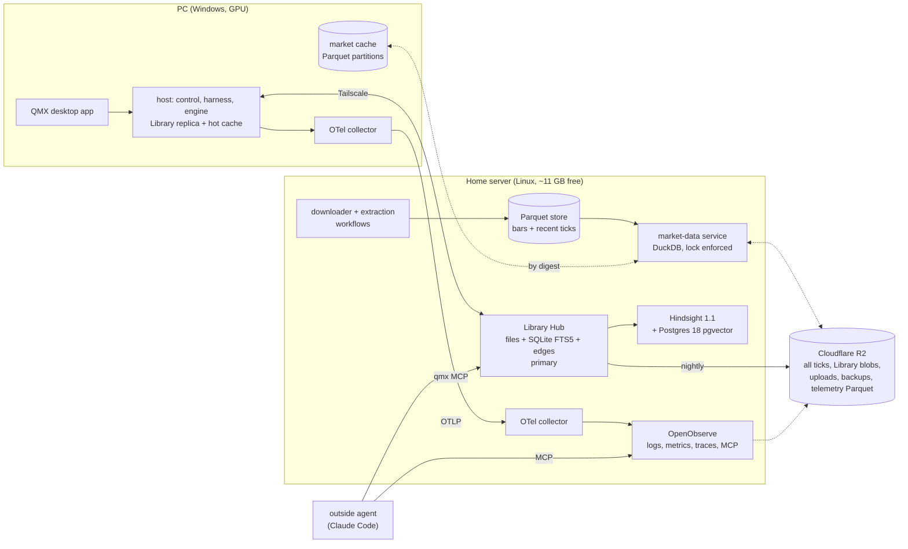

# 53 — The data stack: storage, version control, market data, files, monitoring, memory and trade journals

Date: 2026-10-22. Research only. Nothing here is decided, built, merged or committed.

**How this was read.** Official docs, specs, licence pages and source repositories were fetched today (2026-10-22) with WebFetch, Firecrawl and `curl`. The current QMX code was read read-only at `origin/engine/base` (`8af1a1cd`) with `git show` and `git ls-tree`. Tags: **[retrieved]** = read in that source today; **[local]** = checked in this repo or on this PC today; **[inferred]** = my reasoning from retrieved facts; **[remembered]** = known from before and not re-read today. Sources are listed in §10.

**Inputs.** The operator's seeds (`51-data-round-seeds.md`), today's facts (`50-backend-packages-and-data-today.md`), machines and storage (`49-compute-and-storage-options.md`), the Library design (`architecture/library-and-data/ARCHITECTURE-SPINE.md`), the earlier data study (`30-data-and-devops.md`) and the rulings (`26-operator-rulings-and-alignment.md`). Design rule: design for complexity, not a complex system, and invent no limits.

**The machines this is sized for.** The PC runs Windows and has the GPU (Quadro T1000, 4 GB). One Linux home server has about 11 GB of free RAM and 191 GB of free disk. Cloudflare R2 holds storage and backups at $0.015 per GB-month, the first 10 GB are free, and downloads are free (file 49).

---

## 0. Plain words first

**The short answer.** Keep the Library as it is designed: files on disk, a small SQLite index, and its own git-like history. Add no graph database. Keep price history in plain Parquet files that DuckDB reads, with a full copy in R2. Route all monitoring through one standard, OpenTelemetry, into one light viewer on the server. Run Hindsight on the server with a normal Postgres. It fits.

1. **Library storage.** The current design is right for one person and many agents: content files plus a SQLite index with full-text search. Family trees and "used in" links are rows in a table, walked with a recursive SQL query. That handles a few hundred thousand items easily. **Neo4j is not worth it now.** It needs Java and at least 2 GB of RAM. The free edition holds only one database and can only be backed up while stopped. It would be a second source of truth. A graph database pays off only for deep pattern searches over millions of links, or graph algorithms. If you ever want those, build a graph copy from the Library as a throwaway index.
2. **Version control.** Most of it is **already built**. Every agent writes on its own branch. Moves are safe when two agents race. Drafts, claims on in-progress work, three-way merges and "conflict" records all exist in code. Two gaps remain. A text file changed by two agents is not yet merged line by line; one whole version is flagged as a conflict instead. The UI has no history or "who changed what" view yet. Dolt, lakeFS, DVC and Nessie each solve someone else's problem and would add a second store. Use `git merge-file` (part of git) for the line merge.
3. **Market data.** Plain Parquet files in folders by source, instrument, kind and month, read by DuckDB. DuckDB 2.0 shipped yesterday with faster reads straight from R2. The server holds the working set. R2 holds everything, because 28 forex pairs of ticks alone come to about 140 GB. Sources: Dukascopy (free, forex, metals, indices, many CFDs, going back decades), Binance's free bulk archive and CCXT for crypto, cTrader and MT5 for your own broker's prices, and Databento (pay per GB, $125 free credit) for real futures. ArcticDB is out: production use needs a paid licence.
4. **Your files.** Store each file once, named by its fingerprint, on the server and in R2. Keep what it is, where it came from and its extracted text in the Library. Docling (MIT licence) turns PDFs and books into text with tables and page numbers. MarkItDown (MIT) handles quick conversions. A speech-to-text pass handles recordings.
5. **Monitoring.** Every part speaks OpenTelemetry: Claude Code does, Hindsight does, and QMX's own engine already makes spans. One collector per machine sends everything to one viewer on the server. **OpenObserve** fits best: one program, logs, metrics and traces together, AI-call views, data kept in R2, and an MCP door so an outside Claude Code can ask it what is wrong. Its MCP door needs its free Enterprise tier (free up to 50 GB a day). Langfuse needs 16 GB of RAM, so it is too heavy now. SigNoz needs 4 GB. The Library keeps each run's trace and logs as the permanent record anyway.
6. **Hindsight on the server: yes.** The full Hindsight server takes about 1-1.5 GB of RAM, Postgres takes 0.5-1 GB, and a busy memory-writing burst can add up to about 1.3 GB. That is about 3-4 GB at the worst moment, out of 11 GB free. Use a normal Postgres, not the built-in one: the docs say the built-in one is not for production. Version 1.1.0 came out yesterday. The new "bank templates" are ready-made memory setups (research assistant, multi-agent orchestrator and others) you import with one call.
7. **Trade journals.** Every platform records the same three layers: fills (one row per execution), trades (a round trip from entry to exit, with profit, R and the worst and best swing during the trade) and your notes (tags, mistakes, screenshots). Keep raw fills as data files, like prices. Make each finished trade a Library item linked to the bot or unit version that made it.

**What changes from the current design** is in §9. In one line: no new database for the Library; line-level merge and a history view added; the market-data store's primary moves to "server plus R2"; one OpenTelemetry pipeline and one viewer replace the planned Prometheus, Loki and Grafana; Hindsight moves to the server on a normal Postgres; new kinds `trade` and `upload`.

---

## 1. Library storage stack

### 1.1 What the Library has to hold

| Thing | Shape | Volume [inferred from file 50 and the spine's Deferred row] |
|---|---|---|
| Lineage and family trees (strategy, indicator and unit variants) | a directed graph with no cycles: parent → child, `variant-of`, `derived-from` | thousands to tens of thousands of nodes |
| Relationships ("used in", "produced by", "tests") | typed edges, a closed vocabulary (spine AD-4) | up to a few hundred thousand edges |
| Documents and notes | text with full-text search | thousands |
| Blobs (books, PDFs, screenshots, recordings) | bytes by hash | GBs to tens of GBs |
| Time series (ticks, bars) | billions of rows, read by time range | 10 GB today, about 140 GB for 28 forex pairs (file 30 §4b) |

The first four are Library data. The last is not: spine AD-10 and file 30 §4a keep market data out of the Library and cite it through a `dataset` card. Nothing found today argues against that rule.

### 1.2 Options

| Option | What it is | Fits | Costs and limits |
|---|---|---|---|
| **SQLite + FTS5 + edge table + recursive CTEs** (the current design) | One file per process. FTS5 provides BM25 ranking, prefix queries, a trigram tokenizer, snippets and highlights. `WITH RECURSIVE` walks graphs and family trees | Lineage, relations, documents. Runs the same on the PC and the server, and works offline | One writer at a time; WAL works only on one host. QMX already routes every write through one writer process per store (AD-5), so neither limit binds |
| **Postgres + pgvector + Apache AGE** | A client-server database. pgvector 0.8.7 adds vectors, AGE 1.8.0 adds Cypher on Postgres 11-18 | One central store on the server | A server process; the PC would need its own Postgres or would lose offline use (breaks AD-14). AGE is built from source; no distribution packages are mentioned |
| **Neo4j Community** | Native graph database (Java), Cypher | Pattern queries over many hops, graph algorithms | GPLv3. **Exactly one standard database.** Dumps only from an **offline** server. Minimum 2 GB RAM, 16 GB recommended; 8 GB minimum for on-premises servers. Java 21 or 25 |
| **Kùzu** | Embedded graph DB ("DuckDB for graphs") | It was the natural embedded choice | **Archived 10 Oct 2025**, read-only |
| **LadybugDB** (Kùzu community fork) | Embedded graph DB, MIT, `pip install ladybug` | A rebuildable graph index, if ever needed | Young: 1.9k stars, no named maintainers or funding |
| **DuckDB / Parquet** | Columnar analytics, in process | Market data (§3), backtest trade tables | Not a document store or a graph store |

### 1.3 Facts

- **SQLite concurrency.** "Readers do not block writers and a writer does not block readers," but "there can only be one writer at a time," and WAL "does not work over a network filesystem" **[retrieved, sqlite.org/wal.html]**. Use a client-server database when "many threads or processes must write at the same instant and cannot take turns," or data approaches a terabyte **[retrieved, sqlite.org/whentouse.html]**. A WAL-reset corruption bug is fixed in 3.51.3, which is already the Library's version floor **[retrieved; local, spine Stack table]**.
- **Graphs in SQLite.** The official docs show graph traversal and a family-tree ancestor walk with `WITH RECURSIVE`. Use `UNION` to stop cycles, or `UNION ALL` on data with no cycles (lineage has none) **[retrieved, sqlite.org/lang_with.html]**.
- **Full-text search.** FTS5 provides `bm25()`, prefix indexes, a trigram tokenizer for substring search, external-content tables, `snippet()` and `highlight()` **[retrieved, sqlite.org/fts5.html]**.
- **Vectors in SQLite.** sqlite-vec is "pre-v1, so expect breaking changes", is dual-licensed MIT and Apache-2.0, and is sponsored by Mozilla, Fly.io and Turso **[retrieved]**. The spine already makes it an optional re-ranker only (AD-8).
- **Postgres.** Version 18 is current. `shared_buffers` defaults to 128 MB, with "25% of the memory" as the starting point on a dedicated server **[retrieved, postgresql.org/docs/18]**. pgvector 0.8.7: HNSW "has a better speed-recall tradeoff" but slower builds and more memory, and indexes up to 2,000 dimensions **[retrieved]**.
- **Neo4j.** Community Edition is "suitable for single-instance deployments" and "can have exactly one standard database". Online backup and clustering are Enterprise features **[retrieved, operations manual 2026.10]**. On Community the dump "can be run only on an offline Neo4j DBMS" **[retrieved]**. Hardware minimum is 2 GB RAM, 16 GB recommended **[retrieved, installation/requirements]**. Licence: "Neo4j Community Edition (GPL v3)" **[retrieved, neo4j.com/licensing]**.
- **Kùzu** was "archived by the owner on Oct 10, 2025". LadybugDB is the active MIT fork **[retrieved, GitHub]**.
- **What is in QMX today** **[local]**: `qmx_library/store.py` keeps `objects/`, `blobs/`, `refs/log.jsonl`, `edges/`, `annotations/log.jsonl` and a rebuildable `catalog.db` (FTS5), with `walk`, `marks` and `status`. The spine already says the graph is "the SQLite edge table with recursive queries in `catalog.db` first; the in-memory CSR is built only when measured" (AD-8 point 10).

### 1.4 When a graph database actually pays off [inferred]

A graph database earns its keep when **all three** hold:
1. queries are open-ended patterns ("strategies that share an indicator with a refuted hypothesis two hops away, through any relation") rather than "walk up from this item";
2. the graph holds millions of edges, and walks have unknown depth;
3. you need graph algorithms (centrality, communities, shortest paths) or people writing ad-hoc Cypher.

QMX's lineage is a tree-like graph with no cycles. Its relations come from a closed list, and its walks start from a known item (marks walk upstream; "used in" walks one hop down). At about 100,000 edges, an indexed recursive query answers in milliseconds. Probe P-TAINT (spine AD-22) already measures that on 100,000 items. A second database also breaks the rule that the files are the truth and indexes are rebuildable (AD-5), unless it is fed from the Library as a projection.

### 1.5 Recommendation

- **Keep SQLite + FTS5 + the edge table with recursive queries.** It holds lineage, relations and documents best for one operator, on both the PC and the server, offline included.
- **No Neo4j, no AGE.** If graph exploration is ever wanted, rebuild a LadybugDB (or Neo4j) **projection** from the edge log as an index watcher (AD-5): throwaway, never evidence. Trigger: P-TAINT or a "used in" screen measuring slow, or a real need for graph algorithms.
- **Blobs** stay as content-addressed files with R2 tiering (§4).
- **Time series** stay outside the Library (§3).

---

## 2. Version control for data and agent-edited files

### 2.1 What QMX already has [local, `origin/engine/base` 8af1a1cd]

| Need | Built? | Where |
|---|---|---|
| Branches per writer (operator, each agent chat, each run, engine, hub) | yes | `principal.py`; refs move only by compare-and-swap (`advance`), and a stale head is refused |
| Drafts off `main` | yes | `refs/drafts/<item>`, `refs/agents/<session>/<item>` |
| Claims on in-progress work | yes | `claim` and `release`; `refs/claims.json`; Hub `claims.py` |
| Three-way merge | **partly** | `store.py` `_three_way`: merges **per field** and **per whole blob slot**. When both sides changed the same blob, that is a conflict |
| Conflicts never pick a side | yes | `merge-conflict` objects on `refs/conflicts/<item>/<n>` |
| History, as-of reads | yes in the store | `refs/log.jsonl`, `annotations/log.jsonl`, `as_of` on reads |
| Working copies for agents | yes | `checkout` and `commit` |
| Server copy and replication | code exists | `qmx_hub/server.py`, `replicate.py` |
| Line-by-line merge of text, structural JSON merge | **no** | the spine (AD-7) specifies them; the code does pick-one per slot |
| "Who changed what" and history screens | **no UI** | the data is in the ref and annotation logs |
| The new Library as the source of truth | **not yet** | per file 50 §3.1, the old `library.db` is still the truth; the new store is a mirror until seven clean nightly comparisons |

So his belief that version control was built is mostly right. What is missing is finer merging, a view of the history, and the switch-over.

### 2.2 Options

| Option | Model | Merge granularity | Runs as | Fit for QMX |
|---|---|---|---|---|
| **Library's own refs** (built) | content-addressed objects, CAS refs, per-principal namespaces | field and blob slot (line merge to add) | inside the host and the Hub | already shaped for agents, claims and offline |
| **git** | content-addressed repo | line (`git merge-file`), worktrees | CLI | perfect for code and text; one index lock per worktree; no typed relations |
| **Dolt** | versioned SQL database, MySQL-compatible; Doltgres (Postgres-flavoured) in Beta; Apache-2.0 | **cell** (row by primary key, column); JSON merges per key | a server process (Go) | a second database with its own history, in parallel with the Library |
| **lakeFS** | git-like branches over object storage; zero-copy branches | **object** (whole file) three-way | server plus a KV metadata store | built for data lakes; paid Team tier from $499/month; heavy for one person |
| **DVC** | git holds small pointer files; data in a remote cache by hash | whole file; a directory merge driver combines both sides unless the same file changed | CLI beside git | built for one person's ML datasets; ties data history to a git repo |
| **Nessie + Iceberg** | git-like catalog for Iceberg tables; Apache-2.0 | table snapshots | Java/Quarkus server | a lakehouse tool; Java; no fit for documents |
| **DuckLake** | Parquet plus a SQL catalog (SQLite, Postgres or DuckDB); snapshots and time travel; MIT; 1.0 Apr 2026, 1.1 on 21 Oct 2026 | table snapshots, multi-writer ACID | an extension in DuckDB | an **optional** catalog for market data (§3), not for the Library |

### 2.3 Facts

- **Dolt.** A conflict is "when two branches set the same row and column to different values". Conflicts sit in `dolt_conflicts_<table>` tables and are resolved with `--ours` or `--theirs` or by hand. Licence Apache-2.0; Doltgres "is now in its Beta release" **[retrieved, dolthub.com docs and GitHub]**.
- **lakeFS.** "Initial creation of a branch is a metadata operation that does not duplicate objects." It uses a three-way merge with a key-value metadata store and optimistic locking **[retrieved, docs.lakefs.io]**.
- **DVC.** Its directory merge driver "combines data from both branches" and fails if the same file changed on both. `dvc.lock` is regenerated, not merged **[retrieved, doc.dvc.org]**.
- **Nessie** is "a Transactional Catalog for Data Lakes with Git-like semantics"; it needs JDK 21+ and runs as a Quarkus server **[retrieved, GitHub]**.
- **git merge-file** does a three-way file merge "without needing a branch or commit workflow". Its exit status is the number of conflicts (0 when clean); `--diff3` shows the base, and `--object-id` merges blobs by id **[retrieved, git-scm.com]**. The Python alternative `merge3` (0.0.16) is GPL-2.0-or-later **[retrieved, PyPI]**, so calling git is the cleaner choice.
- **DuckLake** offers snapshots and time travel, concurrent multi-writer access with ACID guarantees, and is MIT **[retrieved, ducklake.select]**.

### 2.4 How concurrent agents branch, merge and resolve under the recommendation

1. Each agent works on its own ref (`refs/agents/<session>/<item>`) and its own working copy (AD-20). Nobody shares a folder.
2. Before starting expensive work, an engine run takes a **claim** on the intent key (AD-24), so two agents do not build the same thing.
3. Publishing is a merge into `refs/drafts/<item>` or `main`. Fields merge three-way; **text blobs merge line by line with `git merge-file -p --diff3`**; JSON blobs merge structurally; other blobs are pick-one.
4. Anything unresolved becomes a `merge-conflict` object. The comparison view shows it; he, or an agent allowed to, resolves it.
5. History, "who changed what" and "as of Tuesday" come from the ref log and annotation log. A **History tab** and a **Blame** column on text blobs read these logs (UI items).
6. Code inside an item (a mini-app plugin, a workflow bundle) is edited in a real git worktree inside the checkout when it is a git repository (engine AD-49). The shadow-git checkpoints of AD-20 cover undo.

### 2.5 Recommendation

**Keep the Library's own version control. Adopt no external VCS for Library data.** Finish what AD-7 already promises:
- line-level text merge through `git merge-file`;
- structural JSON merge;
- a history and blame read over the logs;
- the switch-over that makes the new store the truth.

For market data, immutable fingerprinted partitions already *are* versioning (§3). DuckLake is the one external piece worth a probe later, as an optional catalog if several machines must write market data at once.

---

## 3. Market data: storage, sources, splits, synthetic data

### 3.1 Storage options

| Option | Licence | Runs as | Fit |
|---|---|---|---|
| **Parquet + DuckDB** (QMF's existing design) | MIT | a library in process | one writer, many readers; reads R2 directly; same files on the PC, server and burst machines |
| DuckLake over the same Parquet | MIT | DuckDB extension plus a SQLite or Postgres catalog | adds snapshots, time travel and multiple writers; optional |
| ArcticDB | **BSL 1.1: production use needs a paid licence** | a library on LMDB or S3 | rules itself out |
| TimescaleDB | Apache core; the repo keeps a separate `tsl/` folder **[retrieved]** (compression and continuous aggregates live there under the Timescale License **[remembered]**) | Postgres extension | a server DB for what files already do |
| QuestDB | Apache-2.0; open source converts partitions to Parquet; automatic tiering to object storage is Enterprise only | Java server | strong for live tick ingest; a second always-on DB |

**Facts.**
- **DuckDB 2.0.0 LTS** was announced 21 Oct 2026, supported until at least Oct 2027. It adds asynchronous I/O that is "dramatically faster on object storage such as s3://". Files written by 2.0 cannot be read by older versions **[retrieved, duckdb.org]**.
- **DuckDB concurrency:** one process may read and write; many processes may read in read-only mode; "Appends will never conflict" **[retrieved]**.
- **Partitioning:** Hive-style partitions (`key=value` folders) with filter pushdown on partition keys. `PARTITION_BY` writes partitioned Parquet, also to S3 **[retrieved]**.
- **R2 support:** "DuckDB has a special Secret type, `R2`," keyed by `ACCOUNT_ID` **[retrieved]**.
- **R2 limits:** objects up to about 5 TiB, a single upload up to 5 GiB, at most 1 write per second to the same key **[retrieved]**. Content-addressed keys never collide, so that last limit does not bind **[inferred]**.

**Sizing [inferred from file 30 §4b and file 50].**
- About 5 GB per forex pair for 23 years of ticks (about 3 GB as Parquet plus 2 GB of raw bi5 files). 28 pairs come to about 140 GB, which is 73% of the server's 191 GB free disk.
- One-minute bars are about 12 million rows per instrument over 23 years, roughly 100-200 MB of Parquet each.
- So: **all bars and recent ticks on the server, all ticks in R2.** At the R2 rate, 140 GB costs about $1.95 a month. DuckDB reads R2 partitions on demand with no download fee.

**Layout [inferred].** The base layout is `source=/instrument=/kind=tick|m1|…/year=/month=`, one immutable file per partition, named by its fingerprint.

This also fixes problem 3 in file 30: the same days get the same fingerprint, because a fingerprint covers a fixed partition rather than a caller's window. The `dataset` card's `partition_digests[]` field (already in `dataset.schema.json` **[local]**) lists exactly which files a result used.

### 3.2 Sources

| Source | What | Cost | Limits and facts |
|---|---|---|---|
| **Dukascopy** | forex, metals, indices, commodities, CFDs, many stocks; ticks to monthly | free | "free through Dukascopy's Historical Data Export tool", CSV **[retrieved]**. The `dukascopy-node` downloader (MIT) lists about 1,500 instruments, e.g. EUR/USD from 1973, US 500 from 1980, gold from 1999. It needs Node 20+ **[retrieved]** |
| **Binance public data** (data.binance.vision) | spot, USD-M and COIN-M futures: klines from 1 second to 1 month, trades, aggTrades | free | daily and monthly zips, each with a `.CHECKSUM` file. Archived files may be replaced after fixes **[retrieved]** |
| **CCXT** | 100+ crypto exchanges, one API | free | `enableRateLimit` is on by default. "Most of exchanges will not allow to query detailed candlestick history … too far in the past." `paginate: true` with `paginationCalls` (default 10) **[retrieved, CCXT manual]**. Best for recent and live data; Binance's bulk files are best for deep history |
| **cTrader Open API** (his broker) | his broker's own bars and ticks | free with an account | a maximum of 5 history requests per second per connection; tick requests cover at most one week each and page with `hasMore` **[retrieved, help.ctrader.com]** |
| **MetaTrader 5 Python** | `copy_rates_range` from a running terminal | free | limited by the "Max. bars in chart" setting; times are UTC **[retrieved, mql5.com]**. Needs the Windows terminal, so it is a PC-side source |
| **Databento** | CME, CBOT, NYMEX, COMEX futures and more; L0 to L3 | pay per GB, **$125 free credit** | 16+ years; 1-second to 1-day OHLCV on the Standard plan **[retrieved]**. The option for real futures data |

**Recommendation.**
- **One downloader per source, as server workflows writing the one store** (file 30 §4c is unchanged): Dukascopy first, plus the one-time import of the 10 GB of bi5 files; Binance bulk files for crypto history, with CCXT topping up recent data; broker bars only to compare against his broker's own prices.
- Every partition carries a `licence` tag (Dukascopy and Binance: personal use).

### 3.3 In-sample, out-of-sample, holdout

What exists **[local, file 50 §4]**: fingerprinted split definitions (`train`, `validation`, `sealed-test`); a 12-month holdout lock; optimisation scores only on train and records test; walk-forward; holdout touches counted as `touched` edges (Lab AD-5).

**Recommendation.**
- **Enforce the lock where the data is served** (the market-data service on the server, and the PC cache reader), never in the caller. Today the agent tools skip it.
- **Add a gap ("embargo") between train and test.** scikit-learn's `TimeSeriesSplit(gap=…)` is the standard form: "Number of samples to exclude from the end of each train set before the test set" **[retrieved]**. It stops leakage from features that look back over time.

### 3.4 Synthetic data

- The backtester already has synthetic data generation, trade shuffling and candle perturbation **[local, file 50 §1.3]**.
- Block bootstraps keep the time-ordering structure of real prices: `arch` offers `StationaryBootstrap`, `CircularBlockBootstrap` and `optimal_block_length` **[retrieved, arch docs]**.
- **Rule [inferred]:** synthetic series are their own world (`world = synthetic`). Their card records the generator, its settings, the seed and a `derived-from` link to the source dataset. They are never drawn from holdout months and never mixed into a real dataset.

### 3.5 Journeys

| Journey | Reads |
|---|---|
| A quick copilot idea | DuckDB over the PC cache or R2, through the agent data tool, with the lock applied |
| A Lab experiment | the same, with a `dataset` card pinned |
| A backtest | the dedicated backtest machine reads partitions by digest |
| ML on the PC GPU | `rclone` pulls the needed partitions into the PC cache; the card records the exact digests |

---

## 4. Blobs and uploads (books, PDFs, screenshots, recordings)

### 4.1 Facts

- **R2 limits:** single upload up to 5 GiB; multipart up to about 5 TiB in 10,000 parts; **custom object metadata is capped at 8,192 bytes**; one write per second per key **[retrieved]**.
- **Docling** handles PDF, DOCX, PPTX, HTML, XLSX, EPUB, images and audio through speech recognition. It extracts layout, reading order, tables and formulas, and OCRs scans. Outputs are Markdown, HTML or lossless JSON. Code under MIT; models carry their own licences **[retrieved]**.
- **MarkItDown** handles PDF, Office, images (OCR), audio, HTML, ZIP, YouTube URLs and EPUB. Licence MIT. It "may not be the best option for high-fidelity document conversions for human consumption". It ships an MCP package **[retrieved]**.
- **The Library already** names blobs by sha256, runs text extraction per media type at `put` into FTS5, and tiers blobs PC → server → bucket (spine AD-10, conventions table) **[local]**. What is missing is the upload route (file 50 §2.3).

### 4.2 Recommendation

1. **Upload door.** A new `POST /v1/upload` on the host and the Hub streams bytes and hashes them while writing, so a 2 GB recording never sits in memory. A new record kind `upload` (or reuse `source`) holds:
   - **fields:** title, original filename, media type, size, origin (his upload, agent scrape, screen recording), canonical URL if any, licence note;
   - **blob slots:** `original`, plus derived `text` (Markdown), `pages/*` (per-page images for books), `transcript` (recordings).
2. **Where the bytes live.** Store big files on the server first and in R2 the same night (AD-16). The PC keeps only what he opens (AD-10 eviction). Metadata never goes into R2 object metadata (8 KB cap); it lives in the Library.
3. **Extraction pipeline**, run as an engine workflow on the server:
   - Docling for books, PDFs and slides, keeping page numbers;
   - MarkItDown as the quick path;
   - a speech-to-text pass (Whisper-class) for recordings without captions;
   - vision OCR for screenshots.
   Each output is a `derived-from` edge with a `locator` (page, seconds), which AD-4 already allows. The text feeds FTS5 and, through an index watcher, Hindsight.
4. **No duplicates.** Identical bytes dedupe automatically by hash. For web pages, key the `source` item by canonical URL as its `intent_key`, so `find_by_intent` and claims stop two agents saving the same page.

---

## 5. Observability for agents and workflows

### 5.1 What every part can already emit

- **Claude Code** (every QMX chat and agent):
  - Turn it on with `CLAUDE_CODE_ENABLE_TELEMETRY=1` and send OTLP to a collector.
  - Metrics: `claude_code.token.usage`, `cost.usage`, `session.count` and more.
  - Events: `api_request` (model, cost, tokens), `tool_result` (tool, success, duration) and more.
  - Prompt and tool text is redacted by default.
  - **Traces are beta** (`CLAUDE_CODE_ENHANCED_TELEMETRY_BETA=1`): `interaction → llm_request / tool / hook`. It passes `TRACEPARENT` into Bash subprocesses and accepts an inbound one from SDK callers.
  - Repository settings cannot turn telemetry on; managed or user settings must **[retrieved, code.claude.com/docs/en/monitoring-usage]**.
- **Hindsight:**
  - OTel traces when `HINDSIGHT_API_OTEL_TRACES_ENABLED=true`. They "record prompts, completions, token usage, model/provider, and errors, following GenAI semantic conventions" and continue a caller's `traceparent`.
  - Prometheus metrics are always on at `/metrics`.
  - LLM trace rows are kept 1 day by default **[retrieved, Hindsight configuration]**.
- **OpenTelemetry GenAI conventions** now live in their own repository. All of them are at status **Development**. Operation names include `invoke_agent`, `invoke_workflow`, `execute_tool`, `chat`, `plan`, `retrieval` and the memory operations `create_memory` and `search_memory` **[retrieved, github.com/open-telemetry/semantic-conventions-genai]**. Pin a version, since names may still change.
- **QMX engine:** already one span per node attempt, with `trace_id = run_id` (engine AD-15, file 30 §5a). Remote runs ship OTLP through the sidecar (spine AD-13) **[local]**.

### 5.2 Options for the one view

| Option | Signals | Storage | RAM (documented) | Licence | Outside agent access |
|---|---|---|---|---|---|
| **OpenObserve** | logs, metrics, traces, plus LLM cost, token, latency and agent views | Parquet; object storage native (R2) | none documented; its example Kubernetes limit is 2 GiB | AGPL-3.0; **Enterprise free up to 50 GB/day** | official MCP server (Enterprise tier); SQL REST API |
| **Arize Phoenix** | traces focused on LLMs and agents, evaluations | **SQLite by default**, Postgres optional | not documented | Elastic License 2.0 (fine for self-use) | `/mcp` endpoint |
| **SigNoz** | logs, metrics, traces | ClickHouse + Postgres + Keeper + collector (5 containers) | "At least 4GB of memory allocated to Docker" | MIT core **[remembered]** | official MCP server (logs, traces, metrics, alerts) |
| **Langfuse** | LLM traces, evaluations, prompts | Postgres + ClickHouse + Redis + S3 | "at least 4 cores and 16 GiB" | MIT core **[remembered]**, EE add-ons | API |
| **Grafana stack** (Prometheus, Loki, Tempo, Grafana) | all | 4+ services | the one-container `otel-lgtm` image is "intended for development, demo, and testing" only | Apache/AGPL mix | Grafana API; the MCP route was not checked |
| **Plain structured logs + SQLite** (today) | what QMX writes | files | about 0 | own | file reads over SSH; no cross-machine view |

### 5.3 Recommendation

1. **One standard:** OpenTelemetry everywhere, using GenAI names pinned to a version.
   - The QMX host, engine, Hub, sidecar and market-data service emit OTLP.
   - Every Claude Code session gets the telemetry env vars from the harness.
   - Hindsight turns its traces on.
   - The trading node's planned Prometheus, Loki and Grafana stack (file 30 §5a, node `observability/`) becomes an OTel collector that sends to the same place.
2. **One OTel Collector per machine.** The PC's collector forwards over Tailscale and buffers on disk while the server is unreachable or the PC sleeps [inferred: the collector's file-backed queue, **remembered**].
3. **One viewer on the server: OpenObserve.** It is a single program, covers all three signals and LLM views, keeps data in Parquet on server disk and R2, and has an MCP door, so Claude Code from outside can ask "what failed in the last hour".
   - **Fallback:** Phoenix (SQLite, very light, its own MCP) if only agent traces matter.
   - **Fallback:** SigNoz once the server grows in December.
   - **Probe first:** measure OpenObserve's real memory on the server. The 2 GiB figure is only a deployment example.
4. **The Library stays the record.** Each run's `trace`, `logs/*` and `summary` remain Library blobs (AD-13, AD-15), so the viewer can keep short retention and be rebuilt or swapped.
5. **Outside-agent access:**
   - the viewer's MCP for logs and traces;
   - QMX's own `qmx` MCP for runs and Library items;
   - SSH over Tailscale for files.
   A short runbook skill ("how to inspect QMX") tells an outside Claude Code where each of these is.

---

## 6. Hindsight on the server

### 6.1 Facts [retrieved, hindsight.vectorize.io docs and GitHub releases]

- **Version:** v1.1.0 released 21 Oct 2026 (v1.0.0 on 13 Oct). The docs default to 1.1.
- **Deployment modes:**
  - **embedded** `pg0` Postgres, "convenient for development but not recommended for production";
  - **your own Postgres** 14+ with a vector extension (pgvector by default; pgvectorscale, vchord, scann);
  - Docker full or slim images;
  - Helm;
  - pip (`hindsight-api`, `hindsight-all` for in-process use);
  - Hindsight Cloud.
  The one-container Docker run uses embedded Postgres stored in a volume at `/home/hindsight/.pg0`.
- **RAM:**

  | Component | Minimum | Recommended |
  |---|---|---|
  | API, full image | 1.5 GB | 2 GB |
  | API, slim image | 512 MB | 1 GB |
  | Control Plane (web UI) | 128 MB | 256 MB |
  | PostgreSQL | 512 MB | 1 GB+ |

  The full API idles at about 0.8-1.0 GB RSS and runs at about 1.2-1.5 GB under load. Workers use the same footprint.
- **Retain bursts:** `RETAIN_MEMORY_BUDGET_MB` defaults to 128 MB per retain, with up to `WORKER_MAX_SLOTS` (default 10) at once. So a burst can add about 1.3 GB [inferred from the two defaults].
- **Disk:** the full image is about 9 GB (AMD64); the slim image is about 500 MB. Local models: BGE-small embedder about 130 MB, MiniLM reranker about 90 MB. A local llama.cpp model is about 3.5 GB, but it is not needed when an outside model is used.
- **CPU:** "2 vCPUs is fine for development and basic workloads". The local reranker is the main bottleneck and benefits from a GPU.
- **Services:**
  - The API is stateless and stores everything in Postgres.
  - An internal worker suits small production use.
  - Dedicated `hindsight-worker` processes are for high throughput.
  - MCP is served at `/mcp/{bank_id}/`.
  - API-key tenancy is available.
- **LLM:** an OpenAI-compatible base URL works (`HINDSIGHT_API_LLM_BASE_URL`). Providers include `deepseek`, `zai`, `minimax`, `ollama-cloud`, `opencode-go`, `anthropic` and `claude-code`. Each operation (retain, reflect, consolidation) can use its own model, and failover chains are supported.
- **Bank templates (the "new templates").** A JSON manifest with:
  - `version`;
  - `bank` (retain mission, extraction mode, dispositions, observations on or off);
  - `mental_models` (id, name, source query, trigger);
  - `directives`.

  Import with `POST /v1/default/banks/{bank}/import`; `?dry_run=true` checks a manifest without applying it; export with `GET …/export`. Re-importing an unchanged manifest makes no LLM calls. `HINDSIGHT_API_DEFAULT_BANK_TEMPLATE` applies a template to every new bank. The hub lists nine templates, including **Research Assistant**, **Multi-Agent Orchestrator**, **Coding Agent** and **Plain Retrieval** (vector store with no LLM).
- **On this PC today** **[local]**: the embedded instance at `C:\Users\Mubarak\.pg0\instances\hindsight` is 699 MB, and `~\.hindsight` is 6 MB.

### 6.2 Fit on an 11 GB server [inferred from the figures above]

| Item | Typical | Worst moment |
|---|---|---|
| Hindsight API, full image, internal worker | 1.0 GB | 1.5 GB + 1.3 GB retain burst |
| Postgres for Hindsight (shared_buffers about 512 MB) | 0.6 GB | 1.0 GB |
| Library Hub + market-data service | 0.3-0.5 GB | 1 GB |
| OTel collector + OpenObserve | 0.5-1 GB | 2 GB |
| **Subtotal of services** | **about 2.5-3 GB** | **about 6.8 GB** |
| Agent sessions at 1.5 GB each (engine AD-30 rule) | 5 sessions in the remaining ~8 GB | 2-3 at the worst moment |

**Answer: yes, Hindsight runs fine on the 11 GB server.**

- Use a **system Postgres 18 with pgvector**, not `pg0`, for production, backups and restore drills.
- Use the **full image** (local embedder and reranker on CPU) unless RAM gets tight. Then switch to the slim image with an outside embedding provider, which saves about 0.5-1 GB.
- Point its LLM at QMX's router (a key provider), never the plan login (engine AD-28).
- Leave the Control Plane off except when browsing banks.
- Set `HINDSIGHT_API_WORKER_MAX_SLOTS` to about 4, which caps the retain burst near 0.5 GB [inferred]. This is a setting with a default, not a limit, in line with ruling 106.
- Leave `LLM_TRACE_RETENTION_DAYS` at 1, because OTel carries the traces.

Memories remain QMX records in the Library (ruling 119), so moving Hindsight from the PC to the server is a rebuild from the Library, not a data migration.

**How to use the templates [inferred].** Start the three QMX banks (engine AD-18: by who writes) from templates:
- the copilot from Conversation or Research Assistant;
- workflows from Multi-Agent Orchestrator;
- the Lab from Research Assistant.

Store each bank's manifest as a Library `definition` item, so he edits it like any other template and re-imports it with one call.

---

## 7. Trade journals

### 7.1 What platforms record [retrieved]

| Source | Fill (execution) fields | Trade or position fields |
|---|---|---|
| **MetaTrader 5 deals** | `DEAL_TICKET, DEAL_ORDER, DEAL_TIME, DEAL_TIME_MSC, DEAL_TYPE, DEAL_ENTRY, DEAL_MAGIC, DEAL_REASON, DEAL_POSITION_ID, DEAL_VOLUME, DEAL_PRICE, DEAL_COMMISSION, DEAL_SWAP, DEAL_PROFIT, DEAL_FEE, DEAL_SL, DEAL_TP, DEAL_SYMBOL, DEAL_COMMENT, DEAL_EXTERNAL_ID` | grouped by `DEAL_POSITION_ID`; `DEAL_ENTRY` = in, out, in-out, out-by |
| **cTrader `ProtoOADeal`** | `dealId, orderId, positionId, volume, filledVolume, symbolId, createTimestamp, executionTimestamp, executionPrice, tradeSide, dealStatus, marginRate, commission, baseToUsdConversionRate, moneyDigits, label, comment` | `closePositionDetail`: `entryPrice, grossProfit, swap, commission, balance, quoteToDepositConversionRate, closedVolume, pnlConversionFee` |
| **CCXT unified trade** | `id, timestamp, symbol, order, type, side, takerOrMaker, price, amount, cost, fee{cost,currency,rate}, fees[], info` | position: `side, contracts, contractSize, entryPrice, markPrice, notional, leverage, unrealizedPnl, liquidationPrice, marginMode` |
| **Tradervue generic import** | `Date, Time, Symbol, Quantity, Price, Side` (+ `Commission, TransFee, ECNFee, Option`) | trades are built from executions. Per trade: Position MFE and MAE (largest interim profit and loss), Price MFE and MAE, Best Exit P&L, initial risk and R. Computed from 1-minute data |

The shared pattern is three layers:
1. **Fills:** immutable, broker ids, money exact.
2. **Trades:** a round trip grouped by position id, with derived P&L, R, MAE and MFE (worst and best swing during the trade), and holding time.
3. **Annotations:** setup tags, mistakes, notes, screenshots, initial risk.

### 7.2 Recommendation [inferred]

- **Fills are data, like prices.**
  - Imports from cTrader, MT5 and CCXT, plus the node's own journals, go into append-only Parquet partitioned by `account=/month=`, with every broker id kept and the raw broker record retained (`info`).
  - Backtests write their fills the same way, inside the result's blob.
  - Money uses the existing exact types (integers plus `moneyDigits`, as cTrader does).
- **Trades are Library items:** a new record kind `trade`, one per round trip.
  - **identity:** account, broker position id (or backtest run plus sequence), instrument, side, entry and exit times and prices, volume, gross and net P&L, fees, swap, initial risk, R, MAE, MFE, holding time, world (live, paper, backtest, synthetic).
  - **annotations:** tags, setup, mistakes, notes, so a tag never mints a version.
  - **blob slots:** `screenshots/*`.
  - **relations:** `produced-by` → the unit, bot or strategy version; `consumed` → the `dataset` card for MAE and MFE prices; `tests` → a hypothesis where relevant.
- **A `journal`** is a `collection` item (an existing kind) per account. Paper and live journals then share one shape with backtests, and Portfolio and the Lab read one thing.
- Many thousands of trades are fine as Library items. Millions of backtest trades stay as Parquet inside the result, never as items.
- This lines up with file 30 §4e (the R journal as a view over the node's exit records). The `trade` kind is how that view lands in the Library.

---

## 8. The combined stack

| Layer | Pick | Instead of |
|---|---|---|
| Library store | files + SQLite FTS5 + edge table with recursive queries (as designed) | Neo4j, Postgres + AGE |
| Graph exploration | none now; a rebuildable LadybugDB or Neo4j projection only if measured | a second source of truth |
| Version control | the Library's own refs, claims and merges, **plus** `git merge-file` line merge, JSON merge and a history view | Dolt, lakeFS, DVC, Nessie |
| Market data | Parquet + DuckDB 2.0 in fixed fingerprinted partitions; server working set; R2 full copy; DuckLake as an optional later catalog | ArcticDB, TimescaleDB, QuestDB |
| Data sources | Dukascopy, Binance bulk, CCXT, cTrader and MT5 for broker checks, Databento for futures | — |
| Uploads | content-addressed blobs; server then R2; `upload` kind; Docling, MarkItDown, speech-to-text | R2 object metadata |
| Observability | OTel (GenAI names) → one collector per machine → OpenObserve; the Library keeps run traces | Langfuse; separate Prometheus, Loki and Grafana |
| Memory engine | Hindsight 1.1 on the server, Postgres 18 + pgvector, full image, banks from templates | embedded `pg0` |
| Trade journals | fills as Parquet; `trade` items in the Library; `collection` per account | a journal database |

**Running cost [inferred, from file 49 rates].**
- The server is already paid.
- R2 at about 200 GB (ticks, blobs, backups, telemetry) is about $2.85 a month.
- Databento is pay as you go after the $125 credit.
- Everything else is free or open source.

---

## 9. What changes from the current design

1. **Library storage: unchanged.** Spine AD-8 point 10 already says SQLite edges first. Record a short Deferred row: "a graph database only as a rebuildable projection, and only when P-TAINT or a screen measures slow".
2. **Version control: finish AD-7.**
   - Implement text-blob line merge with `git merge-file -p --diff3`, and JSON structural merge. Today the code merges per field and per whole blob slot.
   - Add `history(item)` and `blame(item, slot)` reads over the ref and annotation logs, plus History and Blame screens (UI handoff).
   - Finish the switch-over so the new store is the truth (file 50 §3.1).
3. **Market data:**
   - Fixed partitions (`source/instrument/kind/year/month`) fingerprinted per partition, so the same days always get the same fingerprint.
   - The primary is "server working set + R2 full copy". File 30's "server holds everything" does not fit 191 GB once 28 pairs of ticks are in.
   - DuckDB 2.0 reads `r2://` directly.
   - Note for builders: 2.0 writes a file format older versions cannot read, so pin 2.0 everywhere.
   - The lock is enforced in the market-data service and the PC cache reader, plus a train/test gap.
4. **Sources:** add Binance bulk files and Databento beside Dukascopy and CCXT.
5. **Uploads:** an upload route, a kind `upload` (or `source` extended), and an extraction workflow (Docling, MarkItDown, speech-to-text) writing `derived-from` edges with locators.
6. **Observability:** replace file 30 §5a's Prometheus, Loki, Grafana and "no second tracing product" with **OTel everywhere → OpenObserve**. Turn on Claude Code and Hindsight telemetry. The node ships to the same backend. Library AD-13 is unchanged.
7. **Hindsight:** moves to the server on a system Postgres 18 + pgvector; banks are created from templates kept as Library items. This matches engine AD-18's "on the PC until the server exists, then on the server".
8. **Trade journals:** new record kind `trade`; fills as Parquet; journals as `collection` items.
9. **Not changed:** dataset cards as the only bridge to market data; archive, never delete; one writer per store; the Hub; R2 as the bucket.

**Probes before building (each one measures, none invents a limit):**
- OpenObserve RAM on the server;
- Hindsight full image RAM with `WORKER_MAX_SLOTS` at its default and at 4;
- DuckDB 2.0 read speed from R2 for one month of ticks;
- P-TAINT on 100,000 items.

---

## 10. Sources (all retrieved 2026-10-22 unless marked)

Library storage
- https://www.sqlite.org/wal.html · https://www.sqlite.org/whentouse.html · https://www.sqlite.org/lang_with.html · https://www.sqlite.org/fts5.html
- https://github.com/asg017/sqlite-vec
- https://www.postgresql.org/docs/current/runtime-config-resource.html · https://github.com/pgvector/pgvector · https://github.com/apache/age
- https://neo4j.com/docs/operations-manual/current/introduction/ · …/database-administration/ · …/backup-restore/offline-backup/ · …/installation/requirements/ · …/performance/memory-configuration/ · https://neo4j.com/licensing/
- https://github.com/kuzudb/kuzu · https://github.com/LadybugDB/ladybug · https://gdotv.com/blog/kuzu-legacy-embedded-graph-database-landscape/ (secondary, status table only)

Version control
- https://www.dolthub.com/docs/introduction/what-is-dolt · https://www.dolthub.com/docs/concepts/dolt/git/conflicts · https://github.com/dolthub/dolt
- https://docs.lakefs.io/ · https://docs.lakefs.io/concepts/internals/
- https://doc.dvc.org/user-guide/how-to/resolve-merge-conflicts
- https://github.com/projectnessie/nessie
- https://ducklake.select/
- https://git-scm.com/docs/git-merge-file · https://pypi.org/project/merge3/

Market data
- https://duckdb.org/2026/10/21/announcing-duckdb-200.html · https://duckdb.org/docs/2.0/connect/concurrency.html · https://duckdb.org/docs/2.0/data/partitioning/hive_partitioning.html · https://duckdb.org/docs/2.0/core_extensions/httpfs/s3api.html
- https://github.com/man-group/ArcticDB · https://github.com/questdb/questdb · https://questdb.com/docs/ · https://github.com/timescale/timescaledb
- https://www.dukascopy.com/swiss/english/marketwatch/historical/ · https://github.com/Leo4815162342/dukascopy-node
- https://github.com/binance/binance-public-data
- https://raw.githubusercontent.com/wiki/ccxt/ccxt/Manual.md (lines 703, 2512-2535, 3617, 6636, 8087) · https://docs.ccxt.com/
- https://help.ctrader.com/open-api/ · https://help.ctrader.com/open-api/symbol-data/ · https://help.ctrader.com/open-api/messages/
- https://www.mql5.com/en/docs/python_metatrader5/mt5copyratesrange_py
- https://databento.com/pricing · https://databento.com/docs/faqs/usage-pricing-and-data-credits
- https://scikit-learn.org/stable/modules/generated/sklearn.model_selection.TimeSeriesSplit.html · https://arch.readthedocs.io/en/latest/bootstrap/timeseries-bootstraps.html

Blobs and extraction
- https://developers.cloudflare.com/r2/platform/limits/ · https://github.com/docling-project/docling · https://github.com/microsoft/markitdown

Observability
- https://github.com/open-telemetry/semantic-conventions-genai (`docs/gen-ai/gen-ai-agent-spans.md`)
- https://code.claude.com/docs/en/monitoring-usage
- https://langfuse.com/self-hosting · https://langfuse.com/self-hosting/deployment/docker-compose
- https://arize.com/docs/phoenix/self-hosting · https://arize.com/docs/phoenix/self-hosting/configuration · https://github.com/Arize-ai/phoenix
- https://signoz.io/docs/install/docker/ · https://signoz.io/docs/ai/signoz-mcp-server/
- https://github.com/grafana/docker-otel-lgtm
- https://github.com/openobserve/openobserve · https://openobserve.ai/downloads/ · https://openobserve.ai/docs/integration/ai/mcp/

Hindsight
- https://hindsight.vectorize.io/ · https://hindsight.vectorize.io/developer/installation · https://hindsight.vectorize.io/developer/configuration · https://hindsight.vectorize.io/developer/services · https://hindsight.vectorize.io/templates · https://hindsight.vectorize.io/developer/api/bank-templates · https://github.com/vectorize-io/hindsight/releases

Trade journals
- https://www.mql5.com/en/docs/constants/tradingconstants/dealproperties · https://help.ctrader.com/open-api/model-messages/ · CCXT manual (above) · https://help.tradervue.com/article/3429-generic-import-format · https://help.tradervue.com/article/3440-mfe-and-mae-calculations · https://help.tradervue.com/article/3426-risk-reporting

Repo and PC **[local]**
- `origin/engine/base` 8af1a1cd: `qmx-agents/packages/qmx-library/src/qmx_library/{store.py,port.py,kinds/dataset.schema.json}`, `qmx-agents/packages/qmx-hub/src/qmx_hub/{server.py,replicate.py,claims.py}`
- `C:\Users\Mubarak\.pg0\instances\hindsight` (699 MB), `C:\Users\Mubarak\.hindsight` (6 MB)
- `tracker/qma-v2/research/methodology/{26,30,49,50,51}-*.md`; `tracker/qma-v2/architecture/library-and-data/ARCHITECTURE-SPINE.md`
