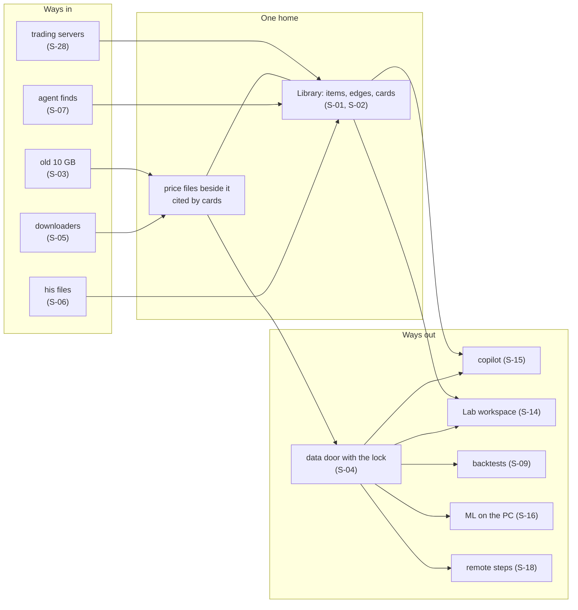

# 54 — Data round: the expansion funnel (party mode, CIS, brainstorming, Wayfinder)

Date: 2026-10-22. **Discussion input only.** Nothing here is an architecture decision or an AD. Nothing was committed. This file is the only write. The operator discusses it before any architecture work starts.

**Inputs read in full:** `51-data-round-seeds.md` (his seeds), `52-data-round-inventory.md` (what exists at `engine/base` `8af1a1cd`), `53-data-stack-research.md` (stack facts), `50-backend-packages-and-data-today.md` (packages and data paths), `26-operator-rulings-and-alignment.md` (rulings 1-119), `46-domain-expansion.md` (earlier scenarios; this round extends them and does not repeat them), `C:\Users\Mubarak\Desktop\QMX\workroom\risk-lab-2026-10-05\seeds.md` (trading seeds), the Wayfinder map and its tickets, and the Library and Lab architecture spines for evidence.

**Evidence shorthand.** "52 r7" is row 7 of file 52's table. "L-AD-n" is a Library architecture decision, "Lab AD-n" a Lab one, "engine AD-n" an engine one. "46 D-nnn" is an idea in study 46. Tags: **E** = EXISTS (built and proven), **P** = PARTIAL (some code exists), **N** = NEW (nothing exists).

---

## 0. Plain words first

**What this round did.** It took your seven seeds and imagined QMX holding real data, end to end. It listed 277 ideas. It kept 30 scenarios. Each kept scenario says what should happen, what can go wrong, the simplest way to make it hold, and what already exists.

**The main finding.** Most of the machinery is already written. Very little of it is switched on, and two doors are missing.

1. **Switched off.** The new Library, its version control, the server copy, mini-app landing and the plugin loader all work in tests. Your running app still uses the old Library file and never syncs with the server.
2. **Missing door one: getting data in.** There is no way to hand QMX a file, and nothing downloads price history.
3. **Missing door two: getting market data out.** No agent, workflow, Lab run or remote machine can read price history, and the holdout lock is not enforced where data is served.

So this week's backend work is mostly "switch on what exists, add two doors". Very little is "build a new system".

**Things you will want to discuss (tensions, not decided):**
- **"The Library takes in all data."** The current design keeps big price files beside the Library and lists them in it with a card. Your seed says everything goes in. The difference matters for speed, disk and backups.
- **Where the main copy lives this week.** Your PC is nearly full (12 GB free on C:, 8 GB on D:). The server has room and memory. Moving the main copy to the server now helps, but it makes the server part of daily work sooner.
- **Graph database.** You once wanted Neo4j. The research says the family trees fit the current small database, and Neo4j would be a second source of truth. A graph *view* is still possible.
- **The trading server.** Its data needs belong in this round. Its design belongs to another session.
- **The Lab without pods.** You will spend most time in the Lab. The pod part may change. A small Lab backend can start without it.

**Your questions** are in §11. There are five, each with a recommended answer you can accept with "yes".

**What happens next.** You discuss this. Then an explainer page carries the answers. Then the architecture pass folds the kept scenarios in. The proposed map section (§10) shows that route.

---

## 1. How this round was run

- **Skills read and followed:** `bmad-party-mode` (session mode, headless: every persona voiced in this one context), `bmad-brainstorming` (headless "ideate for me": techniques run by the facilitator, domain shifted every ten or so ideas, convergence as a separate phase), `bmad-cis-design-thinking`, `bmad-cis-problem-solving`, `bmad-cis-innovation-strategy`, the persona skills (Carson, Maya, Dr. Quinn, Victor, Sophia, Caravaggio) and Winston from `bmad-agent-architect`, `wayfinder`, and `domain-modeling`.
- **His seat.** Where a facilitator would ask him, the answer comes from his seeds and rulings, cited. Nothing is put in his mouth that he did not say.
- **No side files.** The brainstorming skill normally writes a memlog and an HTML keepsake. The brief allows one file, so the diverge log (§6) is the memlog, and the keepsake is replaced by the explainer ticket in §10.
- **No sub-agents** were spawned.
- **Techniques used, in order:** Persona Journey and Jobs to be Done (top-down from his journeys); Starbursting over the 52 inventory (bottom-up); Cross-Pollination from data platforms and IDEs ("VS Code on steroids"); Reverse Brainstorming ("how do we lose his data?"); Chaos Engineering (machines, disks, networks); Constraint Mapping (real vs invented limits); Assumption Reversal ("the Library holds nothing"); What-If wildcards. Convergence used Affinity Clustering, then a relevance filter, then Impact-Effort.

---

## 2. The room (an excerpt)

Headless party, session mode. Seven voices plus his seat.

**Carson:** Data round! Hundreds of ideas before anyone draws a box. Where does a byte *enter* QMX? Go!

**Dr. Quinn:** Before ideas, a symptom. File 52 counts 64 rows: 16 built, 34 partial, 3 designed, 11 missing. Thirty-four *partial*. That is not a missing system. That is a system with its switches off. AHA, or rather: why?

**Winston:** Because each PR proved its part in a test home. LIB1 proved merges, LIB4 proved the server copy, APP2a proved app landing. None of them owned "the running app uses it". The host still opens the old `library.db` (52 r1), never calls `sync()` (52 r21), builds the app supervisor with no sink (52 r9).

**Mubarak (seed 51 §2):** He thought version control was already built. Confirm what exists and what is missing.

**Winston:** It is built in the store. Chat agents just never reach it. They save through the old door, which keeps numbered copies and nothing else (52 r32).

**Victor:** Then the strategic move is obvious. Don't design. *Connect.* Every hour spent inventing is an hour not flipping a switch that already works.

**Maya:** Slow down. Who is the person here? He opens QMX on a Tuesday, drops a 400-page book on the chat, asks "what does this say about London breakouts, and does it hold on gold since 2020?" What does he feel when the answer comes back with no page number and no data date?

**Sophia:** He feels what every researcher feels: a confident answer with nothing under it. The story he wants is the opposite. "Page 212 says X. I tested it on gold, Dukascopy ticks to 21 October, training months only. Here is the card."

**Carson:** YES AND the card is clickable, and the click shows where the bytes live!

**Mubarak (seed 51 §1):** Everything data-related moves into the Library as the one central home.

**Winston:** That is the tension. The design keeps price history *out* of the Library (L-AD-10). Ticks are billions of rows read by time range. The Library is objects, edges and full-text search. Putting 140 GB of ticks into it as blobs makes search, replication and backup carry the wrong weight.

**Victor:** And yet he said *one home*. You keep arguing storage. He is arguing *where he looks*.

**Dr. Quinn:** Then separate the two. *Where he looks* and *where bytes sit* are different questions. Is/is-not: the Library IS the place every dataset is named, found, linked and marked. It IS NOT necessarily the file format of every tick.

**Winston:** One catalog, several byte stores. The card is the bridge. That is the current design, and it only works if a card exists. Today nothing writes one (52 §3 item 1).

**Victor:** So the design is right and the product is wrong. He has never seen a card. Show him one before he's asked to agree.

**Caravaggio:** Please! The card is the hero frame. Instrument, source, months, where it lives, how fresh, which results used it. One glance. If the card is boring, the whole "beside the Library" argument loses.

**Mubarak (ruling 115):** Design for complexity, not a complex system. No codenames.

**Dr. Quinn:** Second root cause. Invented numbers. A 2 GB line for Hindsight, a 6 GB reserve for services that do not exist, a 64 MB upload body, the first 1 MB of a book searched (52 §3 item 6). Each one quietly rules out a journey. A 3 GB screen recording cannot travel. Chapter twelve of a book is never searched.

**Mubarak (seed 51 §7):** No invented limits; defaults come from the real machines.

**Carson:** Chaos round! The PC sleeps mid-download. Two agents grab March 2024 at the same moment. Dukascopy changes its file format. The server disk hits 73 % because someone imported 28 pairs of ticks.

**Winston:** Fixed partitions answer half of that. One file per source, instrument, kind and month, named by its fingerprint (53 §3.1). Two downloads of the same month produce the same name. A claim on the partition key stops the second one before it starts. Claims exist; nothing calls them (52 r31).

**Maya:** And the disk? He told us the PC has little space (ruling 42). Today it has 12 GB on C:. Ten of the gigabytes he cares most about sit on that same disk with no backup.

**Dr. Quinn:** Which makes "back up the ticks" the most urgent data task in the whole round, and it has waited since 16 October (ticket "Back up the orphaned 10 GB tick history now").

**Victor:** The moat is still the same as in 46: "keep me from fooling myself". Data is where people fool themselves most. A holdout read by an agent who did not know it was sealed. Training data that leaked across the seal through a 200-bar moving average.

**Winston:** The lock is optional and the agent path skips it (52 r22). Whatever door we add enforces it on the serving side, and adds a gap between train and test (53 §3.3).

**Mubarak (seed 51 §6):** The Lab is "VS Code on steroids". He spends most time there. Pull results from Tuesday, combine with today's run, run them across a strategy hypothesis.

**Carson:** VS Code! New Project, Explorer, Problems panel, Timeline, Extensions, Terminal, Git panel!

**Winston:** And almost every one of those panels already has a backend. Explorer is a Library collection. Problems is marks and conflicts. Timeline is the ref log. Extensions are packs. Git is branches and merges. Run is the engine. What is missing is a Lab service to hold the workspace, and the engine's `library` step, which is registered but switched off (52 r59).

**Victor:** So the Lab is mostly a *view* over things that exist. Good. Then pods can wait without blocking him.

**Mubarak (seed 51 §6):** Pods may change or disappear with the unit redesign. Don't build on pods.

**Sophia:** Let me tell the trading server's story, because nobody else will. A bot is admitted. It trades gold on a server in Frankfurt while his laptop is closed. At 14:02 the kill switch fires. Where does he learn it? In the journal that synced in seconds, or in a log he finds Thursday?

**Mubarak (risk seeds, 2026-10-21):** Same logic as connecting a machine for workflows. Self-tests on connect. Fast sync of journals and results. Its design comes after the unit work, in its own session.

**Winston:** Then this round names what the trading server *sends and receives*, and stops there. Outbound only, to the Hub. Journals, fills, heartbeats, kill events out; admitted bot versions and kill signals in.

**Dr. Quinn:** One more naming bug. "Node" means three things: the host's worker role, the trading node, and a step in a workflow graph. "Hub" means the hub copilot and the Library's server. The builders will mix them up.

**Mubarak (risk seeds):** Trading node = a trading server.

**Caravaggio:** Then call it that on every screen. "Worker" for the machines that run steps. "Trading server" for where bots live.

**Victor:** Last thing: the outside agent. He wants Claude Code to look at QMX and tell him what is wrong. Today the only door is a token that can also *change* everything (52 r49).

**Winston:** A read-only observer pass, the monitoring viewer's own door, and a runbook skill. The outside agent reports; it does not fix. That matches his words: "observe QMX and tell him what is wrong" (seed 51 §4).

**Carson:** Two hundred and seventy-seven ideas on the board. Converge!

---

## 3. Design thinking: who this is for

### 3.1 Empathy map (from his seeds and rulings)

| Says | Thinks |
|---|---|
| "Everything data-related moves into the Library." "He thought it was already built." "Don't undermine it." "VS Code on steroids." "Finish the platform this week, then the UI." | One place, so nothing gets lost. Agents must not make a mess he has to clean. The system should work out of the box on his server (ruling 111). |
| **Does** | **Feels** |
| Dictates seeds, reads explainers, not text walls (ruling 7). Runs research mostly with cheap Chinese models (107). Lets workflows run unattended (57). Keeps real price history in folders by hand (50 §2.1). | Uneasy about data (he gave it the least context, ruling 91). Pressed for disk. Frustrated when something "built" turns out not to be reachable. |

### 3.2 Point of view

*A solo researcher-trader who directs many agents needs every piece of data to have one findable home, a known origin and an honest boundary between what was tested and what was held back, because the cheapest way to lose money in research is a confident result built on data nobody can trace.*

### 3.3 How might we

1. How might we let him hand QMX anything (a book, a folder, a recording) in one move, and find it again by what it says?
2. How might we make every number an agent shows him carry the data it came from?
3. How might we let ten agents and him touch the same note, strategy or dataset without anyone's work vanishing?
4. How might we make the server, the PC, burst machines and trading servers reach the same data without copying it by hand?
5. How might we stop agents reading the sealed months even by accident?
6. How might we keep the PC usable when its disks are nearly full?
7. How might we let an outside agent diagnose QMX without being able to break it?
8. How might we turn the Lab into a workspace where Tuesday's work is one click from today's?
9. How might we keep family trees for strategies, indicators, units and models without anyone writing them by hand?
10. How might we make data problems found late (a bad feed, a fixed indicator) show up on every result built on them?

---

## 4. Problem solving: why rich data journeys break today

### 4.1 Problem statement

**Initial:** "Data isn't in the Library."
**Refined:** Data has no working way in (no downloader, no upload), no working way out (no market-data door, agent tools empty, lock skipped), and the parts that do exist run in test homes but are not switched on in his real home (52 §3 item 2: his `~/.qmx` has no `library/`, `engine/` or `logs/` folder).

### 4.2 Is / is not

| | Is | Is not |
|---|---|---|
| Where | His real home; the running host; chat agents; remote steps needing prices | Workflow outputs (they land, 52 r7); test homes; Contabo test lanes |
| What | Market history, uploads, agent finds, app outputs, journals | Store mechanics (objects, refs, merges, marks are built) |
| When | Every day of real use | During PR test lanes, which pass |
| Who | The copilot, Lab, workers, trading servers, outside agents | The engine talking to the new store (it does) |

The pattern: **the store is fine; the doors and switches around it are not.**

### 4.3 Five whys

1. Why can't an agent read price history? The data tools have no store (52 r18).
2. Why no store? Nothing downloads, and the 10 GB was never imported (52 r3).
3. Why was that never built? Data was held by ruling 91 until a deeper study was explained to him.
4. Why do even the built parts not run? Each PR proved its part in a test home; the "running app uses it" step was owned by nobody.
5. Why? No end-to-end data journey was ever the acceptance test.

**Root cause:** no journey-level acceptance. **Lever:** make a handful of journeys (§8 S-01 to S-13) the acceptance test of the data work, run on his real home and the real server.

### 4.4 Force field

| Drives toward solving | Holds it back |
|---|---|
| Plumbing exists (store, Hub, passes, sidecar, sinks, packs) | Data hold (rulings 91, 111) until explained |
| Server has room: 11.3 GB free RAM idle, 191 GB disk | PC disks nearly full |
| Research picked boring, proven tools (Parquet, DuckDB, SQLite, OTel) | Invented numbers in settings and limits |
| He wants the backend done this week | Deletion pass in flight on `8af1a1cd` (52 §3 item 14) |
| Ruling 118: anything may be refactored | Several "node" and "hub" meanings confuse builders |

### 4.5 Constraints: real or invented

| Constraint | Real? | Source |
|---|---|---|
| PC: 12 GB free on C:, 8.3 GB on D: | Real, measured | 52 §3 item 5 |
| Server: 11,960 MB RAM, 193 GB disk | Real, measured | 52 r64 |
| GPU: Quadro T1000, 4 GB | Real | 51 §6 |
| R2: 5 GiB per single upload, 8 KB object metadata, 1 write/s per key | Real, provider's own | 53 §4.1 |
| SQLite: one writer, WAL not over network | Real | 53 §1.3 |
| cTrader: 5 history requests per second, one week of ticks per request | Real, provider's own | 53 §3.2 |
| Hindsight "must fit 2 GB" | **Invented** | 52 r64 |
| 6,144 MB overhead, 1,536 MB per session, 12,288 MB budget, 2,048 MB per attempt | **Invented** | 52 r64 |
| Hub body 64 MB; search reads first 1 MB of text; broker read 1,000 bars | **Invented in our code** (the broker figure is our call limit, not the broker's) | 52 §3 item 4, 6 |
| 2 GiB sync-back cap | **Invented** | 52 §3 item 6 |

---

## 5. Innovation strategy: what makes QMX's data different

**Jobs he hires QMX's data layer for:**
1. "Keep everything I and my agents find, once, and let me find it again."
2. "Let me test an idea on real history without fooling myself."
3. "Let my agents work in parallel without trampling each other."
4. "Let work run off my laptop and come back whole."
5. "Tell me when something is wrong, before I discover it in a result."

**Four actions (Blue Ocean grid):**

| Eliminate | Reduce |
|---|---|
| Second databases (no Neo4j, no Dolt, no lakeFS); three news fetchers; two dataset lists; five Libraries; a separate Prometheus/Loki/Grafana for the node | Copies of the same bytes (fixed partitions, content hashes); disk on the PC; manual backups |
| **Raise** | **Create** |
| Provenance (every number cites a card); holdout honesty (lock at the serving side, plus a gap); merges (line-level) | "Every number knows its data"; a Lab workspace where any past run is an input; an outside observer that can only look |

**Platform thought (Victor):** the Library is the bus mini apps meet on (46 D-101). Cards make *data* part of that bus: one app writes a dataset, another reads it by card. No app-to-app wiring is needed.

---

## 6. Diverge log (all 277 ideas)

Every idea is tagged against file 52. "→ park" means kept in the parked list (§9), not dropped.

### G1. Ways data enters (Starbursting: who, what, where, when, how)

| Id | Idea | Tag | Evidence / what is missing |
|---|---|---|---|
| I-001 | Import the old 10 GB Dukascopy ticks (EURUSD, USDJPY, 2003-2026) as fixed partitions with a card | P | 52 r3; 50 §2.1; ticket "Back up the orphaned 10 GB tick history now" |
| I-002 | Import the 252 MB risk-lab one-minute CSVs as a second dataset, flagged "2025 ask file incomplete" | N | 50 §2.1 (risk-lab `ledger.md:64-66`) |
| I-003 | Dukascopy downloader as a server workflow | N | 52 r3 (no fetcher anywhere); 53 §3.2 |
| I-004 | Binance bulk archive downloader for crypto history, checksums verified | N | 53 §3.2 |
| I-005 | CCXT top-up for recent crypto bars, paged | P | 52 r4 (reads 1,000 bars, forgets them) |
| I-006 | Broker bars from cTrader and MT5 recorded, not forgotten, as a "broker" source for price comparison | P | 52 r4; `qmx-broker/adapters.py` |
| I-007 | MT5 history through its Python terminal, a PC-only source | N | 53 §3.2 |
| I-008 | Databento for real futures, pay per GB | N | 53 §3.2 |
| I-009 | Instrument reference data (contract size, tick size, swap, sessions) as a dataset per broker | P | QMF identity is an opaque pair (52 r3); `qmb/execution/financing.py` |
| I-010 | Drag a file into a chat or the Library and it is kept | N | 52 r5 (no upload route) |
| I-011 | Upload a folder or zip: one item per file, the folder becomes a collection | N | 52 r5; kind `collection` exists |
| I-012 | Books and PDFs become text with page numbers (Docling; MarkItDown as the quick path) | N | 53 §4 |
| I-013 | Slides, spreadsheets and EPUBs through the same extraction | N | 53 §4.1 |
| I-014 | Audio and video without captions get a transcript | N | 50 §2.4 (no Whisper) |
| I-015 | YouTube transcripts kept as `source` items, not only the strategy cards made from them | P | 52 r6 (nothing writes `source`) |
| I-016 | Pages an agent reads kept as `source` items keyed by canonical URL | P | 52 r6; 53 §4.2 |
| I-017 | Firecrawl bulk scrapes land as sources, chunked | P | 46 D-025 |
| I-018 | His Obsidian clippings folder watched, now through the upload door | P | 46 D-028 |
| I-019 | The MQL5-articles mini app's private `app.db` finds land as sources | P | 50 §2.4; 52 r9 |
| I-020 | A CSV or table pasted in chat becomes a small dataset with a card | N | — |
| I-021 | An image pasted in chat (a chart) becomes an upload with a vision description | N | 52 r5; engine AD-42 multimodal |
| I-022 | Headline news (central banks, free feeds) | N | 52 r17 |
| I-023 | A calendar source with actual values, so "surprise" can be measured | N | 50 §2.2 |
| I-024 | One calendar fetcher instead of three | P | 52 r17 |
| I-025 | Weekly positioning reports (COT) as a dataset | N | — |
| I-026 | Literature reviews and paper scouts land with their sources linked | P | 50 §2.4 |
| I-027 | Chat transcripts as sources for ideas ("the operator explaining", funnel level 1) | P | L-AD-21 sessions are items; risk seeds funnel |
| I-028 | Screenshots and recordings from computer and browser use | N | 52 r15 |
| I-029 | A trading server's recorded ticks, fills and decisions come back into research | N | 52 r40; 50 §8 q9 |
| I-030 | Broker statement imports (MT5 deals, cTrader deals, CCXT trades) | N | 52 r16; 53 §7 |
| I-031 | His own notes and tags on trades | N | 53 §7.2 |
| I-032 | Model weights and training checkpoints | P | sidecar checkpoints (L-AD-13); 52 r63 |
| I-033 | Notebook outputs (cells, figures) | N | 52 r56 |
| I-034 | QMB result files land as one result kind | P | 52 r13 |
| I-035 | Mini-app outputs reach the Library | P | 52 r9 (no sink in the running app) |
| I-036 | Workflow outputs land with their trace | E | 52 r7 |
| I-037 | Hindsight memories rebuilt from Library records | P | ruling 119; 53 §6 |
| I-038 | Logs and traces as data | P | 52 r14 |
| I-039 | An outside agent's diagnosis saved as a note linked to what it read | N | — |
| I-040 | His old Stats database | → park | ruling 28 (out of scope) |
| I-041 | Pine Script or MQL5 code he finds, as a source with a code blob | P | kinds `source`, `component` |
| I-042 | Voice notes dictated into QMX | → park | ruling 85 |

### G2. Where data lives: the Library and what sits beside it (Assumption Reversal: "the Library holds nothing")

| Id | Idea | Tag | Evidence / what is missing |
|---|---|---|---|
| I-043 | The Library is the one catalog: every piece of data has an item, even when bytes live elsewhere | P | L-AD-1, L-AD-10; 52 §3.1 |
| I-044 | Market-data Parquet beside the Library, cited by `dataset` cards | P | L-AD-10; nothing writes a card (52 §3 item 1) |
| I-045 | Alternative: market bytes as Library blobs, one store | N | 53 §1.1 argues against |
| I-046 | Every downloader and import writes its card automatically | N | 52 r19 (two dataset lists) |
| I-047 | Retire `datasets.json`; cards are the only list | P | 50 §3.3 |
| I-048 | A card lists the exact partition fingerprints a result used | P | `dataset.schema.json` has `partition_digests[]` (53 §3.1) |
| I-049 | A card says where the bytes are (PC cache, server, R2) and their size | N | — |
| I-050 | A card carries its licence | P | 53 §3.2 |
| I-051 | A card carries a quality report and "complete up to" date | N | 52 r20 |
| I-052 | Uploads and agent finds are Library blobs: server first, R2 the same night | P | L-AD-10, L-AD-16; 53 §4.2 |
| I-053 | Big files stream in and out; no 64 MB body limit; resumable | N | 52 §3 item 4 |
| I-054 | Search reads the whole book, chunked, not the first 1 MB | N | 52 §3 item 4 |
| I-055 | Trade fills as Parquet beside; finished trades as Library items | N | 53 §7.2 |
| I-056 | Backtest trade tables stay Parquet inside the result | P | 53 §7.2 |
| I-057 | The registry of where each bot belongs (proven and hypothetical markets) as Library items | N | risk seeds "Registry" |
| I-058 | Bots, units and books as Library items; registry mirrored or replaced | P | 52 r11; ticket "Library OPEN-2" |
| I-059 | MIS labels and regime tags as derived datasets | N | risk seeds MIS; 46 regime tags |
| I-060 | Features computed from bars as derived datasets, `derived-from` their source card | N | `qmf-indicators` batch mode (52 r12) |
| I-061 | One "Data" shelf in the UI over cards | N | UI handoff item |
| I-062 | Five old Libraries fold to one (old file retired, engine fake only in tests, `artifacts.db` drained) | P | 52 §2 |
| I-063 | The QMF registry room's governed records as Library items with signed states | P | ticket "Library OPEN-2" |
| I-064 | A graph view of lineage drawn from the SQLite edges | P | 53 §1; UI |
| I-065 | Neo4j as the primary store | N | 53 §1.5 recommends against |
| I-066 | A rebuildable graph copy (LadybugDB or Neo4j) only when measured slow | → park | 53 §1.5 |

### G3. His journeys (Persona Journey, top-down)

| Id | Idea | Tag | Evidence / what is missing |
|---|---|---|---|
| I-067 | Quick copilot idea: "is EURUSD's London range shrinking this year?" answered from stored bars | P | 52 r18 (tools return nothing) |
| I-068 | The copilot draws the answer as a chart widget | P | engine AD-45 |
| I-069 | The copilot's answer records which card it used | N | 50 §2.1 ("no record of what data a conclusion used") |
| I-070 | A Lab experiment pins a card version | P | 53 §3.5; Lab AD-5 |
| I-071 | Tuesday's Lab run combined with today's across one hypothesis | P | 52 r59, r60 |
| I-072 | The engine's `library` step switched on: read and write items mid-run | P | 52 r59 (registered, not available) |
| I-073 | `@run` and `@library` references resolved in workflow inputs | N | 52 r59 |
| I-074 | A backtest on the QMB machine reads partitions by fingerprint | P | 50 §4.3 |
| I-075 | Backtest results land as items linked to the card and the bot version | P | 52 r13 |
| I-076 | One result shape instead of three | P | 50 §7 duplicate 4 |
| I-077 | ML training on the PC GPU: pull slices, train, push weights | N | 52 r63 |
| I-078 | ML training on a rented GPU reading R2 directly | P | 46 D-136 |
| I-079 | A server workflow reads market data next to where it lives | P | 52 r38 |
| I-080 | Mini app A writes a dataset; mini app B reads it by card | P | 46 D-101; cards new |
| I-081 | Trade-journal review reads the journal collection | P | 52 r16 (template waits) |
| I-082 | Strategy funnel: every level and branch writes a variant | P | risk seeds funnel; 52 r24 |
| I-083 | Domain expansion grid (instrument × timeframe × window) needs many instruments | N | risk seeds |
| I-084 | Similar-market search for the bot registry | N | risk seeds "Registry" |
| I-085 | Fail branch: search history for contexts where a rule's conditions hold | N | risk seeds funnel |
| I-086 | Morning brief shows data freshness and failed downloads | P | 46 D-162 |
| I-087 | News event study (NFP) over history: calendar plus bars | P | 46 D-171 |
| I-088 | The unit's risk research reads the bot's own journal | N | risk seeds "Unit" |
| I-089 | An MIS labeler trained in the Lab, registered as a model item | P | Lab AD-17; 50 §6.3 |
| I-090 | "What did the overnight loop find about gold?" from Library plus memory | P | 46 K-03 |
| I-091 | An idea's story page shows its data too | P | 46 D-200 |

### G4. Hygiene, quality, splits and synthetic data (Data scientist and data analyst lenses)

| Id | Idea | Tag | Evidence / what is missing |
|---|---|---|---|
| I-092 | Fixed partitions (source, instrument, kind, year, month), one fingerprint each, so the same days get the same name | N | 53 §3.1 (fixes 50 "problem 3") |
| I-093 | One fetcher per source, guarded by a claim on the partition key | P | claims built, uncalled (52 r31) |
| I-094 | "Already have it?" lookup on cards before any download | N | — |
| I-095 | Gap check and verify run at import; failures quarantine the partition | P | 52 r20 |
| I-096 | Spike and bad-tick detection at import | P | `qmf/data/verify.py` |
| I-097 | Dukascopy compared with his broker's bars; drift shown on the card | N | 53 §3.2 |
| I-098 | All times stored in UTC; summer-time handled at read | P | QMF time; engine AD-10 time zones |
| I-099 | Weekends and holidays known from the market calendar, not flagged as gaps | P | `qmf-calendar-forex` |
| I-100 | Futures continuous contracts and a roll rule | N | 52 r3 (no roll model) |
| I-101 | A 24/7 calendar for crypto | N | — |
| I-102 | The holdout lock enforced in the serving reader, never left to the caller | P | 52 r22; 53 §3.3 |
| I-103 | A gap ("embargo") between train and test | N | 53 §3.3 |
| I-104 | Holdout touches counted and visible | P | Lab AD-6; 46 D-127 |
| I-105 | The sealed window rolls forward with time | P | `seal.py` setting `historical_holdout_months` |
| I-106 | Synthetic data is its own world; its card records generator, settings, seed and source | P | 52 r23; 53 §3.4 |
| I-107 | Synthetic data never drawn from sealed months | N | 53 §3.4 |
| I-108 | Block bootstrap that keeps time structure (`arch`) | N | 53 §3.4 |
| I-109 | A route for agents and workflows to generate synthetic data | N | 52 r23 |
| I-110 | Licence tags respected in use | N | 53 §3.2 |
| I-111 | Pages deduped by canonical URL | P | 53 §4.2; `find_by_intent` |
| I-112 | The same book with different bytes deduped by extracted-text hash | N | — |
| I-113 | A garbage workflow writing 10,000 notes is allowed, but marked and ranked down | P | L-AD-18; 46 D-063 |
| I-114 | A corrected partition replaces the old; results built on it show "corrected" | P | marks built (L-AD-22); market cards missing |
| I-115 | A fixed indicator makes results on the old version show "superseded" | P | L-AD-22 |
| I-116 | The Lab reads a card's quality before a run and warns | N | — |
| I-117 | Uploaded text is data, never instructions | E | engine AD-43 |
| I-118 | A key pasted into an upload is caught at landing | P | 46 D-185 |
| I-119 | Nothing deleted; old bytes move to cheaper tiers | E | L-AD-6, L-AD-10 |

### G5. Lineage and family trees (Analogical Thinking: git history, genealogy)

| Id | Idea | Tag | Evidence / what is missing |
|---|---|---|---|
| I-120 | Every funnel step writes `variant-of` or `derived-from` with "what changed" | P | 52 r24 (nothing writes it for strategies) |
| I-121 | QML strategy families mirrored into the Library | P | 52 r24 |
| I-122 | Each domain-expansion cell is a variant with its own proof | N | risk seeds |
| I-123 | Same logic on 1m and 5m marked as one bet for correlation counting | N | risk seeds caveat |
| I-124 | Composite strategies with two parents | P | relation `merged-from` exists |
| I-125 | Indicators as versioned items; combinations as items that `use` them | N | 52 r12 |
| I-126 | Units link to the bot version and the risk-settings version | P | kinds `unit`, `bms` |
| I-127 | Model weights link to the data fingerprints, code version and seed | N | — |
| I-128 | A notebook cell that becomes a workflow step keeps its lineage | P | 46 D-132 |
| I-129 | Trial count per family from edges, across agents and machines | P | Lab AD-6; 46 D-125 |
| I-130 | An unlinked near-duplicate variant detected at publish | P | 46 D-126 |
| I-131 | One family-tree read: parent, children, siblings, history | P | `walk` built |
| I-132 | A variant made on the server appears in the PC's tree | P | object-level replication built, not running |
| I-133 | Dead-end variants stay, with the reason | E | L-AD-6; study 08 |
| I-134 | Mini-app versions in lineage | P | kind `mini-app` |
| I-135 | Workflow variants | E | 52 r24 (engine drafts write `variant-of`) |
| I-136 | Who made each variant | E | 52 r29 |

### G6. Version control for concurrent agents (Cross-Pollination: git, Google Docs)

| Id | Idea | Tag | Evidence / what is missing |
|---|---|---|---|
| I-137 | Chat tools save through the new store | P | 52 r1, r32 |
| I-138 | Chat agents work on their own branch for notes, strategies and bots | P | 52 r26 |
| I-139 | Text merged line by line with `git merge-file --diff3` | N | 53 §2.5 |
| I-140 | JSON merged by structure | N | 53 §2.5 |
| I-141 | A conflict door: list and resolve conflicts (him or an allowed agent) | P | 52 r30 |
| I-142 | The engine takes a claim before expensive work | P | 52 r31 |
| I-143 | History and "who changed what" reads | P | 52 r28; 53 §2.1 |
| I-144 | "As of Tuesday" on any read | E | 52 r28 |
| I-145 | A git worktree per concurrent writer for files on disk | P | 52 r33 (engine AD-49 unbuilt) |
| I-146 | His UI edits are one writer among others | E | `principal.py` |
| I-147 | Dataset versions: partitions never change; a new card version on change | P | 53 §2.5 |
| I-148 | Bot code edited by two agents in worktrees inside a checkout | P | 53 §2.4 item 6 |
| I-149 | Lab drafts versioned per subject | P | Lab AD-2; drafts built |
| I-150 | Merge previews in plain words ("agent B changed the stop rule") | N | UI |

### G7. Off his machine: workers, split runs, trading servers (Chaos Engineering)

| Id | Idea | Tag | Evidence / what is missing |
|---|---|---|---|
| I-151 | A sync loop in the running host, PC to Hub | P | 52 r21, r34 |
| I-152 | A Hub-backed Library door in the running host | P | 52 §3 item 3 |
| I-153 | Hub and engine on one server share one process (one writer) | P | 52 r34 (BACKLOG TRG2b) |
| I-154 | The server becomes the main copy in the server setup step | P | L-AD-19 |
| I-155 | A `data_scope` on the run pass | P | L-AD-12 designed; `passes.py` lacks it (52 r38) |
| I-156 | Run bundles carry card references | N | 52 r38 |
| I-157 | A market-data service on the server with the lock | N | 52 r38; 53 §8 |
| I-158 | A PC cache reader with the same lock | N | 53 §3.3 |
| I-159 | Place a step where its data already is | P | 46 D-149 |
| I-160 | Split run: data prep on the server, GPU training on the PC, report on the server | P | 52 r37 |
| I-161 | A burst machine reads R2 with a scoped read-only token | N | 53 §3.1 (DuckDB R2 secret) |
| I-162 | The Hub's `runs/<id>/` routes for sidecar telemetry | P | 52 r34 |
| I-163 | Mirrored remote journals as Library objects | P | 52 r39 |
| I-164 | Cross-machine checks rerun over the real tailnet | P | 52 r39 (ran over loopback) |
| I-165 | A trading server connects outbound only, to the Hub | N | 52 r40 |
| I-166 | It sends heartbeats, journals, fills, decisions and kill events | N | 52 r40; risk seeds |
| I-167 | The PC sends it kill signals and admitted bot versions | N | risk seeds |
| I-168 | It fetches admitted bots from the Library by id | N | — |
| I-169 | It self-tests on connect (latency, demo test trades, broker links) | N | risk seeds |
| I-170 | Several trading servers, each its own writer with its own space | N | — |
| I-171 | Journals sync in seconds, not nightly | N | risk seeds |
| I-172 | One "connect a machine" flow for workers and trading servers | P | `qmx node setup`; risk seeds |
| I-173 | Name apart: "worker" and "trading server" | N | 52 §3 item 13 |
| I-174 | A version check between PC and server | P | 46 D-146 |
| I-175 | PC offline: reads from cache, writes queue | E | L-AD-14 |
| I-176 | Server unreachable: collectors buffer on disk | N | 53 §5.3 |

### G8. DevOps at every level (Failure Analysis)

| Id | Idea | Tag | Evidence / what is missing |
|---|---|---|---|
| I-177 | OpenTelemetry from host, engine, Hub, sidecar and market-data service | P | spans built (52 r42); no OTLP (52 r48) |
| I-178 | The harness sets Claude Code's telemetry variables per session | N | 53 §5.1 |
| I-179 | Hindsight traces switched on | N | 53 §5.1 |
| I-180 | One collector per machine that buffers | N | 53 §5.3 |
| I-181 | One viewer on the server (OpenObserve; Phoenix as fallback) | N | 53 §5.2 |
| I-182 | A Library heartbeat (writer alive, sync lag, disk) | P | 52 r46 |
| I-183 | Lab readings (runs, procedures, kernels) | N | 52 r45 |
| I-184 | Freshness alerts per card | N | 50 §2.7 |
| I-185 | Disk alerts on the PC | N | 52 §3 item 5 |
| I-186 | Trading-server telemetry through OTel, not its own Prometheus, Loki and Grafana | P | 52 r47; 53 §5.3 |
| I-187 | Logs leave the PC; one log store | P | 52 r48 |
| I-188 | A read-only observer pass for outside agents | N | 52 r49 |
| I-189 | Heartbeat and journal tools on `/mcp` | P | 52 r49 |
| I-190 | A runbook skill: "how to inspect QMX" | N | 53 §5.3 |
| I-191 | The outside agent reaches the viewer's own door over Tailscale | N | 53 §5.3 |
| I-192 | "What failed in the last hour?" answered with traces, runs and items | N | 53 §5.3 |
| I-193 | The Library keeps run traces as the record; the viewer keeps a short window | P | L-AD-13 |
| I-194 | Usage per idea family, shown, never capped | P | 46 D-160 |
| I-195 | The doctor checks data (stores reachable, cards valid, lock wired) | P | `qmx node verify` |
| I-196 | Data failures become incidents with signatures | P | engine inbox signatures |
| I-197 | The outside agent writes its diagnosis as a note; it never changes QMX | N | — |

### G9. Mini apps as plugins in the Library (Ecosystem Thinking)

| Id | Idea | Tag | Evidence / what is missing |
|---|---|---|---|
| I-198 | Publishing writes a `mini-app` item | P | 52 r51 |
| I-199 | Packs load from the Library at start-up | P | 52 r50 (nothing calls `materialise`) |
| I-200 | An app's own tools reach a chat | P | 52 r50 |
| I-201 | App outputs land through the sink in the running app | P | 52 r9 |
| I-202 | An app moves to the server from the Library, not from a PC folder | P | 52 r52 |
| I-203 | An app declares the data it needs as card references | N | — |
| I-204 | An app's private database is backed up and summarised in the Library | P | 50 §2.4 |
| I-205 | App monitoring | E | 52 r44 |
| I-206 | Apps archived, never deleted | P | 46 D-115 |
| I-207 | `qmx app check` before publish | P | ticket "qmx app check" |
| I-208 | MCP servers inside packs (excluded today) | P | 52 r50 |

### G10. The Lab as a workspace (Cross-Pollination: VS Code)

| Id | Idea | Tag | Evidence / what is missing |
|---|---|---|---|
| I-209 | "New…" makes a strategy, indicator, ML model, notebook, workflow, mini app, dataset, hypothesis or study | P | 52 r55 (templates exist; no new-project flow) |
| I-210 | Levels as template depth: quick idea, experiment, study, campaign | N | 51 §6 |
| I-211 | Explorer = a Library collection scoped to a project | P | kind `collection` |
| I-212 | Editor: graph and code of one draft | P | 52 r54 |
| I-213 | Run panel = engine runs, with "run just this part" | E | 52 r58 |
| I-214 | Problems panel = marks, conflicts and failed checks | P | L-AD-22; 52 r30 |
| I-215 | Timeline = the item's history | P | 52 r28 |
| I-216 | Search = Library search | P | 52 r61 (copilot reads the old Library) |
| I-217 | Extensions = packs and plugins | P | 52 r50 |
| I-218 | A real terminal | P | copilot as a Claude-Code-style app (memory) |
| I-219 | Notebooks | N | 52 r56 |
| I-220 | A data panel: card, sample rows, quality | N | — |
| I-221 | Tuesday plus today across a hypothesis | P | 52 r59, r60 |
| I-222 | The Lab copilot's tools | N | 52 r61 |
| I-223 | A small Lab service without pods | N | 52 r53, r62 |
| I-224 | Procedures run once the backtester has a door | P | 52 r57 |
| I-225 | Storyboard: rough idea to what he meant in few rounds | P | Lab AD-18 |
| I-226 | The Lab reopens where he left it | N | — |
| I-227 | Lab outputs land in the Library | N | 52 r8 |

### G11. Computer-use and browser-use outputs

| Id | Idea | Tag | Evidence / what is missing |
|---|---|---|---|
| I-228 | Screenshots as uploads linked to the session or run | N | 52 r15 |
| I-229 | Recordings stream to the server, then R2 | N | 52 §3 item 4 |
| I-230 | A vision or OCR description as searchable text | N | 53 §4.2 |
| I-231 | The browsing trail (pages visited) kept as sources | N | — |
| I-232 | Demo-broker click-through recordings as evidence of what the agent did | N | ruling 108 |
| I-233 | TradingView screenshots attached to hypotheses | P | 46 D-035 |
| I-234 | Account numbers in screenshots redacted at landing | N | ruling 116 (redaction kept) |

### G12. Disks and storage (Constraint Mapping)

| Id | Idea | Tag | Evidence / what is missing |
|---|---|---|---|
| I-235 | Free space read live; the PC cache sized from it | N | 52 §3 item 5 |
| I-236 | PC copies released after two verified remote copies | P | L-AD-10 (needs sync running) |
| I-237 | The 10 GB moved off C: after copies, with his go | N | 52 §3 item 5 |
| I-238 | Hindsight's ~700 MB database moves to the server | P | 53 §6 |
| I-239 | A "where are my bytes" view per tier | N | — |
| I-240 | Backups cover the new store and market data | P | 52 §3 item 11 |
| I-241 | One backup plan instead of four | P | 50 §2.8 |
| I-242 | Restore drills on the server | P | L-AD-16 |
| I-243 | R2 cost shown (about $2-3 a month at 200 GB) | N | 53 §8 |
| I-244 | Encrypt personal uploads in R2 | P | ticket "Library OPEN-3" |
| I-245 | Server disk watch (28 pairs of ticks would take 73 %) | N | 53 §3.1 |

### G13. Trade journals

| Id | Idea | Tag | Evidence / what is missing |
|---|---|---|---|
| I-246 | Fills append-only, by account and month | N | 53 §7.2 |
| I-247 | `trade` items with R, worst and best swing, holding time | N | 53 §7.2 |
| I-248 | A journal is a collection per account | N | 53 §7.2 |
| I-249 | Backtest, paper, demo and live trades share one shape, told apart by "world" | N | 53 §7.2 |
| I-250 | His tags and notes never mint a version | P | annotation log exists |
| I-251 | Trade screenshots | N | — |
| I-252 | The review template reads the journal | P | 52 r16 |
| I-253 | Trading-server journals sync back fast | N | 52 r40 |
| I-254 | A unit tunes its risk from its own journal | N | risk seeds "Unit" |

### G14. Failure and chaos (Reverse Brainstorming: "how do we lose his data?")

| Id | Idea | Tag | Evidence / what is missing |
|---|---|---|---|
| I-255 | A download half done when the PC sleeps resumes by partition | N | — |
| I-256 | Dukascopy changes its format; import quarantines, nothing half-written | P | verify exists |
| I-257 | R2 down: the server keeps its working set; writes queue | P | L-AD-14 |
| I-258 | Server disk full mid-download: refuse with an incident, no partial partition | N | — |
| I-259 | Two agents download the same month: one claim wins | P | 52 r31 |
| I-260 | A result's data now lives only in R2: a rerun fetches by fingerprint | P | L-AD-10 |
| I-261 | A feature computed across the seal leaks the holdout | N | — |
| I-262 | A search answer spills 46,000 characters | P | 52 §3 item 12 |
| I-263 | A 3 GB recording upload exhausts memory | N | 52 §3 item 4 |
| I-264 | A corrupt Parquet file caught by fingerprint on read | P | fingerprints built |
| I-265 | Clocks differ across machines in trade times | N | — |
| I-266 | The deletion pass removes code a data design relied on | P | 52 §3 item 14 |
| I-267 | An outside agent's pass leaks; read-only limits the damage | N | — |

### G15. Wildcards (What-If)

| Id | Idea | Tag | Evidence / what is missing |
|---|---|---|---|
| I-268 | "Find days like today" over market states | → park | — |
| I-269 | DuckLake catalog for several machines writing market data | → park | 53 §2.5 |
| I-270 | Sharing data with others | → park | rulings 32, 40 |
| I-271 | Generated (GAN-style) synthetic markets | → park | — |
| I-272 | Order-book depth history | → park | no free source |
| I-273 | Fundamentals as an MIS input | → park | risk seeds ("later") |
| I-274 | Sentiment and other alternative data | → park | — |
| I-275 | The Library as a folder of Markdown he can grep | → park | 46 D-052 |
| I-276 | A "data librarian" workflow that tidies cards, dedupes and writes summaries nightly | N | — |
| I-277 | The copilot answers "how much data do I have, and where?" | N | — |

**Counts:** 277 ideas: 11 EXISTS, 137 PARTIAL, 118 NEW, 11 parked.

---

## 7. Converge

**Move 1, Affinity Clustering.** The ideas fall into nine clusters:
- A. **Switch on what exists** (I-062, I-137, I-151 to I-154, I-198 to I-202, I-072, I-142).
- B. **Ways in** (G1, I-053, I-054, G11).
- C. **The market-data door and honesty** (I-044 to I-051, I-092 to I-110, I-155 to I-161).
- D. **Concurrent work** (G6, I-093, I-259).
- E. **Off-machine and trading servers** (G7).
- F. **Seeing it all** (G8).
- G. **The Lab and lineage** (G5, G10).
- H. **Journals and derived data** (G13, I-057 to I-060).
- I. **Disk, backup, real numbers** (G12, §4.5).

**Move 2, relevance filter.** Kept only what serves QMX's purpose (a research and development assistant for trading, ruling 116) and his goal (finish the backend this week, then the UI, seed 51). Also applied: design for complexity, not a complex system (115); local by default, remote fully covered (117); no caps (106); nothing waits for him (57); trading-node and unit design belong to other sessions (14, risk seeds); don't build on pods (51 §6).

**Move 3, Impact-Effort.** High impact and low effort came first: anything that switches on built code or closes a gap the UI needs to show real data. High impact and high effort (the Lab workspace, trading-server connection) are kept and placed in Tier B or C. Low impact went to the parked list.

**Result: 30 kept scenarios in three tiers.**
- **Tier A, this week's backend (13):** S-01 to S-13.
- **Tier B, needed before or with the UI (14):** S-14 to S-27.
- **Tier C, design with other sessions (3):** S-28 to S-30.

---

## 8. Kept scenarios

Each gives: **Tag** (overall), **Domains crossed**, **Expected**, **Edges and failures**, **Simplest mechanism**, **Evidence** (EXISTS / PARTIAL / NEW), **Blast radius**.

### Tier A: this week's backend

#### S-01. One truth: every save goes to the new Library — PARTIAL
- **Domains:** control door, chat tools, REST, HTTP MCP, the new store, backups, copilot search.
- **Expected:** Every `library_save`, read, search, version and link uses the new store. The old file is imported once and then read-only. The copilot's search uses the new search. Backups cover the new store.
- **Edges and failures:** the 11-14 test junk items in his real old file (52 §2) come along unless filtered; a save arrives during the switch; the engine running alone still uses its fake (52 r7); the deletion pass changes the tree mid-work.
- **Simplest mechanism:** the switch-over that L-AD-19's cut-over and MIGRATION already describe, run now on his real home: import, compare once, flip the door, keep the old file read-only. Point the backup at `<home>/library/`. Filter the known junk at import.
- **Evidence:** PARTIAL. Dual write built (`host.py:489-490`); importer built (LIBM PR 135); old door still primary (`service.py:643-659`); nightly comparison has no trigger (52 r1); backup misses the store (52 §3 item 11).
- **Blast radius:** control door, chat tools, backup. Nothing in the store changes.

#### S-02. The server is home, and the PC stays in sync daily — PARTIAL
- **Domains:** host, Hub, replication, settings, the server setup step, offline work.
- **Expected:** The host runs a sync loop. With the server as main copy, the PC keeps a working copy and a cache, works offline and catches up when back. Schedules and app chains on the server land even while the PC sleeps.
- **Edges and failures:** PC offline for days; a conflict between a PC-owned ref and the server (owners prevent it, L-AD-11); Hub down; the one-writer rule forbids a separate Hub and engine process on the server (52 r34).
- **Simplest mechanism:** call the existing `replicate.sync()` from the host on a timer and on commit; give the host a Hub-backed Library door; run Hub and engine in one process on the server; flip `primary = server` as the setup step says (L-AD-19).
- **Evidence:** PARTIAL. Replication only in lane scripts (52 r21); `HubClient` used only by scripts (52 r34); flip built in `qmx node setup` (LIB4 lane 3).
- **Blast radius:** host start-up, settings, server process layout.

#### S-03. Save the history he already has, then free the C: drive — PARTIAL
- **Domains:** his disk, R2, server, market-data store, cards, backup.
- **Expected:** The 10 GB of ticks and the 252 MB of CSVs are copied to the server and R2, hashes checked on both. They are imported as fixed monthly partitions with a card each. After his go, the copies on C: are removed, freeing about 10 GB.
- **Edges and failures:** a corrupt `bi5` file in the old folder; the 2025 ask file is incomplete (flag it, do not fix it silently); the copy is interrupted; R2 credentials missing.
- **Simplest mechanism:** rclone with checksum verify (already the tool in `qmx_remote` and `qmx_apps/backup.py`), then the import half of the Dukascopy reader that exists in `qmf-data`, writing partitions and a card.
- **Evidence:** PARTIAL. Decoder, store and seal exist (52 r3); no import, no backup (50 §2.1); ticket "Back up the orphaned 10 GB tick history now" waits on the data study.
- **Blast radius:** none in code beyond an import script; the deletion of local files needs his explicit go (§11 Q4).

#### S-04. One door to market data, with the lock on the serving side — PARTIAL
- **Domains:** QMF data, a market-data reader on the server and on the PC, agent tools, run passes, QMB, the Lab, workflows.
- **Expected:** Every reader (copilot tool, workflow step, Lab run, remote worker, QMB) asks one door by card or fingerprint. The door applies the holdout lock and the train/test gap. The agent data tools return real data at start-up.
- **Edges and failures:** a caller asks for sealed months (refused, never silently empty, as `seal.py` already does); a remote worker without a `data_scope` (refused); the PC cache lacks a partition (fetched from server, then R2, by fingerprint); DuckDB 2.0 files unreadable by older versions (pin one version everywhere, 53 §3.1).
- **Simplest mechanism:** a thin reader over the existing `qmf-data` store, opened *with* the seal by the host, exposed as the data tools' context and as a small service on the server. Add `data_scope` to the pass (designed in L-AD-12). No new database.
- **Evidence:** PARTIAL. Store, splits and seal built (52 r22); tools get no store (`harness.py:403`, 52 r18); `data_scope` absent from `passes.py` (52 r38); no service (52 r2).
- **Blast radius:** agent tool start-up, run passes, QMB's reader (local folder today, 50 §4.3).

#### S-05. Downloaders per source, as server workflows that write cards — NEW on a PARTIAL store
- **Domains:** engine (scheduled workflows), market-data store, cards, claims, R2, monitoring.
- **Expected:** A Dukascopy workflow fills monthly partitions for chosen instruments and keeps them current. A Binance workflow fills crypto history; CCXT tops up recent days. Each run writes or updates the card, its quality report and "complete up to" date. A failed download raises an incident.
- **Edges and failures:** the same month fetched twice (one claim per partition key wins); Dukascopy throttles (the provider's limit, not ours, cools the run); a month changes after a provider fix (Binance says archived files may be replaced, 53 §3.2: new fingerprint, card version, `replaces` edge); server disk fills (refuse before writing, incident).
- **Simplest mechanism:** each downloader is a script-only workflow on the existing engine (no model tokens), using the engine's claims and the card writer. The instrument list is a Settings value he edits.
- **Evidence:** NEW fetchers (52 r3); PARTIAL store and claims (52 r31).
- **Blast radius:** new templates only, plus a card writer.

#### S-06. Hand QMX a file — NEW
- **Domains:** control door, Hub, blobs, extraction workflows, search, memory, chat.
- **Expected:** He drops a book, a folder, a recording or a screenshot into a chat or the Library. The bytes stream to disk while being hashed. An `upload` item appears at once. A server workflow extracts text with page numbers or timestamps, and each derived note points back to its page or second. The text is searchable, all of it.
- **Edges and failures:** a 3 GB file (stream, never hold in memory); the same file twice (same hash, same item); a scanned PDF (OCR); a private book (encrypted in R2 if he wants, ticket "Library OPEN-3"); extraction fails (the upload stays, the incident names the step).
- **Simplest mechanism:** one streaming upload route on the host and the Hub (53 §4.2), an `upload` kind (or `source` extended), and an extraction template using Docling, MarkItDown and speech-to-text. Remove the 64 MB body limit and the first-1-MB search limit.
- **Evidence:** NEW route (52 r5); PARTIAL store (blobs by hash, text extraction at put, L-AD-10).
- **Blast radius:** host routes, Hub routes, one kind, one template, search chunking.

#### S-07. Agents keep what they find, once — PARTIAL
- **Domains:** chat tools, workflow templates, sources, claims, search.
- **Expected:** Every page, transcript and paper an agent reads for a purpose is kept as a `source` item, keyed by its canonical address. The second agent to read it finds it already there. Notes made from it point to the place in it.
- **Edges and failures:** the same video in two playlists (one item, 46 D-026); a page that changed since last read (new version of the same item); a paywalled page (keep what was read, with a note); an agent that skips saving (a template step does it, not the model's choice).
- **Simplest mechanism:** a `save_source` step in the intake templates and a chat tool that calls `find_by_intent` first, using the canonical URL as the intent key (53 §4.2). Claims stop two agents fetching at once.
- **Evidence:** PARTIAL. Kind `source` exists, nothing writes it (52 r6); `find_by_intent` built (52 r19).
- **Blast radius:** templates and one chat tool.

#### S-08. Version control reaches chat agents — PARTIAL
- **Domains:** chat tools, the store's refs, merges, conflicts, claims, engine, UI history.
- **Expected:** A chat agent editing a note, strategy or bot works on its own branch and merges. Two agents editing the same text get a line-level merge. A real clash becomes a conflict he can see and resolve, or that an allowed agent resolves. The engine takes a claim before expensive work.
- **Edges and failures:** both agents change the same line (conflict, never a silent pick); binary blobs (pick-one card, as designed); a claim held by a dead run (renewed by heartbeat; expires, L-AD-24); he edits while an agent edits (he is one writer among others).
- **Simplest mechanism:** after S-01, give chat tools `branch`, `merge` and `conflicts` over the existing store; add `git merge-file -p --diff3` for text slots and a structural JSON merge (53 §2.5); call `claim` in the engine's node start.
- **Evidence:** PARTIAL. Refs, merges, history, principals built (52 r26-r29); conflicts have no door (52 r30); claims uncalled (52 r31); line merge missing (53 §2.1).
- **Blast radius:** store merge function, chat tool rows, engine node start.

#### S-09. Backtests by fingerprint, one result shape, results in the Library — PARTIAL
- **Domains:** QMB, market-data door, Library, Lab, agent tools.
- **Expected:** A backtest asks for data by card, runs on the PC or the QMB machine, and lands one result item linked to the card, the bot version and any hypothesis it tests. Big trade tables stay Parquet inside the result.
- **Edges and failures:** the card's data later corrected (result shows "corrected", S-21); the run touches sealed months (refused unless it is the one authorised look, which is recorded); three old result shapes (one survives; the others import into it).
- **Simplest mechanism:** QMB's reader takes the door's partitions instead of a local folder; a result landing step like `trace_export.py` writes the result item and edges.
- **Evidence:** PARTIAL. QMB reads by fingerprint (50 §4.1); results stay in QMB files (52 r13); three shapes (50 §7).
- **Blast radius:** QMB reader entry, one landing step, one kind. The QMB door's wider design belongs to the QMB work (ticket "QMB-session dependencies").

#### S-10. Tuesday's run in today's — PARTIAL
- **Domains:** engine, Library, Lab, hypotheses, copilot.
- **Expected:** In a workflow or Lab run he picks "Tuesday's sweep" as an input. The run reads its results from the Library, combines them with today's, and links the new result to the hypothesis both test. The copilot can do the same from chat.
- **Edges and failures:** Tuesday's input has since been marked (the run refuses or warns, L-AD-22); Tuesday's run used a different data version (comparison shows it, 46 D-133); a reference points at a moving item (pin the version, or follow latest by choice, 46 D-005).
- **Simplest mechanism:** switch on the engine's `library` step and resolve `@run` and `@library` references in workflow inputs, reusing the chat's resolver (`qmx_control/context.py`).
- **Evidence:** PARTIAL. Chat references built (52 r59); `library` step registered, not available (`registry.py:94`); hypothesis kind built (52 r60).
- **Blast radius:** engine registry and input resolution.

#### S-11. Mini apps live in the Library and run as plugins — PARTIAL
- **Domains:** apps, packs, harness tools, Library, server placement.
- **Expected:** Publishing an app writes a `mini-app` item. On start-up, published apps become plugins (skills, helper agents, commands). An app's own tools reach a chat. Its outputs land in the Library. Moving it to the server pulls it from the Library.
- **Edges and failures:** an app published while a chat uses its old version (the chat keeps its version until restart); app outputs that break a consumer's schema (refused and attributed, 46 D-107); app databases growing on the PC (summarised and backed up).
- **Simplest mechanism:** four switches: `apps_publish` writes the item; the host calls `materialise` at start-up; the harness binds `app:<id>` rows; `app_runtime()` attaches the existing `LibrarySink`.
- **Evidence:** PARTIAL. Each piece built and proven in a lane (PACK PR 144, APP2a PR 146, APP2b PR 161); none wired in the running app (52 r9, r50-r52).
- **Blast radius:** host start-up, harness tool binding, app service.

#### S-12. One health view, at every level — PARTIAL
- **Domains:** host, engine, Hub, sidecar, market-data door, Lab, Library, apps, trading servers, Hindsight, Claude Code sessions.
- **Expected:** Everything emits OpenTelemetry. One collector per machine buffers and forwards over Tailscale. One viewer on the server shows logs, metrics and traces across PC, server and trading servers. The Library and the Lab get heartbeats. Cards raise freshness alerts. The PC raises disk alerts.
- **Edges and failures:** server unreachable (collector buffers on disk); PC asleep (nothing lost, sent later); viewer down (the Library still holds each run's trace, L-AD-13); viewer memory unknown (measure first, 53 §5.3).
- **Simplest mechanism:** OTLP exporters where spans already exist; Claude Code and Hindsight telemetry switched on by environment variables; the trading server's planned Prometheus, Loki and Grafana replaced by the same collector (53 §5.3).
- **Evidence:** PARTIAL. Workflow, chat and app monitoring built (52 r42-r44); no Library heartbeat, no Lab, no OTLP, no single store (52 r45-r48).
- **Blast radius:** an exporter per process, a collector config per machine, one service on the server.

#### S-13. An outside agent looks in, and can only look — PARTIAL
- **Domains:** control door, viewer, Library, runbook skill, Tailscale.
- **Expected:** He starts Claude Code anywhere, gives it the runbook skill, and asks "what is wrong with QMX?". It reads the viewer, the runs, the Library items and the logs, then writes its diagnosis as a note. It cannot change settings, run workflows or write anything else.
- **Edges and failures:** the pass leaks (read-only, revocable, expires); the agent tries a manage tool (refused); the PC is asleep (it reads the server's viewer and the server copy of the Library).
- **Simplest mechanism:** a read-only observer pass on the existing bearer gate; the heartbeat and journal tools added to `/mcp`; the viewer's own MCP door; one runbook skill naming each door.
- **Evidence:** PARTIAL. MCP and REST behind a full-control token (52 r49); no observer pass, no setup flow.
- **Blast radius:** the bearer gate and the MCP tool list.

### Tier B: needed before or with the UI

#### S-14. The Lab as a workspace ("VS Code on steroids") — PARTIAL
- **Domains:** Lab service, Library, engine, packs, kernels, copilot, UI.
- **Expected:** "New…" creates a project from a template at a chosen level (quick idea, experiment, study, campaign). The project is a Library collection. Its panels map onto parts that exist (table below). The copilot reaches everything in it. He reopens the Lab where he left it.

| VS Code part | Lab equivalent | Exists? |
|---|---|---|
| New Project / New File | template install at a level | P (37 templates, no new-project flow, 52 r55) |
| Explorer | Library collection for the project | P (kind `collection`) |
| Editor | graph and code of one draft | P (52 r54) |
| Run and Debug | engine runs, "run just this part", replay a node | E (52 r58) |
| Problems | marks, conflicts, failed checks | P (L-AD-22, 52 r30) |
| Timeline | item history | P (52 r28) |
| Source Control | branches, merges, conflicts | P (S-08) |
| Search | Library search | P (52 r61) |
| Extensions | packs and plugins | P (52 r50) |
| Terminal | real terminal in the copilot | P |
| Notebooks | kernels | N (52 r56) |
| Data viewer | card, sample rows, quality | N |

- **Edges and failures:** pods change with the unit redesign (nothing here depends on pods); two copilots in one project (S-08); a long procedure while he closes the Lab (it is an engine run; it continues).
- **Simplest mechanism:** a small Lab service that stores the workspace (open project, layout, pins) as an item and serves the panels from existing reads. Notebooks follow Lab AD-9 later.
- **Evidence:** PARTIAL underneath, NEW service (52 r53).
- **Blast radius:** one new package; no change to the store or engine.

#### S-15. A quick copilot idea that cites its data — PARTIAL
- **Domains:** hub copilot, data door, widgets, Library.
- **Expected:** "Is EURUSD's London range shrinking this year?" The copilot queries bars through the door, draws a chart widget, and the answer names the card and months used. The answer can be saved as a note linked to that card.
- **Edges and failures:** the question touches sealed months (the copilot says so and uses training months only); data incomplete for the window (the card's "complete up to" date is quoted).
- **Simplest mechanism:** S-04's door plus a `consumed` edge when the answer is saved.
- **Evidence:** PARTIAL (52 r18; widgets engine AD-45).
- **Blast radius:** none beyond S-04.

#### S-16. ML on his PC, with the data there — NEW
- **Domains:** PC GPU, PC cache, market-data door, engine placement, Library, server.
- **Expected:** A training run on the PC pulls only the partitions it needs into the PC cache, trains on the GPU, and pushes the weights to the server and R2 as a model item linked to the exact data fingerprints, code version and seed.
- **Edges and failures:** not enough disk (check free space first; one-minute bars for one instrument over 23 years are about 100-200 MB, 53 §3.1, so bars fit; ticks need slices); the GPU's 4 GB is too small for a model (the run says so; a rented GPU reads R2 directly, I-078); the PC sleeps mid-training (resume from checkpoint, 46 D-099).
- **Simplest mechanism:** a PC placement with a GPU resource, a cache pull by fingerprint, and the model kind's lineage fields.
- **Evidence:** NEW (52 r63); the training template `d6-ml-training-run` exists and waits.
- **Blast radius:** placement settings, one template.

#### S-17. Family trees for strategies, indicators, units and models — PARTIAL
- **Domains:** QML, the strategy funnel templates, Library edges, the Lab, the bot registry.
- **Expected:** Every variant the funnel makes (pass branch, fail branch, rewrite branch, domain-expansion cell) is an item with `variant-of` and "what changed". Indicators and their combinations are items with versions. Units link to their bot and risk settings. One read returns parent, children, siblings and history.
- **Edges and failures:** an agent forgets to link (the publish step checks for near-duplicates, 46 D-126); the same logic on 1m and 5m counted as two independent bets (marked as one logic for counting, risk seeds); a family grows into thousands (recursive SQLite walk is fine at this size, 53 §1.4).
- **Simplest mechanism:** the funnel templates write the edges; QML families mirror into the Library; an `indicator` kind (or `component` with a subtype).
- **Evidence:** PARTIAL. Relations and `walk` built; nothing writes them for strategies (52 r24); no indicator kind (52 r12).
- **Blast radius:** templates and one kind.

#### S-18. A remote step that needs market data — MISSING today
- **Domains:** engine placement, run passes, market-data door, R2, QMB, workers.
- **Expected:** A workflow places data preparation on the server, next to the data, and a GPU step on the PC. A burst machine reads partitions straight from R2 with a read-only token scoped to its cards.
- **Edges and failures:** the pass lacks the needed card (refused before start); R2 slow (measure, probe in §10); a worker on an older QMX (version check, 46 D-146).
- **Simplest mechanism:** `data_scope` on the pass and card references in the run bundle; placement prefers the machine holding the data.
- **Evidence:** MISSING (52 r38); placement built (52 r37).
- **Blast radius:** pass, bundle, placement rule.

#### S-19. Trade journals in one shape — NEW
- **Domains:** broker imports, trading servers, backtests, Library, Lab, the unit's research.
- **Expected:** Fills are kept as data files by account and month. Each round trip becomes a `trade` item with profit, R, worst and best swing, holding time and world (backtest, paper, demo, live, synthetic). A journal is a collection per account. His tags and notes sit on top without making new versions.
- **Edges and failures:** two imports of the same statement (broker ids dedupe); partial closes (grouped by position id, 53 §7.1); money precision (exact integers, as cTrader does).
- **Simplest mechanism:** a `trade` kind, an import script per broker, the existing `collection` kind and annotation log.
- **Evidence:** NEW (52 r16).
- **Blast radius:** one kind, import scripts.

#### S-20. Computer and browser outputs as evidence — NEW
- **Domains:** browser and computer use, uploads, search, runs.
- **Expected:** Screenshots and recordings from agent sessions land as uploads linked to the session or run, with a vision description that search can find. Recordings stream to the server and R2.
- **Edges and failures:** a screenshot shows an account number (redacted at landing, ruling 116); a long recording (streams, S-06).
- **Simplest mechanism:** S-06's upload door called by the browser and computer-use tools.
- **Evidence:** NEW (52 r15); browser and computer use are designs (engine AD-33, AD-44).
- **Blast radius:** none beyond S-06.

#### S-21. Bad data found later — PARTIAL
- **Domains:** market-data store, cards, marks, results, hypotheses, memory.
- **Expected:** A partition is found wrong. The fixed one gets a new fingerprint and the card a new version with a `replaces` edge. Every result built on the old one shows "corrected" with the path, and its hypothesis ignores it until rerun.
- **Edges and failures:** forty results used the bad month (marks are computed at read, so no write storm, L-AD-22); he wants to quarantine a whole source (one mark on the card).
- **Simplest mechanism:** cards written for market data (S-05) make the existing marks work for prices too.
- **Evidence:** PARTIAL. Marks built (LIB2 PR 136); market cards not written.
- **Blast radius:** none beyond S-05.

#### S-22. Synthetic data as its own world — PARTIAL
- **Domains:** QMB generators, cards, Lab, workflows.
- **Expected:** An agent asks for synthetic bars. The run uses only training months as its source, records generator, settings and seed on a card marked `world = synthetic`, and never mixes it into real data.
- **Edges and failures:** a request to bootstrap the sealed months (refused at the door); a result on synthetic data shown beside real ones (labelled by world).
- **Simplest mechanism:** a template or tool over the existing four generators plus a block bootstrap.
- **Evidence:** PARTIAL (52 r23; forex-CFD only).
- **Blast radius:** one template.

#### S-23. Derived data: features and labels as datasets — NEW
- **Domains:** indicators, MIS labelers, market-data store, cards, ML.
- **Expected:** Features computed over bars and labels from MIS labelers are stored as partitions with cards that point to their source card and code version. A second experiment reuses them instead of recomputing.
- **Edges and failures:** a feature window crosses the seal (computed only inside allowed months, plus the gap); the indicator code changes (new version, old one superseded).
- **Simplest mechanism:** the same partition writer and card, with `derived-from` to the source card and `uses` to the indicator item.
- **Evidence:** NEW (52 r12 indicators exist in batch mode).
- **Blast radius:** none beyond S-05.

#### S-24. News and calendar from one fetcher — PARTIAL
- **Domains:** news feeds, server workflows, Library, the trading server's blackouts.
- **Expected:** One server workflow fetches the calendar and keeps every revision as data. A second free source adds actual values. The PC's scheduled task is retired. The trading server reads the same data for its news windows.
- **Edges and failures:** the feed is late or changes a value (revisions kept, the parser already fails closed, 50 §2.2).
- **Simplest mechanism:** keep the template `t3-news-calendar-watch`, switch it to the proper parser (`qmf/data/calendar_feed.py`), store all of it.
- **Evidence:** PARTIAL (52 r17: three fetchers).
- **Blast radius:** one template; one scheduled task removed on his PC.

#### S-25. Disks: where bytes live, and when the PC lets go — PARTIAL
- **Domains:** PC, server, R2, Library tiers, market cache, Hindsight.
- **Expected:** He can see what takes space on each tier. The PC keeps only what he uses; everything durable sits on the server and R2. The PC's copy of a file is released only after two verified remote copies. Hindsight's database lives on the server.
- **Edges and failures:** sync not running, so nothing can be released (S-02 first); a released file is needed offline (fetched when online; pinned items stay).
- **Simplest mechanism:** L-AD-10's eviction rule, once S-02 runs; a cache size read from real free space, not a fixed number.
- **Evidence:** PARTIAL (52 r21; §3 item 5).
- **Blast radius:** cache settings; Hindsight move (53 §6).

#### S-26. Real numbers replace invented ones — PARTIAL
- **Domains:** engine capacity settings, Hub, search, broker reads, sync.
- **Expected:** Every limit in code is either a provider's own limit or a default measured on his machines, editable in Settings.
- **Edges and failures:** a removed limit exposes a real one (measure it, then set the default from it).
- **Simplest mechanism:** replace the eight figures in §4.5 with readings from the server probe (PRB-S PR 156 already measured RAM) and stream where a body limit existed.
- **Evidence:** PARTIAL (52 r64, §3 item 6).
- **Blast radius:** settings defaults, Hub request handling, search indexing.

#### S-27. New kinds as schema files — PARTIAL
- **Domains:** Library kinds, previews, search.
- **Expected:** The kinds the seeds need exist: `upload` (or `source` extended), `trade`, `indicator`, `news-item` (or a dataset), and screen captures as uploads. Four retired kinds stop parsing.
- **Edges and failures:** too many near-identical kinds (reuse where the shape is the same).
- **Simplest mechanism:** "kinds are data": one schema file each (L-AD-3).
- **Evidence:** PARTIAL (38 schema files, 4 retired; 52 §3 item 10).
- **Blast radius:** schema files and preview definitions.

### Tier C: design now, build with other sessions

#### S-28. Trading servers connect back (the data side only) — MISSING
- **Domains:** trading server, Hub, Library, journals, monitoring, the PC.
- **Expected:** A new trading server connects with the same "connect a machine" flow as a worker. It dials out to the Hub only. It sends heartbeats, journals, fills, decisions and kill events within seconds. It receives admitted bot versions (fetched by id from the Library) and kill signals. Several trading servers each write only their own space.
- **Edges and failures:** network down (it keeps trading and its own kill switches fire without the PC, risk seeds; it catches up later); the PC sends a kill signal while offline (it waits at the Hub, and some kill levels must not depend on it at all).
- **Simplest mechanism:** reuse the worker's pass, Hub client and collector; journals land as S-19's shapes.
- **Evidence:** MISSING (52 r40, r41). Design owned by the trading-node session after the unit work.
- **Blast radius:** the trading server's doors; nothing on the PC beyond reading.

#### S-29. The strategy funnel at data scale — PARTIAL
- **Domains:** QMB grid, market data for many instruments, the bot registry, lineage, trial counting.
- **Expected:** "Run every bot on many instruments" reads many cards; the registry of where each bot belongs is a set of Library items with proof links; similar-market search compares market character over chosen windows; every expansion counts as a try.
- **Edges and failures:** selection bias from a big grid (trial counts from edges, Lab AD-6); 1m and 5m of one pair as one bet.
- **Simplest mechanism:** cards for many instruments (S-05), registry entries as items, trial counts from edges.
- **Evidence:** PARTIAL. QMB redesign is owned by the risk session (risk seeds "To do").
- **Blast radius:** owned elsewhere; data side is S-05 plus one kind.

#### S-30. Search and answers at real volume — PARTIAL
- **Domains:** Library search, marks walk, copilot context.
- **Expected:** With a hundred thousand items, search returns short, cited answers, and the marks walk stays fast.
- **Edges and failures:** a default page of 46,000 characters spills (52 §3 item 12); search tuned on about 20 objects (52 r25).
- **Simplest mechanism:** measure first (the named probe on 100,000 items, L-AD-22), then page and summarise.
- **Evidence:** PARTIAL.
- **Blast radius:** search output shape.

### 8.1 A picture of the kept journeys

---

## 9. Tensions to discuss, and the parked list

### 9.1 Tensions (surfaced, not decided)

**T1. "The Library takes in all data" vs "price files beside it, with cards".**
- *His seed:* everything data-related moves into the Library as the one central home (51 §1).
- *The design and research:* price history stays in Parquet beside the Library; the Library names it with `dataset` cards (L-AD-10; 53 §1.1, §3).
- *Three readings:*
  - (a) **One store for all bytes.** Simplest to explain. Search, sync and backup then carry 140 GB of ticks they never need to read as documents.
  - (b) **One catalog, bytes where they are fastest.** Every dataset has an item he sees, searches, links and marks in the Library. The ticks sit in a format built for time ranges. This is the current design, but today no card exists, so he has never seen it work.
  - (c) **Mixed by size.** Small datasets (a pasted CSV, a journal) inside; big series beside.
- *The room split.* Victor: "He means one place to look, not one file format." Winston: "(b), and it only counts once cards are written." Dr. Quinn: "(b) and (c) are the same rule seen from two sides." This is his question Q1.

**T2. Main copy on the server now, or later.** The server makes the PC lighter and lets server work land while the PC sleeps (L-AD-19 says the flip belongs to the server setup step). It also makes the server part of daily work this week, before monitoring of it is complete. Question Q2.

**T3. A graph database.** He once wanted Neo4j (51 §1). The research found the family trees, at his scale, fit the edge table with recursive queries, and Neo4j's free edition has one database and offline-only backups (53 §1.3). A graph *picture* of lineage is a UI matter and needs no graph database. A graph copy stays possible if a screen is measured slow (parked I-066). No question: the evidence is clear, but he should hear why his earlier wish is not taken.

**T4. Scope of sources vs "finish this week".** FX, metals, indices and CFDs from Dukascopy and crypto from Binance are free. Real futures need Databento (pay per GB after a $125 credit) and a roll rule that does not exist (I-100). Question Q3.

**T5. Data must serve the trading server; its design belongs elsewhere.** S-28 names only what flows and where it lands. The rest waits for the trading-node session after the unit work (risk seeds).

**T6. The Lab without pods.** He spends most time in the Lab; pods may change. S-14 builds the workspace from existing parts and leaves pods out. The risk: the UI's Lab screens drawn from demo data include pod screens. The UI session should know.

**T7. "Nothing waits for him" vs data hygiene.** Workflows may write garbage freely (ruling 57). Hygiene therefore comes from dedupe by hash and intent key, claims, and marks that rank garbage down, never from a review queue.

**T8. The outside agent: look, or also fix?** His words: "observe QMX and tell him what is wrong" (51 §4). Read-only fits them. Decided as a default in §12; he can widen it.

**T9. Monitoring viewer licence.** OpenObserve's MCP door needs its free Enterprise tier, which means signing up and accepting terms. Phoenix needs no sign-up but covers mainly agent traces. Question Q5, only if the memory probe favours OpenObserve.

**T10. The data hold.** Rulings 91 and 111 hold data until a deeper study is explained to him. Ruling 81 says data is among the first things built. Files 50, 52, 53 and this one are that study. The explainer page is still owed, and it is what lifts the hold.

### 9.2 Parked (kept, not for now)

| Id | Idea | Why parked |
|---|---|---|
| I-040 | His old Stats database | out of scope (ruling 28) |
| I-042 | Voice notes | later (ruling 85) |
| I-066 | A graph copy of the Library | only if measured slow (53 §1.5) |
| I-268 | "Find days like today" | needs market-state features first (S-23) |
| I-269 | DuckLake catalog | only if several machines must write market data at once (53 §2.5) |
| I-270 | Sharing data with others | QMX is personal (rulings 32, 40) |
| I-271 | GAN-style synthetic markets | the four generators and bootstraps cover today's need |
| I-272 | Order-book depth history | no free source |
| I-273 | Fundamentals as an MIS input | later, per risk seeds |
| I-274 | Sentiment and alternative data | no journey asks for it yet |
| I-275 | The Library as grep-able Markdown | nice, not core (46 D-052) |
| I-008, I-100 | Futures data and a roll rule | waits on Q3 |
| I-276 | A nightly "data librarian" workflow | worth it after S-05 and S-07 run for a while |

---

## 10. Wayfinder: proposed map section

**Not written to the Wayfinder folder.** This is a proposal for whoever next edits `tracker/qma-v2/wayfinder/`. Ticket slugs below do not exist yet. Existing tickets are named by title.

**A note on the map's age.** `MAP.md` was last re-centralised on 2026-10-18. Since then the server PRs 156-163 shipped parts of "Contabo setup: Hub, vault, qmx-node, Tailscale" and "Library build plan (qmx_library, Hub, migration)". Those two tickets look partly overtaken; the map owner should check them. This file does not change them.

### 10.1 Proposed section

**Destination (for this section):** the data round is ready for the architecture fold. Every kept scenario has an agreed home, door and switch; his answers lift the data hold (rulings 91, 111).

**Notes:**
- Sources in rank order: `26-operator-rulings-and-alignment.md`, then `51` (seeds), `52` (inventory), `53` (stack), this file.
- Skills: `grilling` and `domain-modeling` on HITL grilling tickets; `prototype` for the explainer and the Lab workspace; `research` for re-checks; probes are AFK tasks that measure and never set limits.
- Acceptance for the data work: the Tier A journeys (S-01 to S-13) run on his real home and the real server, not only in test homes (§4.3).

**Decisions needed (the HITL tickets):** Q1 to Q5 in §11.

**Not yet specified (fog):**
- The market-data service's exact shape: a small service on the server, or a reader library plus direct R2 reads everywhere. Graduates after the read-speed probe.
- The Lab service's boundary once pods settle (unit redesign).
- The trading server's connection, beyond what flows (trading-node session).
- How the bot registry (where each bot belongs) is stored and filled (risk session's QMB redesign).
- Futures: roll rule and the paid source (after Q3).
- Telemetry retention and what the outside agent may read from chats (prompt text is redacted by default in Claude Code telemetry, 53 §5.1).
- The UI's data screens (Data shelf, cards, history, conflicts, where-are-my-bytes): UI session.

**Out of scope for this section:** trading-node internals and the unit (ruling 14, risk seeds); the QMB redesign (risk session); a web version (rulings 32, 40); data sharing with others; any agent path to money (ruling 116).

### 10.2 Proposed tickets

| Slug | Title | Type | Mode | Blocked by | Question | Recommended answer (HITL) |
|---|---|---|---|---|---|---|
| `data-round-explainer` | Explain the data round to him | prototype | HITL | — | An interactive explainer of the 30 scenarios, the tensions and the five questions, so he can answer with "yes" or a change. | Build it from 50, 52, 53 and this file; one screen per tier; the card from S-05 drawn as a real example. On his answers, close "Data deeper study, explained to him". |
| `data-library-meaning` | What "the Library holds all data" means | grilling | HITL | `data-round-explainer` | Q1. | One catalog: every piece of data is an item he can find in the Library; big price files sit beside it in a faster format, each listed by a card. |
| `data-server-home-now` | The server as the main copy this week | grilling | HITL | `data-round-explainer` | Q2. | Yes, as part of the server setup step; the PC keeps a working copy and works offline. |
| `data-first-markets` | Which markets and sources first | grilling | HITL | `data-round-explainer` | Q3. | Free sources first (Dukascopy: FX, metals, indices, CFDs; Binance and CCXT: crypto); Databento futures only when a strategy needs them. |
| `data-free-c-drive` | Free the C: drive after two verified copies | task | HITL | "Back up the orphaned 10 GB tick history now" | Q4: copy the 10 GB and the risk-lab CSVs to the server and R2, verify hashes on both, then remove the C: copies. | Yes, after both copies verify; the agent records counts and hashes in the ticket. |
| `data-recheck-after-deletion` | Re-check the 52 inventory after the deletion pass | research | AFK | — | Which of 52's rows changed when the deletion pass landed? | — |
| `probe-market-read-speed` | Probe: price reads from R2 vs server disk | task | AFK | — | Measure DuckDB 2.0 reading one month of ticks from R2 and from the server disk, from the PC and the server. | — |
| `probe-viewer-ram` | Probe: monitoring viewer memory on the server | task | AFK | — | Measure OpenObserve and Phoenix memory on the server under QMX's real telemetry. | — |
| `probe-hindsight-server` | Probe: Hindsight on the server with a system Postgres | task | AFK | — | Measure memory at default worker slots and at 4, and recall quality against the PC (53 §6.2). | — |
| `probe-library-volume` | Probe: search and marks at 100,000 items | task | AFK | — | Run the named marks probe and measure search answer size at real volume. | — |
| `data-viewer-signup` | Sign up for the viewer's free tier (only if chosen) | task | HITL | `probe-viewer-ram` | Q5. | Yes if OpenObserve wins the probe; otherwise Phoenix with no sign-up, and close this ticket. |
| `data-lab-workspace` | The Lab workspace: what "New…" makes and what each panel shows | prototype | HITL | `data-round-explainer` | Does the S-14 table match how he wants to work in the Lab? | Yes as drawn; notebooks and pods later. |
| `data-node-data-needs` | What a trading server sends and receives | task | HITL | "Risk-session dependencies" | Confirm S-28's list with the trading-node session (owner: that session). | Accept S-28's list as the data contract; the node session designs the rest. |
| `data-architecture-fold` | Fold the kept data scenarios into the architectures | task | AFK | `data-library-meaning`, `data-server-home-now`, `data-first-markets`, `data-recheck-after-deletion`, `probe-market-read-speed`, `probe-library-volume` | Fold S-01 to S-30 into the Library, engine and Lab architectures, review, fix, re-centralise. Also answer "Data decisions from study 30" (mapping in §10.3). | — |
| `data-build-plan` | Plan the data build | task | AFK | `data-architecture-fold` | Sequence the data packets with Tier A first, each proven on his real home. | — |

**Wiring to existing tickets (second pass):**
- "Data deeper study, explained to him" closes when `data-round-explainer` resolves.
- "Back up the orphaned 10 GB tick history now" unblocks when the study closes; `data-free-c-drive` follows it.
- "Data decisions from study 30" closes inside `data-architecture-fold` (mapping below).
- "Library OPEN-2: mirror or replace the QMF registry room" and "Library OPEN-3: encrypt the bucket copy" feed S-17 and S-06; they should be answered before `data-architecture-fold` finishes, but they do not block it.

### 10.3 "Data decisions from study 30", mapped

| Its item | Where this round puts it |
|---|---|
| (1) Trading node on its own small VPS | trading-node session (S-28, T5) |
| (4) Instruments and depth to start | Q3 |
| (5) No tick database for now | consistent with 53: Parquet files, no database |
| (9) MIS training on the server as an engine workflow | parked with the unit work; ML on the PC is S-16 |
| (11) Retire the PC news recorder once the server timer runs | S-24: yes |
| (12) Two observability stacks | S-12: one stack |

---

## 11. Questions for him

Five questions. Each has a recommended answer; "yes" accepts it.

**Q1. What does "the Library holds all data" mean to you?**
Every piece of data (prices, files, journals, results) gets an entry in the Library that you can find, open and link. The big price files themselves sit next to it in a format made for fast reading by date, and each set has a card in the Library that says what it is, where it is and how fresh it is.
*Recommended: yes, that is what I meant.*

**Q2. May the server hold the main copy of the Library and the price data from this week?**
Your PC keeps a working copy and works offline. Work on the server lands even while your PC sleeps. Your PC gets lighter.
*Recommended: yes, as part of setting up the server.*

**Q3. Which markets first?**
Start with the free sources: forex, metals, indices and CFDs from Dukascopy, and crypto from Binance's free files. Add real futures data (Databento, paid per gigabyte after a $125 free credit) only when a strategy needs futures.
*Recommended: yes.*

**Q4. May QMX remove the old 10 GB of price history from your C: drive once two checked copies exist (on the server and in your bucket)?**
That frees about 10 GB on a drive that is 97 % full. Nothing is removed before both copies are verified.
*Recommended: yes.*

**Q5. Only if the memory test picks it: may we sign up for OpenObserve's free tier?**
It is the monitoring viewer that lets an outside Claude Code ask "what went wrong". The free tier needs a sign-up and its terms accepted. If you say no, we use Phoenix, which needs no sign-up but sees less.
*Recommended: yes, if the test picks it.*

---

## 12. What could be decided without him (recommended defaults for the architect)

These follow from his rulings, seeds or the research. Each is a default the architecture pass can take; he can overturn any of them. None is an AD.

| # | Default | Why |
|---|---|---|
| 1 | The outside agent is read-only; it writes only its diagnosis note | his words, 51 §4; S-13 |
| 2 | No graph database now; a graph picture of lineage comes from the edges | 53 §1.5; T3 |
| 3 | No outside version-control system; finish the Library's own, with line-level merge through `git merge-file` | 53 §2.5 |
| 4 | Price files in fixed monthly partitions named by fingerprint; one fetcher per source | 53 §3.1; 50 §7 |
| 5 | The holdout lock is applied by the door that serves data, with a gap between train and test | 52 r22; 53 §3.3 |
| 6 | Synthetic data is its own world and never comes from sealed months | 53 §3.4 |
| 7 | Trade journals in three layers: fills as data, trades as items, notes on top | 53 §7; his "must fit" (51 §1) |
| 8 | Names: "worker" for machines that run steps; "trading server" for where bots live; "node" only for a step in a workflow graph; say "Library server" for the Hub when he reads it | his words "trading node = trading server" (risk seeds); 52 §3 item 13 |
| 9 | "Pairs" in "parent, pairs, history" is read as both: two variants compared or combined, and the instrument pairs a variant ran on. Both are already edges | 51 §1; old lineage folders held "variants, composites, families, relationships" (study 08) |
| 10 | ML on the PC pulls only the partitions it needs; the cache size comes from real free space | §4.5; S-16 |
| 11 | Every limit is a provider's own or a measured default, editable in Settings | 51 §7; ruling 106 |
| 12 | Hindsight on the server with a system Postgres, not the built-in one | 53 §6 |
| 13 | Uploads stream to disk while hashed; no size limit of our own | 53 §4.2 |
| 14 | One backup plan: PC to server on commit, server to R2 nightly, price files included | L-AD-16; 52 §3 item 11 |
| 15 | One calendar fetcher on the server; the PC task retires | S-24 |
| 16 | Acceptance for data work: the Tier A journeys pass on his real home and the real server | §4.3 |

---

## 13. Domain language to sharpen (domain-modeling pass)

Proposed terms for the glossary when the architecture pass writes one. Not written to any `CONTEXT.md` (this file is the only write).

| Term | Proposed meaning | Clash it removes |
|---|---|---|
| **Library** | The one place every piece of QMX data is named, found, linked, versioned and marked | "Five Libraries" in code (52 §2) |
| **Item** | Something in the Library with a history of versions | — |
| **Dataset card** | The Library item that names a set of price partitions: source, instrument, kind, months, where the bytes are, quality, licence | `datasets.json` vs cards (52 r19) |
| **Partition** | One unchangeable price file for one source, instrument, kind and month, named by its fingerprint | "same days, different fingerprints" (50 §2.1) |
| **Price files** | The partitions beside the Library | "market data in the Library" (T1) |
| **Upload** | A file he hands QMX | — |
| **Source** | Something read from outside by him or an agent (page, video, paper) | uploads vs agent finds |
| **World** | live, paper, demo, backtest, synthetic | "synthetic mixed into real" |
| **Sealed months** | The holdout: the newest window no reader may see except one recorded final look | "holdout" vs "test" |
| **Gap** | The months left out between training and testing | — |
| **Family / variant / parent** | A variant is an item made from a parent; a family is everything descended from one root | — |
| **Journal** | Fills, trades and notes for one account | "journal" as node log vs trade journal |
| **Worker** | A machine that runs workflow steps | "node" (host role) |
| **Trading server** | Where admitted bots live and trade | "trading node" |
| **Node** | A step in a workflow graph, only | three meanings today |
| **Library server** | The server copy of the Library (the Hub in code) | "hub" also names the hub copilot |
| **Observer** | An outside agent with read-only access | full-control token today |

---

## 14. Sources

- Seeds: `51-data-round-seeds.md`; `C:\Users\Mubarak\Desktop\QMX\workroom\risk-lab-2026-10-05\seeds.md`.
- On the ground: `52-data-round-inventory.md` (rows 1-64, §2, §3), `50-backend-packages-and-data-today.md` (§2-§8).
- Stack facts: `53-data-stack-research.md` (§1-§9, sources in §10).
- Rulings: `26-operator-rulings-and-alignment.md` (rulings cited by number).
- Earlier scenarios: `46-domain-expansion.md` (D- ids and K- scenarios cited; not repeated).
- Architecture evidence: `tracker/qma-v2/architecture/library-and-data/ARCHITECTURE-SPINE.md` (AD-1 to AD-24), `tracker/qma-v2/architecture/lab-and-pods/ARCHITECTURE-SPINE.md` (AD-1 to AD-18); study 08 for old lineage folders.
- Map: `tracker/qma-v2/wayfinder/MAP.md`, `README.md`, `frontier.py` (run 2026-10-22: 34 on the frontier, 14 blocked, 61 closed), tickets "Data deeper study, explained to him", "Data decisions from study 30", "Back up the orphaned 10 GB tick history now", "Library build plan (qmx_library, Hub, migration)", "Lab OPEN-6: pairs in the scenario builder".
- Skills followed: `bmad-party-mode`, `bmad-brainstorming` (headless and converge references), `bmad-cis-design-thinking`, `bmad-cis-problem-solving`, `bmad-cis-innovation-strategy`, `bmad-cis-agent-*`, `bmad-agent-architect`, `wayfinder` (`C:\Users\Mubarak\.agents\skills\wayfinder\SKILL.md`), `domain-modeling`.
