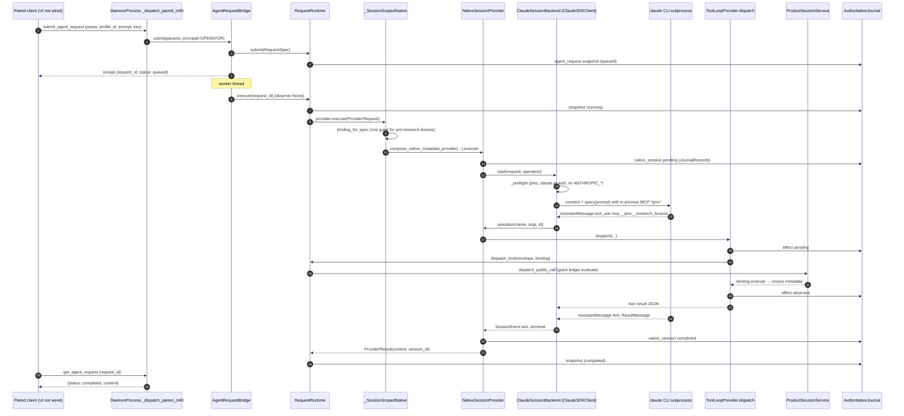

# How the QMA agent code works today, and where one Claude Agent SDK engine plugs in

Commit read: `4eac8f69` (`origin/rebuild/base`, PR #70 "P16c extensibility"), checked out read-only at `D:/QMX-worktrees/harness-survey`.
All paths below are relative to that checkout. `qmx-agents/packages/` is shortened to `pk/` where it would repeat.
Method: static reading of source, imports and configs. Nothing was run. Where a claim rests on import reading alone, it says so.

---

## Overview

There is no single agent system at this commit. There are two agent runtimes, two control planes, and a UI that talks to neither.

1. **The old QMA daemon request runtime** (`pk/qma-daemon/.../request_runtime/`). A paired operator client sends `submit_agent_request` over the CT-40 WebSocket on `127.0.0.1:8765`. `AgentRequestBridge` queues it, `RequestRuntime.execute()` calls one `ProviderAdapter`, and the client polls `get_agent_request` for the text. Providers are an OpenAI-style HTTP endpoint, a text-only Codex app-server, or a "native session" that drives either Codex or the **Claude Agent SDK**. The only tool an agent can reach on this path is `research_browse`, a read of a pinned research corpus.
2. **The new `qmx_agents` runtime** (`pk/qmx-agents/`). It is LangChain 1.4, LangGraph 1.2 and Deep Agents 0.7. `build_copilot()` builds a Deep Agents graph with sub-agents, memory, skills and MCP tools from qmx-control, qmx-tools and qmx-broker. `stream_turn()` runs one turn and writes typed blocks into qmx-control's session log. **No HTTP route calls it.** Only `scripts/live/copilot_build_app.py`, `qmx_remote.worker` and tests do.
3. **qmx-control** (`pk/qmx-control/`) is the FastAPI app on `127.0.0.1:8766`. It serves the same `ControlService` methods as REST and as MCP, plus SSE event streams, behind a bearer token kept in the OS keyring. The rebuild design (`rebuild/DESIGN.md` §8, §12c) names it the one API that survives. The daemon is being deleted slice by slice under P16.
4. **The UI** (`apps/qmx-ui/`) has no live transport. `createWireClient()` uses `recordingTransport()`, which only records calls. It speaks qma-wire method names (`send_message`, `list_mailbox`, `cancel_job`) aimed at the daemon port. On the daemon, `send_message` writes a mailbox row and never calls a model.

So "one chat turn from the UI to the model" does not exist end to end. The two real turn paths are: a paired Python client on CT-40 (path 1), and a Python host calling `stream_turn()` (path 2). This document traces both.

The good news for a one-engine harness: the daemon already contains a reviewed Claude Agent SDK seam (`native_claude.py`) with in-process MCP tools, a deny-by-default `can_use_tool`, and a `PreToolUse` hook. It is the best template in the tree. The bad news: it cannot be imported without LangChain, and its preflight forbids the exact environment a GPT translator needs.

---

## Key Concepts

**Two meanings of "session".**
- `psess:` ProductSession (`pk/qma-daemon/.../sessions/product_session.py`, `ProductSessionService`). Owns grants. Every daemon tool call is checked against it.
- qmx-control session (`ControlService.sessions_create`, a UUID row in `control.db`). Owns the typed block log the UI would read.
- Two more appear underneath: the LangGraph `thread_id` (set to the qmx-control session id in `stream_turn`) and the native Claude `session_id` (stored in daemon journal records by `NativeSessionProvider`).

**Operator principal.**
- Daemon: explicit. `PrincipalClass` has only `operator` and `machine` (`pk/qma-core/.../vocabulary/principals.py`). Pairing (`http_pair.py`, `pairing.py`) binds a WebSocket to the operator. `AgentRequestBridge._session()` refuses any non-operator principal and any session the principal does not own. `qma.wire.principals` lists `submit_agent_request`, `cancel_agent_request`, `resume_agent_request` as operator-only verbs.
- qmx-control: implicit. Whoever holds the bearer token is the operator. `local_token()` creates it in keyring entry `qmx/control-token`. `BearerGate` wraps REST, OpenAPI and the mounted `/mcp`. The road-signing route `POST /api/apps/{id}/sign` is deliberately not exported as an MCP tool.

**Grant and ToolBinding (daemon).** A `ToolBinding` (`tool_loop.py`) pairs an `OperationDescriptor` with a contribution, instance, grant id and a host callback. `ToolBinding.__post_init__` refuses any descriptor whose `effect_class != "read"`. `RequestRuntime.dispatch_tool()` rebuilds the envelope from the binding, refuses retargeting fields, then hands off to `ProductSessionService.dispatch_public_call()`, which evaluates the grant ledger.

**Money path.** Two copies of the same deny-list exist:
- `pk/qma-core/src/qma/core/barriers/money_path.py`. Pure, depends only on qmf-core. Used by the daemon tool registry and plugin context.
- `pk/qmx-agents/src/qmx_agents/guards/money_path.py`. A copy plus `check_descriptor()` (walks tool metadata and name tokens), `check_tool()`, and two concrete proposal writers. Imports `langchain_core` and `qmx_broker`.
The structural guarantee is stronger than either list. `BrokerService` (`pk/qmx-broker/.../service.py`) has `read()` and `propose_order()` only. `propose_order()` writes an unsigned row to `portfolio.db` and never opens a broker connection. Signing and execution belong to QMN.

**Closed lists.** Most configuration surfaces refuse unknown keys or values:
- `ControlService` `SettingsSection` = `providers, mcp_servers, budgets, memory_provider, backup, brokers, remote`. `settings_put` runs `_no_secrets()`, which refuses keys like `api_key` or `token` and points to `credential_ref`.
- `SessionBlock.type` = `user, text, plan, agents, tool, changed, artifact, table, entity, question, permission, panel, handoff, needs_you`.
- `EventTopic` = `runs, jobs, sessions, apps, library, settings, aggregates`.
- `router.py`: `Tier` (4 values), `Provider` = `anthropic, openai, openrouter, local, cliproxy`; `model_selector()` refuses "latest" aliases.
- Daemon `provider_config.py`: `operator-config.json` `agent_sdk` keys are whitelisted, protocols are `native-session | chat-completions | codex-app-server`, and profile tools may only be `research_browse`.

**Where provider credentials come from (three places).**
- `qmx_agents.router.credential(provider)`: keyring `qmx/<provider>`, env fallback only under `CI`.
- Daemon chat-completions: an env var named by `api_key_env`.
- Daemon native sessions: none. The human signs in to the CLI inside a dedicated config home. QMX never reads the token.

---

## How It Works

### Path 1: a CT-40 agent request, down to a Claude Agent SDK call

Startup. `python -m qma.daemon` runs `pk/qma-daemon/.../__main__.py:main()` → `DaemonProcess.compose()` (`process.py`). Near the end of compose (around line 1212) it lazily imports `request_runtime.provider_config.load_agent_request_config(root)`, which reads `operator-config.json`. If `agent_sdk.enabled` is true, `DaemonProcess.configure_agent_requests()` (line ~1352) builds:
- `RequestRuntime(journal, product_sessions, providers)` (`request_runtime/service.py`).
- `ExperimentAuthoring` admission hooks on the runtime.
- `bind_daemon_tool_providers()` (`domain_tools.py`), which wraps each provider in `_SessionScopedTools` or, for a `NativeProviderConfiguration`, `_SessionScopedNative`.
- `bind_actor_workflows()` (`actor_workflow.py`), a pass-through unless an actor catalog exists.
- Optional `CanonicalRequestJoin`.
- `AgentRequestBridge` (`daemon_bridge.py`) with worker threads.

A provider row with `"protocol": "native-session", "backend": "claude"` must also set `native_policy_reviewed: true`, absolute `executable`, `dedicated_home`, `empty_workspace`, and its profile must list exactly `tools: ["research_browse"]` (`provider_config._provider()`, `_policy()`). A plain chat profile cannot be native. Plain chat must use `chat-completions` or `codex-app-server`.

The turn.
1. The client opens the pairing WebSocket. `_serve_pairing_ws()` authenticates the upgrade and calls `_dispatch_paired_ct40()` for each text frame. Dispatch is synchronous JSON-RPC inside the asyncio loop.
2. `initialize` advertises `submit_agent_request` and friends only when the bridge exists (`AgentRequestBridge.capabilities`).
3. `submit_agent_request` with `{product_session_ref, profile_id, prompt, idempotency_key}` goes to `_dispatch_agent_request()` (line ~3356). It checks capability, pairing, operator principal, then `parse_submit_agent_request()` (`pk/qma-wire/.../agent_request.py`, prompt ≤ 16 KiB).
4. `AgentRequestBridge.submit()` loads the session, matches the profile to the session's authority profile and app instance, checks the prompt budget, then `RequestRuntime.submit()`. That validates, binds memory, rejects key reuse with different content, and persists an `agent_request.snapshot` event on `AuthoritativeJournal`. The bridge queues the request id and returns a receipt. The reply carries no text.
5. A bridge worker (`_work()`) serializes per conversation, revalidates context, and calls `RequestRuntime.execute(request_id)` **with no `observe` callback**. Provider events are therefore dropped. Nothing streams.
6. `execute()` refuses a provider with `native_tools=True`, marks the record `running`, persists it, and calls `provider.execute(ProviderRequest(...), emit, token)` outside the lock.
7. `_SessionScopedNative.execute()` checks the active request and profile, resolves the `research_browse` `ToolBinding` for this session's single matching grant (`binding_for_spec()`), then lazily imports `native_composition.compose_native_metadata_provider()`. That builds a `NativeSessionProvider` whose backend factory returns `ClaudeSessionBackend` with one tool schema, `research_browse`, whose `snapshot_ref` and `locator` are enums of the pinned values.
8. `NativeSessionProvider._activity()` (`native_sessions.py`) computes a binding hash, reads any prior native `session_id` from `JournalRecords`, and calls `backend.start()` or `backend.resume()`. A watcher task cancels the SDK turn if `RequestRuntime.validate_active_request()` starts refusing (scope revoked, cancel, deadline).
9. `_ClaudeSDKLifecycle._connect()` (`native_claude.py`) runs `_preflight()` in a thread (CLI version pin `2.1.286`, SDK pin `0.2.163`, `claude auth status` must say `authMethod: claude.ai` in the dedicated `CLAUDE_CONFIG_DIR`, no `ANTHROPIC_*` env vars, no settings, hooks, plugins, agents, skills or `CLAUDE.md` in the home). It then builds `ClaudeAgentOptions` with `tools=[]`, `allowed_tools=["mcp__qmx__research_browse"]`, a long `disallowed_tools` list, `setting_sources=[]`, `strict_mcp_config=True`, `permission_mode="dontAsk"`, `can_use_tool=deny`, a `PreToolUse` hook that denies anything not in the allow set or carrying an `agent_id`, `mcp_servers={"qmx": create_sdk_mcp_server(...)}`, `max_turns=8`, and env that disables auto-memory and telemetry. It creates `ClaudeSDKClient(options=...)`, `connect()`s, and `query(prompt)`s.
10. `events()` iterates `receive_response()`. On `SystemMessage(init)` it verifies the advertised tool list is a subset of the allowed set. On `AssistantMessage` it yields text and refuses sub-agent output, unknown tools, and server-side tool blocks. On `ResultMessage` it yields a terminal status. **It ignores `usage` and cost.**
11. When the model calls `mcp__qmx__research_browse`, the SDK invokes the in-process `call()` closure, which calls `operation(name, args, invocation_id)` in `NativeSessionProvider`. That counts calls, then calls `ToolLoopProvider.dispatch()` (reused only for its dispatch and effect-receipt logic). `dispatch()` writes a pending `effect` record, builds an envelope, and calls `RequestRuntime.dispatch_tool()` → `ProductSessionService.dispatch_public_call()` → grant evaluation → `ToolBinding.execute()` → `KnowledgeService` read. The receipt is written as `observed`.
12. The text comes back as a `ProviderResult`. `execute()` persists `completed`. The client must call `get_agent_request` to read `content`.

The non-native variants follow the same steps 1 to 6. At step 7, `_SessionScopedTools.execute()` either calls the text provider directly (no tools), or builds a `ToolLoopProvider`. `ToolLoopProvider.execute()` asks the text-only model to emit JSON actions (`_TextActionModel`), runs them inside LangChain `create_agent()` or a bounded Deep Agents graph (`deep_agent.create_bounded_deep_agent`), checkpoints into the journal (`graph_storage.JournalCheckpointer`), and dispatches tools through the same `dispatch()` → `dispatch_tool()` path.

### Path 2: a `qmx_agents` Copilot turn, and a tool call that touches money data

The host (today a script) composes:
- `ControlService(home)` and `sessions_create(...)`.
- `ModelRouter(load_config())`. `load_config()` reads the packaged `pk/qmx-agents/src/qmx_agents/models.yaml`. Profile `daily` maps every tier to `cliproxy:<model>`. Provider `cliproxy` has `base_url: http://127.0.0.1:8317`.
- `AsyncSqliteSaver` at `<home>/copilot/threads.db`.
- `BuildContext(...)` with the sandbox app backend for `data-analyst`.

`build_copilot(ctx)` (`copilot.py`) creates a `RunJournal` at `<home>/runs/<session>/journal.jsonl`, registers in-process FastMCP servers (`create_mcp(ctx.control)` and `qmx_tools.servers.create_server("data"|"backtest"|"research")`), mounts `/skills/`, sets a global-memory approval that calls LangGraph `interrupt()`, adds enabled MCP servers from settings, and calls `spec.build_agent()`.

`spec._build()` resolves tools. For `qmx-broker` it opens `MCPAdapter(create_broker_server(broker))`, drops the remote `propose_order`, and appends the local `BrokerOrderProposalTool`. It runs `check_tool()` on every tool, picks the model through `ModelRouter.resolve_model()`, opens `MemoryManager` over a LangGraph `SqliteStore` at `<home>/copilot/memory.db`, assembles middleware (`JournalMiddleware`, router, fallback, retry, `ContextEditingMiddleware`, memory, `AdmissionStateMiddleware`, `MoneyPathMiddleware`, `AppHooksMiddleware`, optional `ResearchLibraryMiddleware`, call limits, `JournalApprovals`), wraps the filesystem backend in `AdmissionBackend`, and returns `create_deep_agent(...)`.

`stream_turn(graph, service, session_id, prompt)` appends a `user` block, runs `graph.astream(stream_mode="updates", subgraphs=True)`, and maps each update to blocks: `text`, `tool` (started and finished), `plan` (from `write_todos`), `agents` (sub-agent namespaces become child sessions), `permission` (from `__interrupt__`), `artifact`. Each block is `ControlService.sessions_append()`, which inserts into `blocks` and `events` in `control.db`. `GET /api/events/sessions?subject=<id>` streams those rows as SSE (`server.stream_events` → `ControlService.stream()`, a 50 ms poll). Approval resumes with `Command(resume=...)`, but no REST route accepts that answer. The script reads it from stdin.

Money-data tool call, traced:
1. The model asks for `positions(broker_id, connection_id, account_id)`.
2. `MoneyPathMiddleware.awrap_tool_call()` runs `check_tool(tool)` → `check_descriptor(name, metadata)`. It splits the name on `_ . : /` and tests every suffix against the deny-list. `positions` is not a denied token, so it passes.
3. The MCP adapter calls the in-process FastMCP tool `positions` in `qmx_broker.server.create_server()`, which calls `BrokerService.read("positions", ...)`.
4. `read()` resolves the account from `settings.toml` `[brokers]`, requires `"read"` in `account.permissions`, takes `_read_lock`, and opens `open_adapter()`. That reads the credential bundle from keyring (`qmx_broker.credentials.credentials("qmx/...")`) and connects cTrader (`CTraderTransport` with the pinned protobuf set) or CCXT (demo uses sandbox mode).
5. The result returns as a `ToolMessage`. `stream_turn` appends a `tool` block with the result text. `JournalMiddleware` records model usage (`message.usage_metadata`) in the run journal.

If the model instead calls `propose_order`, it reaches the local `BrokerOrderProposalTool._run()` → `BrokerService.propose_order()`, which requires `"propose"` permission and writes an unsigned row. Nothing on any agent path can submit an order.

On the daemon side the equivalent money read, `qmn.spot.paper.query` (`spot_tools.py`, `spot_state.py`), is not agent-reachable. It is only served through an operator `start_mission` invoke in `_dispatch_product_session_invoke()`, which pins the account scope to the configured `SpotStateBinding`.

---

## Where Things Live

| Concern | Location | Notes |
|---|---|---|
| Daemon entry and composition | `pk/qma-daemon/src/qma/daemon/__main__.py`, `process.py` (`DaemonProcess.compose`, `configure_agent_requests`, `_serve_pairing_ws`, `_dispatch_paired_ct40`, `_dispatch_agent_request`) | 4,828-line `process.py`. CT-40 on 8765. |
| Agent request wire | `pk/qma-wire/src/qma/wire/agent_request.py` | submit, get, cancel, resume. |
| Request runtime | `request_runtime/service.py` (`RequestRuntime.submit/execute/dispatch_tool/validate_active_request`), `contracts.py`, `daemon_bridge.py` | Journal-backed; polling only. |
| Daemon provider config | `request_runtime/provider_config.py` (`load_agent_request_config`) | Reads `<root>/operator-config.json`. |
| Daemon providers | `providers.py` (`CodexAppServerProvider`), `http_provider.py` (`ChatCompletionsProvider`), `native_configuration.py`, `native_composition.py`, `native_sessions.py`, `native_claude.py`, `native_codex.py`, `native_boundary.py` | Claude SDK used only in `native_claude.py`. |
| Daemon tool loop | `tool_loop.py`, `deep_agent.py`, `sdk_middleware.py`, `agent_extensions.py`, `graph_storage.py`, `domain_tools.py`, `research_workflow.py`, `actor_workflow.py`, `actor_profiles.py`, `canonical_join.py`, `partition_retry.py`, `durable_memory.py`, `memory_projection.py`, `scoped_memory.py` | LangChain/LangGraph. |
| Grants and sessions | `sessions/product_session.py` (`ProductSessionService.dispatch_public_call`, `resolve_grant`, ledger), `sessions/grant_binding.py` | |
| Daemon hooks | `hooks/registry.py` (`HookRegistry`, `AGENT_REACHABLE_WRITE_VERBS`), `ledger_gate.py`, `source_bounds.py`, `timeouts.py` | Before and after hooks on daemon primitives. Not wired to model tool calls. |
| Money deny-list (pure) | `pk/qma-core/src/qma/core/barriers/money_path.py`, `parent_surfaces.py` | Keep. |
| Money check for tools | `pk/qmx-agents/src/qmx_agents/guards/money_path.py` (`check_descriptor`, `check_tool`, `BrokerOrderProposalTool`) | LangChain-bound module. |
| Copilot runtime | `pk/qmx-agents/src/qmx_agents/copilot.py`, `spec.py`, `router.py`, `memory.py`, `tasks.py`, `research.py`, `workflows/`, `guards/` | LangChain, LangGraph, Deep Agents. |
| Agent specs and prompts | `pk/qmx-agents/src/qmx_agents/agents/*.yaml|*.md`, `copilot.md`, `models.yaml`, `skills/` | |
| Control plane | `pk/qmx-control/src/qmx_control/server.py` (`OPERATIONS`, `create_app`, `create_mcp`, `BearerGate`, `local_token`), `service.py` (`ControlService`), `__main__.py`, `node.py` | 8766. REST + `/mcp` + SSE. |
| Domain tools | `pk/qmx-tools/src/qmx_tools/registry.py` (`domain_functions`, `default_tool_registry`), `servers.py`, `service.py` (`DomainContext`) | 13 functions over QMF, QMB, QML, QMN. |
| Broker | `pk/qmx-broker/src/qmx_broker/service.py`, `server.py`, `credentials.py`, `adapters.py`, `ctrader_transport.py` | Read and propose only. |
| Mini apps | `pk/qmx-apps/src/qmx_apps/supervisor.py` (calls `check_descriptor` on app tool calls), `road/`, `docker.py`, `windows_job.py` | |
| Remote runs | `pk/qmx-remote/src/qmx_remote/worker.py` (runs `build_agent` remotely) | |
| UI wire | `apps/qmx-ui/src/lib/host/wireClient.ts`, `dispatchChat.ts`, `runtime.ts`, `lib/origin.ts` | Recording transport only. |
| Stores | Daemon: `AuthoritativeJournal` + single SQLite writer + artifact store via qmf-data under the daemon root. qmx-control: `<home>/control.db` (sessions, blocks, work, events), `<home>/settings.toml`, library. Broker: `<home>/portfolio.db`. Copilot: `<home>/runs/<id>/journal.jsonl`, `<home>/copilot/memory.db`, `<home>/copilot/threads.db`. | Four writers, three of them per-home SQLite. |

---

## Seams for the Claude Agent SDK

The harness has to choose a host process first. Two candidates exist:
- **qmx-control.** The rebuild plan (DESIGN §8, §12c) keeps it and deletes the daemon. It already owns the session log, SSE wire, settings, bearer token, broker, apps, and MCP doors. It lacks a "start a turn" route and an "answer a permission" route.
- **The daemon.** It already has request durability, grants, operator pairing, and the SDK seam. But it is the code P16 is removing, and its agent path cannot stream.

The seams below are written for the qmx-control host, with the daemon equivalents noted.

### 1. Where a query or client is created

Template: `_ClaudeSDKLifecycle._connect()` and `events()` in `pk/qma-daemon/.../request_runtime/native_claude.py`. Copy its option set (`tools=[]`, `setting_sources=[]`, `strict_mcp_config=True`, `disallowed_tools`, `can_use_tool`, `PreToolUse` hook, dedicated `CLAUDE_CONFIG_DIR`, verbatim prompts, no slash commands). Drop its single-tool limit and its `max_turns=8`.

Placement:
- Replace `qmx_agents.copilot.build_copilot()` plus `stream_turn()` with one harness function that builds `ClaudeAgentOptions` per session and runs one `ClaudeSDKClient` turn.
- Call it from a new qmx-control route, for example `POST /api/sessions/{id}/turns`. Add it to `OPERATIONS` only if the Copilot itself should be able to start turns (probably not).
- Daemon equivalent: it is a new `ProviderAdapter` installed by `configure_agent_requests()`, executed by `RequestRuntime.execute()`.

### 2. Where QMX tools are exposed (in-process MCP)

Use `create_sdk_mcp_server(name="qmx", tools=[...])` as `native_claude.py` does. Sources for the `@tool` callables:
- `qmx_tools.registry.domain_functions(ctx)`. Returns plain callables grouped as `data`, `backtest`, `research`, `node`. The function itself is LangChain-free, but its module imports `langchain_core` at the top (see Gotchas).
- `ControlService` methods named in `qmx_control.server.OPERATIONS`. Each row already carries `readOnlyHint` and `destructiveHint` (`interrupt_on` meta). That is the approval list to carry into the SDK.
- `BrokerService.list_accounts`, `BrokerService.read(...)` for the five reads, and `BrokerService.propose_order` as the only write. Keep the current rule: the remote `propose_order` is never trusted by name; only the local writer gets the exception.
- Daemon equivalent: `ToolBinding` objects dispatched through `ToolLoopProvider.dispatch()` → `RequestRuntime.dispatch_tool()`, exactly as `NativeSessionProvider` already does.

The SDK can also connect to qmx-control's mounted `/mcp` over HTTP, but that puts the bearer token into the CLI subprocess config. In-process tools avoid that.

### 3. Where hooks enforce the money rule

Three layers, all available in the SDK:
- **Build time.** Before creating the MCP server, run a LangChain-free `check_descriptor()` over every tool name and metadata. Refuse to start if any tool matches. This is the same rule `spec._build()` runs today.
- **`PreToolUse` hook.** Same shape as `pre_tool()` in `native_claude.py`: deny anything not in the session allow set, anything with an `agent_id` the policy does not allow, and anything whose name or input names a denied act. Call `qma.core.barriers.money_path.is_money_path_act_denied()`.
- **`can_use_tool`.** Deny by default. For tools whose `OPERATIONS` row is destructive, ask the operator through a qmx-control `permission` block and wait for an answer route. This replaces `JournalApprovals`, `HumanInTheLoopMiddleware` and LangGraph `interrupt()`.

Keep `tools=[]` and the `disallowed_tools` list so Bash, Write, Edit, WebFetch and sub-agents stay off unless a profile turns them on deliberately. `allowed_tools` alone is not a boundary; the existing docstring says so.

### 4. Where provider base URLs and keys come from

Today three disconnected sources exist: the packaged `models.yaml` plus keyring (`router.credential`), daemon `operator-config.json`, and qmx-control `settings.toml` `[providers]` (closed section, currently read only for Litestream replicas in `ControlService.app_runtime()`).

For one engine:
- Read endpoints from `ControlService.settings_get("providers")`. That keeps them UI-editable and inside the closed `SettingsSection` list. Secrets stay as `credential_ref` values, which `_no_secrets()` already forces.
- Put the GPT translator's URL into `ClaudeAgentOptions.env["ANTHROPIC_BASE_URL"]` per session, and keep `CLAUDE_CONFIG_DIR` per profile. The router's `cliproxy` branch (`ModelRouter.resolve()`, Anthropic models at the bare base, OpenAI at `/v1`) is the existing precedent for a local translator at `127.0.0.1:8317`.
- The current preflight blocks this. `_ClaudeSDKLifecycle._preflight()` and `native_boundary.check_environment()` refuse any `ANTHROPIC_*` variable in `os.environ` and require `authMethod: claude.ai`. A translator profile needs its own preflight that checks the loopback URL and skips the claude.ai check, while the Claude profile keeps the strict one.

### 5. Where usage is read

- SDK side: `ResultMessage` carries usage and cost. `_ClaudeSDKLifecycle.events()` reads `ResultMessage` but keeps only `result`, `is_error`, `subtype` and `terminal_reason`. That branch is the seam.
- Today's writers: `JournalMiddleware._model_response()` in `qmx_agents/guards/middleware.py` writes `usage_metadata` and response metadata into the run journal as a `model_call` event. `RunIndex.refresh()` in `pk/qmx-control/src/qmx_control/runs.py` sums `payload.metadata.cost` from those events into the run's cost. That is the only cost channel that reaches qmx-control today, and an SDK harness can feed it by writing the same `model_call` journal event from `ResultMessage`. The daemon has a `usage` telemetry kind (`qma.core.ports.telemetry`) and a `TelemetryStore`, but no model-usage writer.
- Account quota: `ModelRouter.accounts()` and `quotas()` call the CLIProxy management API (`/v8/management/...`). Only tests call them.
- Destination: qmx-control has no block type for usage. Either record it with `ControlService.record_work()` or extend the closed `SessionBlock.type` list deliberately.

### The event wire to the UI

Map SDK messages to the same blocks `stream_turn()` emits: `TextBlock` → `text`, `ToolUseBlock` → `tool started`, tool result → `tool` with state, `TodoWrite` → `plan`, sub-agent messages (`parent_tool_use_id`) → `agents` plus a child session, permission waits → `permission`, structured results with `artifact_id` → `artifact`. Write them with `ControlService.sessions_append()`. The existing SSE route then works unchanged. The UI still needs a real transport aimed at 8766 instead of the recording transport aimed at 8765.

### Session resume

Store the SDK `session_id` against the qmx-control session id and pass it as `resume=`. `NativeSessionProvider` already does the same against journal records (`native_session` key), including the rule that an unknown terminal outcome blocks continuation instead of silently starting a new native session. Keep that rule.

---

## Deletable vs Keep table

"Deletable" means the harness replaces it and nothing that survives needs it, once the import traps below are cleared. "Keep" means the harness calls it or must preserve its rule.

| Item | Verdict | Why |
|---|---|---|
| `qmx_agents/spec.py` (`build_agent`, `mcp_configuration`, `AgentSpec`) | Delete | Deep Agents graph builder. The SDK builds the agent. Port the YAML fields that matter (tools, permissions, budgets, interrupt list) into harness profiles. |
| `qmx_agents/copilot.py` (`build_copilot`, `stream_turn`, `AppSandbox`) | Delete after porting | `stream_turn`'s block mapping is the spec for the new SDK-to-block mapper. `AppSandbox` (sandbox app execution) has no SDK equivalent yet. |
| `qmx_agents/router.py` (`ModelRouter`, `RouterConfig`) | Delete, keep two ideas | `credential()` keyring lookup and the `cliproxy` URL split move to the harness provider config. |
| `qmx_agents/memory.py` (`MemoryManager`, `StoreMemoryProvider`) | Delete | LangGraph `SqliteStore` plus middleware. Preserve the global-memory approval rule. |
| `qmx_agents/tasks.py`, `workflows/compiler.py`, `workflows/runs.py`, `research.py` | Delete | LangGraph background tasks, workflow compile, research middleware. `workflows/models.py` was not checked for LangChain use. |
| `qmx_agents/guards/middleware.py`, `guards/hooks.py`, `guards/admission.py` | Delete after porting | Rules move to SDK hooks: money check, journal records, app publish test gate (`AppHooksMiddleware`), write admission paths. |
| `qmx_agents/guards/money_path.py` | Split | Keep `check_descriptor` logic and proposal-writer exception, LangChain-free, next to `qma.core.barriers.money_path`. Delete the `BaseTool` classes. |
| `qmx_agents/guards/journal.py` (`RunJournal`, `encoded`, `fingerprint`), `guards/experiments.py` (`ExperimentLedger`), `guards/parent_surfaces.py` | Keep, re-home | Used by `qmx_apps.road`, `qmx_remote`, the Experiment Ledger ruling (DESIGN §12c.2). |
| `qmx_tools.registry.default_tool_registry` | Delete | LangChain `@tool` wrapper. Keep `domain_functions` and `DomainContext`. |
| `qmx_remote/worker.py` agent execution | Rewrite | Calls `build_agent` and LangGraph config. |
| Daemon `tool_loop.py`, `deep_agent.py`, `sdk_middleware.py`, `agent_extensions.py`, `graph_storage.py`, `durable_memory.py`, `memory_projection.py`, `scoped_memory.py`, `research_workflow.py`, `actor_workflow.py`, `actor_profiles.py`, `canonical_join.py`, `partition_retry.py`, `domain_tools.py` | Delete | LangChain inference loop over text-only providers. One engine makes it redundant. |
| Daemon `http_provider.py`, `providers.py` (`CodexAppServerProvider`), `native_codex.py`, `native_configuration.py`, `native_composition.py` | Delete | Second and third engines. GPT goes through the translator. |
| Daemon `native_claude.py`, `native_sessions.py`, `native_boundary.py` | Harvest, then delete with the daemon | The option set, hook, tool-list checks, terminal-identity checks, resume and unknown-outcome rules are the harness template. |
| Daemon `service.py` (`RequestRuntime`), `daemon_bridge.py`, `contracts.py`, `experiment_authoring.py`, `provider_config.py`, `__main__.py` | Delete with the daemon (P16) | Keep the ideas: idempotency key, durable acceptance, no automatic replay of an unknown turn, per-conversation serialization. |
| `qma-core` `barriers/money_path.py`, `barriers/parent_surfaces.py`, `barriers/reachability.py` (`is_denied_host`) | Keep | Pure. Money rule source of truth. Reachability is useful for translator URL checks. |
| `qma-wire` `money_path_diff.py`, `schemas.py`, `schema_data/` | Keep | QMB names `qma.wire.money_path_field_diff.v1` (DESIGN §12c.3). |
| Daemon `sessions/product_session.py` grants, pairing, `PrincipalClass` | Keep only if the daemon host is kept | Under the P16 plan these go. The operator principal then means the qmx-control bearer token. |
| `qmx_control` (`ControlService`, `create_app`, `create_mcp`, `BearerGate`, `local_token`, `SessionBlock`, `SettingsSection`, `_no_secrets`, events and SSE) | Keep and extend | The harness host. Add turn and permission routes. |
| `qmx_broker` (`BrokerService.read`, `propose_order`, `create_server`, `credentials`) | Keep | Money stays read and propose only. |
| `qmx_apps.supervisor` `check_descriptor` call on app tools | Keep the call, retarget the import | App tool calls must still pass the money check. |
| Dependencies `langchain`, `langchain-core`, `langgraph`, `deepagents`, `langchain-anthropic`, `langchain-openai`, `langchain[mcp]`, `langgraph-checkpoint-sqlite`, `openai-codex` | Delete last | Only after every import below is gone. `claude-agent-sdk` moves from the dev group to a runtime dependency. |

---

## Gotchas

**1. Importing `qmx_agents.guards.journal` loads Deep Agents and the broker.** `guards/__init__.py` eagerly imports `admission` (`deepagents.backends.protocol`), `money_path` (`langchain_core`, `qmx_broker`), `experiments` and `journal`. So any `from qmx_agents.guards.journal import ...` runs all of them. Callers: `qmx_apps/road/__init__.py`, `road/history.py`, `road/validation.py`, `qmx_remote/models.py`, `qmx_remote/runs.py`. And `qmx_apps/supervisor.py` imports `qmx_agents.guards.money_path` directly. Because `qmx_control.service` imports `qmx_apps.supervisor` and `qmx_remote.runs`, **qmx-control cannot be imported without LangChain and Deep Agents installed.** This is the biggest deletion trap: the surviving host depends on the runtime being deleted. Fix order: move `journal.py`, `experiments.py`, `parent_surfaces.py` and a LangChain-free `check_descriptor` into a neutral package, retarget the five callers, then delete.

**2. The pyproject graph has a cycle.** `qmx-apps` declares `qmx-agents`; `qmx-agents` declares `qmx-tools` and `qmx-broker`; `qmx-tools` declares `qmx-control`; `qmx-control` declares `qmx-apps`. uv resolves it inside one workspace, but no package in the cycle can be removed alone. Break it when re-homing the guards.

**3. `qmx_tools/registry.py` imports `langchain_core` at module top.** `servers.py` imports `domain_functions` from it, so even the FastMCP stdio doors need `langchain_core`. Move `domain_functions` to its own module before deleting `default_tool_registry`.

**4. The daemon's Claude SDK path cannot load without LangChain.** `native_sessions.py` imports `ToolLoopProvider` from `tool_loop.py` (LangChain `create_agent`, `langsmith`) for its `dispatch()` method, and `JournalRecords` from `graph_storage.py` (LangGraph `InMemorySaver`). `JournalRecords` is a plain journal-backed key-value store that happens to live in a LangGraph module. Any harvest of `native_sessions.py` must lift `dispatch()` and `JournalRecords` out first.

**5. Enabling any daemon agent profile pulls LangChain.** `configure_agent_requests()` imports `canonical_join` (→ `actor_workflow` → `tool_loop`), `domain_tools` (→ `research_workflow`, `tool_loop`) and `memory_projection` (→ `durable_memory` → LangGraph store) even when only a native Claude provider is configured. Daemon startup without `agent_sdk` appears LangChain-free from import reading (`request_runtime/__init__` and `service.py` keep LangChain under `TYPE_CHECKING`), but `qma-daemon/pyproject.toml` still declares `langchain`, `langgraph` and `deepagents` as hard dependencies.

**6. `claude-agent-sdk==0.2.163` is a dev dependency only** (`qmx-agents/pyproject.toml` `[dependency-groups] dev`). `domain_tools._SessionScopedNative` catches `ImportError` and reports "Optional pinned native SDK is unavailable". A production install would not have the SDK.

**7. The native preflight conflicts with the translator design.** `_preflight()` refuses any `ANTHROPIC_*` name in `os.environ`, requires `claude auth status` to report `claude.ai` and `firstParty`, and pins exact CLI and SDK versions. `check_claude_managed_policy()` checks only Windows paths (`C:/Program Files/ClaudeCode/...` and the registry). On macOS and Linux it silently passes. A platform-neutral harness needs the macOS and Linux managed-settings locations too.

**8. Native Claude is configured for one read tool only.** `compose_native_metadata_provider()` refuses anything but `qml.research.browse` v1, and `provider_config._policy()` forces native profiles to `tools: ["research_browse"]`. A plain Claude chat profile is not configurable on the daemon today.

**9. No streaming on the daemon path.** `AgentRequestBridge._work()` calls `runtime.execute(request_id)` without `observe`, so `ProviderEvent`s (text deltas, tool proposals) go nowhere. The client must poll `get_agent_request`.

**10. qmx-control cannot run or resume a turn.** It has `sessions_create`, `sessions_append`, `sessions_stream` and SSE, but nothing that calls a model and nothing that answers a `permission` block. Today those live in a stdin loop in `scripts/live/copilot_build_app.py`.

**11. Two money-path copies can drift.** `qma.core.barriers.money_path` and `qmx_agents.guards.money_path` duplicate enums and aliases. The tool check is name-token based. It splits names on `_ . : /` and tests suffixes, so `qmx-node`'s domain `propose_order` is refused (suffix `order`), while a read tool whose name does not end in a denied token passes. The real guarantee is structural: no broker method can submit. Keep it that way. Do not rely on names alone.

**12. Usage has nowhere to go.** `SessionBlock.type` and `EventTopic` are closed lists with no usage entry. The SDK `ResultMessage` usage is discarded by the existing adapter.

**13. Settings exist in three files.** `models.yaml` ships inside the package and is not UI-editable. `operator-config.json` is daemon-only. `settings.toml` `[providers]` is the UI-editable one but no agent code reads it. Pick `settings.toml`.

**14. The UI is not wired, and it targets the wrong door.** `lib/origin.ts` names `DAEMON_PORT = 8765`. `wireClient.ts` is a recording transport. qmx-control's CORS default is `http://127.0.0.1:5173`, which matches the dev server, so a real client to 8766 is a UI change, not a server change.

**15. Deletion order blockers outside the agent packages.**
- `qmb/src/qmb/doors/cli/host.py` still has `DAEMON_SPAWN_MODULE = "qma.daemon"` and `_spawn_argv()` callers at lines ~938 and ~1746 (recover path), even though `start/status/stop` now spawn `qmx_control` (line ~1799). Removing `qma.daemon` must clear these.
- `qmx-agents/plugins/*/daemon/plugin.py` and the daemon's `bundled_packs/*` import qma-core hooks, model and memory types.
- `examples/apps/*`, `scripts/live/*` and many tests call `build_agent` and `stream_turn`.

**16. Platform neutrality.** Mostly handled: `windows_job.py` raises off Windows, `pywin32` is marked `sys_platform == 'win32'`, `CREATE_NO_WINDOW` is guarded, `node.py` reads a chmod-600 file vault on Linux. Watch three things: `keyring` needs a Secret Service backend on headless Linux, the managed-policy check above, and user-facing strings that say "Credential Manager".

---

## Where the earlier explanation differs

The earlier document is `tracker/qma-v2/research/how/HOW-harness-surface.md` (same commit, written 2026-10-13). I read it only after the sections above were written. Most of its facts agree with mine. The differences fall into three groups.

### It was shaped for two engines

- **Engine count.** It plans a `BlockProjector` over a shared `QmaEvent` "from both engines", an OpenAI adapter that "parks a `RunState`", mapping of OpenAI `as_tool` and handoffs to child sessions, OpenAI `usage` capture, and runtime pins for `openai-agents` and `openai`. Under the one-engine ruling all of that goes. There is one event source (Claude SDK messages) and one projector. GPT reaches the same SDK through a translator URL.
- **Accounts and routing.** It proposes account rows, `Router.pick`, a model-family guard and stickiness, and storing an OpenAI Sign-in-with-ChatGPT token. With one engine, an "account" is a provider profile: a `CLAUDE_CONFIG_DIR` for Claude, or a translator base URL for GPT, both read from `settings.toml` `[providers]`. Whether the translator holds the ChatGPT token is a translator question, not a harness one.
- **Environment.** It says the SDK merges `os.environ` into the CLI child and therefore qma2 needs an allow-list env and a custom transport or launcher, because the recipe refuses inherited `ANTHROPIC_*`. I did not verify the merge claim. My framing differs: for the GPT profile, `ANTHROPIC_BASE_URL` is not a leak to refuse but a value the harness must set on purpose. So the existing preflight has to be split per profile: strict for Claude (claude.ai auth, no inherited routing), loopback-URL checked for the translator. Scrubbing inherited variables is still needed for both.
- **Package rule.** "Only `qma2.engine` imports an SDK" assumed two SDKs behind a facade. With one SDK the facade can be thinner, but the import rule (one module imports `claude_agent_sdk`) still helps tests.

### It left out the daemon path that runs today

- It describes qmx-control as "a working session store but no harness" and treats the daemon only as the source of the Claude recipe. It does not trace the CT-40 `submit_agent_request` path: `AgentRequestBridge` → `RequestRuntime.execute()` → `_SessionScopedNative` / `_SessionScopedTools` → `NativeSessionProvider` or `ToolLoopProvider`, with polling through `get_agent_request`. That path is real, configurable through `operator-config.json`, and it is the only place where agent tool calls pass a grant ledger (`ProductSessionService.dispatch_public_call`) and the read-only `ToolBinding` rule.
- Because of that, it does not list the daemon's structural money guard (`ToolBinding.__post_init__` refusing non-read descriptors, `RequestRuntime.dispatch_tool()` refusing retargeting) or the fact that daemon native Claude is limited to one tool, `research_browse`. It also does not mention that the daemon drops provider events (`observe=None`), so nothing on that path streams.
- It does not mention the operator principal on the daemon side (`PrincipalClass`, pairing). It does raise the matching gap on the qmx-control side well: one bearer token for operator and agents, and mini-app manifests that carry `qmx/control-token`. I agree that a separate operator principal is a precondition for a safe permission-answer route. My document understated this.

### Facts it has that mine lacked, and small disagreements

- **Second writer and a seq race.** `qmx_tools.service.DomainContext` builds its own `ControlService` (`service.py:127`, confirmed), so stdio tool servers are a second writer on `control.db`. It reasons that `sessions_append` can race on `MAX(seq)` across processes. Not reproduced by it or by me.
- **Cost channel.** It found the `model_call` → `RunIndex` cost sum in `qmx_control/runs.py`. I confirmed it and added it to the usage seam above.
- **Live evidence.** It notes `qmx-agents/examples/native-session-runtime-check.json` records `"model_calls": 0` (confirmed), so the Claude recipe has never made a live call. It also says SDK 0.2.163 has no Windows wheel and the laptop CLI is 2.1.296, which the exact `2.1.286` pin would refuse. I did not verify those two.
- **`propose_order` by name.** We agree that `check_descriptor` refuses any name ending in `order` and that only Python type let the proposal writers through. It frames the fix as an explicit proposal-only exemption in a copied policy module. I agree.
- **Import trap.** We agree that importing `qmx_control` loads LangChain and Deep Agents through `qmx_apps` and `qmx_remote`. I add the pyproject dependency cycle (`qmx-apps` → `qmx-agents` → `qmx-tools` → `qmx-control` → `qmx-apps`), the `qmx_tools/registry.py` top-level `langchain_core` import that the FastMCP doors inherit, and that `native_sessions.py` needs `tool_loop` and `graph_storage` (LangChain and LangGraph) for its `dispatch()` and `JournalRecords`.
- **Deletion order.** It does not cover blockers outside the agent packages. I list the QMB host's remaining `qma.daemon` spawn path (`host.py` `_spawn_argv` callers), the `qmx-agents/plugins/*` and `bundled_packs` imports, and the platform-specific managed-policy check.
- **Where the harness is hosted.** It assumes a new package called by qmx-control and registered through a new `CTL/agent_ops.py`. I reach the same host but name the daemon as the alternative and say why it loses (P16 deletes it, and it cannot stream). Its note that adding the turn route to `OPERATIONS` also exposes turns to agents over MCP is a real design choice I did not raise.
