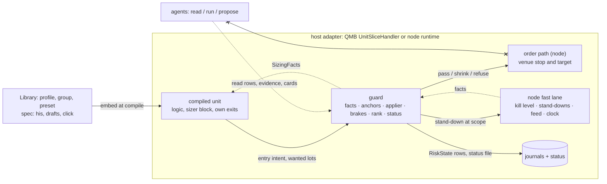

# The risk-and-sizing template: the spine

Fable, fold of the arena, 6 Nov 2026. Fast path, headless: `[ASSUMPTION]` marks an inference nobody confirmed, **[judgment]** marks my opinion. Every file and line below was read at the tips named above; the repair is still moving `qmn/src/qmn/app/runtime.py`, `host.py` and `first_start.py`, so re-check a line before a slice is written. N lines are at `ef011af4`; at R23 `697aafc6` `runtime.py` sits 78 to 90 lines lower. Last round, same day: the ten blockers in `CHECK.md` are fixed in place and `SYNTHESIS.md` lists each. Model numbers are model numbers. Nothing committed; nothing run but the ledger build, its checker and the time-limited sims beside this file.

## 1. The shape in one page

**One mental model.** Every unit carries a **risk profile**: a document with a **spec** that people write and a **status** that only the runtime writes. Every number in the spec has a **derivation**, a fallback ladder, a receipt and an **authority mode**. At each **anchor** the derivation recomputes the number's recommendation from **facts**; one function, the applier, moves the value in force according to the number's mode. **Facts move live, numbers move at anchors.** Above every unit on an account sits one **guard**: it computes the facts, runs every brake, cap and gate above the position, applies one rank table, answers `before_order` with pass, shrink or refuse, and writes the status. Backtest and live run the same guard through two adapters. **Anything that cuts risk acts at once; anything that raises it waits for the anchor.**

| Part | What it is | Who writes it | Where it lives |
|---|---|---|---|
| Profile spec | sizer base, exit numbers, brake bindings, numbers with derivation and mode, needs, fail modes, `accepts_evidence` | him, presets, agent drafts through his click | Library kind `risk-profile`, schema `qmx.risk-profile/1`; `qml/src/qml/risk/profile.py` (new); embedded by `qml/src/qml/compile/compiler.py` |
| Group document | the one config above the units: floor, buffer, kill line, bet-key rule, rank table, never-self-tune list, group brakes, clocks | him | Library kind `risk-group`, schema `qmx.risk-group/1`; `display_name` is his screen word, `parent` reserved |
| Status | values in force, recommendations, receipts, level, brake states, anchors, ledgers, last RiskState | the guard only | `data/deployments/<id>/risk-status.json` beside R22's snapshot (unit); `data/risk-groups/<id>/status.json` (group); rebuilt from journals when missing; tools read RiskState rows, never this file |
| Presets | one `risk-profile` item with `role: preset` per unit type, over four chain keys: preset, class, instrument, unit (the `template` kind is retired and refuses writes, R18 `qmx_library/store.py:981`) | him; agents draft | `qmx_control/catalog.py` rows; children only tighten caps; `PRESET-NUMBERS.md` holds every number's rule |
| Unit blocks | the sizer block and the unit's own exits, compiled in, so the unit stands alone for its own order and its own close | QML | `qml/src/qml/blocks/stdlib/*`, `qml/src/qml/protocol/unit.py` |
| Guard | one package, two ports: the fact kernel, every brake above the position, the registry, the rank table, the applier, `before_order`, RiskState, status | code on the node and in QMB; no agent write path | `packages/qmf-risk/src/qmf/risk/guard/` (new; the package G12 says stays) |
| Node fast lane | kill switch, stand-downs, feed and clock probes, the order path with its venue stop | the node; the kill level is his | N `qmn/src/qmn/app/runtime.py`, `stand_down.py`, `operations.py` |
| Harness | the light form over the ledger rows: sizing and brake replay, the integrated sim, the mandatory scenario block, the choke test, the dry chassis, the conformance tape | this session and the numbers lens; agents run it | `packages/qmf-risk/harness/` (new), seeded from `fold_sim.py` |
| Agents' door | read, run and propose rows, a direction on every operation | QMA (flagged, not designed) | catalog rows; the guard's read-only views |



**How an order flows.** 1. A bar closes; `UnitSliceHandler._step` first calls `guard.advance` through the one wrapper (4.4), which opens any anchor that is due; a guard failure stops entries and nothing else. 2. The unit's logic signals; its stop block gives the disaster stop as an absolute price. 3. `HostedUnit.enter` asks `guard.sizing_facts` for this market and calls the sizer block with the four inputs it gets today (`equity`, `entry_price`, `stop_price`, `record`; J `qml/src/qml/protocol/unit.py:787-789`) plus `SizingFacts`; the sizer answers `Size` with `wanted_lots` at level 1.00. 4. `mint_intents` (J `qmb/src/qmb/host/unit_handler.py:484`, which the node's unit delegates to) passes the entry intent to `guard.before_order`, which applies level, taper, caps and rounding once and answers `Pass`, `Shrink` or `Refuse`; the handler rewrites `quantity` or journals a skip with a closed code. 5. The node's `OrderPath.entry` keeps its own checks (venue ready, kill level, stand-downs) and sends the order with its venue-resident stop and target; QMB rests the intent to the next open. 6. Each bar `HostedUnit.exits` builds `PositionFacts` with no guard call and feeds the per-bar exits; the safest answer wins by the compiled order; exit intents never pass the guard. 7. Fills, closes and deals reach `guard.on_event`; the unit's running loss and the group's are each read once. 8. Every pass the guard emits one RiskState row and, when something moved, writes the status file whole and replaces it.

**How a number gets its value.** 1. The spec names the number: measure, default with its reason, range, `derivation` (rule block, inputs, ladder, clock, cautious direction, guard), `authority` (its mode). A plain preset value goes through the rule `preset-default@1`; `PRESET-NUMBERS.md` gives every core number its rule, rung, clock, cautious direction and owning row. 2. At the anchor of its clock the derivation runs on facts and the record and writes a `Recommendation{target, low, high, rung}` with a receipt into status; the ladder is own record, pooled class, preset, user, refuse. 3. The applier moves the value in force only in the number's mode: `user_only` never; `off` writes `would_be`; `at_anchor` at that anchor; `at_flat` at the first flat after it. 4. A guard per derived number watches what the derivation assumed; a trip drops a rung with a reason code; after N trips the number freezes and a card flags him. 5. Every value in force carries one reason code: `user`, `default`, `calibrated`, `borrowed:<group>`, `capped_by:<rule>`, `stale_so_default`, `frozen_after_trips`. A number with no derivation that is not `user_only` refuses compile; a blank value compiles and blocks the live click.

## 2. Invariants

Each is a call two builders one level down could make incompatibly. Binds / Prevents / Rule. Everything else is seed, or named under Deferred (section 12).

- **AD-1 Spec and status have separate writers.** Binds every document. Prevents the runtime and a person racing on one field, and a restart or a missed anchor reading as a new document. Rule: people and drafts write spec in the Library; only the guard writes status; every status row carries `generation` (the spec fingerprint and the schema) and, apart from it, `anchor_id` and `rev`; a status from another generation reads UNKNOWN and rebuilds through `Guard.recover`; nothing starts cold.
- **AD-2 One guard above the position.** Binds QMB and the node. Prevents two brake stacks that disagree. Rule: every brake, cap, gate and clamp above the position is a registry row the guard runs; the unit holds only its sizer and its own exits; both hosts build the same `Guard` from the same documents and reach it through `UnitSliceHandler`; the guard does no I/O, imports no host and no `qml`, and runs on the runtime thread only; a heavy draw, such as the day stop's k, runs in the harness and reaches the guard as a table.
- **AD-3 Only the node sends orders.** Prevents a second order path. Rule: the guard answers, never sends; no agent surface reaches `before_order` or the order path; the Lab and the harness run the guard on a tape, never a venue.
- **AD-4 Exits and the kill level are safe by type, and a guard failure cannot reach an exit.** Rule: `before_order` takes `UnitEntryIntent` only; exit intents go to the close and amendment paths untouched, and a contract test runs every exit through every guard state; every guard call and status write goes through one wrapper (4.4), so any raise or refusal becomes `guard_unavailable` on entries, exits still mint and the unit stays TRADING; a test runs a guard that raises on every call and the per-bar exit still closes; the `Effect` union has no variant that lowers a kill level or clears a stand-down that waits for his hand; a venue refusal raises urgency, never a retry loop that hides it.
- **AD-5 Every number derives.** Prevents a blank or a magic number. Rule: a number carries `derivation` and `authority`; only a `user_only` number may have no derivation, and any other refuses compile (`number_blank`); a plain preset value goes through `preset-default@1`; a blank value compiles and blocks the live click, never paper or the harness; every default carries a `why`; never-self-tune rows take no input from a record, an agent or a derivation; his derivation edits are versions; his value edits on `user_only` rows are immediate and journalled, and come only through his door (4.8).
- **AD-6 Facts move live, numbers move at anchors.** Binds derivations, the kernel, the sizer. Prevents motion between anchors nobody can explain, and a second mechanism for a cost that changed. Rule: a fact is measured now and never chosen (equity, open risk, cost cell, spread, kill level, day P&L); a number has a derivation and reaches its readers through the value in force; modes at go-live are `user_only`, `off`, `at_anchor`, `at_flat`; `at_period_open` and `live` parse and refuse `authority_not_built`.
- **AD-7 Cuts act at once, raises wait for the anchor.** Rule: a transition that lowers risk (bench, level down, stand-down, shed) takes effect on its event; a transition that raises risk (level up, bench clear, stand-down expiry, dial release, press arming) takes effect at the first anchor after it is earned, at most one level per anchor; a multiplier may read a live ledger between anchors inside bounds frozen at the anchor, and permission to exceed 1.0 is itself a raise.
- **AD-8 One reading of the running loss per scope.** Prevents re-stacked cuts (REVIEW M3). Rule: at unit scope only the bench reads the unit's money ledger to trip; at group scope only `group-day-pair@1` reads the group's ledger, one row with a taper half and a stop half; a registry row declares `reads_ledger` and scope, and compile refuses a second `mode: live` row on the same pair (`two_live_readers`); the sizer reads no realised loss between anchors, only open risk; the guard holds the bet-key ledger.
- **AD-9 Anchors are clocks plus a closed trigger list.** Prevents ad-hoc recompute paths and a restart acting as a free reset. Rule: clocks at go-live are `day` (the class's day boundary from the instrument record) and `allocation` (weekly); triggers are `his_act`, `banker_act`, `version_change`, `world_switch`, `spec_change`, `cost_alarm`, `restart_late`, `admission_change`; `anchor_id` is a pure function of clock and time, so `advance` is idempotent and a late anchor is detected; N never rises at an allocation anchor after a day stop since the last one, and a unit that is itself benched or locked is not re-admitted; a lock on one unit does not freeze the others.
- **AD-10 One scope vocabulary.** Binds stand-downs, kills, brakes, isolation, bet keys. Rule: keys are `all`, `account:<id>`, `deployment_id:<id>`, `unit:<dep>:<market>`, `instrument:<id>`, `class:<k>`, `region:<k>`, `currency:<k>`, `underlying:<k>`, `session:<k>`; strictest wins across scopes; down the levels as caps and states, up as events; a child in the chain may only tighten a cap.
- **AD-11 Brakes raise stand-downs, never a kill level.** Rule: a brake writes a stand-down row (`Kind.RISK_RULE`, self-clearing on the guard's word; `Kind.RISK_STOP` for a lockout that waits for his resume, N `stand_down.py:94`) with a cause and a clear rule; the kill level rises by his hand or his one-tap card and goes down only by his hand.
- **AD-12 One R, two results.** Rule: one R is the planned loss at the disaster stop at entry. `r = money / risk` is the gross result the judge and the logic record read (`trade_r`). `net_r = (money + cash) / risk`, the form QMB's report already computes (`qmx-agents/apps/qmb/jobs/backtest.py`), where money is at fill prices, which already hold spread and slippage, and cash is commission and swap. `costs_r{spread, commission, slippage, swap}` is a display split and is never subtracted again. Brakes, the money ledger, the CUSUM and the admission gate read `net_r`, and the card they read against is the holdout's `net_r`; a test holds that a healthy replay's CUSUM does not drift. Until R24 proves deal money the node takes cash from the cost cell, labelled `cost:uncalibrated`. The money ledger reads broker deals (R20: price and kind until R24 proves their money, labelled), not trade rows, so the record holes cannot hide a loss from a brake.
- **AD-13 A stop is an absolute level at every internal seam.** Prevents the wrong-side stop (`abs(entry − new_stop)`, N `runtime.py:1320`) and two sign conventions. Rule: units, intents, journals, status and the guard carry absolute stop and target prices; only the venue encoder derives a distance, signed by side (`_LEVEL_RULES`, J `packages/qmf-venue/src/qmf/venue/encode.py:115-120`); stops only tighten; every live entry carries a venue-resident stop.
- **AD-14 Registry rows.** Rule: every brake, clamp, gate, accelerator, sizer base and scope key is one row with kind, `brake_class` (tail or timing), `mode` (shadow, live), `direction`, scope, `reads`, `reads_ledger`, verb, rank band, fail mode, restore and the numbers it reads; a row is a `guard` section on the dictionary entry, so a new part is one folder; tail brakes may bind from day one, timing brakes ship shadow until the pooled report; a shadow row runs the same code with its action replaced by a `would_have` write and can never change an answer.
- **AD-15 One rank table per group.** Rule: bands fixed, rows append inside a band and never renumber; a refusal beats a shrink; caps smallest wins; multipliers multiply, each on its own ledger; the highest state is folded on every pass even when no intent came; the accelerator band acts only with everything above clear; a property test over random control states holds it equal to one table.
- **AD-16 Closed reason codes and the choke budget block shipping.** Rule: every guard answer, skip and brake text carries a code in `REASON_CODES` (R `packages/qmf-data/src/qmf/data/journal_kinds/unit.py:43-73`) or R15's census fails CI; the harness runs a healthy unit through all 23 things that bind (section 7), and if its dollars risked over the flat baseline of its N, on every opportunity with refusals at zero, fall under 0.75 (`choke_budget_fire_rate`), CI fails for any change touching one of them; the baseline already holds the reserve and the cost denominator, 0.7225 of the raw formula in the model, so the budget sits on top of that cut; a cap binding on more than 90 % of trades is a defect.
- **AD-17 Backtest and live differ only in named facts.** Rule: the same guard, handler and blocks run in both hosts; both ports provide the same fact names from one kernel (`guard/facts/`, `PROVIDES`); a fact that differs carries a label (`sqs:bar_sampled`, `basis:unmarked`, `cost:uncalibrated`); the profile's needs must be a subset of `PROVIDES` at compile or each missing need names its fallback (`compute_here`, `treat_as_absent`, `no_new_entries`); one conformance tape, with USDJPY and a cross on it, runs through both ports in CI and must give the same verdicts.
- **AD-18 A restart changes nothing a brake can see.** Rule: the status file is written whole then replaced (the same move R22's snapshot uses); on start the guard reads it, and if it is missing or from another generation `Guard.recover` rebuilds it from journal rows and broker deals in deal order before any entry; until then and whenever a fact is past `risk_fact_staleness_limit`, `before_order` refuses with `guard_unavailable` and the word is UNKNOWN; the floor, the high-water mark and the day baseline never reset on a restart; exits are unaffected. Tools read RiskState rows, never the file: on Windows `os.replace` raises while a reader holds it (`check/out-windows-replace.txt`).
- **AD-19 Versions keep the record.** Rule: a profile change is a version with an identity label: `profile_sizing_change` (same unit, logic record continues, money record restarts, his click) or `profile_exit_change` (same unit, a counted try, his click); `_cold_reason` compares a `logic_fingerprint`, so a sizing-only version keeps logic state; adoption at the next flat; the click binds one hash, one level, these markets, until a date. A version restarts the money record as a report only: it never clears a bench, a lockout, a drift lock, a stand-down, a paper state, the level or the ledgers those read (`state_carry_rule`), so an agent's draft and one click cannot clear a brake.
- **AD-20 Windows first-class.** Rule: `pathlib`, no signals, forks or POSIX paths; `tzdata` pinned in `qmf-risk`, because Windows has no system time-zone database; timers are the node's clock, never wall-clock sleeps.

| Convention | Rule |
|---|---|
| Money | `Decimal`; loss currency USD. The kernel converts every money figure at one seam, the account sum and price-derived deals included. The record names a `conversion_market`; both ports load it; a missing or stale one refuses in plain words (`conversion_missing`) |
| Facts | every fact carries a timestamp and a staleness limit; a stale fact takes the profile's fail mode; a stale green is impossible |
| Schema | unknown fields refused; a new field runs, refuses or labels by the census test (J `qml/tests/test_unit_refuses.py:457`, plus one census per new schema) |
| Reserved | the seven reserved chain keys (style, bucket, venue account, market, timeframe, session, event), `parent` on the group, `suggestions` and `packs` beyond one on the profile: parse, resolve to the parent or refuse `*_not_built` |

## 3. Vocabulary

One plain word each; no codenames. **Unit** the thing that trades. **Profile** its risk document: spec and status. **Preset** a profile with `role: preset`: derivations instead of numbers, one per unit type. **Group** the units sharing one floor and cushion: the funnel's "one portfolio config"; a schema word only, so Book, BMS, cluster and portfolio stay open on screen until Q8. **Fact** a value measured now and never chosen. **Number** a value in the spec with a derivation. **Recommendation** what a derivation proposes, with bounds filled later. **In force** the value readers read. **Mode** who may move a number and when. **Anchor** the moment numbers refresh. **Receipt** the record on every resolved value and every order. **Guard** the one risk package above units. **Brake** a row that trips or tapers on a ledger; **clamp** limits one order and reads no evidence; **gate** says yes or no from one outside reading; **accelerator** a row that may raise. **Trip** a transition to a worse state. **Bench** no new entries for the rest of a window, exits run. **Stand-down** a hold at a scope with a clear rule. **Kill level** his switch, GREEN to BLACK. **Level** the size multiplier on the baseline: 0.25, 0.50, 0.75, 1.00. **Baseline** a unit's dollars at risk per trade at level 1.00, with the reserve and the cost denominator already in it. **Lockout** a stop that waits for his click. **Cushion** equity above the floor after the reserve and open risk. **Ledger** one running total at one scope. **Record** a unit's trades. **Card** a question for his click. **Scope** a key from AD-10.

## 4. Contracts

Python-shaped sketches; field names are ledger ids where one exists (`ledger/v1/core.md`). Paths are at tip J unless marked N or R.

### 4.1 The profile document and the group document

```python
class RiskProfile:                       # qml/src/qml/risk/profile.py; "qmx.risk-profile/1"; unknown fields refused
    profile_id: str; version: int; role: Literal["unit", "preset"] = "unit"; preset: Pin | None
    chain: Mapping[ChainKey, str]        # go-live: preset, class, instrument, unit; seven reserved keys resolve to the parent
    sizer: Pin                           # the sizer block; default money-at-stop@1
    numbers: Mapping[NumberId, NumberSpec]        # baseline_risk_usd and every other number, each with a derivation
    exit_numbers: Mapping[NumberId, NumberSpec]   # cut, disaster stop distance, time; a change is a counted try (AD-19)
    brakes: tuple[Binding, ...]          # unit-scope rows; group rows sit on the group; account scope refuses here
    needs: tuple[Need, ...]              # x1_needs_list: fact names each with a fallback (AD-17)
    fail_modes: Mapping[str, FailMode]   # x1_fail_mode per feed: board open, isolation closed, evidence neutral
    accepts_evidence: tuple[EvidenceRow, ...] = ()   # empty at go-live: kind, max cut, floor, ttl
    rank_table: str = "qmx-default@1"    # control_rank_table; the group may pin another
    packs: tuple[Pin, ...] = ()          # more than one refuses packs_not_built
    suggestions: tuple[()] = ()          # reserved; non-empty refuses suggestions_not_built

class NumberSpec:                        # widens qml/src/qml/unit/model.py NumberSpec
    measure: Measure; level: Literal["unit", "group"]
    owner: Literal["user", "preset", "derivation"]     # x1_changed_by_class; user = the never-self-tune list
    range: Range | None                  # his bounds; the VPA's min and max allowed
    default: Decimal | str; why: str     # every default carries its reason
    authority: Authority                 # the shipped StrEnum widens: user_only, off, at_anchor, at_flat; at_period_open, live parse and refuse authority_not_built
    applies_to_open_positions: bool = False   # the shipped field; stays refused when true (J compiler.py:996-999, hand-off 8)
    derivation: Derivation | None        # None only on a user_only number

class Derivation:                        # x1_derivation_rule; the block is a dictionary entry of component_type "derivation"
    rule: Pin; inputs: Mapping[str, FactName | NumberId]        # compile checks the names and no cycle
    ladder: tuple[Rung, ...]             # derivation_fallback_order: own_record, pooled:<class>, preset, user, refuse
    min_count: int; shrink_k: int        # calibration_min_trades, calibration_shrink_k
    clock: Literal["day", "allocation"]  # AD-9
    cautious_direction: Literal["down", "up"]   # x1_cautious_direction: missing data moves this way or holds
    max_step: Decimal | None = None      # largest move per anchor
    guard: ValueGuard | None = None      # x1_tuned_value_guard: what must hold; a trip drops a rung; freeze after x1_guard_freeze_limit

class NumberStatus:                      # in the status file, written by the guard only
    in_force: Decimal | str; would_be: Decimal | None           # would_be under mode off
    recommendation: Recommendation       # target, low, high (None at go-live), rung
    receipt: Receipt                     # x1_derivation_receipt: rule, rung, inputs, prior, reason_code, generation, at
    guard: GuardStatus                   # trips, frozen

class RiskGroup:                         # "qmx.risk-group/1"; the deployment carries it beside the profile (promote.py _deployment, :502)
    group_id: str; version: int; display_name: str           # his screen word: Book, BMS, portfolio, cluster
    parent: str | None = None            # reserved; non-null refuses group_parent_not_built (Q8)
    clocks: Mapping[str, ClockRow]; numbers: Mapping[NumberId, NumberSpec]   # portfolio_floor, bms_buffer_before_floor, kill_line_floor: user_only
    brakes: tuple[Binding, ...]; rank: RankTable; bet_key_rule: str; shed_rank: str
    once_rules: tuple[OnceRule, ...] = ()   # his signed rules for Q4, Q6 and Q9
```

**Status** (`RiskProfileStatus`, `GroupStatus`): `generation`; `anchor_id`; `numbers` per id; `level` (now, start, cohort n and r, clean cohorts, CUSUM, warnings with trade counts); `brakes` per row id (state, since, window, bench days, lock top, lock until, `block_state`); `trading_state` per scope (`ACTIVE`, `REDUCING`, `BENCHED`, `HALTED`, `RESTORE`); `anchors` (day start equity per scope, high-water mark, budget used, N admitted, B); `money_ledger` per scope in `net_r` from broker deals; `last_risk_state`. The never-self-tune list at go-live: `portfolio_floor`, `bms_buffer_before_floor`, `kill_line_floor`, `kill_switch_level`, `floor_touch_tolerance`, `survival_horizon_rounds`. A blank user row compiles and blocks the live click (`x1_settable_by_levels`).

### 4.2 The registry row

A row is a `guard` section on the dictionary entry (`entry.json`), so a new part is one folder. The guard hosts row blocks through a block factory the host passes in, so `qmf-risk` stays free of `qml`; the answer types live in `qmf/risk/guard/answers.py`, because `qml` already depends on `qmf-risk`.

```python
class GuardRowInstance(Instance, Protocol):     # qml/blocks/api.py, beside the shipped Instance
    def update(self, evidence: Mapping[str, object]) -> RowRefuse | Factor | CapLots | Trip | None: ...

class DerivationInstance(Instance, Protocol):   # every derivation block, preset-default@1 included
    def update(self, inputs: Mapping[str, object]) -> Recommendation | None: ...

class RowRefuse: code: ReasonCode; detail: str              # verb refuse
class Factor:    value: Decimal; code: ReasonCode           # verb multiply, at most 1; verb raise, above 1, band 800 only
class CapLots:   lots: Decimal; code: ReasonCode            # verb cap
class Trip:      scope: str; code: ReasonCode; clears: str  # verb trip: a stand-down (AD-11)
```

The shipped `HaltInstance.update(evidence) -> Halt | None` (J `qml/src/qml/blocks/api.py:182-186`) serves the verb `trip` and no other, because `HaltAction` holds only `NO_NEW_ENTRIES` and `FLATTEN`. The guard folds answers by type and band, so a new row needs no guard code; an answer off the row's `verbs` is a guard failure (4.4). A row's `export_state` lands in status as `brakes[row].block_state` and `import_state` reads it at start; if the file is missing, `recover` replays the row's evidence.

```python
class RegistryRow:                       # x1_brake_registry_row
    kind: Literal["brake", "clamp", "gate", "accelerator", "derivation", "scope_key"]
    brake_class: Literal["tail", "timing"] | None
    scope: str                           # AD-10 key pattern the row acts at
    reads: tuple[FactName, ...]          # compile: inside guard.PROVIDES or a named fallback
    reads_ledger: LedgerKey | None       # AD-8
    produces: NumberId | None            # a sizer base produces baseline_risk_usd
    verbs: Mapping[Literal["refuse", "multiply", "cap", "trip", "raise"], int]   # verb to rank band; the day pair has two
    mode: Literal["shadow", "live"]      # x1_brake_shadow_mode; "ramped" reserved
    direction: Literal["cut", "raise"]
    anchor: str; counting_rule: str; equity_basis: Literal["committed", "marked", "realised"]
    fail_mode: Literal["closed", "open", "neutral"]
    numbers: tuple[NumberId, ...]        # each with a Derivation
    restore: Pin | None                  # retry-then-lockout@1 at go-live; probes plug in here
    reason_codes: tuple[str, ...]; expected_fire_band: tuple[Decimal, Decimal]   # the harness's band, shown on the card
```

Go-live rows, live (13): `unit-money-bench@1` (tail, unit, reads `unit_money`, trip, band 400, restore `retry-then-lockout@1`: the second bench inside 20 days locks one level lower for `level_lockout_days`, by rule; the third inside 40 is a lockout, `Kind.RISK_STOP`, paper until his click); `drift-monitor@1` (unit, reads the unit's `net_r` stream against the holdout's `net_r`, a CUSUM warning steps one level down and locks the top there for `level_lockout_days`, the warning that reaches `drift_warnings_to_paper` inside `drift_warning_window_trades` is paper with `demotion_cause`; the same restore row as the bench, applied to drift); `group-day-pair@1` (tail, group, reads `group_day_money`, one row with two halves: `multiply`, the taper into the stop; `trip`, a stand-down at `all` expiring at the next day anchor, with k from `day_stop_sigma_multiple`, read from a table of k by N the harness drew); `cushion-clip@1`, `bet-key-cap@1`, `per-trade-cap@1`, `sanity-band@1`, `margin-headroom@1` (caps); `sqs-gate@1`, `news-window@1`, `admission-gate@1`, `order-rate@1`, `stop-side@1` (refusals). Also: `horizon-floor-odds@1` (derivation, produces `baseline_risk_usd`); `class:`, `region:`, `currency:`, `underlying:`, `session:` (scope keys). Shadow (12): `house-money-press@1` (accelerator, switch-on by proof card and once-rule), `reducing-p10`, `loss-points`, `about-three`, `density`, `chorus`, `burn-tiers`, `class-isolation`, `kelly-ceiling`, `weekend-scale`, `upside-alarm`, `session-loss@1` (`session_loss_limit_r`: binding it would be a second live reading of the unit's running loss).

### 4.3 The sizer socket

**A sizer base is a derivation, not a socket.** `horizon-floor-odds@1` produces the number `baseline_risk_usd` (ledger `horizon_survival_risk_usd`): `committed_cushion_usd ÷ (result_spread_r × z × √(trade_rate × survival_horizon_days) × B)`, with the reserve inside the committed cushion and the trade rate floored at the card's. **Clocks:** the cushion re-reads at the `day` anchor; N and B move only at the `allocation` anchor (FUNNEL DP9), so a fall in cushion cuts size the next morning and a unit that leaves raises nobody until the week turns. **B:** `b_split_rule` is `flat` at go-live, `√(N(1 + (N − 1)ρ))` over admitted units. `freed` waits for his once-rule (Q9): a unit at level 1.00 takes `√(1 + S₂ + 2ρS₁ + ρ(S₁² − S₂))`, with S₁ and S₂ the sum and the sum of squares of the other units' levels, and a unit below 1.00 stays on flat. Freed swing raises a unit above the flat baseline by rule, which makes it his (appendix A). **Level floor (FUNNEL DP13):** a live unit whose level size is under one lot trades at the smallest level that clears one lot, never above baseline, never through a lock. The sizer block only turns dollars at risk into lots. Today the host hands four things (J `unit.py:787-789`) and the receipt is a literal (`:828`); `Size` has no residue (J `api.py:105-109`).

```python
class SizingFacts:                       # a host surface sizing:<market>, beside account and own_position (unit_handler.py:358-367)
    risk_usd: Decimal                    # baseline_risk_usd in force x (anchor cushion - open risk now) / anchor cushion
    cost_per_lot_usd: Decimal            # round trip plus stressed slippage for this instrument and hour; label cost:uncalibrated when pooled
    value_per_point: Decimal; usd_per_quote: Decimal; conversion_age_ns: int   # the kernel's one conversion; fixes USDJPY and a cross; stale answers a skip
    min_lot: Decimal; lot_step: Decimal; max_lot: Decimal
    labels: tuple[str, ...]              # basis:unmarked, cost:uncalibrated, stale_so_default

class Size:                              # widened; old callers read lots and skip_reason
    lots: Decimal | None; skip_reason: str | None = None
    wanted_lots: Decimal | None = None   # unrounded, at level 1.00; the guard applies every later factor to this
    risk_usd: Decimal | None = None; residue_r: Decimal = Decimal(0)   # rounding_residue_r
    reads: tuple[str, ...] = ()          # replaces the literal receipt; lands in SizerReceipt
```

`money-at-stop@1`: `wanted = risk_usd ÷ (|entry − stop| × value_per_point × usd_per_quote + cost_per_lot_usd)`; below `min_lot` a skip with `below_min_lot`. `fixed-fraction-at-stop@1` is ripped out through a migration-map row; when the horizon derivation's inputs are stale the ladder falls to the preset rung, the smaller of the last value in force and `risk_fraction × cushion ÷ B`, and the receipt says `stale_so_default`, so no second sizer block is needed. A fixed share with no B would up-size: $2.00 against $0.76 at N = 10. `/sizer/inputs/<port>` stays refused (`compiler.py:933`): a sizer reads host facts, never another block. Contract tests run long and short through two adapters per slot.

### 4.4 The guard: `before_order` and the fact set

Replaces `CrossUnitHook.before_order(intent, open_positions, dispersion)` and `PASS_EVERY_ORDER` (J `api.py:196-218`) and the node's static `cross_unit_hook(command)` (N `runtime.py:1066-1069`, called at `:1018`). `Runtime.guard` (N `:2531`) stays as the node's health check. `Runtime.risk_stop` (N `:2602`) gets its first producer: a lockout.

```python
class Guard:                             # packages/qmf-risk/src/qmf/risk/guard/
    @classmethod
    def recover(cls, plan: GroupPlan, rows: Iterable[Row], deals: Iterable[Deal], facts: AnchorFacts) -> Guard: ...
    def advance(self, now: Instant, facts: AnchorFacts) -> tuple[Effect, ...]: ...       # idempotent per anchor_id
    def sizing_facts(self, unit: UnitKey, market: str, entry: Decimal, stop: Decimal, facts: OrderFacts) -> SizingFacts: ...
    def before_order(self, intent: UnitEntryIntent, open_positions: Sequence[OpenRisk], facts: OrderFacts) -> Pass | Shrink | Refuse: ...   # pure
    def on_event(self, event: Fill | Close | Deal | BankerAct | HisAct | KillChange) -> tuple[Effect, ...]: ...
    def state(self, scope: str) -> RiskState: ...

class Pass:   lots: Decimal; trail: tuple[Step, ...]
class Shrink: lots: Decimal; code: ReasonCode; binding: str; trail: tuple[Step, ...]
class Refuse: code: ReasonCode; detail: str; trail: tuple[Step, ...]
Effect = RaiseStandDown | ClearOwnStandDown | WriteStatus | Row | Card | Push       # nothing lowers a kill level
```

**One wrapper, in `guard_port.py` on both hosts.** Every call to `advance`, `before_order` and `on_event`, and every status write, goes through it. Any raise, any refusal and any answer off a row's verbs becomes `guard_unavailable` on entries: `before_order` answers `Refuse`, exits mint, per-bar exits run, and `_step` and `mint_intents` still return `Ok`. So the node's `_drive_one` (R23 `runtime.py:3032-3037`) cannot set `Phase.STOPPED` for it and no raise reaches the heal path (`:2193-2195`). The guard is marked dirty, and each bar the wrapper retries `recover` from rows and deals; while that fails the word is UNKNOWN and a card flags him. A failed status write retries at the next pass; the rows are the truth.

**`before_order` is pure.** It runs during warm-up too (R23 `runtime.py:1723-1728` mints and does not place), and `on_event` has no event for a blocked order, so it changes nothing. `on_event` adds a fill's risk to its bet key; `before_order` reads risk from `OrderFacts`.

**Inside `before_order`, on `wanted_lots`:** 1. refusals, named by rank: kill level and stand-downs at every scope of this unit; benched or locked; guard available, facts fresh, approval valid; SQS, news, admission, order rate, stop side. 2. multiply: level, then the pair's taper on the group day ledger. 3. raises, only if nothing above is active and the raise gate passes: dial, press (shadow at go-live). 4. caps, smallest wins: bet key, cushion clip, per-trade worst case, sanity band, margin headroom. 5. round down to `lot_step`. 6. shadow rows run on the same inputs and write `would_have`; the answer does not change. The receipt names the binding clamp and counts it.

**Admission reads two things.** At the door and at each allocation anchor it reads the holdout's net low end (`edge_range`): below zero refuses live, at zero starts at 0.25, above zero starts at 0.50. Per hour, a cost cell refuses only when its own fills show net edge below zero: at least `calibration_min_trades` fills and the band's high end under zero, read at the day anchor, with would-have results still counted so the cell can come back. A cell with no fills, or labelled `cost:uncalibrated`, passes. `edge_to_cost_ratio_min` is shadow, written as `would_have`: at 2 it refuses the worked healthy unit at every hour (0.21 ÷ 0.16 = 1.3), so only the numbers lens may bind a ratio, on measured cells, with F1's table beside it.

**The fact kernel** (`guard/facts/`, `PROVIDES`): a port builds `OrderFacts` per call and `AnchorFacts` per anchor. Node source, QMB source, fail mode:

| Fact | Node | QMB | Missing or stale |
|---|---|---|---|
| `equity_balance` | timed re-read in `ctrader_account.py` (today once at sign-in, `equity()` `:698`) plus R22's wait | start plus closed, summed in USD through the kernel (`_account()`, `unit_handler.py:370`, sums quote money today) | refuse |
| `equity_marked` | none yet: `None` | `None` | label `basis:unmarked` |
| `deals` | R20 closes, price and kind, converted by the kernel; deal money when R24 proves the fields | handler fills, converted | price-derived, labelled |
| `open_risk_at_stop` by bet key, `open_risk_total`, `pending_risk` | `_mine()` and `stop_of` | `HeldPosition` | count at the entry stop |
| `foreign_open_risk` | the reconciler's not-ours positions (DP33 flag) | 0 | account numbers only |
| `day_start_equity`, `budget_used`, `high_water_mark_equity`, `money_ledger` per scope | the guard's own, persisted | same | rebuild from rows and deals |
| `cost_cell` | the hourly profile, else the pooled stressed class default | the stated profile (`host.py:2090-2125`) | `cost:uncalibrated`, never refuse |
| `quote`, `usd_per_quote`, `value_per_point`, lots | `venue.feed.quote`, the record, the `conversion_market`'s quote (the keeper subscribes it, `feed_keeper.py`) | bar bid and ask, the record, the `conversion_market`'s bars (`_bars`, `host.py:2097`, loads it) | refuse; `conversion_missing` in plain words |
| `sqs_reading` | the producer on `feed_keeper.py` quotes and R19's minute rows | bar spread, `sqs:bar_sampled`, for the harness only: a bar-sampled reading never satisfies a live decision (DEC-0153, `labelers.py:350`) | refuse (G12 section 2's rule text) |
| `calendar` | `qmn/data/news_calendar.py` | the recorded strip | refuse the affected legs |
| `kill_level`, `stand_downs` | `level_for`, `stand_downs.blocking` | adapter table | refuse |
| `margin_used`, `margin_free`, `leverage` | computed by the kernel: open lots through the record's margin rule, then `equity_balance` less that; `leverageId` after G-DEMO | the same | refuse |
| `clock_ok`, `feed_fresh` | R23 | true | refuse |
| `evidence` | agent records, later | none | 1.0, neutral |

The MIS board stays outside: it keeps publishing, fails open, and the router must not place into a stand-down. Three fail modes show together on the preflight: board open, isolation closed, evidence neutral.

### 4.5 The rank table

```yaml
rank:                     # on the group; bands fixed, rows append inside a band, never renumber
  100_operator:     [kill_level, flatten, pause, resume]
  200_protection:   [disaster_stop, protection_close, forced_flat, kill_close]
  300_health:       [guard_unavailable, feed, clock, reconcile, approval]
  400_tail_brake:   [day_stop, unit_bench, lockout]
  500_gate:         [sqs, news, admission, order_rate, stop_side]
  600_cap:          [bet_key, cushion_clip, per_trade_cap, sanity_band, margin]
  700_multiplier:   [level, taper]
  800_accelerator:  [dial, press]
  exit: [kill_close, risk_close, disaster_stop, thesis_fi, backstop, time, target]
```

Refuse beats shrink; caps smallest; multipliers product, each on its own ledger; band 800 only with everything above clear; the state folded is the highest, on every pass, even when the unit sent no intent (a benched unit under a day stop reads HALTED, not BENCHED). The `exit` row is read by the pure `safest_exit(answers, rank)` inside the unit: closes beat amends, safety beats strategy, the tightest stop wins among amends; compiler slot order decides evaluation order only. The property test (`tests/test_rank_property.py`, 20,000 random control states) holds the guard's fold equal to one table and proves no raise passes while any brake is active.

**Kill levels** (replaces `PLACEHOLDER_KILL_EFFECTS`, N `qmn/src/qmn/protection/effect_matrix.py:137-143`): YELLOW no new entries at scope; ORANGE no new entries, resting cancelled, amends tighten only; RED close this node's positions at scope (`_close_scope`, N `runtime.py:2359`), no entries; BLACK close everything and pause, resume only by his hand. While the node sends market entries only, YELLOW and ORANGE act alike; both are shown.

### 4.6 The exit socket

This answers "agree the socket with it first". G12's guesses 1, 3 and 8 are accepted, and guess 2 with one change: a use may hold several per-bar exits, so the per-use limit lifts for them at step 2; one stop stays. Today a per-bar exit is fed `{}` (J `unit.py:686`), a stop reads `{}` once at entry, per-bar exits with inputs refuse (`compiler.py:474, 491`), and `timer()` builds long-only (`:444`).

```python
class PositionFacts:                     # OwnPosition (unit.py:129-138) stays; this is what an exit reads, built by HostedUnit.exits (:671) with no guard call
    position: OwnPosition; stop_held: Decimal; stop_at_entry: Decimal; targets: tuple[Decimal, ...]
    bars_held: int; mae_r: Decimal; mfe_r: Decimal; realized_r: Decimal     # R10's MAE and MFE (unit_handler.py:97-99, 249-250) move here
    side_price: Decimal                  # bid for a long, ask for a short (hand-offs 12, 14)
    numbers_in_force: Mapping[NumberId, Decimal]   # the exit numbers stamped at entry (hand-off 8)

class CloseAnswer: mechanism: ExitMechanism; fraction: Decimal = Decimal(1); detail: str = ""
class AmendAnswer: new_stop: Decimal; mechanism: ExitMechanism            # an absolute level (AD-13); tighten only
ExitAnswer = CloseAnswer | AmendAnswer | Signal | Decimal | None           # Signal keeps time-exit-bars' reason code

class ExitMechanism(StrEnum):            # exit_mechanism on the trade row
    STOP; FI_CUT; THESIS_FI; BACKSTOP; BREAKEVEN; TIME; SIGNAL; TARGET; TARGET_BACKSTOP; TRAIL
    FORCED_FLAT; KILL_CLOSE; RISK_CLOSE; LIQUIDATION; ROLL; HAND; UNKNOWN
```

- **Step 2, about 60 lines plus tests.** `HostedUnit.exits` builds `PositionFacts` and feeds every per-bar exit; `timer()` passes the side; several per-bar exits may run and `safest_exit` picks; only `CloseAnswer(fraction=1)` and `Signal` map to an intent (`close_full`). Lifts `exit_not_built` for position facts and whole bars; one stop stays.
- **The disaster stop** is the unit's `ExitUse.STOP`: venue-resident on every live entry (`require_venue_resident_protective_stop`, N `runtime.py:1020` stays); R is measured to it; its distance is a number with a derivation in `exit_numbers`. `stop_not_built` (`compiler.py:502`) stays: no unit without a price stop at go-live (hand-off 7). The **cut** is `fast-invalidation-cut@1`, a per-bar close whose level derives from the winners' MAE percentile (`fi_cut_mae_percentile`), run as a counted two-arm trial per unit through the harness (F1 open).
- **The target rests at the venue** (hand-off 6; section 9), and **nothing amends one level until R24 answers.** The entry will carry a `protective_target_distance` beside `protective_stop_distance` (J `commands.py:361`); `relativeTakeProfit` is in the proto, not yet in the encoder (`encode.py:748-752`), so that is new work. There is no fallback amend after the fill: `encode.py:1029-1036` writes one field, cTrader's page is silent on an omitted one, and if omitting clears it the disaster stop is gone. R24 must answer this. Once a target can rest, every amend sends both levels and reads `stop_of` back, step 3's stop amend included. Until the entry carries it, the node keeps its market close a bar after the level is passed, labelled `TARGET_BACKSTOP` (N `protective()`, `runtime.py:1757-1772`), and he is told a wick can still read differently from QMB (section 13). QMB keeps booking the target at its level (J `qmb/src/qmb/execution/fill.py:1327-1328`), which is the same rule once the target rests.
- **Step 3, about 250 lines, waits for the signed stop.** It lifts `AmendAnswer` and `fraction < 1`, maps them to `amend_protection` and `close_partial`, makes `_move_stop` (N `:1308-1329`) take an absolute level and lets the encoder sign it, replaces R21's `Blocked` (N `:1279`), restores a lost stop from the latest accepted amend row rather than the send row, and needs R24's fact on what the venue holds. A partial that leaves a rest under `min_lot` closes in full (N `:1722-1723` stays). Trails are shadow catalogue entries until then.
- **Trade row v2** (R `journal_kinds/unit.py`; body `qmb/src/qmb/results/journal.py:412`): adds `exit_mechanism`, `r` (gross), `net_r`, `costs_r{spread, commission, slippage, swap}` (display only), `mae_r`, `mfe_r`, `bars_held`, `profile_version`, `level_at_entry`, `labels`, `session`, `equity_before`, `stage`, `world`. `net_r` is a new field by AD-12's form. `r_after_costs` (J `unit_handler.py:724`, read by `qml/motion/engine.py:57,120`) holds gross: it keeps its value, is renamed `gross_r` and is never `net_r`. The judge's `trade_r` stays gross. Ledgers read deals, not trade rows (AD-12).

### 4.7 The RiskState row

```python
class RiskState:                         # journal kind risk_state on the node stream; on change plus a heartbeat (risk_state_emit_interval)
    at: int; scope: str; generation: str; anchor_id: str; rev: int
    word: Literal["GREEN", "YELLOW", "ORANGE", "RED", "BLACK", "UNKNOWN"]   # risk_light_state; stale reads UNKNOWN
    state: Literal["ACTIVE", "REDUCING", "BENCHED", "HALTED", "RESTORE"]      # x1_trading_state, computed never stored
    equity: Mapping[str, Decimal | None]; basis: str                          # balance, marked, realised today
    cushion: CushionRow; sigma: SigmaRow                                      # committed, reserve, floor, buffer, kill_line_distance; budget, sized
    open_risk_usd: Decimal; open_risk_by_key: Mapping[str, Decimal]; budget_used: Decimal
    ledgers: Mapping[LedgerKey, Decimal]; level: Decimal | None; units_admitted: int; units_shed: tuple[str, ...]
    kill: KillRow; drift: DriftRow                                            # requested, enforced, observed
    brakes: tuple[BrakeMeter, ...]                                            # id, mode, class, state, distance_to_trip, fires, would_have
    binding_clamp: Mapping[str, int]; placeholders_live: tuple[str, ...]; fail_modes: Mapping[str, str]
    facts_age_s: Mapping[str, int]                                            # the staleness that made UNKNOWN, if any
```

Register `risk_state` beside `guard`, `risk_event` and `would_have` (R `journal_kinds/unit.py:179-181`). The screen, the copilot, agents and the Lab read one fold.

### 4.8 The agents' read, run and propose surfaces

Catalog rows (`qmx_control/catalog.py`), each with `direction ∈ {read, run, propose, cut, raise, money}`; the host admits `read`, `run`, `propose` and `cut` to agent principals; `raise` and `money` answer only to him. **QMA flag:** `direction` is a new catalog field beside `Approval`; CI fails a row without one; `admits` must read it. Flagged, not designed.

| Row | Direction | Reads or writes |
|---|---|---|
| `risk_state`, `risk_explain`, `risk_ledger_query`, `risk_placeholders_list` | read | the RiskState rows, a number's chain and receipt, the ledger row, the placeholders live; never the status file |
| `risk_profile_check`, `derivation_preview`, `risk_resize_replay`, `risk_scenarios_run` | run | the same guard on a replay port: a profile checked, a derivation previewed, a unit's trades under another profile, the mandatory X4 block |
| `risk_profile_new` | propose | a draft of a profile, a preset or a group; a card and plan on save; his click publishes |
| `risk_derivation_new` | propose | a new rule block: checked by `blocks_check`, saved as a draft (`library_save` is a stdio door today, `catalog.py:497`; **QMA flag**); a profile pins it only through a version and his click. Expressions stay deferred |
| `risk_evidence_put` | cut | an expiring record of an accepted kind, max cut, floor; the guard's `evidence_cut` reads it; expired or malformed means 1.0; `accepts_evidence` is empty at go-live |
| `risk_card` for a loosening | raise | a card from an effect descriptor (hash, base version, scope, ledger ids, expiry); only his click acts; stale refused |
| promote, resume, kill-lower, once-rule sign | money | operator only, never an agent |

No row sends an order, lowers a kill level, blocks an exit, raises a level or moves a `user_only` number (AD-3, AD-4, AD-11). The fast loop never waits for a model; a dead agent changes nothing. On demo, agents' cTrader order tools stand by his ruling; the guard counts what they open as `foreign` (DP33).

**Only his door publishes a risk document.** `library_save` (R18 `service.py:1519`) refuses `risk-profile` and `risk-group` as it refuses `unit`, so an agent cannot put a lower floor on main; `_his_click` (`:1673-1679`) refuses every caller but his door for a move of either onto main; a `user_only` value edit comes only through his door. Slice 3 builds this. The wider triage-3 (`A/REPAIR-SCOPE.md:88`) stays the repair's.

### 4.9 Compiler refusals to lift, and the format bump

`COMPILER_FORMAT_VERSION` is 4 (J `compiler.py:100`); each slice that changes the compiled shape bumps it (exit step 2, the profile; step 3 later) and moves the fingerprint and `pack.json`. Nothing is live, so a cold start costs nothing.

| Refusal | Where | At go-live |
|---|---|---|
| `exit_not_built`: a per-bar exit with inputs; a second per-bar exit | `:474`, `:491-494` | **lifted** for position facts and whole bars; one stop stays |
| the six exits refused by shape | `:361-362` | three close-only run as shadow catalogue; three trails wait for step 3 |
| `stop_not_built` | `:502` | stays; the profile's disaster-stop number satisfies it |
| `halts_not_built` | `:903` | **stays**, message names the profile and the group (brakes are guard rows) |
| `inputs_not_built` on `/sizer/inputs/<port>` | `:484`, `:933` | stays; `sizing:<market>` is a host surface, not a block reference |
| `open_positions_not_built` | `:998` | stays (hand-off 8) |
| `cadence_not_built` on `cadence.at` | `:1011` | **lifted**: the anchor clocks read it |
| `motion_not_built` on the authority fields | `:869` `_MOTION_READ`, `:1004` | **widened** for the new `authority` values and `derivation` |
| `binding_not_read` for a halt in a logic slot | `:724` | stays; the needs list is the check for guard rows |
| `reads_`, `sessions_`, `limit_not_built`, `plain_python`, `settings`, `position_limit` other than 1 | `:900-961` | stay |

New refusals: `authority_not_built`, `packs_not_built`, `suggestions_not_built`, `group_parent_not_built`, `needs_not_met`, `two_live_readers`, `number_blank` (compile: no derivation and not `user_only`; the click: a blank value), `rank_band_unknown`, `conversion_missing`. New census rows: `risk_profile`, `risk_group`, `numbers.*.derivation`, `numbers.*.authority`. A unit with no profile runs in QMB and paper; the live click refuses it.

## 5. The forks, settled

**F-A, the shape of the full model with the simple modes on.** The document, status and receipts carry the Kubernetes and VPA shape from day one: spec and status, a recommendation with bounds (filled later), an authority mode per number. At go-live the modes on are `user_only`, `off`, `at_anchor` and `at_flat` (the shipped motion engine already moves logic numbers when flat, G8 3.9); `at_period_open` and `live` parse and refuse. This costs nothing later and needs no reader changed, because every reader reads the value in force. The one argument for `live`, a cost cell after a broker change, is answered by AD-6: a cost cell is a fact the sizer reads, so it acts at once with no learned number moving; the `cost_alarm` trigger re-derives the admission gate the same day. Candidate 1's own sim showed `live` earning only on that case (+0.9 % to +3.3 % of the cushion on a lag day at scalper rates) and nothing on a healthy unit or on slow decay. **What would make `live` win:** lag money above about half a sized day sigma per broker cost event on real fills, or his wish to see a number move between anchors; then lift `authority_not_built` for that mode and nothing else changes. **He must hear plainly** (section 13): Kubernetes is the model; the first version runs it in its simplest modes.

**F-B, one guard above the position.** Every brake above the position runs in one package with one rank table and one fact set; brake blocks keep the shipped `HaltInstance` shape, hosted by the guard, so a later move of a unit's own brake into the unit is a move, not a rewrite. Candidate 3's version was serious: its fact kernel and its shadow rule are in this spine. Its cost was two arbitration stages and a fact round trip for every cross-unit brake. **What would make the unit-level home win:** units that run for long stretches on hosts with different guard versions, or on a third-party host; today one node owns an account and both hosts ship from one lockfile. The sub-choice: the guard ranks controls; the compiler's order ranks the unit's own exits, read by `safest_exit`.

## 6. The extension proof

| Change | Files | Rows | Guard or compiler code | Rework? |
|---|---|---|---|---|
| A new brake | one folder `stdlib/<brake>/1/` with `entry.json` (its `guard` section) and `block.py` implementing `GuardRowInstance`, or `HaltInstance` for a pure trip | a binding on the profile or group, `mode: shadow`; its numbers; one reason code | none, unless it reads a new fact: then one provider in the kernel and one port line per host (`needs_not_met` says so at compile) | no |
| A new sizer base | one derivation folder implementing `DerivationInstance`, `produces: baseline_risk_usd` | `numbers.baseline_risk_usd.derivation` pin; needs | none; the sizer block is unchanged | no |
| A new derivation rule | one folder implementing `DerivationInstance`, by a repo PR or `risk_derivation_new` | a version pins it; his click | none | no; a pin, ladder, inputs or clock on an existing rule needs no folder |
| A new instrument class | venue port work outside this design (`CcxtClient.equity()` must stop answering 0 on a failed read, J `ccxt_client.py:597-601`) | a class diff in the preset, a day clock row, a cost default, a worst-step row, bet-key legs, `class:<x>`, `conversion_market` on its records; feasibility decides live or paper | none once slice 2's conversion ships; carry fields on the cost cell, later | see walk 2 |
| A new style preset | a `risk-profile` item with `role: preset` | bindings, derivation choices, exit family | none, unless a new exit block | no |
| He changes how one number derives | none | a new profile version: rule, ladder or rung order; the plan card shows the move; his click; in force at the next anchor after adoption; a `user_only` value edit is immediate and journalled | none | no; `profile_sizing_change` keeps the record, a number under `exit_numbers` is a counted try |
| An agent proposes a tighter limit | none | an evidence record if the unit declared that kind (cut only, expiring); or a draft version for a lasting limit, which is a card | none | no; neither touches a user row; enabling evidence is one spec row |
| The Lab simulates a variant | none in the guard | a variant profile | the same package on a replay port through `risk_resize_replay` | no; nothing the Lab writes is in any fact bundle (**QMA flag**: the Lab app is unbuilt) |
| A version rollout keeping the record | none | v2 pinned; a `would_have` sheet beside v1 for the shadow window; the bound click; the identity label | `logic_fingerprint` compare, built at go-live | no; the rip-out of `fixed-fraction-at-stop@1` is its first use, with a migration row |
| Class isolation, shadow to binding | none; the shadow row shipped | the group row flips `mode: shadow → live` after its precision report; his click (Q1) | none; `Kind.RISK_RULE` and the `class:` key exist from go-live | no |
| House money's press switching on | none; the shadow row computed the same multiplier | the proof card passes at an anchor; the once-rule signed (Q4); `press_armed` at the next anchor; the raise gate needs every brake clear | none | no |

Two findings fixed in the design: house money is intraday, so "raises wait" would have made the press a day-over-day compounding; fixed in AD-7 (a multiplier reads a live ledger inside bounds frozen at the anchor; permission to exceed 1.0 is the raise). A `Kind` per brake in `stand_down.py` would have been rework; fixed with one `Kind.RISK_RULE`. Admitted: a brake reading a truly new statistic is code in the kernel; registry rows do not make facts appear. `position_limit` above 1 stays refused and ledgers key on (unit, market).

**Walk 1, a brake that halves size (`reducing-p10`).** One folder. `entry.json`: `kind: brake`, `brake_class: timing`, `verbs: {multiply: 700}`, `mode: shadow`, its `reads`, its two numbers (`reduce_step_percentile`, `reduce_step_factor`), each with a rule. `block.py`, about 20 lines: `update(evidence) -> Factor(Decimal("0.5"), "reducing_p10") | None`, its window in `export_state`. One line in `REASON_CODES`. No guard, compiler, rank-table or status code: the fold multiplies every `Factor` in band 700, `block_state` holds its window, the shadow rule writes `would_have`. The plain limit: flipping it to `live` hits `two_live_readers`, because it is a second reading of the unit's running loss. AD-8 refuses that on purpose; binding it means retiring the bench's reading first.

**Walk 2, a class quoted in EUR (an index CFD on a USD account).** Rows: `conversion_market: EURUSD` on its records, a `class:` diff, a day clock, a cost default, a worst-step row, bet-key legs. No code: both ports load the conversion market by name and the kernel converts (slice 2). **What a new class still costs:** one row of the class on the conformance tape; venue port work if the venue is new; feasibility decides live or paper, and a whole-contract class at $500 reads infeasible until the contract ladder; carry or funding is not modelled until the cost record's carry fields land; an account in EUR is out of scope (`numeraire` is USD).

## 7. The performance proof

**23 things bind at go-live**, FUNNEL 5.2's fifteen factors unpacked: the 13 live rows, of which the day pair acts twice (14); then the reserve, the cost denominator, B, the open-risk share (4.3), the level, the lot shed, the round-down, the resets and the buffer stop (9). The unit's running loss is read once, by the bench (unit scope); the group's once, by the day pair (group scope); the edge stream by the cohorts and the CUSUM, which set the level; the cushion moves only at the anchor; the clip reads live usable cushion as a cap, not a running total; the sizer's live share reads open risk at the stops, which is exposure, not loss.

**The choke test (`fold_sim.py choke`, `out-choke.txt`; appendix A).** The metric is dollars risked over the flat baseline of N on every opportunity, refusals at zero. It runs 12 of the 23, with the admission gate and `net_r` as fixed. **A healthy unit is still above the 0.75 budget at N = 1, 5 and 10: 0.83, 0.81, 0.79.** The denominator already holds 0.7225 of the raw formula (reserve and cost), so against the raw formula it reads 0.60, 0.59, 0.57: the budget is a budget on top of that cut. **The room is thin.** It has not run the cushion clip, bet key, per-trade cap, sanity band, margin, order rate, stop side, SQS, news, resets or the buffer stop, because they have no values or the model has no markets. As a stand-in for SQS and news: 5 % of opportunities refused holds (0.80, 0.78, 0.76); 10 % fails at N = 5 and 10 (0.74, 0.72); 15 % fails everywhere. A lockout's click that never comes fails N = 1 (0.71). So the budget holds on what runs and could fail on the first real SQS and news measurement. Slice 8's CI test runs all 23 and decides; a failure is a defect in the design, not a number to move. Model numbers only.

## 8. The scenario walks

Appendix B walks X4-01, X4-14, X4-66 and a mid-outage restart (X4-45 with X4-48 and X4-71) on these contracts. All meet their bar in the model. Stated gaps: no same-driver cooling time after stops fire (X4-01, the hours clause is shadow); the bleeding book at N = 5 and 10 (X4-66); the fire rate on clustered real days is unknown (X4-14).

## 9. The hand-offs

| # | Item | Answer | Status |
|---|---|---|---|
| 3 | Stop past entry | In scope at step 3 only; absolute levels at every seam, the encoder signs (AD-13); R21's `Blocked` stays until then | decided; R24 fact |
| 4 | Stop widening | Never; the law at `unit_intent.py:720` stands; the placeholder swing stop goes | decided |
| 6 | Target at the broker | **Rests at the venue.** QMB books a target at its level (`fill.py:1327`); the node closes at market a bar later (`runtime.py:1757-1772`), and one wicked bar read +2.00R against −0.55R (seams-7). "Backtest and live run the same rules" decides it; the node's close stays only as a labelled backstop. Candidate 1's "the node closes" is overruled | decided; R24 must prove the venue's close kind and what an amend with one level does to the other |
| 7 | A unit with no stop | Refused at go-live (`stop_not_built` stays); a stop-less base is a later plug with a declared worst case | decided |
| 8 | A moved number and open trades | Open trades keep their entry stamps; `applies_to_open_positions: true` stays refused | decided |
| 9 | Two exits on one bar | `safest_exit` on the rank's `exit` row; closes beat amends; the winner is the row's mechanism | decided |
| 5 | Partial close and R | R stays the planned loss; realised R piecewise; a rest under `min_lot` closes with the partial; ships at step 3 | decided |
| 22 | R and costs | AD-12: `net_r = (money + cash) / risk`; our call, his B9 reservation stands | decided |
| 23 | Kill level meanings | Section 4.5; the day stop raising YELLOW itself is Q5, default a stand-down and a card | decided; Q5 his |
| 24-26 | Refusal alarm count, unplaceable protection, kill line | A number; close, as built; no new entries at the buffer, automatic reduce is Q1b | values wait; Q1b his |
| 27 | Where SQS sits | In the guard, band 500, entries only; the producer moves from `qmn/host/sqs_baseline_producer.py` to `guard/spread.py`; the rule text of `decision_root.py:493-510` unchanged; eight settings derive from the spread histogram's percentiles; DEC-0230 stands, so **the first live entry waits hours for a live-account baseline** | decided; values wait |
| 34 | `too_thin` | `presets.py:45` `min_trades=100` becomes `verification_trades_needed` at the band's low end with an incubation cap | decided; value waits |
| 35 | Version pull | A sizer-only swap trades the same R and pays the pull; an exit change is a counted try; re-read once R11 lands | decided |
| 36, 37 | Rules on a real run; a check with no orders | Never claimed by a stack list; no orders ends `inconclusive` | decided |
| 1, 2, 10, 12, 14 | The socket, six exits, position facts, `timer()`, bid bars | Section 4.6 | decided |
| 11, 13 | Wicked-bar stop; lost stop | Refused at `enter` and at send; the latest accepted amend row, at step 3 | decided |
| 15-20 | USDJPY, costs, receipt, wrong side, socket tests, real risk | Sections 4.3, 4.4; `residue_r` on the row | decided |
| 21 | Metal margin | Account leverage until `leverageId` is read; clamp labelled | waits for G-DEMO |
| 28-33 | Halts, statistics, the hook, row fields, the Book, grids | Sections 4.2, 4.4, 4.7; the guard holds the bet-key ledger; Book against tags is Q8; grids refused at preflight | decided; Q8 his, later |

The work proceeds on the funnel's defaults for Q1 to Q9; none blocks the build. Q7's pushes need his word before they exist.

## 10. The build plan

On landed repair tips only. Must land first: R04 to R06 (format 4, refusals, the record reaches the run) at J; R10 (money measures); R15 (reason census); R20 and R21 (the broker wins, `_close_scope`); R22 (the real balance, the snapshot path); R17 (`_admit`, `_deployment`). Everything above R06 is unreviewed or unmerged (G12), so slices 1 and 2 start on J and rebase.

| Slice | PRs | Main files | Needs landed | Collides with |
|---|---|---|---|---|
| 1. Exit step 2; trade row v2, `net_r`, `gross_r`; the cut block and its two-arm trial | 3 | `qml/protocol/unit.py`, `blocks/api.py`, `compiler.py`, `unit_handler.py`, `results/journal.py`, `journal_kinds/unit.py`, `motion/engine.py` | R04-R06, R10, R15 | R15 journal; rebase after it |
| 2. Guard core, the wrapper and the seam; the fact kernel with its USD seam, both ports and the conformance tape (USDJPY and a cross); status file and `recover`; RiskState; delete the hook | 6 | `qmf/risk/guard/*`, `guard_port.py` x2, `ctrader_account.py` (timed re-read), `unit_handler.py:358,370,484`, `numbers/records.py`, `venue_records.py`, `feed_keeper.py`, `host.py` `_bars`, N `runtime.py:1018,1066`, `api.py:196-218`, `journal_kinds/` | R15, R20, R21, R22 | R22 rewrites `_host` (`:2654`); `first_start.py` for the first status write |
| 3. Profile (with `role: preset`) and group documents, the first preset from `PRESET-NUMBERS.md`, numbers widening, census, format 5, `_deployment` carries both; his door: `library_save` and `_his_click` treat both kinds as `unit` | 5 | `qmx_library/kinds/risk-*.schema.json`, `qml/risk/*`, `qml/unit/model.py`, `compiler.py` (4.9), `promote.py._deployment`, `catalog.py`, `qmx_control/service.py:1519,1673` | R17, R18 | R17 `_admit`, `_leave`; R18 `service.py` |
| 4. Anchors, the applier; the twelve rule blocks of `PRESET-NUMBERS.md`, `preset-default@1` and `horizon-floor-odds@1` first, cost cells with the pooled default; `money-at-stop@1` and the rip-out with its migration row; feasibility, shed and the level floor | 5 | `guard/anchor.py`, `guard/applier.py`, `stdlib/*`, `identity/table.py`, `host.py:2090-2125` | 2, 3, R11 | R11 |
| 5. Climb and drift: start level from the card, cohorts, CUSUM, the drift rule | 2 | `guard/level.py`, `guard/drift.py`, judge `presets.py` | 4 | none |
| 6. Row answers and the fold, rank table and its property test; bench with retry-then-lockout and `risk_stop`; the day pair; `Kind.RISK_RULE`, scope keys; caps; refusals | 6 | `guard/brakes/*`, `guard/ledger.py`, `registry.py`, `blocks/api.py`, N `stand_down.py`, `operations.py:241-258` | 2, 5, R21, R23 | R21 `_close_scope`; R23 stand-downs |
| 7. SQS slice (two PRs: producer, then the rows as derivations); the news window; the kill table | 4 | `guard/spread.py` (moved producer), `labelers.py` rule, `registry_catalog.py` rows as derivations, `feed_keeper.py`; `guard/news.py`, `news_calendar.py`, `windows.py`; `effect_matrix.py` | R19; before C-20 and deletion-4 | C-20; R21 kill path |
| 8. Harness: the integrated sim lifted in (`fold_sim.py choke` the first job), the mandatory block; the choke test in CI over all 23; the dry chassis; the k table | 3 | `qmf-risk/harness/*`, `ReplayPort` | 2, 4, 5, 6 | none |
| 9. Machine check; the bound click in `_admit`; two records, identity rows, `state_carry_rule`; world switch, preflight firewall | 4 | `promote.py:321`, `identity/table.py`, `judge.py`, `qmx_control/service.py` | R17, R18, 8 | R17 |
| 10a. The twelve shadow rows | 2 | `stdlib/*` | 6 | none |
| 10b. Morning card; alert tiers; the go-live list on the click's card | 1 | card renderer, alarm register | R16, Q7 | R16's closed push list |
| 10c. Agent rows and `direction` | 1 | `catalog.py` (QMA flag) | 3 | QMA |
| 11. Target at the venue | 1 | N `runtime.py:1055-1057, 1757`, `commands.py`, `encode.py:748`, `ctrader_account.py` | R24 | R21 |

**43 PRs [judgment], range 38 to 45**, not the 31 this plan first said, and above the funnel's 25 to 35. Reasoning: R19 to R22 ran 246 to 559 source lines each, so one PR here is one reviewable job of about that size. Slice 2 is six such jobs once the wrapper and the USD seam are in. Slice 4 holds twelve rule blocks, not two. Slice 6 is 13 live rows with a fold and its property test. Slice 10 packed twelve rows, a card, tiers and agent rows into 2. If he wants fewer: landing 8 of the shadow rows after go-live saves one PR and loses their first weeks of measuring, so this plan keeps them. Order: 1 → 2 → 3 → 4, then 5 and 6 in parallel, then 7, 8, then 9, 10, 11. Not counted: exit step 3, two more PRs after R21's block lifts and R24 reports. The F1 trial runs as soon as slice 1 lands, on bare QMB, and may change slice 4's first preset.

**Collisions with the repair:** N `runtime.py` at the hook call (`:1018`, deleted), the health check (`:2531`, stays), `risk_stop` (`:2602`, first producer), `protective` (`:1757`), `_move_stop` (`:1308`, step 3), `_host` (`:2654`); `host.py:2090-2125`; `first_start.py`; R17's `_admit` and `_deployment`; R21's `_close_scope` and `Blocked`; R22's snapshot path and balance wait; R15's `REASON_CODES`; R16's closed push list; R18 leaves the board unwired, so isolation stays shadow by construction. These N lines sit 78 to 90 lower at R23.

**Claimed before C-20 and deletion-4** (`handoff/FOR-REPAIR-CLAIMS-BEFORE-C20.md`): the files it names, among them `qmf-risk/control_rank.py`, `control_action.py` (the rank table's shape and `effect_matrix.py`'s importers), `qmf-risk/sizing` (the kill line `qmn/capital` reads), `qmf-risk/versioning` (the migration map's seed), `qmn/protection/effect_matrix.py`, `qmf-data/calendar_feed.py`.

**Unknown until his demo sign-in (R24):** whether a fill carries the stop; deal fields; a close on a gone position; real slippage and commission; the venue's close kind for a take-profit; what an amend with one level does to the other. **Go-live dependencies the funnel does not list:** the right bars come after G-DEMO (every unit gets 15-minute today, R22 refuses the mismatch), so a 1-minute cut cannot run on the node before then; the SQS baseline on a live account takes hours before the first entry (DEC-0230).

## 11. Cuts and additions

**If told to cut more, in order:** the press's shadow row; the dial and Q6; the chain to three keys; the `freed` value of `b_split_rule`; `risk_card`; the morning card's prose; news's per-leg logic; the Simplex rung in the sizer ladder. None changes a contract. Not cut: the bench, the day stop, the clip, SQS, receipts, the choke test.

**Added beyond the funnel, and why:** the group document, so the one portfolio config has a contract and Q8 stays open; facts live and numbers at anchors, which removes the case for `live`; the fact kernel with a conformance tape; a sizer base as a derivation, which makes a new base a row and fixes USDJPY at its root; `two_live_readers` as a compile refusal (M3 as structure); the choke budget as a CI test; one seam in `unit_handler.py`; the `cost_alarm` trigger; `tzdata`; absolute stops at every seam; the drift lockout (appendix C: the bench's retry-then-lockout applied to the CUSUM, so one restore rule serves the unit's two brakes); the day stop's k from the group's own bad day with the tail rows on; freed swing as an option he signs once; one wrapper around the guard; the USD seam with `conversion_market`; `foreign` risk counted at the account; the status file rebuilt from journals; resting targets.

## 12. Assumptions, open questions, deferred

`[ASSUMPTION]` the unit's status file sits beside R22's snapshot under `data/deployments/<id>/` and the group's under `data/risk-groups/<id>/`; R22 is not merged, so the paths may move. `[ASSUMPTION]` one account and one group at go-live, so `all` equals the group. `[ASSUMPTION]` QMB runs one unit with N from the group's plan; multi-unit behaviour is proven in the harness. `[ASSUMPTION]` the first units are FX scalpers at 10 or more trades a day. `[ASSUMPTION]` `UnitSliceHandler` can take a `sizing:<market>` surface without touching the per-market surfaces. `[ASSUMPTION]` agent positions on the demo account read as `foreign` from `attribution.py`'s "not ours". `[ASSUMPTION]` cTrader's order form takes a take-profit on a market order the way it takes `relativeStopLoss`; R24 answers it, and there is no amend fallback until it does. `[ASSUMPTION]` he answers a lockout within about two days; appendix A shows what follows if he does not. Open for him: Q1 to Q9 as the funnel lists them. Open for the numbers lens: every value in `PRESET-NUMBERS.md`, with h and the drift window; the day stop's target fire rate; the dollar clamp; the eight SQS rows; `verification_trades_needed`; the reserve share; the floor-touch tolerance; the survival horizon.

**Deferred, with plug points:** learner bounds and the modes `at_period_open` and `live` (`Recommendation.low`, `high`; `authority`); dead band and share cap (fork rows); the `suggestions` part and its card queue; packs beyond one and combiners beyond `smallest_cap`; the seven reserved keys, tags and drop-ins (`tag:` scope key); the cluster level and Q8 (`risk-group.parent`); pooled priors across a cluster; halt slots inside the unit (a move of rows); exit step 3, the six refused exits, breakeven, trails; REDUCING, loss points, "about three", density, chorus, burn tiers, class isolation, the weekend scale, the Kelly ceiling, the memory ceiling, probes and earned restore (shadow rows, `RegistryRow.restore`); cushion lending, shed classes, de-gross, the ratchet and the sweep (group rows; his base floor split from the lock line); whole-contract ladders, inverse volatility, carry; the trust ladder and outside code (loader signature); the canary, challenger, funded gate, rehab; marked equity (`basis:unmarked` until it lands); the commission key and a cost profile from fills (after G-DEMO); multi-position units; the phone push list (Q7); automatic closes (Q1b); the agent jobs, the mini app, the Lab tenancy, the department (**QMA flag**).

**Stack:** Python as the repo; `tzdata` new in `qmf-risk`. No other new dependency.

## 13. What he must be told at go-live

A plain list, for the screen and for him. Every figure is a model number.

1. **What binds.** The reserve and the cost in the baseline; the split across units; the share left by open risk; the level; the unit bench; the drift monitor; the day pair (a taper, then a stop for the day); the lot shed; round-down; the cushion clip and the buffer stop; the bet key cap; the per-trade cap and sanity band; margin; order rate; stop side; SQS; news; admission; world and version resets. Three brakes read results: the bench, the day pair and the drift monitor.
2. **What is shadow.** These write what they would have done and change nothing: class isolation; REDUCING; loss points; his "about three" (at the unit's own run length, 5 to 10 losses, not three); density; chorus; burn tiers; the Kelly ceiling; the weekend scale; the upside alarm; the session brake; the press after wins.
3. **The session brake is off.** `session_loss_limit_r`, his session drawdown, had been dropped with no word. It is now a shadow row. It cannot bind at go-live, because it would be a second reading of the unit's running loss.
4. **No trails, no breakeven, no partial closes at first.** They wait for exit step 3, after R21's block lifts and R24 reports. The disaster stop, the cut, per-bar closes and the time exit run.
5. **15-minute bars until after G-DEMO.** Every unit on the node gets 15-minute bars until then, so the 1-minute cut and the scalper behind every model number here cannot run on the node before that.
6. **About 3 of 10 units trade at the first seed.** At $500 over a $300 floor and a $0.50 lot: about 3 of 10 proved units, and 1 of a weak ten. The others wait in paper and join as the cushion grows, so his frequency thesis waits on the cushion.
7. **Freed swing raises size by rule, so it is off until he signs it once (Q9).** On, a unit at full level takes the swing the others leave idle and trades above the flat baseline. Model: healthy medians up 5 % at N = 5 and 34 % at N = 10; a bleeding book's half-cushion runs from 11 to 13 % and from 14 to 18 %.
8. **Lockouts wait for his click.** The third bench inside 40 days stops the unit until he resumes it. About one healthy unit in three hits one per 120 days at N = 1. If he does not click, a one-unit book falls under the choke budget (0.71). The second bench's level lock clears by rule.
9. **Drift.** Each CUSUM warning is one level down, locked for 20 days; the third inside 500 trades is paper, and only his click brings it back. In the model 5 to 8 % of healthy units reach paper in 120 days.
10. **The first live entry waits hours** for a live-account SQS baseline (DEC-0230); a demo baseline never satisfies live.
11. **Kubernetes is the model, run in its simplest modes.** Numbers move at anchors only (`user_only`, `off`, `at_anchor`, `at_flat`); facts such as a cost cell move live; no learner bounds, no live mode, no retune share cap.
12. **The target rests at the venue**, which overrules "the node closes". Until the entry carries it the node closes at market a bar late, so a wick can still read differently from the backtest. Nothing amends one level until R24 proves the other survives.
13. **One position per market per unit.** His several positions per unit wait; `position_limit` stays 1.
14. **The bleeding book stays the soft spot.** A book of 5 or 10 with overstated cards loses half the cushion in 11 to 14 % of model runs, and a unit may re-enter the same move with no cooling time once its stops fire.
15. **The choke budget is thin.** A healthy unit reads 0.79 to 0.83 of baseline on 12 of the 23 things that bind, and the baseline itself is 0.72 of the raw formula. SQS and news refusing 10 % of opportunities would put N = 5 and 10 under 0.75. Slice 8 tells.
16. **House money.** The brake half is on from day one at portfolio scope; the press switches on by itself when the unit's own trades pass its card, under the rule he approves once (Q4).
17. **The sweep cap he asked about twice** is not at go-live; it returns as a ratchet at the portfolio, a trade-off against idle money. **The floor and buffer** are fixed at go-live; nothing raises them by rule.
18. **R stays gross with `net_r` beside it:** our call; his B9 reservation stands. **His phone:** the push list on the node is closed; the three pushes in Q7 need his word.
19. **The weak unit** starts at the level its holdout earns, not at a tenth; drift watches it down. **A scalper at a 5-pip stop may not exist after costs** unless its cut catches few winners (F1); the harness's first trial says.
20. **The build is about 43 PRs,** not 31.

---

## Appendix A. The choke test

`fold_sim.py choke 300 120`, `out-choke.txt`: 300 paths, 120 days, the worked example, fat tails, gap days, lot rounding with the shed rule. **Model numbers only; not evidence about a real strategy.** Arm A is the spine as fixed: `net_r` on the card's basis, the admission gate, the cushion daily, N and B weekly, flat B, the sizer's open-risk share with every entry in a slot still open, the level floor stopping at a lock, a lockout's click after 2 days (an assumption), the drift lock. `opp` is dollars risked over the flat baseline of N on every opportunity, refusals at zero. `raw` is `opp` × 0.7225, against the formula with no reserve or cost. `seed` is units trading at the first anchor on $500. The hour cells (8 a day, 60 fills, high end at z 1.645) are model choices; the hours are identical here, so a healthy unit's cell refusals are false ones.

| Case | N | k | opp | raw | live share | seed | half-cushion runs | stops / 100 d | lockouts / 100 d, per unit | to paper | median $ | with freed swing: opp, median $, half-cushion |
|---|---|---|---|---|---|---|---|---|---|---|---|---|
| Healthy +0.10R | 1 | 2.17 | **0.83** | 0.60 | 0.96 | 1 | 0 % | 0.20 | 0.32 | 8.0 % | 1432 | same |
| Healthy | 5 | 1.64 | **0.81** | 0.59 | 0.90 | 3 | 0 % | 0.45 | 0.24 | 6.6 % | 3389 | 0.87, 3560, 0 % |
| Healthy | 10 | 1.45 | **0.79** | 0.57 | 0.76 | 3 | 0 % | 0.76 | 0.20 | 4.6 % | 3509 | 0.86, 4713, 0 % |
| Weak +0.05R | 1 | 2.18 | 0.80 | 0.58 | 0.98 | 1 | 1.0 % | 0.26 | 0.25 | 6.3 % | 650 | same |
| Weak | 5 | 1.95 | 0.59 | 0.43 | 0.37 | 1 | 1.7 % | 0.39 | 0.07 | 1.8 % | 693 | 0.65, 725, 0.3 % |
| Weak | 10 | 1.76 | 0.55 | 0.40 | 0.20 | 1 | 1.7 % | 1.03 | 0.03 | 0.6 % | 729 | 0.58, 682, 1.7 % |
| Bleeding, card +0.10R | 1 | 2.17 | 0.20 | 0.14 | 0.34 | 1 | 0 % | 0.21 | 0.29 | 100 % | 443 | same |
| Bleeding | 5 | 1.64 | 0.23 | 0.16 | 0.18 | 3 | 10.7 % | 0.60 | 0.05 | 28.7 % | 418 | 0.24, 416, 13.3 % |
| Bleeding | 10 | 1.45 | 0.22 | 0.16 | 0.10 | 3 | 14.3 % | 1.38 | 0.02 | 15.4 % | 416 | 0.22, 415, 18.3 % |

Healthy only, opp at N = 1, 5, 10 under one change: SQS and news refuse 5 %: 0.80, 0.78, 0.76. 10 %: 0.76, **0.74, 0.72**. 15 %: **0.72, 0.70, 0.68**. A lockout's click never comes: **0.71**, 0.78, 0.79. Any bench or lock on any unit freezes N for all (the wide reading of AD-9): 0.83, 0.80, 0.77. `net_r` as first written, spread and slippage counted twice: **0.15, 0.22, 0.32**, with 90 to 100 % of healthy units on paper. Bold is under the budget.

**Reading.** Healthy is above 0.75 in every cell of arm A, with 5 to 10 % of opportunities free to be refused. A healthy unit's taken share is 95 %, 89 %, 75 %; the rest is shed or on paper. Benches, stops and hour cells take under 1 % each; the level and the shed take the rest of the gap. Weak at N = 5 and 10 is under 0.75 because most of it waits in paper at level 0.25 on a slow cushion. The budget binds on healthy units only, and he must hear this about the weak ten. The derived k lands between 1.45 and 2.18 and fires 0.2 to 1.4 times per 100 days. Floor touches are 0 % in every cell, with the structural caveat (F12) standing. The older runs, `out-fold.txt`, `out-decompose.txt` and `out-drift-variants.txt`, read size on trades taken; `fold_sim.py fold` still reproduces them byte for byte.

## Appendix B. The scenario walks

**X4-01, five units lose on one shared move.** N = 5. Before the move: `on_event` adds each fill's risk to its bet key and `before_order` reads it; short EURUSD and short gold both load `currency:USD:short`; once `open_risk_cap_per_key_usd` binds, the next entry shrinks or refuses with `bet_key` and the receipt names the clamp. The move: each venue-resident stop fires at rank 200; exits never met the guard; R20 reconciles the closing deals and the kernel writes five `TradeFact` rows in `net_r` about −1. Each unit's bench reads its own window once: −1R against an own p1 near −5.3R, no bench, no streak it did not have. The group day ledger falls about five sized losses, under the taper's start; one reading. The press is shadow and its row would have stayed locked inside `loss_event_window`. Next anchor: cushion down about 2 %, B recomputed on admitted units, N not raised under the caution, baseline down. Bar met. Gap: no same-driver cooling time; once the stops fire the key's open risk is back to zero, so a unit may re-enter the same move; only the taper and the day stop lean against that.

**X4-14, everything is bad everywhere.** N = 10, sizes $0.50. Losses mount across classes; each unit's bench acts at its own loss. The group day ledger passes the taper's start and new entries shrink; it reaches `day_stop_sigma_multiple` times the sized sigma and the guard emits `RaiseStandDown("all", rule="day_stop", clears="next_anchor")`, a `Card` (the one-tap escalation) and, if Q7 says yes, a `Push`. Entries refuse from band 400; exits and venue stops run; no position is closed by the rule (Q1b default); the kill level does not move (Q5 default). Class isolation computes in shadow and shows on the card; he is told it does not bind. Next day anchor: the stand-down clears (a raise, so it waits for the anchor); the baseline re-derives on the smaller cushion and the stop tightens with it. Model (`out-verify-k.txt`): on an X4-14 day of edge −0.40R the book loses about 13 % of the morning's cushion with no stop and about 9 % at k 1.5 to 1.7, for about one point of size; the derived k fires about once per 100 days on a healthy book, against his bar of about once a month and never on a normal day. Passes in the model; the rate on clustered real days is unknown.

**X4-66, the overfit card and the twin.** QMB's deflated holdout: low end below zero refused live; at zero start 0.25; positive start 0.50. The machine check passes, because the machine is fine. His packet says "proof pending, 212 of 610 trades, level 0.50, expires" and approves one hash, one level, these markets. Live: bad cohorts stop the climb; the CUSUM steps one level at once with cause `drift_warning` and locks the top there for `level_lockout_days`, so the unit cannot climb straight back; a second warning inside the window steps and locks once more; the third moves the unit to paper with `demotion_cause`, re-promotion his click. Model (`out-drift-variants.txt`): the bleeding unit reaches paper in 99 % of paths and trades at half size on the way; the overstated card in 61 %; the healthy unit in 8 % against 28 % under the funnel's rule. Ten unproved units are not ten full bets because B splits them. The twin, a lookahead bug with a too-good first week: nothing at go-live can pay it; the press is shadow, the dial needs its e-bar and a once-rule, raises need all clear, the upside alarm is a shadow row that flags it. Honest soft spot: the bleeding book at N = 10 loses half its cushion in about one run in seven before any one CUSUM alarms.

**A restart in the middle of an outage (X4-45 with X4-48 and X4-71).** 14:28 the link drops with four positions open and the group day at −$6; 14:40 the process dies; 16:10 it restarts with no link; 17:00 a day anchor is due; 17:20 the link returns. While down, the venue stops are the only protection, and they work: that is why every entry carries one. 16:10: R22 holds the compiled unit and waits with a plain reason; no handler means no entries; `state()` reads UNKNOWN, never a stale green. 17:00: `advance` sees the anchor due but the balance is stale; it keeps the old values in force and leaves `guard_unavailable` up. 17:20: R20's reconcile runs first and the broker wins; positions closed while down land with price and kind; R21 restores or closes any position with no stop; `reconciler.holds` still blocks entries. The guard reads `risk-status.json`: the generation matches, because the spec did not change, and the anchor id is a separate field that is now behind, so the bench, its rest, the day baseline, the ledger window, the level and the anchors come back as they were; deals since the cursor replay in broker order, split across the 17:00 boundary by their own time, and a bench or day stop that should have tripped while down trips now with `cause: outage_catchup`; cuts first. The missed anchor opens with `cause: restart_late` on the real balance; the old day's stand-down clears; a bench's rest counts in calendar time. Entries open only with feed, reconcile, recover, values in force, clock and SQS reading all fresh. If the status file is missing or from another generation, `recover` rebuilds it from rows and deals and `no_new_entries` holds at `all` until it finishes. Five restarts in ten minutes raise `REPEATED_FAULT` and wait for his resume. A test kills the process at ten random points of a replayed day and asserts every brake variable equals the no-restart run's: a restart changed nothing a brake can see.

## Appendix C. The grafts that were claims, verified

Reruns beside this file, time-limited, model numbers; the candidates' own scripts were rerun first and `fold_sim.py` reproduces each. These read size on trades taken; appendix A has the metric that counts refusals.

- **The drift finding (candidate 3).** `candidate3_sim.py` rerun: at h 17 with two warnings inside 500 trades, a healthy 10-a-day unit goes to paper in 42.0 % of 200 one-unit paths inside 120 days (median day 67), a weak one in 41.0 %, the overstated card in 95.5 %, the bleeding unit in 100 %. **Holds.** The pick's answer as written (the third warning is paper, nothing else changes) **fails on the bleeding book**: `out-decompose.txt` and `out-drift-variants.txt` show it returns healthy units (paper 4 to 8 %) but lets a bleeding unit climb back between warnings, so a bleeding book of 5 or 10 units loses half its cushion in 52 to 57 % of paths against the funnel's 17 to 25 %. What holds is the bench's own restore applied to drift: every warning steps one level down **and locks the top there for the bench's lockout (20 days, `level_lockout_days`)**, the third inside the window is paper. Healthy paper 3 to 8 %, healthy size 0.86 to 0.89, the bleeding book at 17.5 to 25 %, the bleeding unit at half size. A lock for the whole 500-trade window also holds survival but costs six to ten points of healthy size; a shorter window (300 trades) or a lock from the second warning only do not hold survival. The rows `drift_warning_window_trades`, `drift_warnings_to_paper` and `level_lockout_days` carry the rule as a derivation, so the numbers lens can move h, the window and the lock without code.
- **The day stop's k (candidate 2).** `anchor_sim.py kstop 40` rerun: on the sized sigma k 2.5 fires 0.00 to 0.02 times per 100 days at N = 1, 5 and 10 and leaves the X4-14 day's loss at 10 to 12 % of the morning's cushion; k 1.5 fires 1.0 to 3.5 times and cuts it to 8 to 10 % for about one point of size; the budget sigma never fires. **Holds.** The fold derives k as the group's own bad day at the target fire rate in sized-sigma units (`day_stop_sigma_multiple`, `fold_sim.k_own_p1`), with 1.7 as the preset rung. A first derivation drew the day from the cards without the class's tail rows and got k 1.0 at N = 10, a stop that fired on most weeks (`out-fold-notails.txt`); with fat tails and gap days in the draw k derives to 1.4 to 2.2 and fires 0.2 to 1.4 times per 100 days (appendix A). The draw belongs in the harness: it leaves a table of k by N, and the anchor reads the table (AD-2). `out-verify-k.txt` shows the derived k beside the budget sigma and the rungs.
- **Level-weighted B (candidate 2).** By algebra: DP9 read literally gives `B = sqrt(Σ l_i² + ρ Σ l_i l_j)`, which at N = 1 is `l`, so `size = D ÷ (s z √H l) × l` and the level cancels. `anchor_sim.py bmodes 30` rerun: the literal reading lifts a bleeding one-unit book from 0.76 to 0.94 of baseline and a weak N = 10 book's half-cushion runs; freed swing to units at level 1.00 leaves N = 1 unchanged and lifts N = 10 healthy from 0.89 to 0.92. **Holds.** `out-verify-b.txt` reproduces it in the fold's model.
