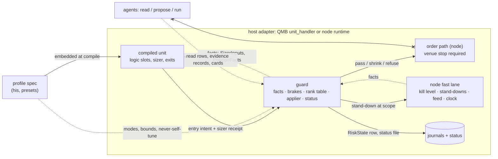

# Candidate 1 spine: the risk-and-sizing template, first increment

Fable, candidate 1, 6 Nov 2026. Fork sides: **F-A (a)** a learner publishes a target with bounds into status and an applier moves the value only in the number's mode; **F-B (a)** every brake above the position runs in one guard package with one rank table. Headless Fast path (`bmad-architecture/references/headless.md`): `[ASSUMPTION]` marks an inference nobody confirmed; **[judgment]** marks my opinion. Code read at the tips G12 names, re-checked today: J = `bld-repair-10` now at `10d99bd0` (R10 reviews moved since G12), N = `bld-repair-21` at `ef011af4`, R = `bld-repair-19` at `7ada84ed`. Nothing committed, nothing run but two time-limited sims in this folder.

Companions: `RATIONALE.md`, `fa_sim.py` with `out-fa-sim.txt` and `out-fa-sim-weak.txt`, `out-core-rerun.txt` (the funnel's `core_sim.py` rerun at 30 paths).

---

## 1. The shape in one page

**Paradigm:** the Kubernetes object with its Vertical Pod Autoscaler (R7 §11). A typed document with defaults; people write the **spec**, the runtime writes the **status**; small control loops keep each number right inside bounds the owner holds. The deliverable is one **risk profile document** per unit type, embedded in the compiled unit, and one **guard** above every unit on a host.

| Part | What it is | Owner of the write | Where it lives (files) |
|---|---|---|---|
| Profile spec | the sizer binding, exit set, brake rows, numbers with derivation and authority, needs, fail modes, `accepts_evidence` | him, presets, agent cards through his click | Library kind `risk-profile`; schema `qml/src/qml/unit/profile.py` (new); embedded by `qml/src/qml/compile/compiler.py` |
| Profile status | in-force values, recommendations with bounds, receipts, level, brake states, trading state per scope, anchors, last RiskState | the runtime only, through the guard | `data/deployments/<id>/risk-status.json` beside R22's unit snapshot, stamped with the spec fingerprint |
| Presets | one `template` Library item per unit type over four chain keys: preset, class, instrument, unit | him and agents through versions | `qmx_control/catalog.py` rows; children only tighten caps |
| Unit blocks | the sizer and the position-scope exits, compiled into the unit, so the unit stands alone for its own order and its own close | QML | `qml/src/qml/blocks/stdlib/*`, `qml/src/qml/protocol/unit.py` |
| Guard | one package, two host adapters: computes the fact set, runs every brake above the position, holds the registry and the rank table, hosts the learner and the applier, answers `before_order`, emits RiskState, writes status | code on the node and in QMB; no agent write path | `packages/qmf-risk/src/qmf/risk/guard/` (new, in the package G12 says stays) |
| Node fast lane | kill switch, stand-downs, feed and clock probes, order path: facts the guard reads; stand-downs the guard raises | the node; the kill level is his | N `qmn/src/qmn/app/runtime.py`, `stand_down.py`, `operations.py` |
| Harness | light form over the ledger rows: sizing and brake replay, the integrated sim, the mandatory scenario block, the choke-budget test, the dry chassis | this session and the numbers lens; agents run it | `packages/qmf-risk/harness/` (new), seeded from `funnel/working/review/core_sim.py` |
| Agents' door | read rows, propose rows, run rows; a direction on every operation | QMA (flagged, not designed) | catalog rows; the guard's read-only views |



**How an order flows.** 1. A bar closes; the compiled unit's logic slots fire. 2. The unit asks the guard for `SizerInputs` for this market (cushion, spread of results, unit count, cost cell, level, taper, edge band, record). 3. The sizer block answers `Size{lots, residue, receipt}` or a skip with its reason. 4. The host hands the entry intent to `guard.before_order(intent, open_positions, facts)`; it answers `Pass`, `Shrink{lots, reason}` or `Refuse{reason}`; the binding clamp is named on the receipt. 5. The node's own checks stay as they are (venue ready, kill level, stand-downs, board) and the order goes out with its venue-resident disaster stop. 6. Exits: each bar, the per-bar exits read `PositionFacts`; an exit intent passes `before_order` by contract; the safest exit wins by the profile's declared order. 7. Every pass the guard emits one RiskState row and, when something moved, writes the status file whole and replaces it.

**How a number gets its value.** 1. The spec names the number: kind, measure, default, range, `derivation` (rule block, inputs, fallback ladder, cadence), `authority` (mode, owner). 2. At the number's cadence the **learner** runs the derivation block on facts and writes a `Recommendation{target, low, high, rung, receipt}` into status; the ladder is own record, pooled class, preset, refuse. 3. The **applier** moves the in-force value only in the number's mode: `user_only` never; `off` shadow; `at_anchor`; `at_flat`; `at_period_open`; `live`. 4. A guard per tuned number watches what the learn assumed; a trip reverts to the default with a reason code; after N trips the number freezes and a card flags him. 5. Every resolved value carries one reason code: `user`, `default`, `calibrated`, `borrowed:<group>`, `capped_by:<rule>`, `stale_so_default`, `frozen_after_trips`. A blank key number refuses compile.

---

## 2. Invariants

Each is a call two builders one level down could make incompatibly. Binds / Prevents / Rule. Everything else is seed or Deferred (section 12).

- **AD-1 Spec and status.** Binds every document. Prevents the runtime and a person racing on one field. Rule: people and cards write spec; only the guard writes status; status carries `generation` = the spec fingerprint it was computed against; a status from another generation is stale and reads as unknown.
- **AD-2 One guard above the position.** Binds QMB and the node. Prevents two brake stacks that disagree. Rule: every brake, cap, gate and clamp above the position is a registry row the guard runs; the unit's blocks hold only its sizer and its own exits; both hosts build the same `Guard` from the same profile.
- **AD-3 Only the node sends orders.** Prevents a second order path. Rule: the guard answers, it never sends; no agent surface reaches `before_order` or the order path; the Lab and the harness run the guard against a tape, never a venue.
- **AD-4 Exits never blocked.** Rule: `before_order` on an exit intent is `Pass` by construction, tested by contract on every brake row; a venue refusal raises urgency, never a retry loop that hides it.
- **AD-5 Every number derives.** Prevents a blank or a magic number. Rule: `NumberSpec` carries `derivation` and `authority`; a key number with no derivation and no `user_only` value refuses compile; his derivation edits are versions, his value edits on `user_only` rows are immediate and journalled.
- **AD-6 One reading of the running loss per scope.** Prevents re-stacked cuts (REVIEW M3). Rule: at unit scope only the bench reads the unit's money ledger to trip; at portfolio scope only the day stop and its taper read the book's ledger; every other reader at go-live is a shadow row writing `would_have`.
- **AD-7 Cuts now, raises in mode.** Rule: a brake transition applies to the next order; a raise (level up, dial, accelerator) applies in the number's mode and only when no brake is active and no cut is settling.
- **AD-8 One scope vocabulary.** Binds stand-downs, kills, brakes, isolation, bet keys. Rule: keys are `all`, `account:<id>`, `deployment_id:<id>`, `unit:<dep>:<market>`, `instrument:<id>`, `class:<k>`, `region:<k>`, `currency:<k>`, `underlying:<k>`, `session:<k>`; strictest wins across scopes; down the levels as caps and states, up as events.
- **AD-9 Brakes raise stand-downs, never a kill level.** Rule: a brake writes a stand-down row with its own clear rule; the kill level rises by his hand or his one-tap card and goes down only by his hand.
- **AD-10 R is gross.** Rule: `r` is the planned loss at the disaster stop at entry; `net_r = r − costs_r`; brakes, the money ledger and the admission gate read `net_r`; `r_after_costs` is renamed `net_r`.
- **AD-11 Status survives restarts beside the snapshot.** Rule: the status file is written whole then replaced; missing or mismatched status means `guard_unavailable_action = no_new_entries` until the next anchor rebuilds it from journals; the floor and the high-water mark never reset on a restart.
- **AD-12 Backtest equals live by fact names.** Rule: both adapters provide the same fact names; the profile's needs list must be a subset of the host's provides list at compile, or each missing need names its fallback (`compute_here`, `treat_as_absent`, `no_new_entries`).
- **AD-13 Registry rows.** Rule: every brake, sizer base, accelerator and scope rule is one row with `brake_class` (tail or timing), `mode` (shadow, live), `direction`, counting rule, equity basis, anchor, fail mode and the derivation of each threshold; a row in shadow computes and journals `would_have` and binds nothing.
- **AD-14 Closed reason codes.** Rule: every brake text has a code in `REASON_CODES` (R `journal_kinds/unit.py:43-74`) or R15's census fails CI.
- **AD-15 One rank table per scope.** Rule: tiers 0 operator, 1 protection, 2 forced flat and kill close, 3 brake trip, 4 cap, 5 modifier, 6 accelerator; a lower tier wins; inside a tier the smallest cap wins; tiers 1 and 2 are never held by 3 to 6.
- **AD-16 Versions keep the record.** Rule: a profile change is a version with an identity label (`profile_version_change` keeps the record and pays R11's pull; `profile_swap` is a new unit); the logic record in R continues, the money record restarts; adoption at the next flat; the click binds one hash, one level, these markets, until a date.
- **AD-17 Windows first-class.** Rule: `pathlib`, no POSIX-only calls, the status write is the same whole-then-replace R22 uses; timers are the node's clock, never wall-clock sleeps.

---

## 3. Vocabulary

One plain word each; no codenames. **Unit** the thing that trades. **Profile** its risk document (spec, status; suggestions later). **Preset** a profile for one type. **Guard** the one risk package above units. **Fact** a number the guard measures. **Number** a value in the spec with a derivation. **Learner** what proposes a number. **Applier** what moves it, in its mode. **Brake** a row that cuts or trips. **Trip** a transition to a worse state. **Bench** no new entries for the rest of a window, exits run. **Stand-down** a hold at a scope with a clear rule. **Kill level** his switch, GREEN to BLACK. **Cushion** equity above the floor after the reserve and open risk. **Level** the size multiplier on the baseline. **Anchor** the moment numbers refresh. **Record** a unit's trades. **Card** a question for his click. **Scope** a key from AD-8. His screen words **Book** and **BMS** stay open: the schema says `portfolio` for the one config at go-live and reserves `cluster` as a tag field it does not read, so Q8 can answer either way without a schema change.

---

## 4. Contracts

Python-shaped sketches. Field names are the ledger ids where one exists (`funnel/ledger-merge.yaml` section 8). Bound to the files named; line numbers are today's tips.

### 4.1 The profile document

```python
# qml/src/qml/unit/profile.py (new). Library kind "risk-profile", schema "qmx.risk-profile/1".
@dataclass(frozen=True)
class RiskProfileSpec:
    profile_id: str; version: int; schema: Literal["qmx.risk-profile/1"]
    preset: str                                   # x1_preset_id: "scalper-mr" | "orb" | "trend-pullback" | next
    chain: Chain                                  # x1_override_chain_order: preset, class, instrument, unit (7 reserved keys parse, resolve to parent)
    sizer: Binding                                # block id@version + params; today "fixed-fraction-at-stop@1" (J unit.py:785), go-live "horizon-floor-odds@1"
    sizer_fallback: Binding                       # the second adapter (X1-H25); the Simplex fallback when inputs are stale
    exit_set: ExitSet                             # stop (disaster), fi (per-bar), target, time; order = declared, safest first
    brakes: tuple[RegistryRow, ...]               # 4.2; the guard runs them; unit.halts stays refused at format 5
    numbers: Mapping[str, NumberSpec]             # 4.1.1
    needs: tuple[Need, ...]                       # x1_needs_list: fact names + fallback (compute_here | treat_as_absent | no_new_entries)
    fail_modes: Mapping[str, FailMode]            # x1_fail_mode per feed: board open, isolation closed, evidence neutral
    accepts_evidence: tuple[EvidenceKind, ...]    # empty at go-live; kind, max cut, floor, ttl, fail mode (X7-H03)
    rank_table: str                               # control_rank_table id; default "qmx-default@1" (4.5)
    suggestions: tuple[()] = ()                   # reserved; non-empty refuses at format 5 (the census test, R04)

@dataclass(frozen=True)
class RiskProfileStatus:                          # data/deployments/<id>/risk-status.json; written by the guard only (AD-1)
    generation: str                               # status_generation = spec fingerprint
    numbers: Mapping[str, NumberStatus]           # in_force, recommendation{target, low, high}, receipt, guard{trips, frozen}
    level: LevelStatus                            # size_level_now, start_level, cohort{n, r}, clean_cohorts, cusum, warnings[]
    brakes: Mapping[str, BrakeState]              # per row id: state, since, window stats, bench_days[], lock_top, lock_until
    trading_state: Mapping[str, str]              # per scope: ACTIVE | REDUCING | BENCHED | HALTED | RESTORE (x1_trading_state)
    anchors: Anchors                              # day_start_equity per scope, high_water_mark_equity, budget used, N_admitted, B
    money_ledger: Mapping[str, Window]            # per scope: running P&L in net_r from broker deals (AD-6, AD-10)
    last_risk_state: RiskState | None             # 4.7
```

**4.1.1 Numbers.** `NumberSpec` at J `qml/src/qml/unit/model.py:424-435` gains two fields and one enum widens.

```python
class AuthorityMode(StrEnum):                     # replaces Authority (model.py:203-204), whose one value becomes an alias
    USER_ONLY = "user_only"                       # the never-self-tune list: portfolio_floor, bms_buffer_before_floor, kill_line_floor, kill_switch_level, floor_touch_tolerance, survival_horizon_days
    OFF = "off"                                   # learner runs, applier journals would_have, value never moves
    AT_ANCHOR = "at_anchor"                       # fork (b)'s mode; the preset default for every learned number
    AT_FLAT = "at_flat"                           # legacy "motion_inside_range" maps here (G8 3.9: moves only when flat)
    AT_PERIOD_OPEN = "at_period_open"
    LIVE = "live"                                 # next order; reserved for cost cells and the SQS threshold

@dataclass(frozen=True)
class Derivation:                                 # x1_derivation_rule; the block is a dictionary entry of role "derivation"
    rule: str                                     # "<block>@<v>"; swapping it is a profile version (AD-5, AD-16)
    inputs: Mapping[str, str]                     # fact names or other numbers; refused if a name is not provided (AD-12)
    fallback: tuple[Rung, ...]                    # derivation_fallback_order: own_record, pooled:class, preset, refuse
    min_count: int; shrink_k: int                 # calibration_min_trades, calibration_shrink_k
    cadence: Cadence                              # every_closed_trades | at: anchor:day | anchor:week | live
    cautious_direction: Literal["down", "up"]     # x1_cautious_direction: missing data moves this way

@dataclass(frozen=True)
class Authority:
    mode: AuthorityMode; owner: Literal["user", "preset", "learner"]
    applies_to_open_positions: bool = False       # read by the applier (lifts compiler.py:996-1000)
    dead_band: Decimal | None = None              # x1_retune_dead_band (fork F-A)
    share_cap: str | None = None                  # x1_retune_share_cap: "<scope>:<share>/<window>" (fork F-A)

@dataclass(frozen=True)
class Receipt:                                    # x1_derivation_receipt, one per resolved value
    derivation: str; rung: str; inputs: Mapping[str, Decimal]; old: Decimal | None; new: Decimal
    reason_code: str                              # x1_value_reason_code: user | default | calibrated | borrowed:<g> | capped_by:<rule> | stale_so_default | frozen_after_trips
    generation: str; at: int                      # spec fingerprint, instant
```

### 4.2 The registry row

```python
@dataclass(frozen=True)
class RegistryRow:                                # x1_brake_registry_row; one per brake, sizer base, accelerator or scope rule
    row_id: str; kind: Literal["brake", "sizer", "accelerator", "scope_rule"]
    block: str                                    # "<block>@<v>" implementing BrakeInstance / SizerInstance
    brake_class: Literal["tail", "timing"]        # tail enforces from day one; timing ships shadow until the pooled report
    mode: Literal["shadow", "live"]               # x1_brake_shadow_mode
    direction: Literal["cut", "raise"]            # x1_proposal_direction_allowed vocabulary
    scope: str                                    # AD-8 key pattern this row acts at
    reads: tuple[str, ...]                        # fact names (needs)
    window: Window                                # trades or time; money_brake_window_trades
    anchor: str                                   # cushion_anchor_type: day | session | fixed | hwm
    counting_rule: str                            # loss_counting_rule: net_r from broker deals (FI counts its size; a breakeven its cost)
    equity_basis: Literal["marked", "balance", "realised"]   # brake_equity_basis
    thresholds: Mapping[str, str]                 # number names in the profile, each with a Derivation (AD-5)
    clear: str                                    # bench: window end + retry-then-lockout; day stop: next anchor; stand-down: its row
    fail_mode: FailMode
    reason_code: str                              # must be in REASON_CODES (AD-14)
    expected_fire_rate: str                       # breaker_expected_fire_rate: the harness's band, shown on the card
    switch_on: str | None = None                  # accelerators: "proof_card:<id>" with the once-rule (Q4)
```

Go-live rows: `unit-bench` (tail, live, own-p1 over `money_brake_window_trades` with `money_brake_dollar_clamp`, clear retry-then-lockout); `portfolio-day-stop` (tail, live, book day P&L ≤ −k × sized σ_book, stand-down at `all` expiring at the next anchor); `pair-brake-half` (tail, live, taper into the day stop); `cushion-clip` (tail, live, worst case at the stops plus gap ≤ cushion above buffer); `bet-key-cap`, `worst-case-veto`, `size-sanity`, `margin-headroom`, `order-rate` (clamps, live); `admission-gate`, `sqs-gate`, `news-window` (gates, live); `house-money-press` (accelerator, shadow, `switch_on: proof_card`); shadow timing rows: `reducing-p10`, `loss-points`, `about-three`, `density`, `chorus`, `burn-tiers`, `class-isolation`, `kelly-ceiling`, `weekend-scale`.

### 4.3 The sizer socket

Today the host hands four things (J `qml/src/qml/protocol/unit.py:785-793`: `equity`, `entry_price`, `stop_price`, `record`) and the receipt is a literal (`:827-830`). The socket widens; `Size` gets its residue and receipt (J `qml/src/qml/blocks/api.py:105-109`; `SizerReceipt` at J `packages/qmf-risk/src/qmf/risk/unit_intent.py:122-126`).

```python
@dataclass(frozen=True, slots=True)
class SizerInputs:                                # built by guard.sizer_inputs(unit, market); the unit passes it through
    equity_balance: Decimal; equity_marked: Decimal | None   # marked None at go-live -> basis "unmarked" on the receipt
    cushion_usd: Decimal                          # committed_cushion_usd = min(balance, marked) - floor - open_risk_at_stop - reserve
    result_spread_r: Decimal                      # s, with FI cuts, from the card then the own record
    n_admitted: int; rho_stressed: Decimal        # live_unit_count at the weekly anchor, never raised under a caution; stressed_unit_correlation
    level_weights: tuple[Decimal, ...]            # the other units' levels, so B is level-weighted (F28)
    trade_rate: Decimal                           # floored at the card's rate
    horizon_days: Decimal; floor_touch_tolerance: Decimal     # user_only numbers
    level: Decimal; taper: Decimal                # size_level_now; the pair's brake half (1.0 when the book is above its p10)
    cost_cell: CostCell                           # round_trip_cost_r, stressed_stop_slippage_r, label: measured | cost:uncalibrated (pooled stressed class default)
    edge_band: tuple[Decimal, Decimal, Decimal]; edge_point: Literal["zero", "low", "mid"]   # DP10; "zero" until Q6
    value_per_point: Decimal; conversion: Decimal; conversion_age_s: int
    min_lot: Decimal; lot_step: Decimal; max_lot: Decimal
    entry_price: Decimal; stop_price: Decimal; record: InstrumentRecord
    extra: Mapping[str, Decimal]                  # any further need the profile declares and the host provides (AD-12)

@dataclass(frozen=True, slots=True)
class Size:
    lots: Decimal | None; skip_reason: str | None = None
    residue_r: Decimal = Decimal(0)               # rounding_residue_r (hand-off 17)
    receipt: SizerReceipt | None = None           # inputs_used, derivation ids, binding_clamp, reason codes, basis

class SizerInstance(Instance, Protocol):
    def update(self, evidence: SizerInputs) -> Size | None: ...
```

The go-live block `horizon-floor-odds@1`: `r = cushion ÷ (s × z × √(trade_rate × horizon_days) × B) × (1 + c0) ÷ (1 + c)`, `B = √(N_w (1 + (N_w − 1) ρ))` on level-weighted units, then `× level × taper`, then money at the stop through `value_per_point × conversion`, then round down to `lot_step`; below `min_lot` a skip with `not_feasible`. `fixed-fraction-at-stop@2` stays as the second adapter and the Simplex fallback (its USDJPY fault, hand-off 15, is fixed by sizing through `value_per_point`, never by dividing account money by a quote-currency loss).

### 4.4 The guard's `before_order` and its fact set

Replaces `CrossUnitHook.before_order(intent, open_positions, dispersion)` (J `api.py:196-218`) and the node's static `cross_unit_hook(command)` (N `runtime.py:1066-1069`, called at `:1018`).

```python
class Guard:                                      # packages/qmf-risk/src/qmf/risk/guard/guard.py
    def facts(self, scope: str | None = None) -> FactSet: ...
    def sizer_inputs(self, unit: UnitRef, market: str, entry: Decimal, stop: Decimal) -> SizerInputs: ...
    def position_facts(self, position: OwnPosition, bar: QuoteBar) -> PositionFacts: ...   # 4.6
    def before_order(self, intent: UnitEntryIntent | UnitExitIntent, open_positions: Sequence[OwnPosition], facts: FactSet) -> Pass | Shrink | Refuse: ...
    def on_event(self, event: Fill | Deal | Mark | Anchor | KillChange | Restart) -> tuple[StandDownRequest, ...]: ...
    def state(self) -> RiskState: ...             # 4.7; emitted every pass

@dataclass(frozen=True, slots=True)
class Pass: receipt: GuardReceipt
@dataclass(frozen=True, slots=True)
class Shrink: lots: Decimal; reason: str; receipt: GuardReceipt
@dataclass(frozen=True, slots=True)
class Refuse: reason: str; receipt: GuardReceipt          # reason in REASON_CODES; one Refuse per order, counted by reason with its denominator

@dataclass(frozen=True, slots=True)
class FactSet:                                    # the needs the host must provide; each with freshness (risk_fact_staleness_limit)
    equity_balance: Fact[Decimal]                 # timed re-read: R22's wait-then-real-balance plus the guard's timer (DP12)
    equity_marked: Fact[Decimal] | None           # None until marked equity lands; then the clip and brakes read it
    open_risk_at_stop: Mapping[str, Decimal]      # by bet key (bet_key_rule: underlying, currency legs, class, direction, driver, window)
    open_risk_total: Decimal; pending_risk: Decimal
    day_start_equity: Mapping[str, Decimal]       # per scope, at the class's declared day boundary; persisted
    budget_used: Mapping[str, Decimal]; high_water_mark_equity: Decimal
    money_ledger: Mapping[str, Decimal]           # running P&L per scope window in net_r from broker deals (R20), not trade rows
    n_admitted: int; b_factor: Decimal; sigma_book_sized: Decimal
    sqs: Mapping[str, SqsReading]; news_window: Mapping[str, Window | None]
    kill_level: Mapping[str, KsaLevel]; stand_downs: tuple[Held, ...]
    margin_used: Decimal; margin_free: Decimal; leverage: Mapping[str, Decimal]
    foreign_positions: tuple[Position, ...]       # scope "foreign": agent positions on the demo account (DP33), counted at the account
    feed_fresh: Mapping[str, bool]; clock_ok: bool
```

The guard is a deep module: six methods at the seam, every brake, cap, gate, learner and applier behind them; two adapters (QMB, node) make the seam real; the deletion test holds, since removing it puts the same arithmetic back into both hosts where they would disagree.

Order of checks for an entry (tier 3 to 5 of the rank table): admission gate (band low end minus cost cell > 0, per hour) → stand-downs at every scope key for this market (bench, day stop, news, SQS, kill ≥ YELLOW as a fact) → bet-key cap → cushion clip → worst-case veto → size sanity band → margin headroom → order rate. Cuts combine smallest-wins; the receipt names the binding clamp and counts it (F8). An exit intent returns `Pass` before any check (AD-4).

### 4.5 The rank table

```python
RANK: Final = (                                   # control_rank_table "qmx-default@1"; one per scope; the profile may pin another
    (0, "operator"),          # his click, his resume, his kill
    (1, "protection"),        # the venue-resident disaster stop; a tighter stop
    (2, "forced_flat"),       # kill RED and BLACK closes, flatten, margin close-out avoidance
    (3, "brake_trip"),        # bench, day stop, stand-down at a scope
    (4, "cap"),               # clip, bet key, worst-case veto, sanity, margin, order rate, lot round-down
    (5, "modifier"),          # level, taper, evidence cut (shadow at go-live), shed
    (6, "accelerator"),       # house money press, the dial: never while 3 to 5 are active or a cut is settling
)
```

The unit's own exits do not go through this table; they combine by the profile's `exit_set.order`, checked at compile: forced flat and kill close, disaster stop, working stop, thesis FI, price FI backstop, target, time. **[judgment]** That split is the F-B sub-choice: the guard ranks controls, the compiler ranks the unit's exits.

### 4.6 The exit socket

Step 2 only at go-live. Today a per-bar exit is fed `{}` (J `unit.py:686`) and a stop reads `{}` once at entry (`:757`); per-bar exits with inputs refuse (`compiler.py:358-363`).

```python
@dataclass(frozen=True, slots=True)
class PositionFacts:                              # guard.position_facts(); fed to every per-bar exit each bar (lifts compiler.py:358-363)
    position_id: str; side: Side; quantity: Decimal; entry_price: Decimal
    stop_price: Decimal                           # the disaster stop the venue holds (R20: the broker wins)
    bars_held: int; r_now: Decimal; mae_r: Decimal; mfe_r: Decimal   # R10 computes MAE and MFE in the handler (J unit_handler.py:97-99)
    bid: OHLC; ask: OHLC                          # a short's exit reads the ask side (hand-off 14)
    opened_at: Instant; numbers_in_force: Mapping[str, Decimal]
    falsifying_condition: str | None              # thesis FI: the named condition, evaluated by the unit's own block

ExitAnswer = Decimal | Signal                     # step 2: a level, or a Signal that closes while it holds (close_full)
# step 3, refused by shape until the signed stop lands: ClosePartial(quantity) | AmendProtection(stop, targets)
```

- **The disaster stop** is `protection.stop` on every entry intent, placed at the venue (`require_venue_resident_protective_stop`, N `runtime.py:1020-1022` stays). A unit with no stop refuses at format 5 as it does today (`stop_not_built`, `compiler.py:500-506`), with the message changed from "the risk session's" to the rule.
- **The cut** (FI) is a per-bar exit answering `Signal`; its level derives from the winners' MAE percentile (`fi_cut_mae_percentile`) and runs as a counted two-arm trial per unit through the harness (F1 open).
- **Trade row v2** (R `journal_kinds/unit.py:178`, body at J `qmb/src/qmb/results/journal.py:412`): adds `mechanism` (`stop`, `fi_cut`, `thesis_fi`, `target`, `time`, `signal`, `forced_flat`, `kill_close`, `protection_close`, `operator`), `r` (gross, AD-10), `net_r`, `costs_r{spread, commission, slippage, swap}`, `mae_r`, `mfe_r`, `bars_held`, `session`, `equity_before`, `stage`, `world`. `r_after_costs` (J `unit_handler.py:724`) becomes `net_r`; the judge's `trade_r` (J `judge.py:224-227`) stays gross.
- **Where step 3 waits.** On the signed stop distance: pin `ProtectionAmendment.new_distance` as positive on the loss side (`entry − stop` long, `stop − entry` short) and negative past entry; the node sends the absolute price. R21's block at N `runtime.py:1278-1287` and `abs()` at `:1320` lift together with the encoder's `_LEVEL_RULES` (J `packages/qmf-venue/src/qmf/venue/encode.py:115-120`); `seats/dispatch.py:917-930` goes with C-20. Until then amends tighten on the loss side only; a partial close that leaves a rest under `min_lot` closes in full (N `:1722-1723` stays).

### 4.7 The RiskState row

```python
@dataclass(frozen=True, slots=True)
class RiskState:                                  # journal kind "risk_state" on the node stream (new in journal_kinds/node.py:30); one per guard pass, at most every risk_state_emit_interval
    at: int; generation: str; scope: str
    word: Literal["GREEN", "YELLOW", "ORANGE", "RED", "BLACK", "UNKNOWN"]   # risk_light_state; UNKNOWN when any key fact is stale
    equity: EquityTriple                          # balance, marked (or None), realised today
    cushion_usd: Decimal; kill_line_distance: Decimal; budget_remaining: Mapping[str, Decimal]
    open_risk_at_stop: Mapping[str, Decimal]; n_effective: Decimal     # exposure board by bet key; X4-93
    trading_state: Mapping[str, str]; active_brakes: tuple[str, ...]; stand_downs: tuple[str, ...]
    level: Mapping[str, Decimal]; taper: Decimal; sqs: Mapping[str, str]
    last_decision: GuardReceipt | None            # requested, enforced, observed (X6-09)
    facts_age_s: Mapping[str, int]                # the staleness that made UNKNOWN, if any
```

### 4.8 The agents' read and propose surfaces

Catalog rows (QMA flag: catalog and host change, X7-H02), each with `direction ∈ {read, propose, cut, raise, money}`; the host admits `read`, `propose` and `cut` to agent principals; `raise` and `money` answer only to him.

| Row | Direction | Reads or writes |
|---|---|---|
| `risk.state.read` | read | the RiskState rows and the status file (read-only view) |
| `risk.profile.read` | read | spec, receipts, registry rows, the ledger, the card queue |
| `risk.journal.read` | read | trade rows v2, `would_have`, `risk_event`, `guard` rows |
| `risk.evidence.file` | cut | an evidence record of an accepted kind, max cut, TTL; the guard's `evidence_cut` modifier reads it; expired or malformed means 1.0; empty `accepts_evidence` at go-live |
| `risk.card.propose` | propose | a card from an effect descriptor (hash, base version, scope, ledger ids, direction, expiry); his click signs it; stale refused |
| `risk.harness.run` | read | a run of the harness on a profile version and a tape; a trial row; no money path |

No row sends an order, lowers a kill level, blocks an exit, raises a level or moves a `user_only` number (AD-3, AD-9).

### 4.9 Compiler refusals to lift, and the format bump

Format 4 → 5 (J `compiler.py:100`); fingerprints and `pack.json` move; the census test (R04, `qml/tests/test_unit_refuses.py:457`) gets rows for `risk_profile`, `numbers.*.derivation`, `numbers.*.authority.mode`, `suggestions` (refused non-empty). Lift: `inputs_not_built` `/sizer/inputs` (`:930-936`, the sizer reads `SizerInputs`); `exit_not_built` for a per-bar exit reading the position or the bar (`:358-363`); `open_positions_not_built` (`:996-1000`, the applier reads it); `motion_not_built` on the new authority fields (widen `_MOTION_READ`, `:865-874`); `cadence_not_built` for `cadence.at` (`:1009-1014`, the anchor clocks read it). Keep refused: `halts_not_built` (`:900-903`; brakes are guard rows), `reads`, `sessions`, `routes`, `plain_python`, `settings`, `position_limit` other than 1, a second exit of one use.

---

## 5. The fork, argued

**F-A (a): learner with bounds, applier with modes.** The organ exists in both sides: today's motion engine learns and applies in one place (G8 3.9); splitting it is a refactor of that code, not a new machine. (b) is (a) with the modes `at_flat`, `at_period_open` and `live` removed and three ledger ids fewer. The honest measure (`fa_sim.py`, appendix C): on X4-39 a single **healthy** unit gains nothing from `live` (−0.02 % to −0.21 % of the cushion, noise); on X4-60 the two sides tie exactly, because the CUSUM step is a state transition in both. Where (a) earns: a **weak** unit whose admission gate flips when the broker's costs rise, where `live` on the cost cell saves +0.9 % of the cushion at 10 trades a day and **+3.3 % at 40** on the lag day; and the numbers the guard itself owns (the SQS threshold, a cost cell), which must move between anchors without a second mechanism. **What makes (b) win:** he prefers fewer parts and the first live units are few and slow; then set every preset's modes to `off` or `at_anchor` and drop the share cap and dead band; nothing else changes. **[judgment]** I keep (a) because the document carries the mode field either way and `live` is the one mode that makes a safety number honest between anchors.

**F-B (a): brakes in one guard.** Halts in logic slots refuse as `binding_not_read` (R05), so (b) needs the compiler to feed account and trades facts into the unit, and every unit on one account then carries its own copy of the portfolio brakes with no shared rank table. (a) gives one place for the rank table, one fact set, backtest equals live by fact names, and units that see each other. **What makes (b) win:** a unit that must carry its brakes between hosts without a guard version; no mandatory scenario asks for it. The sub-choice: the guard ranks controls, the compiler ranks the unit's exits (4.5).

---

## 6. The extension proof

| Change | What changes, in files or rows | Rework? |
|---|---|---|
| A new brake | one block `qml/blocks/stdlib/<brake>/1` implementing `BrakeInstance.update(facts) -> Trip \| None`; one `RegistryRow` in the preset (`mode: shadow`); one code in `REASON_CODES`; its needs pulled into the guard's job list | none |
| A new sizer base | one block implementing `SizerInstance.update(SizerInputs)`; one preset binding; contract tests enrol it (two adapters exist); a new input it needs is a need plus a fact producer row (`extra`), not a format bump | none; a fact the host cannot provide names its fallback or refuses at compile |
| A new instrument class | one `class:` row in the chain (cost default, gap factor, worst step, day boundary); the instrument risk record; an SQS baseline per instrument; feasibility decides live or paper | none; whole-contract classes at $500 read infeasible until the contract ladder (Deferred) |
| A new style preset | one `template` Library item with derivation choices and override diffs | none |
| He changes how a number derives | edits `numbers.<x>.derivation.rule` or its inputs in the UI → a profile version → an effect card → adopted at the next flat; the receipt names the new rule; a `user_only` value edit is immediate and journalled | none |
| An agent proposes a tighter limit | a `risk.card.propose` row (direction `propose`) with the effect descriptor; or an evidence record through `risk.evidence.file` (direction `cut`) when the kind is in `accepts_evidence` | none; at go-live `accepts_evidence` is empty, so enabling is one spec row |
| The Lab simulates a variant | `risk.harness.run` on a profile version and a tape through the QMB adapter; a trial row; the Lab is a tenant of the run surface | none |
| A version rollout keeping the record | `profile_version_change` identity row; logic record continues, money record restarts; migration map `fixed-fraction-at-stop@2 → horizon-floor-odds@1`; adoption at next flat; status `generation` stamps; R11's pull paid | none |
| Class isolation from shadow to binding | the `class-isolation` row flips `mode: shadow → live` after its precision report; the guard then raises a stand-down at `class:<k>` instead of a `would_have` row; the key exists from go-live | none |
| House money's press switching on | the `house-money-press` row's `switch_on: proof_card` fires; the applier moves `house_money_multiplier.max` in `at_anchor` under the once-rule (Q4); the receipt names the card | none |

One finding fixed in the design: the sizer's input set was a format-bumped seam; the `extra` map keyed by need word makes a new input a row.

---

## 7. The performance proof

Factor chain, in order, for every unit at go-live (the fifteen of FUNNEL 5.2): 1 cost denominator, 2 correlation share B (level-weighted), 3 level, 4 the pair's taper, 5 the bench (trip), 6 lot-shed on N, 7 cushion clip, 8 bet-key cap, 9 worst-case veto and sanity band, 10 margin headroom, 11 lot round-down, 12 SQS, 13 news, 14 admission gate, 15 world and version reset. The running loss is read once at unit scope (5) and once at portfolio scope (4 and the day stop). Appendix A traces a healthy, a weak and a bleeding unit. The funnel's harder sim rerun on this machine (`out-core-rerun.txt`, 30 paths): the core runs the healthy unit at **0.88 (N = 1) and 0.89 (N = 10) of baseline**, above the 0.75 choke budget; weak 0.84 to 0.87; bleeding 0.71 to 0.74 with half the cushion lost in 0 % (N = 1) and 37 % (N = 10) of runs against 93 to 100 % bare. The applier adds no cut to that chain: cuts apply at once in both fork sides; `live` only moves the cost cell sooner.

## 8. The scenario walks

Appendix B walks X4-01, X4-14, X4-66 and a mid-outage restart (X4-48 with X4-71). All four pass the scenarios' own bars with these contracts; X4-14 passes on the funnel's bar (stand-down and card, cushion mostly intact) and needs Q5 and Q7 for the kill level and the phone.

## 9. The hand-offs

| Hand-off (G12) | Answer | Who decides |
|---|---|---|
| 3 stop past entry | in scope for step 3 only; sign pinned (4.6); R21's block lifts with step 3 | decided |
| 4 stop widening | never; the disaster stop is placed once at entry, amends tighten | decided |
| 6 target at the broker | the node closes; the trade row's `mechanism: target` and a twin-gap meter show the QMB difference | decided (node way stands) |
| 7 a unit with no stop | refused at go-live; later with the tail-budget sizer | decided |
| 8 a moved number and open trades | `applies_to_open_positions` read by the applier, default false; open trades keep their entry stamps | decided |
| 9 two exits on one bar | the profile's `exit_set.order`, safest first, checked at compile | decided |
| 5 partial close and R | R stays the planned loss at entry; a partial's realised R is its fraction; a rest under `min_lot` closes in full; step 3 | decided |
| 22 R and costs | gross `r`, `net_r` beside; brakes and the gate read `net_r` | our call; his B9 reservation stands |
| 23 kill level meanings | YELLOW no new entries at scope; ORANGE no entries, amends tighten only, resting cancelled; RED close this node's positions at scope, no entries; BLACK close all and pause, his hand only; the placeholder table becomes a derived row | decided; Q5 for the day stop raising YELLOW |
| 27 where SQS sits | in the guard: the baseline producer moves from `qmn/host/sqs_baseline_producer.py` to `guard/sqs.py`; the gate is a stand-down at `instrument:`; the eight rows derive from the spread histogram's percentiles | decided; values wait for numbers |
| 34 `too_thin` | `verification_trades_needed` from the plan at the band's low end with an incubation cap; the judge preset's `min_trades=100` becomes its floor | decided shape; number waits |
| 35 the version pull | a profile-only version trades the same trades and pays the pull; an exit change escapes it | decided (consistent with R11) |
| 33 grid and martingale | refused by the preflight firewall | decided |
| 37 a check with no orders | ends `inconclusive`, never a pass | decided |
| 10, 12, 14 position facts, shorts, bid bars | `PositionFacts` carries both sides; `timer()` runs both sides | decided |

## 10. The build plan

On landed repair tips only. Must land first from the repair: R04 to R06 (format 4, refusals, record reaches the run) at J; R20 and R21 (the broker wins, `_close_scope`) for position facts and kill effects; R22 (the real balance, the snapshot path); R15 (reason census). Everything above R06 is unreviewed or unmerged (G12), so slices 1 and 2 start on J and rebase.

| Slice | Files | PRs |
|---|---|---|
| 1 Exit socket step 2, trade row v2, `net_r` | `qml/blocks/api.py`, `qml/protocol/unit.py:680-760`, `compiler.py:348-366`, `qmb/host/unit_handler.py`, `qmb/results/journal.py`, `journal_kinds/unit.py` | 3 |
| 2 Guard skeleton: facts, status file, RiskState row, both adapters calling `before_order` as pass-through | `qmf-risk/guard/{guard,facts,status,riskstate}.py`, `qmb/host/unit_handler.py:370-376,484-506`, N `runtime.py:1018,1066,2531-2585,2654-2705`, `journal_kinds/node.py` | 3 |
| 3 Profile document, presets, numbers widening, derivation block, applier, format 5 | `qml/unit/{profile,model}.py`, `compiler.py` (4.9), `qmf-risk/guard/applier.py`, `qmx_control/catalog.py`, census test | 4 |
| 4 Sizer: `horizon-floor-odds@1`, `SizerInputs`, feasibility and lot-shed, cost cells with the pooled default | `qml/blocks/stdlib/horizon-floor-odds/1`, `fixed-fraction-at-stop/2`, `qmf-risk/guard/{sizing,costs,feasibility}.py`, `qmx_host/host.py:2090-2125` | 3 |
| 5 Climb and drift: start level from the card, cohorts, CUSUM, second warning to paper | `qmf-risk/guard/{levels,drift}.py`, judge `presets.py` | 2 |
| 6 Tail brakes, clamps, anchors, day boundary, registry rows, rank table, retry-then-lockout | `qmf-risk/guard/brakes/*`, `registry.py`, `anchors.py`, N `stand_down.py` (new kinds), `operations.py:241-258` (scope keys) | 4 |
| 7 SQS slice, news slice, kill effects, scope keys | `qmf-risk/guard/{sqs,news}.py` (moved from the claimed files), `qmn/protection/effect_matrix.py:137-146`, `registry_catalog.py:158-241` | 3 |
| 8 Light harness: sim lifted in, mandatory block, choke-budget test, dry chassis, conformance on one tape | `qmf-risk/harness/*` from `funnel/working/review/core_sim.py` | 2 |
| 9 Machine check, bound click capability in `_admit`, migration map, identity labels, two records, world switch | `promote.py:321` (R17), `qmf-risk/versioning` (kept), identity table rows | 3 |
| 10 Shadow rows for timing brakes, morning card, alert tiers (push list waits for Q7), agent tool rows (QMA flag) | `qmf-risk/guard/brakes/shadow/*`, card renderer, catalog rows | 2 |

**29 PRs [judgment]**, inside the funnel's 25 to 35. Order as listed; slices 1 and 2 may run side by side; 3 before 4; 6 needs 2 and 5; 7 needs 6; 9 needs 3.

**Collisions with the repair:** N `runtime.py` at the hook call (`:1018`), the guard check (`:2531-2585`), `risk_stop` (`:2602`), `_host` (`:2654-2705`); `host.py` at the cost profile (`:2090-2125`); `first_start.py` for the status file's first write; R17's `_admit` (the capability check lives there); R21's `_move_stop` sign and `_close_scope` (RED and the kill table); R22's snapshot path and balance wait; R15's `REASON_CODES`; R16's closed push list (Q7); R18 leaves the board unwired, so isolation stays shadow by construction.

**Claimed before deletion-4 and C-20** (adds to `handoff/FOR-REPAIR-CLAIMS-BEFORE-C20.md`): `qmn/host/sqs_baseline_producer.py`, `qmf-readings/labelers.py` SQS text, `qmn/replay/port.py` SQS rule, `qmn/config/registry_catalog.py` SQS rows, `qmn/protection/windows.py`, `qmn/protection/dispatch.py`, `qmn/data/news_calendar.py`, `qmf-risk/control_window`, `qmf-risk/control_action` and `control_rank` (the rank table's shape and `effect_matrix.py`'s importers), `qmf-risk/sizing` (the kill line `qmn/capital` reads), `qmf-risk/versioning` (the migration map's seed).

## 11. Cuts and additions

**If told to cut more, in order:** the share cap and dead band (fork ids, 3 rows); the `live` mode; the news window's measured-impact learning (keep the calendar tier); the morning card's prose; the Simplex fallback row. None changes a contract. **Added beyond the funnel:** the sizer's `extra` facts map (so a new input is a row); the `safe_region` fallback to the fixed sizer for a dwell when inputs go stale (X1-H04, one row and one branch); the `foreign` scope counted in the account facts (DP33); the `UNKNOWN` word tied to fact staleness; the status file as its own artefact beside R22's snapshot.

## 12. Assumptions and open questions

`[ASSUMPTION]` the status file sits beside R22's unit snapshot under `data/deployments/<id>/`, not inside it (X1 collision 1; R22 is not started, so the path may move). `[ASSUMPTION]` the sign convention in 4.6 is the one the repair will accept; R21 owns `_move_stop` today. `[ASSUMPTION]` `qmf-risk` stays as the guard's home (G12 §3: nothing in it is due for deletion). `[ASSUMPTION]` agent positions on the demo account can be read as a `foreign` scope from `attribution.py`'s "not ours" (G12 §5). Open for him: Q1 to Q8 as the funnel lists them; this spine proceeds on every default. Open for the numbers lens: k for the day stop and the gate, the dollar clamp, the eight SQS rows, `verification_trades_needed`, the reserve share.

## 13. Deferred

Named, not decided here: the `suggestions` part and its card queue; packs with combiners beyond `smallest_cap`; the seven reserved chain keys, tags and drop-ins; the cluster level and Q8; pooled learner priors across a cluster; halt slots inside the unit (F-B b); exit step 3, the six refused exits, breakeven, trails; the Kelly ceiling binding; every timing brake's enforcement (REDUCING, loss points, "about three", density, chorus, burn tiers); class isolation binding and the weekend scale; the trust ladder and the raw-code hatch; the Lab tenancy and the agent jobs; the canary across markets; the ratchet and the sweep; the phone push list (Q7); automatic closes (Q1b); the contract ladder for whole-lot classes; marked equity (`basis:unmarked` until it lands); the commission key and a cost profile from fills (after G-DEMO); multi-position units (`position_limit` stays 1).

---

## Appendix A. Performance traces

Worked example as the funnel: $500, floor $300, ε 1 % (z 2.58), horizon 20 days, 10 trades a day, cost 0.16R, reserve 15 %, FI scalper outcomes, N = 1 unless said. Model numbers only.

**A.1 Healthy (card +0.10R, true +0.10R).** Signal at 09:05. `sizer_inputs`: balance $500, marked None (`basis:unmarked`), open risk 0, cushion = 500 − 300 − 0 − 15 % × 200 = **$170**; s 0.87; H = 10 × 20 = 200; B = 1; cost cell `cost:uncalibrated` at the pooled stressed default (2 × posted spread), c = c0, so the denominator is 1.0 → base r = 170 ÷ (0.87 × 2.58 × 14.1 × 1) ≈ **$5.4** (1.1 % of equity). Level: the card's low end is positive → start **0.50**, so r = $2.7; after two clean cohorts of 25 trades the applier raises the level in `at_flat` to 0.75, then 1.00 (day 6 to 8). Taper 1.0 (book day P&L above −1.3 σ_book). Bench: own p1 over the window ≈ −5.3R; not near. Clip, bet key, veto, sanity, margin: not binding (receipt `binding_clamp: none`). Round-down at $0.50 lot step: $5.4 → $5.0 (`residue_r 0.07`). SQS ready, no news window, gate passes (0.10 − 0.16 × 0 … the low end minus cost stays positive at the card). Order at $5.0 risk. Over 120 days the sim keeps **0.88 of baseline** (`out-core-rerun.txt`, CORE, N = 1), median $1,367 against $1,716 bare; the gap is the start level and two cohorts, the CUSUM's one reversible step about every 668 trades, and the bench's rare trips. Above the 0.75 budget.

**A.2 Weak (card +0.05R, true +0.05R).** Same chain; low end positive (0.05 − 0.00 at the card's cost) → start 0.50; cohorts climb more slowly (bad-cohort rate higher) so the level reaches 1.00 around day 12; CUSUM drift (0.05 − 0.05 − x) warns about once in 500 trades, one step down, climbs back. Sim: **0.84 to 0.87 of baseline**, median $675 to $874 against $718 to $1,023 bare, 0 % half-cushion losses. The weak unit is not the sitting duck: it trades at its holdout level from day one.

**A.3 Bleeding (card +0.10R, true −0.05R).** Start 0.50 on a false card. Day 3 to 5: the CUSUM (believed − 0.05 − x) crosses 17 → one level down to 0.25, cause `drift_warning`, dial reset. The bench reads the unit's window P&L in `net_r` from broker deals; at −5.3R it benches for the rest of the window, the second bench inside 20 days locks one level lower for 20 days, the third inside 40 sends the unit to paper. The second CUSUM warning inside 500 trades moves it to paper with a cause code before either, in most paths. At N = 10 the portfolio day stop reads the sized σ_book and fires when ten units gap together. Sim: **0.71 to 0.74 of baseline while it trades**, half the cushion lost in 0 % (N = 1) and 37 % (N = 10) of runs against 93 to 100 % bare; the choke budget does not apply to a bleeding unit, the brakes are its job. The remaining N = 10 exposure is the open finding the funnel names (section 9 of FUNNEL): the pooled family CUSUM is a shadow row here.

## Appendix B. Scenario walks

**X4-01 Many units lose on one shared move.** Five units in three presets are short USD through EURUSD, GBPUSD, gold and two indices. Before the move: `bet_key_rule` keys open risk by currency leg and direction, so `open_risk_at_stop["currency:USD:short"]` reaches `open_risk_cap_per_key_usd` at the third entry; the fourth gets `Shrink` to the remaining cap and the fifth `Refuse(bet_key_cap)`, both journalled with the binding clamp. The move: each venue-resident disaster stop fires; exit intents `Pass` (AD-4); each unit's money ledger reads one −1R from its broker deal (R20), far from its own p1 of about −5.3R, so no bench fires on one event. The book's day P&L falls to about −1.5 σ_book (sized): the pair's taper cuts new entry size for the rest of the day; if it passes −k σ_book the day stop raises a stand-down at `all` expiring at the next anchor and lands the escalation card. Next anchor: cushion down → base r down; N is not raised under the caution; house money's press is shadow anyway. Correct outcome met: total loss near one event's allowance, no false streak bench, no new same-driver entries past the cap, trading again next day.

**X4-14 Everything is bad everywhere.** Several units at their budgets inside two hours. The portfolio day stop reads book day loss against the sized σ_book (F26, not the budget σ) and raises a stand-down at `all` with expiry at the next anchor; exits run; the cushion clip holds new entries at the buffer; the escalation card offers YELLOW at `all` in one tap (Q5 default: stand-down and card, not a kill level by rule). Class isolation computes in shadow and shows on the card; he is told it does not bind (FUNNEL 5.5). The phone needs Q7; until then the morning card. The cushion is mostly intact because the stop reads the sized sigma, which the harder sim showed the budget sigma never reached.

**X4-66 The overfit card.** Card +0.10R, true 0. The band's low end is positive so the start level is 0.50, not full size; ten such units never run at full size together because N and B split the swing and each starts at 0.50. Cohorts: bad cohorts at a zero edge stop the climb. The CUSUM crosses in a median of about 190 trades → one level down with cause `drift_warning`; a second warning inside 500 trades → paper with its cause code, re-promotion by his click. Loss ≤ the level's size × trades to the second warning (sim: the overstated case ends near $650 at N = 10, 10 % half-cushion). The lookahead twin: the upside alarm is a shadow row; the accelerator half cannot pay it because its switch-on needs the proof card and any CUSUM warning resets the dial.

**Mid-outage restart (X4-48 with X4-71).** 09:31: the node dies with EURUSD open and a benched GBPUSD unit. Restart: `StandDowns.adopt` rebuilds the stand-downs from the journal (N `stand_down.py:416-470`); the kill level comes back; R22's snapshot restores the unit's calibrated numbers; the guard reads `risk-status.json`: generation matches the spec fingerprint, so the bench, its rest, `day_start_equity`, the money ledger window, the level and the anchors come back as they were (AD-11). The guard waits for `feed.ready` then re-reads the real balance (R22); the open position is adopted and the broker's stop wins (R20); the bench holds until its rest ends; the day budget used is the persisted one, not zero. If the status file is missing or from another generation, `guard_unavailable_action = no_new_entries` holds at `all` until the next anchor rebuilds status from the journals; exits still run. Five restarts in ten minutes → `REPEATED_FAULT` at `all` waits for his resume. Correct outcome met: a restart changes nothing a brake can see.

## Appendix C. Fork sim

`fa_sim.py`, 200 paths, 120 days, one unit, standard library; outputs in `out-fa-sim.txt` (card +0.10R) and `out-fa-sim-weak.txt` (card +0.05R). X4-39: on day 40 the true cost goes 1x → 1.5x; `live` puts the new cost cell in force after the first fill of day 40, `at_anchor` at day 41, `never` not at all. X4-60: the edge slides +0.10 → −0.05 over days 20 to 80.

| Case | (a) live minus (b) at_anchor on the lag days | Ending median (a) / (b) / never |
|---|---|---|
| healthy, 10 a day, cost | −0.02 % of cushion | $890 / $889 / $890 |
| healthy, 40 a day, cost | −0.21 % | $1,704 / $1,705 / $1,711 |
| weak, 10 a day, cost (gate flips) | **+0.88 %** | $626 / $633 / $465 |
| weak, 40 a day, cost (gate flips) | **+3.31 %** | $739 / $751 / $591 |
| any, decay | 0.00 % (tie) | equal |

Reading: the learner matters (never-update ends $130 to $160 lower on the weak unit); the mode matters only when a safety number must flip between anchors, and then by a few percent of the cushion per event at scalper rates. Ending medians inside the noise of 200 paths.
