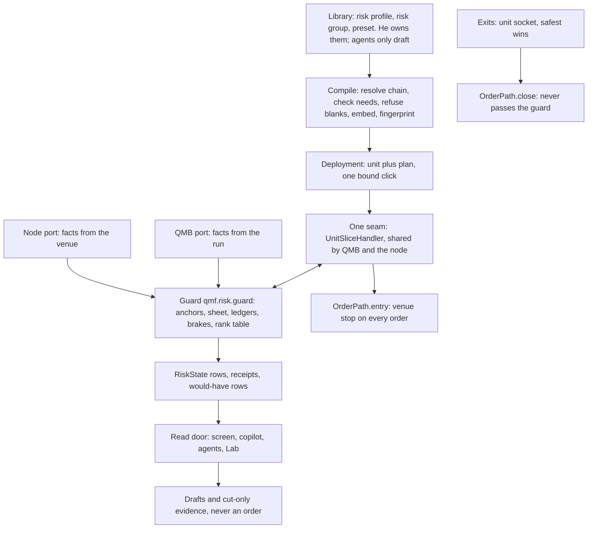

# Risk-and-sizing template: candidate 2 (refresh at anchors, brakes in one guard)

Fork sides: **F-A (b)** every derivation is recomputed at an anchor and used until the next. **F-B (a)** brakes run in one guard package above the position, with one rank table. Sim numbers are model numbers on one worked example, not evidence about a real strategy. **[judgment]** marks my opinion. **[ASSUMPTION]** marks what I inferred with no human available. Proofs and walks are in the appendices.

## 1. The shape in one page

Every number in a unit's risk is worked out once per anchor, written on one sheet, and used until the next anchor. **Anything that cuts risk acts at once. Anything that raises risk waits for the next anchor.** One package, the guard, does this for backtest and live. It sits above the position. It cannot block an exit, and it has no way to lower the kill level.



| Thing | Written by | Home |
|---|---|---|
| Profile, group, preset (spec) | he; agents draft; a click publishes | Library kinds `risk-profile`, `risk-group`, `template` |
| Risk plan | compiler | inside `CompiledUnit.plan`, fingerprinted |
| Sheet and status | guard only | journal rows `risk_sheet`, `risk_event`, `risk_state` |
| Facts | host port | `qmn/src/qmn/app/guard_port.py`, `qmb/src/qmb/host/guard_port.py` (new) |
| Sizer block, brake blocks, derivation blocks | dictionary | `qml/blocks/stdlib/<id>/<v>/` |
| Exit blocks | dictionary; bound on the unit | `exit_set`, `HostedUnit.exits` |
| Kill level | he alone lowers it | `operations.py`, `effect_matrix.py`; a fact to the guard |

**How an order flows.** (1) A bar closes. `UnitSliceHandler._step` first calls `guard.advance`, which opens any anchor that is due. (2) The unit's logic signals; its stop block gives the disaster stop. (3) `HostedUnit.enter` calls the sizer with the old four inputs plus `SizingFacts`. The sizer answers lots at level 1.00. (4) `mint_intents` passes each entry to `guard.before_order`, which applies level, taper, caps and rounding, once, and answers pass, shrink or refuse. (5) The handler rewrites `quantity`, or journals a `Skip` with its closed code. (6) The node's `OrderPath.entry` keeps its health checks and sends with the venue stop; QMB rests the intent to the next open. (7) Fills and closes reach `guard.on_event`. The unit's running loss and the group's running loss are each read once. Exits skip steps 3 to 5.

**How a number gets its value.** (1) Compile resolves its block through preset, class, instrument, unit, and refuses it with no terminal rung. (2) At each anchor of its clock, `derive_anchor` runs its derivation down the ladder: own record, pooled class, preset, refuse. (3) The value is clamped by his range and written to the sheet with a receipt. (4) Every reader reads the sheet in force. (5) He changes the value, the rule or the rung order in a new profile version; his click makes it effective at the next anchor after adoption.

**Words.** A **fact** is measured now and never chosen. A **number** has a derivation and reaches readers through a sheet. A **state** (level, bench, stand-down) moves on events and has no ladder. An **anchor** is the instant a clock or a named trigger opens a new **sheet**: every number of one scope and clock, frozen, each with a **receipt**. The **baseline** is a unit's dollars at risk per trade at **level** 1.00. A **ledger** is one running total at one scope. A **brake** trips or tapers on a ledger; a **clamp** limits one order and reads no evidence; a **gate** says yes or no from one outside reading. A **group** is the units sharing one floor and cushion: the funnel's "one portfolio config". It is a schema word only, so Book, BMS, cluster and portfolio stay open on screen until Q8.

## 2. Invariants

### AD-1 — Spec and status have separate writers
- **Binds:** parts 1, 3, 10.
- **Prevents:** a runtime value leaking into a document, or his edit racing the runtime.
- **Rule:** People and agent drafts write spec in the Library. Only the guard writes status, as journal rows. Every status row carries `generation` (compiled fingerprint, anchor id, rev). A row from another generation reads UNKNOWN.

### AD-2 — No blank number
- **Binds:** parts 1 to 3.
- **Prevents:** a placeholder or empty key reaching live.
- **Rule:** Compile refuses a number with no derivation or no terminal rung. A blank `owner: user` row compiles and blocks the live click. Every default carries a `why`. Never-self-tune rows (floor, buffer, kill line, kill level) take no input from a record, an agent or a learner.

### AD-3 — Everyone reads the sheet in force
- **Binds:** parts 3 to 7, 10, 12.
- **Prevents:** two movers, or two readers seeing two values. It is also what lets a full applier arrive with no reader changing.
- **Rule:** Only `derive_anchor`, one pure function, writes a sheet. No code outside it computes a derived number. No reader holds a sheet across an order. `Sheet.rev` exists from day one.

### AD-4 — Cuts act at once, raises wait for the anchor
- **Binds:** parts 5 to 7, 9.
- **Prevents:** re-raising into a trip, and motion between anchors nobody can explain.
- **Rule:** A transition that lowers risk (bench, level down, stand-down, shed) takes effect on its event. A transition that raises risk (level up, bench clear, stand-down expiry, dial release, press arming) takes effect at the first anchor after it is earned, at most one level per anchor. A multiplier on the sheet may read a live ledger between anchors, with shape and bounds frozen; permission to exceed 1.0 is itself a raise.

### AD-5 — Anchors are clocks plus a closed trigger list
- **Binds:** parts 3, 5, 7.
- **Prevents:** ad-hoc recompute paths, and a restart acting as a free reset.
- **Rule:** `anchor_id` is a pure function of a clock row and time, so `advance` is idempotent and a late anchor is detected. Clocks at go-live: `day` (the class's day boundary, `record.day_boundary`, `record.zone`) and `allocation` (weekly). Triggers: `his_act`, `banker_act`, `version_change`, `world_switch`, `spec_change`, `cost_alarm`, `restart_late`, `admission_change`. A trigger re-derives the affected sheet and bumps `rev`; nothing else may. N never rises under a caution or a bench.

### AD-6 — One guard package, six entry points, one seam
- **Binds:** parts 4, 7, 9, 12.
- **Prevents:** two brake paths, backtest and live disagreeing, and a collision with the repair in `runtime.py`.
- **Rule:** `qmf.risk.guard` holds every statistic, ledger, brake, anchor and the rank table. Its interface is section 3.4. Both hosts reach it through `UnitSliceHandler`; the node's tick may also call `advance`. Ports hand it immutable fact bundles. It does no I/O and imports no host, no `qml`, nothing network. It runs on the runtime thread only.

### AD-7 — Exits and the kill level are safe by type
- **Binds:** parts 4, 8, 9, 12.
- **Prevents:** any rule blocking a close, or a brake or agent clearing the one control that is his.
- **Rule:** `before_order` takes `UnitEntryIntent` only. Exit intents go to `OrderPath.close` or the amendment path untouched; a contract test runs every exit through every guard state. The `Effect` union has no variant that lowers a kill level or clears a his-resume stand-down.

### AD-8 — One rank table
- **Binds:** parts 4, 8, 9.
- **Prevents:** chance ordering on one tick, and a second arbiter.
- **Rule:** One table per group, data on the group document, on the uniqueness law in `qmf/risk/control_rank.py`. No unit may reorder it. A refusal outranks a shrink; the highest band names the reason and the rest go on the trail. A new row picks a band and never renumbers.

### AD-9 — One live reader per ledger per scope
- **Binds:** parts 4, 7.
- **Prevents:** April's stack coming back by accident. Near a loss, two readers multiply to almost nothing.
- **Rule:** A registry row declares `reads_ledger` and scope. Compile refuses a second `mode: live` row on the same pair; shadow rows are free. The running loss is read by the unit bench at unit scope and by the pair's taper-into-stop at group scope. The sizer reads no realised loss between anchors.

### AD-10 — Tail brakes enforce, timing brakes shadow
- **Binds:** parts 4, 7, 12.
- **Prevents:** a first live unit with no brake, and an unproved brake choking a healthy one.
- **Rule:** `brake_class: tail` may bind from day one, with a card saying "tail, timing unproven". `brake_class: timing` ships `mode: shadow` until the pooled report passes. A shadow row writes `would_have` and can never change an answer. A mode change is a version with his click.

### AD-11 — Size-only changes keep R; a moved exit is a counted try
- **Binds:** parts 1, 11.
- **Prevents:** a record lost on every risk change, or an exit change hiding inside a "size" version.
- **Rule:** `qml/identity/table.py` gains `profile_sizing_change` (same unit, logic record continues, new money record, click) and `profile_exit_change` (same unit, counted try, click). `exit_set` stays on the unit document. `_cold_reason` compares a new `logic_fingerprint`, so a sizing-only version keeps logic state.

### AD-12 — R is gross, `net_r` sits beside it
- **Binds:** parts 5, 7, 8.
- **Prevents:** two meanings of one word, as in `r_after_costs`, which holds gross today (`unit_handler.py:724`).
- **Rule:** R is the planned loss at the disaster stop, gross. `net_r` is realised money over planned risk with costs in. Brakes, ledgers, the gate and logic motion read `net_r`. `trade_r` and the judge read gross. Drift keeps both streams. Our call; his B9 reservation stands.

### AD-13 — A stop is an absolute level at every internal seam
- **Binds:** part 8.
- **Prevents:** the wrong-side stop (`abs(entry - new_stop)`, N `runtime.py:1320`) and two sign conventions.
- **Rule:** Units, intents, journals and the guard carry an absolute stop price. Only the venue encoder derives a distance, signed by side. Stops only tighten. Every live entry carries a venue-resident stop.

### AD-14 — Backtest and live differ only in named facts
- **Binds:** parts 4, 12.
- **Prevents:** silent drift between QMB and the node.
- **Rule:** The same guard, handler and blocks run in both. A fact that differs carries a label on the row (`sqs:bar_sampled`, `basis:unmarked`, `cost:uncalibrated`). One conformance tape runs through both ports in CI and must give the same verdicts.

### AD-15 — Agents read, run and propose; never act
- **Binds:** part 12.
- **Prevents:** any agent path to money, a raise or the kill level.
- **Rule:** Every operation declares a direction: `read`, `run`, `propose`, `cut`, `raise`, `money`. Agents get the first three, plus `cut` only through evidence: a fact, read only through an `accepts_evidence` row, cut only, expiring, neutral when missing. No surface writes a sheet.

### AD-16 — The total choke budget blocks shipping
- **Binds:** parts 7, 12.
- **Prevents:** a handbrake with better paperwork.
- **Rule:** The harness runs a healthy unit through every binding factor. Under 0.75 of baseline fails CI for any change touching a factor. A cap binding on more than 90 % of trades is a defect.

### AD-17 — A restart changes nothing a brake can see
- **Binds:** parts 4, 7, 10.
- **Prevents:** a reset anchor acting as a hidden accelerator.
- **Rule:** `Guard.recover` folds journal rows and broker deals, in deal order, before any entry. Until it finishes, and whenever facts are past `risk_fact_staleness_limit`, `before_order` refuses with `guard_unavailable` and the word is UNKNOWN. Exits are unaffected.

| Convention | Rule |
|---|---|
| Money | `Decimal`, loss currency USD, conversion read live with a freshness limit |
| Reasons | The guard answers `ReasonCode`; a test holds every value inside `REASON_CODES`. `Skip` gains `code`, so no brake files as `kill_switch` and QMB stays strict (R15) |
| Scope keys | `all`, `account:`, `deployment_id:`, `instrument:`, plus `class:`, `region:`, `currency:`, `underlying:`, `session:` |
| Levels | Strictest wins across scopes. Down the levels as caps and states, up as events. A child in the chain may only tighten a cap |
| New schema field | run, refuse or label, by census (`qml/tests/test_unit_refuses.py:457`, and one more for the two new schemas) |
| Windows | No signals, forks or POSIX paths. `tzdata` pinned in `qmf-risk`: Windows has no system time-zone database. The guard keeps no file; journal rows are its store |

## 3. Contracts

Paths are at tip J unless marked. Names were read from code on 6 Nov; the repair is still moving them.

### 3.1 The risk profile document

```python
class RiskProfile:                       # qml/src/qml/risk/profile.py; "qmx.risk-profile/1"; unknown fields refused
    profile_id: str; version: int; preset: Pin | None
    chain: Mapping[ChainKey, str]        # go-live: preset, class, instrument, unit. Reserved, resolve to parent:
                                         # style, bucket, venue_account, market, timeframe, session, event
    sizer: Pin                           # default money-at-stop@1
    numbers: Mapping[NumberId, NumberBlock]
    exit_numbers: Mapping[NumberId, NumberBlock]   # cut, disaster stop, time; a change is a counted try
    brakes: tuple[BrakeBinding, ...]     # unit scope; group brakes sit on the group
    accepts_evidence: tuple[EvidenceRow, ...] = ()
    packs: tuple[Pin, ...] = ()          # more than one refuses packs_not_built
    suggestions: tuple[object, ...] = () # later; non-empty refuses suggestions_not_built

class NumberBlock:
    measure: Measure; level: Literal["unit", "group"]
    owner: Literal["self", "measured", "user"]   # x1_changed_by_class; user = never-self-tune
    range: Range | None                  # his bounds: VPA minAllowed, maxAllowed
    cautious: Literal["down", "up"]      # where a failed rung moves
    authority: Literal["off", "at_anchor"]       # off = computed, shown, unused.
                                         # at_flat, at_period_open, live refuse authority_not_built
    clock: Literal["day", "allocation", "card", "never"]
    derivation: Derivation

class Derivation:
    rule: Pin                            # dictionary entry, component_type "derivation"
    params: Mapping[str, NumberId | Decimal | str]   # may name other numbers; compile checks no cycle
    ladder: tuple[Rung, ...]             # tried in order; the last is preset, user or refuse
    max_step: Decimal | None = None      # largest move per anchor
    guard: ValueGuard | None = None      # what must hold; a trip drops a rung; freeze after N trips
    why: str                             # the default's reason, in his words

class Rung:
    source: Literal["own_record", "pooled", "card", "class_default", "preset", "user", "refuse"]
    group: str | None = None; min_count: int | None = None; shrink_k: int | None = None; value: Decimal | None = None
```

Status is never in the document. The guard folds it from journal rows. R22's file under `data/deployments/<id>/` keeps logic block state only.

```python
class Receipt:
    rule: str; rung: str                 # "own_record" | "borrowed:<group>" | "card" | "preset" | "user"
    inputs: Mapping[str, str]; reason: ValueReason; prior: Decimal | None
    labels: tuple[str, ...]              # basis:unmarked, cost:uncalibrated, stale_so_default, frozen_after_trips

class Resolved:
    value: Decimal | str; receipt: Receipt
    low: Decimal | None = None; high: Decimal | None = None   # empty at go-live; a learner fills them
    would_be: Decimal | None = None      # authority off

class Sheet:                             # journal kind risk_sheet
    scope: str; clock: str; anchor_id: str; rev: int; cause: AnchorCause
    opened_at: Instant; generation: str; values: Mapping[NumberId, Resolved]

class UnitStatus:                        # folded; never in the Library
    generation: str; sheets: Mapping[str, Sheet]; dial: Literal["zero", "low"]; press_armed: bool; word: Word
    level: LevelState                    # index, top_lock, lock_until, earned_up, cohort_n, cohort_r, cusum, warnings
    bench: BenchState                    # state, until, strikes
```

The group document, `qmx.risk-group/1`, holds `group_id`, `version`, `display_name` (his screen word), `parent` (reserved; non-null refuses), `clocks`, `numbers`, `brakes`, `rank`, `bet_key_rule`, `shed_rank` and `once_rules` (his signed rules for Q4 and Q6). The deployment carries both documents beside `unit_document` (`qmx_host/promote.py`, `_deployment`).

### 3.2 The registry row

A row is a `guard` section on the dictionary entry (`entry.json`), so a new part is one folder.

```python
class RegistryRow:
    kind: Literal["brake", "clamp", "gate", "accelerator", "derivation", "scope_key"]
    brake_class: Literal["tail", "timing"] | None; scope: Literal["unit", "group", "account"] | None
    reads: tuple[FactName, ...]          # compile: needs inside guard.PROVIDES, or a named fallback
    reads_ledger: LedgerKey | None       # AD-9
    produces: NumberId | None            # a sizer base produces baseline_risk_usd
    verb: Literal["refuse", "multiply", "cap", "trip", "raise"] | None; rank_band: int | None
    mode: Literal["shadow", "live"]      # "ramped" reserved
    fail_mode: Literal["closed", "open", "neutral"]
    numbers: tuple[NumberId, ...]; restore: Pin | None   # retry-then-lockout at go-live; probes plug in here
    reason_codes: tuple[str, ...]; growth_cost: str      # the declared cost, shown on the card
```

```yaml
unit-money-bench@1:   {kind: brake, brake_class: tail, scope: unit, reads: [unit_net_r_window], reads_ledger: unit_money,
                       verb: trip, rank_band: 300, mode: live, fail_mode: closed, restore: retry-then-lockout@1,
                       numbers: [money_brake_percentile, money_brake_window_trades, money_brake_dollar_clamp]}
horizon-floor-odds@1: {kind: derivation, produces: baseline_risk_usd, reads: [committed_cushion_usd, result_spread_r,
                       trade_rate, book_swing_factor, floor_touch_tolerance, survival_horizon_days], mode: live}
class:                {kind: scope_key, reads: [record.instrument_class], fail_mode: closed}   # value "class:fx"
```

A brake block keeps the existing `HaltInstance.update(evidence) -> Halt | None` (`qml/blocks/api.py`), now hosted by the guard. Its face declares fact ports; `stream_kind: "risk"` joins `HOST_FACTS` (`qml/catalogue/datalevel.py:71`). The host passes the guard a block factory, so `qmf-risk` stays free of `qml`.

### 3.3 The sizer socket

Today: `equity`, `entry_price`, `stop_price`, `record` (`qml/protocol/unit.py:785-793`), and `Size(lots, skip_reason)` (`qml/blocks/api.py:105-108`). **A sizer base is a derivation, not a socket.** The sizer block only turns dollars at risk into lots.

```python
class SizingFacts:                       # new surface sizing:<market>, added in UnitSliceHandler.read_surfaces
    risk_usd: Decimal                    # sheet.baseline_risk_usd x (anchor cushion - open risk now) / anchor cushion
    cost_per_lot_usd: Decimal            # round trip plus stressed slippage, this instrument and hour
    usd_per_quote: Decimal; conversion_age_ns: int   # fixes USDJPY; a stale conversion answers a skip
    sheet: SheetView                     # .value(id), .receipt(id): any number the block declares in needs
    labels: tuple[str, ...]

class Size:                              # widened; old callers read lots and skip_reason
    lots: Decimal | None; skip_reason: str | None = None
    wanted_lots: Decimal | None = None   # unrounded, at level 1.00; every later factor applies to this
    risk_usd: Decimal | None = None; residue_r: Decimal = Decimal(0)
    reads: tuple[str, ...] = ()          # replaces the literal receipt at unit.py:827-830; goes in SizerReceipt
```

`money-at-stop@1`: `wanted = risk_usd / (abs(entry - stop) * value_per_point * usd_per_quote + cost_per_lot_usd)`. `/sizer/inputs/<port>` stays refused: a sizer reads no other block. A sizer stays one call at entry (G12 guess 8 accepted).

### 3.4 The guard

```python
class Guard:                             # packages/qmf-risk/src/qmf/risk/guard/
    @classmethod
    def recover(cls, plan: GroupPlan, rows: Iterable[Row], facts: AnchorFacts) -> Guard: ...
    def advance(self, now: Instant, facts: AnchorFacts) -> tuple[Effect, ...]: ...       # idempotent per anchor id
    def sizing_facts(self, unit: UnitKey, market: str, facts: OrderFacts) -> SizingFacts: ...
    def before_order(self, intent: UnitEntryIntent, open_positions: Sequence[OpenRisk],
                     facts: OrderFacts) -> Pass | Shrink | Refuse: ...                   # pure on state and inputs
    def on_event(self, event: Fill | Close | Deal | BankerAct | HisAct) -> tuple[Effect, ...]: ...
    def state(self, scope: str) -> RiskStateRow: ...

class Pass:   lots: Decimal; trail: tuple[Step, ...]
class Shrink: lots: Decimal; code: ReasonCode; binding: str; trail: tuple[Step, ...]     # a cap or the taper bound
class Refuse: code: ReasonCode; detail: str; trail: tuple[Step, ...]
Effect = RaiseStandDown | ClearOwnStandDown | Row | Card | Push    # nothing lowers a kill level
```

This replaces `CrossUnitHook` and `PASS_EVERY_ORDER` (`qml/blocks/api.py:198-218`) and `OrderPath.cross_unit_hook` (N `runtime.py:1065-1069`, called at `:1006`). `Runtime.guard` (N `:2531`) stays as the node's health check. The call site is `UnitSliceHandler.mint_intents` (`qmb/host/unit_handler.py:484`), which both hosts run, because `NodeUnit.mint_intents` delegates to it. A port applies effects: on the node, `Runtime.stand_down` and the journal. A self-clearing trip uses one new `Kind.RISK_RULE`. A lockout or halt uses `Runtime.risk_stop` (N `:2602`), which gets its first producer and keeps waiting for his resume.

**Inside `before_order`,** on `wanted_lots`:

1. Refusals, named by rank: kill level and stand-downs at every scope of this unit; benched or locked; guard available, facts fresh, approval valid; SQS, news, admission.
2. Multiply: level, then the pair's taper on the group day ledger.
3. Raises, only if nothing above is active and the raise gate passes: dial (released by the e-meter's bar under his once-rule), press.
4. Caps, smallest wins: bet key, cushion clip, per-trade worst case, sanity band, margin, order rate, stop side.
5. Round down. Under one lot: `below_min_lot`.
6. Shadow rows run on the same inputs and write `would_have`. The answer does not change.

**The fact set.** A port builds `OrderFacts` per call and `AnchorFacts` per anchor.

| Fact | Node source | QMB source | If missing or stale |
|---|---|---|---|
| `balance` | new timed re-read in `ctrader_account.py` (today once, N `:1062`) | start plus closed, `unit_handler.py:370` | refuse |
| `marked_equity` | none yet: `None` | `None` | label `basis:unmarked` |
| `deals` | R20 closes; deal money when R24 proves the fields | handler fills | price-derived, labelled |
| `open_risk` with bet key | `_mine()`, `client.stop_of` | `HeldPosition` | count at entry stop |
| `foreign_open_risk` | reconciler's not-ours positions | 0 | account numbers only (DP33) |
| `quote`, `usd_per_quote` | `venue.feed.quote` | bar bid and ask | refuse |
| `sqs_reading` | new producer on `feed_keeper.py` | bar spread, `sqs:bar_sampled` | refuse (rule text G12 section 2) |
| `calendar` | `qmn/data/news_calendar.py` | recorded strip | refuse the affected legs |
| `kill`, `stand_downs` | `level_for`, `stand_downs.blocking` | adapter table | refuse |
| `margin`, `leverage` | record; `leverageId` after G-DEMO | record | refuse |
| `cost_cell` | hourly profile, else pooled stressed default | stated profile | `cost:uncalibrated`, never refuse |
| `clock_ok` | R23 | true | refuse |
| `evidence` | feed, later | none | 1.0, neutral |

The MIS board stays outside: it keeps publishing, fails open, and the router must not place into a stand-down (his C27 question). Three fail modes show together on the preflight: board open, isolation closed, evidence neutral.

### 3.5 The rank table

```yaml
rank:                     # on the risk group; bands fixed, rows append inside a band
  100_operator:    [kill_level, flatten, pause]
  200_protection:  [disaster_stop, protection_close, forced_flat]
  300_tail_brake:  [day_stop, unit_bench]
  400_health:      [guard_unavailable, feed, clock, reconcile, approval]
  500_gate:        [sqs, news, cost_gate]
  600_cap:         [bet_key, cushion_clip, per_trade_cap, sanity_band, margin, order_rate, stop_side]
  700_multiplier:  [level, taper]
  800_accelerator: [dial, press]
  exit: [kill_close, risk_close, disaster_stop, thesis_fi, backstop, time, target, trail]
```

Refuse beats shrink. Caps: smallest. Multipliers: product, each on its own ledger. Band 800 acts only with everything above clear. `exit` is read by the pure `safest_exit(answers, rank)` from `HostedUnit.exits`: closes beat amends, safety beats strategy, the tightest stop wins among amends. Compiler slot order decides evaluation order only (the funnel's sub-choice).

**Kill levels** (`PLACEHOLDER_KILL_EFFECTS`, `effect_matrix.py:137-146`, renamed): YELLOW no new entries at scope. ORANGE adds cancel resting; amends tighten only. RED closes this node's positions at scope (`_close_scope`). BLACK closes everything and pauses; only his hand resumes. **[judgment]** While the node sends market entries only, YELLOW and ORANGE act alike. I show both and do not pretend otherwise.

### 3.6 The exit socket

This answers "agree the socket with it first". G12's guesses 1, 2, 3 and 8 are accepted.

```python
class PositionFacts:                     # OwnPosition (unit.py:130-138) stays; this is what an exit reads
    position: OwnPosition; stop_held: Decimal; stop_at_entry: Decimal; targets: tuple[Decimal, ...]
    bars_held: int; mae_r: Decimal; mfe_r: Decimal; realized_r: Decimal
    side_price: Decimal                  # bid for a long, ask for a short

class CloseAnswer: mechanism: ExitMechanism; fraction: Decimal = Decimal(1); detail: str = ""
class AmendAnswer: new_stop: Decimal; mechanism: ExitMechanism     # absolute level, AD-13
ExitAnswer = CloseAnswer | AmendAnswer | Signal | Decimal | None   # Signal keeps time-exit-bars' reason code

class ExitMechanism(StrEnum):
    STOP; FI_CUT; THESIS_FI; BACKSTOP; BREAKEVEN; TIME; SIGNAL; TARGET; TRAIL
    FORCED_FLAT; KILL_CLOSE; RISK_CLOSE; LIQUIDATION; ROLL; HAND; UNKNOWN
```

**Step 2, about 60 lines plus tests.** `HostedUnit.exits` builds `PositionFacts` and feeds every per-bar exit. `timer()` passes the side. Several per-bar exits may run; answers go through `safest_exit`. Only `CloseAnswer(fraction=1)` and `Signal` map to an intent (`close_full`). R10's MAE and MFE (`unit_handler.py:249`) move into `PositionFacts`.

**The disaster stop.** A unit's `ExitUse.STOP` is the disaster stop: venue-resident on every live entry; `require_venue_resident_protective_stop` stays. R is measured to it. A scalper's working exits (cut, thesis, time) are per-bar closes above it. Its distance is a number with a derivation. The cut is a counted two-arm trial per unit, with its level from the winners' MAE: the harness's first job (F1).

**Step 3, about 250 lines, waits for the signed stop.** It lifts `AmendAnswer` and `fraction < 1`, maps them to `amend_protection` and `close_partial`, and replaces R21's `Blocked` (N `runtime.py:1278-1287`). It ships when the venue encoder takes an absolute level (AD-13), R21 restores a lost stop from the latest accepted amend row rather than the send row, and R24 says what the venue holds. Trails are shadow catalogue entries until then.

**The trade row** (`qmb/results/journal.py:412`, `ClosedTrade`) adds `exit_mechanism`, `r`, `net_r`, `cost_r` split into spread, commission, swap and slippage, `mae_r`, `mfe_r`, `bars_held`, `profile_version`, `level_at_entry`, `labels`. `r_after_costs` goes. Guard ledgers read deals, not trade rows, so the record holes (`S/BACKLOG.md:64,66`) cannot hide a loss from a brake.

### 3.7 The RiskState row

```python
class RiskStateRow:                      # journal kind risk_state; on change, plus heartbeat risk_state_emit_interval
    scope: str; at_ns: int; generation: str; anchor_id: str; rev: int
    word: Literal["WRONG", "RIGHT", "WORKING", "UP", "ON", "TRADING", "UNKNOWN"]   # stale reads UNKNOWN
    state: Literal["ACTIVE", "REDUCING", "BENCHED", "HALTED", "RESTORE"]           # computed, never stored
    equity: Mapping[str, Decimal | None]; basis: str          # realized, marked, venue
    cushion: CushionRow; sigma: SigmaRow                      # committed, reserve, floor, buffer, kill_line_distance; budget, sized
    open_risk_usd: Decimal; open_risk_by_key: Mapping[str, Decimal]; budget_used: Decimal
    ledgers: Mapping[LedgerKey, Decimal]; level: Decimal | None; units_admitted: int; units_shed: tuple[str, ...]
    kill: KillRow; drift: DriftRow                            # requested, enforced, observed
    brakes: tuple[BrakeMeter, ...]                            # id, mode, class, state, distance_to_trip, fires, would_have_fires
    binding_clamp: Mapping[str, int]; placeholders_live: tuple[str, ...]; fail_modes: Mapping[str, str]
```

Register `risk_state` and `risk_sheet` beside `risk_event`, `guard` and `would_have` (R `journal_kinds/unit.py:179-181`). The screen, copilot, agents and Lab read one fold.

### 3.8 The agents' surfaces

Rows in `qmx_control/catalog.py`. **QMA flag:** `direction` is a new catalog field beside `Approval`, CI fails a row without one, and `admits` must read it. This session flags it and does not design it.

| Operation | Direction | Approval today |
|---|---|---|
| `risk_state`, `risk_explain`, `risk_ledger_query`, `risk_placeholders_list` | read | `read` |
| `risk_profile_check`, `derivation_preview`, `risk_resize_replay`, `risk_scenarios_run` (same guard on a replay port) | run | `read` |
| `risk_profile_new` (a draft; a card and plan on save) | propose | `domain_write` |
| `risk_evidence_put` (expiring; the unit's `accepts_evidence` row decides) | cut | `domain_write` |
| `risk_card` for a loosening (only his click acts) | raise | `propose_money` |
| promote, resume, kill-lower, once-rule sign | money | operator only, never an agent |

The fast loop waits for no model. A dead agent changes nothing. On demo, agents' cTrader order tools stand by his ruling; the guard counts what they open as `foreign` (DP33, flag).

### 3.9 Compiler refusals and the format bump

`COMPILER_FORMAT_VERSION` is 4 (`compiler.py:100`). I expect three bumps, on whatever number the repair has reached: exit step 2, the risk plan, exit step 3. Nothing is live, so a cold start costs nothing.

| Refusal | Where | At go-live |
|---|---|---|
| `exit_not_built`: per-bar with inputs; a second per-bar | `_exit_gap` `:358-363`; `:492-495` | **lifted** for position facts and whole bars; one stop stays |
| Six refused exits | by shape, `:361-362` | three close-only run as shadow catalogue; three trails wait for step 3 **[ASSUMPTION: read by name; check shapes at build]** |
| `stop_not_built` | `:500-506` | stays; a profile's disaster stop block satisfies it |
| `halts_not_built` | `:902-903` | **stays**, message names the profile. This is what F-B (a) saves |
| `inputs_not_built`, sizer | `:930-936` | stays; a `risk` port is a host fact, not a reference |
| `open_positions_not_built` | `:996-1000` | stays (hand-off 8) |
| `reads_`, `sessions_`, `limit_not_built`; `sizing_modifier`; logic `motion_not_built` | `:900-910`, `:959-961`, `:107-117`, `:1003-1007` | stay |

New: `risk_profile` on `Unit` (census row). A unit with no profile runs in QMB and paper; the live click refuses it. New refusals: `authority_not_built`, `packs_not_built`, `suggestions_not_built`, `needs_not_met`, `two_live_readers`, `number_blank`, `rank_band_unknown`. `Authority.MOTION_INSIDE_RANGE` stays as the label on logic numbers.

## 4. The forks, argued

### F-A (b): refresh at anchors

**Why it fits.** "How does it self configure" and "what if I want to change the way it is derived" are answered by the document and the receipt, not by an applier. Refresh has one writer, one trigger list and nothing moving between anchors to explain. `core_sim.py` already sizes this way: the funnel's own numbers are refresh numbers.

**How it grows into the full learner and applier with no rework.**

| VPA part | Go-live | Later | What changes then |
|---|---|---|---|
| Recommender | a derivation returns value and receipt | it also fills `Resolved.low`, `high` from a decayed record | new derivation pins; fields exist |
| Status | `Sheet` in journal rows | same | nothing |
| Modes | `off`, `at_anchor` | `at_flat`, `at_period_open`, `live` | lift `authority_not_built` per mode; a format bump; old profiles stay valid |
| Updater | `apply_at_anchor(prev, derived)`, one function | new triggers `flat`, `recommendation`; dead band, share cap | that function, three rows from `ledger-merge.yaml`; each move bumps `rev` |
| minAllowed, maxAllowed, per-field off | `range`, `owner`, `authority` | same | nothing |

No reader changes, because every reader already takes the sheet in force (AD-3). Numbers opt in one at a time. The harness needs mid-period revisions, a small change. What I would call real rework if it comes: a per-direction `behavior` block replacing `max_step`, and motion frozen while a canary judges (which needs the canary first).

**What it gives up against the model he liked. Plainly:**

1. A learned number cannot move between anchors. It can be up to a day stale. Triggers cover outside changes, not a number whose evidence simply improves at noon.
2. He gets two of VPA's modes: Off, and something like Initial once a day. No InPlace.
3. No band. He sees a value, a rung and a sample count, not "between 0.8 and 1.1". The edge band is the one exception.
4. Everything moves together. One bad balance read at the anchor touches every number at once, where VPA moves pods one at a time under a disruption budget. My hedge: a failed fact keeps the old sheet and raises `guard_unavailable`; `max_step` caps the jump; the derivation guard freezes.
5. No per-number stabilisation. "Size down slowly" lives in states and `max_step`.
6. No herding guard, because nothing herds yet. Synchronised anchors are a herd by construction, of sizes rather than trades.

**The measured price** (model; detail in Appendix B). Raises waiting: size 0.89 either way at N = 10, 10 a day; 0.91 against 0.92 at 40 a day. X4-39: same lag money at 10 a day, because a 20-fill estimate takes two days in either arm; at 40 a day, N = 1, twice the applier's ($45 against $23, $88 against $45), about 1.5 to 3 % of median equity; at N = 10, mixed. The `cost_alarm` trigger closes this by construction, not by a run. X4-60: no difference, because level steps are states. Strict "one more period of delay": half-cushion runs on the bleeding book rise from 27 % to 34 % at N = 10, so evidence up to an anchor is in force from that anchor.

**What would make (a) win.** Lag money above about half a sized day sigma per broker cost event on real fills. Slow units whose natural anchor is weeks. A measured gain from a number moving inside a day, which R9 says does not exist on independent trades and QMX's own streams might overturn. Or he looks at the card and wants the band; that is the cheapest to grant, and it can ship with refresh.

### F-B (a): brakes in one guard

**Buys:** one rank table; backtest equals live for every brake above the position, through one call site instead of a compiler feeding account and trade ports to logic slots (R05's `binding_not_read`); one fewer compiler lift; units that see each other. **Gives up:** a unit carries its brake blocks in its plan, so it stands alone in what it means, but a host needs a compatible guard to run them. A guard bug hits every unit at once; the hedge is fail-closed entries, untouched exits and the conformance tape. It is the biggest build item. **(b) would win** if units ran on hosts with different guard versions for long stretches, or on a third-party host. Today one node owns an account and both hosts ship from one lockfile, so **[judgment]** (a) wins clearly.

### Three places I changed the funnel's picks

1. **DP9's level-weighted B cannot work as written.** Read literally, B is `sqrt(sum l_i^2 + rho sum l_i l_j)`. At N = 1 that is `l`, so size is `D/(s z sqrt(H) l) x l`: **the level cancels itself**, and likewise whenever all units share a level. `core_sim.py` never ran it; it uses flat B. In my runs it lifts a bleeding unit from 0.71 to 0.93 of baseline at N = 1 and half-cushion runs from 27 % to 39 % at N = 10. **Replacement:** freed swing goes only to a unit already at level 1.00, counting the others at their levels; a unit below full stays on flat B. Default `book-swing-freed@1`, flat as its cautious rung when any unit has a warning (that rung is not simmed). A mixed book of 2 healthy and 8 thin gains about 16 % in median at no half-cushion cost. At 2 trades a day it costs (overstated half-cushion runs 11 % to 27 %), so slow units stay flat until the harness says otherwise. **[judgment]**
2. **The sized sigma alone does not make the day stop fire.** F26 moved it there, but k 2.5 still fires 0.00 to 0.06 times per 100 days; k 1.5 fires 1 to 3.6 times and cuts an X4-14 day's loss from 12.8 % to 7.9 % of the morning's cushion for about one point of size. So k gets a derivation aimed at the group's own p1 day from the units' cards, with 1.7 as the preset rung. The numbers lens still owns the target.
3. **Targets rest at the broker** where the venue holds them, against DP26's "node-closed stands". See hand-off 6.

## 5. The extension proof

All ten walks are in Appendix A. **Nine need no guard code and no compiler change; a new instrument class needs venue work outside this design.** Two findings changed the design: the press broke my first "raises wait" rule (fixed in AD-4), and a new `Kind` per brake would have been rework (fixed with one `Kind.RISK_RULE`). Admitted: a brake reading a truly new statistic is one provider in the guard and two port lines.

## 6. The performance proof

Appendix B. **A healthy unit runs at 0.89 to 0.90 of baseline at cost x1 and 0.79 to 0.81 at cost x1.5, above the 0.75 budget; floor touches 0 % in every cell.** Not fixed: a bleeding book of many units loses half its cushion in about a quarter of runs at N = 5 and 10.

## 7. The scenario walks

Appendix C: X4-01, X4-14, X4-66, a mid-outage restart, plus X4-39, X4-60, X4-62, X4-72. All meet their bar in the model. Stated gaps: re-entry into the same driver after stops (X4-01), and the bleeding book (X4-66).

## 8. The hand-offs

| # | Item | Answer | Status |
|---|---|---|---|
| 3 | Stop past entry | In scope at step 3, momentum families only, tighten only, absolute level. R21's block stays until then. Not needed for the first unit | decided; R24 fact |
| 4 | Stop widening | Never. The law at `unit_intent.py:720` stands; the placeholder swing stop goes | decided |
| 6 | Target at the broker | **Rest it at the venue** where the venue holds it: `relativeTakeProfit` beside `relativeStopLoss` (`ctrader_account.py:12`); `protective` keeps its broker-closed branch (N `:1757`); node-closed stays as a labelled fallback. The hard line says backtest and live run the same rules, QMB may not change, and a wicked bar reads +2.00R against -0.55R today (`seams-7`). DP26 kept node-closed; I disagree. **[judgment]** | decided; R24 fact |
| 7 | A unit with no stop | No *working* stop is allowed; a disaster stop always goes to the venue, its distance from the tail of realised losses | decided; value waits |
| 8 | Moved number, open trades | Open trades keep their entry stamps (`HeldPosition.entry_stamps`). `applies_to_open_positions: true` stays refused | decided |
| 9 | Two exits on one bar | `safest_exit` on the rank table | decided |
| 5 | Partial close and R | R stays the planned loss; realised R piecewise (`realized_r`); a remainder under the minimum lot closes with the partial; QMB's differing fill is a stamped field. Ships at step 3 | decided |
| 22 | R and costs | AD-12. Our call; B9 stands | decided |
| 23 | Kill level meanings | Section 3.5. May the day stop raise a level: Q5, default no, card only | decided; Q5 his |
| 24-26 | Refusal count, unplaceable protection, kill line | A number. Close, as built. No new entries at the buffer; automatic reduce is Q1b | values wait; Q1b his |
| 27 | Where SQS sits | **In the guard, band 500, entries only.** Not one line in `Runtime.guard`. Rule text of `decision_root.py:493-510` unchanged, in `guard/spread.py`. Producer on feed-keeper quotes and R19's minute rows. Eight settings derive from the spread histogram's own percentiles. DEC-0230 stands, so **the first live entry waits hours for a live-account baseline; the packet says so** | decided; values wait |
| 34 | `too_thin` | `presets.py:45` `min_trades=100` becomes `verification_trades_needed` at the band's low end, with an incubation cap, read from the card | decided; value waits |
| 35 | Version pull | A sizer-only swap trades the same R and pays the pull; correct. An exit change is a counted try. Re-read once R11 lands | decided |
| 36, 37 | Rules hold on a real run; check with no orders | Never claimed by a stack list. No orders ends `inconclusive` | decided |
| 1, 2, 10, 12, 14 | Socket, six exits, facts, `timer()`, bid bars | Section 3.6 | decided |
| 11, 13 | Wicked-bar stop; lost stop | Refused at `enter` and at send. Latest accepted amend row, at step 3 | decided |
| 15-20 | USDJPY, costs, receipt, wrong side, socket tests, real risk | Sections 3.3, 3.4. Contract tests run long and short through two adapters per slot. Gap to planned risk on the row as `residue_r` | decided |
| 21 | Metal margin | Account leverage until `leverageId` is read; clamp labelled | waits for G-DEMO |
| 28-33 | Halts, stats, hook, row fields, Book, grids | Sections 3.2, 3.4, 3.7. Guard holds the bet-key ledger; Book against tags is Q8. Grids refused at preflight | decided; Q8 his, later |

I proceed on the funnel's stated defaults for Q1 to Q8. None blocks the build. Q7's pushes need his word before they exist.

## 9. The build plan

**38 PRs, [judgment] 34 to 42,** above the funnel's 25 to 35: SQS, news and facts are real slices, and I counted harness work honestly. The fork saves about three against an applier. Nothing lands on an unlanded tip.

| Slice | PRs | Main files | Needs landed | Collides with |
|---|---|---|---|---|
| A. Exit step 2; trade row, `net_r`; cut block, two-arm trial | 3 | `qml/protocol/unit.py`, `blocks/api.py`, `compiler.py`, `unit_handler.py`, `results/journal.py`, `journal_kinds/unit.py` | R04-R06, R10, R15 | R15 journal; rebase after it |
| B. Guard core and seam; delete the hook | 2 | `qmf/risk/guard/*`, `unit_handler.py:358,484`, N `runtime.py:1006,1054`, `api.py:198-218` | R15, R21 | R15 said leave the hook; this ends it |
| C. Facts: balance re-read, open risk, deals, bet keys | 3 | `guard_port.py` x2, `ctrader_account.py` | R20, R21, **R22** | R22 rewrites `_host`, `_authorise`; go after |
| D. RiskState, words, codes, risk-stop filing | 2 | `guard/state.py`, `journal_kinds/`, N `stand_down.py:194`, N `operations.py:918,923` | R15, R23 | R23 clock row |
| E. Document, presets, compile, census, deploy | 3 | `qmx_library/kinds/risk-*.schema.json`, `qml/risk/*`, `compiler.py`, `promote.py._deployment` | **R17** | R17 `_admit`, `_leave`; other methods |
| F. Anchor, sheet, recover, first derivations | 2 | `guard/anchor.py`, `stdlib/*` | B, C, E | none |
| G. Sizer and rip-out; admission, feasibility, shed | 3 | `money-at-stop/1`, `horizon-floor-odds/1`, `book-swing-freed/1`, dummy template, `identity/table.py` | F, R11 | R11 |
| H. Climb, drift, bench | 3 | `guard/level.py`, `unit-money-bench/1`, `retry-then-lockout/1` | F | none |
| I. Pair, day stop, clip, clamps, press in shadow | 3 | `guard/ledger.py`, `stdlib/*`, `stand_down.py` | F, C | none |
| J. SQS | 2 | `guard/spread.py`, move `sqs_baseline_producer.py`, `labelers.py:338-650` rule, `registry_catalog.py:158-241`, `feed_keeper.py` | R19, before C-20 | C-20 |
| K. News; kill table; scope keys | 2 | `guard/news.py`, `news_calendar.py`, `windows.py`, `effect_matrix.py`, N `operations.py:78` | before deletion-4 | R21 kill path |
| L. Harness: integrated sim, three cases, dry chassis, scenarios, choke test | 3 | `qmb/src/qmb/risk_harness/*`, `ReplayPort` | B, G, H, I, R10 | none |
| M. Machine check, bound click, two records, preflight | 3 | `promote.py`, `identity/table.py`, `presets.py:45` | R17, R18, L | R17 |
| N. Shadow rows; morning card; wake contract; pushes on his word | 2 | `stdlib/*`, alarm register | R16, Q7 | R16 closed list |
| O. Agents' door | 2 | `qmx_control/catalog.py` | D, L | QMA flag |
| P. Target at the venue | 1 | N `runtime.py:1057`, `ctrader_account.py` | R24 | R21 |

**Not counted:** exit step 3, two more PRs after R21's block lifts and R24 reports. **Order:** A → B → C → D, then E → F → G, then H and I in parallel, then J, K, L, then M, N, O, P. The F1 trial runs as soon as A lands, on bare QMB, and can change G's first preset.

**Unknown until his demo sign-in** (R24): whether a fill carries the stop, deal fields, a close on a gone position, real slippage and commission, the resting target. **A go-live dependency the funnel does not list:** the right bars come after G-DEMO (`PL/90-appendices.md:79`). Today every unit gets 15-minute, and R22 refuses the mismatch, so a 1-minute cut cannot run on the node before then.

**Claimed before the deletion sweep,** extending `handoff/FOR-REPAIR-CLAIMS-BEFORE-C20.md`: `qmn/data/news_calendar.py`, `qmn/protection/windows.py`, `qmn/protection/dispatch.py`, `qmn/replay/port.py` (rule text), `qmn/host/sqs_baseline_producer.py`, `qmf-readings/labelers.py` (rule), `qmf-risk/control_window.py`, `control_rank.py`, `control_action.py`, `qmn/protection/effect_matrix.py`, `qmn/config/registry_catalog.py` (SQS rows), `qmf-data/calendar_feed.py`.

## 10. Cuts and additions

**If I had to cut more,** in order: the press's shadow row; the dial and Q6; the chain to three keys; freed swing (flat B only); `risk_card`; the morning card; news's per-leg logic. I would not cut the bench, day stop, clip, SQS, receipts or the choke test.

**Added beyond the funnel, and why:** the sheet as the one thing every reader reads (how the fork grows without rework); "cuts at once, raises at the anchor" (per-direction speed from one rule); `two_live_readers` as a compile refusal (M3 as a structure, not a promise); one seam in `unit_handler.py` (keeps out of the repair's way); the `cost_alarm` trigger (the fork's main weakness, closed cheaply); `tzdata` (a Windows trap nobody listed); `group` as the schema word (leaves Q8 open); resting targets, freed-swing B and k's derivation (section 4).

## 11. Deferred, with plug points

| Later or shadow | Plug |
|---|---|
| Learner bounds, applier modes, dead band, share cap, expressions | `Resolved.low`, `high`; `authority`; `apply_at_anchor`; a generated derivation block |
| REDUCING at p10, loss points, "about three", density, chorus, burn tiers, methodology CUSUM | brake rows, `mode: shadow`. A pooled CUSUM is about 40 % faster at rho 0.3, N = 10 by arithmetic: first to test for the bleeding book |
| Probes, memory ceiling, earned restore | `RegistryRow.restore` |
| Class isolation, class caution, weekend scale, macro | brake rows at `class:`, `region:`; `Kind.RISK_RULE` |
| Kelly ceiling, cost nomogram | cap row in shadow; derivation |
| Cushion lending, shed classes, de-gross, ratchet, sweep | group rows; his base floor stays split from the lock line |
| Whole-contract ladders, inverse-volatility, carry | sizer block; derivation; cost cell fields |
| Stacked packs; seven reserved keys, tags, drop-ins | `packs`; chain values, a `tag:` scope key |
| Book or BMS as documents, cluster tags (Q8) | `risk-group.parent` |
| Trust ladder, outside code | loader signature; only signed `qml` and `human` blocks size live now |
| Canary, challenger, funded gate, rehab | rollout field on the deployment; a verification derivation |
| Marks; multi-position | `marked_equity` from `None` to a value; `position_limit`, ledgers already key on market |
| Agent jobs, mini app, Lab tenancy, department | the read and propose rows. **QMA flag** |
| Deployment, environments, node lease | unchanged from the repair; one node owns an account |

**Stack:** Python as the repo; `tzdata` new in `qmf-risk`, version at build. No other new dependency.

**Assumptions.** [ASSUMPTION] Fast path, headless; reviewer gate walked by me, since subagents are barred. [ASSUMPTION] One account, one group at go-live, so `all` equals the group. [ASSUMPTION] QMB runs one unit with N from the group's plan; multi-unit behaviour is proven in the harness. [ASSUMPTION] The first units are FX scalpers at 10 or more trades a day.

**Biggest risk.** The first scalper may not exist (F1), and the design cannot fix that. Next is build order against a moving repair: slices C, E and M wait on R22, R17 and R18, none finished as of G12.

---

# Appendix A. The extension proof

| Change | Files | Rows | Guard or compiler code | Rework? |
|---|---|---|---|---|
| **A new brake** | new folder `stdlib/<brake>/1/` with `entry.json`, `block.py` | binding on profile or group, `mode: shadow`; its numbers; one reason code | none, unless it reads a new fact (one provider, one port line per host) | no. A second live reader on a ledger is refused by design |
| **A new sizer base** | new derivation folder, `produces: baseline_risk_usd` | `numbers.baseline_risk_usd.derivation`, needs | none; sizer block unchanged | no. Whole-contract ladders swap the sizer block too |
| **A new instrument class** | venue port work; `CcxtClient.equity()` must stop answering 0 on a failed read (J `ccxt_client.py:597-601`) | class diff in the preset, day clock row, cost default, worst-step row, bet-key legs, `class:<x>` value | guard none; carry fields on the cost cell, later | venue work is real and outside this design (G-WALLET) |
| **A new style preset** | Library `template` item | bindings, derivation choices, exit family | none, unless a new exit block | no |
| **He changes how one number derives** | none | new profile version: rule, ladder or rung order | none | no. `profile_sizing_change`: record kept, plan card shows the move, click, next anchor. A number under `exit_numbers` is a counted try |
| **An agent proposes a tighter limit** | none | an evidence record, if the unit declared that kind; or a draft version for a lasting limit | none | no. Evidence applies at once, cut only, expires. A draft is a card. Neither can touch a user row |
| **The Lab simulates a variant** | none in the guard. **QMA flag:** the Lab app is unbuilt | a variant profile | same package on `ReplayPort` | no. Nothing the Lab writes is in any fact bundle |
| **A version rollout that keeps the record** | none | v2 pinned; a `would_have` sheet beside v1 for the shadow window; bound click | `logic_fingerprint` compare, built at go-live | no. Logic record continues; money record per version. The rip-out of `fixed-fraction-at-stop@1` is its first use, with a migration row |
| **Class isolation, shadow to binding** | none; shadow blocks shipped | group version: `mode: live`, after the report, his click (Q1) | none; `Kind.RISK_RULE`, scope keys | no |
| **House money's press on** | none; the shadow block computed the same `m` | proof card passes at an anchor; once-rule signed (Q4); `press_armed` at the next anchor | none | no, after the fix below |

**Findings.**

- *Press against "raises wait".* House money is intraday by nature. My first AD-4 said no raise inside an anchor, which would have made the press a day-over-day multiplier, which is just compounding. Fixed: a multiplier may read a live ledger inside bounds frozen at the anchor, and permission to exceed 1.0 is the raise.
- *New enum per brake.* `Kind` in `stand_down.py` would have needed a row per brake. Fixed: one `Kind.RISK_RULE`, self-clearing on the guard's word.
- *Admitted:* a brake reading a truly new statistic is code in the guard. Registry rows do not make new facts appear. `needs_not_met` says so at compile.
- *Admitted:* `position_limit` above 1 stays refused and ledgers key on (unit, market). Multi-position units need the bet-key and "flat" rules checked again, later.

# Appendix B. The performance proof

**One order, by hand.** $500 seed, $300 floor, eps 1 %, 20 days, 10 trades a day, FI outcomes, s = 0.861, lot step $0.50; reserve and cost share are the sim's constants, 0.85 each (`out-trace.txt`).

| Step, in order | Healthy N = 1 | Healthy N = 10 | Weak N = 1, level 0.75 | Bleeding N = 1, stepped to 0.50 |
|---|---|---|---|---|
| Cushion at the anchor | $200 | $200 | $200 | $200 |
| / (s z sqrt(H) B) | $6.37 | $1.05 | $6.40 | $6.37 |
| Reserve x 0.85 (`committed_cushion_usd`) | $5.42 | $0.89 | $5.44 | $5.42 |
| Cost denominator x 0.85 (`money-at-stop`) | $4.61 | $0.76 | $4.63 | $4.61 |
| Open risk share, live | 1.00 | at least 0.97 | 1.00 | 1.00 |
| SQS, news, admission | pass | pass | pass | pass |
| Level | 1.00 | 1.00 | 0.75: $3.47 | 0.50: $2.30 |
| Taper on the group day ledger | 1.00 | 1.00 | 1.00 | 1.00 |
| Raises | none | none | none | blocked |
| Bet key, clip, boundary, margin | pass | pass | pass | pass |
| Round down | **$4.50** | **$0.50** | **$3.00** | **$2.00** |

**Where one running loss is read.** Unit net R window: the bench only. Group day money: the taper and day stop, one rule, only. Edge stream: cohorts and CUSUM, which set the level. The cushion moves only at the next anchor. The clip reads live usable cushion as a cap: worst case, not a running total, and it binds only near the bottom. The sizer's live share reads open risk at the stops, which is exposure, not loss.

**Level-floor honesty.** At N = 10 and $200, $0.76 and $0.57 both round to $0.50, so **a step from 1.00 to 0.75 changes nothing in lots**, and the floor lifts anything lower back to 0.75 (review M9: "levels do not exist at this scale"). I tested sending such a unit to paper at once (`out-bites.txt`). It made no material difference, so I dropped it. At this scale the real cuts are the bench, the second warning to paper, and shed.

**The design against the funnel's core** (`out-final.txt`, 150 paths, 120 days; raises at the anchor, freed swing, open risk live, day stop on the sized sigma at k 1.7, taper). Size as a share of flat baseline; the core's figure in brackets.

| Case | N = 1 | N = 3 | N = 5 | N = 10 | Half the cushion lost, N = 1 / 3 / 5 / 10 |
|---|---|---|---|---|---|
| Healthy +0.10R, cost x1 | **0.89** (0.91) | 0.90 (0.91) | 0.90 (0.90) | 0.89 (0.89) | 0 / 0 / 0 / 0 % |
| Weak +0.05R, cost x1 | 0.85 (0.88) | 0.86 (0.86) | 0.84 (0.85) | 0.84 (0.84) | 0 / 0 / 0 / 0 % |
| Overstated, cost x1 | 0.80 (0.84) | 0.82 (0.83) | 0.82 (0.82) | 0.81 (0.81) | 0 / 0 / 3 / 1 % |
| Bleeding, cost x1 | 0.70 (0.74) | 0.72 (0.74) | 0.72 (0.73) | 0.72 (0.73) | 0 / 7 / 23 / 25 % |
| Healthy, cost x1.5 (true edge +0.02R) | 0.80 (0.81) | 0.81 (0.81) | 0.81 (0.80) | 0.79 (0.79) | 0 / 1 / 4 / 5 % |
| Bleeding, cost x1.5 | 0.53 (0.57) | 0.59 (0.64) | 0.60 (0.63) | 0.62 (0.64) | 0 / 3 / 11 / 21 % |

- **A healthy unit stays above the choke budget of 0.75: 0.89 to 0.90 at cost x1, 0.79 to 0.81 at cost x1.5.**
- Floor touches: 0 % in every cell. Dark time: at most 2.1 %. The structural caveat on that zero (F12) stands.
- Day stop on the healthy book: 0.2 to 1.0 fires per 100 days; on a weak one 1.0 to 1.7.
- Medians are near the core's. Healthy N = 10: $5,460 against $5,058; weak N = 10: $745 against $777. All inside the noise at 150 paths.
- **Not fixed:** a bleeding book of many units, the funnel's own open item. Ten small units lose together before any one CUSUM alarms. The pooled CUSUM (shadow) is the next test.

**Adding each factor** (`out-attrib2.txt`, 100 paths, size against flat baseline). Moves under about 3 points are noise.

| Factor added | Healthy N = 1 | Healthy N = 10 | Weak N = 10 | Bleeding N = 10 | Same, half-cushion runs |
|---|---|---|---|---|---|
| Sizer: cushion, spread, B, reserve, cost | 0.97 | 0.93 | 0.88 | 0.87 | 100 % |
| Start level from the holdout | 0.46 | 0.44 | 0.20 | 0.41 | 80 % |
| Cohort climb, raises at the anchor | 0.96 | 0.93 | 0.91 | 0.80 | 100 % |
| CUSUM step, second warning to paper | 0.93 | 0.93 | 0.89 | 0.77 | 30 % |
| Unit bench, retry-then-lockout | 0.91 | 0.92 | 0.87 | 0.75 | 28 % |
| Day stop on sized sigma | 0.93 | 0.92 | 0.88 | 0.76 | 23 % |
| Pair's taper into it | 0.90 | 0.91 | 0.86 | 0.72 | 22 % |
| Open risk deducted live | 0.90 | 0.89 | 0.83 | 0.72 | 27 % |

The CUSUM does the survival work. The bench and portfolio brakes each cost one to three points and exist for the tail. A second reading of the day's realised loss inside the sizer costs about another point and saves about one point of half-cushion runs (`out-openrisk.txt`), so AD-9 keeps it out. SQS and news remove trades rather than shrink them, so they lower the trade count, not this ratio.

**The fork's price, in full.**

- Raises waiting for the anchor (`out-fork.txt`): healthy N = 10 at 10 a day, 0.89 either way. At 40 a day, 0.91 against 0.92, median $156,855 against $177,038, about 11 % lower. **I would not trust that gap either way** at 120 paths and that compounding; re-run it first. N = 1 at 2 a day, 0.86 against 0.87.
- X4-39, cost up 1.5x or 2x overnight (`out-coststep.txt`): at 10 a day, N = 1, lag money $20 against $18 and $39 against $38. At 40 a day, N = 1, $45 against $23 and $88 against $45. At 40 a day, N = 10, $2,992 against $3,545 and $2,569 against $1,797.
- X4-60 (`out-decay.txt`): no difference at 400 or 1,200 trades of decay.
- B variants (`out-bmodes.txt`, `out-bmix.txt`): figures in section 4.

**How the sim was extended.** `anchor_sim.py` copies `core_sim.py`'s model and adds named options (its docstring lists them). Its first arm reproduces the funnel's 0.89 to 0.92 healthy and 0.83 to 0.88 weak. 100 to 200 paths per cell, 120 days. Not modelled: bet key, clip, SQS, news, margin, intraday re-sizing, serially correlated results, the demo-live gap, different trade rates across units. **The bet key is the unmodelled factor I would worry about most,** on an FX book where many pairs share USD. Its derivation must keep two overlapping positions normal, and the harness must count how often it binds.

# Appendix C. The walks

## C1. X4-01: five units lose on one USD move

N = 5, cushion $200, B = 3.32, baseline $1.39, $1.00 after lots. Sized day sigma $9.0; taper from about -$8; stop at k 1.7 about -$15.

1. Before the move: `before_order` adds each entry's risk to its bet key. The legs count: short EURUSD and short gold both load USD. Once the key's cap binds, the next entry shrinks or refuses with `bet_key`.
2. The move: each stop fires at the venue. Exits never met the guard.
3. Each unit: -1R against an own p1 near -5.3R. No bench. **No unit is benched for a streak it did not have.**
4. Group: the day ledger reads -$3 to -$5. Under the taper, far from the stop. One reading.
5. The press is shadow; its row would have stayed locked inside `loss_event_window`.
6. Next anchor: cushion about $196, baseline falls about 2 %. The group trades on.

Bar met: loss within one event's allowance, no false streak, trades next day. **Gap, stated:** "no new same-driver entries for a cooling time" is not at go-live (hours clause, shadow). Once the stops fire, open risk on the key is back to zero, so a unit may re-enter the same move. Only the taper and the day stop lean against that.

## C2. X4-14: everything bad everywhere

N = 10, sizes $0.50, sized day sigma $8.3, stop near -$14, 7 % of the cushion. The walk the review failed in M6.

1. Losses mount across classes. Each unit's bench acts at its own loss.
2. The group day ledger passes the taper start. New entries shrink. One reader.
3. It reaches k x sized sigma. The guard emits `RaiseStandDown("all", rule="day_stop", clears="next_anchor")`, a `Card` (one-tap escalation, X7-H43) and, if Q7 says yes, a `Push`.
4. Entries refuse from band 300. **Exits and venue stops run.** No position is closed by the rule (Q1b default). The kill level does not move (Q5 default).
5. Next anchor: the stand-down clears, because that is a raise and it waits for the anchor. The sheet re-derives on the smaller cushion, and the stop tightens with it. A second bad day refires at a lower dollar line.

Model (`out-kstop.txt`, an X4-14 day of edge -0.40R, N = 10): mean loss on that day 12.8 % of the morning's cushion with no stop, 7.9 % at k 1.5, for about one point of size. At k 1.5 it fires about 1.3 times per 100 days on a healthy book and 3.5 on a weak one, against his bar of about once a month and never on a normal day. **Passes in the model.** The fire rate on clustered real days is unknown.

## C3. X4-66: the backtest was overfit; the twin case

1. QMB's deflated holdout. Low end below zero: refused live. At zero: starts at 0.25. Positive: 0.50. Overfit cards should land low, since the band takes the lowest of four shrinkages.
2. Machine check passes, because the machine is fine. It never claimed the edge.
3. His packet says "proof pending, 212 of 610 trades, level 0.50, expires" and approves one hash, one level, these markets.
4. Live: bad cohorts stop the climb. The CUSUM steps one level, at once. A second warning inside 500 trades moves it to paper with `demotion_cause`. Re-promotion is his click.
5. Model: true +0.03R on a +0.10R card, N = 1, median about $485, no half-cushion runs. True -0.05R: about $449, none. At N = 10, 25 % of bleeding runs lose half. **The honest soft spot.**
6. Ten unproved units are not ten full bets, because B splits them.
7. Twin case, a lookahead bug with a too-good first week: nothing at go-live can pay it. The press is shadow, the dial needs its e-bar and a once-rule, and raises need all clear. The upside alarm is shadow, so it is flagged, not stopped. The machine check's twin gap is the first tell.

## C4. A restart in the middle of an outage (X4-45 with X4-48)

14:28 the link drops, four positions open, group day -$6. 14:40 the process dies. 16:10 it restarts with no link. 17:00 New York passes: a day anchor is due. 17:20 the link returns.

1. While down: venue stops are the only protection, and they work. That is why every entry carries one.
2. 16:10: R22 holds the compiled unit and waits with a plain reason. No handler means no entries. `state()` reads UNKNOWN, never a stale green.
3. 17:00: `advance` sees the anchor due, but balance is stale. It keeps the old sheet and leaves `guard_unavailable` up.
4. 17:20: R20's reconcile runs first, and the broker wins. Positions closed while down land with price and kind. R21 restores or closes any position with no stop. `reconciler.holds` still blocks entries.
5. `Guard.recover`: the last sheet, level, bench, strikes and day ledger come from rows. Then deals since the cursor replay **in broker order**, split across the 17:00 boundary by their own time. A bench or day stop that should have tripped during the outage trips now, `cause: outage_catchup`. Cuts first.
6. The missed anchor opens with `cause: restart_late` on the real balance. The old day's stand-down clears. A bench's rest counts in calendar time.
7. Entries open only with feed, reconcile, recover, sheet, clock and SQS reading all fresh.
8. The same fingerprint resumes logic state from R22's file. **A restart changed nothing a brake can see,** which a test asserts by killing the process at ten random points of a replayed day (X4-48's proof).

Known holes do not reach the brakes, because ledgers read deals: a protection close with no trade row (`S/BACKLOG.md:66`), a retried exit lost in a crash (`S/RESUME.md:163`). A trade found after an outage still shows the wrong closed time on its row (`S/BACKLOG.md:67`). Nobody owns those yet. If R24 shows deal money is not available, the ledger falls back to price and labels it, and the hole comes partly back.

## C5. Four more, short

**X4-39, the broker changes its costs.** Overnight, spread tier up 1.5x. SQS sees the live spread against its baseline at once and blocks if past its line. The cost number moves when fills prove it: `cost_drift_multiple` trips on the input monitor, raises `cost_alarm`, the sheet re-derives with `rev` + 1, the denominator grows, the admission gate re-runs. Low end below zero after costs: `cost_gate` refuses on that instrument, and a card tells him. It is not read as decay, because drift keeps gross and cost streams apart. A commission change needs the commission key, after G-DEMO.

**X4-60, the edge fades slowly.** Costs and trade rate move first on the input strip. Cohorts stop passing, so the climb stops. The CUSUM steps down at a warning. Paper within the second warning, with the cause named.

**X4-62, a losing streak with a real edge.** Healthy 10-a-day unit, 8 straight -1R. Own p1 is -5.3R, so it benches at about the sixth, for the rest of the window, and clears at the next anchor at the same level. A second bench inside 20 days locks one level lower for 20 days. The review's walk under the old picks had about 20 days under full size; here the cost is the rest of one day. Bar "costs nothing but the losses": nearly met.

**X4-72 and X4-73, a sweep or deposit.** The balance re-read differs from balance plus deals. The guard reads a `banker_act`, raises the trigger, re-derives before the next order, and leaves verdicts alone. Nothing sweeps by rule at go-live.
