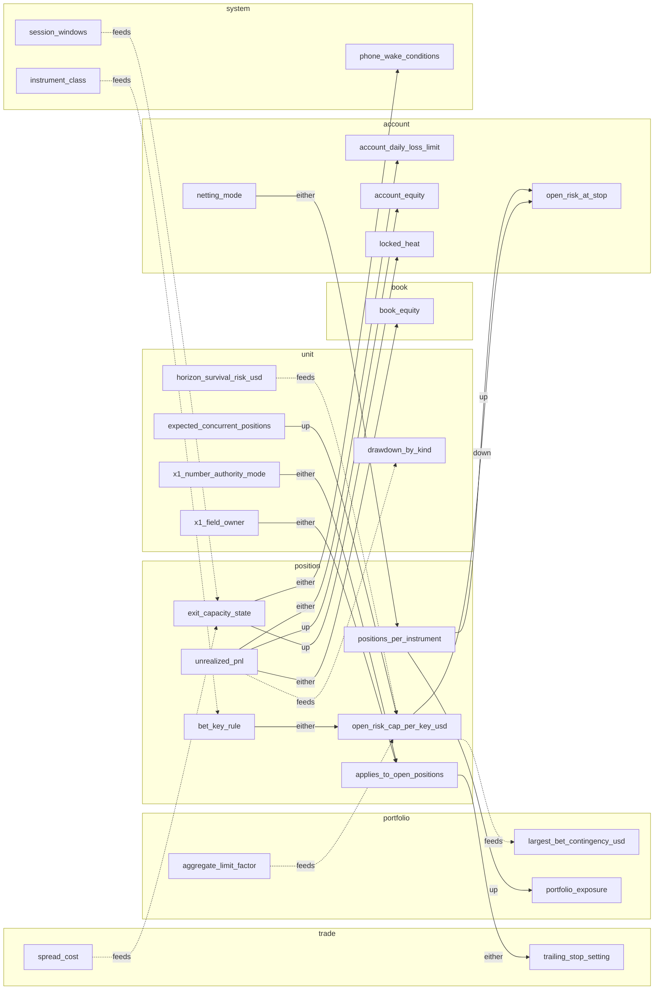
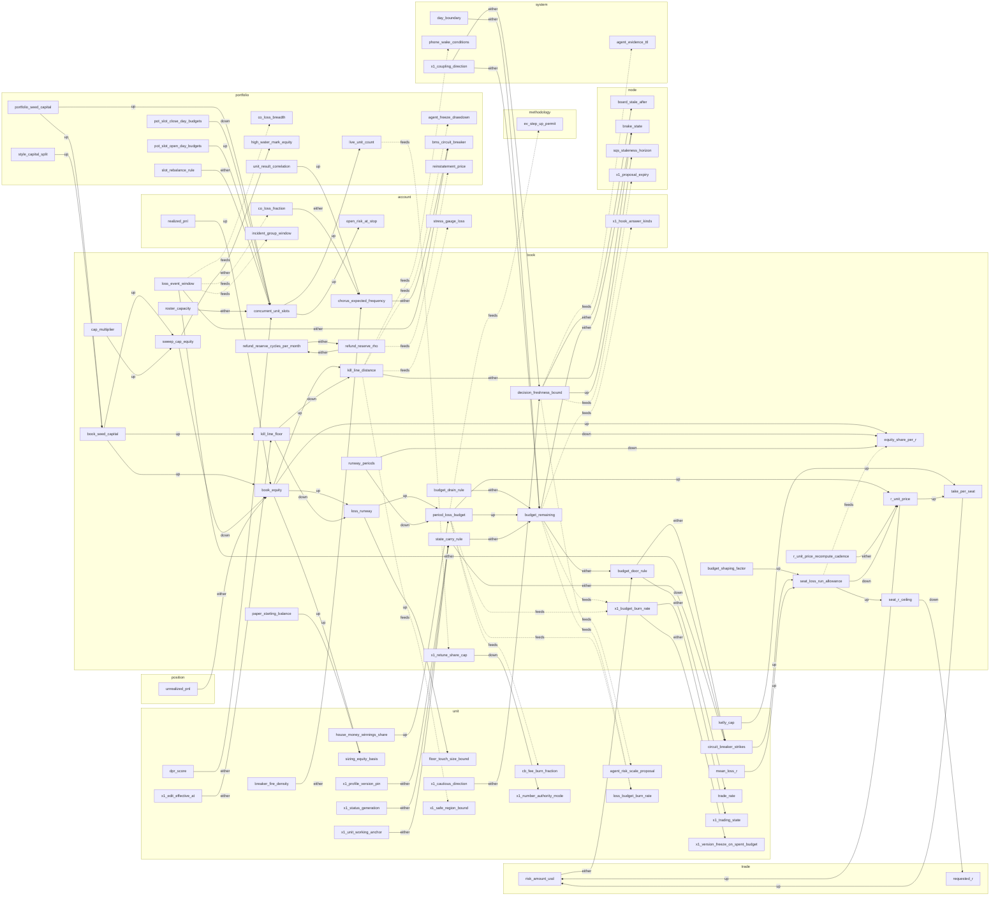

# Variable couplings

Generated by `check.py`. Do not edit by hand; edit the YAML and rerun the checker.

Files: variables.yaml, X0-trading-lens.yaml, X1-template-shape.yaml, X2-sizing-accelerators.yaml, X5-edge-verification.yaml, X6-observability.yaml, X7-agents.yaml. Variables: 705. Couplings: 1372.

Arrows: `up` means a rise in the source pushes the target up, `down` pushes it down, `either` depends on the case.
A dotted `feeds` arrow means the target lists the source in `inputs` and the source does not list the target in `affects`.
The full graph is large; Mermaid viewers may refuse to draw more than about 500 edges, so each level also has its own graph.

## All couplings, grouped by level

### Full graph

```mermaid
flowchart LR
  subgraph L_trade["trade"]
    amend_min_improvement["amend_min_improvement"]
    binding_size_constraint["binding_size_constraint"]
    breakeven_offset["breakeven_offset"]
    breakeven_trigger["breakeven_trigger"]
    carry_cost_r["carry_cost_r"]
    commission_cost["commission_cost"]
    cost_cell_key["cost_cell_key"]
    disaster_stop_distance["disaster_stop_distance"]
    ev_costs_in_r_complete["ev_costs_in_r_complete"]
    ev_counts_toward_proof["ev_counts_toward_proof"]
    ev_exit_mechanism["ev_exit_mechanism"]
    ev_stage_tag["ev_stage_tag"]
    excursion_mae_mfe_r["excursion_mae_mfe_r"]
    exit_mechanism["exit_mechanism"]
    exit_reason_code["exit_reason_code"]
    fast_invalidation_cut_r["fast_invalidation_cut_r"]
    fast_invalidation_trigger["fast_invalidation_trigger"]
    fill_markout_bp["fill_markout_bp"]
    forced_flat_instant["forced_flat_instant"]
    funding_cost["funding_cost"]
    gap_allowance_r["gap_allowance_r"]
    gap_loss_beyond_stop["gap_loss_beyond_stop"]
    giveback_fraction["giveback_fraction"]
    liquidation_stop_check["liquidation_stop_check"]
    lot_dither_max_multiple["lot_dither_max_multiple"]
    lot_size["lot_size"]
    lot_step["lot_step"]
    max_hold_time["max_hold_time"]
    max_lot["max_lot"]
    min_lot["min_lot"]
    min_worthwhile_risk_usd["min_worthwhile_risk_usd"]
    original_risk_r["original_risk_r"]
    partial_close_fraction["partial_close_fraction"]
    price_increment["price_increment"]
    requested_r["requested_r"]
    risk_amount_usd["risk_amount_usd"]
    roi_table_target["roi_table_target"]
    round_trip_cost_r["round_trip_cost_r"]
    rounding_residue_r["rounding_residue_r"]
    slippage_cost["slippage_cost"]
    spread_cost["spread_cost"]
    spread_cost_guard["spread_cost_guard"]
    stop_buffer["stop_buffer"]
    stop_distance["stop_distance"]
    stop_fill_gap_factor["stop_fill_gap_factor"]
    stop_widening_allowed["stop_widening_allowed"]
    stressed_stop_slippage_r["stressed_stop_slippage_r"]
    swap_financing_cost["swap_financing_cost"]
    take_profit_extension_threshold["take_profit_extension_threshold"]
    target_r["target_r"]
    tick_size_tier["tick_size_tier"]
    trailing_stop_setting["trailing_stop_setting"]
    unrealised_profit_cap["unrealised_profit_cap"]
    value_per_point["value_per_point"]
    weight_gap_r["weight_gap_r"]
    worst_step_move_r["worst_step_move_r"]
    x1_value_reason_code["x1_value_reason_code"]
  end
  subgraph L_position["position"]
    applies_to_open_positions["applies_to_open_positions"]
    bet_key_rule["bet_key_rule"]
    exit_capacity_state["exit_capacity_state"]
    open_risk_cap_per_key_usd["open_risk_cap_per_key_usd"]
    positions_per_instrument["positions_per_instrument"]
    unrealized_pnl["unrealized_pnl"]
  end
  subgraph L_unit["unit"]
    accelerator_ceiling_multiple["accelerator_ceiling_multiple"]
    accelerator_earned_r["accelerator_earned_r"]
    accelerator_equity_basis["accelerator_equity_basis"]
    accelerator_growth_per_risk_ratio["accelerator_growth_per_risk_ratio"]
    agent_evidence_fail_mode["agent_evidence_fail_mode"]
    agent_evidence_kinds_accepted["agent_evidence_kinds_accepted"]
    agent_evidence_max_cut["agent_evidence_max_cut"]
    agent_evidence_style_scope["agent_evidence_style_scope"]
    agent_risk_scale["agent_risk_scale"]
    agent_risk_scale_proposal["agent_risk_scale_proposal"]
    aimd_add_step["aimd_add_step"]
    aimd_cut_factor["aimd_cut_factor"]
    anchor_pnl_usd["anchor_pnl_usd"]
    average_win_r["average_win_r"]
    bad_cohort_r["bad_cohort_r"]
    bad_day_percentile["bad_day_percentile"]
    baseline_floor_fraction["baseline_floor_fraction"]
    best_day_profit_share_max["best_day_profit_share_max"]
    block_persistence_score["block_persistence_score"]
    brake_lift_vs_random["brake_lift_vs_random"]
    brake_precision["brake_precision"]
    brake_recall["brake_recall"]
    breaker_expected_fire_rate["breaker_expected_fire_rate"]
    breaker_fire_density["breaker_fire_density"]
    breakeven_win_rate["breakeven_win_rate"]
    budget_share_refresh_interval["budget_share_refresh_interval"]
    burn_rate_page_threshold["burn_rate_page_threshold"]
    burn_rate_ticket_threshold["burn_rate_ticket_threshold"]
    burn_short_window_ratio["burn_short_window_ratio"]
    burn_window_trades["burn_window_trades"]
    calibration_cadence_trades["calibration_cadence_trades"]
    calibration_min_trades["calibration_min_trades"]
    calibration_shrink_k["calibration_shrink_k"]
    calm_duration_guard_days["calm_duration_guard_days"]
    cb_failed_recovery_count["cb_failed_recovery_count"]
    cb_fee_burn_fraction["cb_fee_burn_fraction"]
    circuit_breaker_reset["circuit_breaker_reset"]
    circuit_breaker_strikes["circuit_breaker_strikes"]
    circuit_breaker_window["circuit_breaker_window"]
    cohort_trades["cohort_trades"]
    committed_cushion_usd["committed_cushion_usd"]
    context_size_modifier["context_size_modifier"]
    correlated_market_merge_threshold["correlated_market_merge_threshold"]
    correlation_multiplier["correlation_multiplier"]
    cost_assumption_ratio["cost_assumption_ratio"]
    cost_drift_multiple["cost_drift_multiple"]
    cost_gap_kelly_ceiling["cost_gap_kelly_ceiling"]
    cost_of_conservatism["cost_of_conservatism"]
    cost_stress_multiple["cost_stress_multiple"]
    cushion_anchor_clock["cushion_anchor_clock"]
    cushion_anchor_type["cushion_anchor_type"]
    cushion_multiplier_max["cushion_multiplier_max"]
    cushion_multiplier_min["cushion_multiplier_min"]
    cushion_share_per_trade["cushion_share_per_trade"]
    cusum_allowance_r["cusum_allowance_r"]
    cusum_limit["cusum_limit"]
    daily_r_digest["daily_r_digest"]
    daily_sharpe_audit_trigger["daily_sharpe_audit_trigger"]
    decay_alarm_expectancy_r["decay_alarm_expectancy_r"]
    decay_alarm_loss_streak["decay_alarm_loss_streak"]
    decay_recent_trades["decay_recent_trades"]
    decay_record_days["decay_record_days"]
    decay_watch_drop_r["decay_watch_drop_r"]
    decay_watch_loss_streak["decay_watch_loss_streak"]
    decision_pulse_max_age["decision_pulse_max_age"]
    deflated_sharpe_min["deflated_sharpe_min"]
    demotion_cause["demotion_cause"]
    dpr_multiplier["dpr_multiplier"]
    dpr_score["dpr_score"]
    drawdown_by_kind["drawdown_by_kind"]
    drawdown_pressure_multiplier["drawdown_pressure_multiplier"]
    drift_size_down_step["drift_size_down_step"]
    drift_state["drift_state"]
    edge_range["edge_range"]
    edge_signal_multiplier["edge_signal_multiplier"]
    edge_t_statistic["edge_t_statistic"]
    edge_to_cost_ratio_min["edge_to_cost_ratio_min"]
    effective_observations["effective_observations"]
    effective_tries["effective_tries"]
    ev_alarm_recall["ev_alarm_recall"]
    ev_alarm_triage_rank["ev_alarm_triage_rank"]
    ev_alpha_spending_rule["ev_alpha_spending_rule"]
    ev_applier_mode["ev_applier_mode"]
    ev_approval_expiry_days["ev_approval_expiry_days"]
    ev_approval_hash["ev_approval_hash"]
    ev_approval_level_max["ev_approval_level_max"]
    ev_approval_markets["ev_approval_markets"]
    ev_audit_fail_count["ev_audit_fail_count"]
    ev_autonomy_fallback_after_red["ev_autonomy_fallback_after_red"]
    ev_bad_cohort_r["ev_bad_cohort_r"]
    ev_bad_cohort_target["ev_bad_cohort_target"]
    ev_bad_day_percentile["ev_bad_day_percentile"]
    ev_bet_grid["ev_bet_grid"]
    ev_brake_fire_band["ev_brake_fire_band"]
    ev_calendar_to_proof["ev_calendar_to_proof"]
    ev_canary_share["ev_canary_share"]
    ev_capacity_note["ev_capacity_note"]
    ev_cell_estimate["ev_cell_estimate"]
    ev_cell_key["ev_cell_key"]
    ev_challenge_note_required["ev_challenge_note_required"]
    ev_claim_registered["ev_claim_registered"]
    ev_cohort_trades["ev_cohort_trades"]
    ev_cone_looks_to_red["ev_cone_looks_to_red"]
    ev_confidence["ev_confidence"]
    ev_consistency_best_day_share["ev_consistency_best_day_share"]
    ev_contract_level_replay["ev_contract_level_replay"]
    ev_contrast_bound["ev_contrast_bound"]
    ev_control_run_requested["ev_control_run_requested"]
    ev_control_twin_enabled["ev_control_twin_enabled"]
    ev_cost_reconciliation_gap_r["ev_cost_reconciliation_gap_r"]
    ev_cusum_watch_share["ev_cusum_watch_share"]
    ev_delay_test_bars["ev_delay_test_bars"]
    ev_demotion_alpha["ev_demotion_alpha"]
    ev_demotion_cause["ev_demotion_cause"]
    ev_dry_chassis_result["ev_dry_chassis_result"]
    ev_edge_band_low_after_live_costs["ev_edge_band_low_after_live_costs"]
    ev_edge_band_rule["ev_edge_band_rule"]
    ev_event_days_count["ev_event_days_count"]
    ev_event_replay_loss_cap["ev_event_replay_loss_cap"]
    ev_evidence_e["ev_evidence_e"]
    ev_evidence_multiplier_enabled["ev_evidence_multiplier_enabled"]
    ev_excess_return_basis["ev_excess_return_basis"]
    ev_explanation_note["ev_explanation_note"]
    ev_fallback_dwell_trades["ev_fallback_dwell_trades"]
    ev_false_exit_budget["ev_false_exit_budget"]
    ev_first_hundreds_rule["ev_first_hundreds_rule"]
    ev_gate_requires_low_end_positive["ev_gate_requires_low_end_positive"]
    ev_holding_time_band["ev_holding_time_band"]
    ev_incident_bundle["ev_incident_bundle"]
    ev_independent_episodes["ev_independent_episodes"]
    ev_input_shift_monitor["ev_input_shift_monitor"]
    ev_level_count["ev_level_count"]
    ev_level_down_bar["ev_level_down_bar"]
    ev_level_evidence_alpha["ev_level_evidence_alpha"]
    ev_level_lockout["ev_level_lockout"]
    ev_level_memory_ceiling["ev_level_memory_ceiling"]
    ev_level_min_cohorts["ev_level_min_cohorts"]
    ev_level_up_bar["ev_level_up_bar"]
    ev_look_schedule["ev_look_schedule"]
    ev_loosen_min_days["ev_loosen_min_days"]
    ev_machine_check_days["ev_machine_check_days"]
    ev_machine_check_trades["ev_machine_check_trades"]
    ev_max_incubation_days["ev_max_incubation_days"]
    ev_min_viable_edge_r["ev_min_viable_edge_r"]
    ev_money_record_version["ev_money_record_version"]
    ev_next_look_at["ev_next_look_at"]
    ev_novelty_check["ev_novelty_check"]
    ev_observation_unit["ev_observation_unit"]
    ev_orange_entry["ev_orange_entry"]
    ev_passport["ev_passport"]
    ev_patience_days["ev_patience_days"]
    ev_power["ev_power"]
    ev_promotion_wealth["ev_promotion_wealth"]
    ev_proof_counts_live_min_size["ev_proof_counts_live_min_size"]
    ev_regime_expectation["ev_regime_expectation"]
    ev_regime_min_length["ev_regime_min_length"]
    ev_rehab_children_max["ev_rehab_children_max"]
    ev_replication_ratio["ev_replication_ratio"]
    ev_repromotion_episode_budget["ev_repromotion_episode_budget"]
    ev_restart_weight_schedule["ev_restart_weight_schedule"]
    ev_retire_rule["ev_retire_rule"]
    ev_rollout_outcome["ev_rollout_outcome"]
    ev_rollout_promote_time["ev_rollout_promote_time"]
    ev_rollout_rollback_time["ev_rollout_rollback_time"]
    ev_ruin_audit_flags["ev_ruin_audit_flags"]
    ev_score_scale_r["ev_score_scale_r"]
    ev_sim_block["ev_sim_block"]
    ev_sim_false_alarm["ev_sim_false_alarm"]
    ev_sim_paths["ev_sim_paths"]
    ev_sim_power["ev_sim_power"]
    ev_slow_start_enabled["ev_slow_start_enabled"]
    ev_state_word["ev_state_word"]
    ev_statistical_authorisation["ev_statistical_authorisation"]
    ev_threshold_bounds["ev_threshold_bounds"]
    ev_too_thin_verdict["ev_too_thin_verdict"]
    ev_trades_toward_proof["ev_trades_toward_proof"]
    ev_trial_ledger_id["ev_trial_ledger_id"]
    ev_trip_tax["ev_trip_tax"]
    ev_twin_enabled["ev_twin_enabled"]
    ev_twin_gap_r["ev_twin_gap_r"]
    ev_unseen_data_source["ev_unseen_data_source"]
    ev_upside_alarm_percentile["ev_upside_alarm_percentile"]
    ev_validity_stamp["ev_validity_stamp"]
    ev_variance_cap_r["ev_variance_cap_r"]
    ev_verification_template["ev_verification_template"]
    ev_version_floor_fraction["ev_version_floor_fraction"]
    ev_worry_line_depth["ev_worry_line_depth"]
    ev_worry_line_duration["ev_worry_line_duration"]
    ev_worst_regime_sharpe["ev_worst_regime_sharpe"]
    ev_would_have_counts["ev_would_have_counts"]
    ev_would_have_row["ev_would_have_row"]
    ev_zone_min_hold["ev_zone_min_hold"]
    ev_zone_release_days["ev_zone_release_days"]
    ev_zone_rule["ev_zone_rule"]
    event_ledger_rates["event_ledger_rates"]
    expectancy_floor_r["expectancy_floor_r"]
    expectancy_r["expectancy_r"]
    expected_concurrent_positions["expected_concurrent_positions"]
    exploration_risk_budget_usd["exploration_risk_budget_usd"]
    fallback_dwell_trades["fallback_dwell_trades"]
    feasible_size_usd["feasible_size_usd"]
    fire_context_tags["fire_context_tags"]
    first_warning_event["first_warning_event"]
    floor_touch_size_bound["floor_touch_size_bound"]
    get_even_window["get_even_window"]
    grow_back_rule["grow_back_rule"]
    holding_horizon["holding_horizon"]
    horizon_survival_risk_usd["horizon_survival_risk_usd"]
    hourly_cost_profile["hourly_cost_profile"]
    hourly_volatility_profile["hourly_volatility_profile"]
    house_money_combined_cap["house_money_combined_cap"]
    house_money_multiplier["house_money_multiplier"]
    house_money_scope["house_money_scope"]
    house_money_threshold["house_money_threshold"]
    house_money_winnings_share["house_money_winnings_share"]
    instrument_feasible_at_size["instrument_feasible_at_size"]
    judge_market_shrink_k["judge_market_shrink_k"]
    kelly_cap["kelly_cap"]
    kelly_fraction_raw["kelly_fraction_raw"]
    kelly_multiplier["kelly_multiplier"]
    kelly_probation_discount["kelly_probation_discount"]
    kelly_shrink_factor["kelly_shrink_factor"]
    last_trip_size_level["last_trip_size_level"]
    level_step_cap["level_step_cap"]
    live_cost_gap_multiplier["live_cost_gap_multiplier"]
    losing_day_streak["losing_day_streak"]
    losing_days_limit["losing_days_limit"]
    loss_budget_burn_rate["loss_budget_burn_rate"]
    loss_counting_rule["loss_counting_rule"]
    loss_points_bench_threshold["loss_points_bench_threshold"]
    loss_points_total["loss_points_total"]
    loss_streak["loss_streak"]
    low_profit_lock["low_profit_lock"]
    low_traffic_trade_rate["low_traffic_trade_rate"]
    marginal_stress_contribution_usd["marginal_stress_contribution_usd"]
    max_position_size_lots["max_position_size_lots"]
    mc_cone_floor_percentile["mc_cone_floor_percentile"]
    mean_loss_r["mean_loss_r"]
    microstructure_multiplier["microstructure_multiplier"]
    min_lot_risk_tolerance["min_lot_risk_tolerance"]
    min_net_rr_gate["min_net_rr_gate"]
    min_trades_for_verdict["min_trades_for_verdict"]
    missed_return_r["missed_return_r"]
    money_brake_percentile["money_brake_percentile"]
    monte_carlo_p5_floor["monte_carlo_p5_floor"]
    monte_carlo_shuffle_count["monte_carlo_shuffle_count"]
    nomogram_dead_band["nomogram_dead_band"]
    number_authority_mode["number_authority_mode"]
    number_motion_mode["number_motion_mode"]
    number_move_receipt["number_move_receipt"]
    overdose_bound_alpha["overdose_bound_alpha"]
    paper_min_days["paper_min_days"]
    paper_min_trades["paper_min_trades"]
    paper_to_live_carry_rule["paper_to_live_carry_rule"]
    payoff_ratio["payoff_ratio"]
    pbo_dead_threshold["pbo_dead_threshold"]
    pbo_pass_threshold["pbo_pass_threshold"]
    physics_multiplier["physics_multiplier"]
    planning_edge_point["planning_edge_point"]
    post_loss_raise_window["post_loss_raise_window"]
    premium_window_flag["premium_window_flag"]
    pyramid_add_rule["pyramid_add_rule"]
    raise_headroom_losses["raise_headroom_losses"]
    ranking_score["ranking_score"]
    replay_match_floor["replay_match_floor"]
    repromotion_positive_demo_trades["repromotion_positive_demo_trades"]
    restore_preauthorised["restore_preauthorised"]
    result_spread_r["result_spread_r"]
    reverse_house_money_steps["reverse_house_money_steps"]
    risk_fraction["risk_fraction"]
    risk_light_state["risk_light_state"]
    risk_profile_tries["risk_profile_tries"]
    risk_stop_resume_rule["risk_stop_resume_rule"]
    routine_risk_usd["routine_risk_usd"]
    rvol_multiplier["rvol_multiplier"]
    sequential_evidence_pass["sequential_evidence_pass"]
    session_fill_limit["session_fill_limit"]
    session_fills["session_fills"]
    session_loss_limit_r["session_loss_limit_r"]
    session_multiplier["session_multiplier"]
    session_result_r["session_result_r"]
    share_growth_use_fraction["share_growth_use_fraction"]
    silence_alarm_probability["silence_alarm_probability"]
    size_change_settle_trades["size_change_settle_trades"]
    size_escalation_after_loss_forbidden["size_escalation_after_loss_forbidden"]
    size_level_fraction_table["size_level_fraction_table"]
    size_levels["size_levels"]
    size_ramp_to_full["size_ramp_to_full"]
    sizing_equity_basis["sizing_equity_basis"]
    sleeve_stress_loss_usd["sleeve_stress_loss_usd"]
    slippage_asymmetry["slippage_asymmetry"]
    slippage_p95_by_hour["slippage_p95_by_hour"]
    sprt_bounds["sprt_bounds"]
    status_generation["status_generation"]
    stop_premium_check["stop_premium_check"]
    stoploss_guard_lookback_bars["stoploss_guard_lookback_bars"]
    stoploss_guard_pause_bars["stoploss_guard_pause_bars"]
    stoploss_guard_trade_limit["stoploss_guard_trade_limit"]
    stress_loss_usd["stress_loss_usd"]
    survival_horizon_rounds["survival_horizon_rounds"]
    tail_loss_budget_usd["tail_loss_budget_usd"]
    tail_loss_sizing_factor["tail_loss_sizing_factor"]
    tick_rate_relative["tick_rate_relative"]
    tier_dwell["tier_dwell"]
    tier_dwell_active_days["tier_dwell_active_days"]
    tier_width_day_sigmas["tier_width_day_sigmas"]
    time_under_water["time_under_water"]
    trade_rate["trade_rate"]
    trade_rate_band["trade_rate_band"]
    trades_toward_proof["trades_toward_proof"]
    trip_tax_r["trip_tax_r"]
    tuned_input_guard_trip_limit["tuned_input_guard_trip_limit"]
    twin_gap_r["twin_gap_r"]
    under_baseline_share["under_baseline_share"]
    unit_cost_target["unit_cost_target"]
    unit_daily_loss_limit["unit_daily_loss_limit"]
    unit_day_risk_share["unit_day_risk_share"]
    unit_day_sigma_budget_usd["unit_day_sigma_budget_usd"]
    unit_risk_burst_share["unit_risk_burst_share"]
    unit_risk_qos_class["unit_risk_qos_class"]
    unit_risk_request_share["unit_risk_request_share"]
    upside_alarm_percentile["upside_alarm_percentile"]
    venue_capacity_cap_lots["venue_capacity_cap_lots"]
    verification_trades_needed["verification_trades_needed"]
    viability_cost_fraction_max["viability_cost_fraction_max"]
    vol_scaler_cap["vol_scaler_cap"]
    volatility_target["volatility_target"]
    walk_forward_efficiency_min["walk_forward_efficiency_min"]
    walk_forward_in_sample_months["walk_forward_in_sample_months"]
    walk_forward_out_of_sample_months["walk_forward_out_of_sample_months"]
    win_rate["win_rate"]
    world_switch_reset_rule["world_switch_reset_rule"]
    x1_adopt_at_next_flat["x1_adopt_at_next_flat"]
    x1_affects_graph_runtime["x1_affects_graph_runtime"]
    x1_analysis_outcome["x1_analysis_outcome"]
    x1_approved_config_set["x1_approved_config_set"]
    x1_brake_shadow_mode["x1_brake_shadow_mode"]
    x1_canary_share["x1_canary_share"]
    x1_card_required_before_live["x1_card_required_before_live"]
    x1_cautious_direction["x1_cautious_direction"]
    x1_cluster_tag_set["x1_cluster_tag_set"]
    x1_deploy_retry_rule["x1_deploy_retry_rule"]
    x1_derivation_fallback_order["x1_derivation_fallback_order"]
    x1_derivation_receipt["x1_derivation_receipt"]
    x1_derivation_rule["x1_derivation_rule"]
    x1_edit_effective_at["x1_edit_effective_at"]
    x1_event_override_expiry["x1_event_override_expiry"]
    x1_fail_mode["x1_fail_mode"]
    x1_fallback_dwell["x1_fallback_dwell"]
    x1_field_owner["x1_field_owner"]
    x1_guard_freeze_limit["x1_guard_freeze_limit"]
    x1_guard_trip_count["x1_guard_trip_count"]
    x1_ledger_snapshot_in_compiled_unit["x1_ledger_snapshot_in_compiled_unit"]
    x1_memory_ceiling["x1_memory_ceiling"]
    x1_money_record_scope["x1_money_record_scope"]
    x1_motion_rate_cap["x1_motion_rate_cap"]
    x1_motion_tolerance["x1_motion_tolerance"]
    x1_motion_window_down["x1_motion_window_down"]
    x1_motion_window_up["x1_motion_window_up"]
    x1_needs_list["x1_needs_list"]
    x1_number_authority_mode["x1_number_authority_mode"]
    x1_override_evidence_record["x1_override_evidence_record"]
    x1_pack_order["x1_pack_order"]
    x1_plain_python_quarantine_trades["x1_plain_python_quarantine_trades"]
    x1_preset_id["x1_preset_id"]
    x1_profile_version_pin["x1_profile_version_pin"]
    x1_recommendation_bounds["x1_recommendation_bounds"]
    x1_recommendation_decay_half_life["x1_recommendation_decay_half_life"]
    x1_restore_probe_size_share["x1_restore_probe_size_share"]
    x1_restore_probe_trades["x1_restore_probe_trades"]
    x1_retune_dead_band["x1_retune_dead_band"]
    x1_rollout_time_to_promote["x1_rollout_time_to_promote"]
    x1_runs_on["x1_runs_on"]
    x1_safe_region_bound["x1_safe_region_bound"]
    x1_shadow_trades_before_live["x1_shadow_trades_before_live"]
    x1_shed_priority_class["x1_shed_priority_class"]
    x1_slot_combiner_rule["x1_slot_combiner_rule"]
    x1_status_generation["x1_status_generation"]
    x1_trading_state["x1_trading_state"]
    x1_tuned_value_guard["x1_tuned_value_guard"]
    x1_unit_working_anchor["x1_unit_working_anchor"]
    x1_upgrade_offer_policy["x1_upgrade_offer_policy"]
    x1_version_freeze_on_spent_budget["x1_version_freeze_on_spent_budget"]
  end
  subgraph L_book["book"]
    book_equity["book_equity"]
    book_seed_capital["book_seed_capital"]
    budget_door_rule["budget_door_rule"]
    budget_drain_rule["budget_drain_rule"]
    budget_remaining["budget_remaining"]
    budget_shaping_factor["budget_shaping_factor"]
    cap_multiplier["cap_multiplier"]
    chorus_expected_frequency["chorus_expected_frequency"]
    concurrent_unit_slots["concurrent_unit_slots"]
    decision_freshness_bound["decision_freshness_bound"]
    equity_share_per_r["equity_share_per_r"]
    kill_line_distance["kill_line_distance"]
    kill_line_floor["kill_line_floor"]
    loss_event_window["loss_event_window"]
    loss_runway["loss_runway"]
    paper_starting_balance["paper_starting_balance"]
    period_loss_budget["period_loss_budget"]
    r_unit_price["r_unit_price"]
    r_unit_price_recompute_cadence["r_unit_price_recompute_cadence"]
    refund_reserve_cycles_per_month["refund_reserve_cycles_per_month"]
    refund_reserve_rho["refund_reserve_rho"]
    roster_capacity["roster_capacity"]
    runway_periods["runway_periods"]
    seat_loss_run_allowance["seat_loss_run_allowance"]
    seat_r_ceiling["seat_r_ceiling"]
    state_carry_rule["state_carry_rule"]
    sweep_cap_equity["sweep_cap_equity"]
    take_per_seat["take_per_seat"]
    x1_budget_burn_rate["x1_budget_burn_rate"]
    x1_retune_share_cap["x1_retune_share_cap"]
  end
  subgraph L_methodology["methodology"]
    dominant_family_window["dominant_family_window"]
    ev_agent_stake["ev_agent_stake"]
    ev_alpha_refund_per_discovery["ev_alpha_refund_per_discovery"]
    ev_alpha_spend_per_test["ev_alpha_spend_per_test"]
    ev_budget_burn_fast_window["ev_budget_burn_fast_window"]
    ev_budget_burn_slow_window["ev_budget_burn_slow_window"]
    ev_event_window_minutes["ev_event_window_minutes"]
    ev_family_alpha_wealth["ev_family_alpha_wealth"]
    ev_family_decay_rate["ev_family_decay_rate"]
    ev_family_false_discovery_rate["ev_family_false_discovery_rate"]
    ev_family_id["ev_family_id"]
    ev_family_prior_spread["ev_family_prior_spread"]
    ev_family_stream_alarm["ev_family_stream_alarm"]
    ev_gate_enabled_per_type["ev_gate_enabled_per_type"]
    ev_gate_lift["ev_gate_lift"]
    ev_gate_rejection_rates["ev_gate_rejection_rates"]
    ev_parent_prior_weight["ev_parent_prior_weight"]
    ev_pool_corr_cap["ev_pool_corr_cap"]
    ev_pool_corr_prior["ev_pool_corr_prior"]
    ev_prereg_weight["ev_prereg_weight"]
    ev_step_up_permit["ev_step_up_permit"]
    family_daily_budget["family_daily_budget"]
    per_trade_cap_by_family["per_trade_cap_by_family"]
    qualifying_loss_threshold_r["qualifying_loss_threshold_r"]
    stop_policy_per_style["stop_policy_per_style"]
    warm_up_window["warm_up_window"]
  end
  subgraph L_portfolio["portfolio"]
    agent_freeze_drawdown["agent_freeze_drawdown"]
    aggregate_limit_factor["aggregate_limit_factor"]
    bms_buffer_before_floor["bms_buffer_before_floor"]
    bms_circuit_breaker["bms_circuit_breaker"]
    bms_daily_loss_limit["bms_daily_loss_limit"]
    book_day_sigma_budget_usd["book_day_sigma_budget_usd"]
    breadth_split_threshold["breadth_split_threshold"]
    capital_sharing_rule["capital_sharing_rule"]
    class_feasibility_verdict["class_feasibility_verdict"]
    class_risk_cap["class_risk_cap"]
    class_state_multiplier["class_state_multiplier"]
    cluster_exposure_cap["cluster_exposure_cap"]
    co_loss_breadth["co_loss_breadth"]
    control_rank_table["control_rank_table"]
    corroboration_widening_step["corroboration_widening_step"]
    cross_market_stress_reading["cross_market_stress_reading"]
    currency_exposure_limit["currency_exposure_limit"]
    day_budget_breadth_scale["day_budget_breadth_scale"]
    effective_bets_drop_trip["effective_bets_drop_trip"]
    effective_independent_bets["effective_independent_bets"]
    ev_exploration_budget_share["ev_exploration_budget_share"]
    ev_lifetime_demotion_budget["ev_lifetime_demotion_budget"]
    ev_portfolio_veto_reason["ev_portfolio_veto_reason"]
    ev_review_list_rule["ev_review_list_rule"]
    evidence_source_independence["evidence_source_independence"]
    floor_touch_tolerance["floor_touch_tolerance"]
    gain_lock_fraction["gain_lock_fraction"]
    high_water_mark_equity["high_water_mark_equity"]
    isolation_confirm_mode["isolation_confirm_mode"]
    isolation_end_rule["isolation_end_rule"]
    isolation_nomination_window_days["isolation_nomination_window_days"]
    isolation_scope["isolation_scope"]
    largest_bet_contingency_usd["largest_bet_contingency_usd"]
    live_unit_count["live_unit_count"]
    macro_state_multiplier["macro_state_multiplier"]
    market_isolation_trigger["market_isolation_trigger"]
    max_open_positions["max_open_positions"]
    monthly_return_expectation["monthly_return_expectation"]
    open_breadth_budget_scale["open_breadth_budget_scale"]
    per_instrument_exposure_cap["per_instrument_exposure_cap"]
    portfolio_correlation_ceiling["portfolio_correlation_ceiling"]
    portfolio_daily_risk_budget["portfolio_daily_risk_budget"]
    portfolio_exposure["portfolio_exposure"]
    portfolio_floor["portfolio_floor"]
    portfolio_seed_capital["portfolio_seed_capital"]
    pot_slot_close_day_budgets["pot_slot_close_day_budgets"]
    pot_slot_open_day_budgets["pot_slot_open_day_budgets"]
    regime_probability_vector["regime_probability_vector"]
    reinstatement_price["reinstatement_price"]
    rising_floor_fraction["rising_floor_fraction"]
    single_item_effect_cap["single_item_effect_cap"]
    slot_rebalance_rule["slot_rebalance_rule"]
    stressed_unit_correlation["stressed_unit_correlation"]
    style_capital_split["style_capital_split"]
    unit_capital_share["unit_capital_share"]
    unit_result_correlation["unit_result_correlation"]
    x1_aggregate_limit_factor["x1_aggregate_limit_factor"]
    x1_bet_key_rule["x1_bet_key_rule"]
    x1_enforcement_percent["x1_enforcement_percent"]
    x1_limit_importance["x1_limit_importance"]
    x1_never_self_tune_list["x1_never_self_tune_list"]
    x1_scope_overlap_rule["x1_scope_overlap_rule"]
    x1_starter_budget_share["x1_starter_budget_share"]
    x1_state_transition_table["x1_state_transition_table"]
  end
  subgraph L_account["account"]
    account_balance["account_balance"]
    account_daily_loss_limit["account_daily_loss_limit"]
    account_equity["account_equity"]
    brake_equity_basis["brake_equity_basis"]
    co_loss_fraction["co_loss_fraction"]
    daily_loss_warning_fraction["daily_loss_warning_fraction"]
    day_start_equity["day_start_equity"]
    equity_band["equity_band"]
    equity_band_thresholds["equity_band_thresholds"]
    equity_drawdown_halt["equity_drawdown_halt"]
    false_page_budget["false_page_budget"]
    growth_attribution["growth_attribution"]
    incident_group_window["incident_group_window"]
    leverage["leverage"]
    locked_heat["locked_heat"]
    margin_used["margin_used"]
    netting_mode["netting_mode"]
    open_risk_at_stop["open_risk_at_stop"]
    open_risk_ceiling["open_risk_ceiling"]
    realized_pnl["realized_pnl"]
    reconciliation_tolerance["reconciliation_tolerance"]
    stress_gauge_loss["stress_gauge_loss"]
    unit_agreement_score["unit_agreement_score"]
    venue_capacity_cap["venue_capacity_cap"]
    x1_day_baseline_confirmation["x1_day_baseline_confirmation"]
    x1_hook_answer_kinds["x1_hook_answer_kinds"]
  end
  subgraph L_node["node"]
    black_box_window["black_box_window"]
    board_stale_after["board_stale_after"]
    brake_state["brake_state"]
    caution_window_width["caution_window_width"]
    clock_drift_halt["clock_drift_halt"]
    clock_drift_no_new_entry["clock_drift_no_new_entry"]
    clock_drift_warn["clock_drift_warn"]
    control_apply_lag_limit["control_apply_lag_limit"]
    crash_loop_max_restarts["crash_loop_max_restarts"]
    daily_dead_zone_width["daily_dead_zone_width"]
    disk_headroom_min["disk_headroom_min"]
    ev_cost_profile_source["ev_cost_profile_source"]
    event_impact_measured["event_impact_measured"]
    event_window_width["event_window_width"]
    feed_stale_after["feed_stale_after"]
    journal_harvest_cadence["journal_harvest_cadence"]
    kill_switch_detector_posture["kill_switch_detector_posture"]
    kill_switch_effect_matrix["kill_switch_effect_matrix"]
    kill_switch_level["kill_switch_level"]
    kill_switch_scope["kill_switch_scope"]
    liveness_heartbeat_cadence["liveness_heartbeat_cadence"]
    news_blackout_after["news_blackout_after"]
    news_blackout_before["news_blackout_before"]
    news_calendar_max_staleness["news_calendar_max_staleness"]
    news_impact_level_map["news_impact_level_map"]
    news_region_shift["news_region_shift"]
    protection_retry_max["protection_retry_max"]
    reconciliation_cadence["reconciliation_cadence"]
    records_home_cadence["records_home_cadence"]
    risk_fact_staleness_limit["risk_fact_staleness_limit"]
    risk_state_emit_interval["risk_state_emit_interval"]
    session_handover_buffer_width["session_handover_buffer_width"]
    soft_kill_exit_schedule["soft_kill_exit_schedule"]
    sqs_baseline_conditioning["sqs_baseline_conditioning"]
    sqs_baseline_refit_schedule["sqs_baseline_refit_schedule"]
    sqs_hard_block_threshold["sqs_hard_block_threshold"]
    sqs_hysteresis_band["sqs_hysteresis_band"]
    sqs_outlier_guard_multiple["sqs_outlier_guard_multiple"]
    sqs_sample_cadence["sqs_sample_cadence"]
    sqs_score["sqs_score"]
    sqs_staleness_horizon["sqs_staleness_horizon"]
    watch_window_at_open["watch_window_at_open"]
    watchdog_cadence["watchdog_cadence"]
    window_forced_flat["window_forced_flat"]
    x1_guard_unavailable_action["x1_guard_unavailable_action"]
    x1_oracle_mode["x1_oracle_mode"]
    x1_pin_signature_required_for_live["x1_pin_signature_required_for_live"]
    x1_proposal_direction_allowed["x1_proposal_direction_allowed"]
    x1_proposal_evidence_record["x1_proposal_evidence_record"]
    x1_proposal_expiry["x1_proposal_expiry"]
    x1_risk_state_emit_interval["x1_risk_state_emit_interval"]
    x1_scope_key_set["x1_scope_key_set"]
  end
  subgraph L_system["system"]
    activity_session_windows["activity_session_windows"]
    agent_autonomy_level["agent_autonomy_level"]
    agent_evidence_ttl["agent_evidence_ttl"]
    agent_inference_cost["agent_inference_cost"]
    agent_precision["agent_precision"]
    agent_proposal_quota["agent_proposal_quota"]
    agent_requalify_rule["agent_requalify_rule"]
    agent_vs_random_lift["agent_vs_random_lift"]
    alert_priority["alert_priority"]
    alert_tier["alert_tier"]
    approval_reversal_rate["approval_reversal_rate"]
    approval_ttl["approval_ttl"]
    brake_precision_floor["brake_precision_floor"]
    card_expected_value["card_expected_value"]
    card_graduation_count["card_graduation_count"]
    card_ignore_rate["card_ignore_rate"]
    card_ttl_waking_hours["card_ttl_waking_hours"]
    card_value_floor["card_value_floor"]
    chaos_drill_cadence["chaos_drill_cadence"]
    day_boundary["day_boundary"]
    ev_agent_proposal_kinds["ev_agent_proposal_kinds"]
    ev_core_deny_list["ev_core_deny_list"]
    ev_pipeline_delay_trades["ev_pipeline_delay_trades"]
    ev_pipeline_null_rate["ev_pipeline_null_rate"]
    ev_pipeline_power["ev_pipeline_power"]
    ev_pipeline_version["ev_pipeline_version"]
    ev_proposal_ttl_hours["ev_proposal_ttl_hours"]
    ev_protocol_change_log["ev_protocol_change_log"]
    ev_red_team_schedule["ev_red_team_schedule"]
    ev_test_window_scored_once["ev_test_window_scored_once"]
    hidden_scenario_share["hidden_scenario_share"]
    incident_root_cause_key["incident_root_cause_key"]
    instrument_class["instrument_class"]
    numeraire["numeraire"]
    operation_risk_direction["operation_risk_direction"]
    operator_attention_budget["operator_attention_budget"]
    operator_dismiss_rate["operator_dismiss_rate"]
    page_escalation_after["page_escalation_after"]
    phone_wake_conditions["phone_wake_conditions"]
    pooling_rule_per_parameter["pooling_rule_per_parameter"]
    preauthorised_rule_ttl["preauthorised_rule_ttl"]
    review_queue_burn["review_queue_burn"]
    session_windows["session_windows"]
    x1_adapters_per_slot_min["x1_adapters_per_slot_min"]
    x1_approval_effect_digest["x1_approval_effect_digest"]
    x1_block_migration_map["x1_block_migration_map"]
    x1_brake_registry_row["x1_brake_registry_row"]
    x1_card_flood_cap["x1_card_flood_cap"]
    x1_changed_by_class["x1_changed_by_class"]
    x1_compiler_format["x1_compiler_format"]
    x1_coupling_direction["x1_coupling_direction"]
    x1_entry_class_coverage["x1_entry_class_coverage"]
    x1_expression_names_allowed["x1_expression_names_allowed"]
    x1_identity_profile_version_change["x1_identity_profile_version_change"]
    x1_instrument_bucket["x1_instrument_bucket"]
    x1_layer_h_rules["x1_layer_h_rules"]
    x1_min_trust_per_slot["x1_min_trust_per_slot"]
    x1_override_chain_order["x1_override_chain_order"]
    x1_override_priority["x1_override_priority"]
    x1_profile_schema_version["x1_profile_schema_version"]
    x1_settable_by_levels["x1_settable_by_levels"]
  end
  accelerator_ceiling_multiple -.->|feeds| cushion_multiplier_max
  accelerator_ceiling_multiple -->|down| house_money_multiplier
  accelerator_earned_r -.->|feeds| growth_attribution
  accelerator_equity_basis -->|down| house_money_multiplier
  accelerator_growth_per_risk_ratio -->|up| accelerator_ceiling_multiple
  account_balance -->|up| account_equity
  account_balance -.->|feeds| committed_cushion_usd
  account_daily_loss_limit -->|either| daily_loss_warning_fraction
  account_daily_loss_limit -->|either| drawdown_pressure_multiplier
  account_daily_loss_limit -->|up| kill_switch_level
  account_equity -.->|feeds| committed_cushion_usd
  account_equity -->|up| day_start_equity
  account_equity -.->|feeds| drawdown_by_kind
  account_equity -->|up| equity_band
  account_equity -->|either| equity_drawdown_halt
  account_equity -->|up| high_water_mark_equity
  account_equity -->|up| sizing_equity_basis
  account_equity -->|up| volatility_target
  activity_session_windows -->|either| day_boundary
  activity_session_windows -.->|feeds| day_budget_breadth_scale
  activity_session_windows -->|either| session_windows
  agent_autonomy_level -->|either| agent_evidence_kinds_accepted
  agent_autonomy_level -->|up| agent_proposal_quota
  agent_evidence_fail_mode -->|up| agent_risk_scale
  agent_evidence_kinds_accepted -->|down| agent_risk_scale
  agent_evidence_max_cut -->|up| agent_risk_scale
  agent_evidence_style_scope -->|either| agent_evidence_kinds_accepted
  agent_evidence_ttl -.->|feeds| agent_evidence_style_scope
  agent_evidence_ttl -->|down| agent_risk_scale
  agent_freeze_drawdown -->|down| agent_autonomy_level
  agent_inference_cost -->|down| agent_proposal_quota
  agent_precision -->|up| agent_autonomy_level
  agent_proposal_quota -->|up| review_queue_burn
  agent_requalify_rule -->|down| agent_autonomy_level
  agent_risk_scale -->|up| context_size_modifier
  agent_risk_scale -->|up| risk_amount_usd
  agent_risk_scale_proposal -->|down| risk_amount_usd
  agent_vs_random_lift -->|up| agent_autonomy_level
  agent_vs_random_lift -->|down| agent_evidence_max_cut
  aggregate_limit_factor -.->|feeds| open_risk_cap_per_key_usd
  aggregate_limit_factor -->|up| portfolio_daily_risk_budget
  aimd_add_step -->|up| grow_back_rule
  aimd_cut_factor -->|up| drawdown_pressure_multiplier
  alert_priority -->|either| phone_wake_conditions
  alert_tier -.->|feeds| alert_priority
  alert_tier -->|either| phone_wake_conditions
  amend_min_improvement -->|either| breakeven_trigger
  anchor_pnl_usd -->|up| drawdown_pressure_multiplier
  anchor_pnl_usd -->|up| house_money_multiplier
  applies_to_open_positions -->|either| trailing_stop_setting
  approval_reversal_rate -->|down| agent_autonomy_level
  approval_reversal_rate -.->|feeds| agent_proposal_quota
  approval_reversal_rate -->|up| card_graduation_count
  approval_ttl -->|down| review_queue_burn
  average_win_r -.->|feeds| breakeven_win_rate
  average_win_r -.->|feeds| cost_gap_kelly_ceiling
  average_win_r -->|up| expectancy_r
  average_win_r -->|up| payoff_ratio
  average_win_r -.->|feeds| result_spread_r
  bad_cohort_r -.->|feeds| first_warning_event
  bad_cohort_r -->|down| size_levels
  bad_day_percentile -->|either| alert_tier
  baseline_floor_fraction -->|either| size_ramp_to_full
  best_day_profit_share_max -->|down| unit_day_sigma_budget_usd
  bet_key_rule -->|either| open_risk_cap_per_key_usd
  binding_size_constraint -->|either| control_rank_table
  black_box_window -->|either| brake_recall
  block_persistence_score -->|up| accelerator_ceiling_multiple
  bms_buffer_before_floor -->|either| bms_circuit_breaker
  bms_circuit_breaker -->|up| kill_switch_level
  bms_circuit_breaker -->|up| market_isolation_trigger
  bms_daily_loss_limit -->|either| bms_circuit_breaker
  board_stale_after -->|either| trade_rate
  book_day_sigma_budget_usd -->|either| portfolio_daily_risk_budget
  book_day_sigma_budget_usd -->|up| unit_day_sigma_budget_usd
  book_equity -->|up| equity_share_per_r
  book_equity -->|up| kill_line_distance
  book_equity -->|up| loss_runway
  book_equity -->|up| sizing_equity_basis
  book_seed_capital -->|up| book_equity
  book_seed_capital -->|up| kill_line_floor
  book_seed_capital -->|up| sweep_cap_equity
  brake_equity_basis -->|either| account_daily_loss_limit
  brake_equity_basis -.->|feeds| drawdown_by_kind
  brake_equity_basis -->|either| equity_drawdown_halt
  brake_equity_basis -.->|feeds| x1_brake_registry_row
  brake_lift_vs_random -->|either| brake_precision_floor
  brake_precision -.->|feeds| agent_vs_random_lift
  brake_precision -.->|feeds| brake_lift_vs_random
  brake_precision -.->|feeds| brake_precision_floor
  brake_precision -.->|feeds| brake_recall
  brake_precision -.->|feeds| card_expected_value
  brake_precision -->|either| circuit_breaker_strikes
  brake_precision -.->|feeds| cost_of_conservatism
  brake_precision_floor -->|either| brake_state
  brake_recall -->|either| brake_lift_vs_random
  brake_state -.->|feeds| raise_headroom_losses
  brake_state -.->|feeds| risk_light_state
  brake_state -.->|feeds| under_baseline_share
  brake_state -.->|feeds| x1_trading_state
  breadth_split_threshold -->|up| live_unit_count
  breaker_expected_fire_rate -->|either| breaker_fire_density
  breaker_expected_fire_rate -.->|feeds| ev_brake_fire_band
  breaker_fire_density -.->|feeds| brake_lift_vs_random
  breaker_fire_density -->|either| chorus_expected_frequency
  breaker_fire_density -->|up| drift_state
  breaker_fire_density -.->|feeds| trip_tax_r
  breakeven_offset -->|down| mean_loss_r
  breakeven_trigger -->|either| circuit_breaker_strikes
  breakeven_trigger -->|down| mean_loss_r
  breakeven_trigger -->|down| win_rate
  breakeven_win_rate -->|down| edge_range
  budget_door_rule -->|either| circuit_breaker_strikes
  budget_door_rule -->|down| trade_rate
  budget_drain_rule -->|either| budget_remaining
  budget_remaining -->|either| brake_state
  budget_remaining -->|either| budget_door_rule
  budget_remaining -.->|feeds| loss_budget_burn_rate
  budget_remaining -.->|feeds| x1_budget_burn_rate
  budget_remaining -.->|feeds| x1_hook_answer_kinds
  budget_shaping_factor -->|up| seat_loss_run_allowance
  budget_share_refresh_interval -->|either| unit_capital_share
  burn_rate_page_threshold -->|up| alert_tier
  burn_rate_ticket_threshold -->|up| alert_tier
  burn_short_window_ratio -->|either| burn_rate_page_threshold
  burn_window_trades -.->|feeds| burn_rate_page_threshold
  burn_window_trades -.->|feeds| burn_rate_ticket_threshold
  burn_window_trades -->|either| loss_budget_burn_rate
  calibration_cadence_trades -.->|feeds| number_move_receipt
  calibration_cadence_trades -->|either| risk_fraction
  calibration_min_trades -.->|feeds| number_move_receipt
  calibration_min_trades -->|either| risk_fraction
  calibration_min_trades -.->|feeds| x1_derivation_fallback_order
  calibration_min_trades -.->|feeds| x1_override_evidence_record
  calibration_min_trades -.->|feeds| x1_recommendation_bounds
  calibration_shrink_k -->|either| risk_fraction
  calibration_shrink_k -.->|feeds| x1_derivation_fallback_order
  calibration_shrink_k -.->|feeds| x1_recommendation_bounds
  calm_duration_guard_days -->|down| volatility_target
  cap_multiplier -->|up| sweep_cap_equity
  capital_sharing_rule -->|either| portfolio_daily_risk_budget
  capital_sharing_rule -->|either| unit_capital_share
  card_expected_value -->|either| card_value_floor
  card_graduation_count -->|up| operator_attention_budget
  card_ignore_rate -->|down| agent_proposal_quota
  card_ignore_rate -->|down| operator_attention_budget
  card_ttl_waking_hours -->|up| review_queue_burn
  card_value_floor -->|down| review_queue_burn
  carry_cost_r -->|up| round_trip_cost_r
  caution_window_width -->|either| daily_dead_zone_width
  caution_window_width -->|either| session_handover_buffer_width
  cb_failed_recovery_count -->|either| circuit_breaker_strikes
  cb_fee_burn_fraction -->|either| circuit_breaker_strikes
  chaos_drill_cadence -->|either| brake_recall
  chorus_expected_frequency -->|either| bms_circuit_breaker
  circuit_breaker_reset -->|up| trade_rate
  circuit_breaker_strikes -.->|feeds| breaker_expected_fire_rate
  circuit_breaker_strikes -->|down| breaker_fire_density
  circuit_breaker_strikes -->|up| seat_loss_run_allowance
  circuit_breaker_strikes -->|down| trade_rate
  circuit_breaker_window -->|either| circuit_breaker_strikes
  class_feasibility_verdict -->|down| live_unit_count
  class_risk_cap -->|down| cluster_exposure_cap
  class_risk_cap -->|down| unit_day_risk_share
  class_state_multiplier -->|down| cluster_exposure_cap
  clock_drift_halt -->|down| trade_rate
  clock_drift_no_new_entry -.->|feeds| clock_drift_halt
  clock_drift_no_new_entry -->|down| trade_rate
  clock_drift_warn -->|either| clock_drift_no_new_entry
  cluster_exposure_cap -.->|feeds| class_risk_cap
  cluster_exposure_cap -->|down| trade_rate
  cluster_exposure_cap -.->|feeds| x1_aggregate_limit_factor
  cluster_exposure_cap -.->|feeds| x1_hook_answer_kinds
  co_loss_breadth -->|down| bms_daily_loss_limit
  co_loss_breadth -->|down| effective_independent_bets
  co_loss_breadth -->|down| portfolio_daily_risk_budget
  co_loss_fraction -->|either| chorus_expected_frequency
  co_loss_fraction -->|up| market_isolation_trigger
  cohort_trades -.->|feeds| bad_cohort_r
  cohort_trades -->|either| size_levels
  cohort_trades -.->|feeds| tier_dwell_active_days
  commission_cost -.->|feeds| cost_assumption_ratio
  commission_cost -.->|feeds| hourly_cost_profile
  commission_cost -.->|feeds| min_worthwhile_risk_usd
  commission_cost -->|up| round_trip_cost_r
  committed_cushion_usd -.->|feeds| book_day_sigma_budget_usd
  committed_cushion_usd -->|up| horizon_survival_risk_usd
  concurrent_unit_slots -->|up| live_unit_count
  concurrent_unit_slots -->|up| open_risk_at_stop
  context_size_modifier -->|either| physics_multiplier
  context_size_modifier -->|either| risk_fraction
  control_apply_lag_limit -->|either| risk_light_state
  control_rank_table -->|either| fast_invalidation_trigger
  control_rank_table -.->|feeds| weight_gap_r
  control_rank_table -.->|feeds| x1_layer_h_rules
  control_rank_table -.->|feeds| x1_slot_combiner_rule
  correlated_market_merge_threshold -->|either| effective_independent_bets
  correlated_market_merge_threshold -.->|feeds| ev_family_id
  correlation_multiplier -->|down| risk_fraction
  corroboration_widening_step -->|down| agent_risk_scale
  cost_assumption_ratio -->|either| cost_drift_multiple
  cost_assumption_ratio -.->|feeds| risk_light_state
  cost_assumption_ratio -->|up| round_trip_cost_r
  cost_cell_key -->|either| cost_assumption_ratio
  cost_cell_key -.->|feeds| slippage_p95_by_hour
  cost_drift_multiple -->|up| drift_state
  cost_gap_kelly_ceiling -.->|feeds| binding_size_constraint
  cost_gap_kelly_ceiling -->|down| risk_amount_usd
  cost_of_conservatism -->|either| slot_rebalance_rule
  cost_stress_multiple -.->|feeds| edge_to_cost_ratio_min
  cost_stress_multiple -->|either| expectancy_floor_r
  crash_loop_max_restarts -->|down| trade_rate
  cross_market_stress_reading -->|up| bms_circuit_breaker
  cross_market_stress_reading -.->|feeds| class_risk_cap
  cross_market_stress_reading -.->|feeds| class_state_multiplier
  cross_market_stress_reading -->|down| isolation_end_rule
  cross_market_stress_reading -->|up| market_isolation_trigger
  cross_market_stress_reading -.->|feeds| regime_probability_vector
  cross_market_stress_reading -.->|feeds| stressed_unit_correlation
  currency_exposure_limit -->|down| trade_rate
  cushion_anchor_clock -->|either| anchor_pnl_usd
  cushion_anchor_clock -.->|feeds| budget_share_refresh_interval
  cushion_anchor_clock -->|either| day_start_equity
  cushion_anchor_type -->|either| house_money_multiplier
  cushion_multiplier_max -->|up| house_money_multiplier
  cushion_multiplier_min -->|up| drawdown_pressure_multiplier
  cushion_share_per_trade -->|up| risk_fraction
  cusum_allowance_r -->|either| cusum_limit
  cusum_limit -->|down| drift_state
  cusum_limit -.->|feeds| ev_cusum_watch_share
  cusum_limit -.->|feeds| ev_family_stream_alarm
  daily_dead_zone_width -->|down| trade_rate
  daily_loss_warning_fraction -->|up| kill_switch_level
  daily_r_digest -.->|feeds| bad_day_percentile
  daily_r_digest -.->|feeds| best_day_profit_share_max
  daily_r_digest -->|either| losing_day_streak
  daily_r_digest -.->|feeds| money_brake_percentile
  daily_sharpe_audit_trigger -->|either| edge_range
  day_boundary -.->|feeds| bms_daily_loss_limit
  day_boundary -->|either| budget_remaining
  day_boundary -->|either| circuit_breaker_reset
  day_boundary -.->|feeds| circuit_breaker_window
  day_boundary -.->|feeds| cushion_anchor_clock
  day_boundary -.->|feeds| daily_r_digest
  day_boundary -->|either| day_start_equity
  day_boundary -.->|feeds| forced_flat_instant
  day_boundary -.->|feeds| loss_budget_burn_rate
  day_boundary -.->|feeds| unit_daily_loss_limit
  day_boundary -.->|feeds| x1_day_baseline_confirmation
  day_budget_breadth_scale -->|down| portfolio_daily_risk_budget
  day_start_equity -->|up| account_daily_loss_limit
  day_start_equity -.->|feeds| drawdown_by_kind
  decay_alarm_expectancy_r -->|up| drift_state
  decay_alarm_loss_streak -->|down| drift_state
  decay_recent_trades -->|either| drift_state
  decay_record_days -->|either| drift_state
  decay_watch_drop_r -->|down| drift_state
  decay_watch_loss_streak -->|down| drift_state
  decision_freshness_bound -.->|feeds| agent_evidence_ttl
  decision_freshness_bound -.->|feeds| agent_risk_scale_proposal
  decision_freshness_bound -->|either| board_stale_after
  decision_freshness_bound -->|up| sqs_staleness_horizon
  decision_freshness_bound -.->|feeds| x1_proposal_expiry
  decision_pulse_max_age -->|either| risk_light_state
  deflated_sharpe_min -->|either| edge_range
  disaster_stop_distance -->|down| gap_loss_beyond_stop
  disk_headroom_min -->|down| trade_rate
  dominant_family_window -->|either| reverse_house_money_steps
  dominant_family_window -->|either| session_multiplier
  dpr_multiplier -->|up| risk_fraction
  dpr_score -.->|feeds| cb_failed_recovery_count
  dpr_score -->|either| concurrent_unit_slots
  dpr_score -->|up| dpr_multiplier
  drawdown_by_kind -->|either| brake_state
  drawdown_by_kind -->|either| time_under_water
  drawdown_pressure_multiplier -->|down| risk_fraction
  drift_size_down_step -->|down| risk_fraction
  drift_state -.->|feeds| alert_tier
  drift_state -->|either| brake_state
  drift_state -.->|feeds| demotion_cause
  drift_state -->|up| drift_size_down_step
  drift_state -.->|feeds| edge_signal_multiplier
  drift_state -.->|feeds| ev_state_word
  drift_state -.->|feeds| risk_light_state
  drift_state -->|either| slot_rebalance_rule
  edge_range -->|either| capital_sharing_rule
  edge_range -.->|feeds| edge_signal_multiplier
  edge_range -.->|feeds| ev_edge_band_low_after_live_costs
  edge_range -.->|feeds| ev_edge_band_rule
  edge_range -.->|feeds| ev_gate_requires_low_end_positive
  edge_range -.->|feeds| ev_statistical_authorisation
  edge_range -.->|feeds| horizon_survival_risk_usd
  edge_range -->|up| kelly_shrink_factor
  edge_range -.->|feeds| planning_edge_point
  edge_range -->|either| risk_fraction
  edge_signal_multiplier -->|up| risk_amount_usd
  edge_t_statistic -.->|feeds| cost_gap_kelly_ceiling
  edge_t_statistic -.->|feeds| edge_range
  edge_t_statistic -.->|feeds| edge_to_cost_ratio_min
  edge_t_statistic -.->|feeds| ev_evidence_multiplier_enabled
  edge_t_statistic -->|up| kelly_shrink_factor
  edge_to_cost_ratio_min -->|either| risk_amount_usd
  edge_to_cost_ratio_min -->|down| trade_rate
  effective_bets_drop_trip -->|either| bms_circuit_breaker
  effective_independent_bets -.->|feeds| day_budget_breadth_scale
  effective_independent_bets -->|either| effective_bets_drop_trip
  effective_independent_bets -.->|feeds| ev_calendar_to_proof
  effective_independent_bets -.->|feeds| open_breadth_budget_scale
  effective_independent_bets -.->|feeds| unit_agreement_score
  effective_independent_bets -.->|feeds| unit_day_risk_share
  effective_tries -.->|feeds| accelerator_growth_per_risk_ratio
  effective_tries -.->|feeds| block_persistence_score
  effective_tries -.->|feeds| card_expected_value
  effective_tries -->|either| deflated_sharpe_min
  effective_tries -.->|feeds| ev_edge_band_rule
  effective_tries -.->|feeds| trades_toward_proof
  equity_band -->|down| account_daily_loss_limit
  equity_band -->|down| kelly_cap
  equity_band -->|up| open_risk_ceiling
  equity_band -->|up| per_trade_cap_by_family
  equity_band_thresholds -->|either| equity_band
  equity_drawdown_halt -->|down| dpr_score
  equity_drawdown_halt -->|up| kill_switch_level
  equity_drawdown_halt -.->|feeds| x1_safe_region_bound
  ev_agent_proposal_kinds -->|down| drift_state
  ev_agent_stake -->|down| ev_family_alpha_wealth
  ev_alarm_recall -->|either| ev_gate_enabled_per_type
  ev_alarm_triage_rank -->|either| ev_explanation_note
  ev_alpha_refund_per_discovery -->|up| ev_family_alpha_wealth
  ev_alpha_spend_per_test -->|down| ev_family_alpha_wealth
  ev_alpha_spending_rule -->|either| ev_look_schedule
  ev_applier_mode -->|either| number_motion_mode
  ev_approval_expiry_days -->|either| ev_approval_hash
  ev_approval_hash -->|either| ev_state_word
  ev_approval_level_max -->|down| size_levels
  ev_approval_markets -->|either| ev_canary_share
  ev_audit_fail_count -->|down| ev_counts_toward_proof
  ev_autonomy_fallback_after_red -->|down| ev_applier_mode
  ev_bad_cohort_r -->|either| ev_bad_cohort_target
  ev_bad_cohort_target -->|up| ev_level_down_bar
  ev_bad_cohort_target -.->|feeds| ev_level_lockout
  ev_bad_cohort_target -->|up| ev_level_up_bar
  ev_bad_day_percentile -->|either| daily_r_digest
  ev_bet_grid -->|either| ev_evidence_e
  ev_brake_fire_band -->|down| drift_state
  ev_budget_burn_fast_window -->|down| ev_step_up_permit
  ev_budget_burn_slow_window -->|down| ev_step_up_permit
  ev_calendar_to_proof -.->|feeds| ev_capacity_note
  ev_calendar_to_proof -->|up| ev_too_thin_verdict
  ev_canary_share -->|either| size_levels
  ev_capacity_note -->|up| ev_too_thin_verdict
  ev_cell_estimate -->|either| edge_range
  ev_cell_key -->|either| ev_cell_estimate
  ev_challenge_note_required -->|down| ev_statistical_authorisation
  ev_claim_registered -->|up| effective_tries
  ev_cohort_trades -.->|feeds| ev_level_down_bar
  ev_cohort_trades -->|either| ev_level_up_bar
  ev_cone_looks_to_red -->|down| drift_state
  ev_confidence -->|up| verification_trades_needed
  ev_consistency_best_day_share -->|down| drift_state
  ev_contract_level_replay -->|either| ev_stage_tag
  ev_contrast_bound -->|either| ev_rollout_outcome
  ev_control_run_requested -->|either| ev_dry_chassis_result
  ev_control_twin_enabled -->|down| ev_statistical_authorisation
  ev_core_deny_list -->|either| ev_level_evidence_alpha
  ev_cost_profile_source -->|either| round_trip_cost_r
  ev_cost_profile_source -->|either| slippage_cost
  ev_cost_reconciliation_gap_r -->|down| drift_state
  ev_costs_in_r_complete -->|either| round_trip_cost_r
  ev_counts_toward_proof -->|either| ev_evidence_e
  ev_counts_toward_proof -.->|feeds| ev_trades_toward_proof
  ev_cusum_watch_share -->|down| drift_state
  ev_delay_test_bars -->|down| ev_statistical_authorisation
  ev_demotion_alpha -->|either| ev_evidence_e
  ev_demotion_alpha -.->|feeds| ev_repromotion_episode_budget
  ev_demotion_cause -->|either| ev_repromotion_episode_budget
  ev_dry_chassis_result -->|down| ev_statistical_authorisation
  ev_edge_band_low_after_live_costs -->|down| drift_state
  ev_edge_band_rule -->|either| edge_range
  ev_event_days_count -->|either| ev_event_replay_loss_cap
  ev_event_replay_loss_cap -->|down| ev_statistical_authorisation
  ev_event_window_minutes -->|down| effective_independent_bets
  ev_evidence_e -->|either| drift_state
  ev_evidence_e -->|either| ev_state_word
  ev_evidence_e -.->|feeds| ev_statistical_authorisation
  ev_evidence_multiplier_enabled -->|either| kelly_shrink_factor
  ev_excess_return_basis -->|either| expectancy_floor_r
  ev_exit_mechanism -->|either| exit_reason_code
  ev_explanation_note -->|either| ev_state_word
  ev_exploration_budget_share -->|down| unit_capital_share
  ev_fallback_dwell_trades -->|either| drift_state
  ev_false_exit_budget -->|either| ev_exit_mechanism
  ev_family_alpha_wealth -->|up| ev_promotion_wealth
  ev_family_alpha_wealth -.->|feeds| ev_retire_rule
  ev_family_alpha_wealth -->|up| ev_step_up_permit
  ev_family_decay_rate -->|down| ev_capacity_note
  ev_family_false_discovery_rate -->|down| edge_range
  ev_family_id -->|either| effective_independent_bets
  ev_family_id -->|either| ev_family_alpha_wealth
  ev_family_prior_spread -->|either| edge_range
  ev_family_prior_spread -.->|feeds| ev_edge_band_rule
  ev_family_stream_alarm -->|down| size_levels
  ev_first_hundreds_rule -->|down| edge_range
  ev_gate_enabled_per_type -->|either| ev_statistical_authorisation
  ev_gate_lift -->|either| ev_gate_enabled_per_type
  ev_gate_rejection_rates -->|either| ev_gate_lift
  ev_gate_requires_low_end_positive -->|down| size_levels
  ev_holding_time_band -->|down| drift_state
  ev_incident_bundle -->|either| ev_explanation_note
  ev_independent_episodes -->|either| verification_trades_needed
  ev_input_shift_monitor -->|down| drift_state
  ev_level_count -->|either| size_levels
  ev_level_down_bar -->|down| size_levels
  ev_level_evidence_alpha -->|either| size_levels
  ev_level_lockout -->|down| size_levels
  ev_level_memory_ceiling -->|either| grow_back_rule
  ev_level_min_cohorts -->|either| ev_level_up_bar
  ev_level_up_bar -->|up| size_levels
  ev_lifetime_demotion_budget -->|down| ev_demotion_alpha
  ev_look_schedule -->|either| ev_next_look_at
  ev_loosen_min_days -->|either| ev_state_word
  ev_machine_check_days -->|either| ev_state_word
  ev_machine_check_trades -->|either| ev_state_word
  ev_max_incubation_days -->|down| ev_too_thin_verdict
  ev_min_viable_edge_r -->|down| drift_state
  ev_min_viable_edge_r -->|either| ev_demotion_cause
  ev_money_record_version -->|either| ev_stage_tag
  ev_next_look_at -->|either| ev_state_word
  ev_novelty_check -->|either| effective_tries
  ev_observation_unit -->|either| ev_independent_episodes
  ev_orange_entry -->|down| size_levels
  ev_parent_prior_weight -->|either| edge_range
  ev_passport -->|either| ev_state_word
  ev_patience_days -->|either| ev_alarm_recall
  ev_pipeline_delay_trades -->|either| ev_calendar_to_proof
  ev_pipeline_null_rate -->|either| ev_level_evidence_alpha
  ev_pipeline_power -->|either| ev_too_thin_verdict
  ev_pipeline_version -->|either| ev_trial_ledger_id
  ev_pool_corr_cap -->|either| ev_family_id
  ev_pool_corr_prior -->|down| effective_independent_bets
  ev_portfolio_veto_reason -->|either| ev_state_word
  ev_power -->|up| verification_trades_needed
  ev_prereg_weight -->|up| effective_tries
  ev_promotion_wealth -->|up| sequential_evidence_pass
  ev_proof_counts_live_min_size -->|either| ev_counts_toward_proof
  ev_proposal_ttl_hours -->|either| ev_agent_proposal_kinds
  ev_protocol_change_log -->|up| ev_pipeline_version
  ev_red_team_schedule -->|either| ev_agent_proposal_kinds
  ev_regime_expectation -->|either| drift_state
  ev_regime_min_length -->|either| ev_worst_regime_sharpe
  ev_rehab_children_max -->|either| ev_retire_rule
  ev_replication_ratio -->|down| edge_range
  ev_replication_ratio -.->|feeds| ev_edge_band_rule
  ev_repromotion_episode_budget -->|either| ev_evidence_e
  ev_restart_weight_schedule -->|either| ev_evidence_e
  ev_retire_rule -->|either| ev_state_word
  ev_review_list_rule -->|either| ev_demotion_alpha
  ev_rollout_outcome -->|either| ev_state_word
  ev_rollout_promote_time -->|either| ev_rollout_outcome
  ev_rollout_rollback_time -->|either| ev_rollout_outcome
  ev_ruin_audit_flags -->|down| drift_state
  ev_score_scale_r -->|either| ev_evidence_e
  ev_sim_block -->|either| ev_sim_false_alarm
  ev_sim_block -.->|feeds| ev_sim_power
  ev_sim_false_alarm -->|either| ev_threshold_bounds
  ev_sim_paths -->|either| ev_sim_false_alarm
  ev_sim_paths -.->|feeds| ev_sim_power
  ev_sim_power -->|either| ev_threshold_bounds
  ev_slow_start_enabled -->|up| size_levels
  ev_stage_tag -->|either| ev_counts_toward_proof
  ev_state_word -->|either| brake_state
  ev_statistical_authorisation -->|either| ev_state_word
  ev_step_up_permit -->|up| size_levels
  ev_test_window_scored_once -->|up| effective_tries
  ev_threshold_bounds -->|either| cusum_limit
  ev_too_thin_verdict -->|either| ev_state_word
  ev_trades_toward_proof -->|either| ev_next_look_at
  ev_trial_ledger_id -->|up| effective_tries
  ev_trip_tax -->|either| brake_precision
  ev_twin_enabled -->|either| ev_twin_gap_r
  ev_twin_gap_r -->|down| drift_state
  ev_unseen_data_source -->|either| ev_counts_toward_proof
  ev_upside_alarm_percentile -->|down| drift_state
  ev_validity_stamp -->|down| ev_statistical_authorisation
  ev_variance_cap_r -->|either| ev_evidence_e
  ev_verification_template -->|either| ev_cohort_trades
  ev_verification_template -->|either| ev_look_schedule
  ev_version_floor_fraction -->|either| ev_rollout_outcome
  ev_worry_line_depth -->|down| drift_state
  ev_worry_line_duration -->|down| drift_state
  ev_worst_regime_sharpe -->|down| ev_statistical_authorisation
  ev_would_have_counts -->|down| ev_counts_toward_proof
  ev_would_have_row -->|either| ev_would_have_counts
  ev_zone_min_hold -->|either| drift_state
  ev_zone_release_days -->|up| drift_state
  ev_zone_rule -->|either| drift_state
  event_impact_measured -->|either| event_window_width
  event_impact_measured -->|either| news_blackout_after
  event_impact_measured -->|either| news_blackout_before
  event_ledger_rates -->|either| drift_state
  event_window_width -->|down| trade_rate
  evidence_source_independence -.->|feeds| agent_evidence_max_cut
  evidence_source_independence -->|down| corroboration_widening_step
  evidence_source_independence -->|either| single_item_effect_cap
  excursion_mae_mfe_r -->|either| breaker_fire_density
  excursion_mae_mfe_r -.->|feeds| stop_premium_check
  exit_capacity_state -->|up| locked_heat
  exit_capacity_state -->|either| phone_wake_conditions
  exit_mechanism -->|either| event_ledger_rates
  exit_mechanism -->|either| exit_reason_code
  exit_mechanism -->|either| loss_counting_rule
  exit_reason_code -->|either| loss_counting_rule
  expectancy_floor_r -->|up| edge_range
  expectancy_r -.->|feeds| accelerator_earned_r
  expectancy_r -.->|feeds| cusum_allowance_r
  expectancy_r -.->|feeds| decay_alarm_expectancy_r
  expectancy_r -.->|feeds| decay_watch_drop_r
  expectancy_r -->|up| dpr_score
  expectancy_r -->|up| edge_range
  expectancy_r -->|up| edge_t_statistic
  expectancy_r -.->|feeds| edge_to_cost_ratio_min
  expectancy_r -.->|feeds| expectancy_floor_r
  expectancy_r -->|up| floor_touch_size_bound
  expectancy_r -->|up| kelly_fraction_raw
  expectancy_r -.->|feeds| low_profit_lock
  expectancy_r -->|up| ranking_score
  expectancy_r -.->|feeds| sequential_evidence_pass
  expectancy_r -.->|feeds| sprt_bounds
  expectancy_r -->|down| verification_trades_needed
  expectancy_r -.->|feeds| viability_cost_fraction_max
  expected_concurrent_positions -->|up| open_risk_cap_per_key_usd
  exploration_risk_budget_usd -->|up| size_levels
  fallback_dwell_trades -->|down| risk_amount_usd
  false_page_budget -->|up| burn_rate_page_threshold
  family_daily_budget -->|down| trade_rate
  fast_invalidation_cut_r -.->|feeds| anchor_pnl_usd
  fast_invalidation_cut_r -.->|feeds| cost_gap_kelly_ceiling
  fast_invalidation_cut_r -->|up| loss_points_total
  fast_invalidation_cut_r -->|up| mean_loss_r
  fast_invalidation_trigger -->|either| exit_reason_code
  fast_invalidation_trigger -->|either| fast_invalidation_cut_r
  fast_invalidation_trigger -->|down| win_rate
  feasible_size_usd -->|either| class_feasibility_verdict
  feed_stale_after -->|down| trade_rate
  fill_markout_bp -->|up| cost_assumption_ratio
  fire_context_tags -->|either| breaker_fire_density
  fire_context_tags -.->|feeds| incident_root_cause_key
  fire_context_tags -->|either| market_isolation_trigger
  first_warning_event -->|down| level_step_cap
  floor_touch_size_bound -->|up| cushion_share_per_trade
  floor_touch_tolerance -.->|feeds| book_day_sigma_budget_usd
  floor_touch_tolerance -->|up| floor_touch_size_bound
  floor_touch_tolerance -.->|feeds| horizon_survival_risk_usd
  forced_flat_instant -->|down| gap_loss_beyond_stop
  forced_flat_instant -->|down| swap_financing_cost
  funding_cost -.->|feeds| carry_cost_r
  funding_cost -.->|feeds| cost_assumption_ratio
  funding_cost -->|either| round_trip_cost_r
  gain_lock_fraction -->|up| portfolio_floor
  gap_allowance_r -->|down| lot_size
  gap_allowance_r -->|down| risk_amount_usd
  gap_loss_beyond_stop -.->|feeds| gap_allowance_r
  gap_loss_beyond_stop -.->|feeds| locked_heat
  gap_loss_beyond_stop -->|up| mean_loss_r
  gap_loss_beyond_stop -.->|feeds| stop_fill_gap_factor
  gap_loss_beyond_stop -.->|feeds| stress_gauge_loss
  gap_loss_beyond_stop -.->|feeds| stress_loss_usd
  gap_loss_beyond_stop -.->|feeds| tail_loss_budget_usd
  get_even_window -->|up| alert_tier
  get_even_window -->|down| risk_fraction
  giveback_fraction -->|either| average_win_r
  grow_back_rule -->|up| risk_fraction
  hidden_scenario_share -->|down| risk_profile_tries
  high_water_mark_equity -.->|feeds| agent_freeze_drawdown
  high_water_mark_equity -.->|feeds| drawdown_by_kind
  high_water_mark_equity -->|either| equity_drawdown_halt
  high_water_mark_equity -.->|feeds| gain_lock_fraction
  high_water_mark_equity -->|up| rising_floor_fraction
  high_water_mark_equity -.->|feeds| x1_unit_working_anchor
  holding_horizon -.->|feeds| event_window_width
  holding_horizon -->|up| gap_allowance_r
  holding_horizon -->|either| hourly_volatility_profile
  holding_horizon -->|up| round_trip_cost_r
  holding_horizon -.->|feeds| routine_risk_usd
  holding_horizon -.->|feeds| stop_premium_check
  horizon_survival_risk_usd -.->|feeds| binding_size_constraint
  horizon_survival_risk_usd -->|either| floor_touch_size_bound
  horizon_survival_risk_usd -.->|feeds| open_risk_cap_per_key_usd
  horizon_survival_risk_usd -->|up| risk_amount_usd
  horizon_survival_risk_usd -.->|feeds| size_level_fraction_table
  hourly_cost_profile -.->|feeds| caution_window_width
  hourly_cost_profile -->|either| edge_to_cost_ratio_min
  hourly_cost_profile -->|either| premium_window_flag
  hourly_cost_profile -->|either| round_trip_cost_r
  hourly_volatility_profile -.->|feeds| activity_session_windows
  hourly_volatility_profile -.->|feeds| caution_window_width
  hourly_volatility_profile -->|down| risk_amount_usd
  hourly_volatility_profile -->|either| volatility_target
  house_money_combined_cap -->|down| house_money_multiplier
  house_money_multiplier -.->|feeds| accelerator_earned_r
  house_money_multiplier -->|up| risk_fraction
  house_money_scope -->|either| house_money_multiplier
  house_money_threshold -->|down| house_money_multiplier
  house_money_winnings_share -->|up| period_loss_budget
  incident_group_window -.->|feeds| black_box_window
  incident_group_window -->|either| incident_root_cause_key
  incident_root_cause_key -->|either| page_escalation_after
  instrument_class -.->|feeds| bet_key_rule
  instrument_class -.->|feeds| fire_context_tags
  instrument_class -->|either| isolation_scope
  instrument_class -.->|feeds| macro_state_multiplier
  instrument_class -->|either| news_impact_level_map
  instrument_class -->|either| sqs_hard_block_threshold
  instrument_class -.->|feeds| worst_step_move_r
  instrument_class -.->|feeds| x1_bet_key_rule
  instrument_class -.->|feeds| x1_entry_class_coverage
  instrument_class -.->|feeds| x1_instrument_bucket
  instrument_class -.->|feeds| x1_override_chain_order
  instrument_class -.->|feeds| x1_scope_key_set
  instrument_feasible_at_size -->|up| trade_rate
  isolation_confirm_mode -->|either| isolation_scope
  isolation_confirm_mode -->|either| market_isolation_trigger
  isolation_end_rule -->|up| trade_rate
  isolation_nomination_window_days -.->|feeds| isolation_confirm_mode
  isolation_nomination_window_days -->|either| market_isolation_trigger
  isolation_scope -->|either| kill_switch_scope
  journal_harvest_cadence -->|up| risk_fact_staleness_limit
  judge_market_shrink_k -->|down| edge_range
  judge_market_shrink_k -.->|feeds| ev_cell_estimate
  judge_market_shrink_k -.->|feeds| ev_edge_band_rule
  kelly_cap -->|up| risk_fraction
  kelly_cap -->|up| take_per_seat
  kelly_fraction_raw -->|up| kelly_cap
  kelly_multiplier -->|up| kelly_cap
  kelly_probation_discount -->|up| kelly_cap
  kelly_shrink_factor -.->|feeds| cost_gap_kelly_ceiling
  kelly_shrink_factor -.->|feeds| edge_signal_multiplier
  kelly_shrink_factor -->|up| kelly_cap
  kill_line_distance -.->|feeds| agent_freeze_drawdown
  kill_line_distance -->|either| brake_state
  kill_line_distance -.->|feeds| phone_wake_conditions
  kill_line_distance -.->|feeds| stress_gauge_loss
  kill_line_distance -.->|feeds| x1_safe_region_bound
  kill_line_floor -->|down| equity_share_per_r
  kill_line_floor -->|down| kill_line_distance
  kill_line_floor -->|down| loss_runway
  kill_switch_detector_posture -->|either| kill_switch_level
  kill_switch_effect_matrix -->|down| trade_rate
  kill_switch_level -->|either| kill_switch_effect_matrix
  kill_switch_level -.->|feeds| risk_light_state
  kill_switch_level -->|down| trade_rate
  kill_switch_level -.->|feeds| x1_trading_state
  kill_switch_scope -->|either| market_isolation_trigger
  largest_bet_contingency_usd -->|down| horizon_survival_risk_usd
  last_trip_size_level -->|down| grow_back_rule
  level_step_cap -->|down| size_ramp_to_full
  leverage -.->|feeds| binding_size_constraint
  leverage -.->|feeds| class_feasibility_verdict
  leverage -->|down| liquidation_stop_check
  leverage -->|up| lot_size
  leverage -->|down| margin_used
  liquidation_stop_check -->|down| lot_size
  live_cost_gap_multiplier -->|up| round_trip_cost_r
  live_unit_count -.->|feeds| co_loss_breadth
  live_unit_count -->|up| effective_independent_bets
  live_unit_count -.->|feeds| ev_demotion_alpha
  live_unit_count -.->|feeds| horizon_survival_risk_usd
  live_unit_count -->|down| unit_capital_share
  live_unit_count -.->|feeds| unit_day_risk_share
  live_unit_count -.->|feeds| unit_day_sigma_budget_usd
  live_unit_count -->|either| verification_trades_needed
  live_unit_count -.->|feeds| x1_card_flood_cap
  live_unit_count -.->|feeds| x1_retune_share_cap
  liveness_heartbeat_cadence -->|either| brake_state
  liveness_heartbeat_cadence -.->|feeds| risk_fact_staleness_limit
  liveness_heartbeat_cadence -.->|feeds| risk_light_state
  locked_heat -->|up| phone_wake_conditions
  losing_day_streak -->|either| losing_days_limit
  losing_days_limit -->|down| trade_rate
  loss_budget_burn_rate -.->|feeds| alert_tier
  loss_budget_burn_rate -->|either| brake_state
  loss_budget_burn_rate -->|either| burn_rate_page_threshold
  loss_budget_burn_rate -->|either| burn_rate_ticket_threshold
  loss_counting_rule -->|either| brake_precision
  loss_counting_rule -->|either| circuit_breaker_strikes
  loss_counting_rule -.->|feeds| loss_streak
  loss_counting_rule -.->|feeds| stoploss_guard_trade_limit
  loss_counting_rule -.->|feeds| x1_brake_registry_row
  loss_event_window -->|either| bms_circuit_breaker
  loss_event_window -->|either| circuit_breaker_strikes
  loss_event_window -.->|feeds| co_loss_breadth
  loss_event_window -.->|feeds| co_loss_fraction
  loss_event_window -.->|feeds| incident_group_window
  loss_points_bench_threshold -->|down| trade_rate
  loss_points_total -->|up| loss_points_bench_threshold
  loss_points_total -.->|feeds| money_brake_percentile
  loss_points_total -->|up| reverse_house_money_steps
  loss_runway -->|up| floor_touch_size_bound
  loss_runway -->|up| period_loss_budget
  loss_streak -->|either| decay_alarm_loss_streak
  loss_streak -->|either| decay_watch_loss_streak
  loss_streak -.->|feeds| post_loss_raise_window
  loss_streak -->|up| reverse_house_money_steps
  lot_dither_max_multiple -->|down| rounding_residue_r
  lot_size -->|up| margin_used
  lot_size -->|either| rounding_residue_r
  lot_step -->|down| lot_size
  lot_step -->|up| rounding_residue_r
  low_profit_lock -->|down| trade_rate
  low_traffic_trade_rate -->|either| burn_window_trades
  macro_state_multiplier -->|down| class_risk_cap
  margin_used -.->|feeds| binding_size_constraint
  margin_used -->|either| liquidation_stop_check
  marginal_stress_contribution_usd -->|down| unit_capital_share
  market_isolation_trigger -->|either| isolation_scope
  market_isolation_trigger -->|down| trade_rate
  max_hold_time -.->|feeds| agent_evidence_style_scope
  max_hold_time -.->|feeds| carry_cost_r
  max_hold_time -->|either| exit_reason_code
  max_hold_time -.->|feeds| expected_concurrent_positions
  max_hold_time -.->|feeds| holding_horizon
  max_hold_time -->|either| mean_loss_r
  max_lot -->|down| lot_size
  max_open_positions -->|up| open_risk_at_stop
  max_position_size_lots -.->|feeds| binding_size_constraint
  max_position_size_lots -->|down| lot_size
  mc_cone_floor_percentile -->|up| drift_state
  mc_cone_floor_percentile -.->|feeds| ev_cone_looks_to_red
  mc_cone_floor_percentile -.->|feeds| ev_upside_alarm_percentile
  mc_cone_floor_percentile -.->|feeds| upside_alarm_percentile
  mean_loss_r -.->|feeds| breakeven_win_rate
  mean_loss_r -->|down| expectancy_r
  mean_loss_r -->|up| loss_points_total
  mean_loss_r -->|down| payoff_ratio
  mean_loss_r -.->|feeds| result_spread_r
  mean_loss_r -->|up| seat_loss_run_allowance
  mean_loss_r -.->|feeds| tail_loss_budget_usd
  microstructure_multiplier -->|down| risk_fraction
  min_lot -.->|feeds| feasible_size_usd
  min_lot -.->|feeds| instrument_feasible_at_size
  min_lot -->|up| lot_size
  min_lot -.->|feeds| size_level_fraction_table
  min_lot_risk_tolerance -->|up| instrument_feasible_at_size
  min_net_rr_gate -->|down| trade_rate
  min_trades_for_verdict -->|either| expectancy_floor_r
  min_worthwhile_risk_usd -->|down| trade_rate
  missed_return_r -.->|feeds| growth_attribution
  money_brake_percentile -->|down| circuit_breaker_strikes
  money_brake_percentile -->|either| unit_daily_loss_limit
  monte_carlo_p5_floor -->|up| edge_range
  monte_carlo_shuffle_count -->|either| monte_carlo_p5_floor
  monthly_return_expectation -->|up| risk_fraction
  netting_mode -->|either| positions_per_instrument
  news_blackout_after -->|down| trade_rate
  news_blackout_after -.->|feeds| watch_window_at_open
  news_blackout_after -.->|feeds| x1_event_override_expiry
  news_blackout_before -.->|feeds| soft_kill_exit_schedule
  news_blackout_before -->|down| trade_rate
  news_blackout_before -.->|feeds| watch_window_at_open
  news_calendar_max_staleness -->|down| trade_rate
  news_impact_level_map -.->|feeds| event_impact_measured
  news_impact_level_map -->|up| kill_switch_level
  news_impact_level_map -->|either| market_isolation_trigger
  news_impact_level_map -->|either| news_blackout_after
  news_impact_level_map -->|either| news_blackout_before
  news_impact_level_map -->|either| news_region_shift
  news_region_shift -->|either| market_isolation_trigger
  news_region_shift -->|either| unit_capital_share
  nomogram_dead_band -->|either| drift_size_down_step
  number_authority_mode -->|either| number_motion_mode
  number_motion_mode -.->|feeds| number_move_receipt
  number_motion_mode -->|either| risk_fraction
  number_move_receipt -->|either| brake_state
  numeraire -->|either| value_per_point
  open_breadth_budget_scale -->|down| portfolio_daily_risk_budget
  open_risk_at_stop -.->|feeds| committed_cushion_usd
  open_risk_at_stop -->|either| correlation_multiplier
  open_risk_at_stop -.->|feeds| largest_bet_contingency_usd
  open_risk_at_stop -.->|feeds| locked_heat
  open_risk_at_stop -->|either| open_risk_ceiling
  open_risk_at_stop -->|up| portfolio_exposure
  open_risk_at_stop -.->|feeds| sleeve_stress_loss_usd
  open_risk_at_stop -.->|feeds| stress_gauge_loss
  open_risk_at_stop -.->|feeds| stress_loss_usd
  open_risk_at_stop -.->|feeds| x1_safe_region_bound
  open_risk_cap_per_key_usd -.->|feeds| largest_bet_contingency_usd
  open_risk_cap_per_key_usd -->|down| open_risk_at_stop
  open_risk_ceiling -->|up| risk_fraction
  open_risk_ceiling -.->|feeds| x1_hook_answer_kinds
  operation_risk_direction -->|either| agent_autonomy_level
  operation_risk_direction -->|either| kill_switch_level
  operator_attention_budget -->|up| card_value_floor
  operator_attention_budget -.->|feeds| review_queue_burn
  operator_dismiss_rate -->|up| false_page_budget
  original_risk_r -->|either| excursion_mae_mfe_r
  original_risk_r -->|either| mean_loss_r
  overdose_bound_alpha -->|down| size_levels
  paper_min_days -->|either| paper_min_trades
  paper_min_trades -->|either| paper_min_days
  paper_starting_balance -->|up| sizing_equity_basis
  paper_to_live_carry_rule -->|either| risk_fraction
  paper_to_live_carry_rule -->|either| size_ramp_to_full
  partial_close_fraction -->|either| average_win_r
  payoff_ratio -->|up| kelly_fraction_raw
  payoff_ratio -->|either| min_net_rr_gate
  payoff_ratio -.->|feeds| tail_loss_budget_usd
  payoff_ratio -.->|feeds| tail_loss_sizing_factor
  pbo_dead_threshold -->|either| edge_range
  pbo_pass_threshold -->|either| edge_range
  per_instrument_exposure_cap -->|down| lot_size
  per_trade_cap_by_family -.->|feeds| family_daily_budget
  per_trade_cap_by_family -->|either| house_money_multiplier
  per_trade_cap_by_family -->|up| risk_fraction
  period_loss_budget -->|up| budget_remaining
  period_loss_budget -.->|feeds| cb_fee_burn_fraction
  period_loss_budget -.->|feeds| ev_step_up_permit
  period_loss_budget -.->|feeds| loss_budget_burn_rate
  period_loss_budget -->|up| r_unit_price
  period_loss_budget -.->|feeds| x1_budget_burn_rate
  physics_multiplier -->|down| risk_fraction
  planning_edge_point -->|up| horizon_survival_risk_usd
  pooling_rule_per_parameter -->|either| calibration_shrink_k
  portfolio_correlation_ceiling -->|down| trade_rate
  portfolio_daily_risk_budget -->|up| unit_capital_share
  portfolio_daily_risk_budget -.->|feeds| unit_day_risk_share
  portfolio_exposure -->|up| bms_circuit_breaker
  portfolio_exposure -.->|feeds| cluster_exposure_cap
  portfolio_exposure -->|either| currency_exposure_limit
  portfolio_exposure -.->|feeds| marginal_stress_contribution_usd
  portfolio_exposure -.->|feeds| per_instrument_exposure_cap
  portfolio_floor -->|up| bms_buffer_before_floor
  portfolio_floor -.->|feeds| committed_cushion_usd
  portfolio_floor -->|down| portfolio_daily_risk_budget
  portfolio_seed_capital -->|up| bms_daily_loss_limit
  portfolio_seed_capital -->|up| book_seed_capital
  portfolio_seed_capital -->|up| concurrent_unit_slots
  portfolio_seed_capital -->|up| portfolio_daily_risk_budget
  portfolio_seed_capital -->|up| portfolio_floor
  portfolio_seed_capital -.->|feeds| slot_rebalance_rule
  portfolio_seed_capital -->|up| style_capital_split
  positions_per_instrument -->|up| open_risk_at_stop
  positions_per_instrument -->|up| portfolio_exposure
  post_loss_raise_window -->|down| agent_proposal_quota
  pot_slot_close_day_budgets -->|down| concurrent_unit_slots
  pot_slot_open_day_budgets -->|up| concurrent_unit_slots
  preauthorised_rule_ttl -->|either| restore_preauthorised
  premium_window_flag -->|up| session_multiplier
  premium_window_flag -->|either| trade_rate
  price_increment -->|either| stop_distance
  price_increment -.->|feeds| tick_size_tier
  protection_retry_max -->|down| gap_loss_beyond_stop
  pyramid_add_rule -->|either| max_position_size_lots
  pyramid_add_rule -->|up| open_risk_at_stop
  qualifying_loss_threshold_r -->|down| circuit_breaker_strikes
  qualifying_loss_threshold_r -->|either| loss_counting_rule
  r_unit_price -->|up| risk_amount_usd
  r_unit_price -->|up| take_per_seat
  r_unit_price_recompute_cadence -->|either| r_unit_price
  raise_headroom_losses -.->|feeds| binding_size_constraint
  raise_headroom_losses -->|down| risk_amount_usd
  realized_pnl -->|up| account_balance
  realized_pnl -.->|feeds| anchor_pnl_usd
  realized_pnl -->|up| book_equity
  realized_pnl -.->|feeds| drawdown_by_kind
  realized_pnl -->|either| drawdown_pressure_multiplier
  realized_pnl -->|up| house_money_winnings_share
  reconciliation_cadence -->|either| slippage_cost
  reconciliation_tolerance -.->|feeds| risk_light_state
  reconciliation_tolerance -->|down| trade_rate
  records_home_cadence -->|up| risk_fact_staleness_limit
  refund_reserve_cycles_per_month -->|either| refund_reserve_rho
  refund_reserve_rho -->|either| refund_reserve_cycles_per_month
  refund_reserve_rho -.->|feeds| reinstatement_price
  regime_probability_vector -->|either| macro_state_multiplier
  reinstatement_price -->|down| grow_back_rule
  replay_match_floor -->|up| drift_state
  replay_match_floor -.->|feeds| x1_card_required_before_live
  repromotion_positive_demo_trades -->|down| circuit_breaker_reset
  requested_r -->|up| risk_amount_usd
  restore_preauthorised -->|up| grow_back_rule
  result_spread_r -.->|feeds| cusum_limit
  result_spread_r -.->|feeds| edge_t_statistic
  result_spread_r -->|down| floor_touch_size_bound
  result_spread_r -.->|feeds| horizon_survival_risk_usd
  result_spread_r -->|down| kelly_fraction_raw
  result_spread_r -.->|feeds| ranking_score
  result_spread_r -.->|feeds| routine_risk_usd
  result_spread_r -.->|feeds| sprt_bounds
  result_spread_r -.->|feeds| unit_day_sigma_budget_usd
  result_spread_r -->|up| verification_trades_needed
  reverse_house_money_steps -->|down| risk_fraction
  review_queue_burn -->|down| agent_proposal_quota
  review_queue_burn -.->|feeds| operator_attention_budget
  rising_floor_fraction -->|up| portfolio_floor
  risk_amount_usd -->|either| budget_door_rule
  risk_amount_usd -->|up| lot_size
  risk_amount_usd -->|up| open_risk_at_stop
  risk_amount_usd -->|either| original_risk_r
  risk_amount_usd -->|either| rounding_residue_r
  risk_amount_usd -.->|feeds| routine_risk_usd
  risk_fact_staleness_limit -->|either| risk_light_state
  risk_fact_staleness_limit -.->|feeds| risk_state_emit_interval
  risk_fraction -->|either| brake_precision
  risk_fraction -->|up| risk_amount_usd
  risk_profile_tries -->|up| deflated_sharpe_min
  risk_profile_tries -->|up| effective_tries
  risk_state_emit_interval -->|either| brake_state
  risk_state_emit_interval -->|either| risk_light_state
  risk_stop_resume_rule -->|either| circuit_breaker_reset
  roi_table_target -->|down| average_win_r
  roi_table_target -->|up| win_rate
  roster_capacity -->|either| concurrent_unit_slots
  round_trip_cost_r -->|up| breakeven_win_rate
  round_trip_cost_r -.->|feeds| cb_fee_burn_fraction
  round_trip_cost_r -.->|feeds| cost_drift_multiple
  round_trip_cost_r -.->|feeds| cost_gap_kelly_ceiling
  round_trip_cost_r -.->|feeds| edge_to_cost_ratio_min
  round_trip_cost_r -.->|feeds| ev_edge_band_low_after_live_costs
  round_trip_cost_r -.->|feeds| ev_min_viable_edge_r
  round_trip_cost_r -->|down| expectancy_r
  round_trip_cost_r -.->|feeds| feasible_size_usd
  round_trip_cost_r -.->|feeds| growth_attribution
  round_trip_cost_r -.->|feeds| unit_cost_target
  round_trip_cost_r -->|either| viability_cost_fraction_max
  rounding_residue_r -.->|feeds| weight_gap_r
  routine_risk_usd -->|either| unit_day_risk_share
  runway_periods -->|down| equity_share_per_r
  runway_periods -->|down| period_loss_budget
  rvol_multiplier -.->|feeds| house_money_combined_cap
  rvol_multiplier -->|up| risk_fraction
  seat_loss_run_allowance -.->|feeds| equity_share_per_r
  seat_loss_run_allowance -->|down| r_unit_price
  seat_loss_run_allowance -->|up| seat_r_ceiling
  seat_r_ceiling -->|down| requested_r
  sequential_evidence_pass -.->|feeds| ev_statistical_authorisation
  sequential_evidence_pass -->|either| grow_back_rule
  sequential_evidence_pass -.->|feeds| planning_edge_point
  sequential_evidence_pass -.->|feeds| restore_preauthorised
  session_fill_limit -->|down| trade_rate
  session_fills -->|either| session_fill_limit
  session_handover_buffer_width -->|down| trade_rate
  session_handover_buffer_width -->|either| warm_up_window
  session_loss_limit_r -->|down| trade_rate
  session_multiplier -->|either| risk_fraction
  session_result_r -.->|feeds| post_loss_raise_window
  session_result_r -->|either| session_loss_limit_r
  session_result_r -->|either| unit_daily_loss_limit
  session_windows -.->|feeds| caution_window_width
  session_windows -.->|feeds| circuit_breaker_window
  session_windows -.->|feeds| cushion_anchor_clock
  session_windows -.->|feeds| daily_dead_zone_width
  session_windows -.->|feeds| dominant_family_window
  session_windows -.->|feeds| exit_capacity_state
  session_windows -.->|feeds| family_daily_budget
  session_windows -.->|feeds| fire_context_tags
  session_windows -.->|feeds| forced_flat_instant
  session_windows -.->|feeds| hourly_cost_profile
  session_windows -.->|feeds| hourly_volatility_profile
  session_windows -.->|feeds| news_region_shift
  session_windows -.->|feeds| open_breadth_budget_scale
  session_windows -->|either| premium_window_flag
  session_windows -.->|feeds| session_fills
  session_windows -.->|feeds| session_handover_buffer_width
  session_windows -->|either| session_multiplier
  session_windows -->|either| session_result_r
  session_windows -.->|feeds| silence_alarm_probability
  session_windows -.->|feeds| sqs_baseline_conditioning
  session_windows -.->|feeds| warm_up_window
  session_windows -.->|feeds| watch_window_at_open
  share_growth_use_fraction -.->|feeds| aimd_add_step
  share_growth_use_fraction -->|up| unit_capital_share
  silence_alarm_probability -->|either| risk_light_state
  single_item_effect_cap -->|up| agent_risk_scale
  size_change_settle_trades -->|down| grow_back_rule
  size_escalation_after_loss_forbidden -->|down| risk_amount_usd
  size_level_fraction_table -.->|feeds| instrument_feasible_at_size
  size_level_fraction_table -->|up| risk_amount_usd
  size_level_fraction_table -->|either| size_levels
  size_levels -.->|feeds| accelerator_earned_r
  size_levels -->|either| drift_size_down_step
  size_levels -.->|feeds| ev_state_word
  size_levels -.->|feeds| last_trip_size_level
  size_levels -->|either| size_ramp_to_full
  size_levels -.->|feeds| unit_risk_qos_class
  size_ramp_to_full -->|up| risk_fraction
  sizing_equity_basis -->|up| risk_amount_usd
  sleeve_stress_loss_usd -->|up| marginal_stress_contribution_usd
  slippage_cost -.->|feeds| cost_assumption_ratio
  slippage_cost -->|up| cost_drift_multiple
  slippage_cost -.->|feeds| feasible_size_usd
  slippage_cost -.->|feeds| hourly_cost_profile
  slippage_cost -.->|feeds| live_cost_gap_multiplier
  slippage_cost -->|up| round_trip_cost_r
  slippage_cost -.->|feeds| slippage_p95_by_hour
  slippage_cost -.->|feeds| stop_fill_gap_factor
  slippage_cost -.->|feeds| stressed_stop_slippage_r
  slippage_cost -.->|feeds| tail_loss_budget_usd
  slippage_cost -.->|feeds| twin_gap_r
  slippage_cost -.->|feeds| venue_capacity_cap
  slippage_cost -.->|feeds| venue_capacity_cap_lots
  slippage_p95_by_hour -->|up| cost_assumption_ratio
  slippage_p95_by_hour -.->|feeds| slippage_asymmetry
  slot_rebalance_rule -->|either| concurrent_unit_slots
  slot_rebalance_rule -->|either| style_capital_split
  soft_kill_exit_schedule -->|down| gap_loss_beyond_stop
  spread_cost -->|up| breakeven_offset
  spread_cost -.->|feeds| cost_assumption_ratio
  spread_cost -.->|feeds| exit_capacity_state
  spread_cost -.->|feeds| hourly_cost_profile
  spread_cost -->|up| round_trip_cost_r
  spread_cost -->|up| spread_cost_guard
  spread_cost -->|down| sqs_score
  spread_cost_guard -->|down| round_trip_cost_r
  spread_cost_guard -->|down| trade_rate
  sprt_bounds -->|either| verification_trades_needed
  sqs_baseline_conditioning -->|either| sqs_score
  sqs_baseline_refit_schedule -->|either| sqs_score
  sqs_hard_block_threshold -->|down| trade_rate
  sqs_hysteresis_band -->|down| trade_rate
  sqs_outlier_guard_multiple -->|either| sqs_score
  sqs_sample_cadence -->|either| sqs_score
  sqs_score -->|either| cross_market_stress_reading
  sqs_score -->|either| market_isolation_trigger
  sqs_score -->|either| microstructure_multiplier
  sqs_score -->|either| sqs_hard_block_threshold
  sqs_score -.->|feeds| sqs_hysteresis_band
  sqs_staleness_horizon -->|down| trade_rate
  state_carry_rule -->|either| budget_remaining
  state_carry_rule -->|either| circuit_breaker_strikes
  status_generation -->|either| risk_light_state
  stop_buffer -->|up| stop_distance
  stop_distance -.->|feeds| feasible_size_usd
  stop_distance -.->|feeds| gap_loss_beyond_stop
  stop_distance -.->|feeds| instrument_feasible_at_size
  stop_distance -->|down| lot_size
  stop_distance -->|either| original_risk_r
  stop_distance -.->|feeds| pyramid_add_rule
  stop_distance -->|down| round_trip_cost_r
  stop_fill_gap_factor -->|down| cost_gap_kelly_ceiling
  stop_fill_gap_factor -.->|feeds| instrument_feasible_at_size
  stop_fill_gap_factor -.->|feeds| raise_headroom_losses
  stop_fill_gap_factor -->|down| risk_amount_usd
  stop_policy_per_style -->|either| breakeven_trigger
  stop_policy_per_style -->|either| disaster_stop_distance
  stop_policy_per_style -->|either| fast_invalidation_trigger
  stop_policy_per_style -->|either| loss_counting_rule
  stop_premium_check -->|either| breakeven_trigger
  stop_premium_check -.->|feeds| pyramid_add_rule
  stop_premium_check -->|either| stop_policy_per_style
  stop_widening_allowed -->|up| gap_loss_beyond_stop
  stoploss_guard_lookback_bars -->|either| stoploss_guard_trade_limit
  stoploss_guard_pause_bars -->|down| trade_rate
  stoploss_guard_trade_limit -->|down| trade_rate
  stress_loss_usd -->|up| bms_buffer_before_floor
  stress_loss_usd -->|down| unit_day_risk_share
  stressed_stop_slippage_r -->|down| risk_amount_usd
  stressed_unit_correlation -.->|feeds| aggregate_limit_factor
  stressed_unit_correlation -->|down| effective_independent_bets
  stressed_unit_correlation -->|down| horizon_survival_risk_usd
  stressed_unit_correlation -.->|feeds| unit_day_sigma_budget_usd
  style_capital_split -->|up| book_seed_capital
  style_capital_split -.->|feeds| pot_slot_close_day_budgets
  style_capital_split -.->|feeds| pot_slot_open_day_budgets
  survival_horizon_rounds -->|down| book_day_sigma_budget_usd
  survival_horizon_rounds -->|down| horizon_survival_risk_usd
  swap_financing_cost -.->|feeds| carry_cost_r
  swap_financing_cost -.->|feeds| cost_assumption_ratio
  swap_financing_cost -->|up| round_trip_cost_r
  sweep_cap_equity -->|down| book_equity
  sweep_cap_equity -->|either| high_water_mark_equity
  tail_loss_budget_usd -.->|feeds| binding_size_constraint
  tail_loss_budget_usd -->|down| risk_amount_usd
  tail_loss_sizing_factor -->|down| risk_amount_usd
  take_per_seat -->|up| risk_amount_usd
  take_profit_extension_threshold -->|up| average_win_r
  target_r -->|up| average_win_r
  target_r -->|down| win_rate
  tick_rate_relative -.->|feeds| activity_session_windows
  tick_rate_relative -->|either| premium_window_flag
  tick_rate_relative -->|either| rvol_multiplier
  tick_size_tier -->|down| max_position_size_lots
  tier_dwell -->|either| size_levels
  tier_dwell -->|either| size_ramp_to_full
  tier_dwell_active_days -->|down| unit_day_sigma_budget_usd
  tier_width_day_sigmas -->|up| unit_day_sigma_budget_usd
  time_under_water -->|up| drift_state
  trade_rate -->|either| account_daily_loss_limit
  trade_rate -.->|feeds| agent_evidence_style_scope
  trade_rate -.->|feeds| bad_day_percentile
  trade_rate -->|down| brake_precision
  trade_rate -->|up| breaker_expected_fire_rate
  trade_rate -.->|feeds| burn_window_trades
  trade_rate -->|up| circuit_breaker_strikes
  trade_rate -.->|feeds| cohort_trades
  trade_rate -.->|feeds| effective_observations
  trade_rate -.->|feeds| ev_calendar_to_proof
  trade_rate -.->|feeds| event_ledger_rates
  trade_rate -.->|feeds| expected_concurrent_positions
  trade_rate -->|up| loss_points_bench_threshold
  trade_rate -.->|feeds| low_traffic_trade_rate
  trade_rate -.->|feeds| money_brake_percentile
  trade_rate -.->|feeds| raise_headroom_losses
  trade_rate -->|up| ranking_score
  trade_rate -.->|feeds| silence_alarm_probability
  trade_rate -.->|feeds| size_change_settle_trades
  trade_rate -.->|feeds| survival_horizon_rounds
  trade_rate -.->|feeds| tier_dwell
  trade_rate -.->|feeds| time_under_water
  trade_rate -.->|feeds| trade_rate_band
  trade_rate -.->|feeds| unit_day_sigma_budget_usd
  trade_rate -->|either| verification_trades_needed
  trade_rate -.->|feeds| x1_motion_window_down
  trade_rate -.->|feeds| x1_motion_window_up
  trade_rate -.->|feeds| x1_recommendation_decay_half_life
  trade_rate -.->|feeds| x1_restore_probe_trades
  trade_rate -.->|feeds| x1_rollout_time_to_promote
  trade_rate -.->|feeds| x1_shadow_trades_before_live
  trade_rate_band -->|up| drift_state
  trade_rate_band -.->|feeds| silence_alarm_probability
  trades_toward_proof -->|either| drift_state
  trailing_stop_setting -->|either| average_win_r
  trailing_stop_setting -->|down| circuit_breaker_strikes
  trailing_stop_setting -->|down| mean_loss_r
  trip_tax_r -->|either| brake_precision_floor
  tuned_input_guard_trip_limit -->|either| number_motion_mode
  twin_gap_r -.->|feeds| growth_attribution
  twin_gap_r -.->|feeds| missed_return_r
  twin_gap_r -->|either| replay_match_floor
  twin_gap_r -->|either| trip_tax_r
  under_baseline_share -->|up| missed_return_r
  unit_agreement_score -->|either| portfolio_exposure
  unit_capital_share -.->|feeds| committed_cushion_usd
  unit_capital_share -->|up| sizing_equity_basis
  unit_capital_share -.->|feeds| x1_starter_budget_share
  unit_cost_target -.->|feeds| ev_edge_band_low_after_live_costs
  unit_cost_target -->|up| spread_cost_guard
  unit_daily_loss_limit -.->|feeds| loss_budget_burn_rate
  unit_daily_loss_limit -->|down| trade_rate
  unit_day_risk_share -->|either| class_feasibility_verdict
  unit_day_risk_share -.->|feeds| cost_of_conservatism
  unit_day_risk_share -->|up| risk_amount_usd
  unit_day_risk_share -->|up| unit_daily_loss_limit
  unit_day_sigma_budget_usd -->|up| risk_amount_usd
  unit_day_sigma_budget_usd -.->|feeds| tier_width_day_sigmas
  unit_day_sigma_budget_usd -->|up| unit_daily_loss_limit
  unit_result_correlation -.->|feeds| aggregate_limit_factor
  unit_result_correlation -->|either| capital_sharing_rule
  unit_result_correlation -->|up| chorus_expected_frequency
  unit_result_correlation -.->|feeds| cluster_exposure_cap
  unit_result_correlation -.->|feeds| co_loss_fraction
  unit_result_correlation -.->|feeds| correlated_market_merge_threshold
  unit_result_correlation -->|down| correlation_multiplier
  unit_result_correlation -->|down| effective_independent_bets
  unit_result_correlation -.->|feeds| portfolio_correlation_ceiling
  unit_result_correlation -->|up| portfolio_exposure
  unit_result_correlation -.->|feeds| stress_loss_usd
  unit_result_correlation -.->|feeds| stressed_unit_correlation
  unit_result_correlation -.->|feeds| unit_agreement_score
  unit_result_correlation -->|down| unit_capital_share
  unit_result_correlation -.->|feeds| unit_day_risk_share
  unit_result_correlation -.->|feeds| x1_aggregate_limit_factor
  unit_risk_burst_share -->|up| unit_day_sigma_budget_usd
  unit_risk_qos_class -->|either| unit_capital_share
  unit_risk_qos_class -.->|feeds| unit_risk_burst_share
  unit_risk_qos_class -.->|feeds| unit_risk_request_share
  unit_risk_request_share -->|up| unit_day_sigma_budget_usd
  unrealised_profit_cap -->|down| average_win_r
  unrealized_pnl -->|either| account_daily_loss_limit
  unrealized_pnl -->|up| account_equity
  unrealized_pnl -->|either| book_equity
  unrealized_pnl -.->|feeds| drawdown_by_kind
  upside_alarm_percentile -->|either| drift_state
  value_per_point -.->|feeds| feasible_size_usd
  value_per_point -.->|feeds| instrument_feasible_at_size
  value_per_point -->|down| lot_size
  venue_capacity_cap -->|down| max_lot
  venue_capacity_cap -->|down| max_position_size_lots
  venue_capacity_cap_lots -.->|feeds| binding_size_constraint
  venue_capacity_cap_lots -.->|feeds| breadth_split_threshold
  venue_capacity_cap_lots -->|down| max_position_size_lots
  verification_trades_needed -.->|feeds| ev_calendar_to_proof
  verification_trades_needed -.->|feeds| ev_look_schedule
  verification_trades_needed -.->|feeds| ev_trades_toward_proof
  verification_trades_needed -->|either| paper_min_trades
  verification_trades_needed -.->|feeds| trades_toward_proof
  viability_cost_fraction_max -->|down| trade_rate
  vol_scaler_cap -->|either| volatility_target
  volatility_target -.->|feeds| pyramid_add_rule
  volatility_target -->|either| risk_fraction
  walk_forward_efficiency_min -->|either| edge_range
  walk_forward_in_sample_months -->|either| walk_forward_efficiency_min
  walk_forward_out_of_sample_months -->|either| walk_forward_efficiency_min
  warm_up_window -->|down| house_money_multiplier
  warm_up_window -->|down| trade_rate
  watch_window_at_open -->|either| incident_group_window
  watchdog_cadence -->|either| brake_state
  weight_gap_r -->|either| brake_state
  win_rate -.->|feeds| bad_day_percentile
  win_rate -->|up| brake_precision
  win_rate -->|down| breaker_expected_fire_rate
  win_rate -.->|feeds| circuit_breaker_strikes
  win_rate -.->|feeds| cost_gap_kelly_ceiling
  win_rate -->|up| expectancy_r
  win_rate -->|up| kelly_fraction_raw
  win_rate -.->|feeds| money_brake_percentile
  win_rate -->|either| result_spread_r
  win_rate -.->|feeds| tail_loss_sizing_factor
  win_rate -->|down| verification_trades_needed
  window_forced_flat -->|down| gap_loss_beyond_stop
  world_switch_reset_rule -->|down| size_levels
  worst_step_move_r -->|up| largest_bet_contingency_usd
  worst_step_move_r -.->|feeds| sleeve_stress_loss_usd
  x1_adopt_at_next_flat -->|either| x1_edit_effective_at
  x1_aggregate_limit_factor -->|down| bms_daily_loss_limit
  x1_aggregate_limit_factor -->|down| portfolio_daily_risk_budget
  x1_analysis_outcome -->|either| x1_profile_version_pin
  x1_approval_effect_digest -->|either| x1_profile_version_pin
  x1_approved_config_set -->|either| effective_tries
  x1_approved_config_set -->|either| number_motion_mode
  x1_bet_key_rule -->|either| cluster_exposure_cap
  x1_bet_key_rule -->|either| currency_exposure_limit
  x1_bet_key_rule -->|either| open_risk_at_stop
  x1_block_migration_map -->|either| effective_tries
  x1_block_migration_map -->|either| x1_identity_profile_version_change
  x1_brake_registry_row -->|either| brake_state
  x1_brake_registry_row -->|either| x1_state_transition_table
  x1_brake_shadow_mode -->|either| brake_precision
  x1_brake_shadow_mode -->|either| x1_enforcement_percent
  x1_budget_burn_rate -->|either| x1_trading_state
  x1_budget_burn_rate -->|either| x1_version_freeze_on_spent_budget
  x1_canary_share -->|either| size_ramp_to_full
  x1_canary_share -.->|feeds| x1_analysis_outcome
  x1_canary_share -.->|feeds| x1_rollout_time_to_promote
  x1_card_required_before_live -->|either| x1_profile_version_pin
  x1_cautious_direction -->|either| decision_freshness_bound
  x1_cautious_direction -->|either| x1_fail_mode
  x1_changed_by_class -->|either| x1_never_self_tune_list
  x1_cluster_tag_set -->|either| cluster_exposure_cap
  x1_cluster_tag_set -->|either| per_trade_cap_by_family
  x1_cluster_tag_set -->|either| x1_scope_overlap_rule
  x1_compiler_format -->|either| number_motion_mode
  x1_compiler_format -->|either| x1_needs_list
  x1_coupling_direction -->|either| budget_remaining
  x1_coupling_direction -->|either| decision_freshness_bound
  x1_day_baseline_confirmation -->|either| day_start_equity
  x1_deploy_retry_rule -->|either| x1_analysis_outcome
  x1_derivation_fallback_order -->|either| paper_to_live_carry_rule
  x1_derivation_fallback_order -->|either| x1_derivation_receipt
  x1_derivation_receipt -->|either| x1_value_reason_code
  x1_derivation_rule -->|either| kelly_fraction_raw
  x1_derivation_rule -->|either| number_motion_mode
  x1_derivation_rule -->|either| risk_fraction
  x1_derivation_rule -.->|feeds| x1_derivation_receipt
  x1_edit_effective_at -->|either| kill_line_floor
  x1_enforcement_percent -->|either| market_isolation_trigger
  x1_entry_class_coverage -->|either| x1_brake_shadow_mode
  x1_entry_class_coverage -->|either| x1_min_trust_per_slot
  x1_event_override_expiry -->|either| x1_override_chain_order
  x1_expression_names_allowed -->|either| x1_derivation_rule
  x1_fail_mode -->|either| board_stale_after
  x1_fail_mode -.->|feeds| x1_brake_registry_row
  x1_fail_mode -->|either| x1_guard_unavailable_action
  x1_fallback_dwell -->|either| grow_back_rule
  x1_field_owner -->|either| applies_to_open_positions
  x1_field_owner -->|either| number_motion_mode
  x1_guard_freeze_limit -->|down| number_motion_mode
  x1_guard_trip_count -->|up| x1_guard_freeze_limit
  x1_guard_unavailable_action -->|either| x1_trading_state
  x1_hook_answer_kinds -->|either| exit_reason_code
  x1_hook_answer_kinds -->|down| lot_size
  x1_identity_profile_version_change -->|either| effective_tries
  x1_identity_profile_version_change -->|either| x1_money_record_scope
  x1_instrument_bucket -->|either| cluster_exposure_cap
  x1_instrument_bucket -.->|feeds| x1_cluster_tag_set
  x1_instrument_bucket -->|either| x1_override_chain_order
  x1_layer_h_rules -.->|feeds| x1_affects_graph_runtime
  x1_limit_importance -->|either| cluster_exposure_cap
  x1_limit_importance -->|either| open_risk_ceiling
  x1_memory_ceiling -->|either| grow_back_rule
  x1_min_trust_per_slot -.->|feeds| x1_layer_h_rules
  x1_min_trust_per_slot -->|either| x1_pin_signature_required_for_live
  x1_money_record_scope -->|either| expectancy_r
  x1_motion_rate_cap -->|either| risk_fraction
  x1_motion_tolerance -->|either| x1_retune_dead_band
  x1_motion_window_down -->|either| drift_size_down_step
  x1_motion_window_up -->|either| grow_back_rule
  x1_motion_window_up -->|either| size_ramp_to_full
  x1_needs_list -->|either| day_start_equity
  x1_needs_list -->|either| session_loss_limit_r
  x1_needs_list -->|either| x1_fail_mode
  x1_needs_list -.->|feeds| x1_layer_h_rules
  x1_never_self_tune_list -->|either| kill_switch_level
  x1_never_self_tune_list -->|either| portfolio_floor
  x1_never_self_tune_list -.->|feeds| x1_expression_names_allowed
  x1_never_self_tune_list -.->|feeds| x1_layer_h_rules
  x1_never_self_tune_list -->|down| x1_number_authority_mode
  x1_never_self_tune_list -.->|feeds| x1_proposal_direction_allowed
  x1_number_authority_mode -->|either| applies_to_open_positions
  x1_number_authority_mode -->|either| number_motion_mode
  x1_number_authority_mode -.->|feeds| x1_edit_effective_at
  x1_oracle_mode -->|either| x1_guard_unavailable_action
  x1_override_chain_order -->|either| session_windows
  x1_override_chain_order -.->|feeds| x1_override_priority
  x1_override_chain_order -->|either| x1_value_reason_code
  x1_override_evidence_record -->|either| x1_override_chain_order
  x1_override_priority -->|either| x1_limit_importance
  x1_pack_order -->|either| x1_slot_combiner_rule
  x1_pin_signature_required_for_live -->|either| kill_switch_level
  x1_preset_id -->|either| x1_upgrade_offer_policy
  x1_profile_schema_version -.->|feeds| x1_compiler_format
  x1_profile_schema_version -->|either| x1_profile_version_pin
  x1_profile_version_pin -->|either| effective_tries
  x1_profile_version_pin -->|either| state_carry_rule
  x1_profile_version_pin -.->|feeds| x1_adopt_at_next_flat
  x1_profile_version_pin -.->|feeds| x1_approval_effect_digest
  x1_profile_version_pin -.->|feeds| x1_approved_config_set
  x1_profile_version_pin -.->|feeds| x1_deploy_retry_rule
  x1_profile_version_pin -.->|feeds| x1_money_record_scope
  x1_proposal_direction_allowed -->|either| kill_switch_level
  x1_proposal_direction_allowed -->|either| market_isolation_trigger
  x1_proposal_direction_allowed -->|down| x1_trading_state
  x1_proposal_evidence_record -->|either| x1_proposal_direction_allowed
  x1_proposal_expiry -->|either| isolation_end_rule
  x1_proposal_expiry -->|either| x1_proposal_direction_allowed
  x1_proposal_expiry -.->|feeds| x1_proposal_evidence_record
  x1_recommendation_bounds -->|either| risk_fraction
  x1_recommendation_bounds -->|either| x1_number_authority_mode
  x1_recommendation_bounds -.->|feeds| x1_retune_dead_band
  x1_recommendation_bounds -.->|feeds| x1_tuned_value_guard
  x1_recommendation_decay_half_life -->|either| x1_recommendation_bounds
  x1_restore_probe_size_share -->|down| risk_fraction
  x1_restore_probe_trades -->|either| circuit_breaker_reset
  x1_restore_probe_trades -->|either| x1_trading_state
  x1_retune_dead_band -->|either| calibration_cadence_trades
  x1_retune_share_cap -->|down| x1_number_authority_mode
  x1_risk_state_emit_interval -->|either| liveness_heartbeat_cadence
  x1_rollout_time_to_promote -->|either| calibration_cadence_trades
  x1_safe_region_bound -->|down| risk_fraction
  x1_safe_region_bound -->|either| x1_fallback_dwell
  x1_scope_key_set -->|either| isolation_scope
  x1_scope_key_set -->|either| kill_switch_scope
  x1_scope_key_set -.->|feeds| x1_bet_key_rule
  x1_scope_key_set -.->|feeds| x1_cluster_tag_set
  x1_scope_key_set -.->|feeds| x1_scope_overlap_rule
  x1_scope_overlap_rule -->|down| risk_fraction
  x1_scope_overlap_rule -->|either| x1_trading_state
  x1_settable_by_levels -->|either| x1_never_self_tune_list
  x1_shadow_trades_before_live -->|either| x1_canary_share
  x1_shadow_trades_before_live -->|either| x1_min_trust_per_slot
  x1_shadow_trades_before_live -.->|feeds| x1_plain_python_quarantine_trades
  x1_shed_priority_class -->|down| unit_capital_share
  x1_slot_combiner_rule -->|either| context_size_modifier
  x1_slot_combiner_rule -->|either| x1_value_reason_code
  x1_starter_budget_share -->|either| kelly_probation_discount
  x1_starter_budget_share -->|either| size_ramp_to_full
  x1_starter_budget_share -.->|feeds| x1_shed_priority_class
  x1_state_transition_table -->|either| brake_state
  x1_state_transition_table -->|either| kill_switch_effect_matrix
  x1_status_generation -->|either| state_carry_rule
  x1_status_generation -.->|feeds| x1_risk_state_emit_interval
  x1_trading_state -->|either| grow_back_rule
  x1_trading_state -->|down| risk_fraction
  x1_trading_state -->|either| risk_stop_resume_rule
  x1_trading_state -.->|feeds| x1_memory_ceiling
  x1_trading_state -.->|feeds| x1_state_transition_table
  x1_tuned_value_guard -->|up| x1_guard_trip_count
  x1_tuned_value_guard -->|either| x1_value_reason_code
  x1_unit_working_anchor -->|either| portfolio_floor
  x1_unit_working_anchor -->|either| state_carry_rule
  x1_value_reason_code -->|either| control_rank_table
  x1_value_reason_code -->|either| rounding_residue_r
  x1_version_freeze_on_spent_budget -->|either| x1_profile_version_pin
```

## One graph per level

Each graph shows the level's variables and every variable one step away.

### Level: trade (57 variables, 218 couplings)

```mermaid
flowchart LR
  subgraph L_trade["trade"]
    amend_min_improvement["amend_min_improvement"]
    binding_size_constraint["binding_size_constraint"]
    breakeven_offset["breakeven_offset"]
    breakeven_trigger["breakeven_trigger"]
    carry_cost_r["carry_cost_r"]
    commission_cost["commission_cost"]
    cost_cell_key["cost_cell_key"]
    disaster_stop_distance["disaster_stop_distance"]
    ev_costs_in_r_complete["ev_costs_in_r_complete"]
    ev_counts_toward_proof["ev_counts_toward_proof"]
    ev_exit_mechanism["ev_exit_mechanism"]
    ev_stage_tag["ev_stage_tag"]
    excursion_mae_mfe_r["excursion_mae_mfe_r"]
    exit_mechanism["exit_mechanism"]
    exit_reason_code["exit_reason_code"]
    fast_invalidation_cut_r["fast_invalidation_cut_r"]
    fast_invalidation_trigger["fast_invalidation_trigger"]
    fill_markout_bp["fill_markout_bp"]
    forced_flat_instant["forced_flat_instant"]
    funding_cost["funding_cost"]
    gap_allowance_r["gap_allowance_r"]
    gap_loss_beyond_stop["gap_loss_beyond_stop"]
    giveback_fraction["giveback_fraction"]
    liquidation_stop_check["liquidation_stop_check"]
    lot_dither_max_multiple["lot_dither_max_multiple"]
    lot_size["lot_size"]
    lot_step["lot_step"]
    max_hold_time["max_hold_time"]
    max_lot["max_lot"]
    min_lot["min_lot"]
    min_worthwhile_risk_usd["min_worthwhile_risk_usd"]
    original_risk_r["original_risk_r"]
    partial_close_fraction["partial_close_fraction"]
    price_increment["price_increment"]
    requested_r["requested_r"]
    risk_amount_usd["risk_amount_usd"]
    roi_table_target["roi_table_target"]
    round_trip_cost_r["round_trip_cost_r"]
    rounding_residue_r["rounding_residue_r"]
    slippage_cost["slippage_cost"]
    spread_cost["spread_cost"]
    spread_cost_guard["spread_cost_guard"]
    stop_buffer["stop_buffer"]
    stop_distance["stop_distance"]
    stop_fill_gap_factor["stop_fill_gap_factor"]
    stop_widening_allowed["stop_widening_allowed"]
    stressed_stop_slippage_r["stressed_stop_slippage_r"]
    swap_financing_cost["swap_financing_cost"]
    take_profit_extension_threshold["take_profit_extension_threshold"]
    target_r["target_r"]
    tick_size_tier["tick_size_tier"]
    trailing_stop_setting["trailing_stop_setting"]
    unrealised_profit_cap["unrealised_profit_cap"]
    value_per_point["value_per_point"]
    weight_gap_r["weight_gap_r"]
    worst_step_move_r["worst_step_move_r"]
    x1_value_reason_code["x1_value_reason_code"]
  end
  subgraph L_position["position"]
    applies_to_open_positions["applies_to_open_positions"]
    exit_capacity_state["exit_capacity_state"]
  end
  subgraph L_unit["unit"]
    agent_evidence_style_scope["agent_evidence_style_scope"]
    agent_risk_scale["agent_risk_scale"]
    agent_risk_scale_proposal["agent_risk_scale_proposal"]
    anchor_pnl_usd["anchor_pnl_usd"]
    average_win_r["average_win_r"]
    breaker_fire_density["breaker_fire_density"]
    breakeven_win_rate["breakeven_win_rate"]
    cb_fee_burn_fraction["cb_fee_burn_fraction"]
    circuit_breaker_strikes["circuit_breaker_strikes"]
    cost_assumption_ratio["cost_assumption_ratio"]
    cost_drift_multiple["cost_drift_multiple"]
    cost_gap_kelly_ceiling["cost_gap_kelly_ceiling"]
    edge_signal_multiplier["edge_signal_multiplier"]
    edge_to_cost_ratio_min["edge_to_cost_ratio_min"]
    ev_audit_fail_count["ev_audit_fail_count"]
    ev_contract_level_replay["ev_contract_level_replay"]
    ev_edge_band_low_after_live_costs["ev_edge_band_low_after_live_costs"]
    ev_evidence_e["ev_evidence_e"]
    ev_false_exit_budget["ev_false_exit_budget"]
    ev_min_viable_edge_r["ev_min_viable_edge_r"]
    ev_money_record_version["ev_money_record_version"]
    ev_proof_counts_live_min_size["ev_proof_counts_live_min_size"]
    ev_trades_toward_proof["ev_trades_toward_proof"]
    ev_unseen_data_source["ev_unseen_data_source"]
    ev_would_have_counts["ev_would_have_counts"]
    event_ledger_rates["event_ledger_rates"]
    expectancy_r["expectancy_r"]
    expected_concurrent_positions["expected_concurrent_positions"]
    fallback_dwell_trades["fallback_dwell_trades"]
    feasible_size_usd["feasible_size_usd"]
    holding_horizon["holding_horizon"]
    horizon_survival_risk_usd["horizon_survival_risk_usd"]
    hourly_cost_profile["hourly_cost_profile"]
    hourly_volatility_profile["hourly_volatility_profile"]
    instrument_feasible_at_size["instrument_feasible_at_size"]
    live_cost_gap_multiplier["live_cost_gap_multiplier"]
    loss_counting_rule["loss_counting_rule"]
    loss_points_total["loss_points_total"]
    max_position_size_lots["max_position_size_lots"]
    mean_loss_r["mean_loss_r"]
    pyramid_add_rule["pyramid_add_rule"]
    raise_headroom_losses["raise_headroom_losses"]
    risk_fraction["risk_fraction"]
    routine_risk_usd["routine_risk_usd"]
    size_escalation_after_loss_forbidden["size_escalation_after_loss_forbidden"]
    size_level_fraction_table["size_level_fraction_table"]
    sizing_equity_basis["sizing_equity_basis"]
    sleeve_stress_loss_usd["sleeve_stress_loss_usd"]
    slippage_p95_by_hour["slippage_p95_by_hour"]
    stop_premium_check["stop_premium_check"]
    stress_loss_usd["stress_loss_usd"]
    tail_loss_budget_usd["tail_loss_budget_usd"]
    tail_loss_sizing_factor["tail_loss_sizing_factor"]
    trade_rate["trade_rate"]
    twin_gap_r["twin_gap_r"]
    unit_cost_target["unit_cost_target"]
    unit_day_risk_share["unit_day_risk_share"]
    unit_day_sigma_budget_usd["unit_day_sigma_budget_usd"]
    venue_capacity_cap_lots["venue_capacity_cap_lots"]
    viability_cost_fraction_max["viability_cost_fraction_max"]
    win_rate["win_rate"]
    x1_derivation_receipt["x1_derivation_receipt"]
    x1_slot_combiner_rule["x1_slot_combiner_rule"]
    x1_tuned_value_guard["x1_tuned_value_guard"]
  end
  subgraph L_book["book"]
    budget_door_rule["budget_door_rule"]
    r_unit_price["r_unit_price"]
    seat_r_ceiling["seat_r_ceiling"]
    take_per_seat["take_per_seat"]
  end
  subgraph L_methodology["methodology"]
    stop_policy_per_style["stop_policy_per_style"]
  end
  subgraph L_portfolio["portfolio"]
    control_rank_table["control_rank_table"]
    largest_bet_contingency_usd["largest_bet_contingency_usd"]
    per_instrument_exposure_cap["per_instrument_exposure_cap"]
  end
  subgraph L_account["account"]
    growth_attribution["growth_attribution"]
    leverage["leverage"]
    locked_heat["locked_heat"]
    margin_used["margin_used"]
    open_risk_at_stop["open_risk_at_stop"]
    stress_gauge_loss["stress_gauge_loss"]
    venue_capacity_cap["venue_capacity_cap"]
    x1_hook_answer_kinds["x1_hook_answer_kinds"]
  end
  subgraph L_node["node"]
    brake_state["brake_state"]
    ev_cost_profile_source["ev_cost_profile_source"]
    protection_retry_max["protection_retry_max"]
    reconciliation_cadence["reconciliation_cadence"]
    soft_kill_exit_schedule["soft_kill_exit_schedule"]
    sqs_score["sqs_score"]
    window_forced_flat["window_forced_flat"]
  end
  subgraph L_system["system"]
    day_boundary["day_boundary"]
    instrument_class["instrument_class"]
    numeraire["numeraire"]
    session_windows["session_windows"]
    x1_override_chain_order["x1_override_chain_order"]
  end
  agent_risk_scale -->|up| risk_amount_usd
  agent_risk_scale_proposal -->|down| risk_amount_usd
  amend_min_improvement -->|either| breakeven_trigger
  applies_to_open_positions -->|either| trailing_stop_setting
  binding_size_constraint -->|either| control_rank_table
  breakeven_offset -->|down| mean_loss_r
  breakeven_trigger -->|either| circuit_breaker_strikes
  breakeven_trigger -->|down| mean_loss_r
  breakeven_trigger -->|down| win_rate
  carry_cost_r -->|up| round_trip_cost_r
  commission_cost -.->|feeds| cost_assumption_ratio
  commission_cost -.->|feeds| hourly_cost_profile
  commission_cost -.->|feeds| min_worthwhile_risk_usd
  commission_cost -->|up| round_trip_cost_r
  control_rank_table -->|either| fast_invalidation_trigger
  control_rank_table -.->|feeds| weight_gap_r
  cost_assumption_ratio -->|up| round_trip_cost_r
  cost_cell_key -->|either| cost_assumption_ratio
  cost_cell_key -.->|feeds| slippage_p95_by_hour
  cost_gap_kelly_ceiling -.->|feeds| binding_size_constraint
  cost_gap_kelly_ceiling -->|down| risk_amount_usd
  day_boundary -.->|feeds| forced_flat_instant
  disaster_stop_distance -->|down| gap_loss_beyond_stop
  edge_signal_multiplier -->|up| risk_amount_usd
  edge_to_cost_ratio_min -->|either| risk_amount_usd
  ev_audit_fail_count -->|down| ev_counts_toward_proof
  ev_contract_level_replay -->|either| ev_stage_tag
  ev_cost_profile_source -->|either| round_trip_cost_r
  ev_cost_profile_source -->|either| slippage_cost
  ev_costs_in_r_complete -->|either| round_trip_cost_r
  ev_counts_toward_proof -->|either| ev_evidence_e
  ev_counts_toward_proof -.->|feeds| ev_trades_toward_proof
  ev_exit_mechanism -->|either| exit_reason_code
  ev_false_exit_budget -->|either| ev_exit_mechanism
  ev_money_record_version -->|either| ev_stage_tag
  ev_proof_counts_live_min_size -->|either| ev_counts_toward_proof
  ev_stage_tag -->|either| ev_counts_toward_proof
  ev_unseen_data_source -->|either| ev_counts_toward_proof
  ev_would_have_counts -->|down| ev_counts_toward_proof
  excursion_mae_mfe_r -->|either| breaker_fire_density
  excursion_mae_mfe_r -.->|feeds| stop_premium_check
  exit_mechanism -->|either| event_ledger_rates
  exit_mechanism -->|either| exit_reason_code
  exit_mechanism -->|either| loss_counting_rule
  exit_reason_code -->|either| loss_counting_rule
  fallback_dwell_trades -->|down| risk_amount_usd
  fast_invalidation_cut_r -.->|feeds| anchor_pnl_usd
  fast_invalidation_cut_r -.->|feeds| cost_gap_kelly_ceiling
  fast_invalidation_cut_r -->|up| loss_points_total
  fast_invalidation_cut_r -->|up| mean_loss_r
  fast_invalidation_trigger -->|either| exit_reason_code
  fast_invalidation_trigger -->|either| fast_invalidation_cut_r
  fast_invalidation_trigger -->|down| win_rate
  fill_markout_bp -->|up| cost_assumption_ratio
  forced_flat_instant -->|down| gap_loss_beyond_stop
  forced_flat_instant -->|down| swap_financing_cost
  funding_cost -.->|feeds| carry_cost_r
  funding_cost -.->|feeds| cost_assumption_ratio
  funding_cost -->|either| round_trip_cost_r
  gap_allowance_r -->|down| lot_size
  gap_allowance_r -->|down| risk_amount_usd
  gap_loss_beyond_stop -.->|feeds| gap_allowance_r
  gap_loss_beyond_stop -.->|feeds| locked_heat
  gap_loss_beyond_stop -->|up| mean_loss_r
  gap_loss_beyond_stop -.->|feeds| stop_fill_gap_factor
  gap_loss_beyond_stop -.->|feeds| stress_gauge_loss
  gap_loss_beyond_stop -.->|feeds| stress_loss_usd
  gap_loss_beyond_stop -.->|feeds| tail_loss_budget_usd
  giveback_fraction -->|either| average_win_r
  holding_horizon -->|up| gap_allowance_r
  holding_horizon -->|up| round_trip_cost_r
  horizon_survival_risk_usd -.->|feeds| binding_size_constraint
  horizon_survival_risk_usd -->|up| risk_amount_usd
  hourly_cost_profile -->|either| round_trip_cost_r
  hourly_volatility_profile -->|down| risk_amount_usd
  instrument_class -.->|feeds| worst_step_move_r
  leverage -.->|feeds| binding_size_constraint
  leverage -->|down| liquidation_stop_check
  leverage -->|up| lot_size
  liquidation_stop_check -->|down| lot_size
  live_cost_gap_multiplier -->|up| round_trip_cost_r
  lot_dither_max_multiple -->|down| rounding_residue_r
  lot_size -->|up| margin_used
  lot_size -->|either| rounding_residue_r
  lot_step -->|down| lot_size
  lot_step -->|up| rounding_residue_r
  margin_used -.->|feeds| binding_size_constraint
  margin_used -->|either| liquidation_stop_check
  max_hold_time -.->|feeds| agent_evidence_style_scope
  max_hold_time -.->|feeds| carry_cost_r
  max_hold_time -->|either| exit_reason_code
  max_hold_time -.->|feeds| expected_concurrent_positions
  max_hold_time -.->|feeds| holding_horizon
  max_hold_time -->|either| mean_loss_r
  max_lot -->|down| lot_size
  max_position_size_lots -.->|feeds| binding_size_constraint
  max_position_size_lots -->|down| lot_size
  min_lot -.->|feeds| feasible_size_usd
  min_lot -.->|feeds| instrument_feasible_at_size
  min_lot -->|up| lot_size
  min_lot -.->|feeds| size_level_fraction_table
  min_worthwhile_risk_usd -->|down| trade_rate
  numeraire -->|either| value_per_point
  original_risk_r -->|either| excursion_mae_mfe_r
  original_risk_r -->|either| mean_loss_r
  partial_close_fraction -->|either| average_win_r
  per_instrument_exposure_cap -->|down| lot_size
  price_increment -->|either| stop_distance
  price_increment -.->|feeds| tick_size_tier
  protection_retry_max -->|down| gap_loss_beyond_stop
  r_unit_price -->|up| risk_amount_usd
  raise_headroom_losses -.->|feeds| binding_size_constraint
  raise_headroom_losses -->|down| risk_amount_usd
  reconciliation_cadence -->|either| slippage_cost
  requested_r -->|up| risk_amount_usd
  risk_amount_usd -->|either| budget_door_rule
  risk_amount_usd -->|up| lot_size
  risk_amount_usd -->|up| open_risk_at_stop
  risk_amount_usd -->|either| original_risk_r
  risk_amount_usd -->|either| rounding_residue_r
  risk_amount_usd -.->|feeds| routine_risk_usd
  risk_fraction -->|up| risk_amount_usd
  roi_table_target -->|down| average_win_r
  roi_table_target -->|up| win_rate
  round_trip_cost_r -->|up| breakeven_win_rate
  round_trip_cost_r -.->|feeds| cb_fee_burn_fraction
  round_trip_cost_r -.->|feeds| cost_drift_multiple
  round_trip_cost_r -.->|feeds| cost_gap_kelly_ceiling
  round_trip_cost_r -.->|feeds| edge_to_cost_ratio_min
  round_trip_cost_r -.->|feeds| ev_edge_band_low_after_live_costs
  round_trip_cost_r -.->|feeds| ev_min_viable_edge_r
  round_trip_cost_r -->|down| expectancy_r
  round_trip_cost_r -.->|feeds| feasible_size_usd
  round_trip_cost_r -.->|feeds| growth_attribution
  round_trip_cost_r -.->|feeds| unit_cost_target
  round_trip_cost_r -->|either| viability_cost_fraction_max
  rounding_residue_r -.->|feeds| weight_gap_r
  seat_r_ceiling -->|down| requested_r
  session_windows -.->|feeds| forced_flat_instant
  size_escalation_after_loss_forbidden -->|down| risk_amount_usd
  size_level_fraction_table -->|up| risk_amount_usd
  sizing_equity_basis -->|up| risk_amount_usd
  slippage_cost -.->|feeds| cost_assumption_ratio
  slippage_cost -->|up| cost_drift_multiple
  slippage_cost -.->|feeds| feasible_size_usd
  slippage_cost -.->|feeds| hourly_cost_profile
  slippage_cost -.->|feeds| live_cost_gap_multiplier
  slippage_cost -->|up| round_trip_cost_r
  slippage_cost -.->|feeds| slippage_p95_by_hour
  slippage_cost -.->|feeds| stop_fill_gap_factor
  slippage_cost -.->|feeds| stressed_stop_slippage_r
  slippage_cost -.->|feeds| tail_loss_budget_usd
  slippage_cost -.->|feeds| twin_gap_r
  slippage_cost -.->|feeds| venue_capacity_cap
  slippage_cost -.->|feeds| venue_capacity_cap_lots
  soft_kill_exit_schedule -->|down| gap_loss_beyond_stop
  spread_cost -->|up| breakeven_offset
  spread_cost -.->|feeds| cost_assumption_ratio
  spread_cost -.->|feeds| exit_capacity_state
  spread_cost -.->|feeds| hourly_cost_profile
  spread_cost -->|up| round_trip_cost_r
  spread_cost -->|up| spread_cost_guard
  spread_cost -->|down| sqs_score
  spread_cost_guard -->|down| round_trip_cost_r
  spread_cost_guard -->|down| trade_rate
  stop_buffer -->|up| stop_distance
  stop_distance -.->|feeds| feasible_size_usd
  stop_distance -.->|feeds| gap_loss_beyond_stop
  stop_distance -.->|feeds| instrument_feasible_at_size
  stop_distance -->|down| lot_size
  stop_distance -->|either| original_risk_r
  stop_distance -.->|feeds| pyramid_add_rule
  stop_distance -->|down| round_trip_cost_r
  stop_fill_gap_factor -->|down| cost_gap_kelly_ceiling
  stop_fill_gap_factor -.->|feeds| instrument_feasible_at_size
  stop_fill_gap_factor -.->|feeds| raise_headroom_losses
  stop_fill_gap_factor -->|down| risk_amount_usd
  stop_policy_per_style -->|either| breakeven_trigger
  stop_policy_per_style -->|either| disaster_stop_distance
  stop_policy_per_style -->|either| fast_invalidation_trigger
  stop_premium_check -->|either| breakeven_trigger
  stop_widening_allowed -->|up| gap_loss_beyond_stop
  stressed_stop_slippage_r -->|down| risk_amount_usd
  swap_financing_cost -.->|feeds| carry_cost_r
  swap_financing_cost -.->|feeds| cost_assumption_ratio
  swap_financing_cost -->|up| round_trip_cost_r
  tail_loss_budget_usd -.->|feeds| binding_size_constraint
  tail_loss_budget_usd -->|down| risk_amount_usd
  tail_loss_sizing_factor -->|down| risk_amount_usd
  take_per_seat -->|up| risk_amount_usd
  take_profit_extension_threshold -->|up| average_win_r
  target_r -->|up| average_win_r
  target_r -->|down| win_rate
  tick_size_tier -->|down| max_position_size_lots
  trailing_stop_setting -->|either| average_win_r
  trailing_stop_setting -->|down| circuit_breaker_strikes
  trailing_stop_setting -->|down| mean_loss_r
  unit_cost_target -->|up| spread_cost_guard
  unit_day_risk_share -->|up| risk_amount_usd
  unit_day_sigma_budget_usd -->|up| risk_amount_usd
  unrealised_profit_cap -->|down| average_win_r
  value_per_point -.->|feeds| feasible_size_usd
  value_per_point -.->|feeds| instrument_feasible_at_size
  value_per_point -->|down| lot_size
  venue_capacity_cap -->|down| max_lot
  venue_capacity_cap_lots -.->|feeds| binding_size_constraint
  weight_gap_r -->|either| brake_state
  window_forced_flat -->|down| gap_loss_beyond_stop
  worst_step_move_r -->|up| largest_bet_contingency_usd
  worst_step_move_r -.->|feeds| sleeve_stress_loss_usd
  x1_derivation_receipt -->|either| x1_value_reason_code
  x1_hook_answer_kinds -->|either| exit_reason_code
  x1_hook_answer_kinds -->|down| lot_size
  x1_override_chain_order -->|either| x1_value_reason_code
  x1_slot_combiner_rule -->|either| x1_value_reason_code
  x1_tuned_value_guard -->|either| x1_value_reason_code
  x1_value_reason_code -->|either| control_rank_table
  x1_value_reason_code -->|either| rounding_residue_r
```

### Level: position (6 variables, 21 couplings)



### Level: unit (383 variables, 930 couplings)

```mermaid
flowchart LR
  subgraph L_trade["trade"]
    binding_size_constraint["binding_size_constraint"]
    breakeven_offset["breakeven_offset"]
    breakeven_trigger["breakeven_trigger"]
    commission_cost["commission_cost"]
    cost_cell_key["cost_cell_key"]
    ev_counts_toward_proof["ev_counts_toward_proof"]
    ev_exit_mechanism["ev_exit_mechanism"]
    ev_stage_tag["ev_stage_tag"]
    excursion_mae_mfe_r["excursion_mae_mfe_r"]
    exit_mechanism["exit_mechanism"]
    exit_reason_code["exit_reason_code"]
    fast_invalidation_cut_r["fast_invalidation_cut_r"]
    fast_invalidation_trigger["fast_invalidation_trigger"]
    fill_markout_bp["fill_markout_bp"]
    funding_cost["funding_cost"]
    gap_allowance_r["gap_allowance_r"]
    gap_loss_beyond_stop["gap_loss_beyond_stop"]
    giveback_fraction["giveback_fraction"]
    lot_size["lot_size"]
    max_hold_time["max_hold_time"]
    min_lot["min_lot"]
    min_worthwhile_risk_usd["min_worthwhile_risk_usd"]
    original_risk_r["original_risk_r"]
    partial_close_fraction["partial_close_fraction"]
    risk_amount_usd["risk_amount_usd"]
    roi_table_target["roi_table_target"]
    round_trip_cost_r["round_trip_cost_r"]
    slippage_cost["slippage_cost"]
    spread_cost["spread_cost"]
    spread_cost_guard["spread_cost_guard"]
    stop_distance["stop_distance"]
    stop_fill_gap_factor["stop_fill_gap_factor"]
    swap_financing_cost["swap_financing_cost"]
    take_profit_extension_threshold["take_profit_extension_threshold"]
    target_r["target_r"]
    tick_size_tier["tick_size_tier"]
    trailing_stop_setting["trailing_stop_setting"]
    unrealised_profit_cap["unrealised_profit_cap"]
    value_per_point["value_per_point"]
    worst_step_move_r["worst_step_move_r"]
    x1_value_reason_code["x1_value_reason_code"]
  end
  subgraph L_position["position"]
    applies_to_open_positions["applies_to_open_positions"]
    open_risk_cap_per_key_usd["open_risk_cap_per_key_usd"]
    unrealized_pnl["unrealized_pnl"]
  end
  subgraph L_unit["unit"]
    accelerator_ceiling_multiple["accelerator_ceiling_multiple"]
    accelerator_earned_r["accelerator_earned_r"]
    accelerator_equity_basis["accelerator_equity_basis"]
    accelerator_growth_per_risk_ratio["accelerator_growth_per_risk_ratio"]
    agent_evidence_fail_mode["agent_evidence_fail_mode"]
    agent_evidence_kinds_accepted["agent_evidence_kinds_accepted"]
    agent_evidence_max_cut["agent_evidence_max_cut"]
    agent_evidence_style_scope["agent_evidence_style_scope"]
    agent_risk_scale["agent_risk_scale"]
    agent_risk_scale_proposal["agent_risk_scale_proposal"]
    aimd_add_step["aimd_add_step"]
    aimd_cut_factor["aimd_cut_factor"]
    anchor_pnl_usd["anchor_pnl_usd"]
    average_win_r["average_win_r"]
    bad_cohort_r["bad_cohort_r"]
    bad_day_percentile["bad_day_percentile"]
    baseline_floor_fraction["baseline_floor_fraction"]
    best_day_profit_share_max["best_day_profit_share_max"]
    block_persistence_score["block_persistence_score"]
    brake_lift_vs_random["brake_lift_vs_random"]
    brake_precision["brake_precision"]
    brake_recall["brake_recall"]
    breaker_expected_fire_rate["breaker_expected_fire_rate"]
    breaker_fire_density["breaker_fire_density"]
    breakeven_win_rate["breakeven_win_rate"]
    budget_share_refresh_interval["budget_share_refresh_interval"]
    burn_rate_page_threshold["burn_rate_page_threshold"]
    burn_rate_ticket_threshold["burn_rate_ticket_threshold"]
    burn_short_window_ratio["burn_short_window_ratio"]
    burn_window_trades["burn_window_trades"]
    calibration_cadence_trades["calibration_cadence_trades"]
    calibration_min_trades["calibration_min_trades"]
    calibration_shrink_k["calibration_shrink_k"]
    calm_duration_guard_days["calm_duration_guard_days"]
    cb_failed_recovery_count["cb_failed_recovery_count"]
    cb_fee_burn_fraction["cb_fee_burn_fraction"]
    circuit_breaker_reset["circuit_breaker_reset"]
    circuit_breaker_strikes["circuit_breaker_strikes"]
    circuit_breaker_window["circuit_breaker_window"]
    cohort_trades["cohort_trades"]
    committed_cushion_usd["committed_cushion_usd"]
    context_size_modifier["context_size_modifier"]
    correlated_market_merge_threshold["correlated_market_merge_threshold"]
    correlation_multiplier["correlation_multiplier"]
    cost_assumption_ratio["cost_assumption_ratio"]
    cost_drift_multiple["cost_drift_multiple"]
    cost_gap_kelly_ceiling["cost_gap_kelly_ceiling"]
    cost_of_conservatism["cost_of_conservatism"]
    cost_stress_multiple["cost_stress_multiple"]
    cushion_anchor_clock["cushion_anchor_clock"]
    cushion_anchor_type["cushion_anchor_type"]
    cushion_multiplier_max["cushion_multiplier_max"]
    cushion_multiplier_min["cushion_multiplier_min"]
    cushion_share_per_trade["cushion_share_per_trade"]
    cusum_allowance_r["cusum_allowance_r"]
    cusum_limit["cusum_limit"]
    daily_r_digest["daily_r_digest"]
    daily_sharpe_audit_trigger["daily_sharpe_audit_trigger"]
    decay_alarm_expectancy_r["decay_alarm_expectancy_r"]
    decay_alarm_loss_streak["decay_alarm_loss_streak"]
    decay_recent_trades["decay_recent_trades"]
    decay_record_days["decay_record_days"]
    decay_watch_drop_r["decay_watch_drop_r"]
    decay_watch_loss_streak["decay_watch_loss_streak"]
    decision_pulse_max_age["decision_pulse_max_age"]
    deflated_sharpe_min["deflated_sharpe_min"]
    demotion_cause["demotion_cause"]
    dpr_multiplier["dpr_multiplier"]
    dpr_score["dpr_score"]
    drawdown_by_kind["drawdown_by_kind"]
    drawdown_pressure_multiplier["drawdown_pressure_multiplier"]
    drift_size_down_step["drift_size_down_step"]
    drift_state["drift_state"]
    edge_range["edge_range"]
    edge_signal_multiplier["edge_signal_multiplier"]
    edge_t_statistic["edge_t_statistic"]
    edge_to_cost_ratio_min["edge_to_cost_ratio_min"]
    effective_observations["effective_observations"]
    effective_tries["effective_tries"]
    ev_alarm_recall["ev_alarm_recall"]
    ev_alarm_triage_rank["ev_alarm_triage_rank"]
    ev_alpha_spending_rule["ev_alpha_spending_rule"]
    ev_applier_mode["ev_applier_mode"]
    ev_approval_expiry_days["ev_approval_expiry_days"]
    ev_approval_hash["ev_approval_hash"]
    ev_approval_level_max["ev_approval_level_max"]
    ev_approval_markets["ev_approval_markets"]
    ev_audit_fail_count["ev_audit_fail_count"]
    ev_autonomy_fallback_after_red["ev_autonomy_fallback_after_red"]
    ev_bad_cohort_r["ev_bad_cohort_r"]
    ev_bad_cohort_target["ev_bad_cohort_target"]
    ev_bad_day_percentile["ev_bad_day_percentile"]
    ev_bet_grid["ev_bet_grid"]
    ev_brake_fire_band["ev_brake_fire_band"]
    ev_calendar_to_proof["ev_calendar_to_proof"]
    ev_canary_share["ev_canary_share"]
    ev_capacity_note["ev_capacity_note"]
    ev_cell_estimate["ev_cell_estimate"]
    ev_cell_key["ev_cell_key"]
    ev_challenge_note_required["ev_challenge_note_required"]
    ev_claim_registered["ev_claim_registered"]
    ev_cohort_trades["ev_cohort_trades"]
    ev_cone_looks_to_red["ev_cone_looks_to_red"]
    ev_confidence["ev_confidence"]
    ev_consistency_best_day_share["ev_consistency_best_day_share"]
    ev_contract_level_replay["ev_contract_level_replay"]
    ev_contrast_bound["ev_contrast_bound"]
    ev_control_run_requested["ev_control_run_requested"]
    ev_control_twin_enabled["ev_control_twin_enabled"]
    ev_cost_reconciliation_gap_r["ev_cost_reconciliation_gap_r"]
    ev_cusum_watch_share["ev_cusum_watch_share"]
    ev_delay_test_bars["ev_delay_test_bars"]
    ev_demotion_alpha["ev_demotion_alpha"]
    ev_demotion_cause["ev_demotion_cause"]
    ev_dry_chassis_result["ev_dry_chassis_result"]
    ev_edge_band_low_after_live_costs["ev_edge_band_low_after_live_costs"]
    ev_edge_band_rule["ev_edge_band_rule"]
    ev_event_days_count["ev_event_days_count"]
    ev_event_replay_loss_cap["ev_event_replay_loss_cap"]
    ev_evidence_e["ev_evidence_e"]
    ev_evidence_multiplier_enabled["ev_evidence_multiplier_enabled"]
    ev_excess_return_basis["ev_excess_return_basis"]
    ev_explanation_note["ev_explanation_note"]
    ev_fallback_dwell_trades["ev_fallback_dwell_trades"]
    ev_false_exit_budget["ev_false_exit_budget"]
    ev_first_hundreds_rule["ev_first_hundreds_rule"]
    ev_gate_requires_low_end_positive["ev_gate_requires_low_end_positive"]
    ev_holding_time_band["ev_holding_time_band"]
    ev_incident_bundle["ev_incident_bundle"]
    ev_independent_episodes["ev_independent_episodes"]
    ev_input_shift_monitor["ev_input_shift_monitor"]
    ev_level_count["ev_level_count"]
    ev_level_down_bar["ev_level_down_bar"]
    ev_level_evidence_alpha["ev_level_evidence_alpha"]
    ev_level_lockout["ev_level_lockout"]
    ev_level_memory_ceiling["ev_level_memory_ceiling"]
    ev_level_min_cohorts["ev_level_min_cohorts"]
    ev_level_up_bar["ev_level_up_bar"]
    ev_look_schedule["ev_look_schedule"]
    ev_loosen_min_days["ev_loosen_min_days"]
    ev_machine_check_days["ev_machine_check_days"]
    ev_machine_check_trades["ev_machine_check_trades"]
    ev_max_incubation_days["ev_max_incubation_days"]
    ev_min_viable_edge_r["ev_min_viable_edge_r"]
    ev_money_record_version["ev_money_record_version"]
    ev_next_look_at["ev_next_look_at"]
    ev_novelty_check["ev_novelty_check"]
    ev_observation_unit["ev_observation_unit"]
    ev_orange_entry["ev_orange_entry"]
    ev_passport["ev_passport"]
    ev_patience_days["ev_patience_days"]
    ev_power["ev_power"]
    ev_promotion_wealth["ev_promotion_wealth"]
    ev_proof_counts_live_min_size["ev_proof_counts_live_min_size"]
    ev_regime_expectation["ev_regime_expectation"]
    ev_regime_min_length["ev_regime_min_length"]
    ev_rehab_children_max["ev_rehab_children_max"]
    ev_replication_ratio["ev_replication_ratio"]
    ev_repromotion_episode_budget["ev_repromotion_episode_budget"]
    ev_restart_weight_schedule["ev_restart_weight_schedule"]
    ev_retire_rule["ev_retire_rule"]
    ev_rollout_outcome["ev_rollout_outcome"]
    ev_rollout_promote_time["ev_rollout_promote_time"]
    ev_rollout_rollback_time["ev_rollout_rollback_time"]
    ev_ruin_audit_flags["ev_ruin_audit_flags"]
    ev_score_scale_r["ev_score_scale_r"]
    ev_sim_block["ev_sim_block"]
    ev_sim_false_alarm["ev_sim_false_alarm"]
    ev_sim_paths["ev_sim_paths"]
    ev_sim_power["ev_sim_power"]
    ev_slow_start_enabled["ev_slow_start_enabled"]
    ev_state_word["ev_state_word"]
    ev_statistical_authorisation["ev_statistical_authorisation"]
    ev_threshold_bounds["ev_threshold_bounds"]
    ev_too_thin_verdict["ev_too_thin_verdict"]
    ev_trades_toward_proof["ev_trades_toward_proof"]
    ev_trial_ledger_id["ev_trial_ledger_id"]
    ev_trip_tax["ev_trip_tax"]
    ev_twin_enabled["ev_twin_enabled"]
    ev_twin_gap_r["ev_twin_gap_r"]
    ev_unseen_data_source["ev_unseen_data_source"]
    ev_upside_alarm_percentile["ev_upside_alarm_percentile"]
    ev_validity_stamp["ev_validity_stamp"]
    ev_variance_cap_r["ev_variance_cap_r"]
    ev_verification_template["ev_verification_template"]
    ev_version_floor_fraction["ev_version_floor_fraction"]
    ev_worry_line_depth["ev_worry_line_depth"]
    ev_worry_line_duration["ev_worry_line_duration"]
    ev_worst_regime_sharpe["ev_worst_regime_sharpe"]
    ev_would_have_counts["ev_would_have_counts"]
    ev_would_have_row["ev_would_have_row"]
    ev_zone_min_hold["ev_zone_min_hold"]
    ev_zone_release_days["ev_zone_release_days"]
    ev_zone_rule["ev_zone_rule"]
    event_ledger_rates["event_ledger_rates"]
    expectancy_floor_r["expectancy_floor_r"]
    expectancy_r["expectancy_r"]
    expected_concurrent_positions["expected_concurrent_positions"]
    exploration_risk_budget_usd["exploration_risk_budget_usd"]
    fallback_dwell_trades["fallback_dwell_trades"]
    feasible_size_usd["feasible_size_usd"]
    fire_context_tags["fire_context_tags"]
    first_warning_event["first_warning_event"]
    floor_touch_size_bound["floor_touch_size_bound"]
    get_even_window["get_even_window"]
    grow_back_rule["grow_back_rule"]
    holding_horizon["holding_horizon"]
    horizon_survival_risk_usd["horizon_survival_risk_usd"]
    hourly_cost_profile["hourly_cost_profile"]
    hourly_volatility_profile["hourly_volatility_profile"]
    house_money_combined_cap["house_money_combined_cap"]
    house_money_multiplier["house_money_multiplier"]
    house_money_scope["house_money_scope"]
    house_money_threshold["house_money_threshold"]
    house_money_winnings_share["house_money_winnings_share"]
    instrument_feasible_at_size["instrument_feasible_at_size"]
    judge_market_shrink_k["judge_market_shrink_k"]
    kelly_cap["kelly_cap"]
    kelly_fraction_raw["kelly_fraction_raw"]
    kelly_multiplier["kelly_multiplier"]
    kelly_probation_discount["kelly_probation_discount"]
    kelly_shrink_factor["kelly_shrink_factor"]
    last_trip_size_level["last_trip_size_level"]
    level_step_cap["level_step_cap"]
    live_cost_gap_multiplier["live_cost_gap_multiplier"]
    losing_day_streak["losing_day_streak"]
    losing_days_limit["losing_days_limit"]
    loss_budget_burn_rate["loss_budget_burn_rate"]
    loss_counting_rule["loss_counting_rule"]
    loss_points_bench_threshold["loss_points_bench_threshold"]
    loss_points_total["loss_points_total"]
    loss_streak["loss_streak"]
    low_profit_lock["low_profit_lock"]
    low_traffic_trade_rate["low_traffic_trade_rate"]
    marginal_stress_contribution_usd["marginal_stress_contribution_usd"]
    max_position_size_lots["max_position_size_lots"]
    mc_cone_floor_percentile["mc_cone_floor_percentile"]
    mean_loss_r["mean_loss_r"]
    microstructure_multiplier["microstructure_multiplier"]
    min_lot_risk_tolerance["min_lot_risk_tolerance"]
    min_net_rr_gate["min_net_rr_gate"]
    min_trades_for_verdict["min_trades_for_verdict"]
    missed_return_r["missed_return_r"]
    money_brake_percentile["money_brake_percentile"]
    monte_carlo_p5_floor["monte_carlo_p5_floor"]
    monte_carlo_shuffle_count["monte_carlo_shuffle_count"]
    nomogram_dead_band["nomogram_dead_band"]
    number_authority_mode["number_authority_mode"]
    number_motion_mode["number_motion_mode"]
    number_move_receipt["number_move_receipt"]
    overdose_bound_alpha["overdose_bound_alpha"]
    paper_min_days["paper_min_days"]
    paper_min_trades["paper_min_trades"]
    paper_to_live_carry_rule["paper_to_live_carry_rule"]
    payoff_ratio["payoff_ratio"]
    pbo_dead_threshold["pbo_dead_threshold"]
    pbo_pass_threshold["pbo_pass_threshold"]
    physics_multiplier["physics_multiplier"]
    planning_edge_point["planning_edge_point"]
    post_loss_raise_window["post_loss_raise_window"]
    premium_window_flag["premium_window_flag"]
    pyramid_add_rule["pyramid_add_rule"]
    raise_headroom_losses["raise_headroom_losses"]
    ranking_score["ranking_score"]
    replay_match_floor["replay_match_floor"]
    repromotion_positive_demo_trades["repromotion_positive_demo_trades"]
    restore_preauthorised["restore_preauthorised"]
    result_spread_r["result_spread_r"]
    reverse_house_money_steps["reverse_house_money_steps"]
    risk_fraction["risk_fraction"]
    risk_light_state["risk_light_state"]
    risk_profile_tries["risk_profile_tries"]
    risk_stop_resume_rule["risk_stop_resume_rule"]
    routine_risk_usd["routine_risk_usd"]
    rvol_multiplier["rvol_multiplier"]
    sequential_evidence_pass["sequential_evidence_pass"]
    session_fill_limit["session_fill_limit"]
    session_fills["session_fills"]
    session_loss_limit_r["session_loss_limit_r"]
    session_multiplier["session_multiplier"]
    session_result_r["session_result_r"]
    share_growth_use_fraction["share_growth_use_fraction"]
    silence_alarm_probability["silence_alarm_probability"]
    size_change_settle_trades["size_change_settle_trades"]
    size_escalation_after_loss_forbidden["size_escalation_after_loss_forbidden"]
    size_level_fraction_table["size_level_fraction_table"]
    size_levels["size_levels"]
    size_ramp_to_full["size_ramp_to_full"]
    sizing_equity_basis["sizing_equity_basis"]
    sleeve_stress_loss_usd["sleeve_stress_loss_usd"]
    slippage_asymmetry["slippage_asymmetry"]
    slippage_p95_by_hour["slippage_p95_by_hour"]
    sprt_bounds["sprt_bounds"]
    status_generation["status_generation"]
    stop_premium_check["stop_premium_check"]
    stoploss_guard_lookback_bars["stoploss_guard_lookback_bars"]
    stoploss_guard_pause_bars["stoploss_guard_pause_bars"]
    stoploss_guard_trade_limit["stoploss_guard_trade_limit"]
    stress_loss_usd["stress_loss_usd"]
    survival_horizon_rounds["survival_horizon_rounds"]
    tail_loss_budget_usd["tail_loss_budget_usd"]
    tail_loss_sizing_factor["tail_loss_sizing_factor"]
    tick_rate_relative["tick_rate_relative"]
    tier_dwell["tier_dwell"]
    tier_dwell_active_days["tier_dwell_active_days"]
    tier_width_day_sigmas["tier_width_day_sigmas"]
    time_under_water["time_under_water"]
    trade_rate["trade_rate"]
    trade_rate_band["trade_rate_band"]
    trades_toward_proof["trades_toward_proof"]
    trip_tax_r["trip_tax_r"]
    tuned_input_guard_trip_limit["tuned_input_guard_trip_limit"]
    twin_gap_r["twin_gap_r"]
    under_baseline_share["under_baseline_share"]
    unit_cost_target["unit_cost_target"]
    unit_daily_loss_limit["unit_daily_loss_limit"]
    unit_day_risk_share["unit_day_risk_share"]
    unit_day_sigma_budget_usd["unit_day_sigma_budget_usd"]
    unit_risk_burst_share["unit_risk_burst_share"]
    unit_risk_qos_class["unit_risk_qos_class"]
    unit_risk_request_share["unit_risk_request_share"]
    upside_alarm_percentile["upside_alarm_percentile"]
    venue_capacity_cap_lots["venue_capacity_cap_lots"]
    verification_trades_needed["verification_trades_needed"]
    viability_cost_fraction_max["viability_cost_fraction_max"]
    vol_scaler_cap["vol_scaler_cap"]
    volatility_target["volatility_target"]
    walk_forward_efficiency_min["walk_forward_efficiency_min"]
    walk_forward_in_sample_months["walk_forward_in_sample_months"]
    walk_forward_out_of_sample_months["walk_forward_out_of_sample_months"]
    win_rate["win_rate"]
    world_switch_reset_rule["world_switch_reset_rule"]
    x1_adopt_at_next_flat["x1_adopt_at_next_flat"]
    x1_affects_graph_runtime["x1_affects_graph_runtime"]
    x1_analysis_outcome["x1_analysis_outcome"]
    x1_approved_config_set["x1_approved_config_set"]
    x1_brake_shadow_mode["x1_brake_shadow_mode"]
    x1_canary_share["x1_canary_share"]
    x1_card_required_before_live["x1_card_required_before_live"]
    x1_cautious_direction["x1_cautious_direction"]
    x1_cluster_tag_set["x1_cluster_tag_set"]
    x1_deploy_retry_rule["x1_deploy_retry_rule"]
    x1_derivation_fallback_order["x1_derivation_fallback_order"]
    x1_derivation_receipt["x1_derivation_receipt"]
    x1_derivation_rule["x1_derivation_rule"]
    x1_edit_effective_at["x1_edit_effective_at"]
    x1_event_override_expiry["x1_event_override_expiry"]
    x1_fail_mode["x1_fail_mode"]
    x1_fallback_dwell["x1_fallback_dwell"]
    x1_field_owner["x1_field_owner"]
    x1_guard_freeze_limit["x1_guard_freeze_limit"]
    x1_guard_trip_count["x1_guard_trip_count"]
    x1_ledger_snapshot_in_compiled_unit["x1_ledger_snapshot_in_compiled_unit"]
    x1_memory_ceiling["x1_memory_ceiling"]
    x1_money_record_scope["x1_money_record_scope"]
    x1_motion_rate_cap["x1_motion_rate_cap"]
    x1_motion_tolerance["x1_motion_tolerance"]
    x1_motion_window_down["x1_motion_window_down"]
    x1_motion_window_up["x1_motion_window_up"]
    x1_needs_list["x1_needs_list"]
    x1_number_authority_mode["x1_number_authority_mode"]
    x1_override_evidence_record["x1_override_evidence_record"]
    x1_pack_order["x1_pack_order"]
    x1_plain_python_quarantine_trades["x1_plain_python_quarantine_trades"]
    x1_preset_id["x1_preset_id"]
    x1_profile_version_pin["x1_profile_version_pin"]
    x1_recommendation_bounds["x1_recommendation_bounds"]
    x1_recommendation_decay_half_life["x1_recommendation_decay_half_life"]
    x1_restore_probe_size_share["x1_restore_probe_size_share"]
    x1_restore_probe_trades["x1_restore_probe_trades"]
    x1_retune_dead_band["x1_retune_dead_band"]
    x1_rollout_time_to_promote["x1_rollout_time_to_promote"]
    x1_runs_on["x1_runs_on"]
    x1_safe_region_bound["x1_safe_region_bound"]
    x1_shadow_trades_before_live["x1_shadow_trades_before_live"]
    x1_shed_priority_class["x1_shed_priority_class"]
    x1_slot_combiner_rule["x1_slot_combiner_rule"]
    x1_status_generation["x1_status_generation"]
    x1_trading_state["x1_trading_state"]
    x1_tuned_value_guard["x1_tuned_value_guard"]
    x1_unit_working_anchor["x1_unit_working_anchor"]
    x1_upgrade_offer_policy["x1_upgrade_offer_policy"]
    x1_version_freeze_on_spent_budget["x1_version_freeze_on_spent_budget"]
  end
  subgraph L_book["book"]
    book_equity["book_equity"]
    budget_door_rule["budget_door_rule"]
    budget_remaining["budget_remaining"]
    chorus_expected_frequency["chorus_expected_frequency"]
    concurrent_unit_slots["concurrent_unit_slots"]
    decision_freshness_bound["decision_freshness_bound"]
    kill_line_distance["kill_line_distance"]
    kill_line_floor["kill_line_floor"]
    loss_event_window["loss_event_window"]
    loss_runway["loss_runway"]
    paper_starting_balance["paper_starting_balance"]
    period_loss_budget["period_loss_budget"]
    seat_loss_run_allowance["seat_loss_run_allowance"]
    state_carry_rule["state_carry_rule"]
    take_per_seat["take_per_seat"]
    x1_budget_burn_rate["x1_budget_burn_rate"]
    x1_retune_share_cap["x1_retune_share_cap"]
  end
  subgraph L_methodology["methodology"]
    dominant_family_window["dominant_family_window"]
    ev_family_alpha_wealth["ev_family_alpha_wealth"]
    ev_family_decay_rate["ev_family_decay_rate"]
    ev_family_false_discovery_rate["ev_family_false_discovery_rate"]
    ev_family_id["ev_family_id"]
    ev_family_prior_spread["ev_family_prior_spread"]
    ev_family_stream_alarm["ev_family_stream_alarm"]
    ev_gate_enabled_per_type["ev_gate_enabled_per_type"]
    ev_parent_prior_weight["ev_parent_prior_weight"]
    ev_prereg_weight["ev_prereg_weight"]
    ev_step_up_permit["ev_step_up_permit"]
    family_daily_budget["family_daily_budget"]
    per_trade_cap_by_family["per_trade_cap_by_family"]
    qualifying_loss_threshold_r["qualifying_loss_threshold_r"]
    stop_policy_per_style["stop_policy_per_style"]
    warm_up_window["warm_up_window"]
  end
  subgraph L_portfolio["portfolio"]
    bms_buffer_before_floor["bms_buffer_before_floor"]
    book_day_sigma_budget_usd["book_day_sigma_budget_usd"]
    breadth_split_threshold["breadth_split_threshold"]
    capital_sharing_rule["capital_sharing_rule"]
    class_feasibility_verdict["class_feasibility_verdict"]
    class_risk_cap["class_risk_cap"]
    cluster_exposure_cap["cluster_exposure_cap"]
    control_rank_table["control_rank_table"]
    corroboration_widening_step["corroboration_widening_step"]
    currency_exposure_limit["currency_exposure_limit"]
    effective_independent_bets["effective_independent_bets"]
    ev_lifetime_demotion_budget["ev_lifetime_demotion_budget"]
    ev_portfolio_veto_reason["ev_portfolio_veto_reason"]
    ev_review_list_rule["ev_review_list_rule"]
    evidence_source_independence["evidence_source_independence"]
    floor_touch_tolerance["floor_touch_tolerance"]
    high_water_mark_equity["high_water_mark_equity"]
    isolation_end_rule["isolation_end_rule"]
    largest_bet_contingency_usd["largest_bet_contingency_usd"]
    live_unit_count["live_unit_count"]
    market_isolation_trigger["market_isolation_trigger"]
    monthly_return_expectation["monthly_return_expectation"]
    portfolio_correlation_ceiling["portfolio_correlation_ceiling"]
    portfolio_daily_risk_budget["portfolio_daily_risk_budget"]
    portfolio_exposure["portfolio_exposure"]
    portfolio_floor["portfolio_floor"]
    reinstatement_price["reinstatement_price"]
    single_item_effect_cap["single_item_effect_cap"]
    slot_rebalance_rule["slot_rebalance_rule"]
    stressed_unit_correlation["stressed_unit_correlation"]
    unit_capital_share["unit_capital_share"]
    unit_result_correlation["unit_result_correlation"]
    x1_enforcement_percent["x1_enforcement_percent"]
    x1_never_self_tune_list["x1_never_self_tune_list"]
    x1_scope_overlap_rule["x1_scope_overlap_rule"]
    x1_starter_budget_share["x1_starter_budget_share"]
    x1_state_transition_table["x1_state_transition_table"]
  end
  subgraph L_account["account"]
    account_balance["account_balance"]
    account_daily_loss_limit["account_daily_loss_limit"]
    account_equity["account_equity"]
    brake_equity_basis["brake_equity_basis"]
    day_start_equity["day_start_equity"]
    equity_band["equity_band"]
    equity_drawdown_halt["equity_drawdown_halt"]
    false_page_budget["false_page_budget"]
    growth_attribution["growth_attribution"]
    open_risk_at_stop["open_risk_at_stop"]
    open_risk_ceiling["open_risk_ceiling"]
    realized_pnl["realized_pnl"]
    reconciliation_tolerance["reconciliation_tolerance"]
    venue_capacity_cap["venue_capacity_cap"]
  end
  subgraph L_node["node"]
    black_box_window["black_box_window"]
    board_stale_after["board_stale_after"]
    brake_state["brake_state"]
    caution_window_width["caution_window_width"]
    clock_drift_halt["clock_drift_halt"]
    clock_drift_no_new_entry["clock_drift_no_new_entry"]
    control_apply_lag_limit["control_apply_lag_limit"]
    crash_loop_max_restarts["crash_loop_max_restarts"]
    daily_dead_zone_width["daily_dead_zone_width"]
    disk_headroom_min["disk_headroom_min"]
    event_window_width["event_window_width"]
    feed_stale_after["feed_stale_after"]
    kill_switch_effect_matrix["kill_switch_effect_matrix"]
    kill_switch_level["kill_switch_level"]
    liveness_heartbeat_cadence["liveness_heartbeat_cadence"]
    news_blackout_after["news_blackout_after"]
    news_blackout_before["news_blackout_before"]
    news_calendar_max_staleness["news_calendar_max_staleness"]
    risk_fact_staleness_limit["risk_fact_staleness_limit"]
    risk_state_emit_interval["risk_state_emit_interval"]
    session_handover_buffer_width["session_handover_buffer_width"]
    sqs_hard_block_threshold["sqs_hard_block_threshold"]
    sqs_hysteresis_band["sqs_hysteresis_band"]
    sqs_score["sqs_score"]
    sqs_staleness_horizon["sqs_staleness_horizon"]
    x1_guard_unavailable_action["x1_guard_unavailable_action"]
    x1_proposal_direction_allowed["x1_proposal_direction_allowed"]
    x1_risk_state_emit_interval["x1_risk_state_emit_interval"]
    x1_scope_key_set["x1_scope_key_set"]
  end
  subgraph L_system["system"]
    activity_session_windows["activity_session_windows"]
    agent_autonomy_level["agent_autonomy_level"]
    agent_evidence_ttl["agent_evidence_ttl"]
    agent_proposal_quota["agent_proposal_quota"]
    agent_vs_random_lift["agent_vs_random_lift"]
    alert_tier["alert_tier"]
    brake_precision_floor["brake_precision_floor"]
    card_expected_value["card_expected_value"]
    chaos_drill_cadence["chaos_drill_cadence"]
    day_boundary["day_boundary"]
    ev_agent_proposal_kinds["ev_agent_proposal_kinds"]
    ev_core_deny_list["ev_core_deny_list"]
    ev_pipeline_delay_trades["ev_pipeline_delay_trades"]
    ev_pipeline_null_rate["ev_pipeline_null_rate"]
    ev_pipeline_power["ev_pipeline_power"]
    ev_pipeline_version["ev_pipeline_version"]
    ev_test_window_scored_once["ev_test_window_scored_once"]
    hidden_scenario_share["hidden_scenario_share"]
    incident_root_cause_key["incident_root_cause_key"]
    instrument_class["instrument_class"]
    pooling_rule_per_parameter["pooling_rule_per_parameter"]
    preauthorised_rule_ttl["preauthorised_rule_ttl"]
    session_windows["session_windows"]
    x1_approval_effect_digest["x1_approval_effect_digest"]
    x1_block_migration_map["x1_block_migration_map"]
    x1_brake_registry_row["x1_brake_registry_row"]
    x1_compiler_format["x1_compiler_format"]
    x1_entry_class_coverage["x1_entry_class_coverage"]
    x1_expression_names_allowed["x1_expression_names_allowed"]
    x1_identity_profile_version_change["x1_identity_profile_version_change"]
    x1_instrument_bucket["x1_instrument_bucket"]
    x1_layer_h_rules["x1_layer_h_rules"]
    x1_min_trust_per_slot["x1_min_trust_per_slot"]
    x1_override_chain_order["x1_override_chain_order"]
    x1_profile_schema_version["x1_profile_schema_version"]
  end
  accelerator_ceiling_multiple -.->|feeds| cushion_multiplier_max
  accelerator_ceiling_multiple -->|down| house_money_multiplier
  accelerator_earned_r -.->|feeds| growth_attribution
  accelerator_equity_basis -->|down| house_money_multiplier
  accelerator_growth_per_risk_ratio -->|up| accelerator_ceiling_multiple
  account_balance -.->|feeds| committed_cushion_usd
  account_daily_loss_limit -->|either| drawdown_pressure_multiplier
  account_equity -.->|feeds| committed_cushion_usd
  account_equity -.->|feeds| drawdown_by_kind
  account_equity -->|up| sizing_equity_basis
  account_equity -->|up| volatility_target
  agent_autonomy_level -->|either| agent_evidence_kinds_accepted
  agent_evidence_fail_mode -->|up| agent_risk_scale
  agent_evidence_kinds_accepted -->|down| agent_risk_scale
  agent_evidence_max_cut -->|up| agent_risk_scale
  agent_evidence_style_scope -->|either| agent_evidence_kinds_accepted
  agent_evidence_ttl -.->|feeds| agent_evidence_style_scope
  agent_evidence_ttl -->|down| agent_risk_scale
  agent_risk_scale -->|up| context_size_modifier
  agent_risk_scale -->|up| risk_amount_usd
  agent_risk_scale_proposal -->|down| risk_amount_usd
  agent_vs_random_lift -->|down| agent_evidence_max_cut
  aimd_add_step -->|up| grow_back_rule
  aimd_cut_factor -->|up| drawdown_pressure_multiplier
  anchor_pnl_usd -->|up| drawdown_pressure_multiplier
  anchor_pnl_usd -->|up| house_money_multiplier
  average_win_r -.->|feeds| breakeven_win_rate
  average_win_r -.->|feeds| cost_gap_kelly_ceiling
  average_win_r -->|up| expectancy_r
  average_win_r -->|up| payoff_ratio
  average_win_r -.->|feeds| result_spread_r
  bad_cohort_r -.->|feeds| first_warning_event
  bad_cohort_r -->|down| size_levels
  bad_day_percentile -->|either| alert_tier
  baseline_floor_fraction -->|either| size_ramp_to_full
  best_day_profit_share_max -->|down| unit_day_sigma_budget_usd
  black_box_window -->|either| brake_recall
  block_persistence_score -->|up| accelerator_ceiling_multiple
  board_stale_after -->|either| trade_rate
  book_day_sigma_budget_usd -->|up| unit_day_sigma_budget_usd
  book_equity -->|up| sizing_equity_basis
  brake_equity_basis -.->|feeds| drawdown_by_kind
  brake_lift_vs_random -->|either| brake_precision_floor
  brake_precision -.->|feeds| agent_vs_random_lift
  brake_precision -.->|feeds| brake_lift_vs_random
  brake_precision -.->|feeds| brake_precision_floor
  brake_precision -.->|feeds| brake_recall
  brake_precision -.->|feeds| card_expected_value
  brake_precision -->|either| circuit_breaker_strikes
  brake_precision -.->|feeds| cost_of_conservatism
  brake_recall -->|either| brake_lift_vs_random
  brake_state -.->|feeds| raise_headroom_losses
  brake_state -.->|feeds| risk_light_state
  brake_state -.->|feeds| under_baseline_share
  brake_state -.->|feeds| x1_trading_state
  breaker_expected_fire_rate -->|either| breaker_fire_density
  breaker_expected_fire_rate -.->|feeds| ev_brake_fire_band
  breaker_fire_density -.->|feeds| brake_lift_vs_random
  breaker_fire_density -->|either| chorus_expected_frequency
  breaker_fire_density -->|up| drift_state
  breaker_fire_density -.->|feeds| trip_tax_r
  breakeven_offset -->|down| mean_loss_r
  breakeven_trigger -->|either| circuit_breaker_strikes
  breakeven_trigger -->|down| mean_loss_r
  breakeven_trigger -->|down| win_rate
  breakeven_win_rate -->|down| edge_range
  budget_door_rule -->|either| circuit_breaker_strikes
  budget_door_rule -->|down| trade_rate
  budget_remaining -.->|feeds| loss_budget_burn_rate
  budget_share_refresh_interval -->|either| unit_capital_share
  burn_rate_page_threshold -->|up| alert_tier
  burn_rate_ticket_threshold -->|up| alert_tier
  burn_short_window_ratio -->|either| burn_rate_page_threshold
  burn_window_trades -.->|feeds| burn_rate_page_threshold
  burn_window_trades -.->|feeds| burn_rate_ticket_threshold
  burn_window_trades -->|either| loss_budget_burn_rate
  calibration_cadence_trades -.->|feeds| number_move_receipt
  calibration_cadence_trades -->|either| risk_fraction
  calibration_min_trades -.->|feeds| number_move_receipt
  calibration_min_trades -->|either| risk_fraction
  calibration_min_trades -.->|feeds| x1_derivation_fallback_order
  calibration_min_trades -.->|feeds| x1_override_evidence_record
  calibration_min_trades -.->|feeds| x1_recommendation_bounds
  calibration_shrink_k -->|either| risk_fraction
  calibration_shrink_k -.->|feeds| x1_derivation_fallback_order
  calibration_shrink_k -.->|feeds| x1_recommendation_bounds
  calm_duration_guard_days -->|down| volatility_target
  cb_failed_recovery_count -->|either| circuit_breaker_strikes
  cb_fee_burn_fraction -->|either| circuit_breaker_strikes
  chaos_drill_cadence -->|either| brake_recall
  circuit_breaker_reset -->|up| trade_rate
  circuit_breaker_strikes -.->|feeds| breaker_expected_fire_rate
  circuit_breaker_strikes -->|down| breaker_fire_density
  circuit_breaker_strikes -->|up| seat_loss_run_allowance
  circuit_breaker_strikes -->|down| trade_rate
  circuit_breaker_window -->|either| circuit_breaker_strikes
  class_risk_cap -->|down| unit_day_risk_share
  clock_drift_halt -->|down| trade_rate
  clock_drift_no_new_entry -->|down| trade_rate
  cluster_exposure_cap -->|down| trade_rate
  cohort_trades -.->|feeds| bad_cohort_r
  cohort_trades -->|either| size_levels
  cohort_trades -.->|feeds| tier_dwell_active_days
  commission_cost -.->|feeds| cost_assumption_ratio
  commission_cost -.->|feeds| hourly_cost_profile
  committed_cushion_usd -.->|feeds| book_day_sigma_budget_usd
  committed_cushion_usd -->|up| horizon_survival_risk_usd
  context_size_modifier -->|either| physics_multiplier
  context_size_modifier -->|either| risk_fraction
  control_apply_lag_limit -->|either| risk_light_state
  control_rank_table -.->|feeds| x1_slot_combiner_rule
  correlated_market_merge_threshold -->|either| effective_independent_bets
  correlated_market_merge_threshold -.->|feeds| ev_family_id
  correlation_multiplier -->|down| risk_fraction
  corroboration_widening_step -->|down| agent_risk_scale
  cost_assumption_ratio -->|either| cost_drift_multiple
  cost_assumption_ratio -.->|feeds| risk_light_state
  cost_assumption_ratio -->|up| round_trip_cost_r
  cost_cell_key -->|either| cost_assumption_ratio
  cost_cell_key -.->|feeds| slippage_p95_by_hour
  cost_drift_multiple -->|up| drift_state
  cost_gap_kelly_ceiling -.->|feeds| binding_size_constraint
  cost_gap_kelly_ceiling -->|down| risk_amount_usd
  cost_of_conservatism -->|either| slot_rebalance_rule
  cost_stress_multiple -.->|feeds| edge_to_cost_ratio_min
  cost_stress_multiple -->|either| expectancy_floor_r
  crash_loop_max_restarts -->|down| trade_rate
  currency_exposure_limit -->|down| trade_rate
  cushion_anchor_clock -->|either| anchor_pnl_usd
  cushion_anchor_clock -.->|feeds| budget_share_refresh_interval
  cushion_anchor_clock -->|either| day_start_equity
  cushion_anchor_type -->|either| house_money_multiplier
  cushion_multiplier_max -->|up| house_money_multiplier
  cushion_multiplier_min -->|up| drawdown_pressure_multiplier
  cushion_share_per_trade -->|up| risk_fraction
  cusum_allowance_r -->|either| cusum_limit
  cusum_limit -->|down| drift_state
  cusum_limit -.->|feeds| ev_cusum_watch_share
  cusum_limit -.->|feeds| ev_family_stream_alarm
  daily_dead_zone_width -->|down| trade_rate
  daily_r_digest -.->|feeds| bad_day_percentile
  daily_r_digest -.->|feeds| best_day_profit_share_max
  daily_r_digest -->|either| losing_day_streak
  daily_r_digest -.->|feeds| money_brake_percentile
  daily_sharpe_audit_trigger -->|either| edge_range
  day_boundary -->|either| circuit_breaker_reset
  day_boundary -.->|feeds| circuit_breaker_window
  day_boundary -.->|feeds| cushion_anchor_clock
  day_boundary -.->|feeds| daily_r_digest
  day_boundary -.->|feeds| loss_budget_burn_rate
  day_boundary -.->|feeds| unit_daily_loss_limit
  day_start_equity -.->|feeds| drawdown_by_kind
  decay_alarm_expectancy_r -->|up| drift_state
  decay_alarm_loss_streak -->|down| drift_state
  decay_recent_trades -->|either| drift_state
  decay_record_days -->|either| drift_state
  decay_watch_drop_r -->|down| drift_state
  decay_watch_loss_streak -->|down| drift_state
  decision_freshness_bound -.->|feeds| agent_risk_scale_proposal
  decision_pulse_max_age -->|either| risk_light_state
  deflated_sharpe_min -->|either| edge_range
  disk_headroom_min -->|down| trade_rate
  dominant_family_window -->|either| reverse_house_money_steps
  dominant_family_window -->|either| session_multiplier
  dpr_multiplier -->|up| risk_fraction
  dpr_score -.->|feeds| cb_failed_recovery_count
  dpr_score -->|either| concurrent_unit_slots
  dpr_score -->|up| dpr_multiplier
  drawdown_by_kind -->|either| brake_state
  drawdown_by_kind -->|either| time_under_water
  drawdown_pressure_multiplier -->|down| risk_fraction
  drift_size_down_step -->|down| risk_fraction
  drift_state -.->|feeds| alert_tier
  drift_state -->|either| brake_state
  drift_state -.->|feeds| demotion_cause
  drift_state -->|up| drift_size_down_step
  drift_state -.->|feeds| edge_signal_multiplier
  drift_state -.->|feeds| ev_state_word
  drift_state -.->|feeds| risk_light_state
  drift_state -->|either| slot_rebalance_rule
  edge_range -->|either| capital_sharing_rule
  edge_range -.->|feeds| edge_signal_multiplier
  edge_range -.->|feeds| ev_edge_band_low_after_live_costs
  edge_range -.->|feeds| ev_edge_band_rule
  edge_range -.->|feeds| ev_gate_requires_low_end_positive
  edge_range -.->|feeds| ev_statistical_authorisation
  edge_range -.->|feeds| horizon_survival_risk_usd
  edge_range -->|up| kelly_shrink_factor
  edge_range -.->|feeds| planning_edge_point
  edge_range -->|either| risk_fraction
  edge_signal_multiplier -->|up| risk_amount_usd
  edge_t_statistic -.->|feeds| cost_gap_kelly_ceiling
  edge_t_statistic -.->|feeds| edge_range
  edge_t_statistic -.->|feeds| edge_to_cost_ratio_min
  edge_t_statistic -.->|feeds| ev_evidence_multiplier_enabled
  edge_t_statistic -->|up| kelly_shrink_factor
  edge_to_cost_ratio_min -->|either| risk_amount_usd
  edge_to_cost_ratio_min -->|down| trade_rate
  effective_independent_bets -.->|feeds| ev_calendar_to_proof
  effective_independent_bets -.->|feeds| unit_day_risk_share
  effective_tries -.->|feeds| accelerator_growth_per_risk_ratio
  effective_tries -.->|feeds| block_persistence_score
  effective_tries -.->|feeds| card_expected_value
  effective_tries -->|either| deflated_sharpe_min
  effective_tries -.->|feeds| ev_edge_band_rule
  effective_tries -.->|feeds| trades_toward_proof
  equity_band -->|down| kelly_cap
  equity_drawdown_halt -->|down| dpr_score
  equity_drawdown_halt -.->|feeds| x1_safe_region_bound
  ev_agent_proposal_kinds -->|down| drift_state
  ev_alarm_recall -->|either| ev_gate_enabled_per_type
  ev_alarm_triage_rank -->|either| ev_explanation_note
  ev_alpha_spending_rule -->|either| ev_look_schedule
  ev_applier_mode -->|either| number_motion_mode
  ev_approval_expiry_days -->|either| ev_approval_hash
  ev_approval_hash -->|either| ev_state_word
  ev_approval_level_max -->|down| size_levels
  ev_approval_markets -->|either| ev_canary_share
  ev_audit_fail_count -->|down| ev_counts_toward_proof
  ev_autonomy_fallback_after_red -->|down| ev_applier_mode
  ev_bad_cohort_r -->|either| ev_bad_cohort_target
  ev_bad_cohort_target -->|up| ev_level_down_bar
  ev_bad_cohort_target -.->|feeds| ev_level_lockout
  ev_bad_cohort_target -->|up| ev_level_up_bar
  ev_bad_day_percentile -->|either| daily_r_digest
  ev_bet_grid -->|either| ev_evidence_e
  ev_brake_fire_band -->|down| drift_state
  ev_calendar_to_proof -.->|feeds| ev_capacity_note
  ev_calendar_to_proof -->|up| ev_too_thin_verdict
  ev_canary_share -->|either| size_levels
  ev_capacity_note -->|up| ev_too_thin_verdict
  ev_cell_estimate -->|either| edge_range
  ev_cell_key -->|either| ev_cell_estimate
  ev_challenge_note_required -->|down| ev_statistical_authorisation
  ev_claim_registered -->|up| effective_tries
  ev_cohort_trades -.->|feeds| ev_level_down_bar
  ev_cohort_trades -->|either| ev_level_up_bar
  ev_cone_looks_to_red -->|down| drift_state
  ev_confidence -->|up| verification_trades_needed
  ev_consistency_best_day_share -->|down| drift_state
  ev_contract_level_replay -->|either| ev_stage_tag
  ev_contrast_bound -->|either| ev_rollout_outcome
  ev_control_run_requested -->|either| ev_dry_chassis_result
  ev_control_twin_enabled -->|down| ev_statistical_authorisation
  ev_core_deny_list -->|either| ev_level_evidence_alpha
  ev_cost_reconciliation_gap_r -->|down| drift_state
  ev_counts_toward_proof -->|either| ev_evidence_e
  ev_counts_toward_proof -.->|feeds| ev_trades_toward_proof
  ev_cusum_watch_share -->|down| drift_state
  ev_delay_test_bars -->|down| ev_statistical_authorisation
  ev_demotion_alpha -->|either| ev_evidence_e
  ev_demotion_alpha -.->|feeds| ev_repromotion_episode_budget
  ev_demotion_cause -->|either| ev_repromotion_episode_budget
  ev_dry_chassis_result -->|down| ev_statistical_authorisation
  ev_edge_band_low_after_live_costs -->|down| drift_state
  ev_edge_band_rule -->|either| edge_range
  ev_event_days_count -->|either| ev_event_replay_loss_cap
  ev_event_replay_loss_cap -->|down| ev_statistical_authorisation
  ev_evidence_e -->|either| drift_state
  ev_evidence_e -->|either| ev_state_word
  ev_evidence_e -.->|feeds| ev_statistical_authorisation
  ev_evidence_multiplier_enabled -->|either| kelly_shrink_factor
  ev_excess_return_basis -->|either| expectancy_floor_r
  ev_explanation_note -->|either| ev_state_word
  ev_fallback_dwell_trades -->|either| drift_state
  ev_false_exit_budget -->|either| ev_exit_mechanism
  ev_family_alpha_wealth -->|up| ev_promotion_wealth
  ev_family_alpha_wealth -.->|feeds| ev_retire_rule
  ev_family_decay_rate -->|down| ev_capacity_note
  ev_family_false_discovery_rate -->|down| edge_range
  ev_family_prior_spread -->|either| edge_range
  ev_family_prior_spread -.->|feeds| ev_edge_band_rule
  ev_family_stream_alarm -->|down| size_levels
  ev_first_hundreds_rule -->|down| edge_range
  ev_gate_enabled_per_type -->|either| ev_statistical_authorisation
  ev_gate_requires_low_end_positive -->|down| size_levels
  ev_holding_time_band -->|down| drift_state
  ev_incident_bundle -->|either| ev_explanation_note
  ev_independent_episodes -->|either| verification_trades_needed
  ev_input_shift_monitor -->|down| drift_state
  ev_level_count -->|either| size_levels
  ev_level_down_bar -->|down| size_levels
  ev_level_evidence_alpha -->|either| size_levels
  ev_level_lockout -->|down| size_levels
  ev_level_memory_ceiling -->|either| grow_back_rule
  ev_level_min_cohorts -->|either| ev_level_up_bar
  ev_level_up_bar -->|up| size_levels
  ev_lifetime_demotion_budget -->|down| ev_demotion_alpha
  ev_look_schedule -->|either| ev_next_look_at
  ev_loosen_min_days -->|either| ev_state_word
  ev_machine_check_days -->|either| ev_state_word
  ev_machine_check_trades -->|either| ev_state_word
  ev_max_incubation_days -->|down| ev_too_thin_verdict
  ev_min_viable_edge_r -->|down| drift_state
  ev_min_viable_edge_r -->|either| ev_demotion_cause
  ev_money_record_version -->|either| ev_stage_tag
  ev_next_look_at -->|either| ev_state_word
  ev_novelty_check -->|either| effective_tries
  ev_observation_unit -->|either| ev_independent_episodes
  ev_orange_entry -->|down| size_levels
  ev_parent_prior_weight -->|either| edge_range
  ev_passport -->|either| ev_state_word
  ev_patience_days -->|either| ev_alarm_recall
  ev_pipeline_delay_trades -->|either| ev_calendar_to_proof
  ev_pipeline_null_rate -->|either| ev_level_evidence_alpha
  ev_pipeline_power -->|either| ev_too_thin_verdict
  ev_pipeline_version -->|either| ev_trial_ledger_id
  ev_portfolio_veto_reason -->|either| ev_state_word
  ev_power -->|up| verification_trades_needed
  ev_prereg_weight -->|up| effective_tries
  ev_promotion_wealth -->|up| sequential_evidence_pass
  ev_proof_counts_live_min_size -->|either| ev_counts_toward_proof
  ev_regime_expectation -->|either| drift_state
  ev_regime_min_length -->|either| ev_worst_regime_sharpe
  ev_rehab_children_max -->|either| ev_retire_rule
  ev_replication_ratio -->|down| edge_range
  ev_replication_ratio -.->|feeds| ev_edge_band_rule
  ev_repromotion_episode_budget -->|either| ev_evidence_e
  ev_restart_weight_schedule -->|either| ev_evidence_e
  ev_retire_rule -->|either| ev_state_word
  ev_review_list_rule -->|either| ev_demotion_alpha
  ev_rollout_outcome -->|either| ev_state_word
  ev_rollout_promote_time -->|either| ev_rollout_outcome
  ev_rollout_rollback_time -->|either| ev_rollout_outcome
  ev_ruin_audit_flags -->|down| drift_state
  ev_score_scale_r -->|either| ev_evidence_e
  ev_sim_block -->|either| ev_sim_false_alarm
  ev_sim_block -.->|feeds| ev_sim_power
  ev_sim_false_alarm -->|either| ev_threshold_bounds
  ev_sim_paths -->|either| ev_sim_false_alarm
  ev_sim_paths -.->|feeds| ev_sim_power
  ev_sim_power -->|either| ev_threshold_bounds
  ev_slow_start_enabled -->|up| size_levels
  ev_state_word -->|either| brake_state
  ev_statistical_authorisation -->|either| ev_state_word
  ev_step_up_permit -->|up| size_levels
  ev_test_window_scored_once -->|up| effective_tries
  ev_threshold_bounds -->|either| cusum_limit
  ev_too_thin_verdict -->|either| ev_state_word
  ev_trades_toward_proof -->|either| ev_next_look_at
  ev_trial_ledger_id -->|up| effective_tries
  ev_trip_tax -->|either| brake_precision
  ev_twin_enabled -->|either| ev_twin_gap_r
  ev_twin_gap_r -->|down| drift_state
  ev_unseen_data_source -->|either| ev_counts_toward_proof
  ev_upside_alarm_percentile -->|down| drift_state
  ev_validity_stamp -->|down| ev_statistical_authorisation
  ev_variance_cap_r -->|either| ev_evidence_e
  ev_verification_template -->|either| ev_cohort_trades
  ev_verification_template -->|either| ev_look_schedule
  ev_version_floor_fraction -->|either| ev_rollout_outcome
  ev_worry_line_depth -->|down| drift_state
  ev_worry_line_duration -->|down| drift_state
  ev_worst_regime_sharpe -->|down| ev_statistical_authorisation
  ev_would_have_counts -->|down| ev_counts_toward_proof
  ev_would_have_row -->|either| ev_would_have_counts
  ev_zone_min_hold -->|either| drift_state
  ev_zone_release_days -->|up| drift_state
  ev_zone_rule -->|either| drift_state
  event_ledger_rates -->|either| drift_state
  event_window_width -->|down| trade_rate
  evidence_source_independence -.->|feeds| agent_evidence_max_cut
  excursion_mae_mfe_r -->|either| breaker_fire_density
  excursion_mae_mfe_r -.->|feeds| stop_premium_check
  exit_mechanism -->|either| event_ledger_rates
  exit_mechanism -->|either| loss_counting_rule
  exit_reason_code -->|either| loss_counting_rule
  expectancy_floor_r -->|up| edge_range
  expectancy_r -.->|feeds| accelerator_earned_r
  expectancy_r -.->|feeds| cusum_allowance_r
  expectancy_r -.->|feeds| decay_alarm_expectancy_r
  expectancy_r -.->|feeds| decay_watch_drop_r
  expectancy_r -->|up| dpr_score
  expectancy_r -->|up| edge_range
  expectancy_r -->|up| edge_t_statistic
  expectancy_r -.->|feeds| edge_to_cost_ratio_min
  expectancy_r -.->|feeds| expectancy_floor_r
  expectancy_r -->|up| floor_touch_size_bound
  expectancy_r -->|up| kelly_fraction_raw
  expectancy_r -.->|feeds| low_profit_lock
  expectancy_r -->|up| ranking_score
  expectancy_r -.->|feeds| sequential_evidence_pass
  expectancy_r -.->|feeds| sprt_bounds
  expectancy_r -->|down| verification_trades_needed
  expectancy_r -.->|feeds| viability_cost_fraction_max
  expected_concurrent_positions -->|up| open_risk_cap_per_key_usd
  exploration_risk_budget_usd -->|up| size_levels
  fallback_dwell_trades -->|down| risk_amount_usd
  false_page_budget -->|up| burn_rate_page_threshold
  family_daily_budget -->|down| trade_rate
  fast_invalidation_cut_r -.->|feeds| anchor_pnl_usd
  fast_invalidation_cut_r -.->|feeds| cost_gap_kelly_ceiling
  fast_invalidation_cut_r -->|up| loss_points_total
  fast_invalidation_cut_r -->|up| mean_loss_r
  fast_invalidation_trigger -->|down| win_rate
  feasible_size_usd -->|either| class_feasibility_verdict
  feed_stale_after -->|down| trade_rate
  fill_markout_bp -->|up| cost_assumption_ratio
  fire_context_tags -->|either| breaker_fire_density
  fire_context_tags -.->|feeds| incident_root_cause_key
  fire_context_tags -->|either| market_isolation_trigger
  first_warning_event -->|down| level_step_cap
  floor_touch_size_bound -->|up| cushion_share_per_trade
  floor_touch_tolerance -->|up| floor_touch_size_bound
  floor_touch_tolerance -.->|feeds| horizon_survival_risk_usd
  funding_cost -.->|feeds| cost_assumption_ratio
  gap_loss_beyond_stop -->|up| mean_loss_r
  gap_loss_beyond_stop -.->|feeds| stress_loss_usd
  gap_loss_beyond_stop -.->|feeds| tail_loss_budget_usd
  get_even_window -->|up| alert_tier
  get_even_window -->|down| risk_fraction
  giveback_fraction -->|either| average_win_r
  grow_back_rule -->|up| risk_fraction
  hidden_scenario_share -->|down| risk_profile_tries
  high_water_mark_equity -.->|feeds| drawdown_by_kind
  high_water_mark_equity -.->|feeds| x1_unit_working_anchor
  holding_horizon -.->|feeds| event_window_width
  holding_horizon -->|up| gap_allowance_r
  holding_horizon -->|either| hourly_volatility_profile
  holding_horizon -->|up| round_trip_cost_r
  holding_horizon -.->|feeds| routine_risk_usd
  holding_horizon -.->|feeds| stop_premium_check
  horizon_survival_risk_usd -.->|feeds| binding_size_constraint
  horizon_survival_risk_usd -->|either| floor_touch_size_bound
  horizon_survival_risk_usd -.->|feeds| open_risk_cap_per_key_usd
  horizon_survival_risk_usd -->|up| risk_amount_usd
  horizon_survival_risk_usd -.->|feeds| size_level_fraction_table
  hourly_cost_profile -.->|feeds| caution_window_width
  hourly_cost_profile -->|either| edge_to_cost_ratio_min
  hourly_cost_profile -->|either| premium_window_flag
  hourly_cost_profile -->|either| round_trip_cost_r
  hourly_volatility_profile -.->|feeds| activity_session_windows
  hourly_volatility_profile -.->|feeds| caution_window_width
  hourly_volatility_profile -->|down| risk_amount_usd
  hourly_volatility_profile -->|either| volatility_target
  house_money_combined_cap -->|down| house_money_multiplier
  house_money_multiplier -.->|feeds| accelerator_earned_r
  house_money_multiplier -->|up| risk_fraction
  house_money_scope -->|either| house_money_multiplier
  house_money_threshold -->|down| house_money_multiplier
  house_money_winnings_share -->|up| period_loss_budget
  instrument_class -.->|feeds| fire_context_tags
  instrument_feasible_at_size -->|up| trade_rate
  isolation_end_rule -->|up| trade_rate
  judge_market_shrink_k -->|down| edge_range
  judge_market_shrink_k -.->|feeds| ev_cell_estimate
  judge_market_shrink_k -.->|feeds| ev_edge_band_rule
  kelly_cap -->|up| risk_fraction
  kelly_cap -->|up| take_per_seat
  kelly_fraction_raw -->|up| kelly_cap
  kelly_multiplier -->|up| kelly_cap
  kelly_probation_discount -->|up| kelly_cap
  kelly_shrink_factor -.->|feeds| cost_gap_kelly_ceiling
  kelly_shrink_factor -.->|feeds| edge_signal_multiplier
  kelly_shrink_factor -->|up| kelly_cap
  kill_line_distance -.->|feeds| x1_safe_region_bound
  kill_switch_effect_matrix -->|down| trade_rate
  kill_switch_level -.->|feeds| risk_light_state
  kill_switch_level -->|down| trade_rate
  kill_switch_level -.->|feeds| x1_trading_state
  largest_bet_contingency_usd -->|down| horizon_survival_risk_usd
  last_trip_size_level -->|down| grow_back_rule
  level_step_cap -->|down| size_ramp_to_full
  live_cost_gap_multiplier -->|up| round_trip_cost_r
  live_unit_count -.->|feeds| ev_demotion_alpha
  live_unit_count -.->|feeds| horizon_survival_risk_usd
  live_unit_count -.->|feeds| unit_day_risk_share
  live_unit_count -.->|feeds| unit_day_sigma_budget_usd
  live_unit_count -->|either| verification_trades_needed
  liveness_heartbeat_cadence -.->|feeds| risk_light_state
  losing_day_streak -->|either| losing_days_limit
  losing_days_limit -->|down| trade_rate
  loss_budget_burn_rate -.->|feeds| alert_tier
  loss_budget_burn_rate -->|either| brake_state
  loss_budget_burn_rate -->|either| burn_rate_page_threshold
  loss_budget_burn_rate -->|either| burn_rate_ticket_threshold
  loss_counting_rule -->|either| brake_precision
  loss_counting_rule -->|either| circuit_breaker_strikes
  loss_counting_rule -.->|feeds| loss_streak
  loss_counting_rule -.->|feeds| stoploss_guard_trade_limit
  loss_counting_rule -.->|feeds| x1_brake_registry_row
  loss_event_window -->|either| circuit_breaker_strikes
  loss_points_bench_threshold -->|down| trade_rate
  loss_points_total -->|up| loss_points_bench_threshold
  loss_points_total -.->|feeds| money_brake_percentile
  loss_points_total -->|up| reverse_house_money_steps
  loss_runway -->|up| floor_touch_size_bound
  loss_streak -->|either| decay_alarm_loss_streak
  loss_streak -->|either| decay_watch_loss_streak
  loss_streak -.->|feeds| post_loss_raise_window
  loss_streak -->|up| reverse_house_money_steps
  low_profit_lock -->|down| trade_rate
  low_traffic_trade_rate -->|either| burn_window_trades
  marginal_stress_contribution_usd -->|down| unit_capital_share
  market_isolation_trigger -->|down| trade_rate
  max_hold_time -.->|feeds| agent_evidence_style_scope
  max_hold_time -.->|feeds| expected_concurrent_positions
  max_hold_time -.->|feeds| holding_horizon
  max_hold_time -->|either| mean_loss_r
  max_position_size_lots -.->|feeds| binding_size_constraint
  max_position_size_lots -->|down| lot_size
  mc_cone_floor_percentile -->|up| drift_state
  mc_cone_floor_percentile -.->|feeds| ev_cone_looks_to_red
  mc_cone_floor_percentile -.->|feeds| ev_upside_alarm_percentile
  mc_cone_floor_percentile -.->|feeds| upside_alarm_percentile
  mean_loss_r -.->|feeds| breakeven_win_rate
  mean_loss_r -->|down| expectancy_r
  mean_loss_r -->|up| loss_points_total
  mean_loss_r -->|down| payoff_ratio
  mean_loss_r -.->|feeds| result_spread_r
  mean_loss_r -->|up| seat_loss_run_allowance
  mean_loss_r -.->|feeds| tail_loss_budget_usd
  microstructure_multiplier -->|down| risk_fraction
  min_lot -.->|feeds| feasible_size_usd
  min_lot -.->|feeds| instrument_feasible_at_size
  min_lot -.->|feeds| size_level_fraction_table
  min_lot_risk_tolerance -->|up| instrument_feasible_at_size
  min_net_rr_gate -->|down| trade_rate
  min_trades_for_verdict -->|either| expectancy_floor_r
  min_worthwhile_risk_usd -->|down| trade_rate
  missed_return_r -.->|feeds| growth_attribution
  money_brake_percentile -->|down| circuit_breaker_strikes
  money_brake_percentile -->|either| unit_daily_loss_limit
  monte_carlo_p5_floor -->|up| edge_range
  monte_carlo_shuffle_count -->|either| monte_carlo_p5_floor
  monthly_return_expectation -->|up| risk_fraction
  news_blackout_after -->|down| trade_rate
  news_blackout_after -.->|feeds| x1_event_override_expiry
  news_blackout_before -->|down| trade_rate
  news_calendar_max_staleness -->|down| trade_rate
  nomogram_dead_band -->|either| drift_size_down_step
  number_authority_mode -->|either| number_motion_mode
  number_motion_mode -.->|feeds| number_move_receipt
  number_motion_mode -->|either| risk_fraction
  number_move_receipt -->|either| brake_state
  open_risk_at_stop -.->|feeds| committed_cushion_usd
  open_risk_at_stop -->|either| correlation_multiplier
  open_risk_at_stop -.->|feeds| sleeve_stress_loss_usd
  open_risk_at_stop -.->|feeds| stress_loss_usd
  open_risk_at_stop -.->|feeds| x1_safe_region_bound
  open_risk_ceiling -->|up| risk_fraction
  original_risk_r -->|either| mean_loss_r
  overdose_bound_alpha -->|down| size_levels
  paper_min_days -->|either| paper_min_trades
  paper_min_trades -->|either| paper_min_days
  paper_starting_balance -->|up| sizing_equity_basis
  paper_to_live_carry_rule -->|either| risk_fraction
  paper_to_live_carry_rule -->|either| size_ramp_to_full
  partial_close_fraction -->|either| average_win_r
  payoff_ratio -->|up| kelly_fraction_raw
  payoff_ratio -->|either| min_net_rr_gate
  payoff_ratio -.->|feeds| tail_loss_budget_usd
  payoff_ratio -.->|feeds| tail_loss_sizing_factor
  pbo_dead_threshold -->|either| edge_range
  pbo_pass_threshold -->|either| edge_range
  per_trade_cap_by_family -->|either| house_money_multiplier
  per_trade_cap_by_family -->|up| risk_fraction
  period_loss_budget -.->|feeds| cb_fee_burn_fraction
  period_loss_budget -.->|feeds| loss_budget_burn_rate
  physics_multiplier -->|down| risk_fraction
  planning_edge_point -->|up| horizon_survival_risk_usd
  pooling_rule_per_parameter -->|either| calibration_shrink_k
  portfolio_correlation_ceiling -->|down| trade_rate
  portfolio_daily_risk_budget -.->|feeds| unit_day_risk_share
  portfolio_exposure -.->|feeds| marginal_stress_contribution_usd
  portfolio_floor -.->|feeds| committed_cushion_usd
  post_loss_raise_window -->|down| agent_proposal_quota
  preauthorised_rule_ttl -->|either| restore_preauthorised
  premium_window_flag -->|up| session_multiplier
  premium_window_flag -->|either| trade_rate
  pyramid_add_rule -->|either| max_position_size_lots
  pyramid_add_rule -->|up| open_risk_at_stop
  qualifying_loss_threshold_r -->|down| circuit_breaker_strikes
  qualifying_loss_threshold_r -->|either| loss_counting_rule
  raise_headroom_losses -.->|feeds| binding_size_constraint
  raise_headroom_losses -->|down| risk_amount_usd
  realized_pnl -.->|feeds| anchor_pnl_usd
  realized_pnl -.->|feeds| drawdown_by_kind
  realized_pnl -->|either| drawdown_pressure_multiplier
  realized_pnl -->|up| house_money_winnings_share
  reconciliation_tolerance -.->|feeds| risk_light_state
  reconciliation_tolerance -->|down| trade_rate
  reinstatement_price -->|down| grow_back_rule
  replay_match_floor -->|up| drift_state
  replay_match_floor -.->|feeds| x1_card_required_before_live
  repromotion_positive_demo_trades -->|down| circuit_breaker_reset
  restore_preauthorised -->|up| grow_back_rule
  result_spread_r -.->|feeds| cusum_limit
  result_spread_r -.->|feeds| edge_t_statistic
  result_spread_r -->|down| floor_touch_size_bound
  result_spread_r -.->|feeds| horizon_survival_risk_usd
  result_spread_r -->|down| kelly_fraction_raw
  result_spread_r -.->|feeds| ranking_score
  result_spread_r -.->|feeds| routine_risk_usd
  result_spread_r -.->|feeds| sprt_bounds
  result_spread_r -.->|feeds| unit_day_sigma_budget_usd
  result_spread_r -->|up| verification_trades_needed
  reverse_house_money_steps -->|down| risk_fraction
  risk_amount_usd -.->|feeds| routine_risk_usd
  risk_fact_staleness_limit -->|either| risk_light_state
  risk_fraction -->|either| brake_precision
  risk_fraction -->|up| risk_amount_usd
  risk_profile_tries -->|up| deflated_sharpe_min
  risk_profile_tries -->|up| effective_tries
  risk_state_emit_interval -->|either| risk_light_state
  risk_stop_resume_rule -->|either| circuit_breaker_reset
  roi_table_target -->|down| average_win_r
  roi_table_target -->|up| win_rate
  round_trip_cost_r -->|up| breakeven_win_rate
  round_trip_cost_r -.->|feeds| cb_fee_burn_fraction
  round_trip_cost_r -.->|feeds| cost_drift_multiple
  round_trip_cost_r -.->|feeds| cost_gap_kelly_ceiling
  round_trip_cost_r -.->|feeds| edge_to_cost_ratio_min
  round_trip_cost_r -.->|feeds| ev_edge_band_low_after_live_costs
  round_trip_cost_r -.->|feeds| ev_min_viable_edge_r
  round_trip_cost_r -->|down| expectancy_r
  round_trip_cost_r -.->|feeds| feasible_size_usd
  round_trip_cost_r -.->|feeds| unit_cost_target
  round_trip_cost_r -->|either| viability_cost_fraction_max
  routine_risk_usd -->|either| unit_day_risk_share
  rvol_multiplier -.->|feeds| house_money_combined_cap
  rvol_multiplier -->|up| risk_fraction
  sequential_evidence_pass -.->|feeds| ev_statistical_authorisation
  sequential_evidence_pass -->|either| grow_back_rule
  sequential_evidence_pass -.->|feeds| planning_edge_point
  sequential_evidence_pass -.->|feeds| restore_preauthorised
  session_fill_limit -->|down| trade_rate
  session_fills -->|either| session_fill_limit
  session_handover_buffer_width -->|down| trade_rate
  session_loss_limit_r -->|down| trade_rate
  session_multiplier -->|either| risk_fraction
  session_result_r -.->|feeds| post_loss_raise_window
  session_result_r -->|either| session_loss_limit_r
  session_result_r -->|either| unit_daily_loss_limit
  session_windows -.->|feeds| circuit_breaker_window
  session_windows -.->|feeds| cushion_anchor_clock
  session_windows -.->|feeds| fire_context_tags
  session_windows -.->|feeds| hourly_cost_profile
  session_windows -.->|feeds| hourly_volatility_profile
  session_windows -->|either| premium_window_flag
  session_windows -.->|feeds| session_fills
  session_windows -->|either| session_multiplier
  session_windows -->|either| session_result_r
  session_windows -.->|feeds| silence_alarm_probability
  share_growth_use_fraction -.->|feeds| aimd_add_step
  share_growth_use_fraction -->|up| unit_capital_share
  silence_alarm_probability -->|either| risk_light_state
  single_item_effect_cap -->|up| agent_risk_scale
  size_change_settle_trades -->|down| grow_back_rule
  size_escalation_after_loss_forbidden -->|down| risk_amount_usd
  size_level_fraction_table -.->|feeds| instrument_feasible_at_size
  size_level_fraction_table -->|up| risk_amount_usd
  size_level_fraction_table -->|either| size_levels
  size_levels -.->|feeds| accelerator_earned_r
  size_levels -->|either| drift_size_down_step
  size_levels -.->|feeds| ev_state_word
  size_levels -.->|feeds| last_trip_size_level
  size_levels -->|either| size_ramp_to_full
  size_levels -.->|feeds| unit_risk_qos_class
  size_ramp_to_full -->|up| risk_fraction
  sizing_equity_basis -->|up| risk_amount_usd
  sleeve_stress_loss_usd -->|up| marginal_stress_contribution_usd
  slippage_cost -.->|feeds| cost_assumption_ratio
  slippage_cost -->|up| cost_drift_multiple
  slippage_cost -.->|feeds| feasible_size_usd
  slippage_cost -.->|feeds| hourly_cost_profile
  slippage_cost -.->|feeds| live_cost_gap_multiplier
  slippage_cost -.->|feeds| slippage_p95_by_hour
  slippage_cost -.->|feeds| tail_loss_budget_usd
  slippage_cost -.->|feeds| twin_gap_r
  slippage_cost -.->|feeds| venue_capacity_cap_lots
  slippage_p95_by_hour -->|up| cost_assumption_ratio
  slippage_p95_by_hour -.->|feeds| slippage_asymmetry
  spread_cost -.->|feeds| cost_assumption_ratio
  spread_cost -.->|feeds| hourly_cost_profile
  spread_cost_guard -->|down| trade_rate
  sprt_bounds -->|either| verification_trades_needed
  sqs_hard_block_threshold -->|down| trade_rate
  sqs_hysteresis_band -->|down| trade_rate
  sqs_score -->|either| microstructure_multiplier
  sqs_staleness_horizon -->|down| trade_rate
  state_carry_rule -->|either| circuit_breaker_strikes
  status_generation -->|either| risk_light_state
  stop_distance -.->|feeds| feasible_size_usd
  stop_distance -.->|feeds| instrument_feasible_at_size
  stop_distance -.->|feeds| pyramid_add_rule
  stop_fill_gap_factor -->|down| cost_gap_kelly_ceiling
  stop_fill_gap_factor -.->|feeds| instrument_feasible_at_size
  stop_fill_gap_factor -.->|feeds| raise_headroom_losses
  stop_policy_per_style -->|either| loss_counting_rule
  stop_premium_check -->|either| breakeven_trigger
  stop_premium_check -.->|feeds| pyramid_add_rule
  stop_premium_check -->|either| stop_policy_per_style
  stoploss_guard_lookback_bars -->|either| stoploss_guard_trade_limit
  stoploss_guard_pause_bars -->|down| trade_rate
  stoploss_guard_trade_limit -->|down| trade_rate
  stress_loss_usd -->|up| bms_buffer_before_floor
  stress_loss_usd -->|down| unit_day_risk_share
  stressed_unit_correlation -->|down| horizon_survival_risk_usd
  stressed_unit_correlation -.->|feeds| unit_day_sigma_budget_usd
  survival_horizon_rounds -->|down| book_day_sigma_budget_usd
  survival_horizon_rounds -->|down| horizon_survival_risk_usd
  swap_financing_cost -.->|feeds| cost_assumption_ratio
  tail_loss_budget_usd -.->|feeds| binding_size_constraint
  tail_loss_budget_usd -->|down| risk_amount_usd
  tail_loss_sizing_factor -->|down| risk_amount_usd
  take_profit_extension_threshold -->|up| average_win_r
  target_r -->|up| average_win_r
  target_r -->|down| win_rate
  tick_rate_relative -.->|feeds| activity_session_windows
  tick_rate_relative -->|either| premium_window_flag
  tick_rate_relative -->|either| rvol_multiplier
  tick_size_tier -->|down| max_position_size_lots
  tier_dwell -->|either| size_levels
  tier_dwell -->|either| size_ramp_to_full
  tier_dwell_active_days -->|down| unit_day_sigma_budget_usd
  tier_width_day_sigmas -->|up| unit_day_sigma_budget_usd
  time_under_water -->|up| drift_state
  trade_rate -->|either| account_daily_loss_limit
  trade_rate -.->|feeds| agent_evidence_style_scope
  trade_rate -.->|feeds| bad_day_percentile
  trade_rate -->|down| brake_precision
  trade_rate -->|up| breaker_expected_fire_rate
  trade_rate -.->|feeds| burn_window_trades
  trade_rate -->|up| circuit_breaker_strikes
  trade_rate -.->|feeds| cohort_trades
  trade_rate -.->|feeds| effective_observations
  trade_rate -.->|feeds| ev_calendar_to_proof
  trade_rate -.->|feeds| event_ledger_rates
  trade_rate -.->|feeds| expected_concurrent_positions
  trade_rate -->|up| loss_points_bench_threshold
  trade_rate -.->|feeds| low_traffic_trade_rate
  trade_rate -.->|feeds| money_brake_percentile
  trade_rate -.->|feeds| raise_headroom_losses
  trade_rate -->|up| ranking_score
  trade_rate -.->|feeds| silence_alarm_probability
  trade_rate -.->|feeds| size_change_settle_trades
  trade_rate -.->|feeds| survival_horizon_rounds
  trade_rate -.->|feeds| tier_dwell
  trade_rate -.->|feeds| time_under_water
  trade_rate -.->|feeds| trade_rate_band
  trade_rate -.->|feeds| unit_day_sigma_budget_usd
  trade_rate -->|either| verification_trades_needed
  trade_rate -.->|feeds| x1_motion_window_down
  trade_rate -.->|feeds| x1_motion_window_up
  trade_rate -.->|feeds| x1_recommendation_decay_half_life
  trade_rate -.->|feeds| x1_restore_probe_trades
  trade_rate -.->|feeds| x1_rollout_time_to_promote
  trade_rate -.->|feeds| x1_shadow_trades_before_live
  trade_rate_band -->|up| drift_state
  trade_rate_band -.->|feeds| silence_alarm_probability
  trades_toward_proof -->|either| drift_state
  trailing_stop_setting -->|either| average_win_r
  trailing_stop_setting -->|down| circuit_breaker_strikes
  trailing_stop_setting -->|down| mean_loss_r
  trip_tax_r -->|either| brake_precision_floor
  tuned_input_guard_trip_limit -->|either| number_motion_mode
  twin_gap_r -.->|feeds| growth_attribution
  twin_gap_r -.->|feeds| missed_return_r
  twin_gap_r -->|either| replay_match_floor
  twin_gap_r -->|either| trip_tax_r
  under_baseline_share -->|up| missed_return_r
  unit_capital_share -.->|feeds| committed_cushion_usd
  unit_capital_share -->|up| sizing_equity_basis
  unit_cost_target -.->|feeds| ev_edge_band_low_after_live_costs
  unit_cost_target -->|up| spread_cost_guard
  unit_daily_loss_limit -.->|feeds| loss_budget_burn_rate
  unit_daily_loss_limit -->|down| trade_rate
  unit_day_risk_share -->|either| class_feasibility_verdict
  unit_day_risk_share -.->|feeds| cost_of_conservatism
  unit_day_risk_share -->|up| risk_amount_usd
  unit_day_risk_share -->|up| unit_daily_loss_limit
  unit_day_sigma_budget_usd -->|up| risk_amount_usd
  unit_day_sigma_budget_usd -.->|feeds| tier_width_day_sigmas
  unit_day_sigma_budget_usd -->|up| unit_daily_loss_limit
  unit_result_correlation -.->|feeds| correlated_market_merge_threshold
  unit_result_correlation -->|down| correlation_multiplier
  unit_result_correlation -.->|feeds| stress_loss_usd
  unit_result_correlation -.->|feeds| unit_day_risk_share
  unit_risk_burst_share -->|up| unit_day_sigma_budget_usd
  unit_risk_qos_class -->|either| unit_capital_share
  unit_risk_qos_class -.->|feeds| unit_risk_burst_share
  unit_risk_qos_class -.->|feeds| unit_risk_request_share
  unit_risk_request_share -->|up| unit_day_sigma_budget_usd
  unrealised_profit_cap -->|down| average_win_r
  unrealized_pnl -.->|feeds| drawdown_by_kind
  upside_alarm_percentile -->|either| drift_state
  value_per_point -.->|feeds| feasible_size_usd
  value_per_point -.->|feeds| instrument_feasible_at_size
  venue_capacity_cap -->|down| max_position_size_lots
  venue_capacity_cap_lots -.->|feeds| binding_size_constraint
  venue_capacity_cap_lots -.->|feeds| breadth_split_threshold
  venue_capacity_cap_lots -->|down| max_position_size_lots
  verification_trades_needed -.->|feeds| ev_calendar_to_proof
  verification_trades_needed -.->|feeds| ev_look_schedule
  verification_trades_needed -.->|feeds| ev_trades_toward_proof
  verification_trades_needed -->|either| paper_min_trades
  verification_trades_needed -.->|feeds| trades_toward_proof
  viability_cost_fraction_max -->|down| trade_rate
  vol_scaler_cap -->|either| volatility_target
  volatility_target -.->|feeds| pyramid_add_rule
  volatility_target -->|either| risk_fraction
  walk_forward_efficiency_min -->|either| edge_range
  walk_forward_in_sample_months -->|either| walk_forward_efficiency_min
  walk_forward_out_of_sample_months -->|either| walk_forward_efficiency_min
  warm_up_window -->|down| house_money_multiplier
  warm_up_window -->|down| trade_rate
  win_rate -.->|feeds| bad_day_percentile
  win_rate -->|up| brake_precision
  win_rate -->|down| breaker_expected_fire_rate
  win_rate -.->|feeds| circuit_breaker_strikes
  win_rate -.->|feeds| cost_gap_kelly_ceiling
  win_rate -->|up| expectancy_r
  win_rate -->|up| kelly_fraction_raw
  win_rate -.->|feeds| money_brake_percentile
  win_rate -->|either| result_spread_r
  win_rate -.->|feeds| tail_loss_sizing_factor
  win_rate -->|down| verification_trades_needed
  world_switch_reset_rule -->|down| size_levels
  worst_step_move_r -.->|feeds| sleeve_stress_loss_usd
  x1_adopt_at_next_flat -->|either| x1_edit_effective_at
  x1_analysis_outcome -->|either| x1_profile_version_pin
  x1_approval_effect_digest -->|either| x1_profile_version_pin
  x1_approved_config_set -->|either| effective_tries
  x1_approved_config_set -->|either| number_motion_mode
  x1_block_migration_map -->|either| effective_tries
  x1_brake_shadow_mode -->|either| brake_precision
  x1_brake_shadow_mode -->|either| x1_enforcement_percent
  x1_budget_burn_rate -->|either| x1_trading_state
  x1_budget_burn_rate -->|either| x1_version_freeze_on_spent_budget
  x1_canary_share -->|either| size_ramp_to_full
  x1_canary_share -.->|feeds| x1_analysis_outcome
  x1_canary_share -.->|feeds| x1_rollout_time_to_promote
  x1_card_required_before_live -->|either| x1_profile_version_pin
  x1_cautious_direction -->|either| decision_freshness_bound
  x1_cautious_direction -->|either| x1_fail_mode
  x1_cluster_tag_set -->|either| cluster_exposure_cap
  x1_cluster_tag_set -->|either| per_trade_cap_by_family
  x1_cluster_tag_set -->|either| x1_scope_overlap_rule
  x1_compiler_format -->|either| number_motion_mode
  x1_compiler_format -->|either| x1_needs_list
  x1_deploy_retry_rule -->|either| x1_analysis_outcome
  x1_derivation_fallback_order -->|either| paper_to_live_carry_rule
  x1_derivation_fallback_order -->|either| x1_derivation_receipt
  x1_derivation_receipt -->|either| x1_value_reason_code
  x1_derivation_rule -->|either| kelly_fraction_raw
  x1_derivation_rule -->|either| number_motion_mode
  x1_derivation_rule -->|either| risk_fraction
  x1_derivation_rule -.->|feeds| x1_derivation_receipt
  x1_edit_effective_at -->|either| kill_line_floor
  x1_entry_class_coverage -->|either| x1_brake_shadow_mode
  x1_event_override_expiry -->|either| x1_override_chain_order
  x1_expression_names_allowed -->|either| x1_derivation_rule
  x1_fail_mode -->|either| board_stale_after
  x1_fail_mode -.->|feeds| x1_brake_registry_row
  x1_fail_mode -->|either| x1_guard_unavailable_action
  x1_fallback_dwell -->|either| grow_back_rule
  x1_field_owner -->|either| applies_to_open_positions
  x1_field_owner -->|either| number_motion_mode
  x1_guard_freeze_limit -->|down| number_motion_mode
  x1_guard_trip_count -->|up| x1_guard_freeze_limit
  x1_guard_unavailable_action -->|either| x1_trading_state
  x1_identity_profile_version_change -->|either| effective_tries
  x1_identity_profile_version_change -->|either| x1_money_record_scope
  x1_instrument_bucket -.->|feeds| x1_cluster_tag_set
  x1_layer_h_rules -.->|feeds| x1_affects_graph_runtime
  x1_memory_ceiling -->|either| grow_back_rule
  x1_money_record_scope -->|either| expectancy_r
  x1_motion_rate_cap -->|either| risk_fraction
  x1_motion_tolerance -->|either| x1_retune_dead_band
  x1_motion_window_down -->|either| drift_size_down_step
  x1_motion_window_up -->|either| grow_back_rule
  x1_motion_window_up -->|either| size_ramp_to_full
  x1_needs_list -->|either| day_start_equity
  x1_needs_list -->|either| session_loss_limit_r
  x1_needs_list -->|either| x1_fail_mode
  x1_needs_list -.->|feeds| x1_layer_h_rules
  x1_never_self_tune_list -->|down| x1_number_authority_mode
  x1_number_authority_mode -->|either| applies_to_open_positions
  x1_number_authority_mode -->|either| number_motion_mode
  x1_number_authority_mode -.->|feeds| x1_edit_effective_at
  x1_override_evidence_record -->|either| x1_override_chain_order
  x1_pack_order -->|either| x1_slot_combiner_rule
  x1_preset_id -->|either| x1_upgrade_offer_policy
  x1_profile_schema_version -->|either| x1_profile_version_pin
  x1_profile_version_pin -->|either| effective_tries
  x1_profile_version_pin -->|either| state_carry_rule
  x1_profile_version_pin -.->|feeds| x1_adopt_at_next_flat
  x1_profile_version_pin -.->|feeds| x1_approval_effect_digest
  x1_profile_version_pin -.->|feeds| x1_approved_config_set
  x1_profile_version_pin -.->|feeds| x1_deploy_retry_rule
  x1_profile_version_pin -.->|feeds| x1_money_record_scope
  x1_proposal_direction_allowed -->|down| x1_trading_state
  x1_recommendation_bounds -->|either| risk_fraction
  x1_recommendation_bounds -->|either| x1_number_authority_mode
  x1_recommendation_bounds -.->|feeds| x1_retune_dead_band
  x1_recommendation_bounds -.->|feeds| x1_tuned_value_guard
  x1_recommendation_decay_half_life -->|either| x1_recommendation_bounds
  x1_restore_probe_size_share -->|down| risk_fraction
  x1_restore_probe_trades -->|either| circuit_breaker_reset
  x1_restore_probe_trades -->|either| x1_trading_state
  x1_retune_dead_band -->|either| calibration_cadence_trades
  x1_retune_share_cap -->|down| x1_number_authority_mode
  x1_rollout_time_to_promote -->|either| calibration_cadence_trades
  x1_safe_region_bound -->|down| risk_fraction
  x1_safe_region_bound -->|either| x1_fallback_dwell
  x1_scope_key_set -.->|feeds| x1_cluster_tag_set
  x1_scope_overlap_rule -->|down| risk_fraction
  x1_scope_overlap_rule -->|either| x1_trading_state
  x1_shadow_trades_before_live -->|either| x1_canary_share
  x1_shadow_trades_before_live -->|either| x1_min_trust_per_slot
  x1_shadow_trades_before_live -.->|feeds| x1_plain_python_quarantine_trades
  x1_shed_priority_class -->|down| unit_capital_share
  x1_slot_combiner_rule -->|either| context_size_modifier
  x1_slot_combiner_rule -->|either| x1_value_reason_code
  x1_starter_budget_share -->|either| kelly_probation_discount
  x1_starter_budget_share -->|either| size_ramp_to_full
  x1_starter_budget_share -.->|feeds| x1_shed_priority_class
  x1_status_generation -->|either| state_carry_rule
  x1_status_generation -.->|feeds| x1_risk_state_emit_interval
  x1_trading_state -->|either| grow_back_rule
  x1_trading_state -->|down| risk_fraction
  x1_trading_state -->|either| risk_stop_resume_rule
  x1_trading_state -.->|feeds| x1_memory_ceiling
  x1_trading_state -.->|feeds| x1_state_transition_table
  x1_tuned_value_guard -->|up| x1_guard_trip_count
  x1_tuned_value_guard -->|either| x1_value_reason_code
  x1_unit_working_anchor -->|either| portfolio_floor
  x1_unit_working_anchor -->|either| state_carry_rule
  x1_version_freeze_on_spent_budget -->|either| x1_profile_version_pin
```

### Level: book (30 variables, 94 couplings)



### Level: methodology (26 variables, 49 couplings)

```mermaid
flowchart LR
  subgraph L_trade["trade"]
    breakeven_trigger["breakeven_trigger"]
    disaster_stop_distance["disaster_stop_distance"]
    fast_invalidation_trigger["fast_invalidation_trigger"]
  end
  subgraph L_unit["unit"]
    circuit_breaker_strikes["circuit_breaker_strikes"]
    correlated_market_merge_threshold["correlated_market_merge_threshold"]
    cusum_limit["cusum_limit"]
    edge_range["edge_range"]
    effective_tries["effective_tries"]
    ev_alarm_recall["ev_alarm_recall"]
    ev_capacity_note["ev_capacity_note"]
    ev_edge_band_rule["ev_edge_band_rule"]
    ev_promotion_wealth["ev_promotion_wealth"]
    ev_retire_rule["ev_retire_rule"]
    ev_statistical_authorisation["ev_statistical_authorisation"]
    house_money_multiplier["house_money_multiplier"]
    loss_counting_rule["loss_counting_rule"]
    reverse_house_money_steps["reverse_house_money_steps"]
    risk_fraction["risk_fraction"]
    session_multiplier["session_multiplier"]
    size_levels["size_levels"]
    stop_premium_check["stop_premium_check"]
    trade_rate["trade_rate"]
    x1_cluster_tag_set["x1_cluster_tag_set"]
  end
  subgraph L_book["book"]
    period_loss_budget["period_loss_budget"]
  end
  subgraph L_methodology["methodology"]
    dominant_family_window["dominant_family_window"]
    ev_agent_stake["ev_agent_stake"]
    ev_alpha_refund_per_discovery["ev_alpha_refund_per_discovery"]
    ev_alpha_spend_per_test["ev_alpha_spend_per_test"]
    ev_budget_burn_fast_window["ev_budget_burn_fast_window"]
    ev_budget_burn_slow_window["ev_budget_burn_slow_window"]
    ev_event_window_minutes["ev_event_window_minutes"]
    ev_family_alpha_wealth["ev_family_alpha_wealth"]
    ev_family_decay_rate["ev_family_decay_rate"]
    ev_family_false_discovery_rate["ev_family_false_discovery_rate"]
    ev_family_id["ev_family_id"]
    ev_family_prior_spread["ev_family_prior_spread"]
    ev_family_stream_alarm["ev_family_stream_alarm"]
    ev_gate_enabled_per_type["ev_gate_enabled_per_type"]
    ev_gate_lift["ev_gate_lift"]
    ev_gate_rejection_rates["ev_gate_rejection_rates"]
    ev_parent_prior_weight["ev_parent_prior_weight"]
    ev_pool_corr_cap["ev_pool_corr_cap"]
    ev_pool_corr_prior["ev_pool_corr_prior"]
    ev_prereg_weight["ev_prereg_weight"]
    ev_step_up_permit["ev_step_up_permit"]
    family_daily_budget["family_daily_budget"]
    per_trade_cap_by_family["per_trade_cap_by_family"]
    qualifying_loss_threshold_r["qualifying_loss_threshold_r"]
    stop_policy_per_style["stop_policy_per_style"]
    warm_up_window["warm_up_window"]
  end
  subgraph L_portfolio["portfolio"]
    effective_independent_bets["effective_independent_bets"]
  end
  subgraph L_account["account"]
    equity_band["equity_band"]
  end
  subgraph L_node["node"]
    session_handover_buffer_width["session_handover_buffer_width"]
  end
  subgraph L_system["system"]
    session_windows["session_windows"]
  end
  correlated_market_merge_threshold -.->|feeds| ev_family_id
  cusum_limit -.->|feeds| ev_family_stream_alarm
  dominant_family_window -->|either| reverse_house_money_steps
  dominant_family_window -->|either| session_multiplier
  equity_band -->|up| per_trade_cap_by_family
  ev_agent_stake -->|down| ev_family_alpha_wealth
  ev_alarm_recall -->|either| ev_gate_enabled_per_type
  ev_alpha_refund_per_discovery -->|up| ev_family_alpha_wealth
  ev_alpha_spend_per_test -->|down| ev_family_alpha_wealth
  ev_budget_burn_fast_window -->|down| ev_step_up_permit
  ev_budget_burn_slow_window -->|down| ev_step_up_permit
  ev_event_window_minutes -->|down| effective_independent_bets
  ev_family_alpha_wealth -->|up| ev_promotion_wealth
  ev_family_alpha_wealth -.->|feeds| ev_retire_rule
  ev_family_alpha_wealth -->|up| ev_step_up_permit
  ev_family_decay_rate -->|down| ev_capacity_note
  ev_family_false_discovery_rate -->|down| edge_range
  ev_family_id -->|either| effective_independent_bets
  ev_family_id -->|either| ev_family_alpha_wealth
  ev_family_prior_spread -->|either| edge_range
  ev_family_prior_spread -.->|feeds| ev_edge_band_rule
  ev_family_stream_alarm -->|down| size_levels
  ev_gate_enabled_per_type -->|either| ev_statistical_authorisation
  ev_gate_lift -->|either| ev_gate_enabled_per_type
  ev_gate_rejection_rates -->|either| ev_gate_lift
  ev_parent_prior_weight -->|either| edge_range
  ev_pool_corr_cap -->|either| ev_family_id
  ev_pool_corr_prior -->|down| effective_independent_bets
  ev_prereg_weight -->|up| effective_tries
  ev_step_up_permit -->|up| size_levels
  family_daily_budget -->|down| trade_rate
  per_trade_cap_by_family -.->|feeds| family_daily_budget
  per_trade_cap_by_family -->|either| house_money_multiplier
  per_trade_cap_by_family -->|up| risk_fraction
  period_loss_budget -.->|feeds| ev_step_up_permit
  qualifying_loss_threshold_r -->|down| circuit_breaker_strikes
  qualifying_loss_threshold_r -->|either| loss_counting_rule
  session_handover_buffer_width -->|either| warm_up_window
  session_windows -.->|feeds| dominant_family_window
  session_windows -.->|feeds| family_daily_budget
  session_windows -.->|feeds| warm_up_window
  stop_policy_per_style -->|either| breakeven_trigger
  stop_policy_per_style -->|either| disaster_stop_distance
  stop_policy_per_style -->|either| fast_invalidation_trigger
  stop_policy_per_style -->|either| loss_counting_rule
  stop_premium_check -->|either| stop_policy_per_style
  warm_up_window -->|down| house_money_multiplier
  warm_up_window -->|down| trade_rate
  x1_cluster_tag_set -->|either| per_trade_cap_by_family
```



### Level: portfolio (64 variables, 222 couplings)

```mermaid
flowchart LR
  subgraph L_trade["trade"]
    binding_size_constraint["binding_size_constraint"]
    fast_invalidation_trigger["fast_invalidation_trigger"]
    lot_size["lot_size"]
    weight_gap_r["weight_gap_r"]
    worst_step_move_r["worst_step_move_r"]
    x1_value_reason_code["x1_value_reason_code"]
  end
  subgraph L_position["position"]
    open_risk_cap_per_key_usd["open_risk_cap_per_key_usd"]
    positions_per_instrument["positions_per_instrument"]
  end
  subgraph L_unit["unit"]
    agent_evidence_max_cut["agent_evidence_max_cut"]
    agent_risk_scale["agent_risk_scale"]
    budget_share_refresh_interval["budget_share_refresh_interval"]
    committed_cushion_usd["committed_cushion_usd"]
    correlated_market_merge_threshold["correlated_market_merge_threshold"]
    correlation_multiplier["correlation_multiplier"]
    cost_of_conservatism["cost_of_conservatism"]
    drawdown_by_kind["drawdown_by_kind"]
    drift_state["drift_state"]
    edge_range["edge_range"]
    ev_calendar_to_proof["ev_calendar_to_proof"]
    ev_demotion_alpha["ev_demotion_alpha"]
    ev_state_word["ev_state_word"]
    feasible_size_usd["feasible_size_usd"]
    fire_context_tags["fire_context_tags"]
    floor_touch_size_bound["floor_touch_size_bound"]
    grow_back_rule["grow_back_rule"]
    horizon_survival_risk_usd["horizon_survival_risk_usd"]
    kelly_probation_discount["kelly_probation_discount"]
    marginal_stress_contribution_usd["marginal_stress_contribution_usd"]
    risk_fraction["risk_fraction"]
    share_growth_use_fraction["share_growth_use_fraction"]
    size_ramp_to_full["size_ramp_to_full"]
    sizing_equity_basis["sizing_equity_basis"]
    stress_loss_usd["stress_loss_usd"]
    survival_horizon_rounds["survival_horizon_rounds"]
    trade_rate["trade_rate"]
    unit_day_risk_share["unit_day_risk_share"]
    unit_day_sigma_budget_usd["unit_day_sigma_budget_usd"]
    unit_risk_qos_class["unit_risk_qos_class"]
    venue_capacity_cap_lots["venue_capacity_cap_lots"]
    verification_trades_needed["verification_trades_needed"]
    x1_brake_shadow_mode["x1_brake_shadow_mode"]
    x1_cluster_tag_set["x1_cluster_tag_set"]
    x1_number_authority_mode["x1_number_authority_mode"]
    x1_shed_priority_class["x1_shed_priority_class"]
    x1_slot_combiner_rule["x1_slot_combiner_rule"]
    x1_trading_state["x1_trading_state"]
    x1_unit_working_anchor["x1_unit_working_anchor"]
  end
  subgraph L_book["book"]
    book_seed_capital["book_seed_capital"]
    chorus_expected_frequency["chorus_expected_frequency"]
    concurrent_unit_slots["concurrent_unit_slots"]
    kill_line_distance["kill_line_distance"]
    loss_event_window["loss_event_window"]
    refund_reserve_rho["refund_reserve_rho"]
    sweep_cap_equity["sweep_cap_equity"]
    x1_retune_share_cap["x1_retune_share_cap"]
  end
  subgraph L_methodology["methodology"]
    ev_event_window_minutes["ev_event_window_minutes"]
    ev_family_id["ev_family_id"]
    ev_pool_corr_prior["ev_pool_corr_prior"]
  end
  subgraph L_portfolio["portfolio"]
    agent_freeze_drawdown["agent_freeze_drawdown"]
    aggregate_limit_factor["aggregate_limit_factor"]
    bms_buffer_before_floor["bms_buffer_before_floor"]
    bms_circuit_breaker["bms_circuit_breaker"]
    bms_daily_loss_limit["bms_daily_loss_limit"]
    book_day_sigma_budget_usd["book_day_sigma_budget_usd"]
    breadth_split_threshold["breadth_split_threshold"]
    capital_sharing_rule["capital_sharing_rule"]
    class_feasibility_verdict["class_feasibility_verdict"]
    class_risk_cap["class_risk_cap"]
    class_state_multiplier["class_state_multiplier"]
    cluster_exposure_cap["cluster_exposure_cap"]
    co_loss_breadth["co_loss_breadth"]
    control_rank_table["control_rank_table"]
    corroboration_widening_step["corroboration_widening_step"]
    cross_market_stress_reading["cross_market_stress_reading"]
    currency_exposure_limit["currency_exposure_limit"]
    day_budget_breadth_scale["day_budget_breadth_scale"]
    effective_bets_drop_trip["effective_bets_drop_trip"]
    effective_independent_bets["effective_independent_bets"]
    ev_exploration_budget_share["ev_exploration_budget_share"]
    ev_lifetime_demotion_budget["ev_lifetime_demotion_budget"]
    ev_portfolio_veto_reason["ev_portfolio_veto_reason"]
    ev_review_list_rule["ev_review_list_rule"]
    evidence_source_independence["evidence_source_independence"]
    floor_touch_tolerance["floor_touch_tolerance"]
    gain_lock_fraction["gain_lock_fraction"]
    high_water_mark_equity["high_water_mark_equity"]
    isolation_confirm_mode["isolation_confirm_mode"]
    isolation_end_rule["isolation_end_rule"]
    isolation_nomination_window_days["isolation_nomination_window_days"]
    isolation_scope["isolation_scope"]
    largest_bet_contingency_usd["largest_bet_contingency_usd"]
    live_unit_count["live_unit_count"]
    macro_state_multiplier["macro_state_multiplier"]
    market_isolation_trigger["market_isolation_trigger"]
    max_open_positions["max_open_positions"]
    monthly_return_expectation["monthly_return_expectation"]
    open_breadth_budget_scale["open_breadth_budget_scale"]
    per_instrument_exposure_cap["per_instrument_exposure_cap"]
    portfolio_correlation_ceiling["portfolio_correlation_ceiling"]
    portfolio_daily_risk_budget["portfolio_daily_risk_budget"]
    portfolio_exposure["portfolio_exposure"]
    portfolio_floor["portfolio_floor"]
    portfolio_seed_capital["portfolio_seed_capital"]
    pot_slot_close_day_budgets["pot_slot_close_day_budgets"]
    pot_slot_open_day_budgets["pot_slot_open_day_budgets"]
    regime_probability_vector["regime_probability_vector"]
    reinstatement_price["reinstatement_price"]
    rising_floor_fraction["rising_floor_fraction"]
    single_item_effect_cap["single_item_effect_cap"]
    slot_rebalance_rule["slot_rebalance_rule"]
    stressed_unit_correlation["stressed_unit_correlation"]
    style_capital_split["style_capital_split"]
    unit_capital_share["unit_capital_share"]
    unit_result_correlation["unit_result_correlation"]
    x1_aggregate_limit_factor["x1_aggregate_limit_factor"]
    x1_bet_key_rule["x1_bet_key_rule"]
    x1_enforcement_percent["x1_enforcement_percent"]
    x1_limit_importance["x1_limit_importance"]
    x1_never_self_tune_list["x1_never_self_tune_list"]
    x1_scope_overlap_rule["x1_scope_overlap_rule"]
    x1_starter_budget_share["x1_starter_budget_share"]
    x1_state_transition_table["x1_state_transition_table"]
  end
  subgraph L_account["account"]
    account_equity["account_equity"]
    co_loss_fraction["co_loss_fraction"]
    equity_drawdown_halt["equity_drawdown_halt"]
    leverage["leverage"]
    open_risk_at_stop["open_risk_at_stop"]
    open_risk_ceiling["open_risk_ceiling"]
    unit_agreement_score["unit_agreement_score"]
    x1_hook_answer_kinds["x1_hook_answer_kinds"]
  end
  subgraph L_node["node"]
    brake_state["brake_state"]
    kill_switch_effect_matrix["kill_switch_effect_matrix"]
    kill_switch_level["kill_switch_level"]
    kill_switch_scope["kill_switch_scope"]
    news_impact_level_map["news_impact_level_map"]
    news_region_shift["news_region_shift"]
    sqs_score["sqs_score"]
    x1_proposal_direction_allowed["x1_proposal_direction_allowed"]
    x1_proposal_expiry["x1_proposal_expiry"]
    x1_scope_key_set["x1_scope_key_set"]
  end
  subgraph L_system["system"]
    activity_session_windows["activity_session_windows"]
    agent_autonomy_level["agent_autonomy_level"]
    day_boundary["day_boundary"]
    instrument_class["instrument_class"]
    session_windows["session_windows"]
    x1_brake_registry_row["x1_brake_registry_row"]
    x1_card_flood_cap["x1_card_flood_cap"]
    x1_changed_by_class["x1_changed_by_class"]
    x1_expression_names_allowed["x1_expression_names_allowed"]
    x1_instrument_bucket["x1_instrument_bucket"]
    x1_layer_h_rules["x1_layer_h_rules"]
    x1_override_priority["x1_override_priority"]
    x1_settable_by_levels["x1_settable_by_levels"]
  end
  account_equity -->|up| high_water_mark_equity
  activity_session_windows -.->|feeds| day_budget_breadth_scale
  agent_freeze_drawdown -->|down| agent_autonomy_level
  aggregate_limit_factor -.->|feeds| open_risk_cap_per_key_usd
  aggregate_limit_factor -->|up| portfolio_daily_risk_budget
  binding_size_constraint -->|either| control_rank_table
  bms_buffer_before_floor -->|either| bms_circuit_breaker
  bms_circuit_breaker -->|up| kill_switch_level
  bms_circuit_breaker -->|up| market_isolation_trigger
  bms_daily_loss_limit -->|either| bms_circuit_breaker
  book_day_sigma_budget_usd -->|either| portfolio_daily_risk_budget
  book_day_sigma_budget_usd -->|up| unit_day_sigma_budget_usd
  breadth_split_threshold -->|up| live_unit_count
  budget_share_refresh_interval -->|either| unit_capital_share
  capital_sharing_rule -->|either| portfolio_daily_risk_budget
  capital_sharing_rule -->|either| unit_capital_share
  chorus_expected_frequency -->|either| bms_circuit_breaker
  class_feasibility_verdict -->|down| live_unit_count
  class_risk_cap -->|down| cluster_exposure_cap
  class_risk_cap -->|down| unit_day_risk_share
  class_state_multiplier -->|down| cluster_exposure_cap
  cluster_exposure_cap -.->|feeds| class_risk_cap
  cluster_exposure_cap -->|down| trade_rate
  cluster_exposure_cap -.->|feeds| x1_aggregate_limit_factor
  cluster_exposure_cap -.->|feeds| x1_hook_answer_kinds
  co_loss_breadth -->|down| bms_daily_loss_limit
  co_loss_breadth -->|down| effective_independent_bets
  co_loss_breadth -->|down| portfolio_daily_risk_budget
  co_loss_fraction -->|up| market_isolation_trigger
  committed_cushion_usd -.->|feeds| book_day_sigma_budget_usd
  concurrent_unit_slots -->|up| live_unit_count
  control_rank_table -->|either| fast_invalidation_trigger
  control_rank_table -.->|feeds| weight_gap_r
  control_rank_table -.->|feeds| x1_layer_h_rules
  control_rank_table -.->|feeds| x1_slot_combiner_rule
  correlated_market_merge_threshold -->|either| effective_independent_bets
  corroboration_widening_step -->|down| agent_risk_scale
  cost_of_conservatism -->|either| slot_rebalance_rule
  cross_market_stress_reading -->|up| bms_circuit_breaker
  cross_market_stress_reading -.->|feeds| class_risk_cap
  cross_market_stress_reading -.->|feeds| class_state_multiplier
  cross_market_stress_reading -->|down| isolation_end_rule
  cross_market_stress_reading -->|up| market_isolation_trigger
  cross_market_stress_reading -.->|feeds| regime_probability_vector
  cross_market_stress_reading -.->|feeds| stressed_unit_correlation
  currency_exposure_limit -->|down| trade_rate
  day_boundary -.->|feeds| bms_daily_loss_limit
  day_budget_breadth_scale -->|down| portfolio_daily_risk_budget
  drift_state -->|either| slot_rebalance_rule
  edge_range -->|either| capital_sharing_rule
  effective_bets_drop_trip -->|either| bms_circuit_breaker
  effective_independent_bets -.->|feeds| day_budget_breadth_scale
  effective_independent_bets -->|either| effective_bets_drop_trip
  effective_independent_bets -.->|feeds| ev_calendar_to_proof
  effective_independent_bets -.->|feeds| open_breadth_budget_scale
  effective_independent_bets -.->|feeds| unit_agreement_score
  effective_independent_bets -.->|feeds| unit_day_risk_share
  ev_event_window_minutes -->|down| effective_independent_bets
  ev_exploration_budget_share -->|down| unit_capital_share
  ev_family_id -->|either| effective_independent_bets
  ev_lifetime_demotion_budget -->|down| ev_demotion_alpha
  ev_pool_corr_prior -->|down| effective_independent_bets
  ev_portfolio_veto_reason -->|either| ev_state_word
  ev_review_list_rule -->|either| ev_demotion_alpha
  evidence_source_independence -.->|feeds| agent_evidence_max_cut
  evidence_source_independence -->|down| corroboration_widening_step
  evidence_source_independence -->|either| single_item_effect_cap
  feasible_size_usd -->|either| class_feasibility_verdict
  fire_context_tags -->|either| market_isolation_trigger
  floor_touch_tolerance -.->|feeds| book_day_sigma_budget_usd
  floor_touch_tolerance -->|up| floor_touch_size_bound
  floor_touch_tolerance -.->|feeds| horizon_survival_risk_usd
  gain_lock_fraction -->|up| portfolio_floor
  high_water_mark_equity -.->|feeds| agent_freeze_drawdown
  high_water_mark_equity -.->|feeds| drawdown_by_kind
  high_water_mark_equity -->|either| equity_drawdown_halt
  high_water_mark_equity -.->|feeds| gain_lock_fraction
  high_water_mark_equity -->|up| rising_floor_fraction
  high_water_mark_equity -.->|feeds| x1_unit_working_anchor
  instrument_class -->|either| isolation_scope
  instrument_class -.->|feeds| macro_state_multiplier
  instrument_class -.->|feeds| x1_bet_key_rule
  isolation_confirm_mode -->|either| isolation_scope
  isolation_confirm_mode -->|either| market_isolation_trigger
  isolation_end_rule -->|up| trade_rate
  isolation_nomination_window_days -.->|feeds| isolation_confirm_mode
  isolation_nomination_window_days -->|either| market_isolation_trigger
  isolation_scope -->|either| kill_switch_scope
  kill_line_distance -.->|feeds| agent_freeze_drawdown
  kill_switch_scope -->|either| market_isolation_trigger
  largest_bet_contingency_usd -->|down| horizon_survival_risk_usd
  leverage -.->|feeds| class_feasibility_verdict
  live_unit_count -.->|feeds| co_loss_breadth
  live_unit_count -->|up| effective_independent_bets
  live_unit_count -.->|feeds| ev_demotion_alpha
  live_unit_count -.->|feeds| horizon_survival_risk_usd
  live_unit_count -->|down| unit_capital_share
  live_unit_count -.->|feeds| unit_day_risk_share
  live_unit_count -.->|feeds| unit_day_sigma_budget_usd
  live_unit_count -->|either| verification_trades_needed
  live_unit_count -.->|feeds| x1_card_flood_cap
  live_unit_count -.->|feeds| x1_retune_share_cap
  loss_event_window -->|either| bms_circuit_breaker
  loss_event_window -.->|feeds| co_loss_breadth
  macro_state_multiplier -->|down| class_risk_cap
  marginal_stress_contribution_usd -->|down| unit_capital_share
  market_isolation_trigger -->|either| isolation_scope
  market_isolation_trigger -->|down| trade_rate
  max_open_positions -->|up| open_risk_at_stop
  monthly_return_expectation -->|up| risk_fraction
  news_impact_level_map -->|either| market_isolation_trigger
  news_region_shift -->|either| market_isolation_trigger
  news_region_shift -->|either| unit_capital_share
  open_breadth_budget_scale -->|down| portfolio_daily_risk_budget
  open_risk_at_stop -.->|feeds| largest_bet_contingency_usd
  open_risk_at_stop -->|up| portfolio_exposure
  open_risk_cap_per_key_usd -.->|feeds| largest_bet_contingency_usd
  per_instrument_exposure_cap -->|down| lot_size
  portfolio_correlation_ceiling -->|down| trade_rate
  portfolio_daily_risk_budget -->|up| unit_capital_share
  portfolio_daily_risk_budget -.->|feeds| unit_day_risk_share
  portfolio_exposure -->|up| bms_circuit_breaker
  portfolio_exposure -.->|feeds| cluster_exposure_cap
  portfolio_exposure -->|either| currency_exposure_limit
  portfolio_exposure -.->|feeds| marginal_stress_contribution_usd
  portfolio_exposure -.->|feeds| per_instrument_exposure_cap
  portfolio_floor -->|up| bms_buffer_before_floor
  portfolio_floor -.->|feeds| committed_cushion_usd
  portfolio_floor -->|down| portfolio_daily_risk_budget
  portfolio_seed_capital -->|up| bms_daily_loss_limit
  portfolio_seed_capital -->|up| book_seed_capital
  portfolio_seed_capital -->|up| concurrent_unit_slots
  portfolio_seed_capital -->|up| portfolio_daily_risk_budget
  portfolio_seed_capital -->|up| portfolio_floor
  portfolio_seed_capital -.->|feeds| slot_rebalance_rule
  portfolio_seed_capital -->|up| style_capital_split
  positions_per_instrument -->|up| portfolio_exposure
  pot_slot_close_day_budgets -->|down| concurrent_unit_slots
  pot_slot_open_day_budgets -->|up| concurrent_unit_slots
  refund_reserve_rho -.->|feeds| reinstatement_price
  regime_probability_vector -->|either| macro_state_multiplier
  reinstatement_price -->|down| grow_back_rule
  rising_floor_fraction -->|up| portfolio_floor
  session_windows -.->|feeds| open_breadth_budget_scale
  share_growth_use_fraction -->|up| unit_capital_share
  single_item_effect_cap -->|up| agent_risk_scale
  slot_rebalance_rule -->|either| concurrent_unit_slots
  slot_rebalance_rule -->|either| style_capital_split
  sqs_score -->|either| cross_market_stress_reading
  sqs_score -->|either| market_isolation_trigger
  stress_loss_usd -->|up| bms_buffer_before_floor
  stressed_unit_correlation -.->|feeds| aggregate_limit_factor
  stressed_unit_correlation -->|down| effective_independent_bets
  stressed_unit_correlation -->|down| horizon_survival_risk_usd
  stressed_unit_correlation -.->|feeds| unit_day_sigma_budget_usd
  style_capital_split -->|up| book_seed_capital
  style_capital_split -.->|feeds| pot_slot_close_day_budgets
  style_capital_split -.->|feeds| pot_slot_open_day_budgets
  survival_horizon_rounds -->|down| book_day_sigma_budget_usd
  sweep_cap_equity -->|either| high_water_mark_equity
  unit_agreement_score -->|either| portfolio_exposure
  unit_capital_share -.->|feeds| committed_cushion_usd
  unit_capital_share -->|up| sizing_equity_basis
  unit_capital_share -.->|feeds| x1_starter_budget_share
  unit_day_risk_share -->|either| class_feasibility_verdict
  unit_result_correlation -.->|feeds| aggregate_limit_factor
  unit_result_correlation -->|either| capital_sharing_rule
  unit_result_correlation -->|up| chorus_expected_frequency
  unit_result_correlation -.->|feeds| cluster_exposure_cap
  unit_result_correlation -.->|feeds| co_loss_fraction
  unit_result_correlation -.->|feeds| correlated_market_merge_threshold
  unit_result_correlation -->|down| correlation_multiplier
  unit_result_correlation -->|down| effective_independent_bets
  unit_result_correlation -.->|feeds| portfolio_correlation_ceiling
  unit_result_correlation -->|up| portfolio_exposure
  unit_result_correlation -.->|feeds| stress_loss_usd
  unit_result_correlation -.->|feeds| stressed_unit_correlation
  unit_result_correlation -.->|feeds| unit_agreement_score
  unit_result_correlation -->|down| unit_capital_share
  unit_result_correlation -.->|feeds| unit_day_risk_share
  unit_result_correlation -.->|feeds| x1_aggregate_limit_factor
  unit_risk_qos_class -->|either| unit_capital_share
  venue_capacity_cap_lots -.->|feeds| breadth_split_threshold
  worst_step_move_r -->|up| largest_bet_contingency_usd
  x1_aggregate_limit_factor -->|down| bms_daily_loss_limit
  x1_aggregate_limit_factor -->|down| portfolio_daily_risk_budget
  x1_bet_key_rule -->|either| cluster_exposure_cap
  x1_bet_key_rule -->|either| currency_exposure_limit
  x1_bet_key_rule -->|either| open_risk_at_stop
  x1_brake_registry_row -->|either| x1_state_transition_table
  x1_brake_shadow_mode -->|either| x1_enforcement_percent
  x1_changed_by_class -->|either| x1_never_self_tune_list
  x1_cluster_tag_set -->|either| cluster_exposure_cap
  x1_cluster_tag_set -->|either| x1_scope_overlap_rule
  x1_enforcement_percent -->|either| market_isolation_trigger
  x1_instrument_bucket -->|either| cluster_exposure_cap
  x1_limit_importance -->|either| cluster_exposure_cap
  x1_limit_importance -->|either| open_risk_ceiling
  x1_never_self_tune_list -->|either| kill_switch_level
  x1_never_self_tune_list -->|either| portfolio_floor
  x1_never_self_tune_list -.->|feeds| x1_expression_names_allowed
  x1_never_self_tune_list -.->|feeds| x1_layer_h_rules
  x1_never_self_tune_list -->|down| x1_number_authority_mode
  x1_never_self_tune_list -.->|feeds| x1_proposal_direction_allowed
  x1_override_priority -->|either| x1_limit_importance
  x1_proposal_direction_allowed -->|either| market_isolation_trigger
  x1_proposal_expiry -->|either| isolation_end_rule
  x1_scope_key_set -->|either| isolation_scope
  x1_scope_key_set -.->|feeds| x1_bet_key_rule
  x1_scope_key_set -.->|feeds| x1_scope_overlap_rule
  x1_scope_overlap_rule -->|down| risk_fraction
  x1_scope_overlap_rule -->|either| x1_trading_state
  x1_settable_by_levels -->|either| x1_never_self_tune_list
  x1_shed_priority_class -->|down| unit_capital_share
  x1_starter_budget_share -->|either| kelly_probation_discount
  x1_starter_budget_share -->|either| size_ramp_to_full
  x1_starter_budget_share -.->|feeds| x1_shed_priority_class
  x1_state_transition_table -->|either| brake_state
  x1_state_transition_table -->|either| kill_switch_effect_matrix
  x1_trading_state -.->|feeds| x1_state_transition_table
  x1_unit_working_anchor -->|either| portfolio_floor
  x1_value_reason_code -->|either| control_rank_table
```

### Level: account (26 variables, 103 couplings)

```mermaid
flowchart LR
  subgraph L_trade["trade"]
    binding_size_constraint["binding_size_constraint"]
    exit_reason_code["exit_reason_code"]
    gap_loss_beyond_stop["gap_loss_beyond_stop"]
    liquidation_stop_check["liquidation_stop_check"]
    lot_size["lot_size"]
    max_lot["max_lot"]
    risk_amount_usd["risk_amount_usd"]
    round_trip_cost_r["round_trip_cost_r"]
    slippage_cost["slippage_cost"]
  end
  subgraph L_position["position"]
    exit_capacity_state["exit_capacity_state"]
    open_risk_cap_per_key_usd["open_risk_cap_per_key_usd"]
    positions_per_instrument["positions_per_instrument"]
    unrealized_pnl["unrealized_pnl"]
  end
  subgraph L_unit["unit"]
    accelerator_earned_r["accelerator_earned_r"]
    anchor_pnl_usd["anchor_pnl_usd"]
    burn_rate_page_threshold["burn_rate_page_threshold"]
    committed_cushion_usd["committed_cushion_usd"]
    correlation_multiplier["correlation_multiplier"]
    cushion_anchor_clock["cushion_anchor_clock"]
    dpr_score["dpr_score"]
    drawdown_by_kind["drawdown_by_kind"]
    drawdown_pressure_multiplier["drawdown_pressure_multiplier"]
    house_money_winnings_share["house_money_winnings_share"]
    kelly_cap["kelly_cap"]
    max_position_size_lots["max_position_size_lots"]
    missed_return_r["missed_return_r"]
    pyramid_add_rule["pyramid_add_rule"]
    risk_fraction["risk_fraction"]
    risk_light_state["risk_light_state"]
    sizing_equity_basis["sizing_equity_basis"]
    sleeve_stress_loss_usd["sleeve_stress_loss_usd"]
    stress_loss_usd["stress_loss_usd"]
    trade_rate["trade_rate"]
    twin_gap_r["twin_gap_r"]
    volatility_target["volatility_target"]
    x1_needs_list["x1_needs_list"]
    x1_safe_region_bound["x1_safe_region_bound"]
  end
  subgraph L_book["book"]
    book_equity["book_equity"]
    budget_remaining["budget_remaining"]
    chorus_expected_frequency["chorus_expected_frequency"]
    concurrent_unit_slots["concurrent_unit_slots"]
    kill_line_distance["kill_line_distance"]
    loss_event_window["loss_event_window"]
  end
  subgraph L_methodology["methodology"]
    per_trade_cap_by_family["per_trade_cap_by_family"]
  end
  subgraph L_portfolio["portfolio"]
    class_feasibility_verdict["class_feasibility_verdict"]
    cluster_exposure_cap["cluster_exposure_cap"]
    effective_independent_bets["effective_independent_bets"]
    high_water_mark_equity["high_water_mark_equity"]
    largest_bet_contingency_usd["largest_bet_contingency_usd"]
    market_isolation_trigger["market_isolation_trigger"]
    max_open_positions["max_open_positions"]
    portfolio_exposure["portfolio_exposure"]
    unit_result_correlation["unit_result_correlation"]
    x1_bet_key_rule["x1_bet_key_rule"]
    x1_limit_importance["x1_limit_importance"]
  end
  subgraph L_account["account"]
    account_balance["account_balance"]
    account_daily_loss_limit["account_daily_loss_limit"]
    account_equity["account_equity"]
    brake_equity_basis["brake_equity_basis"]
    co_loss_fraction["co_loss_fraction"]
    daily_loss_warning_fraction["daily_loss_warning_fraction"]
    day_start_equity["day_start_equity"]
    equity_band["equity_band"]
    equity_band_thresholds["equity_band_thresholds"]
    equity_drawdown_halt["equity_drawdown_halt"]
    false_page_budget["false_page_budget"]
    growth_attribution["growth_attribution"]
    incident_group_window["incident_group_window"]
    leverage["leverage"]
    locked_heat["locked_heat"]
    margin_used["margin_used"]
    netting_mode["netting_mode"]
    open_risk_at_stop["open_risk_at_stop"]
    open_risk_ceiling["open_risk_ceiling"]
    realized_pnl["realized_pnl"]
    reconciliation_tolerance["reconciliation_tolerance"]
    stress_gauge_loss["stress_gauge_loss"]
    unit_agreement_score["unit_agreement_score"]
    venue_capacity_cap["venue_capacity_cap"]
    x1_day_baseline_confirmation["x1_day_baseline_confirmation"]
    x1_hook_answer_kinds["x1_hook_answer_kinds"]
  end
  subgraph L_node["node"]
    black_box_window["black_box_window"]
    kill_switch_level["kill_switch_level"]
    watch_window_at_open["watch_window_at_open"]
  end
  subgraph L_system["system"]
    day_boundary["day_boundary"]
    incident_root_cause_key["incident_root_cause_key"]
    operator_dismiss_rate["operator_dismiss_rate"]
    phone_wake_conditions["phone_wake_conditions"]
    x1_brake_registry_row["x1_brake_registry_row"]
  end
  accelerator_earned_r -.->|feeds| growth_attribution
  account_balance -->|up| account_equity
  account_balance -.->|feeds| committed_cushion_usd
  account_daily_loss_limit -->|either| daily_loss_warning_fraction
  account_daily_loss_limit -->|either| drawdown_pressure_multiplier
  account_daily_loss_limit -->|up| kill_switch_level
  account_equity -.->|feeds| committed_cushion_usd
  account_equity -->|up| day_start_equity
  account_equity -.->|feeds| drawdown_by_kind
  account_equity -->|up| equity_band
  account_equity -->|either| equity_drawdown_halt
  account_equity -->|up| high_water_mark_equity
  account_equity -->|up| sizing_equity_basis
  account_equity -->|up| volatility_target
  brake_equity_basis -->|either| account_daily_loss_limit
  brake_equity_basis -.->|feeds| drawdown_by_kind
  brake_equity_basis -->|either| equity_drawdown_halt
  brake_equity_basis -.->|feeds| x1_brake_registry_row
  budget_remaining -.->|feeds| x1_hook_answer_kinds
  cluster_exposure_cap -.->|feeds| x1_hook_answer_kinds
  co_loss_fraction -->|either| chorus_expected_frequency
  co_loss_fraction -->|up| market_isolation_trigger
  concurrent_unit_slots -->|up| open_risk_at_stop
  cushion_anchor_clock -->|either| day_start_equity
  daily_loss_warning_fraction -->|up| kill_switch_level
  day_boundary -->|either| day_start_equity
  day_boundary -.->|feeds| x1_day_baseline_confirmation
  day_start_equity -->|up| account_daily_loss_limit
  day_start_equity -.->|feeds| drawdown_by_kind
  effective_independent_bets -.->|feeds| unit_agreement_score
  equity_band -->|down| account_daily_loss_limit
  equity_band -->|down| kelly_cap
  equity_band -->|up| open_risk_ceiling
  equity_band -->|up| per_trade_cap_by_family
  equity_band_thresholds -->|either| equity_band
  equity_drawdown_halt -->|down| dpr_score
  equity_drawdown_halt -->|up| kill_switch_level
  equity_drawdown_halt -.->|feeds| x1_safe_region_bound
  exit_capacity_state -->|up| locked_heat
  false_page_budget -->|up| burn_rate_page_threshold
  gap_loss_beyond_stop -.->|feeds| locked_heat
  gap_loss_beyond_stop -.->|feeds| stress_gauge_loss
  high_water_mark_equity -->|either| equity_drawdown_halt
  incident_group_window -.->|feeds| black_box_window
  incident_group_window -->|either| incident_root_cause_key
  kill_line_distance -.->|feeds| stress_gauge_loss
  leverage -.->|feeds| binding_size_constraint
  leverage -.->|feeds| class_feasibility_verdict
  leverage -->|down| liquidation_stop_check
  leverage -->|up| lot_size
  leverage -->|down| margin_used
  locked_heat -->|up| phone_wake_conditions
  loss_event_window -.->|feeds| co_loss_fraction
  loss_event_window -.->|feeds| incident_group_window
  lot_size -->|up| margin_used
  margin_used -.->|feeds| binding_size_constraint
  margin_used -->|either| liquidation_stop_check
  max_open_positions -->|up| open_risk_at_stop
  missed_return_r -.->|feeds| growth_attribution
  netting_mode -->|either| positions_per_instrument
  open_risk_at_stop -.->|feeds| committed_cushion_usd
  open_risk_at_stop -->|either| correlation_multiplier
  open_risk_at_stop -.->|feeds| largest_bet_contingency_usd
  open_risk_at_stop -.->|feeds| locked_heat
  open_risk_at_stop -->|either| open_risk_ceiling
  open_risk_at_stop -->|up| portfolio_exposure
  open_risk_at_stop -.->|feeds| sleeve_stress_loss_usd
  open_risk_at_stop -.->|feeds| stress_gauge_loss
  open_risk_at_stop -.->|feeds| stress_loss_usd
  open_risk_at_stop -.->|feeds| x1_safe_region_bound
  open_risk_cap_per_key_usd -->|down| open_risk_at_stop
  open_risk_ceiling -->|up| risk_fraction
  open_risk_ceiling -.->|feeds| x1_hook_answer_kinds
  operator_dismiss_rate -->|up| false_page_budget
  positions_per_instrument -->|up| open_risk_at_stop
  pyramid_add_rule -->|up| open_risk_at_stop
  realized_pnl -->|up| account_balance
  realized_pnl -.->|feeds| anchor_pnl_usd
  realized_pnl -->|up| book_equity
  realized_pnl -.->|feeds| drawdown_by_kind
  realized_pnl -->|either| drawdown_pressure_multiplier
  realized_pnl -->|up| house_money_winnings_share
  reconciliation_tolerance -.->|feeds| risk_light_state
  reconciliation_tolerance -->|down| trade_rate
  risk_amount_usd -->|up| open_risk_at_stop
  round_trip_cost_r -.->|feeds| growth_attribution
  slippage_cost -.->|feeds| venue_capacity_cap
  trade_rate -->|either| account_daily_loss_limit
  twin_gap_r -.->|feeds| growth_attribution
  unit_agreement_score -->|either| portfolio_exposure
  unit_result_correlation -.->|feeds| co_loss_fraction
  unit_result_correlation -.->|feeds| unit_agreement_score
  unrealized_pnl -->|either| account_daily_loss_limit
  unrealized_pnl -->|up| account_equity
  venue_capacity_cap -->|down| max_lot
  venue_capacity_cap -->|down| max_position_size_lots
  watch_window_at_open -->|either| incident_group_window
  x1_bet_key_rule -->|either| open_risk_at_stop
  x1_day_baseline_confirmation -->|either| day_start_equity
  x1_hook_answer_kinds -->|either| exit_reason_code
  x1_hook_answer_kinds -->|down| lot_size
  x1_limit_importance -->|either| open_risk_ceiling
  x1_needs_list -->|either| day_start_equity
```



### Level: node (52 variables, 131 couplings)

```mermaid
flowchart LR
  subgraph L_trade["trade"]
    gap_loss_beyond_stop["gap_loss_beyond_stop"]
    round_trip_cost_r["round_trip_cost_r"]
    slippage_cost["slippage_cost"]
    spread_cost["spread_cost"]
    weight_gap_r["weight_gap_r"]
  end
  subgraph L_unit["unit"]
    brake_recall["brake_recall"]
    drawdown_by_kind["drawdown_by_kind"]
    drift_state["drift_state"]
    ev_state_word["ev_state_word"]
    holding_horizon["holding_horizon"]
    hourly_cost_profile["hourly_cost_profile"]
    hourly_volatility_profile["hourly_volatility_profile"]
    loss_budget_burn_rate["loss_budget_burn_rate"]
    microstructure_multiplier["microstructure_multiplier"]
    number_move_receipt["number_move_receipt"]
    raise_headroom_losses["raise_headroom_losses"]
    risk_light_state["risk_light_state"]
    trade_rate["trade_rate"]
    under_baseline_share["under_baseline_share"]
    x1_cluster_tag_set["x1_cluster_tag_set"]
    x1_event_override_expiry["x1_event_override_expiry"]
    x1_fail_mode["x1_fail_mode"]
    x1_status_generation["x1_status_generation"]
    x1_trading_state["x1_trading_state"]
  end
  subgraph L_book["book"]
    budget_remaining["budget_remaining"]
    decision_freshness_bound["decision_freshness_bound"]
    kill_line_distance["kill_line_distance"]
  end
  subgraph L_methodology["methodology"]
    warm_up_window["warm_up_window"]
  end
  subgraph L_portfolio["portfolio"]
    bms_circuit_breaker["bms_circuit_breaker"]
    cross_market_stress_reading["cross_market_stress_reading"]
    isolation_end_rule["isolation_end_rule"]
    isolation_scope["isolation_scope"]
    market_isolation_trigger["market_isolation_trigger"]
    unit_capital_share["unit_capital_share"]
    x1_bet_key_rule["x1_bet_key_rule"]
    x1_never_self_tune_list["x1_never_self_tune_list"]
    x1_scope_overlap_rule["x1_scope_overlap_rule"]
    x1_state_transition_table["x1_state_transition_table"]
  end
  subgraph L_account["account"]
    account_daily_loss_limit["account_daily_loss_limit"]
    daily_loss_warning_fraction["daily_loss_warning_fraction"]
    equity_drawdown_halt["equity_drawdown_halt"]
    incident_group_window["incident_group_window"]
  end
  subgraph L_node["node"]
    black_box_window["black_box_window"]
    board_stale_after["board_stale_after"]
    brake_state["brake_state"]
    caution_window_width["caution_window_width"]
    clock_drift_halt["clock_drift_halt"]
    clock_drift_no_new_entry["clock_drift_no_new_entry"]
    clock_drift_warn["clock_drift_warn"]
    control_apply_lag_limit["control_apply_lag_limit"]
    crash_loop_max_restarts["crash_loop_max_restarts"]
    daily_dead_zone_width["daily_dead_zone_width"]
    disk_headroom_min["disk_headroom_min"]
    ev_cost_profile_source["ev_cost_profile_source"]
    event_impact_measured["event_impact_measured"]
    event_window_width["event_window_width"]
    feed_stale_after["feed_stale_after"]
    journal_harvest_cadence["journal_harvest_cadence"]
    kill_switch_detector_posture["kill_switch_detector_posture"]
    kill_switch_effect_matrix["kill_switch_effect_matrix"]
    kill_switch_level["kill_switch_level"]
    kill_switch_scope["kill_switch_scope"]
    liveness_heartbeat_cadence["liveness_heartbeat_cadence"]
    news_blackout_after["news_blackout_after"]
    news_blackout_before["news_blackout_before"]
    news_calendar_max_staleness["news_calendar_max_staleness"]
    news_impact_level_map["news_impact_level_map"]
    news_region_shift["news_region_shift"]
    protection_retry_max["protection_retry_max"]
    reconciliation_cadence["reconciliation_cadence"]
    records_home_cadence["records_home_cadence"]
    risk_fact_staleness_limit["risk_fact_staleness_limit"]
    risk_state_emit_interval["risk_state_emit_interval"]
    session_handover_buffer_width["session_handover_buffer_width"]
    soft_kill_exit_schedule["soft_kill_exit_schedule"]
    sqs_baseline_conditioning["sqs_baseline_conditioning"]
    sqs_baseline_refit_schedule["sqs_baseline_refit_schedule"]
    sqs_hard_block_threshold["sqs_hard_block_threshold"]
    sqs_hysteresis_band["sqs_hysteresis_band"]
    sqs_outlier_guard_multiple["sqs_outlier_guard_multiple"]
    sqs_sample_cadence["sqs_sample_cadence"]
    sqs_score["sqs_score"]
    sqs_staleness_horizon["sqs_staleness_horizon"]
    watch_window_at_open["watch_window_at_open"]
    watchdog_cadence["watchdog_cadence"]
    window_forced_flat["window_forced_flat"]
    x1_guard_unavailable_action["x1_guard_unavailable_action"]
    x1_oracle_mode["x1_oracle_mode"]
    x1_pin_signature_required_for_live["x1_pin_signature_required_for_live"]
    x1_proposal_direction_allowed["x1_proposal_direction_allowed"]
    x1_proposal_evidence_record["x1_proposal_evidence_record"]
    x1_proposal_expiry["x1_proposal_expiry"]
    x1_risk_state_emit_interval["x1_risk_state_emit_interval"]
    x1_scope_key_set["x1_scope_key_set"]
  end
  subgraph L_system["system"]
    brake_precision_floor["brake_precision_floor"]
    instrument_class["instrument_class"]
    operation_risk_direction["operation_risk_direction"]
    session_windows["session_windows"]
    x1_brake_registry_row["x1_brake_registry_row"]
    x1_min_trust_per_slot["x1_min_trust_per_slot"]
  end
  account_daily_loss_limit -->|up| kill_switch_level
  black_box_window -->|either| brake_recall
  bms_circuit_breaker -->|up| kill_switch_level
  board_stale_after -->|either| trade_rate
  brake_precision_floor -->|either| brake_state
  brake_state -.->|feeds| raise_headroom_losses
  brake_state -.->|feeds| risk_light_state
  brake_state -.->|feeds| under_baseline_share
  brake_state -.->|feeds| x1_trading_state
  budget_remaining -->|either| brake_state
  caution_window_width -->|either| daily_dead_zone_width
  caution_window_width -->|either| session_handover_buffer_width
  clock_drift_halt -->|down| trade_rate
  clock_drift_no_new_entry -.->|feeds| clock_drift_halt
  clock_drift_no_new_entry -->|down| trade_rate
  clock_drift_warn -->|either| clock_drift_no_new_entry
  control_apply_lag_limit -->|either| risk_light_state
  crash_loop_max_restarts -->|down| trade_rate
  daily_dead_zone_width -->|down| trade_rate
  daily_loss_warning_fraction -->|up| kill_switch_level
  decision_freshness_bound -->|either| board_stale_after
  decision_freshness_bound -->|up| sqs_staleness_horizon
  decision_freshness_bound -.->|feeds| x1_proposal_expiry
  disk_headroom_min -->|down| trade_rate
  drawdown_by_kind -->|either| brake_state
  drift_state -->|either| brake_state
  equity_drawdown_halt -->|up| kill_switch_level
  ev_cost_profile_source -->|either| round_trip_cost_r
  ev_cost_profile_source -->|either| slippage_cost
  ev_state_word -->|either| brake_state
  event_impact_measured -->|either| event_window_width
  event_impact_measured -->|either| news_blackout_after
  event_impact_measured -->|either| news_blackout_before
  event_window_width -->|down| trade_rate
  feed_stale_after -->|down| trade_rate
  holding_horizon -.->|feeds| event_window_width
  hourly_cost_profile -.->|feeds| caution_window_width
  hourly_volatility_profile -.->|feeds| caution_window_width
  incident_group_window -.->|feeds| black_box_window
  instrument_class -->|either| news_impact_level_map
  instrument_class -->|either| sqs_hard_block_threshold
  instrument_class -.->|feeds| x1_scope_key_set
  isolation_scope -->|either| kill_switch_scope
  journal_harvest_cadence -->|up| risk_fact_staleness_limit
  kill_line_distance -->|either| brake_state
  kill_switch_detector_posture -->|either| kill_switch_level
  kill_switch_effect_matrix -->|down| trade_rate
  kill_switch_level -->|either| kill_switch_effect_matrix
  kill_switch_level -.->|feeds| risk_light_state
  kill_switch_level -->|down| trade_rate
  kill_switch_level -.->|feeds| x1_trading_state
  kill_switch_scope -->|either| market_isolation_trigger
  liveness_heartbeat_cadence -->|either| brake_state
  liveness_heartbeat_cadence -.->|feeds| risk_fact_staleness_limit
  liveness_heartbeat_cadence -.->|feeds| risk_light_state
  loss_budget_burn_rate -->|either| brake_state
  news_blackout_after -->|down| trade_rate
  news_blackout_after -.->|feeds| watch_window_at_open
  news_blackout_after -.->|feeds| x1_event_override_expiry
  news_blackout_before -.->|feeds| soft_kill_exit_schedule
  news_blackout_before -->|down| trade_rate
  news_blackout_before -.->|feeds| watch_window_at_open
  news_calendar_max_staleness -->|down| trade_rate
  news_impact_level_map -.->|feeds| event_impact_measured
  news_impact_level_map -->|up| kill_switch_level
  news_impact_level_map -->|either| market_isolation_trigger
  news_impact_level_map -->|either| news_blackout_after
  news_impact_level_map -->|either| news_blackout_before
  news_impact_level_map -->|either| news_region_shift
  news_region_shift -->|either| market_isolation_trigger
  news_region_shift -->|either| unit_capital_share
  number_move_receipt -->|either| brake_state
  operation_risk_direction -->|either| kill_switch_level
  protection_retry_max -->|down| gap_loss_beyond_stop
  reconciliation_cadence -->|either| slippage_cost
  records_home_cadence -->|up| risk_fact_staleness_limit
  risk_fact_staleness_limit -->|either| risk_light_state
  risk_fact_staleness_limit -.->|feeds| risk_state_emit_interval
  risk_state_emit_interval -->|either| brake_state
  risk_state_emit_interval -->|either| risk_light_state
  session_handover_buffer_width -->|down| trade_rate
  session_handover_buffer_width -->|either| warm_up_window
  session_windows -.->|feeds| caution_window_width
  session_windows -.->|feeds| daily_dead_zone_width
  session_windows -.->|feeds| news_region_shift
  session_windows -.->|feeds| session_handover_buffer_width
  session_windows -.->|feeds| sqs_baseline_conditioning
  session_windows -.->|feeds| watch_window_at_open
  soft_kill_exit_schedule -->|down| gap_loss_beyond_stop
  spread_cost -->|down| sqs_score
  sqs_baseline_conditioning -->|either| sqs_score
  sqs_baseline_refit_schedule -->|either| sqs_score
  sqs_hard_block_threshold -->|down| trade_rate
  sqs_hysteresis_band -->|down| trade_rate
  sqs_outlier_guard_multiple -->|either| sqs_score
  sqs_sample_cadence -->|either| sqs_score
  sqs_score -->|either| cross_market_stress_reading
  sqs_score -->|either| market_isolation_trigger
  sqs_score -->|either| microstructure_multiplier
  sqs_score -->|either| sqs_hard_block_threshold
  sqs_score -.->|feeds| sqs_hysteresis_band
  sqs_staleness_horizon -->|down| trade_rate
  watch_window_at_open -->|either| incident_group_window
  watchdog_cadence -->|either| brake_state
  weight_gap_r -->|either| brake_state
  window_forced_flat -->|down| gap_loss_beyond_stop
  x1_brake_registry_row -->|either| brake_state
  x1_fail_mode -->|either| board_stale_after
  x1_fail_mode -->|either| x1_guard_unavailable_action
  x1_guard_unavailable_action -->|either| x1_trading_state
  x1_min_trust_per_slot -->|either| x1_pin_signature_required_for_live
  x1_never_self_tune_list -->|either| kill_switch_level
  x1_never_self_tune_list -.->|feeds| x1_proposal_direction_allowed
  x1_oracle_mode -->|either| x1_guard_unavailable_action
  x1_pin_signature_required_for_live -->|either| kill_switch_level
  x1_proposal_direction_allowed -->|either| kill_switch_level
  x1_proposal_direction_allowed -->|either| market_isolation_trigger
  x1_proposal_direction_allowed -->|down| x1_trading_state
  x1_proposal_evidence_record -->|either| x1_proposal_direction_allowed
  x1_proposal_expiry -->|either| isolation_end_rule
  x1_proposal_expiry -->|either| x1_proposal_direction_allowed
  x1_proposal_expiry -.->|feeds| x1_proposal_evidence_record
  x1_risk_state_emit_interval -->|either| liveness_heartbeat_cadence
  x1_scope_key_set -->|either| isolation_scope
  x1_scope_key_set -->|either| kill_switch_scope
  x1_scope_key_set -.->|feeds| x1_bet_key_rule
  x1_scope_key_set -.->|feeds| x1_cluster_tag_set
  x1_scope_key_set -.->|feeds| x1_scope_overlap_rule
  x1_state_transition_table -->|either| brake_state
  x1_state_transition_table -->|either| kill_switch_effect_matrix
  x1_status_generation -.->|feeds| x1_risk_state_emit_interval
```



### Level: system (61 variables, 157 couplings)

```mermaid
flowchart LR
  subgraph L_trade["trade"]
    forced_flat_instant["forced_flat_instant"]
    value_per_point["value_per_point"]
    worst_step_move_r["worst_step_move_r"]
    x1_value_reason_code["x1_value_reason_code"]
  end
  subgraph L_position["position"]
    bet_key_rule["bet_key_rule"]
    exit_capacity_state["exit_capacity_state"]
  end
  subgraph L_unit["unit"]
    agent_evidence_kinds_accepted["agent_evidence_kinds_accepted"]
    agent_evidence_max_cut["agent_evidence_max_cut"]
    agent_evidence_style_scope["agent_evidence_style_scope"]
    agent_risk_scale["agent_risk_scale"]
    bad_day_percentile["bad_day_percentile"]
    brake_lift_vs_random["brake_lift_vs_random"]
    brake_precision["brake_precision"]
    brake_recall["brake_recall"]
    burn_rate_page_threshold["burn_rate_page_threshold"]
    burn_rate_ticket_threshold["burn_rate_ticket_threshold"]
    calibration_shrink_k["calibration_shrink_k"]
    circuit_breaker_reset["circuit_breaker_reset"]
    circuit_breaker_window["circuit_breaker_window"]
    cushion_anchor_clock["cushion_anchor_clock"]
    daily_r_digest["daily_r_digest"]
    drift_state["drift_state"]
    effective_tries["effective_tries"]
    ev_calendar_to_proof["ev_calendar_to_proof"]
    ev_level_evidence_alpha["ev_level_evidence_alpha"]
    ev_too_thin_verdict["ev_too_thin_verdict"]
    ev_trial_ledger_id["ev_trial_ledger_id"]
    fire_context_tags["fire_context_tags"]
    get_even_window["get_even_window"]
    hourly_cost_profile["hourly_cost_profile"]
    hourly_volatility_profile["hourly_volatility_profile"]
    loss_budget_burn_rate["loss_budget_burn_rate"]
    loss_counting_rule["loss_counting_rule"]
    number_motion_mode["number_motion_mode"]
    post_loss_raise_window["post_loss_raise_window"]
    premium_window_flag["premium_window_flag"]
    restore_preauthorised["restore_preauthorised"]
    risk_profile_tries["risk_profile_tries"]
    session_fills["session_fills"]
    session_multiplier["session_multiplier"]
    session_result_r["session_result_r"]
    silence_alarm_probability["silence_alarm_probability"]
    tick_rate_relative["tick_rate_relative"]
    trip_tax_r["trip_tax_r"]
    unit_daily_loss_limit["unit_daily_loss_limit"]
    x1_affects_graph_runtime["x1_affects_graph_runtime"]
    x1_brake_shadow_mode["x1_brake_shadow_mode"]
    x1_cluster_tag_set["x1_cluster_tag_set"]
    x1_derivation_rule["x1_derivation_rule"]
    x1_event_override_expiry["x1_event_override_expiry"]
    x1_fail_mode["x1_fail_mode"]
    x1_money_record_scope["x1_money_record_scope"]
    x1_needs_list["x1_needs_list"]
    x1_override_evidence_record["x1_override_evidence_record"]
    x1_profile_version_pin["x1_profile_version_pin"]
    x1_shadow_trades_before_live["x1_shadow_trades_before_live"]
  end
  subgraph L_book["book"]
    budget_remaining["budget_remaining"]
    decision_freshness_bound["decision_freshness_bound"]
    kill_line_distance["kill_line_distance"]
  end
  subgraph L_methodology["methodology"]
    dominant_family_window["dominant_family_window"]
    family_daily_budget["family_daily_budget"]
    warm_up_window["warm_up_window"]
  end
  subgraph L_portfolio["portfolio"]
    agent_freeze_drawdown["agent_freeze_drawdown"]
    bms_daily_loss_limit["bms_daily_loss_limit"]
    cluster_exposure_cap["cluster_exposure_cap"]
    control_rank_table["control_rank_table"]
    day_budget_breadth_scale["day_budget_breadth_scale"]
    isolation_scope["isolation_scope"]
    live_unit_count["live_unit_count"]
    macro_state_multiplier["macro_state_multiplier"]
    open_breadth_budget_scale["open_breadth_budget_scale"]
    x1_bet_key_rule["x1_bet_key_rule"]
    x1_limit_importance["x1_limit_importance"]
    x1_never_self_tune_list["x1_never_self_tune_list"]
    x1_state_transition_table["x1_state_transition_table"]
  end
  subgraph L_account["account"]
    brake_equity_basis["brake_equity_basis"]
    day_start_equity["day_start_equity"]
    false_page_budget["false_page_budget"]
    incident_group_window["incident_group_window"]
    locked_heat["locked_heat"]
    x1_day_baseline_confirmation["x1_day_baseline_confirmation"]
  end
  subgraph L_node["node"]
    brake_state["brake_state"]
    caution_window_width["caution_window_width"]
    daily_dead_zone_width["daily_dead_zone_width"]
    kill_switch_level["kill_switch_level"]
    news_impact_level_map["news_impact_level_map"]
    news_region_shift["news_region_shift"]
    session_handover_buffer_width["session_handover_buffer_width"]
    sqs_baseline_conditioning["sqs_baseline_conditioning"]
    sqs_hard_block_threshold["sqs_hard_block_threshold"]
    watch_window_at_open["watch_window_at_open"]
    x1_pin_signature_required_for_live["x1_pin_signature_required_for_live"]
    x1_scope_key_set["x1_scope_key_set"]
  end
  subgraph L_system["system"]
    activity_session_windows["activity_session_windows"]
    agent_autonomy_level["agent_autonomy_level"]
    agent_evidence_ttl["agent_evidence_ttl"]
    agent_inference_cost["agent_inference_cost"]
    agent_precision["agent_precision"]
    agent_proposal_quota["agent_proposal_quota"]
    agent_requalify_rule["agent_requalify_rule"]
    agent_vs_random_lift["agent_vs_random_lift"]
    alert_priority["alert_priority"]
    alert_tier["alert_tier"]
    approval_reversal_rate["approval_reversal_rate"]
    approval_ttl["approval_ttl"]
    brake_precision_floor["brake_precision_floor"]
    card_expected_value["card_expected_value"]
    card_graduation_count["card_graduation_count"]
    card_ignore_rate["card_ignore_rate"]
    card_ttl_waking_hours["card_ttl_waking_hours"]
    card_value_floor["card_value_floor"]
    chaos_drill_cadence["chaos_drill_cadence"]
    day_boundary["day_boundary"]
    ev_agent_proposal_kinds["ev_agent_proposal_kinds"]
    ev_core_deny_list["ev_core_deny_list"]
    ev_pipeline_delay_trades["ev_pipeline_delay_trades"]
    ev_pipeline_null_rate["ev_pipeline_null_rate"]
    ev_pipeline_power["ev_pipeline_power"]
    ev_pipeline_version["ev_pipeline_version"]
    ev_proposal_ttl_hours["ev_proposal_ttl_hours"]
    ev_protocol_change_log["ev_protocol_change_log"]
    ev_red_team_schedule["ev_red_team_schedule"]
    ev_test_window_scored_once["ev_test_window_scored_once"]
    hidden_scenario_share["hidden_scenario_share"]
    incident_root_cause_key["incident_root_cause_key"]
    instrument_class["instrument_class"]
    numeraire["numeraire"]
    operation_risk_direction["operation_risk_direction"]
    operator_attention_budget["operator_attention_budget"]
    operator_dismiss_rate["operator_dismiss_rate"]
    page_escalation_after["page_escalation_after"]
    phone_wake_conditions["phone_wake_conditions"]
    pooling_rule_per_parameter["pooling_rule_per_parameter"]
    preauthorised_rule_ttl["preauthorised_rule_ttl"]
    review_queue_burn["review_queue_burn"]
    session_windows["session_windows"]
    x1_adapters_per_slot_min["x1_adapters_per_slot_min"]
    x1_approval_effect_digest["x1_approval_effect_digest"]
    x1_block_migration_map["x1_block_migration_map"]
    x1_brake_registry_row["x1_brake_registry_row"]
    x1_card_flood_cap["x1_card_flood_cap"]
    x1_changed_by_class["x1_changed_by_class"]
    x1_compiler_format["x1_compiler_format"]
    x1_coupling_direction["x1_coupling_direction"]
    x1_entry_class_coverage["x1_entry_class_coverage"]
    x1_expression_names_allowed["x1_expression_names_allowed"]
    x1_identity_profile_version_change["x1_identity_profile_version_change"]
    x1_instrument_bucket["x1_instrument_bucket"]
    x1_layer_h_rules["x1_layer_h_rules"]
    x1_min_trust_per_slot["x1_min_trust_per_slot"]
    x1_override_chain_order["x1_override_chain_order"]
    x1_override_priority["x1_override_priority"]
    x1_profile_schema_version["x1_profile_schema_version"]
    x1_settable_by_levels["x1_settable_by_levels"]
  end
  activity_session_windows -->|either| day_boundary
  activity_session_windows -.->|feeds| day_budget_breadth_scale
  activity_session_windows -->|either| session_windows
  agent_autonomy_level -->|either| agent_evidence_kinds_accepted
  agent_autonomy_level -->|up| agent_proposal_quota
  agent_evidence_ttl -.->|feeds| agent_evidence_style_scope
  agent_evidence_ttl -->|down| agent_risk_scale
  agent_freeze_drawdown -->|down| agent_autonomy_level
  agent_inference_cost -->|down| agent_proposal_quota
  agent_precision -->|up| agent_autonomy_level
  agent_proposal_quota -->|up| review_queue_burn
  agent_requalify_rule -->|down| agent_autonomy_level
  agent_vs_random_lift -->|up| agent_autonomy_level
  agent_vs_random_lift -->|down| agent_evidence_max_cut
  alert_priority -->|either| phone_wake_conditions
  alert_tier -.->|feeds| alert_priority
  alert_tier -->|either| phone_wake_conditions
  approval_reversal_rate -->|down| agent_autonomy_level
  approval_reversal_rate -.->|feeds| agent_proposal_quota
  approval_reversal_rate -->|up| card_graduation_count
  approval_ttl -->|down| review_queue_burn
  bad_day_percentile -->|either| alert_tier
  brake_equity_basis -.->|feeds| x1_brake_registry_row
  brake_lift_vs_random -->|either| brake_precision_floor
  brake_precision -.->|feeds| agent_vs_random_lift
  brake_precision -.->|feeds| brake_precision_floor
  brake_precision -.->|feeds| card_expected_value
  brake_precision_floor -->|either| brake_state
  burn_rate_page_threshold -->|up| alert_tier
  burn_rate_ticket_threshold -->|up| alert_tier
  card_expected_value -->|either| card_value_floor
  card_graduation_count -->|up| operator_attention_budget
  card_ignore_rate -->|down| agent_proposal_quota
  card_ignore_rate -->|down| operator_attention_budget
  card_ttl_waking_hours -->|up| review_queue_burn
  card_value_floor -->|down| review_queue_burn
  chaos_drill_cadence -->|either| brake_recall
  control_rank_table -.->|feeds| x1_layer_h_rules
  day_boundary -.->|feeds| bms_daily_loss_limit
  day_boundary -->|either| budget_remaining
  day_boundary -->|either| circuit_breaker_reset
  day_boundary -.->|feeds| circuit_breaker_window
  day_boundary -.->|feeds| cushion_anchor_clock
  day_boundary -.->|feeds| daily_r_digest
  day_boundary -->|either| day_start_equity
  day_boundary -.->|feeds| forced_flat_instant
  day_boundary -.->|feeds| loss_budget_burn_rate
  day_boundary -.->|feeds| unit_daily_loss_limit
  day_boundary -.->|feeds| x1_day_baseline_confirmation
  decision_freshness_bound -.->|feeds| agent_evidence_ttl
  drift_state -.->|feeds| alert_tier
  effective_tries -.->|feeds| card_expected_value
  ev_agent_proposal_kinds -->|down| drift_state
  ev_core_deny_list -->|either| ev_level_evidence_alpha
  ev_pipeline_delay_trades -->|either| ev_calendar_to_proof
  ev_pipeline_null_rate -->|either| ev_level_evidence_alpha
  ev_pipeline_power -->|either| ev_too_thin_verdict
  ev_pipeline_version -->|either| ev_trial_ledger_id
  ev_proposal_ttl_hours -->|either| ev_agent_proposal_kinds
  ev_protocol_change_log -->|up| ev_pipeline_version
  ev_red_team_schedule -->|either| ev_agent_proposal_kinds
  ev_test_window_scored_once -->|up| effective_tries
  exit_capacity_state -->|either| phone_wake_conditions
  fire_context_tags -.->|feeds| incident_root_cause_key
  get_even_window -->|up| alert_tier
  hidden_scenario_share -->|down| risk_profile_tries
  hourly_volatility_profile -.->|feeds| activity_session_windows
  incident_group_window -->|either| incident_root_cause_key
  incident_root_cause_key -->|either| page_escalation_after
  instrument_class -.->|feeds| bet_key_rule
  instrument_class -.->|feeds| fire_context_tags
  instrument_class -->|either| isolation_scope
  instrument_class -.->|feeds| macro_state_multiplier
  instrument_class -->|either| news_impact_level_map
  instrument_class -->|either| sqs_hard_block_threshold
  instrument_class -.->|feeds| worst_step_move_r
  instrument_class -.->|feeds| x1_bet_key_rule
  instrument_class -.->|feeds| x1_entry_class_coverage
  instrument_class -.->|feeds| x1_instrument_bucket
  instrument_class -.->|feeds| x1_override_chain_order
  instrument_class -.->|feeds| x1_scope_key_set
  kill_line_distance -.->|feeds| phone_wake_conditions
  live_unit_count -.->|feeds| x1_card_flood_cap
  locked_heat -->|up| phone_wake_conditions
  loss_budget_burn_rate -.->|feeds| alert_tier
  loss_counting_rule -.->|feeds| x1_brake_registry_row
  numeraire -->|either| value_per_point
  operation_risk_direction -->|either| agent_autonomy_level
  operation_risk_direction -->|either| kill_switch_level
  operator_attention_budget -->|up| card_value_floor
  operator_attention_budget -.->|feeds| review_queue_burn
  operator_dismiss_rate -->|up| false_page_budget
  pooling_rule_per_parameter -->|either| calibration_shrink_k
  post_loss_raise_window -->|down| agent_proposal_quota
  preauthorised_rule_ttl -->|either| restore_preauthorised
  review_queue_burn -->|down| agent_proposal_quota
  review_queue_burn -.->|feeds| operator_attention_budget
  session_windows -.->|feeds| caution_window_width
  session_windows -.->|feeds| circuit_breaker_window
  session_windows -.->|feeds| cushion_anchor_clock
  session_windows -.->|feeds| daily_dead_zone_width
  session_windows -.->|feeds| dominant_family_window
  session_windows -.->|feeds| exit_capacity_state
  session_windows -.->|feeds| family_daily_budget
  session_windows -.->|feeds| fire_context_tags
  session_windows -.->|feeds| forced_flat_instant
  session_windows -.->|feeds| hourly_cost_profile
  session_windows -.->|feeds| hourly_volatility_profile
  session_windows -.->|feeds| news_region_shift
  session_windows -.->|feeds| open_breadth_budget_scale
  session_windows -->|either| premium_window_flag
  session_windows -.->|feeds| session_fills
  session_windows -.->|feeds| session_handover_buffer_width
  session_windows -->|either| session_multiplier
  session_windows -->|either| session_result_r
  session_windows -.->|feeds| silence_alarm_probability
  session_windows -.->|feeds| sqs_baseline_conditioning
  session_windows -.->|feeds| warm_up_window
  session_windows -.->|feeds| watch_window_at_open
  tick_rate_relative -.->|feeds| activity_session_windows
  trip_tax_r -->|either| brake_precision_floor
  x1_approval_effect_digest -->|either| x1_profile_version_pin
  x1_block_migration_map -->|either| effective_tries
  x1_block_migration_map -->|either| x1_identity_profile_version_change
  x1_brake_registry_row -->|either| brake_state
  x1_brake_registry_row -->|either| x1_state_transition_table
  x1_changed_by_class -->|either| x1_never_self_tune_list
  x1_compiler_format -->|either| number_motion_mode
  x1_compiler_format -->|either| x1_needs_list
  x1_coupling_direction -->|either| budget_remaining
  x1_coupling_direction -->|either| decision_freshness_bound
  x1_entry_class_coverage -->|either| x1_brake_shadow_mode
  x1_entry_class_coverage -->|either| x1_min_trust_per_slot
  x1_event_override_expiry -->|either| x1_override_chain_order
  x1_expression_names_allowed -->|either| x1_derivation_rule
  x1_fail_mode -.->|feeds| x1_brake_registry_row
  x1_identity_profile_version_change -->|either| effective_tries
  x1_identity_profile_version_change -->|either| x1_money_record_scope
  x1_instrument_bucket -->|either| cluster_exposure_cap
  x1_instrument_bucket -.->|feeds| x1_cluster_tag_set
  x1_instrument_bucket -->|either| x1_override_chain_order
  x1_layer_h_rules -.->|feeds| x1_affects_graph_runtime
  x1_min_trust_per_slot -.->|feeds| x1_layer_h_rules
  x1_min_trust_per_slot -->|either| x1_pin_signature_required_for_live
  x1_needs_list -.->|feeds| x1_layer_h_rules
  x1_never_self_tune_list -.->|feeds| x1_expression_names_allowed
  x1_never_self_tune_list -.->|feeds| x1_layer_h_rules
  x1_override_chain_order -->|either| session_windows
  x1_override_chain_order -.->|feeds| x1_override_priority
  x1_override_chain_order -->|either| x1_value_reason_code
  x1_override_evidence_record -->|either| x1_override_chain_order
  x1_override_priority -->|either| x1_limit_importance
  x1_profile_schema_version -.->|feeds| x1_compiler_format
  x1_profile_schema_version -->|either| x1_profile_version_pin
  x1_profile_version_pin -.->|feeds| x1_approval_effect_digest
  x1_settable_by_levels -->|either| x1_never_self_tune_list
  x1_shadow_trades_before_live -->|either| x1_min_trust_per_slot
```



## Edge table

| From | To | Direction | How |
|---|---|---|---|
| `accelerator_ceiling_multiple` | `cushion_multiplier_max` | feeds | cushion_multiplier_max is computed from it |
| `accelerator_ceiling_multiple` | `house_money_multiplier` | down | Bounds house money with every other boost. |
| `accelerator_earned_r` | `growth_attribution` | feeds | growth_attribution is computed from it |
| `accelerator_equity_basis` | `house_money_multiplier` | down | No boost from profit that may vanish. |
| `accelerator_growth_per_risk_ratio` | `accelerator_ceiling_multiple` | up | Only accelerators above the margin switch on. |
| `account_balance` | `account_equity` | up | Equity is balance plus floating P&L. |
| `account_balance` | `committed_cushion_usd` | feeds | committed_cushion_usd is computed from it |
| `account_daily_loss_limit` | `daily_loss_warning_fraction` | either | The warning sits at a share of it. |
| `account_daily_loss_limit` | `drawdown_pressure_multiplier` | either | The soft brake tapers size toward this limit. |
| `account_daily_loss_limit` | `kill_switch_level` | up | April raised ORANGE at the limit. |
| `account_equity` | `committed_cushion_usd` | feeds | committed_cushion_usd is computed from it |
| `account_equity` | `day_start_equity` | up | The day's base is equity at the boundary. |
| `account_equity` | `drawdown_by_kind` | feeds | drawdown_by_kind is computed from it |
| `account_equity` | `equity_band` | up | Bands step up as equity grows. |
| `account_equity` | `equity_drawdown_halt` | either | The halt reads marked equity. |
| `account_equity` | `high_water_mark_equity` | up | New highs raise the mark. |
| `account_equity` | `sizing_equity_basis` | up | Units start from the venue equity. |
| `account_equity` | `volatility_target` | up | A volatility budget scales with equity. |
| `activity_session_windows` | `day_boundary` | either | A 24/7 class needs an explicit day for daily budgets and brakes. |
| `activity_session_windows` | `day_budget_breadth_scale` | feeds | day_budget_breadth_scale is computed from it |
| `activity_session_windows` | `session_windows` | either | For crypto the session table is these windows, not Tokyo, London, New York. |
| `agent_autonomy_level` | `agent_evidence_kinds_accepted` | either | lower levels may not file evidence |
| `agent_autonomy_level` | `agent_proposal_quota` | up | higher levels file more |
| `agent_evidence_fail_mode` | `agent_risk_scale` | up | neutral returns the scale to 1 when evidence is missing |
| `agent_evidence_kinds_accepted` | `agent_risk_scale` | down | each accepted kind is one more source that can cut size |
| `agent_evidence_max_cut` | `agent_risk_scale` | up | a higher floor limits how far evidence can cut |
| `agent_evidence_style_scope` | `agent_evidence_kinds_accepted` | either | removes kinds a fast unit cannot use |
| `agent_evidence_ttl` | `agent_evidence_style_scope` | feeds | agent_evidence_style_scope is computed from it |
| `agent_evidence_ttl` | `agent_risk_scale` | down | a longer life keeps a cut in force longer |
| `agent_freeze_drawdown` | `agent_autonomy_level` | down | no new grants while frozen |
| `agent_inference_cost` | `agent_proposal_quota` | down | jobs whose spend buys no changed decisions get fewer runs |
| `agent_precision` | `agent_autonomy_level` | up | precise agents earn room |
| `agent_proposal_quota` | `review_queue_burn` | up | more filing fills the queue |
| `agent_requalify_rule` | `agent_autonomy_level` | down | resets to level 0 on a change |
| `agent_risk_scale` | `context_size_modifier` | up | a higher scale means a smaller cut; the unit's own rule multiplies size by it |
| `agent_risk_scale` | `risk_amount_usd` | up | money at risk on the next entry scales with it |
| `agent_risk_scale_proposal` | `risk_amount_usd` | down | Agents can only cut size. |
| `agent_vs_random_lift` | `agent_autonomy_level` | up | beating random opens or keeps the evidence channel |
| `agent_vs_random_lift` | `agent_evidence_max_cut` | down | a proven agent may be allowed deeper cuts |
| `aggregate_limit_factor` | `open_risk_cap_per_key_usd` | feeds | open_risk_cap_per_key_usd is computed from it |
| `aggregate_limit_factor` | `portfolio_daily_risk_budget` | up | Sets the parent below the sum of the children. |
| `aimd_add_step` | `grow_back_rule` | up | Larger steps regrow faster. |
| `aimd_cut_factor` | `drawdown_pressure_multiplier` | up | A factor nearer 1 cuts less. |
| `alert_priority` | `phone_wake_conditions` | either | The highest-priority open incident is the one pushed. |
| `alert_tier` | `alert_priority` | feeds | alert_priority is computed from it |
| `alert_tier` | `phone_wake_conditions` | either | Only page-tier observations can wake him. |
| `amend_min_improvement` | `breakeven_trigger` | either | Decides when the ratchet proposes the move. |
| `anchor_pnl_usd` | `drawdown_pressure_multiplier` | up | Below the anchor the brake half cuts in proportion to the allowance left. |
| `anchor_pnl_usd` | `house_money_multiplier` | up | Profit above the anchor funds the accelerator half. |
| `applies_to_open_positions` | `trailing_stop_setting` | either | If true, a recalibrated exit number would reach live trades. |
| `approval_reversal_rate` | `agent_autonomy_level` | down | reversals demote an agent |
| `approval_reversal_rate` | `agent_proposal_quota` | feeds | agent_proposal_quota is computed from it |
| `approval_reversal_rate` | `card_graduation_count` | up | a type with reversals needs more clean approvals to graduate |
| `approval_ttl` | `review_queue_burn` | down | a longer approval life sends fewer approved cards back to the queue |
| `average_win_r` | `breakeven_win_rate` | feeds | breakeven_win_rate is computed from it |
| `average_win_r` | `cost_gap_kelly_ceiling` | feeds | cost_gap_kelly_ceiling is computed from it |
| `average_win_r` | `expectancy_r` | up | Bigger wins raise expectancy. |
| `average_win_r` | `payoff_ratio` | up | Payoff is average win over average loss. |
| `average_win_r` | `result_spread_r` | feeds | result_spread_r is computed from it |
| `bad_cohort_r` | `first_warning_event` | feeds | first_warning_event is computed from it |
| `bad_cohort_r` | `size_levels` | down | Too many bad cohorts move the level down or lock it. |
| `bad_day_percentile` | `alert_tier` | either | A healthy bad day is a digest line, not a ticket. |
| `baseline_floor_fraction` | `size_ramp_to_full` | either | A looser floor explores bigger sizes sooner. |
| `best_day_profit_share_max` | `unit_day_sigma_budget_usd` | down | Blocks a tier step earned on one lucky day. |
| `bet_key_rule` | `open_risk_cap_per_key_usd` | either | Positions on one key share one cap. |
| `binding_size_constraint` | `control_rank_table` | either | Audit: a cap that binds most trades is dead weight. |
| `black_box_window` | `brake_recall` | either | Frozen records let a missed or late trip be replayed and scored. |
| `block_persistence_score` | `accelerator_ceiling_multiple` | up | Passing lets persistence presses run for the unit. |
| `bms_buffer_before_floor` | `bms_circuit_breaker` | either | Reaching the buffer would brake the portfolio. |
| `bms_circuit_breaker` | `kill_switch_level` | up | A full stop is the kill switch at the 'all' scope. |
| `bms_circuit_breaker` | `market_isolation_trigger` | up | A portfolio fire can isolate one group instead of stopping all. |
| `bms_daily_loss_limit` | `bms_circuit_breaker` | either | One of the candidate portfolio brakes. |
| `board_stale_after` | `trade_rate` | either | A fresh unfavourable board narrows trading; a stale one widens it back. |
| `book_day_sigma_budget_usd` | `portfolio_daily_risk_budget` | either | A derivation candidate for the portfolio's day budget. |
| `book_day_sigma_budget_usd` | `unit_day_sigma_budget_usd` | up | Split across units by the correlation formula or QoS shares. |
| `book_equity` | `equity_share_per_r` | up | With a fixed-dollar kill line the share of equity per R rises as equity grows. |
| `book_equity` | `kill_line_distance` | up | More equity is further from the floor. |
| `book_equity` | `loss_runway` | up | Runway = equity - kill line. |
| `book_equity` | `sizing_equity_basis` | up | In the Book world the sizer's base is Book equity at period open. |
| `book_seed_capital` | `book_equity` | up | A cycle starts at the seed. |
| `book_seed_capital` | `kill_line_floor` | up | In October the floor was set as a share of seed (40 %). |
| `book_seed_capital` | `sweep_cap_equity` | up | July cap C = 2.5 x S. |
| `brake_equity_basis` | `account_daily_loss_limit` | either | Marked equity fires on open losses, realized does not. |
| `brake_equity_basis` | `drawdown_by_kind` | feeds | drawdown_by_kind is computed from it |
| `brake_equity_basis` | `equity_drawdown_halt` | either | A peak base trails, a start base does not. |
| `brake_equity_basis` | `x1_brake_registry_row` | feeds | x1_brake_registry_row is computed from it |
| `brake_lift_vs_random` | `brake_precision_floor` | either | A brake without lift is retuned or sent back to shadow. |
| `brake_precision` | `agent_vs_random_lift` | feeds | agent_vs_random_lift is computed from it |
| `brake_precision` | `brake_lift_vs_random` | feeds | brake_lift_vs_random is computed from it |
| `brake_precision` | `brake_precision_floor` | feeds | brake_precision_floor is computed from it |
| `brake_precision` | `brake_recall` | feeds | brake_recall is computed from it |
| `brake_precision` | `card_expected_value` | feeds | card_expected_value is computed from it |
| `brake_precision` | `circuit_breaker_strikes` | either | Low precision says the count must be scaled up or moved to money. |
| `brake_precision` | `cost_of_conservatism` | feeds | cost_of_conservatism is computed from it |
| `brake_precision_floor` | `brake_state` | either | A brake under the floor can be moved back to shadow. |
| `brake_recall` | `brake_lift_vs_random` | either | Read together in the brake scorecard. |
| `brake_state` | `raise_headroom_losses` | feeds | raise_headroom_losses is computed from it |
| `brake_state` | `risk_light_state` | feeds | risk_light_state is computed from it |
| `brake_state` | `under_baseline_share` | feeds | under_baseline_share is computed from it |
| `brake_state` | `x1_trading_state` | feeds | x1_trading_state is computed from it |
| `breadth_split_threshold` | `live_unit_count` | up | Growth above capacity is proposed as a new deployment. |
| `breaker_expected_fire_rate` | `breaker_fire_density` | either | Sets the baseline that live fires are compared with. |
| `breaker_expected_fire_rate` | `ev_brake_fire_band` | feeds | ev_brake_fire_band is computed from it |
| `breaker_fire_density` | `brake_lift_vs_random` | feeds | brake_lift_vs_random is computed from it |
| `breaker_fire_density` | `chorus_expected_frequency` | either | Many units firing at once is the chorus signal. |
| `breaker_fire_density` | `drift_state` | up | Fires far above the expected rate are early decay evidence. |
| `breaker_fire_density` | `trip_tax_r` | feeds | trip_tax_r is computed from it |
| `breakeven_offset` | `mean_loss_r` | down | An offset past entry locks a small gain instead of a scratch. |
| `breakeven_trigger` | `circuit_breaker_strikes` | either | A breakeven is a 0R loss unit; whether it counts toward the breaker was open in July. |
| `breakeven_trigger` | `mean_loss_r` | down | More trades end at 0R instead of -1R. |
| `breakeven_trigger` | `win_rate` | down | Some trades that would have won are stopped at breakeven. |
| `breakeven_win_rate` | `edge_range` | down | The edge is the distance between the true win rate and this line. |
| `budget_door_rule` | `circuit_breaker_strikes` | either | A strict door can pre-empt the bench. |
| `budget_door_rule` | `trade_rate` | down | A strict door ends the day sooner. |
| `budget_drain_rule` | `budget_remaining` | either | Decides what lowers the remaining budget. |
| `budget_remaining` | `brake_state` | either | Budget used is one of the states the node should report. |
| `budget_remaining` | `budget_door_rule` | either | The door compares the next trade with it. |
| `budget_remaining` | `loss_budget_burn_rate` | feeds | loss_budget_burn_rate is computed from it |
| `budget_remaining` | `x1_budget_burn_rate` | feeds | x1_budget_burn_rate is computed from it |
| `budget_remaining` | `x1_hook_answer_kinds` | feeds | x1_hook_answer_kinds is computed from it |
| `budget_shaping_factor` | `seat_loss_run_allowance` | up | Doubles the losses the budget is built to absorb. |
| `budget_share_refresh_interval` | `unit_capital_share` | either | Keeps the share current in every world. |
| `burn_rate_page_threshold` | `alert_tier` | up | Above it the alert is a page. |
| `burn_rate_ticket_threshold` | `alert_tier` | up | Above it the alert is at least a ticket. |
| `burn_short_window_ratio` | `burn_rate_page_threshold` | either | A shorter short window resets pages faster and fires on more blips. |
| `burn_window_trades` | `burn_rate_page_threshold` | feeds | burn_rate_page_threshold is computed from it |
| `burn_window_trades` | `burn_rate_ticket_threshold` | feeds | burn_rate_ticket_threshold is computed from it |
| `burn_window_trades` | `loss_budget_burn_rate` | either | Sets the window over which burn is measured. |
| `calibration_cadence_trades` | `number_move_receipt` | feeds | number_move_receipt is computed from it |
| `calibration_cadence_trades` | `risk_fraction` | either | Sets how often a sizing number could step. |
| `calibration_min_trades` | `number_move_receipt` | feeds | number_move_receipt is computed from it |
| `calibration_min_trades` | `risk_fraction` | either | Gates when a sizing number could start to self-configure. |
| `calibration_min_trades` | `x1_derivation_fallback_order` | feeds | x1_derivation_fallback_order is computed from it |
| `calibration_min_trades` | `x1_override_evidence_record` | feeds | x1_override_evidence_record is computed from it |
| `calibration_min_trades` | `x1_recommendation_bounds` | feeds | x1_recommendation_bounds is computed from it |
| `calibration_shrink_k` | `risk_fraction` | either | A bigger k makes calibrated sizing numbers move more slowly. |
| `calibration_shrink_k` | `x1_derivation_fallback_order` | feeds | x1_derivation_fallback_order is computed from it |
| `calibration_shrink_k` | `x1_recommendation_bounds` | feeds | x1_recommendation_bounds is computed from it |
| `calm_duration_guard_days` | `volatility_target` | down | Stops further levering after a long calm. |
| `cap_multiplier` | `sweep_cap_equity` | up | C = cap_multiple x S. |
| `capital_sharing_rule` | `portfolio_daily_risk_budget` | either | A split rule divides one day budget; the other caps a total. |
| `capital_sharing_rule` | `unit_capital_share` | either | Decides how the shares are cut. |
| `card_expected_value` | `card_value_floor` | either | cards are ranked and cut by it |
| `card_graduation_count` | `operator_attention_budget` | up | graduated types stop using cards, freeing the budget |
| `card_ignore_rate` | `agent_proposal_quota` | down | card types he ignores are moved to the digest |
| `card_ignore_rate` | `operator_attention_budget` | down | a high ignore rate suggests a smaller real budget |
| `card_ttl_waking_hours` | `review_queue_burn` | up | longer lives keep more cards waiting |
| `card_value_floor` | `review_queue_burn` | down | a higher floor lets fewer cards in |
| `carry_cost_r` | `round_trip_cost_r` | up | Joins the cost term for held positions. |
| `caution_window_width` | `daily_dead_zone_width` | either | The dead zone and the caution window share the measured spread baseline. |
| `caution_window_width` | `session_handover_buffer_width` | either | The node's hand-over buffer kind takes this width. |
| `cb_failed_recovery_count` | `circuit_breaker_strikes` | either | A failed-recovery hit adds a strike. |
| `cb_fee_burn_fraction` | `circuit_breaker_strikes` | either | A fee-burn hit adds a strike. |
| `chaos_drill_cadence` | `brake_recall` | either | Drills supply known faults, so recall is measured, not assumed. |
| `chorus_expected_frequency` | `bms_circuit_breaker` | either | A chorus of firing units is the signal a portfolio breaker would act on. |
| `circuit_breaker_reset` | `trade_rate` | up | A faster reset returns the unit to trading sooner. |
| `circuit_breaker_strikes` | `breaker_expected_fire_rate` | feeds | breaker_expected_fire_rate is computed from it |
| `circuit_breaker_strikes` | `breaker_fire_density` | down | A higher count fires less often. |
| `circuit_breaker_strikes` | `seat_loss_run_allowance` | up | July used B both for the bench and in the sizing divisor; the B split cut this coupling. |
| `circuit_breaker_strikes` | `trade_rate` | down | A fire stops live trading for the window. |
| `circuit_breaker_window` | `circuit_breaker_strikes` | either | A longer window collects more strikes. |
| `class_feasibility_verdict` | `live_unit_count` | down | A simulate-only verdict keeps that class's units off the live count. |
| `class_risk_cap` | `cluster_exposure_cap` | down | A class cap tighter than the cluster cap binds first. |
| `class_risk_cap` | `unit_day_risk_share` | down | Units in a capped class share less. |
| `class_state_multiplier` | `cluster_exposure_cap` | down | A shock state cuts every class together. |
| `clock_drift_halt` | `trade_rate` | down | Halts all trading. |
| `clock_drift_no_new_entry` | `clock_drift_halt` | feeds | clock_drift_halt is computed from it |
| `clock_drift_no_new_entry` | `trade_rate` | down | A drifting clock stops entries. |
| `clock_drift_warn` | `clock_drift_no_new_entry` | either | Entries resume only after the offset stays inside the warn band. |
| `cluster_exposure_cap` | `class_risk_cap` | feeds | class_risk_cap is computed from it |
| `cluster_exposure_cap` | `trade_rate` | down | Blocks new trades in a full cluster. |
| `cluster_exposure_cap` | `x1_aggregate_limit_factor` | feeds | x1_aggregate_limit_factor is computed from it |
| `cluster_exposure_cap` | `x1_hook_answer_kinds` | feeds | x1_hook_answer_kinds is computed from it |
| `co_loss_breadth` | `bms_daily_loss_limit` | down | Children that lose together more often need a tighter parent. |
| `co_loss_breadth` | `effective_independent_bets` | down | Measured co-loss is the realised side of the effective-bet count. |
| `co_loss_breadth` | `portfolio_daily_risk_budget` | down | High co-loss breadth means fewer effective bets, so a smaller day budget for the same swing. |
| `co_loss_fraction` | `chorus_expected_frequency` | either | Observed against expected is the chorus signal. |
| `co_loss_fraction` | `market_isolation_trigger` | up | A class losing together is isolation evidence. |
| `cohort_trades` | `bad_cohort_r` | feeds | bad_cohort_r is computed from it |
| `cohort_trades` | `size_levels` | either | Levels move once per cohort. |
| `cohort_trades` | `tier_dwell_active_days` | feeds | tier_dwell_active_days is computed from it |
| `commission_cost` | `cost_assumption_ratio` | feeds | cost_assumption_ratio is computed from it |
| `commission_cost` | `hourly_cost_profile` | feeds | hourly_cost_profile is computed from it |
| `commission_cost` | `min_worthwhile_risk_usd` | feeds | min_worthwhile_risk_usd is computed from it |
| `commission_cost` | `round_trip_cost_r` | up | Commission adds to the round-trip cost. |
| `committed_cushion_usd` | `book_day_sigma_budget_usd` | feeds | book_day_sigma_budget_usd is computed from it |
| `committed_cushion_usd` | `horizon_survival_risk_usd` | up | The cushion every new trade is sized from. |
| `concurrent_unit_slots` | `live_unit_count` | up | Caps the units trading live. |
| `concurrent_unit_slots` | `open_risk_at_stop` | up | More slots, more open risk at once. |
| `context_size_modifier` | `physics_multiplier` | either | The modern form of the old physics multiplier. |
| `context_size_modifier` | `risk_fraction` | either | Would scale size by market context. |
| `control_apply_lag_limit` | `risk_light_state` | either | A control not applied makes ON for that scope UNKNOWN. |
| `control_rank_table` | `fast_invalidation_trigger` | either | A fast-invalidation close ranks under forced closes. |
| `control_rank_table` | `weight_gap_r` | feeds | weight_gap_r is computed from it |
| `control_rank_table` | `x1_layer_h_rules` | feeds | x1_layer_h_rules is computed from it |
| `control_rank_table` | `x1_slot_combiner_rule` | feeds | x1_slot_combiner_rule is computed from it |
| `correlated_market_merge_threshold` | `effective_independent_bets` | either | Sets when two markets stop counting as two bets. |
| `correlated_market_merge_threshold` | `ev_family_id` | feeds | ev_family_id is computed from it |
| `correlation_multiplier` | `risk_fraction` | down | A correlated trade is sized down, to 0.3 at most. |
| `corroboration_widening_step` | `agent_risk_scale` | down | corroborated records may cut more |
| `cost_assumption_ratio` | `cost_drift_multiple` | either | The threshold compares this ratio. |
| `cost_assumption_ratio` | `risk_light_state` | feeds | risk_light_state is computed from it |
| `cost_assumption_ratio` | `round_trip_cost_r` | up | Measured costs replace assumed ones in the sizer. |
| `cost_cell_key` | `cost_assumption_ratio` | either | Ratios are kept per cell. |
| `cost_cell_key` | `slippage_p95_by_hour` | feeds | slippage_p95_by_hour is computed from it |
| `cost_drift_multiple` | `drift_state` | up | Cost drift above the multiple raises Watch. |
| `cost_gap_kelly_ceiling` | `binding_size_constraint` | feeds | binding_size_constraint is computed from it |
| `cost_gap_kelly_ceiling` | `risk_amount_usd` | down | Caps the baseline; never raises it. |
| `cost_of_conservatism` | `slot_rebalance_rule` | either | A sleeve that leaves budget idle for long is a candidate to lose a slot; one that is always at its cap is a candidate to gain one. |
| `cost_stress_multiple` | `edge_to_cost_ratio_min` | feeds | edge_to_cost_ratio_min is computed from it |
| `cost_stress_multiple` | `expectancy_floor_r` | either | Raises the cost the unit must clear. |
| `crash_loop_max_restarts` | `trade_rate` | down | A crash loop stops all trading until he resumes. |
| `cross_market_stress_reading` | `bms_circuit_breaker` | up | Stress everywhere is a portfolio stop signal. |
| `cross_market_stress_reading` | `class_risk_cap` | feeds | class_risk_cap is computed from it |
| `cross_market_stress_reading` | `class_state_multiplier` | feeds | class_state_multiplier is computed from it |
| `cross_market_stress_reading` | `isolation_end_rule` | down | Lingering stress keeps an isolation on. |
| `cross_market_stress_reading` | `market_isolation_trigger` | up | Stress across a class is isolation evidence. |
| `cross_market_stress_reading` | `regime_probability_vector` | feeds | regime_probability_vector is computed from it |
| `cross_market_stress_reading` | `stressed_unit_correlation` | feeds | stressed_unit_correlation is computed from it |
| `currency_exposure_limit` | `trade_rate` | down | Blocks new trades on an over-exposed currency. |
| `cushion_anchor_clock` | `anchor_pnl_usd` | either | Resets the ledger at each anchor. |
| `cushion_anchor_clock` | `budget_share_refresh_interval` | feeds | budget_share_refresh_interval is computed from it |
| `cushion_anchor_clock` | `day_start_equity` | either | One confirmed baseline per scope and anchor. |
| `cushion_anchor_type` | `house_money_multiplier` | either | Only a fixed anchor lets the rule press above baseline. |
| `cushion_multiplier_max` | `house_money_multiplier` | up | Caps the boost. |
| `cushion_multiplier_min` | `drawdown_pressure_multiplier` | up | A higher floor keeps more size in a losing run. |
| `cushion_share_per_trade` | `risk_fraction` | up | A bigger share of the cushion means a bigger trade. |
| `cusum_allowance_r` | `cusum_limit` | either | The pair together sets detection speed and false-alarm rate. |
| `cusum_limit` | `drift_state` | down | A higher limit alarms later and more surely. |
| `cusum_limit` | `ev_cusum_watch_share` | feeds | ev_cusum_watch_share is computed from it |
| `cusum_limit` | `ev_family_stream_alarm` | feeds | ev_family_stream_alarm is computed from it |
| `daily_dead_zone_width` | `trade_rate` | down | Blocks entries in the dead zone. |
| `daily_loss_warning_fraction` | `kill_switch_level` | up | April raised YELLOW at the warning. |
| `daily_r_digest` | `bad_day_percentile` | feeds | bad_day_percentile is computed from it |
| `daily_r_digest` | `best_day_profit_share_max` | feeds | best_day_profit_share_max is computed from it |
| `daily_r_digest` | `losing_day_streak` | either | A negative day extends the streak. |
| `daily_r_digest` | `money_brake_percentile` | feeds | money_brake_percentile is computed from it |
| `daily_sharpe_audit_trigger` | `edge_range` | either | Holds suspiciously good units out of sizing until audited. |
| `day_boundary` | `bms_daily_loss_limit` | feeds | bms_daily_loss_limit is computed from it |
| `day_boundary` | `budget_remaining` | either | The budget resets at the boundary. |
| `day_boundary` | `circuit_breaker_reset` | either | Daily brakes reset at the boundary. |
| `day_boundary` | `circuit_breaker_window` | feeds | circuit_breaker_window is computed from it |
| `day_boundary` | `cushion_anchor_clock` | feeds | cushion_anchor_clock is computed from it |
| `day_boundary` | `daily_r_digest` | feeds | daily_r_digest is computed from it |
| `day_boundary` | `day_start_equity` | either | The boundary fixes when the base is taken. |
| `day_boundary` | `forced_flat_instant` | feeds | forced_flat_instant is computed from it |
| `day_boundary` | `loss_budget_burn_rate` | feeds | loss_budget_burn_rate is computed from it |
| `day_boundary` | `unit_daily_loss_limit` | feeds | unit_daily_loss_limit is computed from it |
| `day_boundary` | `x1_day_baseline_confirmation` | feeds | x1_day_baseline_confirmation is computed from it |
| `day_budget_breadth_scale` | `portfolio_daily_risk_budget` | down | Fewer open bets, smaller day budget for the same swing. |
| `day_start_equity` | `account_daily_loss_limit` | up | The limit is a share of it. |
| `day_start_equity` | `drawdown_by_kind` | feeds | drawdown_by_kind is computed from it |
| `decay_alarm_expectancy_r` | `drift_state` | up | A higher alarm line alarms sooner. |
| `decay_alarm_loss_streak` | `drift_state` | down | A longer allowed streak alarms less often. |
| `decay_recent_trades` | `drift_state` | either | A shorter window reacts faster and false-alarms more. |
| `decay_record_days` | `drift_state` | either | Sets the baseline the recent trades are judged against. |
| `decay_watch_drop_r` | `drift_state` | down | A bigger allowed drop raises Watch less often. |
| `decay_watch_loss_streak` | `drift_state` | down | A longer allowed streak raises Watch less often. |
| `decision_freshness_bound` | `agent_evidence_ttl` | feeds | agent_evidence_ttl is computed from it |
| `decision_freshness_bound` | `agent_risk_scale_proposal` | feeds | agent_risk_scale_proposal is computed from it |
| `decision_freshness_bound` | `board_stale_after` | either | The same idea for MIS readings. |
| `decision_freshness_bound` | `sqs_staleness_horizon` | up | SQS samples must be at least this fresh. |
| `decision_freshness_bound` | `x1_proposal_expiry` | feeds | x1_proposal_expiry is computed from it |
| `decision_pulse_max_age` | `risk_light_state` | either | A missed pulse makes the unit 'on but deaf'. |
| `deflated_sharpe_min` | `edge_range` | either | Gates whether a unit has a real edge to size on. |
| `disaster_stop_distance` | `gap_loss_beyond_stop` | down | A broker-held stop caps the loss when the system is down. |
| `disk_headroom_min` | `trade_rate` | down | A full disk stops entries. |
| `dominant_family_window` | `reverse_house_money_steps` | either | RHM applied only where ORB dominated. |
| `dominant_family_window` | `session_multiplier` | either | The dominant family's multiplier rose toward 1.2. |
| `dpr_multiplier` | `risk_fraction` | up | A better tier keeps more size. |
| `dpr_score` | `cb_failed_recovery_count` | feeds | cb_failed_recovery_count is computed from it |
| `dpr_score` | `concurrent_unit_slots` | either | Rating set slot priority in the auction. |
| `dpr_score` | `dpr_multiplier` | up | The tier sets the size multiplier. |
| `drawdown_by_kind` | `brake_state` | either | Each money brake reads its declared kind. |
| `drawdown_by_kind` | `time_under_water` | either | Depth and duration are shown together. |
| `drawdown_pressure_multiplier` | `risk_fraction` | down | Size falls as the day's loss grows. |
| `drift_size_down_step` | `risk_fraction` | down | A drift cut lowers the size. |
| `drift_state` | `alert_tier` | feeds | alert_tier is computed from it |
| `drift_state` | `brake_state` | either | Drift is one of the states the node should report. |
| `drift_state` | `demotion_cause` | feeds | demotion_cause is computed from it |
| `drift_state` | `drift_size_down_step` | up | Watch or Alarm would trigger a size-down. |
| `drift_state` | `edge_signal_multiplier` | feeds | edge_signal_multiplier is computed from it |
| `drift_state` | `ev_state_word` | feeds | ev_state_word is computed from it |
| `drift_state` | `risk_light_state` | feeds | risk_light_state is computed from it |
| `drift_state` | `slot_rebalance_rule` | either | A drifting style is a reason to move capital away from it. |
| `edge_range` | `capital_sharing_rule` | either | The less sure the edge, the more splitting protects against being wrong. |
| `edge_range` | `edge_signal_multiplier` | feeds | edge_signal_multiplier is computed from it |
| `edge_range` | `ev_edge_band_low_after_live_costs` | feeds | ev_edge_band_low_after_live_costs is computed from it |
| `edge_range` | `ev_edge_band_rule` | feeds | ev_edge_band_rule is computed from it |
| `edge_range` | `ev_gate_requires_low_end_positive` | feeds | ev_gate_requires_low_end_positive is computed from it |
| `edge_range` | `ev_statistical_authorisation` | feeds | ev_statistical_authorisation is computed from it |
| `edge_range` | `horizon_survival_risk_usd` | feeds | horizon_survival_risk_usd is computed from it |
| `edge_range` | `kelly_shrink_factor` | up | A tighter, surer range justifies less shrinking. |
| `edge_range` | `planning_edge_point` | feeds | planning_edge_point is computed from it |
| `edge_range` | `risk_fraction` | either | Range-based sizing gates or tiers the size instead of scaling it with a point estimate. |
| `edge_signal_multiplier` | `risk_amount_usd` | up | Size follows the edge slowly; money facts act through the cushion pair. |
| `edge_t_statistic` | `cost_gap_kelly_ceiling` | feeds | cost_gap_kelly_ceiling is computed from it |
| `edge_t_statistic` | `edge_range` | feeds | edge_range is computed from it |
| `edge_t_statistic` | `edge_to_cost_ratio_min` | feeds | edge_to_cost_ratio_min is computed from it |
| `edge_t_statistic` | `ev_evidence_multiplier_enabled` | feeds | ev_evidence_multiplier_enabled is computed from it |
| `edge_t_statistic` | `kelly_shrink_factor` | up | More certainty means less shrinking. |
| `edge_to_cost_ratio_min` | `risk_amount_usd` | either | A ratio far above the floor may lift size inside the share; below it, size is zero. |
| `edge_to_cost_ratio_min` | `trade_rate` | down | Hours or instruments where the ratio is below the floor are refused, so the unit trades less. |
| `effective_bets_drop_trip` | `bms_circuit_breaker` | either | A collapse in independent bets is a reason to brake. |
| `effective_independent_bets` | `day_budget_breadth_scale` | feeds | day_budget_breadth_scale is computed from it |
| `effective_independent_bets` | `effective_bets_drop_trip` | either | The trip watches this number fall. |
| `effective_independent_bets` | `ev_calendar_to_proof` | feeds | ev_calendar_to_proof is computed from it |
| `effective_independent_bets` | `open_breadth_budget_scale` | feeds | open_breadth_budget_scale is computed from it |
| `effective_independent_bets` | `unit_agreement_score` | feeds | unit_agreement_score is computed from it |
| `effective_independent_bets` | `unit_day_risk_share` | feeds | unit_day_risk_share is computed from it |
| `effective_tries` | `accelerator_growth_per_risk_ratio` | feeds | accelerator_growth_per_risk_ratio is computed from it |
| `effective_tries` | `block_persistence_score` | feeds | block_persistence_score is computed from it |
| `effective_tries` | `card_expected_value` | feeds | card_expected_value is computed from it |
| `effective_tries` | `deflated_sharpe_min` | either | More tries raise the bar a winner must clear. |
| `effective_tries` | `ev_edge_band_rule` | feeds | ev_edge_band_rule is computed from it |
| `effective_tries` | `trades_toward_proof` | feeds | trades_toward_proof is computed from it |
| `equity_band` | `account_daily_loss_limit` | down | Bigger bands get a tighter daily limit. |
| `equity_band` | `kelly_cap` | down | Bigger bands get a lower Kelly cap. |
| `equity_band` | `open_risk_ceiling` | up | Bigger bands get a higher open-risk ceiling. |
| `equity_band` | `per_trade_cap_by_family` | up | Bigger bands get a higher per-trade cap. |
| `equity_band_thresholds` | `equity_band` | either | Sets where each band starts. |
| `equity_drawdown_halt` | `dpr_score` | down | April's rating weighted drawdown 20 %. |
| `equity_drawdown_halt` | `kill_switch_level` | up | April raised the kill switch on drawdown. |
| `equity_drawdown_halt` | `x1_safe_region_bound` | feeds | x1_safe_region_bound is computed from it |
| `ev_agent_proposal_kinds` | `drift_state` | down | a step_down proposal can only lower |
| `ev_agent_stake` | `ev_family_alpha_wealth` | down | a stake is spent from the family |
| `ev_alarm_recall` | `ev_gate_enabled_per_type` | either | a source with no recall is switched off per type |
| `ev_alarm_triage_rank` | `ev_explanation_note` | either | orders the morning list |
| `ev_alpha_refund_per_discovery` | `ev_family_alpha_wealth` | up | a proof refunds |
| `ev_alpha_spend_per_test` | `ev_family_alpha_wealth` | down | each birth spends |
| `ev_alpha_spending_rule` | `ev_look_schedule` | either | the rule shapes the schedule's bars |
| `ev_applier_mode` | `number_motion_mode` | either | the verification numbers' motion mode |
| `ev_approval_expiry_days` | `ev_approval_hash` | either | expiry revokes the grant |
| `ev_approval_hash` | `ev_state_word` | either | a hash mismatch revokes live |
| `ev_approval_level_max` | `size_levels` | down | caps the ladder |
| `ev_approval_markets` | `ev_canary_share` | either | the canary subset is part of the list |
| `ev_audit_fail_count` | `ev_counts_toward_proof` | down | audit-failed rows are excluded |
| `ev_autonomy_fallback_after_red` | `ev_applier_mode` | down | forces shadow mode after a red |
| `ev_bad_cohort_r` | `ev_bad_cohort_target` | either | defines what the target rate counts |
| `ev_bad_cohort_target` | `ev_level_down_bar` | up | BOIN bars derive from the target |
| `ev_bad_cohort_target` | `ev_level_lockout` | feeds | ev_level_lockout is computed from it |
| `ev_bad_cohort_target` | `ev_level_up_bar` | up | BOIN bars derive from the target |
| `ev_bad_day_percentile` | `daily_r_digest` | either | the digest names the day |
| `ev_bet_grid` | `ev_evidence_e` | either | the grid shapes the wealth path |
| `ev_brake_fire_band` | `drift_state` | down | above the band is yellow |
| `ev_budget_burn_fast_window` | `ev_step_up_permit` | down | a fast burn removes the permit |
| `ev_budget_burn_slow_window` | `ev_step_up_permit` | down | a slow burn turns automatic step-ups into cards |
| `ev_calendar_to_proof` | `ev_capacity_note` | feeds | ev_capacity_note is computed from it |
| `ev_calendar_to_proof` | `ev_too_thin_verdict` | up | a longer calendar makes 'too thin' more likely |
| `ev_canary_share` | `size_levels` | either | widening the canary is a step up in scope |
| `ev_capacity_note` | `ev_too_thin_verdict` | up | a proof that arrives after the edge has decayed closes the claim |
| `ev_cell_estimate` | `edge_range` | either | a cell below zero after local costs is a drop_market proposal |
| `ev_cell_key` | `ev_cell_estimate` | either | cells are what estimates are shrunk over |
| `ev_challenge_note_required` | `ev_statistical_authorisation` | down | no note, no authorisation |
| `ev_claim_registered` | `effective_tries` | up | every registered claim is a counted try |
| `ev_cohort_trades` | `ev_level_down_bar` | feeds | ev_level_down_bar is computed from it |
| `ev_cohort_trades` | `ev_level_up_bar` | either | cohort size sets the bars' resolution |
| `ev_cone_looks_to_red` | `drift_state` | down | two looks below is orange |
| `ev_confidence` | `verification_trades_needed` | up | a higher confidence needs more trades |
| `ev_consistency_best_day_share` | `drift_state` | down | a breach is yellow |
| `ev_contract_level_replay` | `ev_stage_tag` | either | contract months are tagged |
| `ev_contrast_bound` | `ev_rollout_outcome` | either | a positive lower bound passes |
| `ev_control_run_requested` | `ev_dry_chassis_result` | either | the run writes the dry-chassis result |
| `ev_control_twin_enabled` | `ev_statistical_authorisation` | down | the unit must beat its control at planned looks when it runs |
| `ev_core_deny_list` | `ev_level_evidence_alpha` | either | on the list |
| `ev_cost_profile_source` | `round_trip_cost_r` | either | feeds the complete cost |
| `ev_cost_profile_source` | `slippage_cost` | either | the profile is what slippage is read from |
| `ev_cost_reconciliation_gap_r` | `drift_state` | down | a widening gap is an inputs fire |
| `ev_costs_in_r_complete` | `round_trip_cost_r` | either | the complete cost is what the band reads |
| `ev_counts_toward_proof` | `ev_evidence_e` | either | only counting rows move the meter |
| `ev_counts_toward_proof` | `ev_trades_toward_proof` | feeds | ev_trades_toward_proof is computed from it |
| `ev_cusum_watch_share` | `drift_state` | down | watch is yellow |
| `ev_delay_test_bars` | `ev_statistical_authorisation` | down | a flipped sign rejects |
| `ev_demotion_alpha` | `ev_evidence_e` | either | sets the demotion bar |
| `ev_demotion_alpha` | `ev_repromotion_episode_budget` | feeds | ev_repromotion_episode_budget is computed from it |
| `ev_demotion_cause` | `ev_repromotion_episode_budget` | either | the cause sets the episode's rules |
| `ev_dry_chassis_result` | `ev_statistical_authorisation` | down | a unit that does not beat its dry chassis is not authorised |
| `ev_edge_band_low_after_live_costs` | `drift_state` | down | below zero is red |
| `ev_edge_band_rule` | `edge_range` | either | picks the low end the plan and the gate read |
| `ev_event_days_count` | `ev_event_replay_loss_cap` | either | more days, more chances to breach |
| `ev_event_replay_loss_cap` | `ev_statistical_authorisation` | down | a breach blocks paper |
| `ev_event_window_minutes` | `effective_independent_bets` | down | one move inside the window is one episode |
| `ev_evidence_e` | `drift_state` | either | the zone reads it against the level's bar |
| `ev_evidence_e` | `ev_state_word` | either | shown as the evidence meter |
| `ev_evidence_e` | `ev_statistical_authorisation` | feeds | ev_statistical_authorisation is computed from it |
| `ev_evidence_multiplier_enabled` | `kelly_shrink_factor` | either | when on, the multiplier is the shrink |
| `ev_excess_return_basis` | `expectancy_floor_r` | either | the floor is on excess, not absolute, return |
| `ev_exit_mechanism` | `exit_reason_code` | either | the richer field behind the code |
| `ev_explanation_note` | `ev_state_word` | either | shown beside the state |
| `ev_exploration_budget_share` | `unit_capital_share` | down | a level-1 unit draws from this line, not the book's |
| `ev_fallback_dwell_trades` | `drift_state` | either | after the dwell the looks decide the zone |
| `ev_false_exit_budget` | `ev_exit_mechanism` | either | a rule over budget is not enabled |
| `ev_family_alpha_wealth` | `ev_promotion_wealth` | up | funds each birth |
| `ev_family_alpha_wealth` | `ev_retire_rule` | feeds | ev_retire_rule is computed from it |
| `ev_family_alpha_wealth` | `ev_step_up_permit` | up | a spent family freezes step-ups |
| `ev_family_decay_rate` | `ev_capacity_note` | down | faster decay leaves less capacity |
| `ev_family_false_discovery_rate` | `edge_range` | down | a high rate pulls every child's low end down |
| `ev_family_id` | `effective_independent_bets` | either | the family is what N_eff is counted over |
| `ev_family_id` | `ev_family_alpha_wealth` | either | the family holds the wealth |
| `ev_family_prior_spread` | `edge_range` | either | a narrow family prior pulls the low end toward the family mean |
| `ev_family_prior_spread` | `ev_edge_band_rule` | feeds | ev_edge_band_rule is computed from it |
| `ev_family_stream_alarm` | `size_levels` | down | a family alarm steps every member down |
| `ev_first_hundreds_rule` | `edge_range` | down | an early alarm re-cuts the low end |
| `ev_gate_enabled_per_type` | `ev_statistical_authorisation` | either | only enabled gates count |
| `ev_gate_lift` | `ev_gate_enabled_per_type` | either | no lift, switched off per type |
| `ev_gate_rejection_rates` | `ev_gate_lift` | either | rates feed the gate scorecard |
| `ev_gate_requires_low_end_positive` | `size_levels` | down | no positive low end, no level above paper |
| `ev_holding_time_band` | `drift_state` | down | an inputs fire is yellow |
| `ev_incident_bundle` | `ev_explanation_note` | either | the note is derived from it |
| `ev_independent_episodes` | `verification_trades_needed` | either | proof is counted in episodes, not fills |
| `ev_input_shift_monitor` | `drift_state` | down | a shift is an inputs fire |
| `ev_level_count` | `size_levels` | either | defines the ladder's length |
| `ev_level_down_bar` | `size_levels` | down | above the bar the level falls one step |
| `ev_level_evidence_alpha` | `size_levels` | either | a step up needs the next level's bar |
| `ev_level_lockout` | `size_levels` | down | a locked level cannot be entered |
| `ev_level_memory_ceiling` | `grow_back_rule` | either | shapes the regrowth after a cut |
| `ev_level_min_cohorts` | `ev_level_up_bar` | either | no step before the minimum |
| `ev_level_up_bar` | `size_levels` | up | below the bar the level rises one step |
| `ev_lifetime_demotion_budget` | `ev_demotion_alpha` | down | a smaller budget raises every unit's bar |
| `ev_look_schedule` | `ev_next_look_at` | either | the schedule is what the next look is read from |
| `ev_loosen_min_days` | `ev_state_word` | either | ready for his card only after the days and the e-value |
| `ev_machine_check_days` | `ev_state_word` | either | closes the machine check |
| `ev_machine_check_trades` | `ev_state_word` | either | closes the machine check |
| `ev_max_incubation_days` | `ev_too_thin_verdict` | down | a longer incubation makes 'too thin' less likely |
| `ev_min_viable_edge_r` | `drift_state` | down | confirmed below the line is red |
| `ev_min_viable_edge_r` | `ev_demotion_cause` | either | sets the statistical cause |
| `ev_money_record_version` | `ev_stage_tag` | either | money rows carry the profile version |
| `ev_next_look_at` | `ev_state_word` | either | shown on the card |
| `ev_novelty_check` | `effective_tries` | either | a near-copy is merged into an existing try instead of adding one |
| `ev_observation_unit` | `ev_independent_episodes` | either | defines how episodes are cut |
| `ev_orange_entry` | `size_levels` | down | orange steps down one level |
| `ev_parent_prior_weight` | `edge_range` | either | a strong prior pulls the child's band toward the family |
| `ev_passport` | `ev_state_word` | either | the screen reads the passport |
| `ev_patience_days` | `ev_alarm_recall` | either | longer patience, more expected alarms |
| `ev_pipeline_delay_trades` | `ev_calendar_to_proof` | either | the measured delay corrects the plan's estimate |
| `ev_pipeline_null_rate` | `ev_level_evidence_alpha` | either | a high null rate tightens the bars |
| `ev_pipeline_power` | `ev_too_thin_verdict` | either | the provable-edge line is what the pipeline can actually prove |
| `ev_pipeline_version` | `ev_trial_ledger_id` | either | every trial records its version |
| `ev_pool_corr_cap` | `ev_family_id` | either | above the cap the unit is merged into the family's count |
| `ev_pool_corr_prior` | `effective_independent_bets` | down | a higher prior lowers N_eff |
| `ev_portfolio_veto_reason` | `ev_state_word` | either | a vetoed unit stays pending |
| `ev_power` | `verification_trades_needed` | up | more power needs more trades |
| `ev_prereg_weight` | `effective_tries` | up | post-hoc edits raise the count faster |
| `ev_promotion_wealth` | `sequential_evidence_pass` | up | less wealth, a higher bar |
| `ev_proof_counts_live_min_size` | `ev_counts_toward_proof` | either | sets the live-L1 stage tag as counting |
| `ev_proposal_ttl_hours` | `ev_agent_proposal_kinds` | either | expiry applies to every kind |
| `ev_protocol_change_log` | `ev_pipeline_version` | up | each change is a new version |
| `ev_red_team_schedule` | `ev_agent_proposal_kinds` | either | defects narrow the kinds |
| `ev_regime_expectation` | `drift_state` | either | the cone is judged against this, not the whole record |
| `ev_regime_min_length` | `ev_worst_regime_sharpe` | either | shorter blocks make the worst block noisier |
| `ev_rehab_children_max` | `ev_retire_rule` | either | exhausting it retires the version |
| `ev_replication_ratio` | `edge_range` | down | a low ratio cuts the low end |
| `ev_replication_ratio` | `ev_edge_band_rule` | feeds | ev_edge_band_rule is computed from it |
| `ev_repromotion_episode_budget` | `ev_evidence_e` | either | sets the episode's crossing bar |
| `ev_restart_weight_schedule` | `ev_evidence_e` | either | a restart resets the meter at a price |
| `ev_retire_rule` | `ev_state_word` | either | retired is a state word |
| `ev_review_list_rule` | `ev_demotion_alpha` | either | the rule decides how the budget is split |
| `ev_rollout_outcome` | `ev_state_word` | either | inconclusive is on the Needs-you list |
| `ev_rollout_promote_time` | `ev_rollout_outcome` | either | a step is judged at this time |
| `ev_rollout_rollback_time` | `ev_rollout_outcome` | either | a step is rolled back at this time |
| `ev_ruin_audit_flags` | `drift_state` | down | any flag is yellow |
| `ev_score_scale_r` | `ev_evidence_e` | either | a larger scale slows the meter and clips less |
| `ev_sim_block` | `ev_sim_false_alarm` | either | longer blocks keep more streak structure |
| `ev_sim_block` | `ev_sim_power` | feeds | ev_sim_power is computed from it |
| `ev_sim_false_alarm` | `ev_threshold_bounds` | either | the bounds come from the simulation |
| `ev_sim_paths` | `ev_sim_false_alarm` | either | more paths, finer rates |
| `ev_sim_paths` | `ev_sim_power` | feeds | ev_sim_power is computed from it |
| `ev_sim_power` | `ev_threshold_bounds` | either | power bounds the loosening |
| `ev_slow_start_enabled` | `size_levels` | up | faster climb before any warning |
| `ev_stage_tag` | `ev_counts_toward_proof` | either | only paper and later stages count |
| `ev_state_word` | `brake_state` | either | the node emits it beside health |
| `ev_statistical_authorisation` | `ev_state_word` | either | feeds the packet |
| `ev_step_up_permit` | `size_levels` | up | no permit, no step up |
| `ev_test_window_scored_once` | `effective_tries` | up | every extra look adds a try |
| `ev_threshold_bounds` | `cusum_limit` | either | the calibrated limit replaces the constant |
| `ev_too_thin_verdict` | `ev_state_word` | either | closed-thin is a state word |
| `ev_trades_toward_proof` | `ev_next_look_at` | either | the next look is the next schedule point above it |
| `ev_trial_ledger_id` | `effective_tries` | up | the ledger is what the try count is read from |
| `ev_trip_tax` | `brake_precision` | either | a trip that cost more than it saved lowers precision |
| `ev_twin_enabled` | `ev_twin_gap_r` | either | no twin, no gap |
| `ev_twin_gap_r` | `drift_state` | down | a widening gap is an inputs fire |
| `ev_unseen_data_source` | `ev_counts_toward_proof` | either | sets which stage tags count |
| `ev_upside_alarm_percentile` | `drift_state` | down | too good is yellow |
| `ev_validity_stamp` | `ev_statistical_authorisation` | down | a missing or failed stamp blocks authorisation |
| `ev_variance_cap_r` | `ev_evidence_e` | either | the Catoni bound on money needs the cap |
| `ev_verification_template` | `ev_cohort_trades` | either | the template sets the cohort |
| `ev_verification_template` | `ev_look_schedule` | either | the template sets the schedule |
| `ev_version_floor_fraction` | `ev_rollout_outcome` | either | breaching the floor fails the rollout |
| `ev_worry_line_depth` | `drift_state` | down | past the line is orange |
| `ev_worry_line_duration` | `drift_state` | down | past the line is orange |
| `ev_worst_regime_sharpe` | `ev_statistical_authorisation` | down | a deeply negative worst block rejects |
| `ev_would_have_counts` | `ev_counts_toward_proof` | down | would-have rows are excluded from proof |
| `ev_would_have_row` | `ev_would_have_counts` | either | the row is what the rule counts |
| `ev_zone_min_hold` | `drift_state` | either | no change inside the hold |
| `ev_zone_release_days` | `drift_state` | up | release returns the unit to green |
| `ev_zone_rule` | `drift_state` | either | the rule produces the zone |
| `event_impact_measured` | `event_window_width` | either | Window width per event type is derived from the measured impact. |
| `event_impact_measured` | `news_blackout_after` | either | The after-window ends when spread and move settle, as measured. |
| `event_impact_measured` | `news_blackout_before` | either | The before-window becomes a measured number, not a fixed minute count. |
| `event_ledger_rates` | `drift_state` | either | A shift in the exit mix is decay evidence before money moves. |
| `event_window_width` | `trade_rate` | down | Blocked minutes reduce the unit's trades; the blocked share is reported. |
| `evidence_source_independence` | `agent_evidence_max_cut` | feeds | agent_evidence_max_cut is computed from it |
| `evidence_source_independence` | `corroboration_widening_step` | down | fewer independent sources means less widening |
| `evidence_source_independence` | `single_item_effect_cap` | either | decides whether an item counts as uncorroborated |
| `excursion_mae_mfe_r` | `breaker_fire_density` | either | WF3 read MAE and MFE drift beside breaker fires as decay evidence. |
| `excursion_mae_mfe_r` | `stop_premium_check` | feeds | stop_premium_check is computed from it |
| `exit_capacity_state` | `locked_heat` | up | Non-exitable positions move their risk into locked heat. |
| `exit_capacity_state` | `phone_wake_conditions` | either | Exit capacity lost with open positions may page. |
| `exit_mechanism` | `event_ledger_rates` | either | The event ledger counts mechanisms. |
| `exit_mechanism` | `exit_reason_code` | either | Splits the old exit kind into mechanism and outcome. |
| `exit_mechanism` | `loss_counting_rule` | either | A brake can count FI cuts by size only if the row names them. |
| `exit_reason_code` | `loss_counting_rule` | either | A brake can count fast-invalidation cuts differently only if the row says what closed the trade. |
| `expectancy_floor_r` | `edge_range` | up | A higher floor admits only units with a bigger edge. |
| `expectancy_r` | `accelerator_earned_r` | feeds | accelerator_earned_r is computed from it |
| `expectancy_r` | `cusum_allowance_r` | feeds | cusum_allowance_r is computed from it |
| `expectancy_r` | `decay_alarm_expectancy_r` | feeds | decay_alarm_expectancy_r is computed from it |
| `expectancy_r` | `decay_watch_drop_r` | feeds | decay_watch_drop_r is computed from it |
| `expectancy_r` | `dpr_score` | up | Expectancy was part of the April rating. |
| `expectancy_r` | `edge_range` | up | The point estimate sits inside the range. |
| `expectancy_r` | `edge_t_statistic` | up | A bigger edge is easier to tell from zero. |
| `expectancy_r` | `edge_to_cost_ratio_min` | feeds | edge_to_cost_ratio_min is computed from it |
| `expectancy_r` | `expectancy_floor_r` | feeds | expectancy_floor_r is computed from it |
| `expectancy_r` | `floor_touch_size_bound` | up | r <= 2 x EV x cushion / (s^2 x ln(1/eps)); EV <= 0 means size 0. |
| `expectancy_r` | `kelly_fraction_raw` | up | Kelly is about EV over the variance of trade results. |
| `expectancy_r` | `low_profit_lock` | feeds | low_profit_lock is computed from it |
| `expectancy_r` | `ranking_score` | up | Score = n x EV^2 / s^2. |
| `expectancy_r` | `sequential_evidence_pass` | feeds | sequential_evidence_pass is computed from it |
| `expectancy_r` | `sprt_bounds` | feeds | sprt_bounds is computed from it |
| `expectancy_r` | `verification_trades_needed` | down | Proof costs grow with one over the edge squared. |
| `expectancy_r` | `viability_cost_fraction_max` | feeds | viability_cost_fraction_max is computed from it |
| `expected_concurrent_positions` | `open_risk_cap_per_key_usd` | up | More expected concurrency, a wider derived heat cap. |
| `exploration_risk_budget_usd` | `size_levels` | up | Pays for probing a bigger level or profile. |
| `fallback_dwell_trades` | `risk_amount_usd` | down | Holds the safe size for the dwell. |
| `false_page_budget` | `burn_rate_page_threshold` | up | Over budget, the page tier is reviewed upward. |
| `family_daily_budget` | `trade_rate` | down | A drained family budget stops that family for the day. |
| `fast_invalidation_cut_r` | `anchor_pnl_usd` | feeds | anchor_pnl_usd is computed from it |
| `fast_invalidation_cut_r` | `cost_gap_kelly_ceiling` | feeds | cost_gap_kelly_ceiling is computed from it |
| `fast_invalidation_cut_r` | `loss_points_total` | up | Loss points count an FI cut by its size. |
| `fast_invalidation_cut_r` | `mean_loss_r` | up | Bigger cuts raise the average loss toward a full stop. |
| `fast_invalidation_trigger` | `exit_reason_code` | either | Needs its own reason code, or brakes cannot tell it apart. |
| `fast_invalidation_trigger` | `fast_invalidation_cut_r` | either | An earlier trigger means smaller cuts and more of them. |
| `fast_invalidation_trigger` | `win_rate` | down | Cutting early turns some eventual winners into small losses. |
| `feasible_size_usd` | `class_feasibility_verdict` | either | A feasible size above the sleeve's share makes the class simulate-only. |
| `feed_stale_after` | `trade_rate` | down | Stale feeds stop entries on that market. |
| `fill_markout_bp` | `cost_assumption_ratio` | up | Toxic fills are a hidden cost. |
| `fire_context_tags` | `breaker_fire_density` | either | Fire density by context separates a bad market from a bad unit. |
| `fire_context_tags` | `incident_root_cause_key` | feeds | incident_root_cause_key is computed from it |
| `fire_context_tags` | `market_isolation_trigger` | either | Fires clustered in one class are isolation evidence. |
| `first_warning_event` | `level_step_cap` | down | After the first warning steps shrink to at most +50 %. |
| `floor_touch_size_bound` | `cushion_share_per_trade` | up | The bound sets what share of the cushion one trade may risk. |
| `floor_touch_tolerance` | `book_day_sigma_budget_usd` | feeds | book_day_sigma_budget_usd is computed from it |
| `floor_touch_tolerance` | `floor_touch_size_bound` | up | Accepting more floor touches allows bigger trades. |
| `floor_touch_tolerance` | `horizon_survival_risk_usd` | feeds | horizon_survival_risk_usd is computed from it |
| `forced_flat_instant` | `gap_loss_beyond_stop` | down | No overnight hold means no overnight gap. |
| `forced_flat_instant` | `swap_financing_cost` | down | Closing before rollover avoids swap. |
| `funding_cost` | `carry_cost_r` | feeds | carry_cost_r is computed from it |
| `funding_cost` | `cost_assumption_ratio` | feeds | cost_assumption_ratio is computed from it |
| `funding_cost` | `round_trip_cost_r` | either | Funding can be paid or received, so it moves cost either way. |
| `gain_lock_fraction` | `portfolio_floor` | up | The floor ratchets up by this share of new highs. |
| `gap_allowance_r` | `lot_size` | down | Fewer lots for the same risk when a gap is in the denominator. |
| `gap_allowance_r` | `risk_amount_usd` | down | A bigger denominator means less money at the nominal stop for the same budget. |
| `gap_loss_beyond_stop` | `gap_allowance_r` | feeds | gap_allowance_r is computed from it |
| `gap_loss_beyond_stop` | `locked_heat` | feeds | locked_heat is computed from it |
| `gap_loss_beyond_stop` | `mean_loss_r` | up | Gaps make the average loss bigger than the stop implies. |
| `gap_loss_beyond_stop` | `stop_fill_gap_factor` | feeds | stop_fill_gap_factor is computed from it |
| `gap_loss_beyond_stop` | `stress_gauge_loss` | feeds | stress_gauge_loss is computed from it |
| `gap_loss_beyond_stop` | `stress_loss_usd` | feeds | stress_loss_usd is computed from it |
| `gap_loss_beyond_stop` | `tail_loss_budget_usd` | feeds | tail_loss_budget_usd is computed from it |
| `get_even_window` | `alert_tier` | up | A size raise inside the window becomes a flagged ticket, not a silent change. |
| `get_even_window` | `risk_fraction` | down | Raises proposed right after a loss are held for his look. |
| `giveback_fraction` | `average_win_r` | either | Closes winners after a pullback from the peak. |
| `grow_back_rule` | `risk_fraction` | up | Lets size rise again after a brake or drift cut. |
| `hidden_scenario_share` | `risk_profile_tries` | down | hidden scenarios cannot be tuned against, so judging on them adds no search tries |
| `high_water_mark_equity` | `agent_freeze_drawdown` | feeds | agent_freeze_drawdown is computed from it |
| `high_water_mark_equity` | `drawdown_by_kind` | feeds | drawdown_by_kind is computed from it |
| `high_water_mark_equity` | `equity_drawdown_halt` | either | A trailing halt measures from the high. |
| `high_water_mark_equity` | `gain_lock_fraction` | feeds | gain_lock_fraction is computed from it |
| `high_water_mark_equity` | `rising_floor_fraction` | up | A rising floor follows the high. |
| `high_water_mark_equity` | `x1_unit_working_anchor` | feeds | x1_unit_working_anchor is computed from it |
| `holding_horizon` | `event_window_width` | feeds | event_window_width is computed from it |
| `holding_horizon` | `gap_allowance_r` | up | A hold that crosses a close or a weekend needs a gap allowance; a scalper's does not. |
| `holding_horizon` | `hourly_volatility_profile` | either | The volatility forecast is made for the planned hold, not for a fixed bar. |
| `holding_horizon` | `round_trip_cost_r` | up | A shorter hold means a tighter stop, so the same cost is a larger share of R. |
| `holding_horizon` | `routine_risk_usd` | feeds | routine_risk_usd is computed from it |
| `holding_horizon` | `stop_premium_check` | feeds | stop_premium_check is computed from it |
| `horizon_survival_risk_usd` | `binding_size_constraint` | feeds | binding_size_constraint is computed from it |
| `horizon_survival_risk_usd` | `floor_touch_size_bound` | either | A derivation candidate for the floor-touch bound, finite horizon and correlated units included. |
| `horizon_survival_risk_usd` | `open_risk_cap_per_key_usd` | feeds | open_risk_cap_per_key_usd is computed from it |
| `horizon_survival_risk_usd` | `risk_amount_usd` | up | The baseline amount before level, modifiers and clamps. |
| `horizon_survival_risk_usd` | `size_level_fraction_table` | feeds | size_level_fraction_table is computed from it |
| `hourly_cost_profile` | `caution_window_width` | feeds | caution_window_width is computed from it |
| `hourly_cost_profile` | `edge_to_cost_ratio_min` | either | The gate compares the edge with this cell's stressed value. |
| `hourly_cost_profile` | `premium_window_flag` | either | A window is a slice where cost is low and net edge high; the cost side comes from here. |
| `hourly_cost_profile` | `round_trip_cost_r` | either | The per-trade cost in R is read from the cell for the hour the trade is placed. |
| `hourly_volatility_profile` | `activity_session_windows` | feeds | activity_session_windows is computed from it |
| `hourly_volatility_profile` | `caution_window_width` | feeds | caution_window_width is computed from it |
| `hourly_volatility_profile` | `risk_amount_usd` | down | An elevated forecast for the hold cuts size inside the share. |
| `hourly_volatility_profile` | `volatility_target` | either | The target is met with a size that reads this forecast, not a fixed bar. |
| `house_money_combined_cap` | `house_money_multiplier` | down | Limits the boost. |
| `house_money_multiplier` | `accelerator_earned_r` | feeds | accelerator_earned_r is computed from it |
| `house_money_multiplier` | `risk_fraction` | up | Multiplies the candidate size. |
| `house_money_scope` | `house_money_multiplier` | either | Decides whose profit triggers the boost. |
| `house_money_threshold` | `house_money_multiplier` | down | A higher threshold switches the boost on less often. |
| `house_money_winnings_share` | `period_loss_budget` | up | Winnings raise what the day may lose. |
| `incident_group_window` | `black_box_window` | feeds | black_box_window is computed from it |
| `incident_group_window` | `incident_root_cause_key` | either | Longer windows join more alerts into one incident. |
| `incident_root_cause_key` | `page_escalation_after` | either | One incident is paged once and re-paged only if worse. |
| `instrument_class` | `bet_key_rule` | feeds | bet_key_rule is computed from it |
| `instrument_class` | `fire_context_tags` | feeds | fire_context_tags is computed from it |
| `instrument_class` | `isolation_scope` | either | A class is the natural isolation scope. |
| `instrument_class` | `macro_state_multiplier` | feeds | macro_state_multiplier is computed from it |
| `instrument_class` | `news_impact_level_map` | either | News maps to instruments partly by class. |
| `instrument_class` | `sqs_hard_block_threshold` | either | Thresholds are per class. |
| `instrument_class` | `worst_step_move_r` | feeds | worst_step_move_r is computed from it |
| `instrument_class` | `x1_bet_key_rule` | feeds | x1_bet_key_rule is computed from it |
| `instrument_class` | `x1_entry_class_coverage` | feeds | x1_entry_class_coverage is computed from it |
| `instrument_class` | `x1_instrument_bucket` | feeds | x1_instrument_bucket is computed from it |
| `instrument_class` | `x1_override_chain_order` | feeds | x1_override_chain_order is computed from it |
| `instrument_class` | `x1_scope_key_set` | feeds | x1_scope_key_set is computed from it |
| `instrument_feasible_at_size` | `trade_rate` | up | Admits the instrument to live trading for the unit. |
| `isolation_confirm_mode` | `isolation_scope` | either | auto mode switches the scope off without waiting |
| `isolation_confirm_mode` | `market_isolation_trigger` | either | names who may pull the trigger |
| `isolation_end_rule` | `trade_rate` | up | Lifting the isolation returns markets to trading. |
| `isolation_nomination_window_days` | `isolation_confirm_mode` | feeds | isolation_confirm_mode is computed from it |
| `isolation_nomination_window_days` | `market_isolation_trigger` | either | longer windows see slower bleeds and react later |
| `isolation_scope` | `kill_switch_scope` | either | Needs new scopes beside instrument. |
| `journal_harvest_cadence` | `risk_fact_staleness_limit` | up | Facts read on This PC are at least this old. |
| `judge_market_shrink_k` | `edge_range` | down | A bigger k trusts a thin market's own record less. |
| `judge_market_shrink_k` | `ev_cell_estimate` | feeds | ev_cell_estimate is computed from it |
| `judge_market_shrink_k` | `ev_edge_band_rule` | feeds | ev_edge_band_rule is computed from it |
| `kelly_cap` | `risk_fraction` | up | A higher ceiling lets the size rise further before it binds. |
| `kelly_cap` | `take_per_seat` | up | July took the smaller of the offer and the Kelly figure. |
| `kelly_fraction_raw` | `kelly_cap` | up | The Kelly ceiling is a fraction of this figure. |
| `kelly_multiplier` | `kelly_cap` | up | The used share scales the Kelly ceiling. |
| `kelly_probation_discount` | `kelly_cap` | up | A smaller discount leaves a higher ceiling on first live. |
| `kelly_shrink_factor` | `cost_gap_kelly_ceiling` | feeds | cost_gap_kelly_ceiling is computed from it |
| `kelly_shrink_factor` | `edge_signal_multiplier` | feeds | edge_signal_multiplier is computed from it |
| `kelly_shrink_factor` | `kelly_cap` | up | Less shrinking leaves a higher ceiling. |
| `kill_line_distance` | `agent_freeze_drawdown` | feeds | agent_freeze_drawdown is computed from it |
| `kill_line_distance` | `brake_state` | either | One of the numbers the UI and phone need to show 'how close'. |
| `kill_line_distance` | `phone_wake_conditions` | feeds | phone_wake_conditions is computed from it |
| `kill_line_distance` | `stress_gauge_loss` | feeds | stress_gauge_loss is computed from it |
| `kill_line_distance` | `x1_safe_region_bound` | feeds | x1_safe_region_bound is computed from it |
| `kill_line_floor` | `equity_share_per_r` | down | A higher fixed floor lowers the share of equity per R. |
| `kill_line_floor` | `kill_line_distance` | down | A higher floor is closer. |
| `kill_line_floor` | `loss_runway` | down | A higher floor leaves less runway, so smaller trades. |
| `kill_switch_detector_posture` | `kill_switch_level` | either | Pause posture lets detectors raise a block. |
| `kill_switch_effect_matrix` | `trade_rate` | down | Higher levels stop more. |
| `kill_switch_level` | `kill_switch_effect_matrix` | either | The level picks the effect. |
| `kill_switch_level` | `risk_light_state` | feeds | risk_light_state is computed from it |
| `kill_switch_level` | `trade_rate` | down | YELLOW and above stop new entries. |
| `kill_switch_level` | `x1_trading_state` | feeds | x1_trading_state is computed from it |
| `kill_switch_scope` | `market_isolation_trigger` | either | Isolation needs a class or region scope here. |
| `largest_bet_contingency_usd` | `horizon_survival_risk_usd` | down | Comes off the cushion before any sizing. |
| `last_trip_size_level` | `grow_back_rule` | down | Regrowth slows near the remembered level. |
| `level_step_cap` | `size_ramp_to_full` | down | Caps how fast a unit climbs. |
| `leverage` | `binding_size_constraint` | feeds | binding_size_constraint is computed from it |
| `leverage` | `class_feasibility_verdict` | feeds | class_feasibility_verdict is computed from it |
| `leverage` | `liquidation_stop_check` | down | More leverage moves the liquidation price closer, so more stops fail the check. |
| `leverage` | `lot_size` | up | More leverage allows bigger lots on the same margin. |
| `leverage` | `margin_used` | down | More leverage uses less margin per lot. |
| `liquidation_stop_check` | `lot_size` | down | High leverage near liquidation forces a smaller size or a closer stop. |
| `live_cost_gap_multiplier` | `round_trip_cost_r` | up | Charges demo's optimism to the live cost term. |
| `live_unit_count` | `co_loss_breadth` | feeds | co_loss_breadth is computed from it |
| `live_unit_count` | `effective_independent_bets` | up | More units can mean more independent bets. |
| `live_unit_count` | `ev_demotion_alpha` | feeds | ev_demotion_alpha is computed from it |
| `live_unit_count` | `horizon_survival_risk_usd` | feeds | horizon_survival_risk_usd is computed from it |
| `live_unit_count` | `unit_capital_share` | down | A split rule gives each unit less as units are added. |
| `live_unit_count` | `unit_day_risk_share` | feeds | unit_day_risk_share is computed from it |
| `live_unit_count` | `unit_day_sigma_budget_usd` | feeds | unit_day_sigma_budget_usd is computed from it |
| `live_unit_count` | `verification_trades_needed` | either | More units testing one claim reach proof sooner in calendar time. |
| `live_unit_count` | `x1_card_flood_cap` | feeds | x1_card_flood_cap is computed from it |
| `live_unit_count` | `x1_retune_share_cap` | feeds | x1_retune_share_cap is computed from it |
| `liveness_heartbeat_cadence` | `brake_state` | either | Part of the 'up' signal the UI shows. |
| `liveness_heartbeat_cadence` | `risk_fact_staleness_limit` | feeds | risk_fact_staleness_limit is computed from it |
| `liveness_heartbeat_cadence` | `risk_light_state` | feeds | risk_light_state is computed from it |
| `locked_heat` | `phone_wake_conditions` | up | Locked heat above a share of room above the floor may page. |
| `losing_day_streak` | `losing_days_limit` | either | The halt compares this with its limit. |
| `losing_days_limit` | `trade_rate` | down | Stops the unit after a run of bad days. |
| `loss_budget_burn_rate` | `alert_tier` | feeds | alert_tier is computed from it |
| `loss_budget_burn_rate` | `brake_state` | either | Shown on each money brake's meter. |
| `loss_budget_burn_rate` | `burn_rate_page_threshold` | either | Compared with the page tier. |
| `loss_budget_burn_rate` | `burn_rate_ticket_threshold` | either | Compared with the ticket tier. |
| `loss_counting_rule` | `brake_precision` | either | Counting small cuts makes a count brake fire more on healthy units. |
| `loss_counting_rule` | `circuit_breaker_strikes` | either | Decides which closes become strikes. |
| `loss_counting_rule` | `loss_streak` | feeds | loss_streak is computed from it |
| `loss_counting_rule` | `stoploss_guard_trade_limit` | feeds | stoploss_guard_trade_limit is computed from it |
| `loss_counting_rule` | `x1_brake_registry_row` | feeds | x1_brake_registry_row is computed from it |
| `loss_event_window` | `bms_circuit_breaker` | either | Groups correlated losses into one event before counting. |
| `loss_event_window` | `circuit_breaker_strikes` | either | Units losing to one shared move may count once. |
| `loss_event_window` | `co_loss_breadth` | feeds | co_loss_breadth is computed from it |
| `loss_event_window` | `co_loss_fraction` | feeds | co_loss_fraction is computed from it |
| `loss_event_window` | `incident_group_window` | feeds | incident_group_window is computed from it |
| `loss_points_bench_threshold` | `trade_rate` | down | A bench stops the unit for the rest of the day. |
| `loss_points_total` | `loss_points_bench_threshold` | up | More points used brings the bench closer. |
| `loss_points_total` | `money_brake_percentile` | feeds | money_brake_percentile is computed from it |
| `loss_points_total` | `reverse_house_money_steps` | up | October's size tiers were set by points used. |
| `loss_runway` | `floor_touch_size_bound` | up | Safe size grows with the cushion. |
| `loss_runway` | `period_loss_budget` | up | D = U / n. |
| `loss_streak` | `decay_alarm_loss_streak` | either | The alarm compares the streak with its limit. |
| `loss_streak` | `decay_watch_loss_streak` | either | The nightly decay check watches the streak. |
| `loss_streak` | `post_loss_raise_window` | feeds | post_loss_raise_window is computed from it |
| `loss_streak` | `reverse_house_money_steps` | up | Longer streaks cut size more. |
| `lot_dither_max_multiple` | `rounding_residue_r` | down | Carried residue keeps average risk on target. |
| `lot_size` | `margin_used` | up | More lots use more margin. |
| `lot_size` | `rounding_residue_r` | either | Rounding down leaves a gap between planned and sent risk. |
| `lot_step` | `lot_size` | down | Sizes are rounded down to the step. |
| `lot_step` | `rounding_residue_r` | up | A coarser step leaves more risk unrounded. |
| `low_profit_lock` | `trade_rate` | down | Locks a weak market for a while. |
| `low_traffic_trade_rate` | `burn_window_trades` | either | Below it the burn window is not used. |
| `macro_state_multiplier` | `class_risk_cap` | down | The class cap is the approved cap times this multiplier times the fast-layer multiplier. |
| `margin_used` | `binding_size_constraint` | feeds | binding_size_constraint is computed from it |
| `margin_used` | `liquidation_stop_check` | either | Margin and leverage set the liquidation price. |
| `marginal_stress_contribution_usd` | `unit_capital_share` | down | Units that add stress get less budget; units that lower it get more. |
| `market_isolation_trigger` | `isolation_scope` | either | Fires at the named scope. |
| `market_isolation_trigger` | `trade_rate` | down | Isolated markets take no new entries. |
| `max_hold_time` | `agent_evidence_style_scope` | feeds | agent_evidence_style_scope is computed from it |
| `max_hold_time` | `carry_cost_r` | feeds | carry_cost_r is computed from it |
| `max_hold_time` | `exit_reason_code` | either | A time exit reads 'close' in the trade row, same as a fast-invalidation cut. |
| `max_hold_time` | `expected_concurrent_positions` | feeds | expected_concurrent_positions is computed from it |
| `max_hold_time` | `holding_horizon` | feeds | holding_horizon is computed from it |
| `max_hold_time` | `mean_loss_r` | either | Time exits cut some losers early and some winners short. |
| `max_lot` | `lot_size` | down | Caps the size. |
| `max_open_positions` | `open_risk_at_stop` | up | More open positions, more risk at the stops. |
| `max_position_size_lots` | `binding_size_constraint` | feeds | binding_size_constraint is computed from it |
| `max_position_size_lots` | `lot_size` | down | Caps the size whatever the sizer says. |
| `mc_cone_floor_percentile` | `drift_state` | up | A higher floor flags sooner. |
| `mc_cone_floor_percentile` | `ev_cone_looks_to_red` | feeds | ev_cone_looks_to_red is computed from it |
| `mc_cone_floor_percentile` | `ev_upside_alarm_percentile` | feeds | ev_upside_alarm_percentile is computed from it |
| `mc_cone_floor_percentile` | `upside_alarm_percentile` | feeds | upside_alarm_percentile is computed from it |
| `mean_loss_r` | `breakeven_win_rate` | feeds | breakeven_win_rate is computed from it |
| `mean_loss_r` | `expectancy_r` | down | Bigger losses lower expectancy. |
| `mean_loss_r` | `loss_points_total` | up | Bigger losses use more points. |
| `mean_loss_r` | `payoff_ratio` | down | Payoff is average win over average loss. |
| `mean_loss_r` | `result_spread_r` | feeds | result_spread_r is computed from it |
| `mean_loss_r` | `seat_loss_run_allowance` | up | July priced a seat with B x b x mean loss. |
| `mean_loss_r` | `tail_loss_budget_usd` | feeds | tail_loss_budget_usd is computed from it |
| `microstructure_multiplier` | `risk_fraction` | down | Poor spread or depth shrinks size to half at most. |
| `min_lot` | `feasible_size_usd` | feeds | feasible_size_usd is computed from it |
| `min_lot` | `instrument_feasible_at_size` | feeds | instrument_feasible_at_size is computed from it |
| `min_lot` | `lot_size` | up | Below the minimum the trade is skipped, so small accounts lose trades or must oversize. |
| `min_lot` | `size_level_fraction_table` | feeds | size_level_fraction_table is computed from it |
| `min_lot_risk_tolerance` | `instrument_feasible_at_size` | up | A looser tolerance admits more instruments. |
| `min_net_rr_gate` | `trade_rate` | down | Units under the gate do not trade at all. |
| `min_trades_for_verdict` | `expectancy_floor_r` | either | The floor is judged only once enough trades exist. |
| `min_worthwhile_risk_usd` | `trade_rate` | down | Trades below it are skipped. |
| `missed_return_r` | `growth_attribution` | feeds | growth_attribution is computed from it |
| `money_brake_percentile` | `circuit_breaker_strikes` | down | For high-frequency units the money quantile replaces the strike count; the count stays only for low-frequency units. |
| `money_brake_percentile` | `unit_daily_loss_limit` | either | The unit's daily limit is this quantile in R times the money per R. |
| `monte_carlo_p5_floor` | `edge_range` | up | A stricter floor admits only sturdier units. |
| `monte_carlo_shuffle_count` | `monte_carlo_p5_floor` | either | More shuffles make the percentile steadier. |
| `monthly_return_expectation` | `risk_fraction` | up | A higher return target pushes the design toward bigger sizes or more trades. |
| `netting_mode` | `positions_per_instrument` | either | Netting makes two units on one symbol one position. |
| `news_blackout_after` | `trade_rate` | down | A longer settle skips more trades. |
| `news_blackout_after` | `watch_window_at_open` | feeds | watch_window_at_open is computed from it |
| `news_blackout_after` | `x1_event_override_expiry` | feeds | x1_event_override_expiry is computed from it |
| `news_blackout_before` | `soft_kill_exit_schedule` | feeds | soft_kill_exit_schedule is computed from it |
| `news_blackout_before` | `trade_rate` | down | Wider windows skip more trades. |
| `news_blackout_before` | `watch_window_at_open` | feeds | watch_window_at_open is computed from it |
| `news_calendar_max_staleness` | `trade_rate` | down | A stale calendar stops entries. |
| `news_impact_level_map` | `event_impact_measured` | feeds | event_impact_measured is computed from it |
| `news_impact_level_map` | `kill_switch_level` | up | April raised the level by impact. |
| `news_impact_level_map` | `market_isolation_trigger` | either | News by region and instrument is isolation evidence. |
| `news_impact_level_map` | `news_blackout_after` | either | Impact sets how long the settle lasts. |
| `news_impact_level_map` | `news_blackout_before` | either | Impact sets the window width. |
| `news_impact_level_map` | `news_region_shift` | either | High-impact events trigger the region block. |
| `news_region_shift` | `market_isolation_trigger` | either | The action template for isolation by region. |
| `news_region_shift` | `unit_capital_share` | either | April moved freed budget to open regions. |
| `nomogram_dead_band` | `drift_size_down_step` | either | No step inside the band. |
| `number_authority_mode` | `number_motion_mode` | either | The applier the motion engine lacks. |
| `number_motion_mode` | `number_move_receipt` | feeds | number_move_receipt is computed from it |
| `number_motion_mode` | `risk_fraction` | either | Decides whether sizing can self-configure at all. |
| `number_move_receipt` | `brake_state` | either | A learner moving a brake threshold shows on the brake's meter. |
| `numeraire` | `value_per_point` | either | A quote currency other than USD needs conversion. |
| `open_breadth_budget_scale` | `portfolio_daily_risk_budget` | down | No crypto-sized hole on the FX weekend. |
| `open_risk_at_stop` | `committed_cushion_usd` | feeds | committed_cushion_usd is computed from it |
| `open_risk_at_stop` | `correlation_multiplier` | either | April sized new trades down against correlated open risk. |
| `open_risk_at_stop` | `largest_bet_contingency_usd` | feeds | largest_bet_contingency_usd is computed from it |
| `open_risk_at_stop` | `locked_heat` | feeds | locked_heat is computed from it |
| `open_risk_at_stop` | `open_risk_ceiling` | either | The ceiling limits it. |
| `open_risk_at_stop` | `portfolio_exposure` | up | Open risk is one face of exposure. |
| `open_risk_at_stop` | `sleeve_stress_loss_usd` | feeds | sleeve_stress_loss_usd is computed from it |
| `open_risk_at_stop` | `stress_gauge_loss` | feeds | stress_gauge_loss is computed from it |
| `open_risk_at_stop` | `stress_loss_usd` | feeds | stress_loss_usd is computed from it |
| `open_risk_at_stop` | `x1_safe_region_bound` | feeds | x1_safe_region_bound is computed from it |
| `open_risk_cap_per_key_usd` | `largest_bet_contingency_usd` | feeds | largest_bet_contingency_usd is computed from it |
| `open_risk_cap_per_key_usd` | `open_risk_at_stop` | down | Refuses risk beyond the key's cap; a second same-bet position gets what is left. |
| `open_risk_ceiling` | `risk_fraction` | up | Room left under the ceiling caps the next trade. |
| `open_risk_ceiling` | `x1_hook_answer_kinds` | feeds | x1_hook_answer_kinds is computed from it |
| `operation_risk_direction` | `agent_autonomy_level` | either | the autonomy level decides which directions an agent profile may use |
| `operation_risk_direction` | `kill_switch_level` | either | only an operator principal may call operations that change the kill level; agents can only pre-fill an escalation card |
| `operator_attention_budget` | `card_value_floor` | up | a smaller budget raises the bar a card must clear |
| `operator_attention_budget` | `review_queue_burn` | feeds | review_queue_burn is computed from it |
| `operator_dismiss_rate` | `false_page_budget` | up | Dismissed pages count against the budget. |
| `original_risk_r` | `excursion_mae_mfe_r` | either | Every excursion and result is divided by the money at risk at entry. |
| `original_risk_r` | `mean_loss_r` | either | Loss sizes are counted in R, so the R definition sets what a full stop means. |
| `overdose_bound_alpha` | `size_levels` | down | A step happens only while the estimate stays under alpha. |
| `paper_min_days` | `paper_min_trades` | either | Whichever comes later ends paper. |
| `paper_min_trades` | `paper_min_days` | either | Whichever comes later ends paper. |
| `paper_starting_balance` | `sizing_equity_basis` | up | Paper sizes from this balance. |
| `paper_to_live_carry_rule` | `risk_fraction` | either | Carried calibrated values set the first live size. |
| `paper_to_live_carry_rule` | `size_ramp_to_full` | either | Carrying full state skips the ramp. |
| `partial_close_fraction` | `average_win_r` | either | Banking part early lowers the big wins and raises the small ones. |
| `payoff_ratio` | `kelly_fraction_raw` | up | raw_kelly = ((RR + 1) x p - 1) / RR. |
| `payoff_ratio` | `min_net_rr_gate` | either | The fee gate blocks a unit whose payoff ratio is under 1.1. |
| `payoff_ratio` | `tail_loss_budget_usd` | feeds | tail_loss_budget_usd is computed from it |
| `payoff_ratio` | `tail_loss_sizing_factor` | feeds | tail_loss_sizing_factor is computed from it |
| `pbo_dead_threshold` | `edge_range` | either | Kills units that look overfit. |
| `pbo_pass_threshold` | `edge_range` | either | Units that look overfit are not sized at all. |
| `per_instrument_exposure_cap` | `lot_size` | down | Caps size on a crowded instrument. |
| `per_trade_cap_by_family` | `family_daily_budget` | feeds | family_daily_budget is computed from it |
| `per_trade_cap_by_family` | `house_money_multiplier` | either | Under a binding cap house money had no effect. |
| `per_trade_cap_by_family` | `risk_fraction` | up | A higher cap lets size rise until it binds. |
| `period_loss_budget` | `budget_remaining` | up | Sets where the day's remaining budget starts. |
| `period_loss_budget` | `cb_fee_burn_fraction` | feeds | cb_fee_burn_fraction is computed from it |
| `period_loss_budget` | `ev_step_up_permit` | feeds | ev_step_up_permit is computed from it |
| `period_loss_budget` | `loss_budget_burn_rate` | feeds | loss_budget_burn_rate is computed from it |
| `period_loss_budget` | `r_unit_price` | up | The price of one R is the budget over the loss allowance. |
| `period_loss_budget` | `x1_budget_burn_rate` | feeds | x1_budget_burn_rate is computed from it |
| `physics_multiplier` | `risk_fraction` | down | A chaotic reading shrinks or blocks size. |
| `planning_edge_point` | `horizon_survival_risk_usd` | up | A higher point adds drift, which relaxes the survival size. |
| `pooling_rule_per_parameter` | `calibration_shrink_k` | either | Decides what each number shrinks toward. |
| `portfolio_correlation_ceiling` | `trade_rate` | down | Drops correlated intents. |
| `portfolio_daily_risk_budget` | `unit_capital_share` | up | A bigger day budget gives each unit more. |
| `portfolio_daily_risk_budget` | `unit_day_risk_share` | feeds | unit_day_risk_share is computed from it |
| `portfolio_exposure` | `bms_circuit_breaker` | up | Concentrated exposure is what 'losing all at once' needs. |
| `portfolio_exposure` | `cluster_exposure_cap` | feeds | cluster_exposure_cap is computed from it |
| `portfolio_exposure` | `currency_exposure_limit` | either | Exposure by currency is what the limit checks. |
| `portfolio_exposure` | `marginal_stress_contribution_usd` | feeds | marginal_stress_contribution_usd is computed from it |
| `portfolio_exposure` | `per_instrument_exposure_cap` | feeds | per_instrument_exposure_cap is computed from it |
| `portfolio_floor` | `bms_buffer_before_floor` | up | The buffer sits above the floor. |
| `portfolio_floor` | `committed_cushion_usd` | feeds | committed_cushion_usd is computed from it |
| `portfolio_floor` | `portfolio_daily_risk_budget` | down | A higher floor leaves less to spend. |
| `portfolio_seed_capital` | `bms_daily_loss_limit` | up | A limit in dollars scales with the total. |
| `portfolio_seed_capital` | `book_seed_capital` | up | Each pot is a share of the total. |
| `portfolio_seed_capital` | `concurrent_unit_slots` | up | He remembers slots rising with capital; the BMS opens slots 'if the capital allows'. |
| `portfolio_seed_capital` | `portfolio_daily_risk_budget` | up | More capital allows more to spend a day. |
| `portfolio_seed_capital` | `portfolio_floor` | up | A floor is set against the total. |
| `portfolio_seed_capital` | `slot_rebalance_rule` | feeds | slot_rebalance_rule is computed from it |
| `portfolio_seed_capital` | `style_capital_split` | up | The total is what gets split. |
| `positions_per_instrument` | `open_risk_at_stop` | up | More positions per market stack more risk at the stops. |
| `positions_per_instrument` | `portfolio_exposure` | up | Stacked positions on one market are one bet made bigger. |
| `post_loss_raise_window` | `agent_proposal_quota` | down | agents whose raises cluster after losses grow quota slowest |
| `pot_slot_close_day_budgets` | `concurrent_unit_slots` | down | Closes a slot when the pot cannot carry it. |
| `pot_slot_open_day_budgets` | `concurrent_unit_slots` | up | Opens a slot when the pot can carry it. |
| `preauthorised_rule_ttl` | `restore_preauthorised` | either | an expired approval turns the restore ladder back into cards |
| `premium_window_flag` | `session_multiplier` | up | Premium windows get the higher multiplier. |
| `premium_window_flag` | `trade_rate` | either | Trading only premium windows cuts trades; adding windows adds them. |
| `price_increment` | `stop_distance` | either | Converts a stop written in pips, points or ticks into price. |
| `price_increment` | `tick_size_tier` | feeds | tick_size_tier is computed from it |
| `protection_retry_max` | `gap_loss_beyond_stop` | down | A position without a venue stop is closed rather than left bare. |
| `pyramid_add_rule` | `max_position_size_lots` | either | The cap bounds the total after adds. |
| `pyramid_add_rule` | `open_risk_at_stop` | up | Each add raises the position's risk at the common stop. |
| `qualifying_loss_threshold_r` | `circuit_breaker_strikes` | down | A deeper q counts fewer closes as strikes. |
| `qualifying_loss_threshold_r` | `loss_counting_rule` | either | q is the counting rule's line. |
| `r_unit_price` | `risk_amount_usd` | up | Money at risk = requested R x price of R. |
| `r_unit_price` | `take_per_seat` | up | July offered this price; Kelly disposed. |
| `r_unit_price_recompute_cadence` | `r_unit_price` | either | More frequent recompute makes the price track equity intraday. |
| `raise_headroom_losses` | `binding_size_constraint` | feeds | binding_size_constraint is computed from it |
| `raise_headroom_losses` | `risk_amount_usd` | down | Clips any raise that would drive into a trip. |
| `realized_pnl` | `account_balance` | up | Closed results move the balance. |
| `realized_pnl` | `anchor_pnl_usd` | feeds | anchor_pnl_usd is computed from it |
| `realized_pnl` | `book_equity` | up | A Book's ledger is its seed plus its closed results. |
| `realized_pnl` | `drawdown_by_kind` | feeds | drawdown_by_kind is computed from it |
| `realized_pnl` | `drawdown_pressure_multiplier` | either | April pressure read the day's realized loss. |
| `realized_pnl` | `house_money_winnings_share` | up | Winnings feed the house-money budget. |
| `reconciliation_cadence` | `slippage_cost` | either | Reconcile rows are one source of measured slippage. |
| `reconciliation_tolerance` | `risk_light_state` | feeds | risk_light_state is computed from it |
| `reconciliation_tolerance` | `trade_rate` | down | A drift stand-down stops new entries. |
| `records_home_cadence` | `risk_fact_staleness_limit` | up | Server facts on This PC are up to this old. |
| `refund_reserve_cycles_per_month` | `refund_reserve_rho` | either | The two coefficients price the reserve together. |
| `refund_reserve_rho` | `refund_reserve_cycles_per_month` | either | The two coefficients price the reserve together. |
| `refund_reserve_rho` | `reinstatement_price` | feeds | reinstatement_price is computed from it |
| `regime_probability_vector` | `macro_state_multiplier` | either | The per-class multiplier table is weighted by these probabilities. |
| `reinstatement_price` | `grow_back_rule` | down | No free refills. |
| `replay_match_floor` | `drift_state` | up | A low match says live behaves differently from the tested unit. |
| `replay_match_floor` | `x1_card_required_before_live` | feeds | x1_card_required_before_live is computed from it |
| `repromotion_positive_demo_trades` | `circuit_breaker_reset` | down | A longer requirement keeps a demoted unit on paper longer. |
| `requested_r` | `risk_amount_usd` | up | Money at risk is requested_r times the price of one R. |
| `restore_preauthorised` | `grow_back_rule` | up | steps back up run automatically when the evidence gate passes |
| `result_spread_r` | `cusum_limit` | feeds | cusum_limit is computed from it |
| `result_spread_r` | `edge_t_statistic` | feeds | edge_t_statistic is computed from it |
| `result_spread_r` | `floor_touch_size_bound` | down | A wider spread lowers the safe size. |
| `result_spread_r` | `horizon_survival_risk_usd` | feeds | horizon_survival_risk_usd is computed from it |
| `result_spread_r` | `kelly_fraction_raw` | down | A wider spread lowers Kelly. |
| `result_spread_r` | `ranking_score` | feeds | ranking_score is computed from it |
| `result_spread_r` | `routine_risk_usd` | feeds | routine_risk_usd is computed from it |
| `result_spread_r` | `sprt_bounds` | feeds | sprt_bounds is computed from it |
| `result_spread_r` | `unit_day_sigma_budget_usd` | feeds | unit_day_sigma_budget_usd is computed from it |
| `result_spread_r` | `verification_trades_needed` | up | Noisier results need more trades to prove. |
| `reverse_house_money_steps` | `risk_fraction` | down | Shrinks size as losses pile up. |
| `review_queue_burn` | `agent_proposal_quota` | down | a burning queue throttles every agent |
| `review_queue_burn` | `operator_attention_budget` | feeds | operator_attention_budget is computed from it |
| `rising_floor_fraction` | `portfolio_floor` | up | The floor rises as the high rises. |
| `risk_amount_usd` | `budget_door_rule` | either | The door compares the next trade's risk with what is left. |
| `risk_amount_usd` | `lot_size` | up | More money at risk means more lots for the same stop distance. |
| `risk_amount_usd` | `open_risk_at_stop` | up | Each open trade adds its money at risk to the open-risk sum. |
| `risk_amount_usd` | `original_risk_r` | either | It is the money value of 1R for this trade. |
| `risk_amount_usd` | `rounding_residue_r` | either | Small risk amounts round off a bigger share. |
| `risk_amount_usd` | `routine_risk_usd` | feeds | routine_risk_usd is computed from it |
| `risk_fact_staleness_limit` | `risk_light_state` | either | Past the limit a word shows UNKNOWN. |
| `risk_fact_staleness_limit` | `risk_state_emit_interval` | feeds | risk_state_emit_interval is computed from it |
| `risk_fraction` | `brake_precision` | either | Money brakes fire sooner at a bigger fraction; count brakes do not care. |
| `risk_fraction` | `risk_amount_usd` | up | Money at risk is equity times this fraction. |
| `risk_profile_tries` | `deflated_sharpe_min` | up | more tries raise the bar a profile change must clear |
| `risk_profile_tries` | `effective_tries` | up | risk search counts beside strategy search |
| `risk_state_emit_interval` | `brake_state` | either | Sets how fresh the brake meters are on every screen. |
| `risk_state_emit_interval` | `risk_light_state` | either | A late heartbeat turns the six words grey (UNKNOWN). |
| `risk_stop_resume_rule` | `circuit_breaker_reset` | either | Automatic or manual release decides how often he is woken. |
| `roi_table_target` | `average_win_r` | down | Taking smaller profits on older trades lowers the average win. |
| `roi_table_target` | `win_rate` | up | Smaller late targets are hit more often. |
| `roster_capacity` | `concurrent_unit_slots` | either | Slots are filled from the roster. |
| `round_trip_cost_r` | `breakeven_win_rate` | up | p* = (L + c) / (W + L). |
| `round_trip_cost_r` | `cb_fee_burn_fraction` | feeds | cb_fee_burn_fraction is computed from it |
| `round_trip_cost_r` | `cost_drift_multiple` | feeds | cost_drift_multiple is computed from it |
| `round_trip_cost_r` | `cost_gap_kelly_ceiling` | feeds | cost_gap_kelly_ceiling is computed from it |
| `round_trip_cost_r` | `edge_to_cost_ratio_min` | feeds | edge_to_cost_ratio_min is computed from it |
| `round_trip_cost_r` | `ev_edge_band_low_after_live_costs` | feeds | ev_edge_band_low_after_live_costs is computed from it |
| `round_trip_cost_r` | `ev_min_viable_edge_r` | feeds | ev_min_viable_edge_r is computed from it |
| `round_trip_cost_r` | `expectancy_r` | down | EV = p x W - (1 - p) x L - c. |
| `round_trip_cost_r` | `feasible_size_usd` | feeds | feasible_size_usd is computed from it |
| `round_trip_cost_r` | `growth_attribution` | feeds | growth_attribution is computed from it |
| `round_trip_cost_r` | `unit_cost_target` | feeds | unit_cost_target is computed from it |
| `round_trip_cost_r` | `viability_cost_fraction_max` | either | The viability door compares this cost with the expected edge. |
| `rounding_residue_r` | `weight_gap_r` | feeds | weight_gap_r is computed from it |
| `routine_risk_usd` | `unit_day_risk_share` | either | Shares of the day budget are set so each sleeve's routine risk adds up to the budget. |
| `runway_periods` | `equity_share_per_r` | down | More periods lower the price of R. |
| `runway_periods` | `period_loss_budget` | down | More periods means a smaller budget each period. |
| `rvol_multiplier` | `house_money_combined_cap` | feeds | house_money_combined_cap is computed from it |
| `rvol_multiplier` | `risk_fraction` | up | More relative volume keeps more size, up to 1.0. |
| `seat_loss_run_allowance` | `equity_share_per_r` | feeds | equity_share_per_r is computed from it |
| `seat_loss_run_allowance` | `r_unit_price` | down | A bigger allowance makes each R cheaper. |
| `seat_loss_run_allowance` | `seat_r_ceiling` | up | seat_r_ceiling <= allowance. |
| `seat_r_ceiling` | `requested_r` | down | Caps what a seat may ask for. |
| `sequential_evidence_pass` | `ev_statistical_authorisation` | feeds | ev_statistical_authorisation is computed from it |
| `sequential_evidence_pass` | `grow_back_rule` | either | The same score after a cut is the 'loosen on new evidence' gate. |
| `sequential_evidence_pass` | `planning_edge_point` | feeds | planning_edge_point is computed from it |
| `sequential_evidence_pass` | `restore_preauthorised` | feeds | restore_preauthorised is computed from it |
| `session_fill_limit` | `trade_rate` | down | Caps trades per session. |
| `session_fills` | `session_fill_limit` | either | The halt compares this with its limit. |
| `session_handover_buffer_width` | `trade_rate` | down | Blocks entries around handovers. |
| `session_handover_buffer_width` | `warm_up_window` | either | The modern home of the April warm-up. |
| `session_loss_limit_r` | `trade_rate` | down | Stops the unit for the rest of the session. |
| `session_multiplier` | `risk_fraction` | either | Raises size in premium windows and lowers it in thin ones. |
| `session_result_r` | `post_loss_raise_window` | feeds | post_loss_raise_window is computed from it |
| `session_result_r` | `session_loss_limit_r` | either | The session halt compares this with its limit. |
| `session_result_r` | `unit_daily_loss_limit` | either | A day is the sum of its sessions. |
| `session_windows` | `caution_window_width` | feeds | caution_window_width is computed from it |
| `session_windows` | `circuit_breaker_window` | feeds | circuit_breaker_window is computed from it |
| `session_windows` | `cushion_anchor_clock` | feeds | cushion_anchor_clock is computed from it |
| `session_windows` | `daily_dead_zone_width` | feeds | daily_dead_zone_width is computed from it |
| `session_windows` | `dominant_family_window` | feeds | dominant_family_window is computed from it |
| `session_windows` | `exit_capacity_state` | feeds | exit_capacity_state is computed from it |
| `session_windows` | `family_daily_budget` | feeds | family_daily_budget is computed from it |
| `session_windows` | `fire_context_tags` | feeds | fire_context_tags is computed from it |
| `session_windows` | `forced_flat_instant` | feeds | forced_flat_instant is computed from it |
| `session_windows` | `hourly_cost_profile` | feeds | hourly_cost_profile is computed from it |
| `session_windows` | `hourly_volatility_profile` | feeds | hourly_volatility_profile is computed from it |
| `session_windows` | `news_region_shift` | feeds | news_region_shift is computed from it |
| `session_windows` | `open_breadth_budget_scale` | feeds | open_breadth_budget_scale is computed from it |
| `session_windows` | `premium_window_flag` | either | Windows are the slices premium status is judged on. |
| `session_windows` | `session_fills` | feeds | session_fills is computed from it |
| `session_windows` | `session_handover_buffer_width` | feeds | session_handover_buffer_width is computed from it |
| `session_windows` | `session_multiplier` | either | Sizes by window. |
| `session_windows` | `session_result_r` | either | Session brakes count within a window. |
| `session_windows` | `silence_alarm_probability` | feeds | silence_alarm_probability is computed from it |
| `session_windows` | `sqs_baseline_conditioning` | feeds | sqs_baseline_conditioning is computed from it |
| `session_windows` | `warm_up_window` | feeds | warm_up_window is computed from it |
| `session_windows` | `watch_window_at_open` | feeds | watch_window_at_open is computed from it |
| `share_growth_use_fraction` | `aimd_add_step` | feeds | aimd_add_step is computed from it |
| `share_growth_use_fraction` | `unit_capital_share` | up | Idle units do not grow their share. |
| `silence_alarm_probability` | `risk_light_state` | either | Turns TRADING into 'on but quiet' with a cause. |
| `single_item_effect_cap` | `agent_risk_scale` | up | limits how far one item can push the scale down |
| `size_change_settle_trades` | `grow_back_rule` | down | No raise while a change is settling. |
| `size_escalation_after_loss_forbidden` | `risk_amount_usd` | down | Blocks size rises after losses. |
| `size_level_fraction_table` | `instrument_feasible_at_size` | feeds | instrument_feasible_at_size is computed from it |
| `size_level_fraction_table` | `risk_amount_usd` | up | Level fraction times baseline. |
| `size_level_fraction_table` | `size_levels` | either | Gives each level its dollars. |
| `size_levels` | `accelerator_earned_r` | feeds | accelerator_earned_r is computed from it |
| `size_levels` | `drift_size_down_step` | either | A size-down moves one level down. |
| `size_levels` | `ev_state_word` | feeds | ev_state_word is computed from it |
| `size_levels` | `last_trip_size_level` | feeds | last_trip_size_level is computed from it |
| `size_levels` | `size_ramp_to_full` | either | The ramp walks these levels. |
| `size_levels` | `unit_risk_qos_class` | feeds | unit_risk_qos_class is computed from it |
| `size_ramp_to_full` | `risk_fraction` | up | Size grows along the ramp. |
| `sizing_equity_basis` | `risk_amount_usd` | up | A larger base gives larger trades at the same fraction. |
| `sleeve_stress_loss_usd` | `marginal_stress_contribution_usd` | up | Feeds the book's stress matrix. |
| `slippage_cost` | `cost_assumption_ratio` | feeds | cost_assumption_ratio is computed from it |
| `slippage_cost` | `cost_drift_multiple` | up | Rising slippage is the fastest sign a unit is breaking. |
| `slippage_cost` | `feasible_size_usd` | feeds | feasible_size_usd is computed from it |
| `slippage_cost` | `hourly_cost_profile` | feeds | hourly_cost_profile is computed from it |
| `slippage_cost` | `live_cost_gap_multiplier` | feeds | live_cost_gap_multiplier is computed from it |
| `slippage_cost` | `round_trip_cost_r` | up | Slippage adds to cost. |
| `slippage_cost` | `slippage_p95_by_hour` | feeds | slippage_p95_by_hour is computed from it |
| `slippage_cost` | `stop_fill_gap_factor` | feeds | stop_fill_gap_factor is computed from it |
| `slippage_cost` | `stressed_stop_slippage_r` | feeds | stressed_stop_slippage_r is computed from it |
| `slippage_cost` | `tail_loss_budget_usd` | feeds | tail_loss_budget_usd is computed from it |
| `slippage_cost` | `twin_gap_r` | feeds | twin_gap_r is computed from it |
| `slippage_cost` | `venue_capacity_cap` | feeds | venue_capacity_cap is computed from it |
| `slippage_cost` | `venue_capacity_cap_lots` | feeds | venue_capacity_cap_lots is computed from it |
| `slippage_p95_by_hour` | `cost_assumption_ratio` | up | Wider tails raise realised cost. |
| `slippage_p95_by_hour` | `slippage_asymmetry` | feeds | slippage_asymmetry is computed from it |
| `slot_rebalance_rule` | `concurrent_unit_slots` | either | Opens or closes slots. |
| `slot_rebalance_rule` | `style_capital_split` | either | Moves money between style pots. |
| `soft_kill_exit_schedule` | `gap_loss_beyond_stop` | down | Flat before news avoids the news gap. |
| `spread_cost` | `breakeven_offset` | up | Breakeven sits a spread beyond entry. |
| `spread_cost` | `cost_assumption_ratio` | feeds | cost_assumption_ratio is computed from it |
| `spread_cost` | `exit_capacity_state` | feeds | exit_capacity_state is computed from it |
| `spread_cost` | `hourly_cost_profile` | feeds | hourly_cost_profile is computed from it |
| `spread_cost` | `round_trip_cost_r` | up | A wider spread is a bigger cost per trade. |
| `spread_cost` | `spread_cost_guard` | up | A wider live spread trips the guard more often. |
| `spread_cost` | `sqs_score` | down | SQS is the usual spread divided by the live spread. |
| `spread_cost_guard` | `round_trip_cost_r` | down | Keeps expensive fills out. |
| `spread_cost_guard` | `trade_rate` | down | Blocks entries while the spread is above the unit's target. |
| `sprt_bounds` | `verification_trades_needed` | either | Sets how many trades a sequential verdict takes. |
| `sqs_baseline_conditioning` | `sqs_score` | either | Sets what 'usual spread' means. |
| `sqs_baseline_refit_schedule` | `sqs_score` | either | Keeps the baseline current. |
| `sqs_hard_block_threshold` | `trade_rate` | down | A stricter threshold blocks more entries. |
| `sqs_hysteresis_band` | `trade_rate` | down | A wider band keeps a block on longer. |
| `sqs_outlier_guard_multiple` | `sqs_score` | either | Decides which samples count. |
| `sqs_sample_cadence` | `sqs_score` | either | Sets how fresh the score is. |
| `sqs_score` | `cross_market_stress_reading` | either | Wide spreads across a class are a risk-off tell. |
| `sqs_score` | `market_isolation_trigger` | either | SQS across a class is isolation evidence. |
| `sqs_score` | `microstructure_multiplier` | either | April's microstructure multiplier read spread quality. |
| `sqs_score` | `sqs_hard_block_threshold` | either | The block compares the score with the class threshold. |
| `sqs_score` | `sqs_hysteresis_band` | feeds | sqs_hysteresis_band is computed from it |
| `sqs_staleness_horizon` | `trade_rate` | down | A stale sensor blocks entries. |
| `state_carry_rule` | `budget_remaining` | either | A reset refills the budget. |
| `state_carry_rule` | `circuit_breaker_strikes` | either | A reset clears the breaker count. |
| `status_generation` | `risk_light_state` | either | An out-of-date status cannot show a normal word. |
| `stop_buffer` | `stop_distance` | up | A bigger buffer widens the stop. |
| `stop_distance` | `feasible_size_usd` | feeds | feasible_size_usd is computed from it |
| `stop_distance` | `gap_loss_beyond_stop` | feeds | gap_loss_beyond_stop is computed from it |
| `stop_distance` | `instrument_feasible_at_size` | feeds | instrument_feasible_at_size is computed from it |
| `stop_distance` | `lot_size` | down | A wider stop needs fewer lots for the same money at risk. |
| `stop_distance` | `original_risk_r` | either | The stop fixes where -1R sits. |
| `stop_distance` | `pyramid_add_rule` | feeds | pyramid_add_rule is computed from it |
| `stop_distance` | `round_trip_cost_r` | down | The same cost weighs less in R when the stop is wider. |
| `stop_fill_gap_factor` | `cost_gap_kelly_ceiling` | down | A larger g lowers the Kelly ceiling. |
| `stop_fill_gap_factor` | `instrument_feasible_at_size` | feeds | instrument_feasible_at_size is computed from it |
| `stop_fill_gap_factor` | `raise_headroom_losses` | feeds | raise_headroom_losses is computed from it |
| `stop_fill_gap_factor` | `risk_amount_usd` | down | Loss per stop above 1R shrinks the quantity. |
| `stop_policy_per_style` | `breakeven_trigger` | either | Turns the breakeven move on or off for the style. |
| `stop_policy_per_style` | `disaster_stop_distance` | either | Decides whether a wide broker-side stop sits under the working exit. |
| `stop_policy_per_style` | `fast_invalidation_trigger` | either | Turns fast invalidation on or off for the style. |
| `stop_policy_per_style` | `loss_counting_rule` | either | What a brake can count depends on which exits exist. |
| `stop_premium_check` | `breakeven_trigger` | either | A breakeven move is allowed only where the check says momentum. |
| `stop_premium_check` | `pyramid_add_rule` | feeds | pyramid_add_rule is computed from it |
| `stop_premium_check` | `stop_policy_per_style` | either | The stop policy is chosen per logic from this check, not per style name. |
| `stop_widening_allowed` | `gap_loss_beyond_stop` | up | Allowing widening would let losses run past the planned 1R. |
| `stoploss_guard_lookback_bars` | `stoploss_guard_trade_limit` | either | A longer lookback collects more stops. |
| `stoploss_guard_pause_bars` | `trade_rate` | down | A longer pause skips more entries. |
| `stoploss_guard_trade_limit` | `trade_rate` | down | Pauses entries after a cluster of stops. |
| `stress_loss_usd` | `bms_buffer_before_floor` | up | The buffer is sized from the summed stress loss of what is live. |
| `stress_loss_usd` | `unit_day_risk_share` | down | A sleeve whose stress loss exceeds its share is cut to fit. |
| `stressed_stop_slippage_r` | `risk_amount_usd` | down | Joins the size denominator. |
| `stressed_unit_correlation` | `aggregate_limit_factor` | feeds | aggregate_limit_factor is computed from it |
| `stressed_unit_correlation` | `effective_independent_bets` | down | N_eff = N / (1 + (N - 1) rho). |
| `stressed_unit_correlation` | `horizon_survival_risk_usd` | down | Higher correlation shrinks each unit's share. |
| `stressed_unit_correlation` | `unit_day_sigma_budget_usd` | feeds | unit_day_sigma_budget_usd is computed from it |
| `style_capital_split` | `book_seed_capital` | up | Each style's pot seeds its Book. |
| `style_capital_split` | `pot_slot_close_day_budgets` | feeds | pot_slot_close_day_budgets is computed from it |
| `style_capital_split` | `pot_slot_open_day_budgets` | feeds | pot_slot_open_day_budgets is computed from it |
| `survival_horizon_rounds` | `book_day_sigma_budget_usd` | down | More days in the horizon shrink the daily swing allowed. |
| `survival_horizon_rounds` | `horizon_survival_risk_usd` | down | Risk falls with the square root of H. |
| `swap_financing_cost` | `carry_cost_r` | feeds | carry_cost_r is computed from it |
| `swap_financing_cost` | `cost_assumption_ratio` | feeds | cost_assumption_ratio is computed from it |
| `swap_financing_cost` | `round_trip_cost_r` | up | Holding through rollover adds swap to the trade's cost. |
| `sweep_cap_equity` | `book_equity` | down | A sweep resets Book equity to seed. |
| `sweep_cap_equity` | `high_water_mark_equity` | either | A sweep at a high-water mark banks the gain. |
| `tail_loss_budget_usd` | `binding_size_constraint` | feeds | binding_size_constraint is computed from it |
| `tail_loss_budget_usd` | `risk_amount_usd` | down | Binds for cliff-shaped units. |
| `tail_loss_sizing_factor` | `risk_amount_usd` | down | Negative-skew units size smaller than a symmetric unit with the same expectancy. |
| `take_per_seat` | `risk_amount_usd` | up | The take is the dollars per R used. |
| `take_profit_extension_threshold` | `average_win_r` | up | Letting winners run raises the average win. |
| `target_r` | `average_win_r` | up | A farther target makes wins bigger. |
| `target_r` | `win_rate` | down | A farther target is reached less often. |
| `tick_rate_relative` | `activity_session_windows` | feeds | activity_session_windows is computed from it |
| `tick_rate_relative` | `premium_window_flag` | either | Activity concentration is one of the two things a window measures. |
| `tick_rate_relative` | `rvol_multiplier` | either | Where no volume exists, the in-play gate reads this ratio instead. |
| `tick_size_tier` | `max_position_size_lots` | down | Lower caps on small-tick markets for fast trend. |
| `tier_dwell` | `size_levels` | either | A level may rise only after the dwell; it falls at once. |
| `tier_dwell` | `size_ramp_to_full` | either | The ramp is a sequence of dwells. |
| `tier_dwell_active_days` | `unit_day_sigma_budget_usd` | down | A longer dwell delays each tier's raise. |
| `tier_width_day_sigmas` | `unit_day_sigma_budget_usd` | up | Each tier reached lifts the unit's day swing by a declared step. |
| `time_under_water` | `drift_state` | up | Time under water past the worry line is decay evidence for breakout and trend units. |
| `trade_rate` | `account_daily_loss_limit` | either | More trades a day spread a daily limit thinner. |
| `trade_rate` | `agent_evidence_style_scope` | feeds | agent_evidence_style_scope is computed from it |
| `trade_rate` | `bad_day_percentile` | feeds | bad_day_percentile is computed from it |
| `trade_rate` | `brake_precision` | down | Count brakes fire on healthy units by chance as trades pile up: '2 full stops a day' fires on 61 % of days at 4 trades and 94 % at 8. |
| `trade_rate` | `breaker_expected_fire_rate` | up | More trades a day make the breaker condition more likely by chance. |
| `trade_rate` | `burn_window_trades` | feeds | burn_window_trades is computed from it |
| `trade_rate` | `circuit_breaker_strikes` | up | A unit that trades more needs a higher count, or the breaker fires on healthy days. |
| `trade_rate` | `cohort_trades` | feeds | cohort_trades is computed from it |
| `trade_rate` | `effective_observations` | feeds | effective_observations is computed from it |
| `trade_rate` | `ev_calendar_to_proof` | feeds | ev_calendar_to_proof is computed from it |
| `trade_rate` | `event_ledger_rates` | feeds | event_ledger_rates is computed from it |
| `trade_rate` | `expected_concurrent_positions` | feeds | expected_concurrent_positions is computed from it |
| `trade_rate` | `loss_points_bench_threshold` | up | More trades a day use more points by chance, so the bench line must rise with frequency. |
| `trade_rate` | `low_traffic_trade_rate` | feeds | low_traffic_trade_rate is computed from it |
| `trade_rate` | `money_brake_percentile` | feeds | money_brake_percentile is computed from it |
| `trade_rate` | `raise_headroom_losses` | feeds | raise_headroom_losses is computed from it |
| `trade_rate` | `ranking_score` | up | Score = n x EV^2 / s^2. |
| `trade_rate` | `silence_alarm_probability` | feeds | silence_alarm_probability is computed from it |
| `trade_rate` | `size_change_settle_trades` | feeds | size_change_settle_trades is computed from it |
| `trade_rate` | `survival_horizon_rounds` | feeds | survival_horizon_rounds is computed from it |
| `trade_rate` | `tier_dwell` | feeds | tier_dwell is computed from it |
| `trade_rate` | `time_under_water` | feeds | time_under_water is computed from it |
| `trade_rate` | `trade_rate_band` | feeds | trade_rate_band is computed from it |
| `trade_rate` | `unit_day_sigma_budget_usd` | feeds | unit_day_sigma_budget_usd is computed from it |
| `trade_rate` | `verification_trades_needed` | either | More trades a day reach proof sooner in calendar time; the trade count needed is unchanged. |
| `trade_rate` | `x1_motion_window_down` | feeds | x1_motion_window_down is computed from it |
| `trade_rate` | `x1_motion_window_up` | feeds | x1_motion_window_up is computed from it |
| `trade_rate` | `x1_recommendation_decay_half_life` | feeds | x1_recommendation_decay_half_life is computed from it |
| `trade_rate` | `x1_restore_probe_trades` | feeds | x1_restore_probe_trades is computed from it |
| `trade_rate` | `x1_rollout_time_to_promote` | feeds | x1_rollout_time_to_promote is computed from it |
| `trade_rate` | `x1_shadow_trades_before_live` | feeds | x1_shadow_trades_before_live is computed from it |
| `trade_rate_band` | `drift_state` | up | A rate outside the band raises Watch. |
| `trade_rate_band` | `silence_alarm_probability` | feeds | silence_alarm_probability is computed from it |
| `trades_toward_proof` | `drift_state` | either | Below the needed count the zone reads 'thin'. |
| `trailing_stop_setting` | `average_win_r` | either | Trailing keeps part of a run but gives back some. |
| `trailing_stop_setting` | `circuit_breaker_strikes` | down | April feared trailing would turn full stops into small losses and make the breaker fire late. |
| `trailing_stop_setting` | `mean_loss_r` | down | A trailed stop turns some losers into small losses or scratches. |
| `trip_tax_r` | `brake_precision_floor` | either | A brake whose tax exceeds its saving is reviewed. |
| `tuned_input_guard_trip_limit` | `number_motion_mode` | either | Freezes a number that keeps failing. |
| `twin_gap_r` | `growth_attribution` | feeds | growth_attribution is computed from it |
| `twin_gap_r` | `missed_return_r` | feeds | missed_return_r is computed from it |
| `twin_gap_r` | `replay_match_floor` | either | A growing gap is read beside replay match. |
| `twin_gap_r` | `trip_tax_r` | either | The twin is the counterfactual for a trip. |
| `under_baseline_share` | `missed_return_r` | up | More time under baseline leaves more return on the table if the edge held. |
| `unit_agreement_score` | `portfolio_exposure` | either | Agreement shows crowding inside QMX. |
| `unit_capital_share` | `committed_cushion_usd` | feeds | committed_cushion_usd is computed from it |
| `unit_capital_share` | `sizing_equity_basis` | up | A unit sizes from its share. |
| `unit_capital_share` | `x1_starter_budget_share` | feeds | x1_starter_budget_share is computed from it |
| `unit_cost_target` | `ev_edge_band_low_after_live_costs` | feeds | ev_edge_band_low_after_live_costs is computed from it |
| `unit_cost_target` | `spread_cost_guard` | up | A looser target lets more spread through. |
| `unit_daily_loss_limit` | `loss_budget_burn_rate` | feeds | loss_budget_burn_rate is computed from it |
| `unit_daily_loss_limit` | `trade_rate` | down | Stops the unit for the day. |
| `unit_day_risk_share` | `class_feasibility_verdict` | either | The share is what the feasible size is compared against. |
| `unit_day_risk_share` | `cost_of_conservatism` | feeds | cost_of_conservatism is computed from it |
| `unit_day_risk_share` | `risk_amount_usd` | up | The per-trade risk is derived inside this share and the unit's own trade rate. |
| `unit_day_risk_share` | `unit_daily_loss_limit` | up | A unit's daily limit is its share, or a multiple of it the money brake sets. |
| `unit_day_sigma_budget_usd` | `risk_amount_usd` | up | Converted to per-trade risk by the square root of the trade rate. |
| `unit_day_sigma_budget_usd` | `tier_width_day_sigmas` | feeds | tier_width_day_sigmas is computed from it |
| `unit_day_sigma_budget_usd` | `unit_daily_loss_limit` | up | The unit's own percentile day brake reads the same sigma. |
| `unit_result_correlation` | `aggregate_limit_factor` | feeds | aggregate_limit_factor is computed from it |
| `unit_result_correlation` | `capital_sharing_rule` | either | Correlation decides whether splitting or full size is safer. |
| `unit_result_correlation` | `chorus_expected_frequency` | up | Correlated units fire together more often. |
| `unit_result_correlation` | `cluster_exposure_cap` | feeds | cluster_exposure_cap is computed from it |
| `unit_result_correlation` | `co_loss_fraction` | feeds | co_loss_fraction is computed from it |
| `unit_result_correlation` | `correlated_market_merge_threshold` | feeds | correlated_market_merge_threshold is computed from it |
| `unit_result_correlation` | `correlation_multiplier` | down | A correlated trade is sized down. |
| `unit_result_correlation` | `effective_independent_bets` | down | More correlation means fewer independent bets. |
| `unit_result_correlation` | `portfolio_correlation_ceiling` | feeds | portfolio_correlation_ceiling is computed from it |
| `unit_result_correlation` | `portfolio_exposure` | up | Correlated units ride the same moves. |
| `unit_result_correlation` | `stress_loss_usd` | feeds | stress_loss_usd is computed from it |
| `unit_result_correlation` | `stressed_unit_correlation` | feeds | stressed_unit_correlation is computed from it |
| `unit_result_correlation` | `unit_agreement_score` | feeds | unit_agreement_score is computed from it |
| `unit_result_correlation` | `unit_capital_share` | down | Risk shares shrink when units are really the same bet. |
| `unit_result_correlation` | `unit_day_risk_share` | feeds | unit_day_risk_share is computed from it |
| `unit_result_correlation` | `x1_aggregate_limit_factor` | feeds | x1_aggregate_limit_factor is computed from it |
| `unit_risk_burst_share` | `unit_day_sigma_budget_usd` | up | Borrowed slack on top of the request. |
| `unit_risk_qos_class` | `unit_capital_share` | either | Sets who keeps budget under pressure. |
| `unit_risk_qos_class` | `unit_risk_burst_share` | feeds | unit_risk_burst_share is computed from it |
| `unit_risk_qos_class` | `unit_risk_request_share` | feeds | unit_risk_request_share is computed from it |
| `unit_risk_request_share` | `unit_day_sigma_budget_usd` | up | The guaranteed part of the unit's swing. |
| `unrealised_profit_cap` | `average_win_r` | down | Caps the size of any single win. |
| `unrealized_pnl` | `account_daily_loss_limit` | either | A brake on marked equity fires on open losses; one on realized equity does not. |
| `unrealized_pnl` | `account_equity` | up | Marked equity is balance plus floating P&L. |
| `unrealized_pnl` | `book_equity` | either | Counts in the Book's marked equity but not in its sizing equity (Sept docs). |
| `unrealized_pnl` | `drawdown_by_kind` | feeds | drawdown_by_kind is computed from it |
| `upside_alarm_percentile` | `drift_state` | either | Too good is a yellow, not a green. |
| `value_per_point` | `feasible_size_usd` | feeds | feasible_size_usd is computed from it |
| `value_per_point` | `instrument_feasible_at_size` | feeds | instrument_feasible_at_size is computed from it |
| `value_per_point` | `lot_size` | down | A bigger value per point needs fewer lots for the same risk. |
| `venue_capacity_cap` | `max_lot` | down | Where pushback is measured, the effective max lot is lower than the venue's published one. |
| `venue_capacity_cap` | `max_position_size_lots` | down | The venue cap is a second ceiling under the record's max lot. |
| `venue_capacity_cap_lots` | `binding_size_constraint` | feeds | binding_size_constraint is computed from it |
| `venue_capacity_cap_lots` | `breadth_split_threshold` | feeds | breadth_split_threshold is computed from it |
| `venue_capacity_cap_lots` | `max_position_size_lots` | down | No accelerator sizes past venue capacity. |
| `verification_trades_needed` | `ev_calendar_to_proof` | feeds | ev_calendar_to_proof is computed from it |
| `verification_trades_needed` | `ev_look_schedule` | feeds | ev_look_schedule is computed from it |
| `verification_trades_needed` | `ev_trades_toward_proof` | feeds | ev_trades_toward_proof is computed from it |
| `verification_trades_needed` | `paper_min_trades` | either | Paper alone cannot prove a thin edge; this number shows how far short it is. |
| `verification_trades_needed` | `trades_toward_proof` | feeds | trades_toward_proof is computed from it |
| `viability_cost_fraction_max` | `trade_rate` | down | A tight viability door refuses whole units or markets. |
| `vol_scaler_cap` | `volatility_target` | either | Bounds the raise from target over forecast volatility. |
| `volatility_target` | `pyramid_add_rule` | feeds | pyramid_add_rule is computed from it |
| `volatility_target` | `risk_fraction` | either | Sizes down in volatile markets and up in quiet ones. |
| `walk_forward_efficiency_min` | `edge_range` | either | A unit that fails this gate has no edge to size on. |
| `walk_forward_in_sample_months` | `walk_forward_efficiency_min` | either | Window lengths shape the in-sample against out-of-sample comparison. |
| `walk_forward_out_of_sample_months` | `walk_forward_efficiency_min` | either | Window lengths shape the comparison. |
| `warm_up_window` | `house_money_multiplier` | down | April switched house money off during the warm-up. |
| `warm_up_window` | `trade_rate` | down | Fewer entries in the warm-up. |
| `watch_window_at_open` | `incident_group_window` | either | Notifications inside the window are grouped. |
| `watchdog_cadence` | `brake_state` | either | Sets how stale the node's health word can be. |
| `weight_gap_r` | `brake_state` | either | Shows which brake or clamp bound the size. |
| `win_rate` | `bad_day_percentile` | feeds | bad_day_percentile is computed from it |
| `win_rate` | `brake_precision` | up | A higher win rate makes count brakes fire less on a healthy unit. |
| `win_rate` | `breaker_expected_fire_rate` | down | A higher win rate makes runs of losses rarer. |
| `win_rate` | `circuit_breaker_strikes` | feeds | circuit_breaker_strikes is computed from it |
| `win_rate` | `cost_gap_kelly_ceiling` | feeds | cost_gap_kelly_ceiling is computed from it |
| `win_rate` | `expectancy_r` | up | More wins raise expectancy. |
| `win_rate` | `kelly_fraction_raw` | up | Kelly grows with the win rate. |
| `win_rate` | `money_brake_percentile` | feeds | money_brake_percentile is computed from it |
| `win_rate` | `result_spread_r` | either | The spread of results depends on the win rate and the win and loss sizes. |
| `win_rate` | `tail_loss_sizing_factor` | feeds | tail_loss_sizing_factor is computed from it |
| `win_rate` | `verification_trades_needed` | down | A higher edge needs fewer trades to prove. |
| `window_forced_flat` | `gap_loss_beyond_stop` | down | Closing before news avoids news gaps. |
| `world_switch_reset_rule` | `size_levels` | down | Starts the new world at the first live level. |
| `worst_step_move_r` | `largest_bet_contingency_usd` | up | Sets the N-1 and PML reserve. |
| `worst_step_move_r` | `sleeve_stress_loss_usd` | feeds | sleeve_stress_loss_usd is computed from it |
| `x1_adopt_at_next_flat` | `x1_edit_effective_at` | either | the profile-level form of the same choice |
| `x1_aggregate_limit_factor` | `bms_daily_loss_limit` | down | likewise for the loss limit |
| `x1_aggregate_limit_factor` | `portfolio_daily_risk_budget` | down | the portfolio budget is the factor times the sum |
| `x1_analysis_outcome` | `x1_profile_version_pin` | either | pass moves the pin; fail keeps it |
| `x1_approval_effect_digest` | `x1_profile_version_pin` | either | the pin moves only to the approved hash |
| `x1_approved_config_set` | `effective_tries` | either | counted tries if a switch is a version |
| `x1_approved_config_set` | `number_motion_mode` | either | a bandit is a motion mode across whole versions |
| `x1_bet_key_rule` | `cluster_exposure_cap` | either | a key cap is a cluster cap |
| `x1_bet_key_rule` | `currency_exposure_limit` | either | a currency key implements the limit |
| `x1_bet_key_rule` | `open_risk_at_stop` | either | open risk is summed per key |
| `x1_block_migration_map` | `effective_tries` | either | whether a mapped migration is a counted try |
| `x1_block_migration_map` | `x1_identity_profile_version_change` | either | a mapped swap earns the cheaper label |
| `x1_brake_registry_row` | `brake_state` | either | the row names what the state word means for that brake |
| `x1_brake_registry_row` | `x1_state_transition_table` | either | every row is a transition in the table |
| `x1_brake_shadow_mode` | `brake_precision` | either | precision is read from shadow rows before the mode rises |
| `x1_brake_shadow_mode` | `x1_enforcement_percent` | either | ramped mode uses the chance |
| `x1_budget_burn_rate` | `x1_trading_state` | either | a fast burn moves the level to REDUCING or HALTED |
| `x1_budget_burn_rate` | `x1_version_freeze_on_spent_budget` | either | a spent budget triggers the freeze |
| `x1_canary_share` | `size_ramp_to_full` | either | the rollout steps are the ramp |
| `x1_canary_share` | `x1_analysis_outcome` | feeds | x1_analysis_outcome is computed from it |
| `x1_canary_share` | `x1_rollout_time_to_promote` | feeds | x1_rollout_time_to_promote is computed from it |
| `x1_card_required_before_live` | `x1_profile_version_pin` | either | a pin cannot move to a version without a card |
| `x1_cautious_direction` | `decision_freshness_bound` | either | a stale input counts as missing |
| `x1_cautious_direction` | `x1_fail_mode` | either | the per-number form of the fail mode |
| `x1_changed_by_class` | `x1_never_self_tune_list` | either | every user row belongs on the list |
| `x1_cluster_tag_set` | `cluster_exposure_cap` | either | each tag may carry a cap |
| `x1_cluster_tag_set` | `per_trade_cap_by_family` | either | a family is one kind of tag |
| `x1_cluster_tag_set` | `x1_scope_overlap_rule` | either | several tags answer at once |
| `x1_compiler_format` | `number_motion_mode` | either | more modes compile |
| `x1_compiler_format` | `x1_needs_list` | either | format 2 checks needs against provides |
| `x1_coupling_direction` | `budget_remaining` | either | a down_cap edge |
| `x1_coupling_direction` | `decision_freshness_bound` | either | a stale broadcast is handled by the lower level's fail mode |
| `x1_day_baseline_confirmation` | `day_start_equity` | either | fixes the anchor every day brake reads |
| `x1_deploy_retry_rule` | `x1_analysis_outcome` | either | fail is final for that version |
| `x1_derivation_fallback_order` | `paper_to_live_carry_rule` | either | which rung a promoted unit starts from |
| `x1_derivation_fallback_order` | `x1_derivation_receipt` | either | every rung writes one |
| `x1_derivation_receipt` | `x1_value_reason_code` | either | the receipt carries the code |
| `x1_derivation_rule` | `kelly_fraction_raw` | either | Kelly is one derivation among others |
| `x1_derivation_rule` | `number_motion_mode` | either | a motion rule is one derivation family |
| `x1_derivation_rule` | `risk_fraction` | either | the fraction gets its value and its reason from the bound derivation |
| `x1_derivation_rule` | `x1_derivation_receipt` | feeds | x1_derivation_receipt is computed from it |
| `x1_edit_effective_at` | `kill_line_floor` | either | Gen 3's rule for this row |
| `x1_enforcement_percent` | `market_isolation_trigger` | either | isolation brakes ramp this way |
| `x1_entry_class_coverage` | `x1_brake_shadow_mode` | either | an uncovered class forces shadow |
| `x1_entry_class_coverage` | `x1_min_trust_per_slot` | either | tested_on_data is per class |
| `x1_event_override_expiry` | `x1_override_chain_order` | either | the last rung, time-limited |
| `x1_expression_names_allowed` | `x1_derivation_rule` | either | an expression compiles into a generated derivation block |
| `x1_fail_mode` | `board_stale_after` | either | a stale board is a missing input handled by this mode |
| `x1_fail_mode` | `x1_brake_registry_row` | feeds | x1_brake_registry_row is computed from it |
| `x1_fail_mode` | `x1_guard_unavailable_action` | either | the unit-wide form of the same choice |
| `x1_fallback_dwell` | `grow_back_rule` | either | the dwell delays any regrowth |
| `x1_field_owner` | `applies_to_open_positions` | either | a spec field the applier reads |
| `x1_field_owner` | `number_motion_mode` | either | a motion rule writes status only, never the spec value |
| `x1_guard_freeze_limit` | `number_motion_mode` | down | a frozen number stops moving until he unfreezes it |
| `x1_guard_trip_count` | `x1_guard_freeze_limit` | up | reaching the limit freezes the number at its default |
| `x1_guard_unavailable_action` | `x1_trading_state` | either | the chosen action is a state transition |
| `x1_hook_answer_kinds` | `exit_reason_code` | either | the same closed-code discipline on both doors |
| `x1_hook_answer_kinds` | `lot_size` | down | shrink lowers the order's size |
| `x1_identity_profile_version_change` | `effective_tries` | either | a new version is a counted try |
| `x1_identity_profile_version_change` | `x1_money_record_scope` | either | a new version starts a money record |
| `x1_instrument_bucket` | `cluster_exposure_cap` | either | a bucket can be a cluster tag |
| `x1_instrument_bucket` | `x1_cluster_tag_set` | feeds | x1_cluster_tag_set is computed from it |
| `x1_instrument_bucket` | `x1_override_chain_order` | either | the bucket rung |
| `x1_layer_h_rules` | `x1_affects_graph_runtime` | feeds | x1_affects_graph_runtime is computed from it |
| `x1_limit_importance` | `cluster_exposure_cap` | either | an important cap cannot be loosened by a unit |
| `x1_limit_importance` | `open_risk_ceiling` | either | likewise |
| `x1_memory_ceiling` | `grow_back_rule` | either | the rule changes speed at the ceiling |
| `x1_min_trust_per_slot` | `x1_layer_h_rules` | feeds | x1_layer_h_rules is computed from it |
| `x1_min_trust_per_slot` | `x1_pin_signature_required_for_live` | either | a community origin needs the signature on top of the trust level |
| `x1_money_record_scope` | `expectancy_r` | either | unchanged across profile versions |
| `x1_motion_rate_cap` | `risk_fraction` | either | bounds each step of the fraction |
| `x1_motion_tolerance` | `x1_retune_dead_band` | either | two bands on one number; the architecture decides whether they merge |
| `x1_motion_window_down` | `drift_size_down_step` | either | the window sets how many readings a step-down needs |
| `x1_motion_window_up` | `grow_back_rule` | either | the window gates every step up |
| `x1_motion_window_up` | `size_ramp_to_full` | either | a warm-up ramp uses the same window |
| `x1_needs_list` | `day_start_equity` | either | the most common need |
| `x1_needs_list` | `session_loss_limit_r` | either | a halt on this needs the guard to compute session loss |
| `x1_needs_list` | `x1_fail_mode` | either | the per-need fallback |
| `x1_needs_list` | `x1_layer_h_rules` | feeds | x1_layer_h_rules is computed from it |
| `x1_never_self_tune_list` | `kill_switch_level` | either | no proposal may lower it |
| `x1_never_self_tune_list` | `portfolio_floor` | either | cannot be learnt, applied or proposed; only he edits it |
| `x1_never_self_tune_list` | `x1_expression_names_allowed` | feeds | x1_expression_names_allowed is computed from it |
| `x1_never_self_tune_list` | `x1_layer_h_rules` | feeds | x1_layer_h_rules is computed from it |
| `x1_never_self_tune_list` | `x1_number_authority_mode` | down | a listed number has no mode; it is always off |
| `x1_never_self_tune_list` | `x1_proposal_direction_allowed` | feeds | x1_proposal_direction_allowed is computed from it |
| `x1_number_authority_mode` | `applies_to_open_positions` | either | at_new_position leaves open positions alone unless this flag is set |
| `x1_number_authority_mode` | `number_motion_mode` | either | a motion rule only recommends; this mode decides whether it applies |
| `x1_number_authority_mode` | `x1_edit_effective_at` | feeds | x1_edit_effective_at is computed from it |
| `x1_oracle_mode` | `x1_guard_unavailable_action` | either | an oracle rejects all when unreachable; the local guard needs no such rule |
| `x1_override_chain_order` | `session_windows` | either | the session rung keys on these windows |
| `x1_override_chain_order` | `x1_override_priority` | feeds | x1_override_priority is computed from it |
| `x1_override_chain_order` | `x1_value_reason_code` | either | inherited:<level> names the winning rung |
| `x1_override_evidence_record` | `x1_override_chain_order` | either | an instrument or session rung is empty until the record justifies it |
| `x1_override_priority` | `x1_limit_importance` | either | important is a low priority number at an outer level |
| `x1_pack_order` | `x1_slot_combiner_rule` | either | a slot claimed twice invokes the combiner |
| `x1_pin_signature_required_for_live` | `kill_switch_level` | either | none directly; both are his-hand-only gates on the money path |
| `x1_preset_id` | `x1_upgrade_offer_policy` | either | an improved preset offers its new defaults to units that forked from it |
| `x1_profile_schema_version` | `x1_compiler_format` | feeds | x1_compiler_format is computed from it |
| `x1_profile_schema_version` | `x1_profile_version_pin` | either | a pin names the schema its profile was written in |
| `x1_profile_version_pin` | `effective_tries` | either | whether a pin change is a counted try is the identity table's |
| `x1_profile_version_pin` | `state_carry_rule` | either | a profile-only change must not cold-start logic block state |
| `x1_profile_version_pin` | `x1_adopt_at_next_flat` | feeds | x1_adopt_at_next_flat is computed from it |
| `x1_profile_version_pin` | `x1_approval_effect_digest` | feeds | x1_approval_effect_digest is computed from it |
| `x1_profile_version_pin` | `x1_approved_config_set` | feeds | x1_approved_config_set is computed from it |
| `x1_profile_version_pin` | `x1_deploy_retry_rule` | feeds | x1_deploy_retry_rule is computed from it |
| `x1_profile_version_pin` | `x1_money_record_scope` | feeds | x1_money_record_scope is computed from it |
| `x1_proposal_direction_allowed` | `kill_switch_level` | either | never lowered by a proposal |
| `x1_proposal_direction_allowed` | `market_isolation_trigger` | either | an isolation proposal is a tighten |
| `x1_proposal_direction_allowed` | `x1_trading_state` | down | an applied proposal can only move a scope toward REDUCING or HALTED |
| `x1_proposal_evidence_record` | `x1_proposal_direction_allowed` | either | a proposal without a record is refused in both directions |
| `x1_proposal_expiry` | `isolation_end_rule` | either | an isolation proposal ends at its expiry unless renewed |
| `x1_proposal_expiry` | `x1_proposal_direction_allowed` | either | an expired tightening releases through the restore state |
| `x1_proposal_expiry` | `x1_proposal_evidence_record` | feeds | x1_proposal_evidence_record is computed from it |
| `x1_recommendation_bounds` | `risk_fraction` | either | a wide band keeps the applier off; a narrow band lets the target apply |
| `x1_recommendation_bounds` | `x1_number_authority_mode` | either | a band wider than the dead band blocks application |
| `x1_recommendation_bounds` | `x1_retune_dead_band` | feeds | x1_retune_dead_band is computed from it |
| `x1_recommendation_bounds` | `x1_tuned_value_guard` | feeds | x1_tuned_value_guard is computed from it |
| `x1_recommendation_decay_half_life` | `x1_recommendation_bounds` | either | a short half-life widens the bounds on a thin record |
| `x1_restore_probe_size_share` | `risk_fraction` | down | scales the fraction during the probe |
| `x1_restore_probe_trades` | `circuit_breaker_reset` | either | the reset becomes a probe, not a timer |
| `x1_restore_probe_trades` | `x1_trading_state` | either | RESTORE holds until the group is judged |
| `x1_retune_dead_band` | `calibration_cadence_trades` | either | a wide band makes the cadence irrelevant |
| `x1_retune_share_cap` | `x1_number_authority_mode` | down | a unit over the cap waits for the next window |
| `x1_risk_state_emit_interval` | `liveness_heartbeat_cadence` | either | the two cadences should agree |
| `x1_rollout_time_to_promote` | `calibration_cadence_trades` | either | motion is paused during the window |
| `x1_safe_region_bound` | `risk_fraction` | down | outside the region the baseline fraction replaces the tuned one |
| `x1_safe_region_bound` | `x1_fallback_dwell` | either | leaving the region starts the dwell |
| `x1_scope_key_set` | `isolation_scope` | either | isolation resolves through these keys |
| `x1_scope_key_set` | `kill_switch_scope` | either | the kill switch gains the same keys |
| `x1_scope_key_set` | `x1_bet_key_rule` | feeds | x1_bet_key_rule is computed from it |
| `x1_scope_key_set` | `x1_cluster_tag_set` | feeds | x1_cluster_tag_set is computed from it |
| `x1_scope_key_set` | `x1_scope_overlap_rule` | feeds | x1_scope_overlap_rule is computed from it |
| `x1_scope_overlap_rule` | `risk_fraction` | down | the smallest answer across scopes binds |
| `x1_scope_overlap_rule` | `x1_trading_state` | either | the most restrictive state across scopes holds |
| `x1_settable_by_levels` | `x1_never_self_tune_list` | either | a row settable only at account is on the list by construction |
| `x1_shadow_trades_before_live` | `x1_canary_share` | either | the canary step follows the shadow step |
| `x1_shadow_trades_before_live` | `x1_min_trust_per_slot` | either | shadowed_live is the top rung of the trust ladder |
| `x1_shadow_trades_before_live` | `x1_plain_python_quarantine_trades` | feeds | x1_plain_python_quarantine_trades is computed from it |
| `x1_shed_priority_class` | `unit_capital_share` | down | a lower class is cut first when the portfolio budget binds |
| `x1_slot_combiner_rule` | `context_size_modifier` | either | modifiers become opinions with a priority |
| `x1_slot_combiner_rule` | `x1_value_reason_code` | either | capped_by names the opinion that bound |
| `x1_starter_budget_share` | `kelly_probation_discount` | either | the same idea as a discount |
| `x1_starter_budget_share` | `size_ramp_to_full` | either | the ramp starts from this share |
| `x1_starter_budget_share` | `x1_shed_priority_class` | feeds | x1_shed_priority_class is computed from it |
| `x1_state_transition_table` | `brake_state` | either | brake_state becomes the per-scope state word |
| `x1_state_transition_table` | `kill_switch_effect_matrix` | either | the matrix is one column of the table |
| `x1_status_generation` | `state_carry_rule` | either | a status from another generation is carried only by the declared rule |
| `x1_status_generation` | `x1_risk_state_emit_interval` | feeds | x1_risk_state_emit_interval is computed from it |
| `x1_trading_state` | `grow_back_rule` | either | RESTORE is the state the rule runs in |
| `x1_trading_state` | `risk_fraction` | down | REDUCING scales the fraction; HALTED sets new-entry size to zero |
| `x1_trading_state` | `risk_stop_resume_rule` | either | resume moves HALTED to RESTORE |
| `x1_trading_state` | `x1_memory_ceiling` | feeds | x1_memory_ceiling is computed from it |
| `x1_trading_state` | `x1_state_transition_table` | feeds | x1_state_transition_table is computed from it |
| `x1_tuned_value_guard` | `x1_guard_trip_count` | up | a failed guard counts one trip |
| `x1_tuned_value_guard` | `x1_value_reason_code` | either | a revert writes frozen_after_trips or reverted_by_guard |
| `x1_unit_working_anchor` | `portfolio_floor` | either | never moved by a unit restart |
| `x1_unit_working_anchor` | `state_carry_rule` | either | a world switch must not move the global anchors |
| `x1_value_reason_code` | `control_rank_table` | either | capped_by names the rank that bound |
| `x1_value_reason_code` | `rounding_residue_r` | either | both ride the same receipt |
| `x1_version_freeze_on_spent_budget` | `x1_profile_version_pin` | either | the pin cannot move while frozen |

## Variables

| Id | Level | Kind | Status | Name |
|---|---|---|---|---|
| `amend_min_improvement` | trade | other | docs_only | Smallest stop improvement worth sending as an amendment |
| `binding_size_constraint` | trade | evidence | proposal | Which constraint set the final size (receipt field) |
| `breakeven_offset` | trade | other | built_not_running | Where the stop lands when it moves to breakeven |
| `breakeven_trigger` | trade | other | built_not_running | Profit at which the stop moves to breakeven |
| `carry_cost_r` | trade | cost | proposal | Signed swap or funding over the planned hold, in R |
| `commission_cost` | trade | cost | built_not_running | Commission per lot or per notional |
| `cost_cell_key` | trade | other | proposal | Key of a cost cell (instrument, hour of week, broker, order type) |
| `disaster_stop_distance` | trade | limit | idea | Wide broker-side stop kept under the working exit |
| `ev_costs_in_r_complete` | trade | cost | proposal | Whether a trade row's costs include commission, swap, funding and slippage |
| `ev_counts_toward_proof` | trade | evidence | proposal | Whether a trade row counts toward edge proof |
| `ev_exit_mechanism` | trade | evidence | proposal | Which exit closed the trade |
| `ev_stage_tag` | trade | evidence | proposal | Stage a trade belongs to in the evidence ledger |
| `excursion_mae_mfe_r` | trade | measure | running | Worst and best excursion of a trade, in R |
| `exit_mechanism` | trade | evidence | proposal | What closed a trade, kept apart from its outcome |
| `exit_reason_code` | trade | evidence | running | Why a trade closed, as recorded on its trade row |
| `fast_invalidation_cut_r` | trade | other | idea | Size of a fast-invalidation cut, in R |
| `fast_invalidation_trigger` | trade | other | idea | When a fast-invalidation cut fires |
| `fill_markout_bp` | trade | measure | proposal | Mid-price move against a fill at 1 s, 5 s and 60 s after it |
| `forced_flat_instant` | trade | schedule | docs_only | A clock time at which open positions are closed (for example no overnight) |
| `funding_cost` | trade | cost | built_not_running | Perpetual futures funding paid or received |
| `gap_allowance_r` | trade | size_input | proposal | Gap allowance added to the stop in the sizing denominator for positions that may hold through a close |
| `gap_loss_beyond_stop` | trade | measure | running | Loss beyond -1R when price gaps through the stop |
| `giveback_fraction` | trade | other | built_not_running | Share of peak open profit given back before closing |
| `liquidation_stop_check` | trade | limit | running | Refusal of a stop that sits beyond the liquidation price |
| `lot_dither_max_multiple` | trade | limit | idea | Largest multiple of target a dithered trade may risk |
| `lot_size` | trade | size_output | running | Order size in lots sent to the venue |
| `lot_step` | trade | limit | running | Size increment the venue accepts |
| `max_hold_time` | trade | other | running | Longest a position may stay open before it is closed |
| `max_lot` | trade | limit | running | Largest order the venue accepts for an instrument |
| `min_lot` | trade | limit | running | Smallest order the venue accepts for an instrument |
| `min_worthwhile_risk_usd` | trade | limit | idea | Smallest risk at which fixed per-trade costs stay under a set share of R |
| `original_risk_r` | trade | measure | running | R, one unit of the money a trade loses if its stop is hit |
| `partial_close_fraction` | trade | other | built_not_running | Share of the position closed at each target (scale-out ladder) |
| `price_increment` | trade | other | running | Tick, pip and point definitions of an instrument |
| `requested_r` | trade | size_input | docs_only | How many R the trade asks for (Book world) |
| `risk_amount_usd` | trade | size_output | running | Money at risk on one trade if the stop is hit |
| `roi_table_target` | trade | other | built_not_running | Profit target that falls as the trade ages |
| `round_trip_cost_r` | trade | cost | idea | Round-trip trading cost expressed in R |
| `rounding_residue_r` | trade | measure | running | Risk lost or added by lot rounding, in R |
| `slippage_cost` | trade | cost | built_not_running | Slippage between asked and filled price |
| `spread_cost` | trade | cost | built_not_running | Spread paid per round trip |
| `spread_cost_guard` | trade | limit | proposal | Pre-order check of live spread against the unit's cost target |
| `stop_buffer` | trade | other | running | Extra room beyond the last swing point when placing the stop |
| `stop_distance` | trade | size_input | running | Distance from entry to the protective stop |
| `stop_fill_gap_factor` | trade | size_input | proposal | Average stop fill as a multiple of 1R after gaps and slippage (g) |
| `stop_widening_allowed` | trade | limit | running | Whether a stop may ever be moved further from entry |
| `stressed_stop_slippage_r` | trade | cost | proposal | Stressed slippage on stop exits, in R |
| `swap_financing_cost` | trade | cost | built_not_running | Overnight swap or financing on a held position |
| `take_profit_extension_threshold` | trade | other | dropped | Continuation probability above which the take-profit is pushed further |
| `target_r` | trade | other | running | Take-profit distance as a multiple of R |
| `tick_size_tier` | trade | other | idea | Instrument tier by tick size over volatility, for fast-trend caps |
| `trailing_stop_setting` | trade | other | built_not_running | How a trailing or stepped stop follows profit |
| `unrealised_profit_cap` | trade | other | built_not_running | Open profit at which the position is closed |
| `value_per_point` | trade | size_input | running | Money one lot gains or loses per unit of price |
| `weight_gap_r` | trade | evidence | proposal | Gap between the size a unit wanted, the size risk allowed and the size the venue filled |
| `worst_step_move_r` | trade | measure | idea | Worst one-step move per class and holding time, in R at a typical stop |
| `x1_value_reason_code` | trade | evidence | proposal | Reason code on every resolved value in the sizer receipt |
| `applies_to_open_positions` | position | other | running | Whether a moved number may change an open trade's exits |
| `bet_key_rule` | position | other | proposal | Rule that assigns each position to a bet key |
| `exit_capacity_state` | position | evidence | proposal | Whether an open position can be exited now at expected cost (open and liquid, thin, halted or limit-locked, venue down, rejecting) |
| `open_risk_cap_per_key_usd` | position | limit | proposal | Most open risk on one bet key |
| `positions_per_instrument` | position | limit | running | How many positions a unit may hold on one instrument at once |
| `unrealized_pnl` | position | measure | docs_only | Floating profit or loss of open positions |
| `accelerator_ceiling_multiple` | unit | limit | idea | Highest multiple of baseline any accelerator stack may reach |
| `accelerator_earned_r` | unit | measure | proposal | Extra R an accelerator risked and won, beside the unit's block-persistence result |
| `accelerator_equity_basis` | unit | other | proposal | Equity series accelerators may read (realised profit only) |
| `accelerator_growth_per_risk_ratio` | unit | evidence | proposal | Growth per unit of risk with an accelerator over an equal-average constant |
| `agent_evidence_fail_mode` | unit | other | proposal | What a unit does when agent evidence is missing, stale or malformed |
| `agent_evidence_kinds_accepted` | unit | other | proposal | Agent evidence kinds a unit's (or Book's, or BMS's) own rules may read |
| `agent_evidence_max_cut` | unit | limit | proposal | Floor on the size scale one evidence kind may cause (the largest cut) |
| `agent_evidence_style_scope` | unit | other | proposal | Whether a unit's style and holding time allow agent evidence at all |
| `agent_risk_scale` | unit | size_input | proposal | Size scale an agent evidence record proposes, clamped between the unit's floor and 1 |
| `agent_risk_scale_proposal` | unit | size_input | proposal | An agent's typed, expiring de-risk scale for a unit |
| `aimd_add_step` | unit | brake_reset | proposal | Size added after a green day in the AIMD pair |
| `aimd_cut_factor` | unit | brake_threshold | proposal | Size multiplier after a bad day in the AIMD pair |
| `anchor_pnl_usd` | unit | measure | proposal | P&L since the scope's anchor on its money ledger |
| `average_win_r` | unit | evidence | idea | Average winning trade, in R |
| `bad_cohort_r` | unit | brake_threshold | idea | Cohort result at or below which a cohort counts as bad |
| `bad_day_percentile` | unit | measure | proposal | Where a day's R sits in the card's daily distribution for this unit type |
| `baseline_floor_fraction` | unit | limit | idea | Share of the incumbent level's cumulative result a size probe must keep |
| `best_day_profit_share_max` | unit | limit | proposal | Largest share of qualifying profit one day may supply |
| `block_persistence_score` | unit | evidence | proposal | Block P&L autocorrelation at the best block size, tries counted |
| `brake_lift_vs_random` | unit | evidence | proposal | How much better a brake does than a random brake firing as often |
| `brake_precision` | unit | evidence | idea | Share of a brake's fires that needed action (low means it fires on healthy units) |
| `brake_recall` | unit | evidence | proposal | Share of known bad episodes a brake caught, on replay |
| `breaker_expected_fire_rate` | unit | evidence | docs_only | How often the breaker should fire on a healthy unit, from its own record |
| `breaker_fire_density` | unit | evidence | docs_only | Breaker fires per rolling window, read as decay evidence |
| `breakeven_win_rate` | unit | evidence | docs_only | Win rate at which a unit only breaks even after costs |
| `budget_share_refresh_interval` | unit | schedule | proposal | How often a deployment's budget share is refreshed |
| `burn_rate_page_threshold` | unit | other | proposal | Burn rate over both windows at which the phone is woken |
| `burn_rate_ticket_threshold` | unit | other | proposal | Burn rate over both windows at which a ticket opens |
| `burn_short_window_ratio` | unit | other | proposal | Length of the short burn window as a share of the long one; both must exceed the tier |
| `burn_window_trades` | unit | schedule | proposal | Long burn window expressed in the unit's expected trades instead of hours |
| `calibration_cadence_trades` | unit | schedule | running | How often a calibrated number may move |
| `calibration_min_trades` | unit | evidence | running | Closed trades a self-calibrating number needs before it may move |
| `calibration_shrink_k` | unit | evidence | running | Shrink constant pulling a calibrated number toward its default |
| `calm_duration_guard_days` | unit | schedule | idea | Days of low volatility after which calm-volatility raises freeze |
| `cb_failed_recovery_count` | unit | brake_threshold | docs_only | Failed recoveries from a decline in one session that count as a breaker hit |
| `cb_fee_burn_fraction` | unit | brake_threshold | docs_only | Share of the day budget spent on fees that counts as a breaker hit |
| `circuit_breaker_reset` | unit | brake_reset | built_not_running | What clears a tripped circuit breaker |
| `circuit_breaker_strikes` | unit | brake_threshold | built_not_running | Losses that trip the unit circuit breaker (bench to paper) |
| `circuit_breaker_window` | unit | schedule | idea | Time window the breaker counts strikes over |
| `cohort_trades` | unit | evidence | proposal | Trades per cohort for level moves |
| `committed_cushion_usd` | unit | measure | proposal | Cushion left for new trades after open risk and pending orders |
| `context_size_modifier` | unit | size_input | built_not_running | A market reading allowed to change a unit's size (sizing modifier role) |
| `correlated_market_merge_threshold` | unit | evidence | proposal | Result correlation above which two markets count as one record in judging |
| `correlation_multiplier` | unit | size_input | dropped | Size multiplier that shrinks a trade correlated with open ones |
| `cost_assumption_ratio` | unit | measure | proposal | Realised cost over assumed cost per cell (spread, commission, slippage, swap or funding) |
| `cost_drift_multiple` | unit | brake_threshold | proposal | Rise in costs over the baseline that flags a breaking unit |
| `cost_gap_kelly_ceiling` | unit | limit | proposal | Kelly fraction at the stop after costs and gap factor, shrunk by evidence |
| `cost_of_conservatism` | unit | measure | idea | Risk budget left idle, and R forgone by brakes that were not needed, per sleeve per day |
| `cost_stress_multiple` | unit | evidence | running | Multiple of modelled costs a unit must survive in testing |
| `cushion_anchor_clock` | unit | schedule | proposal | When each scope's anchor resets |
| `cushion_anchor_type` | unit | other | proposal | Whether a cushion rule's anchor is fixed or trailing |
| `cushion_multiplier_max` | unit | accelerator | idea | Highest value of the cushion multiplier |
| `cushion_multiplier_min` | unit | limit | idea | Lowest value of the cushion multiplier |
| `cushion_share_per_trade` | unit | size_input | idea | Share of the cushion above the floor risked on one trade |
| `cusum_allowance_r` | unit | brake_threshold | proposal | Slack the CUSUM allows before it starts counting a drop |
| `cusum_limit` | unit | brake_threshold | proposal | CUSUM alarm limit on trade R |
| `daily_r_digest` | unit | measure | running | R per unit per market per UTC day |
| `daily_sharpe_audit_trigger` | unit | evidence | running | Daily Sharpe above which a verdict is held for a lookahead audit |
| `decay_alarm_expectancy_r` | unit | brake_threshold | running | Recent expectancy at or below which an Alarm is raised |
| `decay_alarm_loss_streak` | unit | brake_threshold | running | Losses in a row that raise an Alarm |
| `decay_recent_trades` | unit | evidence | running | Recent trades the nightly decay check compares against the record |
| `decay_record_days` | unit | evidence | running | Days of the unit's own record the decay check compares with |
| `decay_watch_drop_r` | unit | brake_threshold | running | Drop in recent expectancy that raises a Watch |
| `decay_watch_loss_streak` | unit | brake_threshold | running | Losses in a row that raise a Watch |
| `decision_pulse_max_age` | unit | limit | proposal | Longest time a unit may go without evaluating a bar before TRADING turns false (deaf) |
| `deflated_sharpe_min` | unit | evidence | running | Least deflated Sharpe over the family's effective tries |
| `demotion_cause` | unit | evidence | proposal | Why a unit was demoted or sized down (statistical failure, change warning, pre-authorised loss rule, cost, execution) |
| `dpr_multiplier` | unit | size_input | dropped | Size multiplier from the bot's rating tier |
| `dpr_score` | unit | evidence | dropped | Bot performance rating, 0-100 (DPR) |
| `drawdown_by_kind` | unit | measure | proposal | Drawdown measured as a declared triple of equity series, anchor and window (day, session, trailing, cushion, unit working anchor, account floor) |
| `drawdown_pressure_multiplier` | unit | brake_threshold | dropped | Soft brake that shrinks size as the day's loss limit is used up |
| `drift_size_down_step` | unit | brake_threshold | idea | How much size is cut when live results drift, and how fast |
| `drift_state` | unit | evidence | running | Whether live results sit inside what the backtest promised (OK, Watch, Alarm) |
| `edge_range` | unit | evidence | idea | The unit's edge stated as a range, not a point |
| `edge_signal_multiplier` | unit | size_input | proposal | Slow size multiplier from the shrunk live edge against the plan |
| `edge_t_statistic` | unit | evidence | idea | How sure we are of the edge (t-statistic of mean trade R) |
| `edge_to_cost_ratio_min` | unit | limit | proposal | Smallest ratio of the edge's lower bound to stressed round-trip cost that may trade |
| `effective_observations` | unit | evidence | proposal | Independent observations behind a shown performance number |
| `effective_tries` | unit | evidence | proposal | Number of independent variants tried for a unit family |
| `ev_alarm_recall` | unit | evidence | proposal | Share of real events an alarm source caught |
| `ev_alarm_triage_rank` | unit | evidence | proposal | Rank of an alarm by the chance it is false |
| `ev_alpha_spending_rule` | unit | other | proposal | How the false-alarm budget is spent across looks |
| `ev_applier_mode` | unit | other | proposal | How a published verification value is applied |
| `ev_approval_expiry_days` | unit | schedule | proposal | Days an approval stays valid without renewal |
| `ev_approval_hash` | unit | other | proposal | Hash of the exact artifact his click approved |
| `ev_approval_level_max` | unit | limit | proposal | Highest size level the approval allows |
| `ev_approval_markets` | unit | other | proposal | Market list and canary subset the approval covers |
| `ev_audit_fail_count` | unit | measure | proposal | Trades or proposals whose reported action, order, fill, account change and evidence disagree |
| `ev_autonomy_fallback_after_red` | unit | other | proposal | Whether auto-applied threshold changes fall back to his confirmation after a red |
| `ev_bad_cohort_r` | unit | brake_threshold | proposal | Net R at or below which a cohort is bad |
| `ev_bad_cohort_target` | unit | brake_threshold | proposal | Target bad-cohort rate the ladder aims under |
| `ev_bad_day_percentile` | unit | evidence | proposal | Percentile of the card's daily distribution below which a day is an event |
| `ev_bet_grid` | unit | other | proposal | Bet sizes the funded e-process averages over |
| `ev_brake_fire_band` | unit | brake_threshold | proposal | Band of brake fires per 100 trades a healthy unit shows |
| `ev_calendar_to_proof` | unit | schedule | proposal | Calendar days until proof at the expected trade rate |
| `ev_canary_share` | unit | limit | proposal | Share of a unit's markets that go live first |
| `ev_capacity_note` | unit | evidence | proposal | Expected value left when evidence allows the next level |
| `ev_cell_estimate` | unit | evidence | proposal | A cell's shrunk edge estimate |
| `ev_cell_key` | unit | other | proposal | The market x session cell a trade belongs to |
| `ev_challenge_note_required` | unit | other | proposal | Whether a challenge note must exist before paper |
| `ev_claim_registered` | unit | other | proposal | Claim card registered with a hash before any test |
| `ev_cohort_trades` | unit | evidence | proposal | Trades in one cohort for the level ladder |
| `ev_cone_looks_to_red` | unit | brake_threshold | proposal | Looks below the cone's floor before the ladder steps down |
| `ev_confidence` | unit | evidence | proposal | Confidence the plan prices proof at |
| `ev_consistency_best_day_share` | unit | brake_threshold | proposal | Largest share of a month's profit one day may hold before a check |
| `ev_contract_level_replay` | unit | other | proposal | Whether futures, energy and metals are verified on individual contracts |
| `ev_contrast_bound` | unit | evidence | proposal | Bound on new-minus-incumbent R, with prefix refresh |
| `ev_control_run_requested` | unit | other | proposal | A random-control run the challenger commissioned |
| `ev_control_twin_enabled` | unit | other | proposal | Whether a random-entry control twin runs on paper |
| `ev_cost_reconciliation_gap_r` | unit | measure | proposal | Difference between backtest, paper and live costs on the same trades |
| `ev_cusum_watch_share` | unit | brake_threshold | proposal | Share of the CUSUM limit at which a watch is raised |
| `ev_delay_test_bars` | unit | evidence | proposal | Bars of delay in the sign-flip test |
| `ev_demotion_alpha` | unit | evidence | proposal | Per-unit false-demotion level |
| `ev_demotion_cause` | unit | other | proposal | Why a unit was demoted |
| `ev_dry_chassis_result` | unit | evidence | proposal | The random-entry unit's result on the same battery |
| `ev_edge_band_low_after_live_costs` | unit | evidence | proposal | The band's low end after measured live costs |
| `ev_edge_band_rule` | unit | other | proposal | Which shrinkage sets the band's low end |
| `ev_event_days_count` | unit | evidence | proposal | Recorded event days replayed before paper |
| `ev_event_replay_loss_cap` | unit | limit | proposal | Largest loss allowed on any one recorded event day |
| `ev_evidence_e` | unit | evidence | proposal | The running evidence (wealth) of a unit against 'no edge' |
| `ev_evidence_multiplier_enabled` | unit | other | proposal | Whether size at a level is scaled by the edge's t-statistic |
| `ev_excess_return_basis` | unit | other | proposal | Class benchmark the proof gates are computed against |
| `ev_explanation_note` | unit | other | proposal | Plain-words explanation of a zone change, written by an agent |
| `ev_fallback_dwell_trades` | unit | limit | proposal | Trades the planned-look fallback and the e-process may disagree before the fallback decides |
| `ev_false_exit_budget` | unit | limit | proposal | Allowed share of shadow early exits that would have been wrong |
| `ev_first_hundreds_rule` | unit | other | proposal | Live trades inside which an early CUSUM alarm reads as 'the holdout was optimistic' |
| `ev_gate_requires_low_end_positive` | unit | other | proposal | Whether level 1 needs a positive low end with evidence |
| `ev_holding_time_band` | unit | brake_threshold | proposal | Band of holding time against the card |
| `ev_incident_bundle` | unit | other | proposal | Deterministic record of a zone change: inputs, thresholds, evidence ids |
| `ev_independent_episodes` | unit | evidence | proposal | Non-overlapping episodes behind a trade count |
| `ev_input_shift_monitor` | unit | evidence | proposal | Shift in the unit's live inputs against a frozen reference |
| `ev_level_count` | unit | size_input | proposal | Number of size levels above paper |
| `ev_level_down_bar` | unit | brake_threshold | proposal | Bad-cohort rate at or above which the unit steps down |
| `ev_level_evidence_alpha` | unit | evidence | proposal | Evidence threshold per size level, as alpha |
| `ev_level_lockout` | unit | brake_threshold | proposal | Bad-cohort rate at which a level and every higher one lock |
| `ev_level_memory_ceiling` | unit | accelerator | proposal | Level below which regrowth after a step down is fast |
| `ev_level_min_cohorts` | unit | limit | proposal | Cohorts a level must hold before any step |
| `ev_level_up_bar` | unit | accelerator | proposal | Bad-cohort rate at or below which the unit steps up |
| `ev_look_schedule` | unit | schedule | proposal | Planned looks, in trades or calendar times |
| `ev_loosen_min_days` | unit | brake_reset | proposal | Days that must pass after a demotion before re-promotion |
| `ev_machine_check_days` | unit | schedule | proposal | Days the machine check runs at most |
| `ev_machine_check_trades` | unit | evidence | proposal | Trades the machine check runs at most |
| `ev_max_incubation_days` | unit | schedule | proposal | Days a unit may spend proving before the claim is closed |
| `ev_min_viable_edge_r` | unit | evidence | proposal | Edge per trade below which the unit is not worth running |
| `ev_money_record_version` | unit | other | proposal | The risk-profile version a money record belongs to |
| `ev_next_look_at` | unit | schedule | proposal | Trade count (or date) of the next planned look |
| `ev_novelty_check` | unit | evidence | proposal | Novelty of a claim against the family ledger |
| `ev_observation_unit` | unit | other | proposal | What one observation is for proof |
| `ev_orange_entry` | unit | other | proposal | What puts a unit in orange (step down one level) |
| `ev_passport` | unit | other | proposal | The frozen verification record per unit version |
| `ev_patience_days` | unit | measure | proposal | How long a unit has been watched |
| `ev_power` | unit | evidence | proposal | Power the plan prices proof at |
| `ev_promotion_wealth` | unit | evidence | proposal | Testing wealth a candidate receives at birth |
| `ev_proof_counts_live_min_size` | unit | other | proposal | Whether level-1 live trades count toward proof |
| `ev_regime_expectation` | unit | evidence | proposal | Expected net R per trade in the current regime word |
| `ev_regime_min_length` | unit | evidence | proposal | Minimum trades per regime block |
| `ev_rehab_children_max` | unit | limit | proposal | Rehab children a demoted unit may spawn before retirement |
| `ev_replication_ratio` | unit | evidence | proposal | Expected out-of-sample over in-sample Sharpe |
| `ev_repromotion_episode_budget` | unit | evidence | proposal | Budget of a re-promotion episode after a demotion |
| `ev_restart_weight_schedule` | unit | other | proposal | Weights spent by each restart of the evidence |
| `ev_retire_rule` | unit | other | proposal | When a unit version retires for good |
| `ev_rollout_outcome` | unit | other | proposal | Result of a rollout analysis step |
| `ev_rollout_promote_time` | unit | schedule | proposal | Declared time after which a passing step promotes |
| `ev_rollout_rollback_time` | unit | schedule | proposal | Declared time after which a failing step rolls back |
| `ev_ruin_audit_flags` | unit | evidence | proposal | Fingerprints of hidden risk of ruin found in closed positions |
| `ev_score_scale_r` | unit | evidence | proposal | Scale that clips a trade's R into the betting score |
| `ev_sim_block` | unit | evidence | proposal | Block length of the bootstrap, in trades |
| `ev_sim_false_alarm` | unit | evidence | proposal | Simulated false-alarm rate of each slow-lane rule for this unit |
| `ev_sim_paths` | unit | evidence | proposal | Bootstrap paths the calibration uses |
| `ev_sim_power` | unit | evidence | proposal | Simulated power of each slow-lane rule for this unit |
| `ev_slow_start_enabled` | unit | accelerator | proposal | Whether steps may be two levels at a time before the first warning |
| `ev_state_word` | unit | evidence | proposal | The unit's verification state word on screen |
| `ev_statistical_authorisation` | unit | evidence | proposal | Whether the evidence verdict passed |
| `ev_threshold_bounds` | unit | evidence | proposal | Low and high bounds published beside every calibrated threshold |
| `ev_too_thin_verdict` | unit | evidence | proposal | Whether the edge cannot be proved inside the incubation |
| `ev_trades_toward_proof` | unit | evidence | proposal | Counting trades so far against the trades needed |
| `ev_trial_ledger_id` | unit | other | proposal | Immutable trial id with parent in the search ledger |
| `ev_trip_tax` | unit | measure | proposal | What a brake trip cost: time lost, forgone net P&L, exit costs, loss avoided |
| `ev_twin_enabled` | unit | other | proposal | Whether a paper twin runs beside the live unit |
| `ev_twin_gap_r` | unit | measure | proposal | Per-trade gap between the live unit and its paper twin |
| `ev_unseen_data_source` | unit | other | proposal | Which data could not have shaped the claim |
| `ev_upside_alarm_percentile` | unit | brake_threshold | proposal | Cone percentile above which results are too good |
| `ev_validity_stamp` | unit | other | proposal | Conditions a test result ran under |
| `ev_variance_cap_r` | unit | limit | proposal | Known upper bound on a trade's variance, set at promotion |
| `ev_verification_template` | unit | other | proposal | The verification template a unit type uses |
| `ev_version_floor_fraction` | unit | limit | proposal | Fraction of the incumbent's cumulative R a new version must hold |
| `ev_worry_line_depth` | unit | brake_threshold | proposal | Max drawdown beyond which the unit is in worry territory, by style |
| `ev_worry_line_duration` | unit | brake_threshold | proposal | Time under water beyond which the unit is in worry territory |
| `ev_worst_regime_sharpe` | unit | evidence | proposal | Lowest per-trade Sharpe in any regime block of the record |
| `ev_would_have_counts` | unit | other | proposal | What would-have rows count toward |
| `ev_would_have_row` | unit | other | proposal | A journal row for a trade the unit would have taken while stopped |
| `ev_zone_min_hold` | unit | limit | proposal | Minimum hold in a zone before it may change |
| `ev_zone_release_days` | unit | brake_reset | proposal | Days a unit must stay clean before yellow or orange releases to green |
| `ev_zone_rule` | unit | other | proposal | How the inputs map to green, yellow, orange, red |
| `event_ledger_rates` | unit | evidence | proposal | Exit event rates per unit (FI rate, scratch rate, full-stop share, time-exit share, stop slippage) |
| `expectancy_floor_r` | unit | evidence | running | Least expectancy after costs a unit must show to pass |
| `expectancy_r` | unit | evidence | running | Expected result per trade after costs, in R |
| `expected_concurrent_positions` | unit | measure | proposal | Expected number of a unit's positions open at once (Little's law) |
| `exploration_risk_budget_usd` | unit | limit | idea | Ring-fenced budget for trying new sizing profiles live |
| `fallback_dwell_trades` | unit | schedule | idea | Trades the zero-edge sizer keeps control after a Simplex switch |
| `feasible_size_usd` | unit | measure | proposal | Money at risk of the smallest allowed position, costs and stressed slippage included |
| `fire_context_tags` | unit | evidence | proposal | Context written on every brake fire, risk stop, refusal and loss (session, class, MIS words, news, liquidity, rollover, roll) |
| `first_warning_event` | unit | other | proposal | What counts as the first warning in a ramp |
| `floor_touch_size_bound` | unit | size_output | idea | Largest risk per trade that keeps the chance of touching the floor under a target |
| `get_even_window` | unit | other | proposal | Time after a loss within which any size raise, by him or an agent, is flagged |
| `grow_back_rule` | unit | brake_reset | idea | How size grows back after a cut |
| `holding_horizon` | unit | other | idea | Planned holding time of a unit's trades (the style dial) |
| `horizon_survival_risk_usd` | unit | size_output | proposal | Per-trade risk from the horizon floor-odds sizer |
| `hourly_cost_profile` | unit | cost | proposal | Round-trip cost per instrument, venue, hour and session, measured |
| `hourly_volatility_profile` | unit | measure | proposal | Volatility forecast per instrument and hour bucket for the planned hold |
| `house_money_combined_cap` | unit | limit | dropped | Cap on house money and reverse house money together |
| `house_money_multiplier` | unit | accelerator | dropped | Size boost once the day is in profit (house money) |
| `house_money_scope` | unit | other | idea | Whether house money belongs to the slot, the unit or the BMS |
| `house_money_threshold` | unit | accelerator | dropped | Day profit at which house money switches on |
| `house_money_winnings_share` | unit | accelerator | idea | Share of today's winnings added to today's loss budget |
| `instrument_feasible_at_size` | unit | evidence | proposal | Whether an instrument is tradable for a unit at its current derived size |
| `judge_market_shrink_k` | unit | evidence | proposal | Shrink constant that pulls a thin market's record toward the unit's whole record |
| `kelly_cap` | unit | limit | dropped | Ceiling on risk per trade from Kelly |
| `kelly_fraction_raw` | unit | size_output | idea | Full Kelly bet size from the unit's own record |
| `kelly_multiplier` | unit | size_input | dropped | Share of full Kelly actually used (half, quarter, full) |
| `kelly_probation_discount` | unit | size_input | dropped | Kelly cut on a unit's first live period |
| `kelly_shrink_factor` | unit | size_input | idea | Cut applied to Kelly for an uncertain edge |
| `last_trip_size_level` | unit | measure | proposal | Size level at which the last brake tripped |
| `level_step_cap` | unit | limit | proposal | Largest step up as a share of the current level |
| `live_cost_gap_multiplier` | unit | cost | proposal | Live cost over paper-twin cost per trade |
| `losing_day_streak` | unit | measure | idea | Losing days in a row so far |
| `losing_days_limit` | unit | brake_threshold | built_not_running | Losing days in a row at which the unit is flattened and stopped |
| `loss_budget_burn_rate` | unit | measure | proposal | How fast a scope is spending its loss budget against the share of trading time elapsed |
| `loss_counting_rule` | unit | other | idea | What a brake counts as a loss (full stops only, stop-outs, by size, or at -q or worse) |
| `loss_points_bench_threshold` | unit | brake_threshold | idea | Loss points in a day at which the unit is benched until tomorrow |
| `loss_points_total` | unit | measure | idea | Loss points used today (a full stop costs 1, a cut costs its size) |
| `loss_streak` | unit | measure | idea | Losses in a row so far |
| `low_profit_lock` | unit | brake_threshold | idea | Lock one market after its recent trades made too little |
| `low_traffic_trade_rate` | unit | other | proposal | Trade rate below which burn-rate alerts give way to a per-trade loss rule |
| `marginal_stress_contribution_usd` | unit | measure | proposal | A unit's marginal contribution to the book's stress loss |
| `max_position_size_lots` | unit | limit | idea | Hard cap on lots per position for a unit |
| `mc_cone_floor_percentile` | unit | brake_threshold | proposal | Percentile of the backtest Monte Carlo cone below which live results raise a flag |
| `mean_loss_r` | unit | evidence | docs_only | Average losing trade, in R |
| `microstructure_multiplier` | unit | size_input | dropped | Size multiplier from spread and depth quality |
| `min_lot_risk_tolerance` | unit | limit | idea | Most a minimum-lot trade may exceed its level's risk |
| `min_net_rr_gate` | unit | limit | dropped | Smallest payoff ratio after fees that may trade |
| `min_trades_for_verdict` | unit | evidence | running | Fewest trades before a test verdict counts |
| `missed_return_r` | unit | measure | proposal | Return the baseline would have earned while size was held below it |
| `money_brake_percentile` | unit | brake_threshold | proposal | Percentile of the unit's own daily P&L distribution at which its money brake trips |
| `monte_carlo_p5_floor` | unit | evidence | running | What the 5th-percentile Monte Carlo outcome must stay above |
| `monte_carlo_shuffle_count` | unit | evidence | docs_only | Trade-order shuffles in the Monte Carlo test |
| `nomogram_dead_band` | unit | other | idea | Band of a sizing signal inside which size does not change |
| `number_authority_mode` | unit | other | proposal | How a learned sizing input is applied (off, initial or live) |
| `number_motion_mode` | unit | other | running | How a unit number may move (fixed, derived, calibrated, scaled, learned) |
| `number_move_receipt` | unit | evidence | proposal | Receipt row for every move of a self-configuring number (learner, applier, mode, bounds, reason) |
| `overdose_bound_alpha` | unit | limit | idea | Largest allowed chance that the next size level is too big |
| `paper_min_days` | unit | schedule | running | Days a unit needs on paper before his card |
| `paper_min_trades` | unit | evidence | running | Trades a unit needs on paper before his card |
| `paper_to_live_carry_rule` | unit | other | running | Which numbers a live deployment starts from |
| `payoff_ratio` | unit | evidence | docs_only | Average win divided by average loss, after fees |
| `pbo_dead_threshold` | unit | evidence | docs_only | Probability of backtest overfitting above which a unit is dead |
| `pbo_pass_threshold` | unit | evidence | docs_only | Probability of backtest overfitting below which a unit passes |
| `physics_multiplier` | unit | size_input | dropped | Size multiplier from chaos and market-physics measures |
| `planning_edge_point` | unit | other | proposal | Which point of the edge range the sizer uses as drift (zero, low or mid) |
| `post_loss_raise_window` | unit | schedule | proposal | Time after a loss in a scope during which any raise proposal is flagged and slowed |
| `premium_window_flag` | unit | evidence | idea | A time window where a unit's edge after costs is clearly higher (premium or sniping window) |
| `pyramid_add_rule` | unit | accelerator | idea | Add-on rule for trend units: smaller adds on the way, one stop for the whole position |
| `raise_headroom_losses` | unit | limit | proposal | Full losses at the new size that must fit before the nearest trip |
| `ranking_score` | unit | evidence | idea | Score for which unit or filter is worth trading |
| `replay_match_floor` | unit | brake_threshold | running | Share of live decisions a replay must match before a bench card |
| `repromotion_positive_demo_trades` | unit | brake_reset | dropped | Net-positive demo trades in a row needed to return to live after a demotion |
| `restore_preauthorised` | unit | other | idea | Whether a unit's restore ladder runs its steps without a click each time |
| `result_spread_r` | unit | evidence | idea | Spread of trade results around their average (standard deviation), in R |
| `reverse_house_money_steps` | unit | brake_threshold | dropped | Size cut during a losing streak (reverse house money) |
| `risk_fraction` | unit | size_input | running | Share of equity risked to the stop on one trade |
| `risk_light_state` | unit | evidence | proposal | His six words per scope (UP, ON, TRADING, RIGHT, WRONG, TRIPPED) plus UNKNOWN |
| `risk_profile_tries` | unit | evidence | proposal | Trials counted for risk-parameter and profile search in a unit family |
| `risk_stop_resume_rule` | unit | brake_reset | built_not_running | Who or what releases a unit stopped by a risk rule |
| `routine_risk_usd` | unit | measure | proposal | Routine risk of a sleeve at its holding horizon |
| `rvol_multiplier` | unit | size_input | dropped | Size multiplier from relative volume |
| `sequential_evidence_pass` | unit | evidence | running | Evidence score at which a unit's edge counts as shown (betting score or e-value) |
| `session_fill_limit` | unit | brake_threshold | built_not_running | Fills in one session at which the unit is flattened for that session |
| `session_fills` | unit | measure | idea | Fills so far this session |
| `session_loss_limit_r` | unit | brake_threshold | built_not_running | Loss in R in one session at which the unit is flattened for that session |
| `session_multiplier` | unit | accelerator | dropped | Size multiplier by session window and family |
| `session_result_r` | unit | measure | idea | Result in R so far this session |
| `share_growth_use_fraction` | unit | other | idea | Share of a unit's budget it must use before its share may grow |
| `silence_alarm_probability` | unit | other | proposal | Chance of seeing zero trades, given the card's trade rate and the open hours, below which a unit is flagged quiet |
| `size_change_settle_trades` | unit | schedule | proposal | Trades at the current size before the next size change |
| `size_escalation_after_loss_forbidden` | unit | limit | proposal | Ban on raising size after a loss unless a declared contrarian accelerator allows it |
| `size_level_fraction_table` | unit | size_input | proposal | Fraction of the derived baseline each size level stands for |
| `size_levels` | unit | size_input | idea | Fixed size steps a unit moves between |
| `size_ramp_to_full` | unit | schedule | idea | Ramp a new live unit from a small size up to its full size |
| `sizing_equity_basis` | unit | size_input | running | Which money figure the sizer multiplies by |
| `sleeve_stress_loss_usd` | unit | measure | proposal | A sleeve's loss at its class worst step |
| `slippage_asymmetry` | unit | measure | proposal | Exit slippage against entry slippage per broker and symbol |
| `slippage_p95_by_hour` | unit | measure | proposal | 95th percentile slippage per instrument and hour, entries and exits apart |
| `sprt_bounds` | unit | evidence | idea | Stopping bounds for a sequential test of 'no edge' against 'target edge' |
| `status_generation` | unit | evidence | proposal | Profile version and generation a RiskState or status row was computed under |
| `stop_premium_check` | unit | evidence | proposal | Whether the unit's own returns persist at its horizon, so a stop or breakeven rule can help |
| `stoploss_guard_lookback_bars` | unit | schedule | idea | Bars the stoploss guard looks back over |
| `stoploss_guard_pause_bars` | unit | brake_reset | idea | Bars the stoploss guard pauses entries for |
| `stoploss_guard_trade_limit` | unit | brake_threshold | idea | Stop-outs within a bar lookback that pause new entries (stoploss guard) |
| `stress_loss_usd` | unit | measure | proposal | Stress loss of a sleeve under the mandatory scenario set |
| `survival_horizon_rounds` | unit | schedule | proposal | Rounds of trades the floor-odds survival target must hold for (H) |
| `tail_loss_budget_usd` | unit | limit | proposal | Per-trade budget on expected shortfall for negative-skew units |
| `tail_loss_sizing_factor` | unit | size_input | proposal | Size divisor for negative-skew logics until their own tail record exists |
| `tick_rate_relative` | unit | evidence | proposal | Quote updates per minute against the usual at the same minute of the session |
| `tier_dwell` | unit | schedule | proposal | Dwell before a size tier may step up, counted in the unit's own clock |
| `tier_dwell_active_days` | unit | schedule | proposal | Active days at a tier before stepping up |
| `tier_width_day_sigmas` | unit | accelerator | proposal | Tier width as a multiple of the unit's day swing |
| `time_under_water` | unit | measure | proposal | Time since the last high of a drawdown kind, against the style's worry line |
| `trade_rate` | unit | evidence | running | How often a unit trades (trades per day or week) |
| `trade_rate_band` | unit | brake_threshold | proposal | Band around the expected trade rate outside which a unit is flagged |
| `trades_toward_proof` | unit | evidence | proposal | Trades a unit has toward the count its verification plan needs |
| `trip_tax_r` | unit | measure | proposal | What a trip cost (units paused, time lost, forgone net result, exit costs) beside the loss it avoided |
| `tuned_input_guard_trip_limit` | unit | other | proposal | Guard trips after which a learned input freezes at its default |
| `twin_gap_r` | unit | measure | proposal | Per-trade gap between a live unit and its paper twin on the same signals |
| `under_baseline_share` | unit | measure | proposal | Share of open hours a unit or book held size below its baseline (the sitting-duck meter) |
| `unit_cost_target` | unit | limit | proposal | The cost a unit was proven at, used to refuse expensive fills |
| `unit_daily_loss_limit` | unit | brake_threshold | idea | Most a single unit may lose in one day |
| `unit_day_risk_share` | unit | size_input | proposal | A unit's share of the day risk budget, set by effective bets |
| `unit_day_sigma_budget_usd` | unit | size_input | proposal | Daily P&L swing a unit may carry |
| `unit_risk_burst_share` | unit | limit | idea | Most of the book's swing a unit may borrow when the book has slack |
| `unit_risk_qos_class` | unit | other | proposal | A unit's risk priority class (Guaranteed, Burstable, BestEffort) |
| `unit_risk_request_share` | unit | size_input | proposal | A unit's guaranteed share of the book's swing |
| `upside_alarm_percentile` | unit | other | proposal | Cone percentile above which results are flagged too good (check for a sizing bug or hidden exposure) |
| `venue_capacity_cap_lots` | unit | limit | idea | Largest size a venue takes before fills degrade |
| `verification_trades_needed` | unit | evidence | idea | Trades a unit needs to prove its edge at a set confidence |
| `viability_cost_fraction_max` | unit | limit | dropped | Largest share of the expected edge that costs may eat |
| `vol_scaler_cap` | unit | limit | idea | Largest multiplier from calm-volatility scaling |
| `volatility_target` | unit | size_input | idea | Size so each position carries a set amount of daily volatility |
| `walk_forward_efficiency_min` | unit | evidence | running | Least validation Sharpe as a share of in-sample Sharpe |
| `walk_forward_in_sample_months` | unit | evidence | docs_only | Walk-forward training window |
| `walk_forward_out_of_sample_months` | unit | evidence | docs_only | Walk-forward test window |
| `win_rate` | unit | evidence | running | Share of trades that win |
| `world_switch_reset_rule` | unit | brake_reset | proposal | What resets when a unit switches world (paper to live, PC to VPS, venue) |
| `x1_adopt_at_next_flat` | unit | schedule | proposal | Whether a new profile version waits for the unit to be flat before it applies |
| `x1_affects_graph_runtime` | unit | other | idea | Whether the ledger's affects edges run at trade time, recomputing dependents when a number moves (wild) |
| `x1_analysis_outcome` | unit | evidence | proposal | Outcome of one rollout analysis run, pass, fail or inconclusive |
| `x1_approved_config_set` | unit | other | idea | The few pre-approved profile versions a unit's live bandit may switch among, the default as the baseline arm |
| `x1_brake_shadow_mode` | unit | other | proposal | Brake mode, shadow (records would_have), ramped (enforced with a chance) or live |
| `x1_canary_share` | unit | limit | proposal | Share of a unit's markets or size that runs a new profile version live while the old version runs the rest as control |
| `x1_card_required_before_live` | unit | other | proposal | Whether a profile version needs a passed self-test card before it may size live |
| `x1_cautious_direction` | unit | other | proposal | For each number, which way a missing input must push it |
| `x1_cluster_tag_set` | unit | other | proposal | Cluster tags a unit carries, several at once, in place of one Book container |
| `x1_deploy_retry_rule` | unit | other | proposal | Whether a failed deploy of the same unit or profile version may be retried |
| `x1_derivation_fallback_order` | unit | other | proposal | Rungs a number falls back through when its derivation lacks evidence |
| `x1_derivation_receipt` | unit | evidence | proposal | Calibration row body with derivation id, inputs, old and new value |
| `x1_derivation_rule` | unit | other | proposal | Entry id and version of the block that derives a number |
| `x1_edit_effective_at` | unit | schedule | proposal | When an edit to a number takes effect, now, next flat or next period open |
| `x1_event_override_expiry` | unit | schedule | proposal | Time after which a temporary event override lapses |
| `x1_fail_mode` | unit | other | proposal | What a piece does when its inputs are missing or the guard is down |
| `x1_fallback_dwell` | unit | schedule | proposal | Trades the fixed sizer keeps control before the tuned one may return |
| `x1_field_owner` | unit | other | proposal | Field owner, spec or status, per field of the unit document |
| `x1_guard_freeze_limit` | unit | limit | proposal | Trips after which a tuned number freezes at its default and is flagged to him |
| `x1_guard_trip_count` | unit | measure | proposal | Failed guesses counted per tuned number |
| `x1_ledger_snapshot_in_compiled_unit` | unit | other | proposal | Whether the compiled unit carries the ledger rows it uses |
| `x1_memory_ceiling` | unit | brake_reset | proposal | Size level just below where the last trip happened, up to which regrowth is fast and past which it is slow |
| `x1_money_record_scope` | unit | evidence | proposal | Profile version a money record belongs to |
| `x1_motion_rate_cap` | unit | limit | proposal | Most a number may move per update, per direction |
| `x1_motion_tolerance` | unit | other | proposal | Band around the target inside which nothing moves |
| `x1_motion_window_down` | unit | schedule | proposal | Span over which a cut is decided, per moving number |
| `x1_motion_window_up` | unit | schedule | proposal | Span over which evidence must hold, at the current size, before a number may grow |
| `x1_needs_list` | unit | other | proposal | Statistics a profile reads, each with a fallback if the host does not provide it |
| `x1_number_authority_mode` | unit | other | proposal | Authority mode per number, who may apply a learned value and when |
| `x1_override_evidence_record` | unit | evidence | proposal | Evidence window, effective sample, uncertainty, last update and expiry stored with every instrument or session override |
| `x1_pack_order` | unit | other | proposal | Order packs apply in a profile |
| `x1_plain_python_quarantine_trades` | unit | limit | idea | Shadow trades a raw-code risk piece runs before it may act |
| `x1_preset_id` | unit | other | proposal | Which preset and version a unit was created from |
| `x1_profile_version_pin` | unit | other | proposal | Profile version and fingerprint a unit version runs |
| `x1_recommendation_bounds` | unit | size_input | proposal | Low and high bound published beside each learned target |
| `x1_recommendation_decay_half_life` | unit | schedule | proposal | Age at which one trade's weight in the learner halves |
| `x1_restore_probe_size_share` | unit | brake_reset | proposal | Share of baseline size a probe trade runs at |
| `x1_restore_probe_trades` | unit | brake_reset | proposal | Probe trades judged as a group before a braked scope returns to full size |
| `x1_retune_dead_band` | unit | other | proposal | Smallest relative change in a recommendation worth applying |
| `x1_rollout_time_to_promote` | unit | schedule | proposal | Declared minimum trades or time for a new version to reach full share |
| `x1_runs_on` | unit | other | idea | Where a profile's unit and guard run, the PC, the node or both |
| `x1_safe_region_bound` | unit | limit | proposal | Projected open risk and drawdown past which the fixed sizer takes over from the tuned one |
| `x1_shadow_trades_before_live` | unit | limit | proposal | Trades a proposed profile must shadow (would_have rows) before it may size live |
| `x1_shed_priority_class` | unit | other | proposal | Class a unit is shed in when a budget tightens, probation first and core last |
| `x1_slot_combiner_rule` | unit | other | proposal | How several opinions on one slot combine |
| `x1_status_generation` | unit | evidence | proposal | Status generation, the spec fingerprint a tuned value or brake state was computed against |
| `x1_trading_state` | unit | other | proposal | Trading state per scope, ACTIVE, REDUCING, HALTED or RESTORE |
| `x1_tuned_value_guard` | unit | other | proposal | Condition that must hold for a tuned number to stay in force |
| `x1_unit_working_anchor` | unit | other | proposal | A unit's working drawdown reference, which may restart after a near-breach while the portfolio floor and high-water mark never do |
| `x1_upgrade_offer_policy` | unit | other | proposal | Whether improved defaults are offered as cards, auto-adopted in shadow, or ignored |
| `x1_version_freeze_on_spent_budget` | unit | other | idea | Whether a unit with its loss budget spent may receive a new risk version |
| `book_equity` | book | measure | built_not_running | Book's own equity (its virtual ledger) |
| `book_seed_capital` | book | size_input | docs_only | Seed money a Book or a style's pot starts a cycle with |
| `budget_door_rule` | book | other | docs_only | When the budget door refuses (remaining below one trade's risk, or only at zero) |
| `budget_drain_rule` | book | other | docs_only | What drains the period budget (realized losses, open risk, or both) |
| `budget_remaining` | book | measure | idea | How much of the period budget is left |
| `budget_shaping_factor` | book | size_input | dropped | Safety factor in the July seat price |
| `cap_multiplier` | book | limit | dropped | Multiple of seed at which Book profit is swept out |
| `chorus_expected_frequency` | book | brake_threshold | dropped | Expected rate of abnormal losses across a cohort (chorus flag) |
| `concurrent_unit_slots` | book | limit | docs_only | How many units may trade live at once |
| `decision_freshness_bound` | book | limit | docs_only | Oldest evidence a live-money decision may read |
| `equity_share_per_r` | book | measure | docs_only | Share of Book equity one R costs |
| `kill_line_distance` | book | measure | idea | How far equity is from the kill line |
| `kill_line_floor` | book | limit | built_not_running | Money floor under a Book; touching it stops the Book |
| `loss_event_window` | book | schedule | idea | Time window inside which losses from one move count as one event |
| `loss_runway` | book | measure | docs_only | Cushion of money between Book equity and the kill line |
| `paper_starting_balance` | book | size_input | docs_only | Frozen balance a paper lane starts from |
| `period_loss_budget` | book | brake_threshold | docs_only | Most the Book may lose in one period (the day budget) |
| `r_unit_price` | book | size_output | docs_only | Dollars one R costs in a Book this period |
| `r_unit_price_recompute_cadence` | book | schedule | docs_only | How often the price of R is re-derived inside a period |
| `refund_reserve_cycles_per_month` | book | other | dropped | Expected Book cycles per month in the refund reserve |
| `refund_reserve_rho` | book | other | dropped | Reserve-pricing coefficient for refunds |
| `roster_capacity` | book | limit | dropped | How many units a Book may hold, live or not |
| `runway_periods` | book | size_input | docs_only | Number of periods the cushion is spread across |
| `seat_loss_run_allowance` | book | size_input | docs_only | Losses in R a seat's day budget is built to absorb |
| `seat_r_ceiling` | book | limit | docs_only | Most R one seat may request on a trade |
| `state_carry_rule` | book | other | docs_only | Which counters carry over when a Book or unit is rebound or versioned |
| `sweep_cap_equity` | book | limit | dropped | Book equity at which profit is swept at the next rollover |
| `take_per_seat` | book | size_output | dropped | Dollars per R actually taken by a seat (smaller of offer and Kelly) |
| `x1_budget_burn_rate` | book | measure | proposal | How fast a level's loss budget is being used, relative to using it exactly over its window |
| `x1_retune_share_cap` | book | limit | proposal | Most units of one cluster that may apply a learned move in one window |
| `dominant_family_window` | methodology | other | dropped | Which strategy family leads each session window |
| `ev_agent_stake` | methodology | evidence | proposal | Share of family wealth an agent bids on its proposal |
| `ev_alpha_refund_per_discovery` | methodology | limit | proposal | Wealth a proved unit returns to its family |
| `ev_alpha_spend_per_test` | methodology | limit | proposal | Wealth a new candidate takes from its family |
| `ev_budget_burn_fast_window` | methodology | schedule | proposal | Fast window for budget burn (pages) |
| `ev_budget_burn_slow_window` | methodology | schedule | proposal | Slow window for budget burn (tickets) |
| `ev_event_window_minutes` | methodology | schedule | proposal | Window inside which losses from one move count once across a family |
| `ev_family_alpha_wealth` | methodology | limit | proposal | A family's remaining budget of allowed false discoveries |
| `ev_family_decay_rate` | methodology | evidence | proposal | How fast a family's edge has decayed, from retired members |
| `ev_family_false_discovery_rate` | methodology | evidence | proposal | Share of 'winners' the family's search finds on a no-edge synthetic market |
| `ev_family_id` | methodology | other | proposal | The logic family a unit belongs to, for pooled proof and budget |
| `ev_family_prior_spread` | methodology | evidence | proposal | Spread of true performance across a family, fitted |
| `ev_family_stream_alarm` | methodology | evidence | proposal | Alarm on the family's pooled daily stream |
| `ev_gate_enabled_per_type` | methodology | other | proposal | Whether a gate is active for a unit type |
| `ev_gate_lift` | methodology | evidence | proposal | Share of a gate's passes that later held, over the base rate |
| `ev_gate_rejection_rates` | methodology | evidence | proposal | Share of candidates each gate rejected, per family |
| `ev_parent_prior_weight` | methodology | accelerator | proposal | Weight of the parent's live record in a rehab child's prior |
| `ev_pool_corr_cap` | methodology | limit | proposal | Correlation above which a new unit adds tries, not breadth |
| `ev_pool_corr_prior` | methodology | evidence | proposal | Prior result correlation between units of a family, before paper measures it |
| `ev_prereg_weight` | methodology | evidence | proposal | Weight of a pre-registered claim in the try count |
| `ev_step_up_permit` | methodology | accelerator | proposal | Whether the family's budgets permit a step up now |
| `family_daily_budget` | methodology | limit | dropped | Daily risk budget per strategy family |
| `per_trade_cap_by_family` | methodology | limit | dropped | Most a single trade may risk, by family and equity band |
| `qualifying_loss_threshold_r` | methodology | brake_threshold | built_not_running | Loss in R at or beyond which a close counts toward the bench |
| `stop_policy_per_style` | methodology | other | idea | Which exit protects a trade, per style (full stop, fast invalidation, disaster stop, ratchet) |
| `warm_up_window` | methodology | schedule | dropped | Caution window at a session open where only some entries are allowed |
| `agent_freeze_drawdown` | portfolio | brake_threshold | idea | Book or BMS drawdown at which new agent autonomy grants and raise cards freeze |
| `aggregate_limit_factor` | portfolio | limit | proposal | Parent limit divided by the sum of its children's limits |
| `bms_buffer_before_floor` | portfolio | brake_threshold | idea | Buffer the BMS keeps above the floor so it is almost never touched |
| `bms_circuit_breaker` | portfolio | brake_threshold | idea | Portfolio circuit breaker that switches off everything, or one market group, on evidence |
| `bms_daily_loss_limit` | portfolio | brake_threshold | idea | Most the whole portfolio may lose in one day |
| `book_day_sigma_budget_usd` | portfolio | limit | proposal | Daily P&L swing the book may carry, from its cushion and horizon |
| `breadth_split_threshold` | portfolio | other | idea | Point at which new budget buys a new deployment instead of more size |
| `capital_sharing_rule` | portfolio | other | idea | How capital is shared across units (split by N, or own size with a capped total) |
| `class_feasibility_verdict` | portfolio | other | proposal | Whether a class may trade live at the current budget, or stays simulated |
| `class_risk_cap` | portfolio | limit | proposal | Risk a class may carry now, in loss units |
| `class_state_multiplier` | portfolio | size_input | idea | Gross multiplier on a class from macro state and volatility and liquidity state |
| `cluster_exposure_cap` | portfolio | limit | idea | Most of the portfolio allowed on one correlated cluster |
| `co_loss_breadth` | portfolio | measure | proposal | Share of live units losing inside one loss-event window, and the loss given that |
| `control_rank_table` | portfolio | other | docs_only | Which control wins when several act on the same tick |
| `corroboration_widening_step` | portfolio | other | idea | How much more an evidence record may cut for each independent confirming source |
| `cross_market_stress_reading` | portfolio | evidence | proposal | Reading that senses markets moving or drying up together (risk-off) |
| `currency_exposure_limit` | portfolio | limit | proposal | Most risk allowed on any one currency across all positions |
| `day_budget_breadth_scale` | portfolio | size_input | idea | Scale on the day risk budget from how much of the usual breadth is open now |
| `effective_bets_drop_trip` | portfolio | brake_threshold | proposal | Fall in effective bets that trips the correlation watch |
| `effective_independent_bets` | portfolio | measure | idea | How many truly independent bets the live units make |
| `ev_exploration_budget_share` | portfolio | limit | proposal | Share of risk capacity ring-fenced for proof-pending units |
| `ev_lifetime_demotion_budget` | portfolio | limit | proposal | Lifetime budget of false demotions across all units |
| `ev_portfolio_veto_reason` | portfolio | other | proposal | Why the portfolio vetoed an authorised unit |
| `ev_review_list_rule` | portfolio | other | proposal | How many-unit alarms are combined |
| `evidence_source_independence` | portfolio | measure | idea | Effective number of independent sources behind an evidence record |
| `floor_touch_tolerance` | portfolio | other | idea | How often touching the floor is acceptable (eps) |
| `gain_lock_fraction` | portfolio | limit | idea | Share of each new high that raises the floor |
| `high_water_mark_equity` | portfolio | measure | built_not_running | Highest equity reached so far |
| `isolation_confirm_mode` | portfolio | other | idea | Whether a confirmed agent isolation nomination applies by itself or waits for his click |
| `isolation_end_rule` | portfolio | brake_reset | idea | What lifts an isolation |
| `isolation_nomination_window_days` | portfolio | schedule | idea | Days of readings and journals an agent reads before nominating an isolation |
| `isolation_scope` | portfolio | other | idea | What an isolation switches off (class, region, currency, instrument, correlated group) |
| `largest_bet_contingency_usd` | portfolio | limit | proposal | Reserve for the largest bet or worst credible zone event, taken off the cushion before sizing |
| `live_unit_count` | portfolio | measure | running | Number of units trading live at once |
| `macro_state_multiplier` | portfolio | size_input | idea | Per-class budget multiplier from the macro state (cut-only live) |
| `market_isolation_trigger` | portfolio | brake_threshold | idea | Evidence that switches off one market class, region or instrument group |
| `max_open_positions` | portfolio | limit | idea | Most positions open at once across the portfolio |
| `monthly_return_expectation` | portfolio | other | idea | What a good month should return |
| `open_breadth_budget_scale` | portfolio | size_input | proposal | Share of the day swing usable given which classes are open now |
| `per_instrument_exposure_cap` | portfolio | limit | idea | Most of the portfolio allowed on one instrument |
| `portfolio_correlation_ceiling` | portfolio | limit | dropped | Correlation above which a new intent is dropped |
| `portfolio_daily_risk_budget` | portfolio | limit | idea | Total risk the portfolio may spend in one day, split across units |
| `portfolio_exposure` | portfolio | measure | idea | How much of the portfolio rides on the same moves (exposure) |
| `portfolio_floor` | portfolio | limit | idea | Money floor under the whole portfolio |
| `portfolio_seed_capital` | portfolio | size_input | proposal | Total money QMX trades with |
| `pot_slot_close_day_budgets` | portfolio | brake_threshold | idea | Cushion, in the current slot's day budgets, below which a style pot closes a slot |
| `pot_slot_open_day_budgets` | portfolio | accelerator | idea | Cushion, in the next slot's day budgets, at which a style pot opens a slot |
| `regime_probability_vector` | portfolio | evidence | idea | Filtered regime probabilities per class, point in time |
| `reinstatement_price` | portfolio | other | idea | Charge for refilling a spent risk budget from the restore reserve |
| `rising_floor_fraction` | portfolio | limit | idea | Share of the high-water mark the floor rises to |
| `single_item_effect_cap` | portfolio | limit | proposal | Largest cut one uncorroborated item may cause across all units at once |
| `slot_rebalance_rule` | portfolio | other | idea | How the BMS moves capital or slots between styles |
| `stressed_unit_correlation` | portfolio | size_input | proposal | Correlation used for sizing, the higher of measured and stressed |
| `style_capital_split` | portfolio | size_input | proposal | How the total seed splits across styles |
| `unit_capital_share` | portfolio | size_input | idea | Share of BMS capital each unit sizes from |
| `unit_result_correlation` | portfolio | evidence | idea | Average correlation between units' results |
| `x1_aggregate_limit_factor` | portfolio | limit | proposal | Factor by which the portfolio limit sits below the sum of its clusters' limits |
| `x1_bet_key_rule` | portfolio | other | proposal | Rule that assigns every open position a bet key, so the same bet is counted once |
| `x1_enforcement_percent` | portfolio | other | proposal | Chance that a ramped brake's trip is enforced, raised from zero |
| `x1_limit_importance` | portfolio | other | proposal | Normal or important; an important limit is won by the outermost level and may only be tightened inside it |
| `x1_never_self_tune_list` | portfolio | other | proposal | Numbers no learner, applier, agent or expression may move, owned by him, per template |
| `x1_scope_overlap_rule` | portfolio | other | proposal | How answers from overlapping scopes combine |
| `x1_starter_budget_share` | portfolio | limit | proposal | Share of its eventual budget a newly promoted unit starts at |
| `x1_state_transition_table` | portfolio | other | proposal | Which events move which scope between trading states, with a reason and a cost per transition |
| `account_balance` | account | measure | running | Account balance from closed trades and cash events |
| `account_daily_loss_limit` | account | brake_threshold | built_not_running | Most the account may lose in one day before trading stops |
| `account_equity` | account | measure | running | Account equity as the venue reports it (balance plus floating P&L) |
| `brake_equity_basis` | account | other | idea | Which money series and base a money brake measures from |
| `co_loss_fraction` | account | measure | proposal | Share of units losing in one window, and the loss given that share |
| `daily_loss_warning_fraction` | account | brake_threshold | dropped | Share of the daily limit at which a warning is raised |
| `day_start_equity` | account | measure | idea | Equity at the start of the trading day |
| `equity_band` | account | other | dropped | Account size class that sets several caps (Growth, Scaling, Guardian) |
| `equity_band_thresholds` | account | limit | dropped | Equity at which the account moves between bands |
| `equity_drawdown_halt` | account | brake_threshold | built_not_running | Drawdown from the start or the peak at which the account is flattened and held |
| `false_page_budget` | account | limit | proposal | Most pages a month that may turn out to need no action before the page rules are reviewed |
| `growth_attribution` | account | measure | proposal | Daily money change split into edge at base size, accelerators, brakes held, costs, execution gap and allocation |
| `incident_group_window` | account | schedule | proposal | Window within which alerts with one root-cause key join one incident (the hours clause) |
| `leverage` | account | limit | running | Account or instrument leverage |
| `locked_heat` | account | measure | proposal | Open risk at the stop in positions that cannot be exited now |
| `margin_used` | account | measure | running | Margin the open positions use |
| `netting_mode` | account | other | proposal | Whether the account nets positions per symbol or keeps them apart (hedging) |
| `open_risk_at_stop` | account | measure | idea | Money lost if every open stop were hit at once (portfolio heat) |
| `open_risk_ceiling` | account | limit | dropped | Most open risk allowed at once, as a share of equity |
| `realized_pnl` | account | measure | running | Profit or loss of closed trades |
| `reconciliation_tolerance` | account | limit | docs_only | Unexplained gap between broker and ledger tolerated before trading halts |
| `stress_gauge_loss` | account | measure | proposal | Loss if the worst plausible move per class hit now, with gap allowance, against room above the floor |
| `unit_agreement_score` | account | measure | proposal | How many independent units sit on the same side of one instrument or factor, and which families dominate |
| `venue_capacity_cap` | account | limit | idea | Ceiling on size growth per venue and instrument from counterparty pushback |
| `x1_day_baseline_confirmation` | account | other | proposal | Whether the day's starting equity is computed, or computed and confirmed by him |
| `x1_hook_answer_kinds` | account | other | proposal | Answers before_order may give, pass, shrink or refuse, each with a closed reason code |
| `black_box_window` | node | schedule | idea | Minutes of ticks, decisions and RiskState frozen when any brake trips |
| `board_stale_after` | node | limit | built_not_running | Age after which an MIS board read is ignored and the unit trades on its own rules |
| `brake_state` | node | measure | idea | Each brake's state and distance to trip, as the node reports it |
| `caution_window_width` | node | schedule | proposal | Width of the session-open, hand-over and fix caution windows |
| `clock_drift_halt` | node | brake_threshold | docs_only | Clock offset that halts the node until he resurrects it |
| `clock_drift_no_new_entry` | node | brake_threshold | running | Clock offset that stops new entries |
| `clock_drift_warn` | node | brake_threshold | running | Clock offset that raises a warning |
| `control_apply_lag_limit` | node | limit | proposal | Longest gap between a control being requested and the node enforcing it before the UI says not yet applied |
| `crash_loop_max_restarts` | node | brake_threshold | running | Restarts inside a window that stand the node down |
| `daily_dead_zone_width` | node | schedule | built_not_running | Width of the daily band when no session is meaningfully open |
| `disk_headroom_min` | node | brake_threshold | running | Free disk below which new entries stop |
| `ev_cost_profile_source` | node | cost | proposal | Where the per-instrument, per-hour cost profile came from |
| `event_impact_measured` | node | evidence | proposal | Measured move and spread change per scheduled release and instrument, in event time |
| `event_window_width` | node | schedule | proposal | Entry-block window width per event type and unit style |
| `feed_stale_after` | node | brake_threshold | running | Age of the last quote at which a market stops new entries |
| `journal_harvest_cadence` | node | schedule | running | How often This PC harvests the open month of node journals |
| `kill_switch_detector_posture` | node | other | docs_only | Whether automatic detectors only inform or also pause entries |
| `kill_switch_effect_matrix` | node | other | running | What each kill-switch level does at its scope |
| `kill_switch_level` | node | measure | running | Kill-switch level (GREEN, YELLOW, ORANGE, RED, BLACK) |
| `kill_switch_scope` | node | other | running | What a kill switch, pause or stand-down can cover |
| `liveness_heartbeat_cadence` | node | schedule | running | How often the node pings that it is alive |
| `news_blackout_after` | node | schedule | built_not_running | Minutes after a news release before new entries resume |
| `news_blackout_before` | node | schedule | built_not_running | Minutes before a news release when new entries stop |
| `news_calendar_max_staleness` | node | limit | built_not_running | Oldest news calendar the node accepts before failing entries closed |
| `news_impact_level_map` | node | other | built_not_running | How a release's impact and currency map to blocked instruments and a kill level |
| `news_region_shift` | node | other | dropped | Block the news region and keep trading the other regions |
| `protection_retry_max` | node | limit | running | Tries to get the venue to hold a stop before the position is closed |
| `reconciliation_cadence` | node | schedule | running | How often positions are read back from the venue and reconciled |
| `records_home_cadence` | node | schedule | running | How often server nodes' records are pulled home to This PC |
| `risk_fact_staleness_limit` | node | limit | proposal | Age after which a risk fact on any screen or tool turns UNKNOWN instead of keeping its last colour |
| `risk_state_emit_interval` | node | schedule | proposal | Heartbeat interval at which the node writes a full RiskState fold even when nothing changed |
| `session_handover_buffer_width` | node | schedule | built_not_running | Pause around a session handover (open or close) |
| `soft_kill_exit_schedule` | node | schedule | dropped | Staged exits ahead of scheduled news |
| `sqs_baseline_conditioning` | node | other | built_not_running | Which session window and statistic the SQS baseline is built from |
| `sqs_baseline_refit_schedule` | node | schedule | built_not_running | How often the SQS baseline is refitted |
| `sqs_hard_block_threshold` | node | brake_threshold | built_not_running | SQS score below which entries on an instrument are blocked |
| `sqs_hysteresis_band` | node | brake_reset | built_not_running | Band the SQS must re-cross before a block clears |
| `sqs_outlier_guard_multiple` | node | other | built_not_running | Spread outlier guard, in multiples of the spread's own dispersion |
| `sqs_sample_cadence` | node | schedule | built_not_running | How often the live spread is sampled for SQS |
| `sqs_score` | node | evidence | built_not_running | Spread quality score (usual spread divided by live spread) |
| `sqs_staleness_horizon` | node | limit | built_not_running | Age past which an SQS sample counts as stale (and blocks) |
| `watch_window_at_open` | node | schedule | proposal | Minutes around session opens and high-impact releases with raised watch sensitivity and grouped notifications |
| `watchdog_cadence` | node | schedule | running | How often the node watcher grades each node Well, Watch or Alarm |
| `window_forced_flat` | node | other | docs_only | Whether a protection window also closes open positions |
| `x1_guard_unavailable_action` | node | other | proposal | What every unit does when the host guard cannot answer |
| `x1_oracle_mode` | node | other | idea | Whether a central risk service answers every unit's size (wild) or the node-local guard does |
| `x1_pin_signature_required_for_live` | node | other | proposal | Whether a block pin from an outside origin needs his signature before it may size live |
| `x1_proposal_direction_allowed` | node | other | proposal | Which proposal directions may apply without his click, tighten only or both |
| `x1_proposal_evidence_record` | node | evidence | proposal | Evidence record carried by every agent proposal, source, availability time, confidence, permitted use, expiry |
| `x1_proposal_expiry` | node | schedule | proposal | Time after which an agent proposal lapses on its own |
| `x1_risk_state_emit_interval` | node | schedule | proposal | How often the RiskState row is emitted per unit, cluster and portfolio |
| `x1_scope_key_set` | node | other | proposal | Scope keys the kill switch, stand-downs, brakes and proposals share |
| `activity_session_windows` | system | schedule | proposal | Activity-defined session windows for 24/7 instruments |
| `agent_autonomy_level` | system | other | proposal | What an agent profile may do (notes, drafts, evidence in proven classes, wider evidence) |
| `agent_evidence_ttl` | system | schedule | proposal | How long an agent evidence record stays valid, per kind |
| `agent_inference_cost` | system | cost | idea | Model spend per agent job, against the value of what it changed |
| `agent_precision` | system | evidence | idea | Share of an agent's cuts or cards that were later shown to need action |
| `agent_proposal_quota` | system | limit | idea | Cards and evidence records one agent profile may file per day |
| `agent_requalify_rule` | system | other | idea | What an agent must pass again after its model, prompt or procedure changes |
| `agent_vs_random_lift` | system | evidence | proposal | How much an agent's cuts beat a random cutter firing as often with the same sizes, per class |
| `alert_priority` | system | other | proposal | Order in which simultaneous alerts are shown, one at a time |
| `alert_tier` | system | other | proposal | Urgency tier of an observation (silent act, digest, ticket, page) |
| `approval_reversal_rate` | system | evidence | proposal | Share of approved agent changes he later reverses |
| `approval_ttl` | system | schedule | proposal | How long his approval of a card stays usable before the effect must be re-checked |
| `brake_precision_floor` | system | limit | proposal | Precision below which a brake is reported as a defect |
| `card_expected_value` | system | measure | proposal | Expected money a card's change would add or save, both ways |
| `card_graduation_count` | system | other | idea | Approvals of one card type with no reversal before it is offered as a rule he approves once |
| `card_ignore_rate` | system | evidence | idea | Share of cards of one type he leaves unanswered until they expire |
| `card_ttl_waking_hours` | system | schedule | idea | How long a card waits before it expires, counted in his waking hours |
| `card_value_floor` | system | limit | idea | Least expected money a card must carry to reach him |
| `chaos_drill_cadence` | system | schedule | idea | How often faults are injected on paper and demo to prove every alert fires |
| `day_boundary` | system | schedule | running | When a trading day starts and ends for daily brakes and budgets |
| `ev_agent_proposal_kinds` | system | other | proposal | Proposal kinds an agent may land through the slow lane |
| `ev_core_deny_list` | system | other | proposal | Numbers no agent and no self-tuner may change |
| `ev_pipeline_delay_trades` | system | evidence | proposal | Trades (and days) the pipeline takes to promote a true edge |
| `ev_pipeline_null_rate` | system | evidence | proposal | False-promotion rate of the whole pipeline on null paths |
| `ev_pipeline_power` | system | evidence | proposal | Power of the whole pipeline at injected edges |
| `ev_pipeline_version` | system | other | proposal | Version of the governed research pipeline a candidate ran under |
| `ev_proposal_ttl_hours` | system | schedule | proposal | Hours an agent proposal stays valid |
| `ev_protocol_change_log` | system | other | proposal | Changes the outer loop made to the pipeline, with reasons |
| `ev_red_team_schedule` | system | schedule | proposal | How often the information path is red-teamed |
| `ev_test_window_scored_once` | system | limit | proposal | Times the sealed test window may be scored per candidate |
| `hidden_scenario_share` | system | other | idea | Share of the scenario battery kept hidden from agents and rotated |
| `incident_root_cause_key` | system | other | proposal | Key that groups alerts from one cause (broker, feed, node, class, unit) into one incident |
| `instrument_class` | system | other | running | Instrument class an instrument belongs to |
| `numeraire` | system | other | docs_only | Currency every money figure is reported in |
| `operation_risk_direction` | system | other | proposal | Declared risk direction of every agent tool and app operation (read, propose, cut, raise, money) |
| `operator_attention_budget` | system | limit | proposal | Cards that may reach him per day |
| `operator_dismiss_rate` | system | evidence | idea | Share of a card or push class he dismisses without action |
| `page_escalation_after` | system | schedule | proposal | Minutes after which an unacknowledged or worsening money page is re-sent on a second channel |
| `phone_wake_conditions` | system | other | proposal | Conditions that may wake him (money at risk now, the system cannot fix it alone, his action changes the outcome by a deadline) |
| `pooling_rule_per_parameter` | system | other | proposal | Which parameters pool across instruments and which stay local |
| `preauthorised_rule_ttl` | system | schedule | idea | How long a rule he approved once stays in force before he must re-confirm it |
| `review_queue_burn` | system | measure | idea | How fast his card queue fills against the attention budget |
| `session_windows` | system | schedule | running | Named session windows (Tokyo, London, New York, overlaps) per market |
| `x1_adapters_per_slot_min` | system | limit | proposal | Passing blocks a slot needs before it counts as extensible |
| `x1_approval_effect_digest` | system | evidence | proposal | Hash of the canonical effect a card approves, signed by his click and re-checked at use |
| `x1_block_migration_map` | system | other | proposal | Old block id and version to new id and version, with a parameter transform |
| `x1_brake_registry_row` | system | other | proposal | One registry row per brake or accelerator with the nine attributes plus counting rule, fail mode and equity base |
| `x1_card_flood_cap` | system | limit | proposal | Most cards that may land for him per night, grouped by root cause |
| `x1_changed_by_class` | system | other | proposal | Measured, self or user, per ledger row |
| `x1_compiler_format` | system | other | proposal | Compiler format a profile needs, format 2 runs halts, reads, derivations and the override chain |
| `x1_coupling_direction` | system | other | proposal | Direction of a ledger edge across levels, down as cap, down as state or up as event |
| `x1_entry_class_coverage` | system | evidence | proposal | Class keys a dictionary entry's golden cases cover; a slot bound on an uncovered class compiles only in shadow |
| `x1_expression_names_allowed` | system | other | idea | Ledger ids an expression may read |
| `x1_identity_profile_version_change` | system | other | proposal | Identity-table result for a change inside a risk profile |
| `x1_instrument_bucket` | system | other | proposal | Bucket code inside a class that picks default parameters, with a residual bucket |
| `x1_layer_h_rules` | system | other | proposal | Ledger-coupling checks a profile must pass before it compiles |
| `x1_min_trust_per_slot` | system | other | proposal | Lowest trust level a block needs to fill a slot live |
| `x1_override_chain_order` | system | other | proposal | The fixed order of levels a value resolves through, later wins |
| `x1_override_priority` | system | other | idea | Numbered strength of a definition in the cascade; lowest number wins |
| `x1_profile_schema_version` | system | other | proposal | Version of the risk-profile document shape |
| `x1_settable_by_levels` | system | other | proposal | Which levels may set a number, with the account as the policy level above all |
