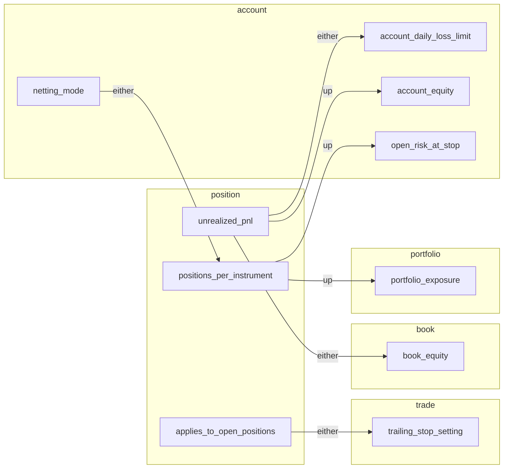
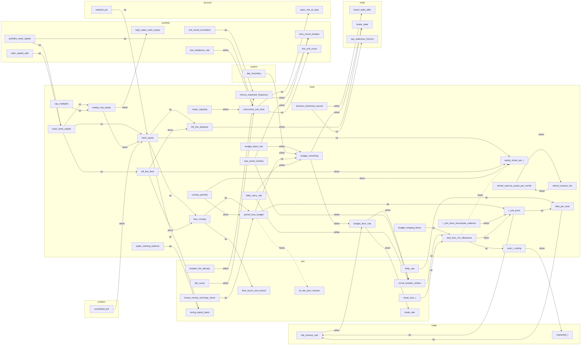
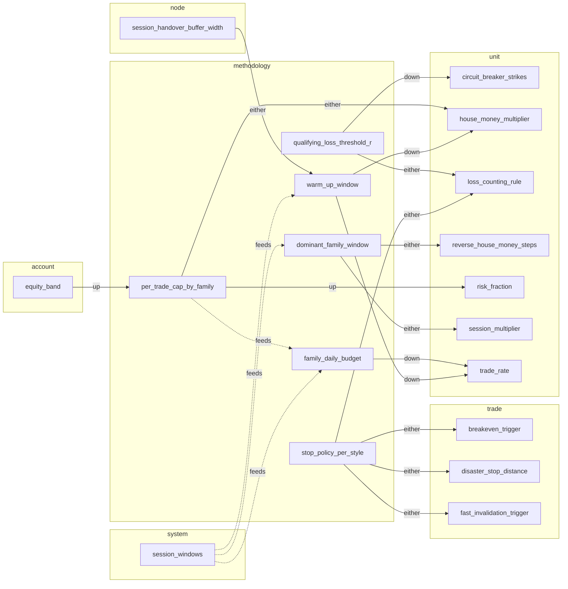
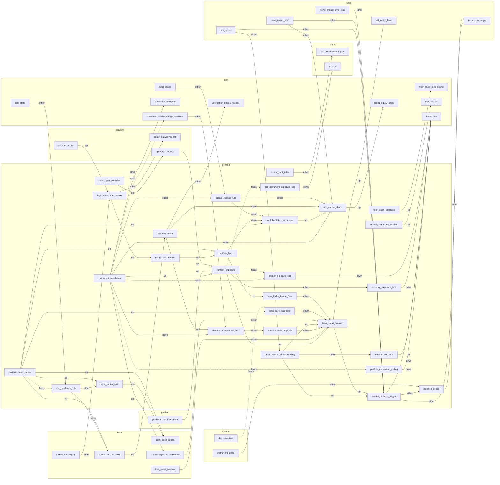
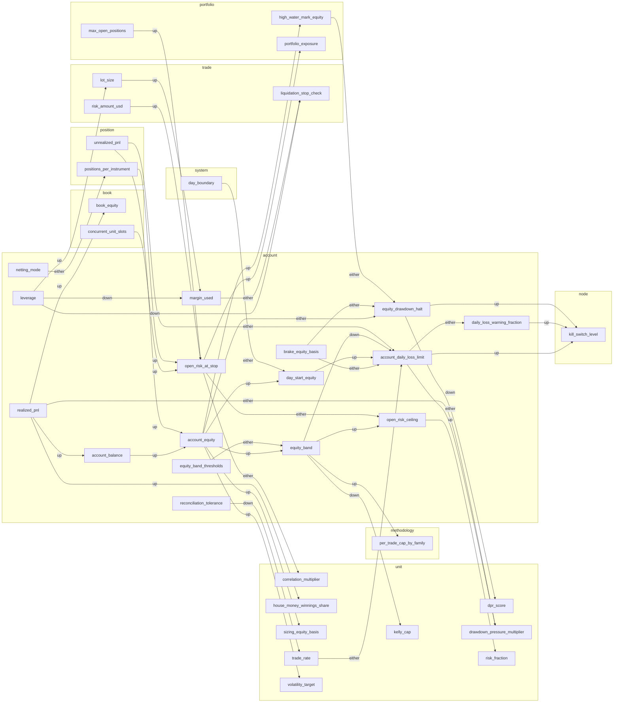

# Variable couplings

Generated by `check.py`. Do not edit by hand; edit the YAML and rerun the checker.

Files: variables.yaml. Variables: 267. Couplings: 473.

Arrows: `up` means a rise in the source pushes the target up, `down` pushes it down, `either` depends on the case.
A dotted `feeds` arrow means the target lists the source in `inputs` and the source does not list the target in `affects`.
The full graph is large; Mermaid viewers may refuse to draw more than about 500 edges, so each level also has its own graph.

## All couplings, grouped by level

### Full graph

```mermaid
flowchart LR
  subgraph L_trade["trade"]
    amend_min_improvement["amend_min_improvement"]
    breakeven_offset["breakeven_offset"]
    breakeven_trigger["breakeven_trigger"]
    commission_cost["commission_cost"]
    disaster_stop_distance["disaster_stop_distance"]
    excursion_mae_mfe_r["excursion_mae_mfe_r"]
    exit_reason_code["exit_reason_code"]
    fast_invalidation_cut_r["fast_invalidation_cut_r"]
    fast_invalidation_trigger["fast_invalidation_trigger"]
    forced_flat_instant["forced_flat_instant"]
    funding_cost["funding_cost"]
    gap_loss_beyond_stop["gap_loss_beyond_stop"]
    giveback_fraction["giveback_fraction"]
    liquidation_stop_check["liquidation_stop_check"]
    lot_size["lot_size"]
    lot_step["lot_step"]
    max_hold_time["max_hold_time"]
    max_lot["max_lot"]
    min_lot["min_lot"]
    original_risk_r["original_risk_r"]
    partial_close_fraction["partial_close_fraction"]
    price_increment["price_increment"]
    requested_r["requested_r"]
    risk_amount_usd["risk_amount_usd"]
    roi_table_target["roi_table_target"]
    round_trip_cost_r["round_trip_cost_r"]
    rounding_residue_r["rounding_residue_r"]
    slippage_cost["slippage_cost"]
    spread_cost["spread_cost"]
    spread_cost_guard["spread_cost_guard"]
    stop_buffer["stop_buffer"]
    stop_distance["stop_distance"]
    stop_widening_allowed["stop_widening_allowed"]
    swap_financing_cost["swap_financing_cost"]
    take_profit_extension_threshold["take_profit_extension_threshold"]
    target_r["target_r"]
    trailing_stop_setting["trailing_stop_setting"]
    unrealised_profit_cap["unrealised_profit_cap"]
    value_per_point["value_per_point"]
  end
  subgraph L_position["position"]
    applies_to_open_positions["applies_to_open_positions"]
    positions_per_instrument["positions_per_instrument"]
    unrealized_pnl["unrealized_pnl"]
  end
  subgraph L_unit["unit"]
    average_win_r["average_win_r"]
    brake_precision["brake_precision"]
    breaker_expected_fire_rate["breaker_expected_fire_rate"]
    breaker_fire_density["breaker_fire_density"]
    breakeven_win_rate["breakeven_win_rate"]
    calibration_cadence_trades["calibration_cadence_trades"]
    calibration_min_trades["calibration_min_trades"]
    calibration_shrink_k["calibration_shrink_k"]
    cb_failed_recovery_count["cb_failed_recovery_count"]
    cb_fee_burn_fraction["cb_fee_burn_fraction"]
    circuit_breaker_reset["circuit_breaker_reset"]
    circuit_breaker_strikes["circuit_breaker_strikes"]
    circuit_breaker_window["circuit_breaker_window"]
    context_size_modifier["context_size_modifier"]
    correlated_market_merge_threshold["correlated_market_merge_threshold"]
    correlation_multiplier["correlation_multiplier"]
    cost_drift_multiple["cost_drift_multiple"]
    cost_stress_multiple["cost_stress_multiple"]
    cushion_share_per_trade["cushion_share_per_trade"]
    cusum_allowance_r["cusum_allowance_r"]
    cusum_limit["cusum_limit"]
    daily_r_digest["daily_r_digest"]
    daily_sharpe_audit_trigger["daily_sharpe_audit_trigger"]
    decay_alarm_expectancy_r["decay_alarm_expectancy_r"]
    decay_alarm_loss_streak["decay_alarm_loss_streak"]
    decay_recent_trades["decay_recent_trades"]
    decay_record_days["decay_record_days"]
    decay_watch_drop_r["decay_watch_drop_r"]
    decay_watch_loss_streak["decay_watch_loss_streak"]
    deflated_sharpe_min["deflated_sharpe_min"]
    dpr_multiplier["dpr_multiplier"]
    dpr_score["dpr_score"]
    drawdown_pressure_multiplier["drawdown_pressure_multiplier"]
    drift_size_down_step["drift_size_down_step"]
    drift_state["drift_state"]
    edge_range["edge_range"]
    edge_t_statistic["edge_t_statistic"]
    effective_tries["effective_tries"]
    expectancy_floor_r["expectancy_floor_r"]
    expectancy_r["expectancy_r"]
    floor_touch_size_bound["floor_touch_size_bound"]
    grow_back_rule["grow_back_rule"]
    house_money_combined_cap["house_money_combined_cap"]
    house_money_multiplier["house_money_multiplier"]
    house_money_scope["house_money_scope"]
    house_money_threshold["house_money_threshold"]
    house_money_winnings_share["house_money_winnings_share"]
    judge_market_shrink_k["judge_market_shrink_k"]
    kelly_cap["kelly_cap"]
    kelly_fraction_raw["kelly_fraction_raw"]
    kelly_multiplier["kelly_multiplier"]
    kelly_probation_discount["kelly_probation_discount"]
    kelly_shrink_factor["kelly_shrink_factor"]
    losing_day_streak["losing_day_streak"]
    losing_days_limit["losing_days_limit"]
    loss_counting_rule["loss_counting_rule"]
    loss_points_bench_threshold["loss_points_bench_threshold"]
    loss_points_total["loss_points_total"]
    loss_streak["loss_streak"]
    low_profit_lock["low_profit_lock"]
    max_position_size_lots["max_position_size_lots"]
    mc_cone_floor_percentile["mc_cone_floor_percentile"]
    mean_loss_r["mean_loss_r"]
    microstructure_multiplier["microstructure_multiplier"]
    min_net_rr_gate["min_net_rr_gate"]
    min_trades_for_verdict["min_trades_for_verdict"]
    monte_carlo_p5_floor["monte_carlo_p5_floor"]
    monte_carlo_shuffle_count["monte_carlo_shuffle_count"]
    number_motion_mode["number_motion_mode"]
    paper_min_days["paper_min_days"]
    paper_min_trades["paper_min_trades"]
    paper_to_live_carry_rule["paper_to_live_carry_rule"]
    payoff_ratio["payoff_ratio"]
    pbo_dead_threshold["pbo_dead_threshold"]
    pbo_pass_threshold["pbo_pass_threshold"]
    physics_multiplier["physics_multiplier"]
    premium_window_flag["premium_window_flag"]
    ranking_score["ranking_score"]
    replay_match_floor["replay_match_floor"]
    repromotion_positive_demo_trades["repromotion_positive_demo_trades"]
    result_spread_r["result_spread_r"]
    reverse_house_money_steps["reverse_house_money_steps"]
    risk_fraction["risk_fraction"]
    risk_stop_resume_rule["risk_stop_resume_rule"]
    rvol_multiplier["rvol_multiplier"]
    sequential_evidence_pass["sequential_evidence_pass"]
    session_fill_limit["session_fill_limit"]
    session_fills["session_fills"]
    session_loss_limit_r["session_loss_limit_r"]
    session_multiplier["session_multiplier"]
    session_result_r["session_result_r"]
    size_levels["size_levels"]
    size_ramp_to_full["size_ramp_to_full"]
    sizing_equity_basis["sizing_equity_basis"]
    sprt_bounds["sprt_bounds"]
    stoploss_guard_lookback_bars["stoploss_guard_lookback_bars"]
    stoploss_guard_pause_bars["stoploss_guard_pause_bars"]
    stoploss_guard_trade_limit["stoploss_guard_trade_limit"]
    trade_rate["trade_rate"]
    trade_rate_band["trade_rate_band"]
    unit_cost_target["unit_cost_target"]
    unit_daily_loss_limit["unit_daily_loss_limit"]
    verification_trades_needed["verification_trades_needed"]
    viability_cost_fraction_max["viability_cost_fraction_max"]
    volatility_target["volatility_target"]
    walk_forward_efficiency_min["walk_forward_efficiency_min"]
    walk_forward_in_sample_months["walk_forward_in_sample_months"]
    walk_forward_out_of_sample_months["walk_forward_out_of_sample_months"]
    win_rate["win_rate"]
  end
  subgraph L_book["book"]
    book_equity["book_equity"]
    book_seed_capital["book_seed_capital"]
    budget_door_rule["budget_door_rule"]
    budget_drain_rule["budget_drain_rule"]
    budget_remaining["budget_remaining"]
    budget_shaping_factor["budget_shaping_factor"]
    cap_multiplier["cap_multiplier"]
    chorus_expected_frequency["chorus_expected_frequency"]
    concurrent_unit_slots["concurrent_unit_slots"]
    decision_freshness_bound["decision_freshness_bound"]
    equity_share_per_r["equity_share_per_r"]
    kill_line_distance["kill_line_distance"]
    kill_line_floor["kill_line_floor"]
    loss_event_window["loss_event_window"]
    loss_runway["loss_runway"]
    paper_starting_balance["paper_starting_balance"]
    period_loss_budget["period_loss_budget"]
    r_unit_price["r_unit_price"]
    r_unit_price_recompute_cadence["r_unit_price_recompute_cadence"]
    refund_reserve_cycles_per_month["refund_reserve_cycles_per_month"]
    refund_reserve_rho["refund_reserve_rho"]
    roster_capacity["roster_capacity"]
    runway_periods["runway_periods"]
    seat_loss_run_allowance["seat_loss_run_allowance"]
    seat_r_ceiling["seat_r_ceiling"]
    state_carry_rule["state_carry_rule"]
    sweep_cap_equity["sweep_cap_equity"]
    take_per_seat["take_per_seat"]
  end
  subgraph L_methodology["methodology"]
    dominant_family_window["dominant_family_window"]
    family_daily_budget["family_daily_budget"]
    per_trade_cap_by_family["per_trade_cap_by_family"]
    qualifying_loss_threshold_r["qualifying_loss_threshold_r"]
    stop_policy_per_style["stop_policy_per_style"]
    warm_up_window["warm_up_window"]
  end
  subgraph L_portfolio["portfolio"]
    bms_buffer_before_floor["bms_buffer_before_floor"]
    bms_circuit_breaker["bms_circuit_breaker"]
    bms_daily_loss_limit["bms_daily_loss_limit"]
    capital_sharing_rule["capital_sharing_rule"]
    cluster_exposure_cap["cluster_exposure_cap"]
    control_rank_table["control_rank_table"]
    cross_market_stress_reading["cross_market_stress_reading"]
    currency_exposure_limit["currency_exposure_limit"]
    effective_bets_drop_trip["effective_bets_drop_trip"]
    effective_independent_bets["effective_independent_bets"]
    floor_touch_tolerance["floor_touch_tolerance"]
    high_water_mark_equity["high_water_mark_equity"]
    isolation_end_rule["isolation_end_rule"]
    isolation_scope["isolation_scope"]
    live_unit_count["live_unit_count"]
    market_isolation_trigger["market_isolation_trigger"]
    max_open_positions["max_open_positions"]
    monthly_return_expectation["monthly_return_expectation"]
    per_instrument_exposure_cap["per_instrument_exposure_cap"]
    portfolio_correlation_ceiling["portfolio_correlation_ceiling"]
    portfolio_daily_risk_budget["portfolio_daily_risk_budget"]
    portfolio_exposure["portfolio_exposure"]
    portfolio_floor["portfolio_floor"]
    portfolio_seed_capital["portfolio_seed_capital"]
    rising_floor_fraction["rising_floor_fraction"]
    slot_rebalance_rule["slot_rebalance_rule"]
    style_capital_split["style_capital_split"]
    unit_capital_share["unit_capital_share"]
    unit_result_correlation["unit_result_correlation"]
  end
  subgraph L_account["account"]
    account_balance["account_balance"]
    account_daily_loss_limit["account_daily_loss_limit"]
    account_equity["account_equity"]
    brake_equity_basis["brake_equity_basis"]
    daily_loss_warning_fraction["daily_loss_warning_fraction"]
    day_start_equity["day_start_equity"]
    equity_band["equity_band"]
    equity_band_thresholds["equity_band_thresholds"]
    equity_drawdown_halt["equity_drawdown_halt"]
    leverage["leverage"]
    margin_used["margin_used"]
    netting_mode["netting_mode"]
    open_risk_at_stop["open_risk_at_stop"]
    open_risk_ceiling["open_risk_ceiling"]
    realized_pnl["realized_pnl"]
    reconciliation_tolerance["reconciliation_tolerance"]
  end
  subgraph L_node["node"]
    board_stale_after["board_stale_after"]
    brake_state["brake_state"]
    clock_drift_halt["clock_drift_halt"]
    clock_drift_no_new_entry["clock_drift_no_new_entry"]
    clock_drift_warn["clock_drift_warn"]
    crash_loop_max_restarts["crash_loop_max_restarts"]
    daily_dead_zone_width["daily_dead_zone_width"]
    disk_headroom_min["disk_headroom_min"]
    feed_stale_after["feed_stale_after"]
    kill_switch_detector_posture["kill_switch_detector_posture"]
    kill_switch_effect_matrix["kill_switch_effect_matrix"]
    kill_switch_level["kill_switch_level"]
    kill_switch_scope["kill_switch_scope"]
    liveness_heartbeat_cadence["liveness_heartbeat_cadence"]
    news_blackout_after["news_blackout_after"]
    news_blackout_before["news_blackout_before"]
    news_calendar_max_staleness["news_calendar_max_staleness"]
    news_impact_level_map["news_impact_level_map"]
    news_region_shift["news_region_shift"]
    protection_retry_max["protection_retry_max"]
    reconciliation_cadence["reconciliation_cadence"]
    session_handover_buffer_width["session_handover_buffer_width"]
    soft_kill_exit_schedule["soft_kill_exit_schedule"]
    sqs_baseline_conditioning["sqs_baseline_conditioning"]
    sqs_baseline_refit_schedule["sqs_baseline_refit_schedule"]
    sqs_hard_block_threshold["sqs_hard_block_threshold"]
    sqs_hysteresis_band["sqs_hysteresis_band"]
    sqs_outlier_guard_multiple["sqs_outlier_guard_multiple"]
    sqs_sample_cadence["sqs_sample_cadence"]
    sqs_score["sqs_score"]
    sqs_staleness_horizon["sqs_staleness_horizon"]
    watchdog_cadence["watchdog_cadence"]
    window_forced_flat["window_forced_flat"]
  end
  subgraph L_system["system"]
    day_boundary["day_boundary"]
    instrument_class["instrument_class"]
    numeraire["numeraire"]
    session_windows["session_windows"]
  end
  account_balance -->|up| account_equity
  account_daily_loss_limit -->|either| daily_loss_warning_fraction
  account_daily_loss_limit -->|either| drawdown_pressure_multiplier
  account_daily_loss_limit -->|up| kill_switch_level
  account_equity -->|up| day_start_equity
  account_equity -->|up| equity_band
  account_equity -->|either| equity_drawdown_halt
  account_equity -->|up| high_water_mark_equity
  account_equity -->|up| sizing_equity_basis
  account_equity -->|up| volatility_target
  amend_min_improvement -->|either| breakeven_trigger
  applies_to_open_positions -->|either| trailing_stop_setting
  average_win_r -.->|feeds| breakeven_win_rate
  average_win_r -->|up| expectancy_r
  average_win_r -->|up| payoff_ratio
  average_win_r -.->|feeds| result_spread_r
  bms_buffer_before_floor -->|either| bms_circuit_breaker
  bms_circuit_breaker -->|up| kill_switch_level
  bms_circuit_breaker -->|up| market_isolation_trigger
  bms_daily_loss_limit -->|either| bms_circuit_breaker
  board_stale_after -->|either| trade_rate
  book_equity -->|up| equity_share_per_r
  book_equity -->|up| kill_line_distance
  book_equity -->|up| loss_runway
  book_equity -->|up| sizing_equity_basis
  book_seed_capital -->|up| book_equity
  book_seed_capital -->|up| kill_line_floor
  book_seed_capital -->|up| sweep_cap_equity
  brake_equity_basis -->|either| account_daily_loss_limit
  brake_equity_basis -->|either| equity_drawdown_halt
  brake_precision -->|either| circuit_breaker_strikes
  breaker_expected_fire_rate -->|either| breaker_fire_density
  breaker_fire_density -->|either| chorus_expected_frequency
  breaker_fire_density -->|up| drift_state
  breakeven_offset -->|down| mean_loss_r
  breakeven_trigger -->|either| circuit_breaker_strikes
  breakeven_trigger -->|down| mean_loss_r
  breakeven_trigger -->|down| win_rate
  breakeven_win_rate -->|down| edge_range
  budget_door_rule -->|either| circuit_breaker_strikes
  budget_door_rule -->|down| trade_rate
  budget_drain_rule -->|either| budget_remaining
  budget_remaining -->|either| brake_state
  budget_remaining -->|either| budget_door_rule
  budget_shaping_factor -->|up| seat_loss_run_allowance
  calibration_cadence_trades -->|either| risk_fraction
  calibration_min_trades -->|either| risk_fraction
  calibration_shrink_k -->|either| risk_fraction
  cap_multiplier -->|up| sweep_cap_equity
  capital_sharing_rule -->|either| portfolio_daily_risk_budget
  capital_sharing_rule -->|either| unit_capital_share
  cb_failed_recovery_count -->|either| circuit_breaker_strikes
  cb_fee_burn_fraction -->|either| circuit_breaker_strikes
  chorus_expected_frequency -->|either| bms_circuit_breaker
  circuit_breaker_reset -->|up| trade_rate
  circuit_breaker_strikes -.->|feeds| breaker_expected_fire_rate
  circuit_breaker_strikes -->|down| breaker_fire_density
  circuit_breaker_strikes -->|up| seat_loss_run_allowance
  circuit_breaker_strikes -->|down| trade_rate
  circuit_breaker_window -->|either| circuit_breaker_strikes
  clock_drift_halt -->|down| trade_rate
  clock_drift_no_new_entry -.->|feeds| clock_drift_halt
  clock_drift_no_new_entry -->|down| trade_rate
  clock_drift_warn -->|either| clock_drift_no_new_entry
  cluster_exposure_cap -->|down| trade_rate
  commission_cost -->|up| round_trip_cost_r
  concurrent_unit_slots -->|up| live_unit_count
  concurrent_unit_slots -->|up| open_risk_at_stop
  context_size_modifier -->|either| physics_multiplier
  context_size_modifier -->|either| risk_fraction
  control_rank_table -->|either| fast_invalidation_trigger
  correlated_market_merge_threshold -->|either| effective_independent_bets
  correlation_multiplier -->|down| risk_fraction
  cost_drift_multiple -->|up| drift_state
  cost_stress_multiple -->|either| expectancy_floor_r
  crash_loop_max_restarts -->|down| trade_rate
  cross_market_stress_reading -->|up| bms_circuit_breaker
  cross_market_stress_reading -->|down| isolation_end_rule
  cross_market_stress_reading -->|up| market_isolation_trigger
  currency_exposure_limit -->|down| trade_rate
  cushion_share_per_trade -->|up| risk_fraction
  cusum_allowance_r -->|either| cusum_limit
  cusum_limit -->|down| drift_state
  daily_dead_zone_width -->|down| trade_rate
  daily_loss_warning_fraction -->|up| kill_switch_level
  daily_r_digest -->|either| losing_day_streak
  daily_sharpe_audit_trigger -->|either| edge_range
  day_boundary -.->|feeds| bms_daily_loss_limit
  day_boundary -->|either| budget_remaining
  day_boundary -->|either| circuit_breaker_reset
  day_boundary -.->|feeds| circuit_breaker_window
  day_boundary -.->|feeds| daily_r_digest
  day_boundary -->|either| day_start_equity
  day_boundary -.->|feeds| forced_flat_instant
  day_boundary -.->|feeds| unit_daily_loss_limit
  day_start_equity -->|up| account_daily_loss_limit
  decay_alarm_expectancy_r -->|up| drift_state
  decay_alarm_loss_streak -->|down| drift_state
  decay_recent_trades -->|either| drift_state
  decay_record_days -->|either| drift_state
  decay_watch_drop_r -->|down| drift_state
  decay_watch_loss_streak -->|down| drift_state
  decision_freshness_bound -->|either| board_stale_after
  decision_freshness_bound -->|up| sqs_staleness_horizon
  deflated_sharpe_min -->|either| edge_range
  disaster_stop_distance -->|down| gap_loss_beyond_stop
  disk_headroom_min -->|down| trade_rate
  dominant_family_window -->|either| reverse_house_money_steps
  dominant_family_window -->|either| session_multiplier
  dpr_multiplier -->|up| risk_fraction
  dpr_score -.->|feeds| cb_failed_recovery_count
  dpr_score -->|either| concurrent_unit_slots
  dpr_score -->|up| dpr_multiplier
  drawdown_pressure_multiplier -->|down| risk_fraction
  drift_size_down_step -->|down| risk_fraction
  drift_state -->|either| brake_state
  drift_state -->|up| drift_size_down_step
  drift_state -->|either| slot_rebalance_rule
  edge_range -->|either| capital_sharing_rule
  edge_range -->|up| kelly_shrink_factor
  edge_range -->|either| risk_fraction
  edge_t_statistic -.->|feeds| edge_range
  edge_t_statistic -->|up| kelly_shrink_factor
  effective_bets_drop_trip -->|either| bms_circuit_breaker
  effective_independent_bets -->|either| effective_bets_drop_trip
  effective_tries -->|either| deflated_sharpe_min
  equity_band -->|down| account_daily_loss_limit
  equity_band -->|down| kelly_cap
  equity_band -->|up| open_risk_ceiling
  equity_band -->|up| per_trade_cap_by_family
  equity_band_thresholds -->|either| equity_band
  equity_drawdown_halt -->|down| dpr_score
  equity_drawdown_halt -->|up| kill_switch_level
  excursion_mae_mfe_r -->|either| breaker_fire_density
  exit_reason_code -->|either| loss_counting_rule
  expectancy_floor_r -->|up| edge_range
  expectancy_r -.->|feeds| cusum_allowance_r
  expectancy_r -.->|feeds| decay_alarm_expectancy_r
  expectancy_r -.->|feeds| decay_watch_drop_r
  expectancy_r -->|up| dpr_score
  expectancy_r -->|up| edge_range
  expectancy_r -->|up| edge_t_statistic
  expectancy_r -.->|feeds| expectancy_floor_r
  expectancy_r -->|up| floor_touch_size_bound
  expectancy_r -->|up| kelly_fraction_raw
  expectancy_r -.->|feeds| low_profit_lock
  expectancy_r -->|up| ranking_score
  expectancy_r -.->|feeds| sequential_evidence_pass
  expectancy_r -.->|feeds| sprt_bounds
  expectancy_r -->|down| verification_trades_needed
  expectancy_r -.->|feeds| viability_cost_fraction_max
  family_daily_budget -->|down| trade_rate
  fast_invalidation_cut_r -->|up| loss_points_total
  fast_invalidation_cut_r -->|up| mean_loss_r
  fast_invalidation_trigger -->|either| exit_reason_code
  fast_invalidation_trigger -->|either| fast_invalidation_cut_r
  fast_invalidation_trigger -->|down| win_rate
  feed_stale_after -->|down| trade_rate
  floor_touch_size_bound -->|up| cushion_share_per_trade
  floor_touch_tolerance -->|up| floor_touch_size_bound
  forced_flat_instant -->|down| gap_loss_beyond_stop
  forced_flat_instant -->|down| swap_financing_cost
  funding_cost -->|either| round_trip_cost_r
  gap_loss_beyond_stop -->|up| mean_loss_r
  giveback_fraction -->|either| average_win_r
  grow_back_rule -->|up| risk_fraction
  high_water_mark_equity -->|either| equity_drawdown_halt
  high_water_mark_equity -->|up| rising_floor_fraction
  house_money_combined_cap -->|down| house_money_multiplier
  house_money_multiplier -->|up| risk_fraction
  house_money_scope -->|either| house_money_multiplier
  house_money_threshold -->|down| house_money_multiplier
  house_money_winnings_share -->|up| period_loss_budget
  instrument_class -->|either| isolation_scope
  instrument_class -->|either| news_impact_level_map
  instrument_class -->|either| sqs_hard_block_threshold
  isolation_end_rule -->|up| trade_rate
  isolation_scope -->|either| kill_switch_scope
  judge_market_shrink_k -->|down| edge_range
  kelly_cap -->|up| risk_fraction
  kelly_cap -->|up| take_per_seat
  kelly_fraction_raw -->|up| kelly_cap
  kelly_multiplier -->|up| kelly_cap
  kelly_probation_discount -->|up| kelly_cap
  kelly_shrink_factor -->|up| kelly_cap
  kill_line_distance -->|either| brake_state
  kill_line_floor -->|down| equity_share_per_r
  kill_line_floor -->|down| kill_line_distance
  kill_line_floor -->|down| loss_runway
  kill_switch_detector_posture -->|either| kill_switch_level
  kill_switch_effect_matrix -->|down| trade_rate
  kill_switch_level -->|either| kill_switch_effect_matrix
  kill_switch_level -->|down| trade_rate
  kill_switch_scope -->|either| market_isolation_trigger
  leverage -->|down| liquidation_stop_check
  leverage -->|up| lot_size
  leverage -->|down| margin_used
  liquidation_stop_check -->|down| lot_size
  live_unit_count -->|up| effective_independent_bets
  live_unit_count -->|down| unit_capital_share
  live_unit_count -->|either| verification_trades_needed
  liveness_heartbeat_cadence -->|either| brake_state
  losing_day_streak -->|either| losing_days_limit
  losing_days_limit -->|down| trade_rate
  loss_counting_rule -->|either| brake_precision
  loss_counting_rule -->|either| circuit_breaker_strikes
  loss_counting_rule -.->|feeds| loss_streak
  loss_counting_rule -.->|feeds| stoploss_guard_trade_limit
  loss_event_window -->|either| bms_circuit_breaker
  loss_event_window -->|either| circuit_breaker_strikes
  loss_points_bench_threshold -->|down| trade_rate
  loss_points_total -->|up| loss_points_bench_threshold
  loss_points_total -->|up| reverse_house_money_steps
  loss_runway -->|up| floor_touch_size_bound
  loss_runway -->|up| period_loss_budget
  loss_streak -->|either| decay_alarm_loss_streak
  loss_streak -->|either| decay_watch_loss_streak
  loss_streak -->|up| reverse_house_money_steps
  lot_size -->|up| margin_used
  lot_size -->|either| rounding_residue_r
  lot_step -->|down| lot_size
  lot_step -->|up| rounding_residue_r
  low_profit_lock -->|down| trade_rate
  margin_used -->|either| liquidation_stop_check
  market_isolation_trigger -->|either| isolation_scope
  market_isolation_trigger -->|down| trade_rate
  max_hold_time -->|either| exit_reason_code
  max_hold_time -->|either| mean_loss_r
  max_lot -->|down| lot_size
  max_open_positions -->|up| open_risk_at_stop
  max_position_size_lots -->|down| lot_size
  mc_cone_floor_percentile -->|up| drift_state
  mean_loss_r -.->|feeds| breakeven_win_rate
  mean_loss_r -->|down| expectancy_r
  mean_loss_r -->|up| loss_points_total
  mean_loss_r -->|down| payoff_ratio
  mean_loss_r -.->|feeds| result_spread_r
  mean_loss_r -->|up| seat_loss_run_allowance
  microstructure_multiplier -->|down| risk_fraction
  min_lot -->|up| lot_size
  min_net_rr_gate -->|down| trade_rate
  min_trades_for_verdict -->|either| expectancy_floor_r
  monte_carlo_p5_floor -->|up| edge_range
  monte_carlo_shuffle_count -->|either| monte_carlo_p5_floor
  monthly_return_expectation -->|up| risk_fraction
  netting_mode -->|either| positions_per_instrument
  news_blackout_after -->|down| trade_rate
  news_blackout_before -.->|feeds| soft_kill_exit_schedule
  news_blackout_before -->|down| trade_rate
  news_calendar_max_staleness -->|down| trade_rate
  news_impact_level_map -->|up| kill_switch_level
  news_impact_level_map -->|either| market_isolation_trigger
  news_impact_level_map -->|either| news_blackout_after
  news_impact_level_map -->|either| news_blackout_before
  news_impact_level_map -->|either| news_region_shift
  news_region_shift -->|either| market_isolation_trigger
  news_region_shift -->|either| unit_capital_share
  number_motion_mode -->|either| risk_fraction
  numeraire -->|either| value_per_point
  open_risk_at_stop -->|either| correlation_multiplier
  open_risk_at_stop -->|either| open_risk_ceiling
  open_risk_at_stop -->|up| portfolio_exposure
  open_risk_ceiling -->|up| risk_fraction
  original_risk_r -->|either| excursion_mae_mfe_r
  original_risk_r -->|either| mean_loss_r
  paper_min_days -->|either| paper_min_trades
  paper_min_trades -->|either| paper_min_days
  paper_starting_balance -->|up| sizing_equity_basis
  paper_to_live_carry_rule -->|either| risk_fraction
  paper_to_live_carry_rule -->|either| size_ramp_to_full
  partial_close_fraction -->|either| average_win_r
  payoff_ratio -->|up| kelly_fraction_raw
  payoff_ratio -->|either| min_net_rr_gate
  pbo_dead_threshold -->|either| edge_range
  pbo_pass_threshold -->|either| edge_range
  per_instrument_exposure_cap -->|down| lot_size
  per_trade_cap_by_family -.->|feeds| family_daily_budget
  per_trade_cap_by_family -->|either| house_money_multiplier
  per_trade_cap_by_family -->|up| risk_fraction
  period_loss_budget -->|up| budget_remaining
  period_loss_budget -.->|feeds| cb_fee_burn_fraction
  period_loss_budget -->|up| r_unit_price
  physics_multiplier -->|down| risk_fraction
  portfolio_correlation_ceiling -->|down| trade_rate
  portfolio_daily_risk_budget -->|up| unit_capital_share
  portfolio_exposure -->|up| bms_circuit_breaker
  portfolio_exposure -.->|feeds| cluster_exposure_cap
  portfolio_exposure -->|either| currency_exposure_limit
  portfolio_exposure -.->|feeds| per_instrument_exposure_cap
  portfolio_floor -->|up| bms_buffer_before_floor
  portfolio_floor -->|down| portfolio_daily_risk_budget
  portfolio_seed_capital -->|up| bms_daily_loss_limit
  portfolio_seed_capital -->|up| book_seed_capital
  portfolio_seed_capital -->|up| concurrent_unit_slots
  portfolio_seed_capital -->|up| portfolio_daily_risk_budget
  portfolio_seed_capital -->|up| portfolio_floor
  portfolio_seed_capital -.->|feeds| slot_rebalance_rule
  portfolio_seed_capital -->|up| style_capital_split
  positions_per_instrument -->|up| open_risk_at_stop
  positions_per_instrument -->|up| portfolio_exposure
  premium_window_flag -->|up| session_multiplier
  premium_window_flag -->|either| trade_rate
  price_increment -->|either| stop_distance
  protection_retry_max -->|down| gap_loss_beyond_stop
  qualifying_loss_threshold_r -->|down| circuit_breaker_strikes
  qualifying_loss_threshold_r -->|either| loss_counting_rule
  r_unit_price -->|up| risk_amount_usd
  r_unit_price -->|up| take_per_seat
  r_unit_price_recompute_cadence -->|either| r_unit_price
  realized_pnl -->|up| account_balance
  realized_pnl -->|up| book_equity
  realized_pnl -->|either| drawdown_pressure_multiplier
  realized_pnl -->|up| house_money_winnings_share
  reconciliation_cadence -->|either| slippage_cost
  reconciliation_tolerance -->|down| trade_rate
  refund_reserve_cycles_per_month -->|either| refund_reserve_rho
  refund_reserve_rho -->|either| refund_reserve_cycles_per_month
  replay_match_floor -->|up| drift_state
  repromotion_positive_demo_trades -->|down| circuit_breaker_reset
  requested_r -->|up| risk_amount_usd
  result_spread_r -.->|feeds| cusum_limit
  result_spread_r -.->|feeds| edge_t_statistic
  result_spread_r -->|down| floor_touch_size_bound
  result_spread_r -->|down| kelly_fraction_raw
  result_spread_r -.->|feeds| ranking_score
  result_spread_r -.->|feeds| sprt_bounds
  result_spread_r -->|up| verification_trades_needed
  reverse_house_money_steps -->|down| risk_fraction
  rising_floor_fraction -->|up| portfolio_floor
  risk_amount_usd -->|either| budget_door_rule
  risk_amount_usd -->|up| lot_size
  risk_amount_usd -->|up| open_risk_at_stop
  risk_amount_usd -->|either| original_risk_r
  risk_amount_usd -->|either| rounding_residue_r
  risk_fraction -->|either| brake_precision
  risk_fraction -->|up| risk_amount_usd
  risk_stop_resume_rule -->|either| circuit_breaker_reset
  roi_table_target -->|down| average_win_r
  roi_table_target -->|up| win_rate
  roster_capacity -->|either| concurrent_unit_slots
  round_trip_cost_r -->|up| breakeven_win_rate
  round_trip_cost_r -.->|feeds| cb_fee_burn_fraction
  round_trip_cost_r -.->|feeds| cost_drift_multiple
  round_trip_cost_r -->|down| expectancy_r
  round_trip_cost_r -.->|feeds| unit_cost_target
  round_trip_cost_r -->|either| viability_cost_fraction_max
  runway_periods -->|down| equity_share_per_r
  runway_periods -->|down| period_loss_budget
  rvol_multiplier -.->|feeds| house_money_combined_cap
  rvol_multiplier -->|up| risk_fraction
  seat_loss_run_allowance -.->|feeds| equity_share_per_r
  seat_loss_run_allowance -->|down| r_unit_price
  seat_loss_run_allowance -->|up| seat_r_ceiling
  seat_r_ceiling -->|down| requested_r
  sequential_evidence_pass -->|either| grow_back_rule
  session_fill_limit -->|down| trade_rate
  session_fills -->|either| session_fill_limit
  session_handover_buffer_width -->|down| trade_rate
  session_handover_buffer_width -->|either| warm_up_window
  session_loss_limit_r -->|down| trade_rate
  session_multiplier -->|either| risk_fraction
  session_result_r -->|either| session_loss_limit_r
  session_result_r -->|either| unit_daily_loss_limit
  session_windows -.->|feeds| circuit_breaker_window
  session_windows -.->|feeds| daily_dead_zone_width
  session_windows -.->|feeds| dominant_family_window
  session_windows -.->|feeds| family_daily_budget
  session_windows -.->|feeds| forced_flat_instant
  session_windows -.->|feeds| news_region_shift
  session_windows -->|either| premium_window_flag
  session_windows -.->|feeds| session_fills
  session_windows -.->|feeds| session_handover_buffer_width
  session_windows -->|either| session_multiplier
  session_windows -->|either| session_result_r
  session_windows -.->|feeds| sqs_baseline_conditioning
  session_windows -.->|feeds| warm_up_window
  size_levels -->|either| drift_size_down_step
  size_levels -->|either| size_ramp_to_full
  size_ramp_to_full -->|up| risk_fraction
  sizing_equity_basis -->|up| risk_amount_usd
  slippage_cost -->|up| cost_drift_multiple
  slippage_cost -->|up| round_trip_cost_r
  slot_rebalance_rule -->|either| concurrent_unit_slots
  slot_rebalance_rule -->|either| style_capital_split
  soft_kill_exit_schedule -->|down| gap_loss_beyond_stop
  spread_cost -->|up| breakeven_offset
  spread_cost -->|up| round_trip_cost_r
  spread_cost -->|up| spread_cost_guard
  spread_cost -->|down| sqs_score
  spread_cost_guard -->|down| round_trip_cost_r
  spread_cost_guard -->|down| trade_rate
  sprt_bounds -->|either| verification_trades_needed
  sqs_baseline_conditioning -->|either| sqs_score
  sqs_baseline_refit_schedule -->|either| sqs_score
  sqs_hard_block_threshold -->|down| trade_rate
  sqs_hysteresis_band -->|down| trade_rate
  sqs_outlier_guard_multiple -->|either| sqs_score
  sqs_sample_cadence -->|either| sqs_score
  sqs_score -->|either| cross_market_stress_reading
  sqs_score -->|either| market_isolation_trigger
  sqs_score -->|either| microstructure_multiplier
  sqs_score -->|either| sqs_hard_block_threshold
  sqs_score -.->|feeds| sqs_hysteresis_band
  sqs_staleness_horizon -->|down| trade_rate
  state_carry_rule -->|either| budget_remaining
  state_carry_rule -->|either| circuit_breaker_strikes
  stop_buffer -->|up| stop_distance
  stop_distance -.->|feeds| gap_loss_beyond_stop
  stop_distance -->|down| lot_size
  stop_distance -->|either| original_risk_r
  stop_distance -->|down| round_trip_cost_r
  stop_policy_per_style -->|either| breakeven_trigger
  stop_policy_per_style -->|either| disaster_stop_distance
  stop_policy_per_style -->|either| fast_invalidation_trigger
  stop_policy_per_style -->|either| loss_counting_rule
  stop_widening_allowed -->|up| gap_loss_beyond_stop
  stoploss_guard_lookback_bars -->|either| stoploss_guard_trade_limit
  stoploss_guard_pause_bars -->|down| trade_rate
  stoploss_guard_trade_limit -->|down| trade_rate
  style_capital_split -->|up| book_seed_capital
  swap_financing_cost -->|up| round_trip_cost_r
  sweep_cap_equity -->|down| book_equity
  sweep_cap_equity -->|either| high_water_mark_equity
  take_per_seat -->|up| risk_amount_usd
  take_profit_extension_threshold -->|up| average_win_r
  target_r -->|up| average_win_r
  target_r -->|down| win_rate
  trade_rate -->|either| account_daily_loss_limit
  trade_rate -->|down| brake_precision
  trade_rate -->|up| breaker_expected_fire_rate
  trade_rate -->|up| circuit_breaker_strikes
  trade_rate -->|up| loss_points_bench_threshold
  trade_rate -->|up| ranking_score
  trade_rate -.->|feeds| trade_rate_band
  trade_rate -->|either| verification_trades_needed
  trade_rate_band -->|up| drift_state
  trailing_stop_setting -->|either| average_win_r
  trailing_stop_setting -->|down| circuit_breaker_strikes
  trailing_stop_setting -->|down| mean_loss_r
  unit_capital_share -->|up| sizing_equity_basis
  unit_cost_target -->|up| spread_cost_guard
  unit_daily_loss_limit -->|down| trade_rate
  unit_result_correlation -->|either| capital_sharing_rule
  unit_result_correlation -->|up| chorus_expected_frequency
  unit_result_correlation -.->|feeds| cluster_exposure_cap
  unit_result_correlation -.->|feeds| correlated_market_merge_threshold
  unit_result_correlation -->|down| correlation_multiplier
  unit_result_correlation -->|down| effective_independent_bets
  unit_result_correlation -.->|feeds| portfolio_correlation_ceiling
  unit_result_correlation -->|up| portfolio_exposure
  unit_result_correlation -->|down| unit_capital_share
  unrealised_profit_cap -->|down| average_win_r
  unrealized_pnl -->|either| account_daily_loss_limit
  unrealized_pnl -->|up| account_equity
  unrealized_pnl -->|either| book_equity
  value_per_point -->|down| lot_size
  verification_trades_needed -->|either| paper_min_trades
  viability_cost_fraction_max -->|down| trade_rate
  volatility_target -->|either| risk_fraction
  walk_forward_efficiency_min -->|either| edge_range
  walk_forward_in_sample_months -->|either| walk_forward_efficiency_min
  walk_forward_out_of_sample_months -->|either| walk_forward_efficiency_min
  warm_up_window -->|down| house_money_multiplier
  warm_up_window -->|down| trade_rate
  watchdog_cadence -->|either| brake_state
  win_rate -->|up| brake_precision
  win_rate -->|down| breaker_expected_fire_rate
  win_rate -.->|feeds| circuit_breaker_strikes
  win_rate -->|up| expectancy_r
  win_rate -->|up| kelly_fraction_raw
  win_rate -->|either| result_spread_r
  win_rate -->|down| verification_trades_needed
  window_forced_flat -->|down| gap_loss_beyond_stop
```

## One graph per level

Each graph shows the level's variables and every variable one step away.

### Level: trade (39 variables, 92 couplings)

```mermaid
flowchart LR
  subgraph L_trade["trade"]
    amend_min_improvement["amend_min_improvement"]
    breakeven_offset["breakeven_offset"]
    breakeven_trigger["breakeven_trigger"]
    commission_cost["commission_cost"]
    disaster_stop_distance["disaster_stop_distance"]
    excursion_mae_mfe_r["excursion_mae_mfe_r"]
    exit_reason_code["exit_reason_code"]
    fast_invalidation_cut_r["fast_invalidation_cut_r"]
    fast_invalidation_trigger["fast_invalidation_trigger"]
    forced_flat_instant["forced_flat_instant"]
    funding_cost["funding_cost"]
    gap_loss_beyond_stop["gap_loss_beyond_stop"]
    giveback_fraction["giveback_fraction"]
    liquidation_stop_check["liquidation_stop_check"]
    lot_size["lot_size"]
    lot_step["lot_step"]
    max_hold_time["max_hold_time"]
    max_lot["max_lot"]
    min_lot["min_lot"]
    original_risk_r["original_risk_r"]
    partial_close_fraction["partial_close_fraction"]
    price_increment["price_increment"]
    requested_r["requested_r"]
    risk_amount_usd["risk_amount_usd"]
    roi_table_target["roi_table_target"]
    round_trip_cost_r["round_trip_cost_r"]
    rounding_residue_r["rounding_residue_r"]
    slippage_cost["slippage_cost"]
    spread_cost["spread_cost"]
    spread_cost_guard["spread_cost_guard"]
    stop_buffer["stop_buffer"]
    stop_distance["stop_distance"]
    stop_widening_allowed["stop_widening_allowed"]
    swap_financing_cost["swap_financing_cost"]
    take_profit_extension_threshold["take_profit_extension_threshold"]
    target_r["target_r"]
    trailing_stop_setting["trailing_stop_setting"]
    unrealised_profit_cap["unrealised_profit_cap"]
    value_per_point["value_per_point"]
  end
  subgraph L_position["position"]
    applies_to_open_positions["applies_to_open_positions"]
  end
  subgraph L_unit["unit"]
    average_win_r["average_win_r"]
    breaker_fire_density["breaker_fire_density"]
    breakeven_win_rate["breakeven_win_rate"]
    cb_fee_burn_fraction["cb_fee_burn_fraction"]
    circuit_breaker_strikes["circuit_breaker_strikes"]
    cost_drift_multiple["cost_drift_multiple"]
    expectancy_r["expectancy_r"]
    loss_counting_rule["loss_counting_rule"]
    loss_points_total["loss_points_total"]
    max_position_size_lots["max_position_size_lots"]
    mean_loss_r["mean_loss_r"]
    risk_fraction["risk_fraction"]
    sizing_equity_basis["sizing_equity_basis"]
    trade_rate["trade_rate"]
    unit_cost_target["unit_cost_target"]
    viability_cost_fraction_max["viability_cost_fraction_max"]
    win_rate["win_rate"]
  end
  subgraph L_book["book"]
    budget_door_rule["budget_door_rule"]
    r_unit_price["r_unit_price"]
    seat_r_ceiling["seat_r_ceiling"]
    take_per_seat["take_per_seat"]
  end
  subgraph L_methodology["methodology"]
    stop_policy_per_style["stop_policy_per_style"]
  end
  subgraph L_portfolio["portfolio"]
    control_rank_table["control_rank_table"]
    per_instrument_exposure_cap["per_instrument_exposure_cap"]
  end
  subgraph L_account["account"]
    leverage["leverage"]
    margin_used["margin_used"]
    open_risk_at_stop["open_risk_at_stop"]
  end
  subgraph L_node["node"]
    protection_retry_max["protection_retry_max"]
    reconciliation_cadence["reconciliation_cadence"]
    soft_kill_exit_schedule["soft_kill_exit_schedule"]
    sqs_score["sqs_score"]
    window_forced_flat["window_forced_flat"]
  end
  subgraph L_system["system"]
    day_boundary["day_boundary"]
    numeraire["numeraire"]
    session_windows["session_windows"]
  end
  amend_min_improvement -->|either| breakeven_trigger
  applies_to_open_positions -->|either| trailing_stop_setting
  breakeven_offset -->|down| mean_loss_r
  breakeven_trigger -->|either| circuit_breaker_strikes
  breakeven_trigger -->|down| mean_loss_r
  breakeven_trigger -->|down| win_rate
  commission_cost -->|up| round_trip_cost_r
  control_rank_table -->|either| fast_invalidation_trigger
  day_boundary -.->|feeds| forced_flat_instant
  disaster_stop_distance -->|down| gap_loss_beyond_stop
  excursion_mae_mfe_r -->|either| breaker_fire_density
  exit_reason_code -->|either| loss_counting_rule
  fast_invalidation_cut_r -->|up| loss_points_total
  fast_invalidation_cut_r -->|up| mean_loss_r
  fast_invalidation_trigger -->|either| exit_reason_code
  fast_invalidation_trigger -->|either| fast_invalidation_cut_r
  fast_invalidation_trigger -->|down| win_rate
  forced_flat_instant -->|down| gap_loss_beyond_stop
  forced_flat_instant -->|down| swap_financing_cost
  funding_cost -->|either| round_trip_cost_r
  gap_loss_beyond_stop -->|up| mean_loss_r
  giveback_fraction -->|either| average_win_r
  leverage -->|down| liquidation_stop_check
  leverage -->|up| lot_size
  liquidation_stop_check -->|down| lot_size
  lot_size -->|up| margin_used
  lot_size -->|either| rounding_residue_r
  lot_step -->|down| lot_size
  lot_step -->|up| rounding_residue_r
  margin_used -->|either| liquidation_stop_check
  max_hold_time -->|either| exit_reason_code
  max_hold_time -->|either| mean_loss_r
  max_lot -->|down| lot_size
  max_position_size_lots -->|down| lot_size
  min_lot -->|up| lot_size
  numeraire -->|either| value_per_point
  original_risk_r -->|either| excursion_mae_mfe_r
  original_risk_r -->|either| mean_loss_r
  partial_close_fraction -->|either| average_win_r
  per_instrument_exposure_cap -->|down| lot_size
  price_increment -->|either| stop_distance
  protection_retry_max -->|down| gap_loss_beyond_stop
  r_unit_price -->|up| risk_amount_usd
  reconciliation_cadence -->|either| slippage_cost
  requested_r -->|up| risk_amount_usd
  risk_amount_usd -->|either| budget_door_rule
  risk_amount_usd -->|up| lot_size
  risk_amount_usd -->|up| open_risk_at_stop
  risk_amount_usd -->|either| original_risk_r
  risk_amount_usd -->|either| rounding_residue_r
  risk_fraction -->|up| risk_amount_usd
  roi_table_target -->|down| average_win_r
  roi_table_target -->|up| win_rate
  round_trip_cost_r -->|up| breakeven_win_rate
  round_trip_cost_r -.->|feeds| cb_fee_burn_fraction
  round_trip_cost_r -.->|feeds| cost_drift_multiple
  round_trip_cost_r -->|down| expectancy_r
  round_trip_cost_r -.->|feeds| unit_cost_target
  round_trip_cost_r -->|either| viability_cost_fraction_max
  seat_r_ceiling -->|down| requested_r
  session_windows -.->|feeds| forced_flat_instant
  sizing_equity_basis -->|up| risk_amount_usd
  slippage_cost -->|up| cost_drift_multiple
  slippage_cost -->|up| round_trip_cost_r
  soft_kill_exit_schedule -->|down| gap_loss_beyond_stop
  spread_cost -->|up| breakeven_offset
  spread_cost -->|up| round_trip_cost_r
  spread_cost -->|up| spread_cost_guard
  spread_cost -->|down| sqs_score
  spread_cost_guard -->|down| round_trip_cost_r
  spread_cost_guard -->|down| trade_rate
  stop_buffer -->|up| stop_distance
  stop_distance -.->|feeds| gap_loss_beyond_stop
  stop_distance -->|down| lot_size
  stop_distance -->|either| original_risk_r
  stop_distance -->|down| round_trip_cost_r
  stop_policy_per_style -->|either| breakeven_trigger
  stop_policy_per_style -->|either| disaster_stop_distance
  stop_policy_per_style -->|either| fast_invalidation_trigger
  stop_widening_allowed -->|up| gap_loss_beyond_stop
  swap_financing_cost -->|up| round_trip_cost_r
  take_per_seat -->|up| risk_amount_usd
  take_profit_extension_threshold -->|up| average_win_r
  target_r -->|up| average_win_r
  target_r -->|down| win_rate
  trailing_stop_setting -->|either| average_win_r
  trailing_stop_setting -->|down| circuit_breaker_strikes
  trailing_stop_setting -->|down| mean_loss_r
  unit_cost_target -->|up| spread_cost_guard
  unrealised_profit_cap -->|down| average_win_r
  value_per_point -->|down| lot_size
  window_forced_flat -->|down| gap_loss_beyond_stop
```



### Level: position (3 variables, 7 couplings)



### Level: unit (109 variables, 271 couplings)

```mermaid
flowchart LR
  subgraph L_trade["trade"]
    breakeven_offset["breakeven_offset"]
    breakeven_trigger["breakeven_trigger"]
    excursion_mae_mfe_r["excursion_mae_mfe_r"]
    exit_reason_code["exit_reason_code"]
    fast_invalidation_cut_r["fast_invalidation_cut_r"]
    fast_invalidation_trigger["fast_invalidation_trigger"]
    gap_loss_beyond_stop["gap_loss_beyond_stop"]
    giveback_fraction["giveback_fraction"]
    lot_size["lot_size"]
    max_hold_time["max_hold_time"]
    original_risk_r["original_risk_r"]
    partial_close_fraction["partial_close_fraction"]
    risk_amount_usd["risk_amount_usd"]
    roi_table_target["roi_table_target"]
    round_trip_cost_r["round_trip_cost_r"]
    slippage_cost["slippage_cost"]
    spread_cost_guard["spread_cost_guard"]
    take_profit_extension_threshold["take_profit_extension_threshold"]
    target_r["target_r"]
    trailing_stop_setting["trailing_stop_setting"]
    unrealised_profit_cap["unrealised_profit_cap"]
  end
  subgraph L_unit["unit"]
    average_win_r["average_win_r"]
    brake_precision["brake_precision"]
    breaker_expected_fire_rate["breaker_expected_fire_rate"]
    breaker_fire_density["breaker_fire_density"]
    breakeven_win_rate["breakeven_win_rate"]
    calibration_cadence_trades["calibration_cadence_trades"]
    calibration_min_trades["calibration_min_trades"]
    calibration_shrink_k["calibration_shrink_k"]
    cb_failed_recovery_count["cb_failed_recovery_count"]
    cb_fee_burn_fraction["cb_fee_burn_fraction"]
    circuit_breaker_reset["circuit_breaker_reset"]
    circuit_breaker_strikes["circuit_breaker_strikes"]
    circuit_breaker_window["circuit_breaker_window"]
    context_size_modifier["context_size_modifier"]
    correlated_market_merge_threshold["correlated_market_merge_threshold"]
    correlation_multiplier["correlation_multiplier"]
    cost_drift_multiple["cost_drift_multiple"]
    cost_stress_multiple["cost_stress_multiple"]
    cushion_share_per_trade["cushion_share_per_trade"]
    cusum_allowance_r["cusum_allowance_r"]
    cusum_limit["cusum_limit"]
    daily_r_digest["daily_r_digest"]
    daily_sharpe_audit_trigger["daily_sharpe_audit_trigger"]
    decay_alarm_expectancy_r["decay_alarm_expectancy_r"]
    decay_alarm_loss_streak["decay_alarm_loss_streak"]
    decay_recent_trades["decay_recent_trades"]
    decay_record_days["decay_record_days"]
    decay_watch_drop_r["decay_watch_drop_r"]
    decay_watch_loss_streak["decay_watch_loss_streak"]
    deflated_sharpe_min["deflated_sharpe_min"]
    dpr_multiplier["dpr_multiplier"]
    dpr_score["dpr_score"]
    drawdown_pressure_multiplier["drawdown_pressure_multiplier"]
    drift_size_down_step["drift_size_down_step"]
    drift_state["drift_state"]
    edge_range["edge_range"]
    edge_t_statistic["edge_t_statistic"]
    effective_tries["effective_tries"]
    expectancy_floor_r["expectancy_floor_r"]
    expectancy_r["expectancy_r"]
    floor_touch_size_bound["floor_touch_size_bound"]
    grow_back_rule["grow_back_rule"]
    house_money_combined_cap["house_money_combined_cap"]
    house_money_multiplier["house_money_multiplier"]
    house_money_scope["house_money_scope"]
    house_money_threshold["house_money_threshold"]
    house_money_winnings_share["house_money_winnings_share"]
    judge_market_shrink_k["judge_market_shrink_k"]
    kelly_cap["kelly_cap"]
    kelly_fraction_raw["kelly_fraction_raw"]
    kelly_multiplier["kelly_multiplier"]
    kelly_probation_discount["kelly_probation_discount"]
    kelly_shrink_factor["kelly_shrink_factor"]
    losing_day_streak["losing_day_streak"]
    losing_days_limit["losing_days_limit"]
    loss_counting_rule["loss_counting_rule"]
    loss_points_bench_threshold["loss_points_bench_threshold"]
    loss_points_total["loss_points_total"]
    loss_streak["loss_streak"]
    low_profit_lock["low_profit_lock"]
    max_position_size_lots["max_position_size_lots"]
    mc_cone_floor_percentile["mc_cone_floor_percentile"]
    mean_loss_r["mean_loss_r"]
    microstructure_multiplier["microstructure_multiplier"]
    min_net_rr_gate["min_net_rr_gate"]
    min_trades_for_verdict["min_trades_for_verdict"]
    monte_carlo_p5_floor["monte_carlo_p5_floor"]
    monte_carlo_shuffle_count["monte_carlo_shuffle_count"]
    number_motion_mode["number_motion_mode"]
    paper_min_days["paper_min_days"]
    paper_min_trades["paper_min_trades"]
    paper_to_live_carry_rule["paper_to_live_carry_rule"]
    payoff_ratio["payoff_ratio"]
    pbo_dead_threshold["pbo_dead_threshold"]
    pbo_pass_threshold["pbo_pass_threshold"]
    physics_multiplier["physics_multiplier"]
    premium_window_flag["premium_window_flag"]
    ranking_score["ranking_score"]
    replay_match_floor["replay_match_floor"]
    repromotion_positive_demo_trades["repromotion_positive_demo_trades"]
    result_spread_r["result_spread_r"]
    reverse_house_money_steps["reverse_house_money_steps"]
    risk_fraction["risk_fraction"]
    risk_stop_resume_rule["risk_stop_resume_rule"]
    rvol_multiplier["rvol_multiplier"]
    sequential_evidence_pass["sequential_evidence_pass"]
    session_fill_limit["session_fill_limit"]
    session_fills["session_fills"]
    session_loss_limit_r["session_loss_limit_r"]
    session_multiplier["session_multiplier"]
    session_result_r["session_result_r"]
    size_levels["size_levels"]
    size_ramp_to_full["size_ramp_to_full"]
    sizing_equity_basis["sizing_equity_basis"]
    sprt_bounds["sprt_bounds"]
    stoploss_guard_lookback_bars["stoploss_guard_lookback_bars"]
    stoploss_guard_pause_bars["stoploss_guard_pause_bars"]
    stoploss_guard_trade_limit["stoploss_guard_trade_limit"]
    trade_rate["trade_rate"]
    trade_rate_band["trade_rate_band"]
    unit_cost_target["unit_cost_target"]
    unit_daily_loss_limit["unit_daily_loss_limit"]
    verification_trades_needed["verification_trades_needed"]
    viability_cost_fraction_max["viability_cost_fraction_max"]
    volatility_target["volatility_target"]
    walk_forward_efficiency_min["walk_forward_efficiency_min"]
    walk_forward_in_sample_months["walk_forward_in_sample_months"]
    walk_forward_out_of_sample_months["walk_forward_out_of_sample_months"]
    win_rate["win_rate"]
  end
  subgraph L_book["book"]
    book_equity["book_equity"]
    budget_door_rule["budget_door_rule"]
    chorus_expected_frequency["chorus_expected_frequency"]
    concurrent_unit_slots["concurrent_unit_slots"]
    loss_event_window["loss_event_window"]
    loss_runway["loss_runway"]
    paper_starting_balance["paper_starting_balance"]
    period_loss_budget["period_loss_budget"]
    seat_loss_run_allowance["seat_loss_run_allowance"]
    state_carry_rule["state_carry_rule"]
    take_per_seat["take_per_seat"]
  end
  subgraph L_methodology["methodology"]
    dominant_family_window["dominant_family_window"]
    family_daily_budget["family_daily_budget"]
    per_trade_cap_by_family["per_trade_cap_by_family"]
    qualifying_loss_threshold_r["qualifying_loss_threshold_r"]
    stop_policy_per_style["stop_policy_per_style"]
    warm_up_window["warm_up_window"]
  end
  subgraph L_portfolio["portfolio"]
    capital_sharing_rule["capital_sharing_rule"]
    cluster_exposure_cap["cluster_exposure_cap"]
    currency_exposure_limit["currency_exposure_limit"]
    effective_independent_bets["effective_independent_bets"]
    floor_touch_tolerance["floor_touch_tolerance"]
    isolation_end_rule["isolation_end_rule"]
    live_unit_count["live_unit_count"]
    market_isolation_trigger["market_isolation_trigger"]
    monthly_return_expectation["monthly_return_expectation"]
    portfolio_correlation_ceiling["portfolio_correlation_ceiling"]
    slot_rebalance_rule["slot_rebalance_rule"]
    unit_capital_share["unit_capital_share"]
    unit_result_correlation["unit_result_correlation"]
  end
  subgraph L_account["account"]
    account_daily_loss_limit["account_daily_loss_limit"]
    account_equity["account_equity"]
    equity_band["equity_band"]
    equity_drawdown_halt["equity_drawdown_halt"]
    open_risk_at_stop["open_risk_at_stop"]
    open_risk_ceiling["open_risk_ceiling"]
    realized_pnl["realized_pnl"]
    reconciliation_tolerance["reconciliation_tolerance"]
  end
  subgraph L_node["node"]
    board_stale_after["board_stale_after"]
    brake_state["brake_state"]
    clock_drift_halt["clock_drift_halt"]
    clock_drift_no_new_entry["clock_drift_no_new_entry"]
    crash_loop_max_restarts["crash_loop_max_restarts"]
    daily_dead_zone_width["daily_dead_zone_width"]
    disk_headroom_min["disk_headroom_min"]
    feed_stale_after["feed_stale_after"]
    kill_switch_effect_matrix["kill_switch_effect_matrix"]
    kill_switch_level["kill_switch_level"]
    news_blackout_after["news_blackout_after"]
    news_blackout_before["news_blackout_before"]
    news_calendar_max_staleness["news_calendar_max_staleness"]
    session_handover_buffer_width["session_handover_buffer_width"]
    sqs_hard_block_threshold["sqs_hard_block_threshold"]
    sqs_hysteresis_band["sqs_hysteresis_band"]
    sqs_score["sqs_score"]
    sqs_staleness_horizon["sqs_staleness_horizon"]
  end
  subgraph L_system["system"]
    day_boundary["day_boundary"]
    session_windows["session_windows"]
  end
  account_daily_loss_limit -->|either| drawdown_pressure_multiplier
  account_equity -->|up| sizing_equity_basis
  account_equity -->|up| volatility_target
  average_win_r -.->|feeds| breakeven_win_rate
  average_win_r -->|up| expectancy_r
  average_win_r -->|up| payoff_ratio
  average_win_r -.->|feeds| result_spread_r
  board_stale_after -->|either| trade_rate
  book_equity -->|up| sizing_equity_basis
  brake_precision -->|either| circuit_breaker_strikes
  breaker_expected_fire_rate -->|either| breaker_fire_density
  breaker_fire_density -->|either| chorus_expected_frequency
  breaker_fire_density -->|up| drift_state
  breakeven_offset -->|down| mean_loss_r
  breakeven_trigger -->|either| circuit_breaker_strikes
  breakeven_trigger -->|down| mean_loss_r
  breakeven_trigger -->|down| win_rate
  breakeven_win_rate -->|down| edge_range
  budget_door_rule -->|either| circuit_breaker_strikes
  budget_door_rule -->|down| trade_rate
  calibration_cadence_trades -->|either| risk_fraction
  calibration_min_trades -->|either| risk_fraction
  calibration_shrink_k -->|either| risk_fraction
  cb_failed_recovery_count -->|either| circuit_breaker_strikes
  cb_fee_burn_fraction -->|either| circuit_breaker_strikes
  circuit_breaker_reset -->|up| trade_rate
  circuit_breaker_strikes -.->|feeds| breaker_expected_fire_rate
  circuit_breaker_strikes -->|down| breaker_fire_density
  circuit_breaker_strikes -->|up| seat_loss_run_allowance
  circuit_breaker_strikes -->|down| trade_rate
  circuit_breaker_window -->|either| circuit_breaker_strikes
  clock_drift_halt -->|down| trade_rate
  clock_drift_no_new_entry -->|down| trade_rate
  cluster_exposure_cap -->|down| trade_rate
  context_size_modifier -->|either| physics_multiplier
  context_size_modifier -->|either| risk_fraction
  correlated_market_merge_threshold -->|either| effective_independent_bets
  correlation_multiplier -->|down| risk_fraction
  cost_drift_multiple -->|up| drift_state
  cost_stress_multiple -->|either| expectancy_floor_r
  crash_loop_max_restarts -->|down| trade_rate
  currency_exposure_limit -->|down| trade_rate
  cushion_share_per_trade -->|up| risk_fraction
  cusum_allowance_r -->|either| cusum_limit
  cusum_limit -->|down| drift_state
  daily_dead_zone_width -->|down| trade_rate
  daily_r_digest -->|either| losing_day_streak
  daily_sharpe_audit_trigger -->|either| edge_range
  day_boundary -->|either| circuit_breaker_reset
  day_boundary -.->|feeds| circuit_breaker_window
  day_boundary -.->|feeds| daily_r_digest
  day_boundary -.->|feeds| unit_daily_loss_limit
  decay_alarm_expectancy_r -->|up| drift_state
  decay_alarm_loss_streak -->|down| drift_state
  decay_recent_trades -->|either| drift_state
  decay_record_days -->|either| drift_state
  decay_watch_drop_r -->|down| drift_state
  decay_watch_loss_streak -->|down| drift_state
  deflated_sharpe_min -->|either| edge_range
  disk_headroom_min -->|down| trade_rate
  dominant_family_window -->|either| reverse_house_money_steps
  dominant_family_window -->|either| session_multiplier
  dpr_multiplier -->|up| risk_fraction
  dpr_score -.->|feeds| cb_failed_recovery_count
  dpr_score -->|either| concurrent_unit_slots
  dpr_score -->|up| dpr_multiplier
  drawdown_pressure_multiplier -->|down| risk_fraction
  drift_size_down_step -->|down| risk_fraction
  drift_state -->|either| brake_state
  drift_state -->|up| drift_size_down_step
  drift_state -->|either| slot_rebalance_rule
  edge_range -->|either| capital_sharing_rule
  edge_range -->|up| kelly_shrink_factor
  edge_range -->|either| risk_fraction
  edge_t_statistic -.->|feeds| edge_range
  edge_t_statistic -->|up| kelly_shrink_factor
  effective_tries -->|either| deflated_sharpe_min
  equity_band -->|down| kelly_cap
  equity_drawdown_halt -->|down| dpr_score
  excursion_mae_mfe_r -->|either| breaker_fire_density
  exit_reason_code -->|either| loss_counting_rule
  expectancy_floor_r -->|up| edge_range
  expectancy_r -.->|feeds| cusum_allowance_r
  expectancy_r -.->|feeds| decay_alarm_expectancy_r
  expectancy_r -.->|feeds| decay_watch_drop_r
  expectancy_r -->|up| dpr_score
  expectancy_r -->|up| edge_range
  expectancy_r -->|up| edge_t_statistic
  expectancy_r -.->|feeds| expectancy_floor_r
  expectancy_r -->|up| floor_touch_size_bound
  expectancy_r -->|up| kelly_fraction_raw
  expectancy_r -.->|feeds| low_profit_lock
  expectancy_r -->|up| ranking_score
  expectancy_r -.->|feeds| sequential_evidence_pass
  expectancy_r -.->|feeds| sprt_bounds
  expectancy_r -->|down| verification_trades_needed
  expectancy_r -.->|feeds| viability_cost_fraction_max
  family_daily_budget -->|down| trade_rate
  fast_invalidation_cut_r -->|up| loss_points_total
  fast_invalidation_cut_r -->|up| mean_loss_r
  fast_invalidation_trigger -->|down| win_rate
  feed_stale_after -->|down| trade_rate
  floor_touch_size_bound -->|up| cushion_share_per_trade
  floor_touch_tolerance -->|up| floor_touch_size_bound
  gap_loss_beyond_stop -->|up| mean_loss_r
  giveback_fraction -->|either| average_win_r
  grow_back_rule -->|up| risk_fraction
  house_money_combined_cap -->|down| house_money_multiplier
  house_money_multiplier -->|up| risk_fraction
  house_money_scope -->|either| house_money_multiplier
  house_money_threshold -->|down| house_money_multiplier
  house_money_winnings_share -->|up| period_loss_budget
  isolation_end_rule -->|up| trade_rate
  judge_market_shrink_k -->|down| edge_range
  kelly_cap -->|up| risk_fraction
  kelly_cap -->|up| take_per_seat
  kelly_fraction_raw -->|up| kelly_cap
  kelly_multiplier -->|up| kelly_cap
  kelly_probation_discount -->|up| kelly_cap
  kelly_shrink_factor -->|up| kelly_cap
  kill_switch_effect_matrix -->|down| trade_rate
  kill_switch_level -->|down| trade_rate
  live_unit_count -->|either| verification_trades_needed
  losing_day_streak -->|either| losing_days_limit
  losing_days_limit -->|down| trade_rate
  loss_counting_rule -->|either| brake_precision
  loss_counting_rule -->|either| circuit_breaker_strikes
  loss_counting_rule -.->|feeds| loss_streak
  loss_counting_rule -.->|feeds| stoploss_guard_trade_limit
  loss_event_window -->|either| circuit_breaker_strikes
  loss_points_bench_threshold -->|down| trade_rate
  loss_points_total -->|up| loss_points_bench_threshold
  loss_points_total -->|up| reverse_house_money_steps
  loss_runway -->|up| floor_touch_size_bound
  loss_streak -->|either| decay_alarm_loss_streak
  loss_streak -->|either| decay_watch_loss_streak
  loss_streak -->|up| reverse_house_money_steps
  low_profit_lock -->|down| trade_rate
  market_isolation_trigger -->|down| trade_rate
  max_hold_time -->|either| mean_loss_r
  max_position_size_lots -->|down| lot_size
  mc_cone_floor_percentile -->|up| drift_state
  mean_loss_r -.->|feeds| breakeven_win_rate
  mean_loss_r -->|down| expectancy_r
  mean_loss_r -->|up| loss_points_total
  mean_loss_r -->|down| payoff_ratio
  mean_loss_r -.->|feeds| result_spread_r
  mean_loss_r -->|up| seat_loss_run_allowance
  microstructure_multiplier -->|down| risk_fraction
  min_net_rr_gate -->|down| trade_rate
  min_trades_for_verdict -->|either| expectancy_floor_r
  monte_carlo_p5_floor -->|up| edge_range
  monte_carlo_shuffle_count -->|either| monte_carlo_p5_floor
  monthly_return_expectation -->|up| risk_fraction
  news_blackout_after -->|down| trade_rate
  news_blackout_before -->|down| trade_rate
  news_calendar_max_staleness -->|down| trade_rate
  number_motion_mode -->|either| risk_fraction
  open_risk_at_stop -->|either| correlation_multiplier
  open_risk_ceiling -->|up| risk_fraction
  original_risk_r -->|either| mean_loss_r
  paper_min_days -->|either| paper_min_trades
  paper_min_trades -->|either| paper_min_days
  paper_starting_balance -->|up| sizing_equity_basis
  paper_to_live_carry_rule -->|either| risk_fraction
  paper_to_live_carry_rule -->|either| size_ramp_to_full
  partial_close_fraction -->|either| average_win_r
  payoff_ratio -->|up| kelly_fraction_raw
  payoff_ratio -->|either| min_net_rr_gate
  pbo_dead_threshold -->|either| edge_range
  pbo_pass_threshold -->|either| edge_range
  per_trade_cap_by_family -->|either| house_money_multiplier
  per_trade_cap_by_family -->|up| risk_fraction
  period_loss_budget -.->|feeds| cb_fee_burn_fraction
  physics_multiplier -->|down| risk_fraction
  portfolio_correlation_ceiling -->|down| trade_rate
  premium_window_flag -->|up| session_multiplier
  premium_window_flag -->|either| trade_rate
  qualifying_loss_threshold_r -->|down| circuit_breaker_strikes
  qualifying_loss_threshold_r -->|either| loss_counting_rule
  realized_pnl -->|either| drawdown_pressure_multiplier
  realized_pnl -->|up| house_money_winnings_share
  reconciliation_tolerance -->|down| trade_rate
  replay_match_floor -->|up| drift_state
  repromotion_positive_demo_trades -->|down| circuit_breaker_reset
  result_spread_r -.->|feeds| cusum_limit
  result_spread_r -.->|feeds| edge_t_statistic
  result_spread_r -->|down| floor_touch_size_bound
  result_spread_r -->|down| kelly_fraction_raw
  result_spread_r -.->|feeds| ranking_score
  result_spread_r -.->|feeds| sprt_bounds
  result_spread_r -->|up| verification_trades_needed
  reverse_house_money_steps -->|down| risk_fraction
  risk_fraction -->|either| brake_precision
  risk_fraction -->|up| risk_amount_usd
  risk_stop_resume_rule -->|either| circuit_breaker_reset
  roi_table_target -->|down| average_win_r
  roi_table_target -->|up| win_rate
  round_trip_cost_r -->|up| breakeven_win_rate
  round_trip_cost_r -.->|feeds| cb_fee_burn_fraction
  round_trip_cost_r -.->|feeds| cost_drift_multiple
  round_trip_cost_r -->|down| expectancy_r
  round_trip_cost_r -.->|feeds| unit_cost_target
  round_trip_cost_r -->|either| viability_cost_fraction_max
  rvol_multiplier -.->|feeds| house_money_combined_cap
  rvol_multiplier -->|up| risk_fraction
  sequential_evidence_pass -->|either| grow_back_rule
  session_fill_limit -->|down| trade_rate
  session_fills -->|either| session_fill_limit
  session_handover_buffer_width -->|down| trade_rate
  session_loss_limit_r -->|down| trade_rate
  session_multiplier -->|either| risk_fraction
  session_result_r -->|either| session_loss_limit_r
  session_result_r -->|either| unit_daily_loss_limit
  session_windows -.->|feeds| circuit_breaker_window
  session_windows -->|either| premium_window_flag
  session_windows -.->|feeds| session_fills
  session_windows -->|either| session_multiplier
  session_windows -->|either| session_result_r
  size_levels -->|either| drift_size_down_step
  size_levels -->|either| size_ramp_to_full
  size_ramp_to_full -->|up| risk_fraction
  sizing_equity_basis -->|up| risk_amount_usd
  slippage_cost -->|up| cost_drift_multiple
  spread_cost_guard -->|down| trade_rate
  sprt_bounds -->|either| verification_trades_needed
  sqs_hard_block_threshold -->|down| trade_rate
  sqs_hysteresis_band -->|down| trade_rate
  sqs_score -->|either| microstructure_multiplier
  sqs_staleness_horizon -->|down| trade_rate
  state_carry_rule -->|either| circuit_breaker_strikes
  stop_policy_per_style -->|either| loss_counting_rule
  stoploss_guard_lookback_bars -->|either| stoploss_guard_trade_limit
  stoploss_guard_pause_bars -->|down| trade_rate
  stoploss_guard_trade_limit -->|down| trade_rate
  take_profit_extension_threshold -->|up| average_win_r
  target_r -->|up| average_win_r
  target_r -->|down| win_rate
  trade_rate -->|either| account_daily_loss_limit
  trade_rate -->|down| brake_precision
  trade_rate -->|up| breaker_expected_fire_rate
  trade_rate -->|up| circuit_breaker_strikes
  trade_rate -->|up| loss_points_bench_threshold
  trade_rate -->|up| ranking_score
  trade_rate -.->|feeds| trade_rate_band
  trade_rate -->|either| verification_trades_needed
  trade_rate_band -->|up| drift_state
  trailing_stop_setting -->|either| average_win_r
  trailing_stop_setting -->|down| circuit_breaker_strikes
  trailing_stop_setting -->|down| mean_loss_r
  unit_capital_share -->|up| sizing_equity_basis
  unit_cost_target -->|up| spread_cost_guard
  unit_daily_loss_limit -->|down| trade_rate
  unit_result_correlation -.->|feeds| correlated_market_merge_threshold
  unit_result_correlation -->|down| correlation_multiplier
  unrealised_profit_cap -->|down| average_win_r
  verification_trades_needed -->|either| paper_min_trades
  viability_cost_fraction_max -->|down| trade_rate
  volatility_target -->|either| risk_fraction
  walk_forward_efficiency_min -->|either| edge_range
  walk_forward_in_sample_months -->|either| walk_forward_efficiency_min
  walk_forward_out_of_sample_months -->|either| walk_forward_efficiency_min
  warm_up_window -->|down| house_money_multiplier
  warm_up_window -->|down| trade_rate
  win_rate -->|up| brake_precision
  win_rate -->|down| breaker_expected_fire_rate
  win_rate -.->|feeds| circuit_breaker_strikes
  win_rate -->|up| expectancy_r
  win_rate -->|up| kelly_fraction_raw
  win_rate -->|either| result_spread_r
  win_rate -->|down| verification_trades_needed
```

### Level: book (28 variables, 63 couplings)



### Level: methodology (6 variables, 19 couplings)



### Level: portfolio (29 variables, 74 couplings)



### Level: account (16 variables, 45 couplings)



### Level: node (33 variables, 62 couplings)

```mermaid
flowchart LR
  subgraph L_trade["trade"]
    gap_loss_beyond_stop["gap_loss_beyond_stop"]
    slippage_cost["slippage_cost"]
    spread_cost["spread_cost"]
  end
  subgraph L_unit["unit"]
    drift_state["drift_state"]
    microstructure_multiplier["microstructure_multiplier"]
    trade_rate["trade_rate"]
  end
  subgraph L_book["book"]
    budget_remaining["budget_remaining"]
    decision_freshness_bound["decision_freshness_bound"]
    kill_line_distance["kill_line_distance"]
  end
  subgraph L_methodology["methodology"]
    warm_up_window["warm_up_window"]
  end
  subgraph L_portfolio["portfolio"]
    bms_circuit_breaker["bms_circuit_breaker"]
    cross_market_stress_reading["cross_market_stress_reading"]
    isolation_scope["isolation_scope"]
    market_isolation_trigger["market_isolation_trigger"]
    unit_capital_share["unit_capital_share"]
  end
  subgraph L_account["account"]
    account_daily_loss_limit["account_daily_loss_limit"]
    daily_loss_warning_fraction["daily_loss_warning_fraction"]
    equity_drawdown_halt["equity_drawdown_halt"]
  end
  subgraph L_node["node"]
    board_stale_after["board_stale_after"]
    brake_state["brake_state"]
    clock_drift_halt["clock_drift_halt"]
    clock_drift_no_new_entry["clock_drift_no_new_entry"]
    clock_drift_warn["clock_drift_warn"]
    crash_loop_max_restarts["crash_loop_max_restarts"]
    daily_dead_zone_width["daily_dead_zone_width"]
    disk_headroom_min["disk_headroom_min"]
    feed_stale_after["feed_stale_after"]
    kill_switch_detector_posture["kill_switch_detector_posture"]
    kill_switch_effect_matrix["kill_switch_effect_matrix"]
    kill_switch_level["kill_switch_level"]
    kill_switch_scope["kill_switch_scope"]
    liveness_heartbeat_cadence["liveness_heartbeat_cadence"]
    news_blackout_after["news_blackout_after"]
    news_blackout_before["news_blackout_before"]
    news_calendar_max_staleness["news_calendar_max_staleness"]
    news_impact_level_map["news_impact_level_map"]
    news_region_shift["news_region_shift"]
    protection_retry_max["protection_retry_max"]
    reconciliation_cadence["reconciliation_cadence"]
    session_handover_buffer_width["session_handover_buffer_width"]
    soft_kill_exit_schedule["soft_kill_exit_schedule"]
    sqs_baseline_conditioning["sqs_baseline_conditioning"]
    sqs_baseline_refit_schedule["sqs_baseline_refit_schedule"]
    sqs_hard_block_threshold["sqs_hard_block_threshold"]
    sqs_hysteresis_band["sqs_hysteresis_band"]
    sqs_outlier_guard_multiple["sqs_outlier_guard_multiple"]
    sqs_sample_cadence["sqs_sample_cadence"]
    sqs_score["sqs_score"]
    sqs_staleness_horizon["sqs_staleness_horizon"]
    watchdog_cadence["watchdog_cadence"]
    window_forced_flat["window_forced_flat"]
  end
  subgraph L_system["system"]
    instrument_class["instrument_class"]
    session_windows["session_windows"]
  end
  account_daily_loss_limit -->|up| kill_switch_level
  bms_circuit_breaker -->|up| kill_switch_level
  board_stale_after -->|either| trade_rate
  budget_remaining -->|either| brake_state
  clock_drift_halt -->|down| trade_rate
  clock_drift_no_new_entry -.->|feeds| clock_drift_halt
  clock_drift_no_new_entry -->|down| trade_rate
  clock_drift_warn -->|either| clock_drift_no_new_entry
  crash_loop_max_restarts -->|down| trade_rate
  daily_dead_zone_width -->|down| trade_rate
  daily_loss_warning_fraction -->|up| kill_switch_level
  decision_freshness_bound -->|either| board_stale_after
  decision_freshness_bound -->|up| sqs_staleness_horizon
  disk_headroom_min -->|down| trade_rate
  drift_state -->|either| brake_state
  equity_drawdown_halt -->|up| kill_switch_level
  feed_stale_after -->|down| trade_rate
  instrument_class -->|either| news_impact_level_map
  instrument_class -->|either| sqs_hard_block_threshold
  isolation_scope -->|either| kill_switch_scope
  kill_line_distance -->|either| brake_state
  kill_switch_detector_posture -->|either| kill_switch_level
  kill_switch_effect_matrix -->|down| trade_rate
  kill_switch_level -->|either| kill_switch_effect_matrix
  kill_switch_level -->|down| trade_rate
  kill_switch_scope -->|either| market_isolation_trigger
  liveness_heartbeat_cadence -->|either| brake_state
  news_blackout_after -->|down| trade_rate
  news_blackout_before -.->|feeds| soft_kill_exit_schedule
  news_blackout_before -->|down| trade_rate
  news_calendar_max_staleness -->|down| trade_rate
  news_impact_level_map -->|up| kill_switch_level
  news_impact_level_map -->|either| market_isolation_trigger
  news_impact_level_map -->|either| news_blackout_after
  news_impact_level_map -->|either| news_blackout_before
  news_impact_level_map -->|either| news_region_shift
  news_region_shift -->|either| market_isolation_trigger
  news_region_shift -->|either| unit_capital_share
  protection_retry_max -->|down| gap_loss_beyond_stop
  reconciliation_cadence -->|either| slippage_cost
  session_handover_buffer_width -->|down| trade_rate
  session_handover_buffer_width -->|either| warm_up_window
  session_windows -.->|feeds| daily_dead_zone_width
  session_windows -.->|feeds| news_region_shift
  session_windows -.->|feeds| session_handover_buffer_width
  session_windows -.->|feeds| sqs_baseline_conditioning
  soft_kill_exit_schedule -->|down| gap_loss_beyond_stop
  spread_cost -->|down| sqs_score
  sqs_baseline_conditioning -->|either| sqs_score
  sqs_baseline_refit_schedule -->|either| sqs_score
  sqs_hard_block_threshold -->|down| trade_rate
  sqs_hysteresis_band -->|down| trade_rate
  sqs_outlier_guard_multiple -->|either| sqs_score
  sqs_sample_cadence -->|either| sqs_score
  sqs_score -->|either| cross_market_stress_reading
  sqs_score -->|either| market_isolation_trigger
  sqs_score -->|either| microstructure_multiplier
  sqs_score -->|either| sqs_hard_block_threshold
  sqs_score -.->|feeds| sqs_hysteresis_band
  sqs_staleness_horizon -->|down| trade_rate
  watchdog_cadence -->|either| brake_state
  window_forced_flat -->|down| gap_loss_beyond_stop
```



### Level: system (4 variables, 25 couplings)

```mermaid
flowchart LR
  subgraph L_trade["trade"]
    forced_flat_instant["forced_flat_instant"]
    value_per_point["value_per_point"]
  end
  subgraph L_unit["unit"]
    circuit_breaker_reset["circuit_breaker_reset"]
    circuit_breaker_window["circuit_breaker_window"]
    daily_r_digest["daily_r_digest"]
    premium_window_flag["premium_window_flag"]
    session_fills["session_fills"]
    session_multiplier["session_multiplier"]
    session_result_r["session_result_r"]
    unit_daily_loss_limit["unit_daily_loss_limit"]
  end
  subgraph L_book["book"]
    budget_remaining["budget_remaining"]
  end
  subgraph L_methodology["methodology"]
    dominant_family_window["dominant_family_window"]
    family_daily_budget["family_daily_budget"]
    warm_up_window["warm_up_window"]
  end
  subgraph L_portfolio["portfolio"]
    bms_daily_loss_limit["bms_daily_loss_limit"]
    isolation_scope["isolation_scope"]
  end
  subgraph L_account["account"]
    day_start_equity["day_start_equity"]
  end
  subgraph L_node["node"]
    daily_dead_zone_width["daily_dead_zone_width"]
    news_impact_level_map["news_impact_level_map"]
    news_region_shift["news_region_shift"]
    session_handover_buffer_width["session_handover_buffer_width"]
    sqs_baseline_conditioning["sqs_baseline_conditioning"]
    sqs_hard_block_threshold["sqs_hard_block_threshold"]
  end
  subgraph L_system["system"]
    day_boundary["day_boundary"]
    instrument_class["instrument_class"]
    numeraire["numeraire"]
    session_windows["session_windows"]
  end
  day_boundary -.->|feeds| bms_daily_loss_limit
  day_boundary -->|either| budget_remaining
  day_boundary -->|either| circuit_breaker_reset
  day_boundary -.->|feeds| circuit_breaker_window
  day_boundary -.->|feeds| daily_r_digest
  day_boundary -->|either| day_start_equity
  day_boundary -.->|feeds| forced_flat_instant
  day_boundary -.->|feeds| unit_daily_loss_limit
  instrument_class -->|either| isolation_scope
  instrument_class -->|either| news_impact_level_map
  instrument_class -->|either| sqs_hard_block_threshold
  numeraire -->|either| value_per_point
  session_windows -.->|feeds| circuit_breaker_window
  session_windows -.->|feeds| daily_dead_zone_width
  session_windows -.->|feeds| dominant_family_window
  session_windows -.->|feeds| family_daily_budget
  session_windows -.->|feeds| forced_flat_instant
  session_windows -.->|feeds| news_region_shift
  session_windows -->|either| premium_window_flag
  session_windows -.->|feeds| session_fills
  session_windows -.->|feeds| session_handover_buffer_width
  session_windows -->|either| session_multiplier
  session_windows -->|either| session_result_r
  session_windows -.->|feeds| sqs_baseline_conditioning
  session_windows -.->|feeds| warm_up_window
```



## Edge table

| From | To | Direction | How |
|---|---|---|---|
| `account_balance` | `account_equity` | up | Equity is balance plus floating P&L. |
| `account_daily_loss_limit` | `daily_loss_warning_fraction` | either | The warning sits at a share of it. |
| `account_daily_loss_limit` | `drawdown_pressure_multiplier` | either | The soft brake tapers size toward this limit. |
| `account_daily_loss_limit` | `kill_switch_level` | up | April raised ORANGE at the limit. |
| `account_equity` | `day_start_equity` | up | The day's base is equity at the boundary. |
| `account_equity` | `equity_band` | up | Bands step up as equity grows. |
| `account_equity` | `equity_drawdown_halt` | either | The halt reads marked equity. |
| `account_equity` | `high_water_mark_equity` | up | New highs raise the mark. |
| `account_equity` | `sizing_equity_basis` | up | Units start from the venue equity. |
| `account_equity` | `volatility_target` | up | A volatility budget scales with equity. |
| `amend_min_improvement` | `breakeven_trigger` | either | Decides when the ratchet proposes the move. |
| `applies_to_open_positions` | `trailing_stop_setting` | either | If true, a recalibrated exit number would reach live trades. |
| `average_win_r` | `breakeven_win_rate` | feeds | breakeven_win_rate is computed from it |
| `average_win_r` | `expectancy_r` | up | Bigger wins raise expectancy. |
| `average_win_r` | `payoff_ratio` | up | Payoff is average win over average loss. |
| `average_win_r` | `result_spread_r` | feeds | result_spread_r is computed from it |
| `bms_buffer_before_floor` | `bms_circuit_breaker` | either | Reaching the buffer would brake the portfolio. |
| `bms_circuit_breaker` | `kill_switch_level` | up | A full stop is the kill switch at the 'all' scope. |
| `bms_circuit_breaker` | `market_isolation_trigger` | up | A portfolio fire can isolate one group instead of stopping all. |
| `bms_daily_loss_limit` | `bms_circuit_breaker` | either | One of the candidate portfolio brakes. |
| `board_stale_after` | `trade_rate` | either | A fresh unfavourable board narrows trading; a stale one widens it back. |
| `book_equity` | `equity_share_per_r` | up | With a fixed-dollar kill line the share of equity per R rises as equity grows. |
| `book_equity` | `kill_line_distance` | up | More equity is further from the floor. |
| `book_equity` | `loss_runway` | up | Runway = equity - kill line. |
| `book_equity` | `sizing_equity_basis` | up | In the Book world the sizer's base is Book equity at period open. |
| `book_seed_capital` | `book_equity` | up | A cycle starts at the seed. |
| `book_seed_capital` | `kill_line_floor` | up | In October the floor was set as a share of seed (40 %). |
| `book_seed_capital` | `sweep_cap_equity` | up | July cap C = 2.5 x S. |
| `brake_equity_basis` | `account_daily_loss_limit` | either | Marked equity fires on open losses, realized does not. |
| `brake_equity_basis` | `equity_drawdown_halt` | either | A peak base trails, a start base does not. |
| `brake_precision` | `circuit_breaker_strikes` | either | Low precision says the count must be scaled up or moved to money. |
| `breaker_expected_fire_rate` | `breaker_fire_density` | either | Sets the baseline that live fires are compared with. |
| `breaker_fire_density` | `chorus_expected_frequency` | either | Many units firing at once is the chorus signal. |
| `breaker_fire_density` | `drift_state` | up | Fires far above the expected rate are early decay evidence. |
| `breakeven_offset` | `mean_loss_r` | down | An offset past entry locks a small gain instead of a scratch. |
| `breakeven_trigger` | `circuit_breaker_strikes` | either | A breakeven is a 0R loss unit; whether it counts toward the breaker was open in July. |
| `breakeven_trigger` | `mean_loss_r` | down | More trades end at 0R instead of -1R. |
| `breakeven_trigger` | `win_rate` | down | Some trades that would have won are stopped at breakeven. |
| `breakeven_win_rate` | `edge_range` | down | The edge is the distance between the true win rate and this line. |
| `budget_door_rule` | `circuit_breaker_strikes` | either | A strict door can pre-empt the bench. |
| `budget_door_rule` | `trade_rate` | down | A strict door ends the day sooner. |
| `budget_drain_rule` | `budget_remaining` | either | Decides what lowers the remaining budget. |
| `budget_remaining` | `brake_state` | either | Budget used is one of the states the node should report. |
| `budget_remaining` | `budget_door_rule` | either | The door compares the next trade with it. |
| `budget_shaping_factor` | `seat_loss_run_allowance` | up | Doubles the losses the budget is built to absorb. |
| `calibration_cadence_trades` | `risk_fraction` | either | Sets how often a sizing number could step. |
| `calibration_min_trades` | `risk_fraction` | either | Gates when a sizing number could start to self-configure. |
| `calibration_shrink_k` | `risk_fraction` | either | A bigger k makes calibrated sizing numbers move more slowly. |
| `cap_multiplier` | `sweep_cap_equity` | up | C = cap_multiple x S. |
| `capital_sharing_rule` | `portfolio_daily_risk_budget` | either | A split rule divides one day budget; the other caps a total. |
| `capital_sharing_rule` | `unit_capital_share` | either | Decides how the shares are cut. |
| `cb_failed_recovery_count` | `circuit_breaker_strikes` | either | A failed-recovery hit adds a strike. |
| `cb_fee_burn_fraction` | `circuit_breaker_strikes` | either | A fee-burn hit adds a strike. |
| `chorus_expected_frequency` | `bms_circuit_breaker` | either | A chorus of firing units is the signal a portfolio breaker would act on. |
| `circuit_breaker_reset` | `trade_rate` | up | A faster reset returns the unit to trading sooner. |
| `circuit_breaker_strikes` | `breaker_expected_fire_rate` | feeds | breaker_expected_fire_rate is computed from it |
| `circuit_breaker_strikes` | `breaker_fire_density` | down | A higher count fires less often. |
| `circuit_breaker_strikes` | `seat_loss_run_allowance` | up | July used B both for the bench and in the sizing divisor; the B split cut this coupling. |
| `circuit_breaker_strikes` | `trade_rate` | down | A fire stops live trading for the window. |
| `circuit_breaker_window` | `circuit_breaker_strikes` | either | A longer window collects more strikes. |
| `clock_drift_halt` | `trade_rate` | down | Halts all trading. |
| `clock_drift_no_new_entry` | `clock_drift_halt` | feeds | clock_drift_halt is computed from it |
| `clock_drift_no_new_entry` | `trade_rate` | down | A drifting clock stops entries. |
| `clock_drift_warn` | `clock_drift_no_new_entry` | either | Entries resume only after the offset stays inside the warn band. |
| `cluster_exposure_cap` | `trade_rate` | down | Blocks new trades in a full cluster. |
| `commission_cost` | `round_trip_cost_r` | up | Commission adds to the round-trip cost. |
| `concurrent_unit_slots` | `live_unit_count` | up | Caps the units trading live. |
| `concurrent_unit_slots` | `open_risk_at_stop` | up | More slots, more open risk at once. |
| `context_size_modifier` | `physics_multiplier` | either | The modern form of the old physics multiplier. |
| `context_size_modifier` | `risk_fraction` | either | Would scale size by market context. |
| `control_rank_table` | `fast_invalidation_trigger` | either | A fast-invalidation close ranks under forced closes. |
| `correlated_market_merge_threshold` | `effective_independent_bets` | either | Sets when two markets stop counting as two bets. |
| `correlation_multiplier` | `risk_fraction` | down | A correlated trade is sized down, to 0.3 at most. |
| `cost_drift_multiple` | `drift_state` | up | Cost drift above the multiple raises Watch. |
| `cost_stress_multiple` | `expectancy_floor_r` | either | Raises the cost the unit must clear. |
| `crash_loop_max_restarts` | `trade_rate` | down | A crash loop stops all trading until he resumes. |
| `cross_market_stress_reading` | `bms_circuit_breaker` | up | Stress everywhere is a portfolio stop signal. |
| `cross_market_stress_reading` | `isolation_end_rule` | down | Lingering stress keeps an isolation on. |
| `cross_market_stress_reading` | `market_isolation_trigger` | up | Stress across a class is isolation evidence. |
| `currency_exposure_limit` | `trade_rate` | down | Blocks new trades on an over-exposed currency. |
| `cushion_share_per_trade` | `risk_fraction` | up | A bigger share of the cushion means a bigger trade. |
| `cusum_allowance_r` | `cusum_limit` | either | The pair together sets detection speed and false-alarm rate. |
| `cusum_limit` | `drift_state` | down | A higher limit alarms later and more surely. |
| `daily_dead_zone_width` | `trade_rate` | down | Blocks entries in the dead zone. |
| `daily_loss_warning_fraction` | `kill_switch_level` | up | April raised YELLOW at the warning. |
| `daily_r_digest` | `losing_day_streak` | either | A negative day extends the streak. |
| `daily_sharpe_audit_trigger` | `edge_range` | either | Holds suspiciously good units out of sizing until audited. |
| `day_boundary` | `bms_daily_loss_limit` | feeds | bms_daily_loss_limit is computed from it |
| `day_boundary` | `budget_remaining` | either | The budget resets at the boundary. |
| `day_boundary` | `circuit_breaker_reset` | either | Daily brakes reset at the boundary. |
| `day_boundary` | `circuit_breaker_window` | feeds | circuit_breaker_window is computed from it |
| `day_boundary` | `daily_r_digest` | feeds | daily_r_digest is computed from it |
| `day_boundary` | `day_start_equity` | either | The boundary fixes when the base is taken. |
| `day_boundary` | `forced_flat_instant` | feeds | forced_flat_instant is computed from it |
| `day_boundary` | `unit_daily_loss_limit` | feeds | unit_daily_loss_limit is computed from it |
| `day_start_equity` | `account_daily_loss_limit` | up | The limit is a share of it. |
| `decay_alarm_expectancy_r` | `drift_state` | up | A higher alarm line alarms sooner. |
| `decay_alarm_loss_streak` | `drift_state` | down | A longer allowed streak alarms less often. |
| `decay_recent_trades` | `drift_state` | either | A shorter window reacts faster and false-alarms more. |
| `decay_record_days` | `drift_state` | either | Sets the baseline the recent trades are judged against. |
| `decay_watch_drop_r` | `drift_state` | down | A bigger allowed drop raises Watch less often. |
| `decay_watch_loss_streak` | `drift_state` | down | A longer allowed streak raises Watch less often. |
| `decision_freshness_bound` | `board_stale_after` | either | The same idea for MIS readings. |
| `decision_freshness_bound` | `sqs_staleness_horizon` | up | SQS samples must be at least this fresh. |
| `deflated_sharpe_min` | `edge_range` | either | Gates whether a unit has a real edge to size on. |
| `disaster_stop_distance` | `gap_loss_beyond_stop` | down | A broker-held stop caps the loss when the system is down. |
| `disk_headroom_min` | `trade_rate` | down | A full disk stops entries. |
| `dominant_family_window` | `reverse_house_money_steps` | either | RHM applied only where ORB dominated. |
| `dominant_family_window` | `session_multiplier` | either | The dominant family's multiplier rose toward 1.2. |
| `dpr_multiplier` | `risk_fraction` | up | A better tier keeps more size. |
| `dpr_score` | `cb_failed_recovery_count` | feeds | cb_failed_recovery_count is computed from it |
| `dpr_score` | `concurrent_unit_slots` | either | Rating set slot priority in the auction. |
| `dpr_score` | `dpr_multiplier` | up | The tier sets the size multiplier. |
| `drawdown_pressure_multiplier` | `risk_fraction` | down | Size falls as the day's loss grows. |
| `drift_size_down_step` | `risk_fraction` | down | A drift cut lowers the size. |
| `drift_state` | `brake_state` | either | Drift is one of the states the node should report. |
| `drift_state` | `drift_size_down_step` | up | Watch or Alarm would trigger a size-down. |
| `drift_state` | `slot_rebalance_rule` | either | A drifting style is a reason to move capital away from it. |
| `edge_range` | `capital_sharing_rule` | either | The less sure the edge, the more splitting protects against being wrong. |
| `edge_range` | `kelly_shrink_factor` | up | A tighter, surer range justifies less shrinking. |
| `edge_range` | `risk_fraction` | either | Range-based sizing gates or tiers the size instead of scaling it with a point estimate. |
| `edge_t_statistic` | `edge_range` | feeds | edge_range is computed from it |
| `edge_t_statistic` | `kelly_shrink_factor` | up | More certainty means less shrinking. |
| `effective_bets_drop_trip` | `bms_circuit_breaker` | either | A collapse in independent bets is a reason to brake. |
| `effective_independent_bets` | `effective_bets_drop_trip` | either | The trip watches this number fall. |
| `effective_tries` | `deflated_sharpe_min` | either | More tries raise the bar a winner must clear. |
| `equity_band` | `account_daily_loss_limit` | down | Bigger bands get a tighter daily limit. |
| `equity_band` | `kelly_cap` | down | Bigger bands get a lower Kelly cap. |
| `equity_band` | `open_risk_ceiling` | up | Bigger bands get a higher open-risk ceiling. |
| `equity_band` | `per_trade_cap_by_family` | up | Bigger bands get a higher per-trade cap. |
| `equity_band_thresholds` | `equity_band` | either | Sets where each band starts. |
| `equity_drawdown_halt` | `dpr_score` | down | April's rating weighted drawdown 20 %. |
| `equity_drawdown_halt` | `kill_switch_level` | up | April raised the kill switch on drawdown. |
| `excursion_mae_mfe_r` | `breaker_fire_density` | either | WF3 read MAE and MFE drift beside breaker fires as decay evidence. |
| `exit_reason_code` | `loss_counting_rule` | either | A brake can count fast-invalidation cuts differently only if the row says what closed the trade. |
| `expectancy_floor_r` | `edge_range` | up | A higher floor admits only units with a bigger edge. |
| `expectancy_r` | `cusum_allowance_r` | feeds | cusum_allowance_r is computed from it |
| `expectancy_r` | `decay_alarm_expectancy_r` | feeds | decay_alarm_expectancy_r is computed from it |
| `expectancy_r` | `decay_watch_drop_r` | feeds | decay_watch_drop_r is computed from it |
| `expectancy_r` | `dpr_score` | up | Expectancy was part of the April rating. |
| `expectancy_r` | `edge_range` | up | The point estimate sits inside the range. |
| `expectancy_r` | `edge_t_statistic` | up | A bigger edge is easier to tell from zero. |
| `expectancy_r` | `expectancy_floor_r` | feeds | expectancy_floor_r is computed from it |
| `expectancy_r` | `floor_touch_size_bound` | up | r <= 2 x EV x cushion / (s^2 x ln(1/eps)); EV <= 0 means size 0. |
| `expectancy_r` | `kelly_fraction_raw` | up | Kelly is about EV over the variance of trade results. |
| `expectancy_r` | `low_profit_lock` | feeds | low_profit_lock is computed from it |
| `expectancy_r` | `ranking_score` | up | Score = n x EV^2 / s^2. |
| `expectancy_r` | `sequential_evidence_pass` | feeds | sequential_evidence_pass is computed from it |
| `expectancy_r` | `sprt_bounds` | feeds | sprt_bounds is computed from it |
| `expectancy_r` | `verification_trades_needed` | down | Proof costs grow with one over the edge squared. |
| `expectancy_r` | `viability_cost_fraction_max` | feeds | viability_cost_fraction_max is computed from it |
| `family_daily_budget` | `trade_rate` | down | A drained family budget stops that family for the day. |
| `fast_invalidation_cut_r` | `loss_points_total` | up | Loss points count an FI cut by its size. |
| `fast_invalidation_cut_r` | `mean_loss_r` | up | Bigger cuts raise the average loss toward a full stop. |
| `fast_invalidation_trigger` | `exit_reason_code` | either | Needs its own reason code, or brakes cannot tell it apart. |
| `fast_invalidation_trigger` | `fast_invalidation_cut_r` | either | An earlier trigger means smaller cuts and more of them. |
| `fast_invalidation_trigger` | `win_rate` | down | Cutting early turns some eventual winners into small losses. |
| `feed_stale_after` | `trade_rate` | down | Stale feeds stop entries on that market. |
| `floor_touch_size_bound` | `cushion_share_per_trade` | up | The bound sets what share of the cushion one trade may risk. |
| `floor_touch_tolerance` | `floor_touch_size_bound` | up | Accepting more floor touches allows bigger trades. |
| `forced_flat_instant` | `gap_loss_beyond_stop` | down | No overnight hold means no overnight gap. |
| `forced_flat_instant` | `swap_financing_cost` | down | Closing before rollover avoids swap. |
| `funding_cost` | `round_trip_cost_r` | either | Funding can be paid or received, so it moves cost either way. |
| `gap_loss_beyond_stop` | `mean_loss_r` | up | Gaps make the average loss bigger than the stop implies. |
| `giveback_fraction` | `average_win_r` | either | Closes winners after a pullback from the peak. |
| `grow_back_rule` | `risk_fraction` | up | Lets size rise again after a brake or drift cut. |
| `high_water_mark_equity` | `equity_drawdown_halt` | either | A trailing halt measures from the high. |
| `high_water_mark_equity` | `rising_floor_fraction` | up | A rising floor follows the high. |
| `house_money_combined_cap` | `house_money_multiplier` | down | Limits the boost. |
| `house_money_multiplier` | `risk_fraction` | up | Multiplies the candidate size. |
| `house_money_scope` | `house_money_multiplier` | either | Decides whose profit triggers the boost. |
| `house_money_threshold` | `house_money_multiplier` | down | A higher threshold switches the boost on less often. |
| `house_money_winnings_share` | `period_loss_budget` | up | Winnings raise what the day may lose. |
| `instrument_class` | `isolation_scope` | either | A class is the natural isolation scope. |
| `instrument_class` | `news_impact_level_map` | either | News maps to instruments partly by class. |
| `instrument_class` | `sqs_hard_block_threshold` | either | Thresholds are per class. |
| `isolation_end_rule` | `trade_rate` | up | Lifting the isolation returns markets to trading. |
| `isolation_scope` | `kill_switch_scope` | either | Needs new scopes beside instrument. |
| `judge_market_shrink_k` | `edge_range` | down | A bigger k trusts a thin market's own record less. |
| `kelly_cap` | `risk_fraction` | up | A higher ceiling lets the size rise further before it binds. |
| `kelly_cap` | `take_per_seat` | up | July took the smaller of the offer and the Kelly figure. |
| `kelly_fraction_raw` | `kelly_cap` | up | The Kelly ceiling is a fraction of this figure. |
| `kelly_multiplier` | `kelly_cap` | up | The used share scales the Kelly ceiling. |
| `kelly_probation_discount` | `kelly_cap` | up | A smaller discount leaves a higher ceiling on first live. |
| `kelly_shrink_factor` | `kelly_cap` | up | Less shrinking leaves a higher ceiling. |
| `kill_line_distance` | `brake_state` | either | One of the numbers the UI and phone need to show 'how close'. |
| `kill_line_floor` | `equity_share_per_r` | down | A higher fixed floor lowers the share of equity per R. |
| `kill_line_floor` | `kill_line_distance` | down | A higher floor is closer. |
| `kill_line_floor` | `loss_runway` | down | A higher floor leaves less runway, so smaller trades. |
| `kill_switch_detector_posture` | `kill_switch_level` | either | Pause posture lets detectors raise a block. |
| `kill_switch_effect_matrix` | `trade_rate` | down | Higher levels stop more. |
| `kill_switch_level` | `kill_switch_effect_matrix` | either | The level picks the effect. |
| `kill_switch_level` | `trade_rate` | down | YELLOW and above stop new entries. |
| `kill_switch_scope` | `market_isolation_trigger` | either | Isolation needs a class or region scope here. |
| `leverage` | `liquidation_stop_check` | down | More leverage moves the liquidation price closer, so more stops fail the check. |
| `leverage` | `lot_size` | up | More leverage allows bigger lots on the same margin. |
| `leverage` | `margin_used` | down | More leverage uses less margin per lot. |
| `liquidation_stop_check` | `lot_size` | down | High leverage near liquidation forces a smaller size or a closer stop. |
| `live_unit_count` | `effective_independent_bets` | up | More units can mean more independent bets. |
| `live_unit_count` | `unit_capital_share` | down | A split rule gives each unit less as units are added. |
| `live_unit_count` | `verification_trades_needed` | either | More units testing one claim reach proof sooner in calendar time. |
| `liveness_heartbeat_cadence` | `brake_state` | either | Part of the 'up' signal the UI shows. |
| `losing_day_streak` | `losing_days_limit` | either | The halt compares this with its limit. |
| `losing_days_limit` | `trade_rate` | down | Stops the unit after a run of bad days. |
| `loss_counting_rule` | `brake_precision` | either | Counting small cuts makes a count brake fire more on healthy units. |
| `loss_counting_rule` | `circuit_breaker_strikes` | either | Decides which closes become strikes. |
| `loss_counting_rule` | `loss_streak` | feeds | loss_streak is computed from it |
| `loss_counting_rule` | `stoploss_guard_trade_limit` | feeds | stoploss_guard_trade_limit is computed from it |
| `loss_event_window` | `bms_circuit_breaker` | either | Groups correlated losses into one event before counting. |
| `loss_event_window` | `circuit_breaker_strikes` | either | Units losing to one shared move may count once. |
| `loss_points_bench_threshold` | `trade_rate` | down | A bench stops the unit for the rest of the day. |
| `loss_points_total` | `loss_points_bench_threshold` | up | More points used brings the bench closer. |
| `loss_points_total` | `reverse_house_money_steps` | up | October's size tiers were set by points used. |
| `loss_runway` | `floor_touch_size_bound` | up | Safe size grows with the cushion. |
| `loss_runway` | `period_loss_budget` | up | D = U / n. |
| `loss_streak` | `decay_alarm_loss_streak` | either | The alarm compares the streak with its limit. |
| `loss_streak` | `decay_watch_loss_streak` | either | The nightly decay check watches the streak. |
| `loss_streak` | `reverse_house_money_steps` | up | Longer streaks cut size more. |
| `lot_size` | `margin_used` | up | More lots use more margin. |
| `lot_size` | `rounding_residue_r` | either | Rounding down leaves a gap between planned and sent risk. |
| `lot_step` | `lot_size` | down | Sizes are rounded down to the step. |
| `lot_step` | `rounding_residue_r` | up | A coarser step leaves more risk unrounded. |
| `low_profit_lock` | `trade_rate` | down | Locks a weak market for a while. |
| `margin_used` | `liquidation_stop_check` | either | Margin and leverage set the liquidation price. |
| `market_isolation_trigger` | `isolation_scope` | either | Fires at the named scope. |
| `market_isolation_trigger` | `trade_rate` | down | Isolated markets take no new entries. |
| `max_hold_time` | `exit_reason_code` | either | A time exit reads 'close' in the trade row, same as a fast-invalidation cut. |
| `max_hold_time` | `mean_loss_r` | either | Time exits cut some losers early and some winners short. |
| `max_lot` | `lot_size` | down | Caps the size. |
| `max_open_positions` | `open_risk_at_stop` | up | More open positions, more risk at the stops. |
| `max_position_size_lots` | `lot_size` | down | Caps the size whatever the sizer says. |
| `mc_cone_floor_percentile` | `drift_state` | up | A higher floor flags sooner. |
| `mean_loss_r` | `breakeven_win_rate` | feeds | breakeven_win_rate is computed from it |
| `mean_loss_r` | `expectancy_r` | down | Bigger losses lower expectancy. |
| `mean_loss_r` | `loss_points_total` | up | Bigger losses use more points. |
| `mean_loss_r` | `payoff_ratio` | down | Payoff is average win over average loss. |
| `mean_loss_r` | `result_spread_r` | feeds | result_spread_r is computed from it |
| `mean_loss_r` | `seat_loss_run_allowance` | up | July priced a seat with B x b x mean loss. |
| `microstructure_multiplier` | `risk_fraction` | down | Poor spread or depth shrinks size to half at most. |
| `min_lot` | `lot_size` | up | Below the minimum the trade is skipped, so small accounts lose trades or must oversize. |
| `min_net_rr_gate` | `trade_rate` | down | Units under the gate do not trade at all. |
| `min_trades_for_verdict` | `expectancy_floor_r` | either | The floor is judged only once enough trades exist. |
| `monte_carlo_p5_floor` | `edge_range` | up | A stricter floor admits only sturdier units. |
| `monte_carlo_shuffle_count` | `monte_carlo_p5_floor` | either | More shuffles make the percentile steadier. |
| `monthly_return_expectation` | `risk_fraction` | up | A higher return target pushes the design toward bigger sizes or more trades. |
| `netting_mode` | `positions_per_instrument` | either | Netting makes two units on one symbol one position. |
| `news_blackout_after` | `trade_rate` | down | A longer settle skips more trades. |
| `news_blackout_before` | `soft_kill_exit_schedule` | feeds | soft_kill_exit_schedule is computed from it |
| `news_blackout_before` | `trade_rate` | down | Wider windows skip more trades. |
| `news_calendar_max_staleness` | `trade_rate` | down | A stale calendar stops entries. |
| `news_impact_level_map` | `kill_switch_level` | up | April raised the level by impact. |
| `news_impact_level_map` | `market_isolation_trigger` | either | News by region and instrument is isolation evidence. |
| `news_impact_level_map` | `news_blackout_after` | either | Impact sets how long the settle lasts. |
| `news_impact_level_map` | `news_blackout_before` | either | Impact sets the window width. |
| `news_impact_level_map` | `news_region_shift` | either | High-impact events trigger the region block. |
| `news_region_shift` | `market_isolation_trigger` | either | The action template for isolation by region. |
| `news_region_shift` | `unit_capital_share` | either | April moved freed budget to open regions. |
| `number_motion_mode` | `risk_fraction` | either | Decides whether sizing can self-configure at all. |
| `numeraire` | `value_per_point` | either | A quote currency other than USD needs conversion. |
| `open_risk_at_stop` | `correlation_multiplier` | either | April sized new trades down against correlated open risk. |
| `open_risk_at_stop` | `open_risk_ceiling` | either | The ceiling limits it. |
| `open_risk_at_stop` | `portfolio_exposure` | up | Open risk is one face of exposure. |
| `open_risk_ceiling` | `risk_fraction` | up | Room left under the ceiling caps the next trade. |
| `original_risk_r` | `excursion_mae_mfe_r` | either | Every excursion and result is divided by the money at risk at entry. |
| `original_risk_r` | `mean_loss_r` | either | Loss sizes are counted in R, so the R definition sets what a full stop means. |
| `paper_min_days` | `paper_min_trades` | either | Whichever comes later ends paper. |
| `paper_min_trades` | `paper_min_days` | either | Whichever comes later ends paper. |
| `paper_starting_balance` | `sizing_equity_basis` | up | Paper sizes from this balance. |
| `paper_to_live_carry_rule` | `risk_fraction` | either | Carried calibrated values set the first live size. |
| `paper_to_live_carry_rule` | `size_ramp_to_full` | either | Carrying full state skips the ramp. |
| `partial_close_fraction` | `average_win_r` | either | Banking part early lowers the big wins and raises the small ones. |
| `payoff_ratio` | `kelly_fraction_raw` | up | raw_kelly = ((RR + 1) x p - 1) / RR. |
| `payoff_ratio` | `min_net_rr_gate` | either | The fee gate blocks a unit whose payoff ratio is under 1.1. |
| `pbo_dead_threshold` | `edge_range` | either | Kills units that look overfit. |
| `pbo_pass_threshold` | `edge_range` | either | Units that look overfit are not sized at all. |
| `per_instrument_exposure_cap` | `lot_size` | down | Caps size on a crowded instrument. |
| `per_trade_cap_by_family` | `family_daily_budget` | feeds | family_daily_budget is computed from it |
| `per_trade_cap_by_family` | `house_money_multiplier` | either | Under a binding cap house money had no effect. |
| `per_trade_cap_by_family` | `risk_fraction` | up | A higher cap lets size rise until it binds. |
| `period_loss_budget` | `budget_remaining` | up | Sets where the day's remaining budget starts. |
| `period_loss_budget` | `cb_fee_burn_fraction` | feeds | cb_fee_burn_fraction is computed from it |
| `period_loss_budget` | `r_unit_price` | up | The price of one R is the budget over the loss allowance. |
| `physics_multiplier` | `risk_fraction` | down | A chaotic reading shrinks or blocks size. |
| `portfolio_correlation_ceiling` | `trade_rate` | down | Drops correlated intents. |
| `portfolio_daily_risk_budget` | `unit_capital_share` | up | A bigger day budget gives each unit more. |
| `portfolio_exposure` | `bms_circuit_breaker` | up | Concentrated exposure is what 'losing all at once' needs. |
| `portfolio_exposure` | `cluster_exposure_cap` | feeds | cluster_exposure_cap is computed from it |
| `portfolio_exposure` | `currency_exposure_limit` | either | Exposure by currency is what the limit checks. |
| `portfolio_exposure` | `per_instrument_exposure_cap` | feeds | per_instrument_exposure_cap is computed from it |
| `portfolio_floor` | `bms_buffer_before_floor` | up | The buffer sits above the floor. |
| `portfolio_floor` | `portfolio_daily_risk_budget` | down | A higher floor leaves less to spend. |
| `portfolio_seed_capital` | `bms_daily_loss_limit` | up | A limit in dollars scales with the total. |
| `portfolio_seed_capital` | `book_seed_capital` | up | Each pot is a share of the total. |
| `portfolio_seed_capital` | `concurrent_unit_slots` | up | He remembers slots rising with capital; the BMS opens slots 'if the capital allows'. |
| `portfolio_seed_capital` | `portfolio_daily_risk_budget` | up | More capital allows more to spend a day. |
| `portfolio_seed_capital` | `portfolio_floor` | up | A floor is set against the total. |
| `portfolio_seed_capital` | `slot_rebalance_rule` | feeds | slot_rebalance_rule is computed from it |
| `portfolio_seed_capital` | `style_capital_split` | up | The total is what gets split. |
| `positions_per_instrument` | `open_risk_at_stop` | up | More positions per market stack more risk at the stops. |
| `positions_per_instrument` | `portfolio_exposure` | up | Stacked positions on one market are one bet made bigger. |
| `premium_window_flag` | `session_multiplier` | up | Premium windows get the higher multiplier. |
| `premium_window_flag` | `trade_rate` | either | Trading only premium windows cuts trades; adding windows adds them. |
| `price_increment` | `stop_distance` | either | Converts a stop written in pips, points or ticks into price. |
| `protection_retry_max` | `gap_loss_beyond_stop` | down | A position without a venue stop is closed rather than left bare. |
| `qualifying_loss_threshold_r` | `circuit_breaker_strikes` | down | A deeper q counts fewer closes as strikes. |
| `qualifying_loss_threshold_r` | `loss_counting_rule` | either | q is the counting rule's line. |
| `r_unit_price` | `risk_amount_usd` | up | Money at risk = requested R x price of R. |
| `r_unit_price` | `take_per_seat` | up | July offered this price; Kelly disposed. |
| `r_unit_price_recompute_cadence` | `r_unit_price` | either | More frequent recompute makes the price track equity intraday. |
| `realized_pnl` | `account_balance` | up | Closed results move the balance. |
| `realized_pnl` | `book_equity` | up | A Book's ledger is its seed plus its closed results. |
| `realized_pnl` | `drawdown_pressure_multiplier` | either | April pressure read the day's realized loss. |
| `realized_pnl` | `house_money_winnings_share` | up | Winnings feed the house-money budget. |
| `reconciliation_cadence` | `slippage_cost` | either | Reconcile rows are one source of measured slippage. |
| `reconciliation_tolerance` | `trade_rate` | down | A drift stand-down stops new entries. |
| `refund_reserve_cycles_per_month` | `refund_reserve_rho` | either | The two coefficients price the reserve together. |
| `refund_reserve_rho` | `refund_reserve_cycles_per_month` | either | The two coefficients price the reserve together. |
| `replay_match_floor` | `drift_state` | up | A low match says live behaves differently from the tested unit. |
| `repromotion_positive_demo_trades` | `circuit_breaker_reset` | down | A longer requirement keeps a demoted unit on paper longer. |
| `requested_r` | `risk_amount_usd` | up | Money at risk is requested_r times the price of one R. |
| `result_spread_r` | `cusum_limit` | feeds | cusum_limit is computed from it |
| `result_spread_r` | `edge_t_statistic` | feeds | edge_t_statistic is computed from it |
| `result_spread_r` | `floor_touch_size_bound` | down | A wider spread lowers the safe size. |
| `result_spread_r` | `kelly_fraction_raw` | down | A wider spread lowers Kelly. |
| `result_spread_r` | `ranking_score` | feeds | ranking_score is computed from it |
| `result_spread_r` | `sprt_bounds` | feeds | sprt_bounds is computed from it |
| `result_spread_r` | `verification_trades_needed` | up | Noisier results need more trades to prove. |
| `reverse_house_money_steps` | `risk_fraction` | down | Shrinks size as losses pile up. |
| `rising_floor_fraction` | `portfolio_floor` | up | The floor rises as the high rises. |
| `risk_amount_usd` | `budget_door_rule` | either | The door compares the next trade's risk with what is left. |
| `risk_amount_usd` | `lot_size` | up | More money at risk means more lots for the same stop distance. |
| `risk_amount_usd` | `open_risk_at_stop` | up | Each open trade adds its money at risk to the open-risk sum. |
| `risk_amount_usd` | `original_risk_r` | either | It is the money value of 1R for this trade. |
| `risk_amount_usd` | `rounding_residue_r` | either | Small risk amounts round off a bigger share. |
| `risk_fraction` | `brake_precision` | either | Money brakes fire sooner at a bigger fraction; count brakes do not care. |
| `risk_fraction` | `risk_amount_usd` | up | Money at risk is equity times this fraction. |
| `risk_stop_resume_rule` | `circuit_breaker_reset` | either | Automatic or manual release decides how often he is woken. |
| `roi_table_target` | `average_win_r` | down | Taking smaller profits on older trades lowers the average win. |
| `roi_table_target` | `win_rate` | up | Smaller late targets are hit more often. |
| `roster_capacity` | `concurrent_unit_slots` | either | Slots are filled from the roster. |
| `round_trip_cost_r` | `breakeven_win_rate` | up | p* = (L + c) / (W + L). |
| `round_trip_cost_r` | `cb_fee_burn_fraction` | feeds | cb_fee_burn_fraction is computed from it |
| `round_trip_cost_r` | `cost_drift_multiple` | feeds | cost_drift_multiple is computed from it |
| `round_trip_cost_r` | `expectancy_r` | down | EV = p x W - (1 - p) x L - c. |
| `round_trip_cost_r` | `unit_cost_target` | feeds | unit_cost_target is computed from it |
| `round_trip_cost_r` | `viability_cost_fraction_max` | either | The viability door compares this cost with the expected edge. |
| `runway_periods` | `equity_share_per_r` | down | More periods lower the price of R. |
| `runway_periods` | `period_loss_budget` | down | More periods means a smaller budget each period. |
| `rvol_multiplier` | `house_money_combined_cap` | feeds | house_money_combined_cap is computed from it |
| `rvol_multiplier` | `risk_fraction` | up | More relative volume keeps more size, up to 1.0. |
| `seat_loss_run_allowance` | `equity_share_per_r` | feeds | equity_share_per_r is computed from it |
| `seat_loss_run_allowance` | `r_unit_price` | down | A bigger allowance makes each R cheaper. |
| `seat_loss_run_allowance` | `seat_r_ceiling` | up | seat_r_ceiling <= allowance. |
| `seat_r_ceiling` | `requested_r` | down | Caps what a seat may ask for. |
| `sequential_evidence_pass` | `grow_back_rule` | either | The same score after a cut is the 'loosen on new evidence' gate. |
| `session_fill_limit` | `trade_rate` | down | Caps trades per session. |
| `session_fills` | `session_fill_limit` | either | The halt compares this with its limit. |
| `session_handover_buffer_width` | `trade_rate` | down | Blocks entries around handovers. |
| `session_handover_buffer_width` | `warm_up_window` | either | The modern home of the April warm-up. |
| `session_loss_limit_r` | `trade_rate` | down | Stops the unit for the rest of the session. |
| `session_multiplier` | `risk_fraction` | either | Raises size in premium windows and lowers it in thin ones. |
| `session_result_r` | `session_loss_limit_r` | either | The session halt compares this with its limit. |
| `session_result_r` | `unit_daily_loss_limit` | either | A day is the sum of its sessions. |
| `session_windows` | `circuit_breaker_window` | feeds | circuit_breaker_window is computed from it |
| `session_windows` | `daily_dead_zone_width` | feeds | daily_dead_zone_width is computed from it |
| `session_windows` | `dominant_family_window` | feeds | dominant_family_window is computed from it |
| `session_windows` | `family_daily_budget` | feeds | family_daily_budget is computed from it |
| `session_windows` | `forced_flat_instant` | feeds | forced_flat_instant is computed from it |
| `session_windows` | `news_region_shift` | feeds | news_region_shift is computed from it |
| `session_windows` | `premium_window_flag` | either | Windows are the slices premium status is judged on. |
| `session_windows` | `session_fills` | feeds | session_fills is computed from it |
| `session_windows` | `session_handover_buffer_width` | feeds | session_handover_buffer_width is computed from it |
| `session_windows` | `session_multiplier` | either | Sizes by window. |
| `session_windows` | `session_result_r` | either | Session brakes count within a window. |
| `session_windows` | `sqs_baseline_conditioning` | feeds | sqs_baseline_conditioning is computed from it |
| `session_windows` | `warm_up_window` | feeds | warm_up_window is computed from it |
| `size_levels` | `drift_size_down_step` | either | A size-down moves one level down. |
| `size_levels` | `size_ramp_to_full` | either | The ramp walks these levels. |
| `size_ramp_to_full` | `risk_fraction` | up | Size grows along the ramp. |
| `sizing_equity_basis` | `risk_amount_usd` | up | A larger base gives larger trades at the same fraction. |
| `slippage_cost` | `cost_drift_multiple` | up | Rising slippage is the fastest sign a unit is breaking. |
| `slippage_cost` | `round_trip_cost_r` | up | Slippage adds to cost. |
| `slot_rebalance_rule` | `concurrent_unit_slots` | either | Opens or closes slots. |
| `slot_rebalance_rule` | `style_capital_split` | either | Moves money between style pots. |
| `soft_kill_exit_schedule` | `gap_loss_beyond_stop` | down | Flat before news avoids the news gap. |
| `spread_cost` | `breakeven_offset` | up | Breakeven sits a spread beyond entry. |
| `spread_cost` | `round_trip_cost_r` | up | A wider spread is a bigger cost per trade. |
| `spread_cost` | `spread_cost_guard` | up | A wider live spread trips the guard more often. |
| `spread_cost` | `sqs_score` | down | SQS is the usual spread divided by the live spread. |
| `spread_cost_guard` | `round_trip_cost_r` | down | Keeps expensive fills out. |
| `spread_cost_guard` | `trade_rate` | down | Blocks entries while the spread is above the unit's target. |
| `sprt_bounds` | `verification_trades_needed` | either | Sets how many trades a sequential verdict takes. |
| `sqs_baseline_conditioning` | `sqs_score` | either | Sets what 'usual spread' means. |
| `sqs_baseline_refit_schedule` | `sqs_score` | either | Keeps the baseline current. |
| `sqs_hard_block_threshold` | `trade_rate` | down | A stricter threshold blocks more entries. |
| `sqs_hysteresis_band` | `trade_rate` | down | A wider band keeps a block on longer. |
| `sqs_outlier_guard_multiple` | `sqs_score` | either | Decides which samples count. |
| `sqs_sample_cadence` | `sqs_score` | either | Sets how fresh the score is. |
| `sqs_score` | `cross_market_stress_reading` | either | Wide spreads across a class are a risk-off tell. |
| `sqs_score` | `market_isolation_trigger` | either | SQS across a class is isolation evidence. |
| `sqs_score` | `microstructure_multiplier` | either | April's microstructure multiplier read spread quality. |
| `sqs_score` | `sqs_hard_block_threshold` | either | The block compares the score with the class threshold. |
| `sqs_score` | `sqs_hysteresis_band` | feeds | sqs_hysteresis_band is computed from it |
| `sqs_staleness_horizon` | `trade_rate` | down | A stale sensor blocks entries. |
| `state_carry_rule` | `budget_remaining` | either | A reset refills the budget. |
| `state_carry_rule` | `circuit_breaker_strikes` | either | A reset clears the breaker count. |
| `stop_buffer` | `stop_distance` | up | A bigger buffer widens the stop. |
| `stop_distance` | `gap_loss_beyond_stop` | feeds | gap_loss_beyond_stop is computed from it |
| `stop_distance` | `lot_size` | down | A wider stop needs fewer lots for the same money at risk. |
| `stop_distance` | `original_risk_r` | either | The stop fixes where -1R sits. |
| `stop_distance` | `round_trip_cost_r` | down | The same cost weighs less in R when the stop is wider. |
| `stop_policy_per_style` | `breakeven_trigger` | either | Turns the breakeven move on or off for the style. |
| `stop_policy_per_style` | `disaster_stop_distance` | either | Decides whether a wide broker-side stop sits under the working exit. |
| `stop_policy_per_style` | `fast_invalidation_trigger` | either | Turns fast invalidation on or off for the style. |
| `stop_policy_per_style` | `loss_counting_rule` | either | What a brake can count depends on which exits exist. |
| `stop_widening_allowed` | `gap_loss_beyond_stop` | up | Allowing widening would let losses run past the planned 1R. |
| `stoploss_guard_lookback_bars` | `stoploss_guard_trade_limit` | either | A longer lookback collects more stops. |
| `stoploss_guard_pause_bars` | `trade_rate` | down | A longer pause skips more entries. |
| `stoploss_guard_trade_limit` | `trade_rate` | down | Pauses entries after a cluster of stops. |
| `style_capital_split` | `book_seed_capital` | up | Each style's pot seeds its Book. |
| `swap_financing_cost` | `round_trip_cost_r` | up | Holding through rollover adds swap to the trade's cost. |
| `sweep_cap_equity` | `book_equity` | down | A sweep resets Book equity to seed. |
| `sweep_cap_equity` | `high_water_mark_equity` | either | A sweep at a high-water mark banks the gain. |
| `take_per_seat` | `risk_amount_usd` | up | The take is the dollars per R used. |
| `take_profit_extension_threshold` | `average_win_r` | up | Letting winners run raises the average win. |
| `target_r` | `average_win_r` | up | A farther target makes wins bigger. |
| `target_r` | `win_rate` | down | A farther target is reached less often. |
| `trade_rate` | `account_daily_loss_limit` | either | More trades a day spread a daily limit thinner. |
| `trade_rate` | `brake_precision` | down | Count brakes fire on healthy units by chance as trades pile up: '2 full stops a day' fires on 61 % of days at 4 trades and 94 % at 8. |
| `trade_rate` | `breaker_expected_fire_rate` | up | More trades a day make the breaker condition more likely by chance. |
| `trade_rate` | `circuit_breaker_strikes` | up | A unit that trades more needs a higher count, or the breaker fires on healthy days. |
| `trade_rate` | `loss_points_bench_threshold` | up | More trades a day use more points by chance, so the bench line must rise with frequency. |
| `trade_rate` | `ranking_score` | up | Score = n x EV^2 / s^2. |
| `trade_rate` | `trade_rate_band` | feeds | trade_rate_band is computed from it |
| `trade_rate` | `verification_trades_needed` | either | More trades a day reach proof sooner in calendar time; the trade count needed is unchanged. |
| `trade_rate_band` | `drift_state` | up | A rate outside the band raises Watch. |
| `trailing_stop_setting` | `average_win_r` | either | Trailing keeps part of a run but gives back some. |
| `trailing_stop_setting` | `circuit_breaker_strikes` | down | April feared trailing would turn full stops into small losses and make the breaker fire late. |
| `trailing_stop_setting` | `mean_loss_r` | down | A trailed stop turns some losers into small losses or scratches. |
| `unit_capital_share` | `sizing_equity_basis` | up | A unit sizes from its share. |
| `unit_cost_target` | `spread_cost_guard` | up | A looser target lets more spread through. |
| `unit_daily_loss_limit` | `trade_rate` | down | Stops the unit for the day. |
| `unit_result_correlation` | `capital_sharing_rule` | either | Correlation decides whether splitting or full size is safer. |
| `unit_result_correlation` | `chorus_expected_frequency` | up | Correlated units fire together more often. |
| `unit_result_correlation` | `cluster_exposure_cap` | feeds | cluster_exposure_cap is computed from it |
| `unit_result_correlation` | `correlated_market_merge_threshold` | feeds | correlated_market_merge_threshold is computed from it |
| `unit_result_correlation` | `correlation_multiplier` | down | A correlated trade is sized down. |
| `unit_result_correlation` | `effective_independent_bets` | down | More correlation means fewer independent bets. |
| `unit_result_correlation` | `portfolio_correlation_ceiling` | feeds | portfolio_correlation_ceiling is computed from it |
| `unit_result_correlation` | `portfolio_exposure` | up | Correlated units ride the same moves. |
| `unit_result_correlation` | `unit_capital_share` | down | Risk shares shrink when units are really the same bet. |
| `unrealised_profit_cap` | `average_win_r` | down | Caps the size of any single win. |
| `unrealized_pnl` | `account_daily_loss_limit` | either | A brake on marked equity fires on open losses; one on realized equity does not. |
| `unrealized_pnl` | `account_equity` | up | Marked equity is balance plus floating P&L. |
| `unrealized_pnl` | `book_equity` | either | Counts in the Book's marked equity but not in its sizing equity (Sept docs). |
| `value_per_point` | `lot_size` | down | A bigger value per point needs fewer lots for the same risk. |
| `verification_trades_needed` | `paper_min_trades` | either | Paper alone cannot prove a thin edge; this number shows how far short it is. |
| `viability_cost_fraction_max` | `trade_rate` | down | A tight viability door refuses whole units or markets. |
| `volatility_target` | `risk_fraction` | either | Sizes down in volatile markets and up in quiet ones. |
| `walk_forward_efficiency_min` | `edge_range` | either | A unit that fails this gate has no edge to size on. |
| `walk_forward_in_sample_months` | `walk_forward_efficiency_min` | either | Window lengths shape the in-sample against out-of-sample comparison. |
| `walk_forward_out_of_sample_months` | `walk_forward_efficiency_min` | either | Window lengths shape the comparison. |
| `warm_up_window` | `house_money_multiplier` | down | April switched house money off during the warm-up. |
| `warm_up_window` | `trade_rate` | down | Fewer entries in the warm-up. |
| `watchdog_cadence` | `brake_state` | either | Sets how stale the node's health word can be. |
| `win_rate` | `brake_precision` | up | A higher win rate makes count brakes fire less on a healthy unit. |
| `win_rate` | `breaker_expected_fire_rate` | down | A higher win rate makes runs of losses rarer. |
| `win_rate` | `circuit_breaker_strikes` | feeds | circuit_breaker_strikes is computed from it |
| `win_rate` | `expectancy_r` | up | More wins raise expectancy. |
| `win_rate` | `kelly_fraction_raw` | up | Kelly grows with the win rate. |
| `win_rate` | `result_spread_r` | either | The spread of results depends on the win rate and the win and loss sizes. |
| `win_rate` | `verification_trades_needed` | down | A higher edge needs fewer trades to prove. |
| `window_forced_flat` | `gap_loss_beyond_stop` | down | Closing before news avoids news gaps. |

## Variables

| Id | Level | Kind | Status | Name |
|---|---|---|---|---|
| `amend_min_improvement` | trade | other | docs_only | Smallest stop improvement worth sending as an amendment |
| `breakeven_offset` | trade | other | built_not_running | Where the stop lands when it moves to breakeven |
| `breakeven_trigger` | trade | other | built_not_running | Profit at which the stop moves to breakeven |
| `commission_cost` | trade | cost | built_not_running | Commission per lot or per notional |
| `disaster_stop_distance` | trade | limit | idea | Wide broker-side stop kept under the working exit |
| `excursion_mae_mfe_r` | trade | measure | running | Worst and best excursion of a trade, in R |
| `exit_reason_code` | trade | evidence | running | Why a trade closed, as recorded on its trade row |
| `fast_invalidation_cut_r` | trade | other | idea | Size of a fast-invalidation cut, in R |
| `fast_invalidation_trigger` | trade | other | idea | When a fast-invalidation cut fires |
| `forced_flat_instant` | trade | schedule | docs_only | A clock time at which open positions are closed (for example no overnight) |
| `funding_cost` | trade | cost | built_not_running | Perpetual futures funding paid or received |
| `gap_loss_beyond_stop` | trade | measure | running | Loss beyond -1R when price gaps through the stop |
| `giveback_fraction` | trade | other | built_not_running | Share of peak open profit given back before closing |
| `liquidation_stop_check` | trade | limit | running | Refusal of a stop that sits beyond the liquidation price |
| `lot_size` | trade | size_output | running | Order size in lots sent to the venue |
| `lot_step` | trade | limit | running | Size increment the venue accepts |
| `max_hold_time` | trade | other | running | Longest a position may stay open before it is closed |
| `max_lot` | trade | limit | running | Largest order the venue accepts for an instrument |
| `min_lot` | trade | limit | running | Smallest order the venue accepts for an instrument |
| `original_risk_r` | trade | measure | running | R, one unit of the money a trade loses if its stop is hit |
| `partial_close_fraction` | trade | other | built_not_running | Share of the position closed at each target (scale-out ladder) |
| `price_increment` | trade | other | running | Tick, pip and point definitions of an instrument |
| `requested_r` | trade | size_input | docs_only | How many R the trade asks for (Book world) |
| `risk_amount_usd` | trade | size_output | running | Money at risk on one trade if the stop is hit |
| `roi_table_target` | trade | other | built_not_running | Profit target that falls as the trade ages |
| `round_trip_cost_r` | trade | cost | idea | Round-trip trading cost expressed in R |
| `rounding_residue_r` | trade | measure | running | Risk lost or added by lot rounding, in R |
| `slippage_cost` | trade | cost | built_not_running | Slippage between asked and filled price |
| `spread_cost` | trade | cost | built_not_running | Spread paid per round trip |
| `spread_cost_guard` | trade | limit | proposal | Pre-order check of live spread against the unit's cost target |
| `stop_buffer` | trade | other | running | Extra room beyond the last swing point when placing the stop |
| `stop_distance` | trade | size_input | running | Distance from entry to the protective stop |
| `stop_widening_allowed` | trade | limit | running | Whether a stop may ever be moved further from entry |
| `swap_financing_cost` | trade | cost | built_not_running | Overnight swap or financing on a held position |
| `take_profit_extension_threshold` | trade | other | dropped | Continuation probability above which the take-profit is pushed further |
| `target_r` | trade | other | running | Take-profit distance as a multiple of R |
| `trailing_stop_setting` | trade | other | built_not_running | How a trailing or stepped stop follows profit |
| `unrealised_profit_cap` | trade | other | built_not_running | Open profit at which the position is closed |
| `value_per_point` | trade | size_input | running | Money one lot gains or loses per unit of price |
| `applies_to_open_positions` | position | other | running | Whether a moved number may change an open trade's exits |
| `positions_per_instrument` | position | limit | running | How many positions a unit may hold on one instrument at once |
| `unrealized_pnl` | position | measure | docs_only | Floating profit or loss of open positions |
| `average_win_r` | unit | evidence | idea | Average winning trade, in R |
| `brake_precision` | unit | evidence | idea | Share of a brake's fires that needed action (low means it fires on healthy units) |
| `breaker_expected_fire_rate` | unit | evidence | docs_only | How often the breaker should fire on a healthy unit, from its own record |
| `breaker_fire_density` | unit | evidence | docs_only | Breaker fires per rolling window, read as decay evidence |
| `breakeven_win_rate` | unit | evidence | docs_only | Win rate at which a unit only breaks even after costs |
| `calibration_cadence_trades` | unit | schedule | running | How often a calibrated number may move |
| `calibration_min_trades` | unit | evidence | running | Closed trades a self-calibrating number needs before it may move |
| `calibration_shrink_k` | unit | evidence | running | Shrink constant pulling a calibrated number toward its default |
| `cb_failed_recovery_count` | unit | brake_threshold | docs_only | Failed recoveries from a decline in one session that count as a breaker hit |
| `cb_fee_burn_fraction` | unit | brake_threshold | docs_only | Share of the day budget spent on fees that counts as a breaker hit |
| `circuit_breaker_reset` | unit | brake_reset | built_not_running | What clears a tripped circuit breaker |
| `circuit_breaker_strikes` | unit | brake_threshold | built_not_running | Losses that trip the unit circuit breaker (bench to paper) |
| `circuit_breaker_window` | unit | schedule | idea | Time window the breaker counts strikes over |
| `context_size_modifier` | unit | size_input | built_not_running | A market reading allowed to change a unit's size (sizing modifier role) |
| `correlated_market_merge_threshold` | unit | evidence | proposal | Result correlation above which two markets count as one record in judging |
| `correlation_multiplier` | unit | size_input | dropped | Size multiplier that shrinks a trade correlated with open ones |
| `cost_drift_multiple` | unit | brake_threshold | proposal | Rise in costs over the baseline that flags a breaking unit |
| `cost_stress_multiple` | unit | evidence | running | Multiple of modelled costs a unit must survive in testing |
| `cushion_share_per_trade` | unit | size_input | idea | Share of the cushion above the floor risked on one trade |
| `cusum_allowance_r` | unit | brake_threshold | proposal | Slack the CUSUM allows before it starts counting a drop |
| `cusum_limit` | unit | brake_threshold | proposal | CUSUM alarm limit on trade R |
| `daily_r_digest` | unit | measure | running | R per unit per market per UTC day |
| `daily_sharpe_audit_trigger` | unit | evidence | running | Daily Sharpe above which a verdict is held for a lookahead audit |
| `decay_alarm_expectancy_r` | unit | brake_threshold | running | Recent expectancy at or below which an Alarm is raised |
| `decay_alarm_loss_streak` | unit | brake_threshold | running | Losses in a row that raise an Alarm |
| `decay_recent_trades` | unit | evidence | running | Recent trades the nightly decay check compares against the record |
| `decay_record_days` | unit | evidence | running | Days of the unit's own record the decay check compares with |
| `decay_watch_drop_r` | unit | brake_threshold | running | Drop in recent expectancy that raises a Watch |
| `decay_watch_loss_streak` | unit | brake_threshold | running | Losses in a row that raise a Watch |
| `deflated_sharpe_min` | unit | evidence | running | Least deflated Sharpe over the family's effective tries |
| `dpr_multiplier` | unit | size_input | dropped | Size multiplier from the bot's rating tier |
| `dpr_score` | unit | evidence | dropped | Bot performance rating, 0-100 (DPR) |
| `drawdown_pressure_multiplier` | unit | brake_threshold | dropped | Soft brake that shrinks size as the day's loss limit is used up |
| `drift_size_down_step` | unit | brake_threshold | idea | How much size is cut when live results drift, and how fast |
| `drift_state` | unit | evidence | running | Whether live results sit inside what the backtest promised (OK, Watch, Alarm) |
| `edge_range` | unit | evidence | idea | The unit's edge stated as a range, not a point |
| `edge_t_statistic` | unit | evidence | idea | How sure we are of the edge (t-statistic of mean trade R) |
| `effective_tries` | unit | evidence | proposal | Number of independent variants tried for a unit family |
| `expectancy_floor_r` | unit | evidence | running | Least expectancy after costs a unit must show to pass |
| `expectancy_r` | unit | evidence | running | Expected result per trade after costs, in R |
| `floor_touch_size_bound` | unit | size_output | idea | Largest risk per trade that keeps the chance of touching the floor under a target |
| `grow_back_rule` | unit | brake_reset | idea | How size grows back after a cut |
| `house_money_combined_cap` | unit | limit | dropped | Cap on house money and reverse house money together |
| `house_money_multiplier` | unit | accelerator | dropped | Size boost once the day is in profit (house money) |
| `house_money_scope` | unit | other | idea | Whether house money belongs to the slot, the unit or the BMS |
| `house_money_threshold` | unit | accelerator | dropped | Day profit at which house money switches on |
| `house_money_winnings_share` | unit | accelerator | idea | Share of today's winnings added to today's loss budget |
| `judge_market_shrink_k` | unit | evidence | proposal | Shrink constant that pulls a thin market's record toward the unit's whole record |
| `kelly_cap` | unit | limit | dropped | Ceiling on risk per trade from Kelly |
| `kelly_fraction_raw` | unit | size_output | idea | Full Kelly bet size from the unit's own record |
| `kelly_multiplier` | unit | size_input | dropped | Share of full Kelly actually used (half, quarter, full) |
| `kelly_probation_discount` | unit | size_input | dropped | Kelly cut on a unit's first live period |
| `kelly_shrink_factor` | unit | size_input | idea | Cut applied to Kelly for an uncertain edge |
| `losing_day_streak` | unit | measure | idea | Losing days in a row so far |
| `losing_days_limit` | unit | brake_threshold | built_not_running | Losing days in a row at which the unit is flattened and stopped |
| `loss_counting_rule` | unit | other | idea | What a brake counts as a loss (full stops only, stop-outs, by size, or at -q or worse) |
| `loss_points_bench_threshold` | unit | brake_threshold | idea | Loss points in a day at which the unit is benched until tomorrow |
| `loss_points_total` | unit | measure | idea | Loss points used today (a full stop costs 1, a cut costs its size) |
| `loss_streak` | unit | measure | idea | Losses in a row so far |
| `low_profit_lock` | unit | brake_threshold | idea | Lock one market after its recent trades made too little |
| `max_position_size_lots` | unit | limit | idea | Hard cap on lots per position for a unit |
| `mc_cone_floor_percentile` | unit | brake_threshold | proposal | Percentile of the backtest Monte Carlo cone below which live results raise a flag |
| `mean_loss_r` | unit | evidence | docs_only | Average losing trade, in R |
| `microstructure_multiplier` | unit | size_input | dropped | Size multiplier from spread and depth quality |
| `min_net_rr_gate` | unit | limit | dropped | Smallest payoff ratio after fees that may trade |
| `min_trades_for_verdict` | unit | evidence | running | Fewest trades before a test verdict counts |
| `monte_carlo_p5_floor` | unit | evidence | running | What the 5th-percentile Monte Carlo outcome must stay above |
| `monte_carlo_shuffle_count` | unit | evidence | docs_only | Trade-order shuffles in the Monte Carlo test |
| `number_motion_mode` | unit | other | running | How a unit number may move (fixed, derived, calibrated, scaled, learned) |
| `paper_min_days` | unit | schedule | running | Days a unit needs on paper before his card |
| `paper_min_trades` | unit | evidence | running | Trades a unit needs on paper before his card |
| `paper_to_live_carry_rule` | unit | other | running | Which numbers a live deployment starts from |
| `payoff_ratio` | unit | evidence | docs_only | Average win divided by average loss, after fees |
| `pbo_dead_threshold` | unit | evidence | docs_only | Probability of backtest overfitting above which a unit is dead |
| `pbo_pass_threshold` | unit | evidence | docs_only | Probability of backtest overfitting below which a unit passes |
| `physics_multiplier` | unit | size_input | dropped | Size multiplier from chaos and market-physics measures |
| `premium_window_flag` | unit | evidence | idea | A time window where a unit's edge after costs is clearly higher (premium or sniping window) |
| `ranking_score` | unit | evidence | idea | Score for which unit or filter is worth trading |
| `replay_match_floor` | unit | brake_threshold | running | Share of live decisions a replay must match before a bench card |
| `repromotion_positive_demo_trades` | unit | brake_reset | dropped | Net-positive demo trades in a row needed to return to live after a demotion |
| `result_spread_r` | unit | evidence | idea | Spread of trade results around their average (standard deviation), in R |
| `reverse_house_money_steps` | unit | brake_threshold | dropped | Size cut during a losing streak (reverse house money) |
| `risk_fraction` | unit | size_input | running | Share of equity risked to the stop on one trade |
| `risk_stop_resume_rule` | unit | brake_reset | built_not_running | Who or what releases a unit stopped by a risk rule |
| `rvol_multiplier` | unit | size_input | dropped | Size multiplier from relative volume |
| `sequential_evidence_pass` | unit | evidence | running | Evidence score at which a unit's edge counts as shown (betting score or e-value) |
| `session_fill_limit` | unit | brake_threshold | built_not_running | Fills in one session at which the unit is flattened for that session |
| `session_fills` | unit | measure | idea | Fills so far this session |
| `session_loss_limit_r` | unit | brake_threshold | built_not_running | Loss in R in one session at which the unit is flattened for that session |
| `session_multiplier` | unit | accelerator | dropped | Size multiplier by session window and family |
| `session_result_r` | unit | measure | idea | Result in R so far this session |
| `size_levels` | unit | size_input | idea | Fixed size steps a unit moves between |
| `size_ramp_to_full` | unit | schedule | idea | Ramp a new live unit from a small size up to its full size |
| `sizing_equity_basis` | unit | size_input | running | Which money figure the sizer multiplies by |
| `sprt_bounds` | unit | evidence | idea | Stopping bounds for a sequential test of 'no edge' against 'target edge' |
| `stoploss_guard_lookback_bars` | unit | schedule | idea | Bars the stoploss guard looks back over |
| `stoploss_guard_pause_bars` | unit | brake_reset | idea | Bars the stoploss guard pauses entries for |
| `stoploss_guard_trade_limit` | unit | brake_threshold | idea | Stop-outs within a bar lookback that pause new entries (stoploss guard) |
| `trade_rate` | unit | evidence | running | How often a unit trades (trades per day or week) |
| `trade_rate_band` | unit | brake_threshold | proposal | Band around the expected trade rate outside which a unit is flagged |
| `unit_cost_target` | unit | limit | proposal | The cost a unit was proven at, used to refuse expensive fills |
| `unit_daily_loss_limit` | unit | brake_threshold | idea | Most a single unit may lose in one day |
| `verification_trades_needed` | unit | evidence | idea | Trades a unit needs to prove its edge at a set confidence |
| `viability_cost_fraction_max` | unit | limit | dropped | Largest share of the expected edge that costs may eat |
| `volatility_target` | unit | size_input | idea | Size so each position carries a set amount of daily volatility |
| `walk_forward_efficiency_min` | unit | evidence | running | Least validation Sharpe as a share of in-sample Sharpe |
| `walk_forward_in_sample_months` | unit | evidence | docs_only | Walk-forward training window |
| `walk_forward_out_of_sample_months` | unit | evidence | docs_only | Walk-forward test window |
| `win_rate` | unit | evidence | running | Share of trades that win |
| `book_equity` | book | measure | built_not_running | Book's own equity (its virtual ledger) |
| `book_seed_capital` | book | size_input | docs_only | Seed money a Book or a style's pot starts a cycle with |
| `budget_door_rule` | book | other | docs_only | When the budget door refuses (remaining below one trade's risk, or only at zero) |
| `budget_drain_rule` | book | other | docs_only | What drains the period budget (realized losses, open risk, or both) |
| `budget_remaining` | book | measure | idea | How much of the period budget is left |
| `budget_shaping_factor` | book | size_input | dropped | Safety factor in the July seat price |
| `cap_multiplier` | book | limit | dropped | Multiple of seed at which Book profit is swept out |
| `chorus_expected_frequency` | book | brake_threshold | dropped | Expected rate of abnormal losses across a cohort (chorus flag) |
| `concurrent_unit_slots` | book | limit | docs_only | How many units may trade live at once |
| `decision_freshness_bound` | book | limit | docs_only | Oldest evidence a live-money decision may read |
| `equity_share_per_r` | book | measure | docs_only | Share of Book equity one R costs |
| `kill_line_distance` | book | measure | idea | How far equity is from the kill line |
| `kill_line_floor` | book | limit | built_not_running | Money floor under a Book; touching it stops the Book |
| `loss_event_window` | book | schedule | idea | Time window inside which losses from one move count as one event |
| `loss_runway` | book | measure | docs_only | Cushion of money between Book equity and the kill line |
| `paper_starting_balance` | book | size_input | docs_only | Frozen balance a paper lane starts from |
| `period_loss_budget` | book | brake_threshold | docs_only | Most the Book may lose in one period (the day budget) |
| `r_unit_price` | book | size_output | docs_only | Dollars one R costs in a Book this period |
| `r_unit_price_recompute_cadence` | book | schedule | docs_only | How often the price of R is re-derived inside a period |
| `refund_reserve_cycles_per_month` | book | other | dropped | Expected Book cycles per month in the refund reserve |
| `refund_reserve_rho` | book | other | dropped | Reserve-pricing coefficient for refunds |
| `roster_capacity` | book | limit | dropped | How many units a Book may hold, live or not |
| `runway_periods` | book | size_input | docs_only | Number of periods the cushion is spread across |
| `seat_loss_run_allowance` | book | size_input | docs_only | Losses in R a seat's day budget is built to absorb |
| `seat_r_ceiling` | book | limit | docs_only | Most R one seat may request on a trade |
| `state_carry_rule` | book | other | docs_only | Which counters carry over when a Book or unit is rebound or versioned |
| `sweep_cap_equity` | book | limit | dropped | Book equity at which profit is swept at the next rollover |
| `take_per_seat` | book | size_output | dropped | Dollars per R actually taken by a seat (smaller of offer and Kelly) |
| `dominant_family_window` | methodology | other | dropped | Which strategy family leads each session window |
| `family_daily_budget` | methodology | limit | dropped | Daily risk budget per strategy family |
| `per_trade_cap_by_family` | methodology | limit | dropped | Most a single trade may risk, by family and equity band |
| `qualifying_loss_threshold_r` | methodology | brake_threshold | built_not_running | Loss in R at or beyond which a close counts toward the bench |
| `stop_policy_per_style` | methodology | other | idea | Which exit protects a trade, per style (full stop, fast invalidation, disaster stop, ratchet) |
| `warm_up_window` | methodology | schedule | dropped | Caution window at a session open where only some entries are allowed |
| `bms_buffer_before_floor` | portfolio | brake_threshold | idea | Buffer the BMS keeps above the floor so it is almost never touched |
| `bms_circuit_breaker` | portfolio | brake_threshold | idea | Portfolio circuit breaker that switches off everything, or one market group, on evidence |
| `bms_daily_loss_limit` | portfolio | brake_threshold | idea | Most the whole portfolio may lose in one day |
| `capital_sharing_rule` | portfolio | other | idea | How capital is shared across units (split by N, or own size with a capped total) |
| `cluster_exposure_cap` | portfolio | limit | idea | Most of the portfolio allowed on one correlated cluster |
| `control_rank_table` | portfolio | other | docs_only | Which control wins when several act on the same tick |
| `cross_market_stress_reading` | portfolio | evidence | proposal | Reading that senses markets moving or drying up together (risk-off) |
| `currency_exposure_limit` | portfolio | limit | proposal | Most risk allowed on any one currency across all positions |
| `effective_bets_drop_trip` | portfolio | brake_threshold | proposal | Fall in effective bets that trips the correlation watch |
| `effective_independent_bets` | portfolio | measure | idea | How many truly independent bets the live units make |
| `floor_touch_tolerance` | portfolio | other | idea | How often touching the floor is acceptable (eps) |
| `high_water_mark_equity` | portfolio | measure | built_not_running | Highest equity reached so far |
| `isolation_end_rule` | portfolio | brake_reset | idea | What lifts an isolation |
| `isolation_scope` | portfolio | other | idea | What an isolation switches off (class, region, currency, instrument, correlated group) |
| `live_unit_count` | portfolio | measure | running | Number of units trading live at once |
| `market_isolation_trigger` | portfolio | brake_threshold | idea | Evidence that switches off one market class, region or instrument group |
| `max_open_positions` | portfolio | limit | idea | Most positions open at once across the portfolio |
| `monthly_return_expectation` | portfolio | other | idea | What a good month should return |
| `per_instrument_exposure_cap` | portfolio | limit | idea | Most of the portfolio allowed on one instrument |
| `portfolio_correlation_ceiling` | portfolio | limit | dropped | Correlation above which a new intent is dropped |
| `portfolio_daily_risk_budget` | portfolio | limit | idea | Total risk the portfolio may spend in one day, split across units |
| `portfolio_exposure` | portfolio | measure | idea | How much of the portfolio rides on the same moves (exposure) |
| `portfolio_floor` | portfolio | limit | idea | Money floor under the whole portfolio |
| `portfolio_seed_capital` | portfolio | size_input | proposal | Total money QMX trades with |
| `rising_floor_fraction` | portfolio | limit | idea | Share of the high-water mark the floor rises to |
| `slot_rebalance_rule` | portfolio | other | idea | How the BMS moves capital or slots between styles |
| `style_capital_split` | portfolio | size_input | proposal | How the total seed splits across styles |
| `unit_capital_share` | portfolio | size_input | idea | Share of BMS capital each unit sizes from |
| `unit_result_correlation` | portfolio | evidence | idea | Average correlation between units' results |
| `account_balance` | account | measure | running | Account balance from closed trades and cash events |
| `account_daily_loss_limit` | account | brake_threshold | built_not_running | Most the account may lose in one day before trading stops |
| `account_equity` | account | measure | running | Account equity as the venue reports it (balance plus floating P&L) |
| `brake_equity_basis` | account | other | idea | Which money series and base a money brake measures from |
| `daily_loss_warning_fraction` | account | brake_threshold | dropped | Share of the daily limit at which a warning is raised |
| `day_start_equity` | account | measure | idea | Equity at the start of the trading day |
| `equity_band` | account | other | dropped | Account size class that sets several caps (Growth, Scaling, Guardian) |
| `equity_band_thresholds` | account | limit | dropped | Equity at which the account moves between bands |
| `equity_drawdown_halt` | account | brake_threshold | built_not_running | Drawdown from the start or the peak at which the account is flattened and held |
| `leverage` | account | limit | running | Account or instrument leverage |
| `margin_used` | account | measure | running | Margin the open positions use |
| `netting_mode` | account | other | proposal | Whether the account nets positions per symbol or keeps them apart (hedging) |
| `open_risk_at_stop` | account | measure | idea | Money lost if every open stop were hit at once (portfolio heat) |
| `open_risk_ceiling` | account | limit | dropped | Most open risk allowed at once, as a share of equity |
| `realized_pnl` | account | measure | running | Profit or loss of closed trades |
| `reconciliation_tolerance` | account | limit | docs_only | Unexplained gap between broker and ledger tolerated before trading halts |
| `board_stale_after` | node | limit | built_not_running | Age after which an MIS board read is ignored and the unit trades on its own rules |
| `brake_state` | node | measure | idea | Each brake's state and distance to trip, as the node reports it |
| `clock_drift_halt` | node | brake_threshold | docs_only | Clock offset that halts the node until he resurrects it |
| `clock_drift_no_new_entry` | node | brake_threshold | running | Clock offset that stops new entries |
| `clock_drift_warn` | node | brake_threshold | running | Clock offset that raises a warning |
| `crash_loop_max_restarts` | node | brake_threshold | running | Restarts inside a window that stand the node down |
| `daily_dead_zone_width` | node | schedule | built_not_running | Width of the daily band when no session is meaningfully open |
| `disk_headroom_min` | node | brake_threshold | running | Free disk below which new entries stop |
| `feed_stale_after` | node | brake_threshold | running | Age of the last quote at which a market stops new entries |
| `kill_switch_detector_posture` | node | other | docs_only | Whether automatic detectors only inform or also pause entries |
| `kill_switch_effect_matrix` | node | other | running | What each kill-switch level does at its scope |
| `kill_switch_level` | node | measure | running | Kill-switch level (GREEN, YELLOW, ORANGE, RED, BLACK) |
| `kill_switch_scope` | node | other | running | What a kill switch, pause or stand-down can cover |
| `liveness_heartbeat_cadence` | node | schedule | running | How often the node pings that it is alive |
| `news_blackout_after` | node | schedule | built_not_running | Minutes after a news release before new entries resume |
| `news_blackout_before` | node | schedule | built_not_running | Minutes before a news release when new entries stop |
| `news_calendar_max_staleness` | node | limit | built_not_running | Oldest news calendar the node accepts before failing entries closed |
| `news_impact_level_map` | node | other | built_not_running | How a release's impact and currency map to blocked instruments and a kill level |
| `news_region_shift` | node | other | dropped | Block the news region and keep trading the other regions |
| `protection_retry_max` | node | limit | running | Tries to get the venue to hold a stop before the position is closed |
| `reconciliation_cadence` | node | schedule | running | How often positions are read back from the venue and reconciled |
| `session_handover_buffer_width` | node | schedule | built_not_running | Pause around a session handover (open or close) |
| `soft_kill_exit_schedule` | node | schedule | dropped | Staged exits ahead of scheduled news |
| `sqs_baseline_conditioning` | node | other | built_not_running | Which session window and statistic the SQS baseline is built from |
| `sqs_baseline_refit_schedule` | node | schedule | built_not_running | How often the SQS baseline is refitted |
| `sqs_hard_block_threshold` | node | brake_threshold | built_not_running | SQS score below which entries on an instrument are blocked |
| `sqs_hysteresis_band` | node | brake_reset | built_not_running | Band the SQS must re-cross before a block clears |
| `sqs_outlier_guard_multiple` | node | other | built_not_running | Spread outlier guard, in multiples of the spread's own dispersion |
| `sqs_sample_cadence` | node | schedule | built_not_running | How often the live spread is sampled for SQS |
| `sqs_score` | node | evidence | built_not_running | Spread quality score (usual spread divided by live spread) |
| `sqs_staleness_horizon` | node | limit | built_not_running | Age past which an SQS sample counts as stale (and blocks) |
| `watchdog_cadence` | node | schedule | running | How often the node watcher grades each node Well, Watch or Alarm |
| `window_forced_flat` | node | other | docs_only | Whether a protection window also closes open positions |
| `day_boundary` | system | schedule | running | When a trading day starts and ends for daily brakes and budgets |
| `instrument_class` | system | other | running | Instrument class an instrument belongs to |
| `numeraire` | system | other | docs_only | Currency every money figure is reported in |
| `session_windows` | system | schedule | running | Named session windows (Tokyo, London, New York, overlaps) per market |
