# Variable couplings, ledger v1

Generated by `check.py --v1`. Do not edit by hand; rerun `build_v1.py`, then the checker.

Files: variables.yaml. Variables: 832. Couplings: 1713.

| Type | Couplings | Meaning |
|---|---|---|
| `down:cap` | 296 | a higher level publishes a limit the lower level reads as a fact |
| `down:state` | 14 | a higher level publishes a state the lower level reads as a fact |
| `up:event` | 160 | a lower level reaches up only by an event it journals |
| `same:level` | 687 | both ends sit at one level; the plan's rule does not cover these (NOTES.md) |
| `feeds` | 556 | the target lists the source in `inputs`; the source has no `affects` edge to it |

The Mermaid labels show the type. The edge table also gives the direction: `up` means a rise in the source pushes the target up, `down` pushes it down, `either` depends on the case.
Viewers may refuse to draw more than about 500 edges. Start with the core graph; each level also has its own graph.

## Core tier

### Core graph (202 variables, 298 couplings among them)

```mermaid
flowchart LR
  subgraph L_trade["trade"]
    commission_cost["commission_cost"]
    disaster_stop_distance["disaster_stop_distance"]
    excursion_mae_mfe_r["excursion_mae_mfe_r"]
    exit_mechanism["exit_mechanism"]
    exit_reason_code["exit_reason_code"]
    falsifying_condition["falsifying_condition"]
    fast_invalidation_cut_r["fast_invalidation_cut_r"]
    fast_invalidation_trigger["fast_invalidation_trigger"]
    forced_flat_instant["forced_flat_instant"]
    gap_loss_beyond_stop["gap_loss_beyond_stop"]
    liquidation_stop_check["liquidation_stop_check"]
    lot_step["lot_step"]
    max_hold_time["max_hold_time"]
    max_lot["max_lot"]
    min_lot["min_lot"]
    per_trade_worst_case_cap_r["per_trade_worst_case_cap_r"]
    round_trip_cost_r["round_trip_cost_r"]
    rounding_residue_r["rounding_residue_r"]
    slippage_cost["slippage_cost"]
    spread_cost["spread_cost"]
    stop_widening_allowed["stop_widening_allowed"]
    stressed_stop_slippage_r["stressed_stop_slippage_r"]
    value_per_point["value_per_point"]
    worst_step_move_r["worst_step_move_r"]
    x1_value_reason_code["x1_value_reason_code"]
  end
  subgraph L_position["position"]
    applies_to_open_positions["applies_to_open_positions"]
    open_risk_cap_per_key_usd["open_risk_cap_per_key_usd"]
  end
  subgraph L_unit["unit"]
    accelerator_growth_per_risk_ratio["accelerator_growth_per_risk_ratio"]
    agent_evidence_kinds_accepted["agent_evidence_kinds_accepted"]
    agent_evidence_max_cut["agent_evidence_max_cut"]
    anchor_pnl_usd["anchor_pnl_usd"]
    bad_cohort_r["bad_cohort_r"]
    bad_day_percentile["bad_day_percentile"]
    bench_min_rest["bench_min_rest"]
    bench_retry_max_in_window["bench_retry_max_in_window"]
    brake_precision["brake_precision"]
    calibration_cadence_trades["calibration_cadence_trades"]
    calibration_min_trades["calibration_min_trades"]
    calibration_shrink_k["calibration_shrink_k"]
    choke_budget_fire_rate["choke_budget_fire_rate"]
    cohort_trades["cohort_trades"]
    committed_cushion_usd["committed_cushion_usd"]
    cost_drift_multiple["cost_drift_multiple"]
    cost_of_conservatism["cost_of_conservatism"]
    cost_stress_multiple["cost_stress_multiple"]
    cushion_anchor_type["cushion_anchor_type"]
    cushion_multiplier_max["cushion_multiplier_max"]
    cushion_multiplier_min["cushion_multiplier_min"]
    cusum_allowance_r["cusum_allowance_r"]
    cusum_limit["cusum_limit"]
    daily_r_digest["daily_r_digest"]
    demotion_cause["demotion_cause"]
    drift_size_down_step["drift_size_down_step"]
    drift_state["drift_state"]
    edge_range["edge_range"]
    edge_to_cost_ratio_min["edge_to_cost_ratio_min"]
    effective_tries["effective_tries"]
    ev_approval_markets["ev_approval_markets"]
    ev_bet_grid["ev_bet_grid"]
    ev_edge_band_rule["ev_edge_band_rule"]
    ev_evidence_e["ev_evidence_e"]
    ev_machine_check_days["ev_machine_check_days"]
    ev_machine_check_trades["ev_machine_check_trades"]
    ev_score_scale_r["ev_score_scale_r"]
    ev_twin_enabled["ev_twin_enabled"]
    fi_cut_mae_percentile["fi_cut_mae_percentile"]
    horizon_survival_risk_usd["horizon_survival_risk_usd"]
    hourly_cost_profile["hourly_cost_profile"]
    house_money_combined_cap["house_money_combined_cap"]
    house_money_lockout["house_money_lockout"]
    house_money_multiplier["house_money_multiplier"]
    house_money_scope["house_money_scope"]
    house_money_threshold["house_money_threshold"]
    house_money_winnings_share["house_money_winnings_share"]
    instrument_feasible_at_size["instrument_feasible_at_size"]
    loss_counting_rule["loss_counting_rule"]
    max_position_size_lots["max_position_size_lots"]
    min_lot_risk_tolerance["min_lot_risk_tolerance"]
    money_brake_dollar_clamp["money_brake_dollar_clamp"]
    money_brake_percentile["money_brake_percentile"]
    money_brake_threshold_r["money_brake_threshold_r"]
    money_brake_window_trades["money_brake_window_trades"]
    number_motion_mode["number_motion_mode"]
    order_rate_limit_per_min["order_rate_limit_per_min"]
    paper_to_live_carry_rule["paper_to_live_carry_rule"]
    planning_edge_point["planning_edge_point"]
    replay_match_floor["replay_match_floor"]
    result_spread_r["result_spread_r"]
    risk_fraction["risk_fraction"]
    risk_light_state["risk_light_state"]
    risk_stop_resume_rule["risk_stop_resume_rule"]
    session_loss_limit_r["session_loss_limit_r"]
    size_level_fraction_table["size_level_fraction_table"]
    size_levels["size_levels"]
    sizing_equity_basis["sizing_equity_basis"]
    status_generation["status_generation"]
    survival_horizon_rounds["survival_horizon_rounds"]
    trade_rate["trade_rate"]
    trade_rate_band["trade_rate_band"]
    trip_tax_r["trip_tax_r"]
    under_baseline_share["under_baseline_share"]
    unit_day_sigma_budget_usd["unit_day_sigma_budget_usd"]
    verification_trades_needed["verification_trades_needed"]
    world_switch_reset_rule["world_switch_reset_rule"]
    x1_adopt_at_next_flat["x1_adopt_at_next_flat"]
    x1_brake_shadow_mode["x1_brake_shadow_mode"]
    x1_card_required_before_live["x1_card_required_before_live"]
    x1_cautious_direction["x1_cautious_direction"]
    x1_derivation_receipt["x1_derivation_receipt"]
    x1_derivation_rule["x1_derivation_rule"]
    x1_fail_mode["x1_fail_mode"]
    x1_field_owner["x1_field_owner"]
    x1_guard_freeze_limit["x1_guard_freeze_limit"]
    x1_money_record_scope["x1_money_record_scope"]
    x1_needs_list["x1_needs_list"]
    x1_number_authority_mode["x1_number_authority_mode"]
    x1_preset_id["x1_preset_id"]
    x1_profile_version_pin["x1_profile_version_pin"]
    x1_runs_on["x1_runs_on"]
    x1_slot_combiner_rule["x1_slot_combiner_rule"]
    x1_trading_state["x1_trading_state"]
    x1_tuned_value_guard["x1_tuned_value_guard"]
  end
  subgraph L_book["book"]
    budget_remaining["budget_remaining"]
    decision_freshness_bound["decision_freshness_bound"]
    kill_line_distance["kill_line_distance"]
    kill_line_floor["kill_line_floor"]
    loss_event_window["loss_event_window"]
    state_carry_rule["state_carry_rule"]
  end
  subgraph L_methodology["methodology"]
    stop_policy_per_style["stop_policy_per_style"]
  end
  subgraph L_portfolio["portfolio"]
    bet_key_rule["bet_key_rule"]
    bms_breaker_target_fire_rate["bms_breaker_target_fire_rate"]
    bms_buffer_before_floor["bms_buffer_before_floor"]
    bms_circuit_breaker["bms_circuit_breaker"]
    bms_daily_loss_limit["bms_daily_loss_limit"]
    book_day_sigma_budget_usd["book_day_sigma_budget_usd"]
    control_rank_table["control_rank_table"]
    effective_independent_bets["effective_independent_bets"]
    floor_touch_tolerance["floor_touch_tolerance"]
    high_water_mark_equity["high_water_mark_equity"]
    isolation_scope["isolation_scope"]
    largest_bet_contingency_usd["largest_bet_contingency_usd"]
    live_unit_count["live_unit_count"]
    portfolio_floor["portfolio_floor"]
    stressed_unit_correlation["stressed_unit_correlation"]
    unit_capital_share["unit_capital_share"]
    unit_result_correlation["unit_result_correlation"]
    x1_never_self_tune_list["x1_never_self_tune_list"]
  end
  subgraph L_account["account"]
    brake_equity_basis["brake_equity_basis"]
    day_start_equity["day_start_equity"]
    floor_breach_dwell_s["floor_breach_dwell_s"]
    leverage["leverage"]
    margin_headroom_min_share["margin_headroom_min_share"]
    margin_used["margin_used"]
    open_risk_at_stop["open_risk_at_stop"]
    open_risk_ceiling["open_risk_ceiling"]
    x1_hook_answer_kinds["x1_hook_answer_kinds"]
  end
  subgraph L_node["node"]
    brake_state["brake_state"]
    feed_stale_after["feed_stale_after"]
    kill_switch_effect_matrix["kill_switch_effect_matrix"]
    kill_switch_level["kill_switch_level"]
    kill_switch_scope["kill_switch_scope"]
    liveness_heartbeat_cadence["liveness_heartbeat_cadence"]
    news_blackout_after["news_blackout_after"]
    news_blackout_before["news_blackout_before"]
    news_calendar_max_staleness["news_calendar_max_staleness"]
    news_fail_safe_affected["news_fail_safe_affected"]
    news_impact_level_map["news_impact_level_map"]
    protection_retry_max["protection_retry_max"]
    risk_fact_staleness_limit["risk_fact_staleness_limit"]
    risk_state_emit_interval["risk_state_emit_interval"]
    size_sanity_band_multiple["size_sanity_band_multiple"]
    sqs_baseline_conditioning["sqs_baseline_conditioning"]
    sqs_baseline_refit_schedule["sqs_baseline_refit_schedule"]
    sqs_hard_block_threshold["sqs_hard_block_threshold"]
    sqs_hysteresis_band["sqs_hysteresis_band"]
    sqs_outlier_guard_multiple["sqs_outlier_guard_multiple"]
    sqs_sample_cadence["sqs_sample_cadence"]
    sqs_score["sqs_score"]
    sqs_staleness_horizon["sqs_staleness_horizon"]
    x1_guard_unavailable_action["x1_guard_unavailable_action"]
    x1_proposal_direction_allowed["x1_proposal_direction_allowed"]
  end
  subgraph L_system["system"]
    agent_evidence_ttl["agent_evidence_ttl"]
    alert_tier["alert_tier"]
    brake_path_delta_r["brake_path_delta_r"]
    compiler_format["compiler_format"]
    day_boundary["day_boundary"]
    derivation_fallback_order["derivation_fallback_order"]
    exits_never_blocked["exits_never_blocked"]
    instrument_class["instrument_class"]
    numeraire["numeraire"]
    phone_wake_conditions["phone_wake_conditions"]
    scenario_set_version["scenario_set_version"]
    scenario_severity_percentile["scenario_severity_percentile"]
    scorecard_survival_gate["scorecard_survival_gate"]
    shared_driver_tags["shared_driver_tags"]
    x1_approval_effect_digest["x1_approval_effect_digest"]
    x1_brake_registry_row["x1_brake_registry_row"]
    x1_changed_by_class["x1_changed_by_class"]
    x1_identity_profile_version_change["x1_identity_profile_version_change"]
    x1_override_chain_order["x1_override_chain_order"]
    x1_profile_schema_version["x1_profile_schema_version"]
    x1_settable_by_levels["x1_settable_by_levels"]
  end
  agent_evidence_ttl -->|"down:cap"| x1_proposal_direction_allowed
  alert_tier -->|"same:level"| phone_wake_conditions
  anchor_pnl_usd -->|"same:level"| house_money_multiplier
  bad_cohort_r -->|"same:level"| size_levels
  bad_day_percentile -->|"up:event"| alert_tier
  bad_day_percentile -->|"same:level"| daily_r_digest
  bench_retry_max_in_window -->|"same:level"| risk_stop_resume_rule
  bet_key_rule -->|"up:event"| open_risk_at_stop
  bet_key_rule -->|"down:cap"| open_risk_cap_per_key_usd
  bms_breaker_target_fire_rate -->|"same:level"| bms_circuit_breaker
  bms_buffer_before_floor -->|"same:level"| bms_circuit_breaker
  bms_circuit_breaker -->|"up:event"| kill_switch_level
  bms_daily_loss_limit -->|"same:level"| bms_circuit_breaker
  book_day_sigma_budget_usd -->|"down:cap"| unit_day_sigma_budget_usd
  brake_equity_basis -.->|feeds| floor_breach_dwell_s
  brake_equity_basis -.->|feeds| x1_brake_registry_row
  brake_path_delta_r -->|"same:level"| scorecard_survival_gate
  brake_precision -.->|feeds| cost_of_conservatism
  brake_state -.->|feeds| risk_light_state
  brake_state -.->|feeds| under_baseline_share
  brake_state -.->|feeds| x1_trading_state
  budget_remaining -->|"up:event"| brake_state
  budget_remaining -.->|feeds| x1_hook_answer_kinds
  calibration_cadence_trades -->|"same:level"| risk_fraction
  calibration_min_trades -.->|feeds| derivation_fallback_order
  calibration_min_trades -->|"same:level"| risk_fraction
  calibration_shrink_k -.->|feeds| derivation_fallback_order
  calibration_shrink_k -->|"same:level"| risk_fraction
  choke_budget_fire_rate -->|"up:event"| brake_state
  cohort_trades -.->|feeds| bad_cohort_r
  cohort_trades -->|"same:level"| size_levels
  commission_cost -.->|feeds| hourly_cost_profile
  commission_cost -->|"same:level"| round_trip_cost_r
  committed_cushion_usd -.->|feeds| book_day_sigma_budget_usd
  committed_cushion_usd -->|"same:level"| horizon_survival_risk_usd
  compiler_format -->|"down:cap"| number_motion_mode
  compiler_format -->|"down:cap"| x1_needs_list
  control_rank_table -->|"down:cap"| fast_invalidation_trigger
  control_rank_table -.->|feeds| x1_slot_combiner_rule
  cost_drift_multiple -->|"same:level"| drift_state
  cost_stress_multiple -.->|feeds| edge_to_cost_ratio_min
  cushion_anchor_type -->|"same:level"| house_money_multiplier
  cushion_multiplier_max -->|"same:level"| house_money_multiplier
  cusum_allowance_r -->|"same:level"| cusum_limit
  cusum_limit -->|"same:level"| drift_state
  daily_r_digest -.->|feeds| bad_day_percentile
  daily_r_digest -.->|feeds| money_brake_percentile
  day_boundary -.->|feeds| bms_daily_loss_limit
  day_boundary -->|"down:cap"| budget_remaining
  day_boundary -.->|feeds| daily_r_digest
  day_boundary -->|"down:cap"| day_start_equity
  day_boundary -.->|feeds| forced_flat_instant
  decision_freshness_bound -.->|feeds| agent_evidence_ttl
  decision_freshness_bound -->|"up:event"| sqs_staleness_horizon
  derivation_fallback_order -->|"down:cap"| paper_to_live_carry_rule
  derivation_fallback_order -->|"down:cap"| x1_derivation_receipt
  disaster_stop_distance -->|"same:level"| gap_loss_beyond_stop
  drift_size_down_step -->|"same:level"| risk_fraction
  drift_state -.->|feeds| alert_tier
  drift_state -->|"up:event"| brake_state
  drift_state -.->|feeds| demotion_cause
  drift_state -->|"same:level"| drift_size_down_step
  drift_state -.->|feeds| risk_light_state
  edge_range -.->|feeds| ev_edge_band_rule
  edge_range -.->|feeds| horizon_survival_risk_usd
  edge_range -.->|feeds| planning_edge_point
  edge_range -->|"same:level"| risk_fraction
  edge_to_cost_ratio_min -->|"same:level"| trade_rate
  effective_tries -.->|feeds| accelerator_growth_per_risk_ratio
  effective_tries -.->|feeds| ev_edge_band_rule
  ev_approval_markets -->|"same:level"| size_levels
  ev_bet_grid -->|"same:level"| ev_evidence_e
  ev_edge_band_rule -->|"same:level"| edge_range
  ev_evidence_e -->|"same:level"| drift_state
  ev_score_scale_r -->|"same:level"| ev_evidence_e
  excursion_mae_mfe_r -.->|feeds| fi_cut_mae_percentile
  exit_mechanism -->|"same:level"| exit_reason_code
  exit_mechanism -->|"up:event"| loss_counting_rule
  exit_reason_code -->|"up:event"| loss_counting_rule
  falsifying_condition -->|"same:level"| exit_reason_code
  falsifying_condition -->|"same:level"| fast_invalidation_trigger
  fast_invalidation_cut_r -.->|feeds| anchor_pnl_usd
  fast_invalidation_trigger -->|"same:level"| exit_reason_code
  fast_invalidation_trigger -->|"same:level"| fast_invalidation_cut_r
  feed_stale_after -->|"down:cap"| trade_rate
  fi_cut_mae_percentile -->|"down:cap"| fast_invalidation_cut_r
  floor_breach_dwell_s -->|"down:cap"| floor_touch_tolerance
  floor_touch_tolerance -.->|feeds| book_day_sigma_budget_usd
  floor_touch_tolerance -.->|feeds| horizon_survival_risk_usd
  forced_flat_instant -->|"same:level"| gap_loss_beyond_stop
  horizon_survival_risk_usd -.->|feeds| open_risk_cap_per_key_usd
  horizon_survival_risk_usd -.->|feeds| size_level_fraction_table
  hourly_cost_profile -->|"same:level"| edge_to_cost_ratio_min
  hourly_cost_profile -->|"down:cap"| round_trip_cost_r
  house_money_combined_cap -->|"same:level"| house_money_multiplier
  house_money_lockout -->|"same:level"| house_money_winnings_share
  house_money_multiplier -->|"same:level"| risk_fraction
  house_money_scope -->|"same:level"| house_money_multiplier
  house_money_threshold -->|"same:level"| house_money_multiplier
  instrument_class -.->|feeds| bet_key_rule
  instrument_class -->|"down:cap"| isolation_scope
  instrument_class -->|"down:cap"| news_impact_level_map
  instrument_class -.->|feeds| shared_driver_tags
  instrument_class -->|"down:cap"| sqs_hard_block_threshold
  instrument_class -.->|feeds| worst_step_move_r
  instrument_class -.->|feeds| x1_override_chain_order
  instrument_feasible_at_size -->|"same:level"| trade_rate
  isolation_scope -.->|feeds| bet_key_rule
  isolation_scope -->|"up:event"| kill_switch_scope
  kill_line_distance -->|"up:event"| brake_state
  kill_line_distance -.->|feeds| phone_wake_conditions
  kill_line_floor -->|"same:level"| kill_line_distance
  kill_switch_effect_matrix -->|"down:cap"| trade_rate
  kill_switch_level -->|"same:level"| kill_switch_effect_matrix
  kill_switch_level -.->|feeds| risk_light_state
  kill_switch_level -->|"down:cap"| trade_rate
  kill_switch_level -.->|feeds| x1_trading_state
  largest_bet_contingency_usd -->|"down:cap"| horizon_survival_risk_usd
  leverage -->|"down:cap"| liquidation_stop_check
  leverage -.->|feeds| margin_headroom_min_share
  leverage -->|"same:level"| margin_used
  live_unit_count -->|"same:level"| effective_independent_bets
  live_unit_count -.->|feeds| horizon_survival_risk_usd
  live_unit_count -->|"same:level"| unit_capital_share
  live_unit_count -.->|feeds| unit_day_sigma_budget_usd
  live_unit_count -->|"down:cap"| verification_trades_needed
  liveness_heartbeat_cadence -->|"same:level"| brake_state
  liveness_heartbeat_cadence -.->|feeds| risk_fact_staleness_limit
  liveness_heartbeat_cadence -.->|feeds| risk_light_state
  loss_counting_rule -->|"same:level"| brake_precision
  loss_counting_rule -.->|feeds| x1_brake_registry_row
  loss_event_window -->|"up:event"| bms_circuit_breaker
  loss_event_window -->|"up:event"| effective_independent_bets
  loss_event_window -.->|feeds| house_money_lockout
  lot_step -->|"same:level"| rounding_residue_r
  margin_used -->|"down:cap"| liquidation_stop_check
  margin_used -.->|feeds| margin_headroom_min_share
  max_hold_time -->|"same:level"| exit_reason_code
  min_lot -.->|feeds| instrument_feasible_at_size
  min_lot -.->|feeds| size_level_fraction_table
  min_lot_risk_tolerance -->|"same:level"| instrument_feasible_at_size
  money_brake_dollar_clamp -->|"same:level"| money_brake_threshold_r
  money_brake_threshold_r -->|"up:event"| brake_state
  money_brake_window_trades -->|"same:level"| money_brake_threshold_r
  news_blackout_after -->|"down:cap"| trade_rate
  news_blackout_before -->|"down:cap"| trade_rate
  news_calendar_max_staleness -->|"down:cap"| trade_rate
  news_fail_safe_affected -->|"same:level"| news_impact_level_map
  news_impact_level_map -->|"same:level"| kill_switch_level
  news_impact_level_map -->|"same:level"| news_blackout_after
  news_impact_level_map -->|"same:level"| news_blackout_before
  number_motion_mode -->|"same:level"| risk_fraction
  numeraire -->|"down:cap"| value_per_point
  open_risk_at_stop -.->|feeds| committed_cushion_usd
  open_risk_at_stop -.->|feeds| largest_bet_contingency_usd
  open_risk_at_stop -.->|feeds| open_risk_cap_per_key_usd
  open_risk_at_stop -->|"same:level"| open_risk_ceiling
  open_risk_cap_per_key_usd -->|"up:event"| effective_independent_bets
  open_risk_cap_per_key_usd -.->|feeds| largest_bet_contingency_usd
  open_risk_cap_per_key_usd -->|"up:event"| open_risk_at_stop
  open_risk_ceiling -->|"down:cap"| risk_fraction
  open_risk_ceiling -.->|feeds| x1_hook_answer_kinds
  paper_to_live_carry_rule -->|"same:level"| risk_fraction
  planning_edge_point -->|"same:level"| horizon_survival_risk_usd
  portfolio_floor -->|"same:level"| bms_buffer_before_floor
  portfolio_floor -.->|feeds| committed_cushion_usd
  protection_retry_max -->|"down:cap"| gap_loss_beyond_stop
  replay_match_floor -->|"same:level"| drift_state
  replay_match_floor -.->|feeds| x1_card_required_before_live
  result_spread_r -.->|feeds| cusum_limit
  result_spread_r -.->|feeds| horizon_survival_risk_usd
  result_spread_r -.->|feeds| money_brake_threshold_r
  result_spread_r -.->|feeds| unit_day_sigma_budget_usd
  result_spread_r -->|"same:level"| verification_trades_needed
  risk_fact_staleness_limit -->|"down:state"| risk_light_state
  risk_fact_staleness_limit -.->|feeds| risk_state_emit_interval
  risk_fraction -->|"same:level"| brake_precision
  risk_state_emit_interval -->|"same:level"| brake_state
  risk_state_emit_interval -->|"down:state"| risk_light_state
  round_trip_cost_r -.->|feeds| cost_drift_multiple
  round_trip_cost_r -.->|feeds| edge_to_cost_ratio_min
  round_trip_cost_r -.->|feeds| fi_cut_mae_percentile
  scenario_set_version -.->|feeds| brake_path_delta_r
  scenario_set_version -.->|feeds| scenario_severity_percentile
  scenario_set_version -->|"down:cap"| stressed_unit_correlation
  scorecard_survival_gate -->|"down:cap"| size_level_fraction_table
  session_loss_limit_r -->|"same:level"| trade_rate
  shared_driver_tags -.->|feeds| bet_key_rule
  shared_driver_tags -->|"down:cap"| loss_event_window
  shared_driver_tags -->|"down:cap"| news_impact_level_map
  shared_driver_tags -->|"down:cap"| open_risk_cap_per_key_usd
  size_level_fraction_table -.->|feeds| instrument_feasible_at_size
  size_level_fraction_table -->|"same:level"| size_levels
  size_levels -->|"same:level"| drift_size_down_step
  size_levels -.->|feeds| size_level_fraction_table
  slippage_cost -->|"up:event"| cost_drift_multiple
  slippage_cost -.->|feeds| hourly_cost_profile
  slippage_cost -->|"same:level"| round_trip_cost_r
  slippage_cost -.->|feeds| stressed_stop_slippage_r
  spread_cost -.->|feeds| hourly_cost_profile
  spread_cost -->|"same:level"| round_trip_cost_r
  spread_cost -->|"up:event"| sqs_score
  sqs_baseline_conditioning -->|"same:level"| sqs_score
  sqs_baseline_refit_schedule -->|"same:level"| sqs_score
  sqs_hard_block_threshold -->|"down:cap"| trade_rate
  sqs_hysteresis_band -->|"down:cap"| trade_rate
  sqs_outlier_guard_multiple -->|"same:level"| sqs_score
  sqs_sample_cadence -->|"same:level"| sqs_score
  sqs_score -->|"same:level"| sqs_hard_block_threshold
  sqs_score -.->|feeds| sqs_hysteresis_band
  sqs_staleness_horizon -->|"down:cap"| trade_rate
  state_carry_rule -->|"same:level"| budget_remaining
  state_carry_rule -.->|feeds| world_switch_reset_rule
  status_generation -->|"same:level"| risk_light_state
  status_generation -->|"up:event"| state_carry_rule
  stop_policy_per_style -->|"down:cap"| disaster_stop_distance
  stop_policy_per_style -->|"down:cap"| fast_invalidation_trigger
  stop_policy_per_style -->|"down:cap"| loss_counting_rule
  stop_widening_allowed -->|"same:level"| gap_loss_beyond_stop
  stressed_unit_correlation -->|"same:level"| effective_independent_bets
  stressed_unit_correlation -->|"down:cap"| horizon_survival_risk_usd
  stressed_unit_correlation -->|"down:cap"| open_risk_cap_per_key_usd
  stressed_unit_correlation -.->|feeds| unit_day_sigma_budget_usd
  survival_horizon_rounds -->|"up:event"| book_day_sigma_budget_usd
  survival_horizon_rounds -->|"same:level"| horizon_survival_risk_usd
  trade_rate -.->|feeds| bad_day_percentile
  trade_rate -->|"same:level"| brake_precision
  trade_rate -.->|feeds| choke_budget_fire_rate
  trade_rate -.->|feeds| cohort_trades
  trade_rate -.->|feeds| money_brake_percentile
  trade_rate -.->|feeds| money_brake_threshold_r
  trade_rate -.->|feeds| money_brake_window_trades
  trade_rate -.->|feeds| order_rate_limit_per_min
  trade_rate -.->|feeds| survival_horizon_rounds
  trade_rate -.->|feeds| trade_rate_band
  trade_rate -.->|feeds| unit_day_sigma_budget_usd
  trade_rate -->|"same:level"| verification_trades_needed
  trade_rate_band -->|"same:level"| drift_state
  trip_tax_r -->|"same:level"| brake_precision
  unit_capital_share -.->|feeds| committed_cushion_usd
  unit_capital_share -.->|feeds| money_brake_dollar_clamp
  unit_capital_share -->|"down:cap"| sizing_equity_basis
  unit_result_correlation -->|"same:level"| effective_independent_bets
  unit_result_correlation -.->|feeds| stressed_unit_correlation
  unit_result_correlation -->|"same:level"| unit_capital_share
  value_per_point -.->|feeds| instrument_feasible_at_size
  world_switch_reset_rule -->|"same:level"| size_level_fraction_table
  world_switch_reset_rule -->|"same:level"| size_levels
  worst_step_move_r -->|"up:event"| largest_bet_contingency_usd
  x1_approval_effect_digest -->|"down:cap"| x1_profile_version_pin
  x1_brake_registry_row -->|"down:state"| brake_state
  x1_brake_shadow_mode -->|"same:level"| brake_precision
  x1_brake_shadow_mode -->|"same:level"| number_motion_mode
  x1_card_required_before_live -->|"same:level"| x1_profile_version_pin
  x1_cautious_direction -->|"up:event"| decision_freshness_bound
  x1_cautious_direction -->|"same:level"| x1_fail_mode
  x1_changed_by_class -->|"down:cap"| x1_never_self_tune_list
  x1_derivation_receipt -->|"down:cap"| x1_value_reason_code
  x1_derivation_rule -->|"same:level"| number_motion_mode
  x1_derivation_rule -->|"same:level"| risk_fraction
  x1_derivation_rule -.->|feeds| x1_derivation_receipt
  x1_fail_mode -.->|feeds| x1_brake_registry_row
  x1_fail_mode -->|"up:event"| x1_guard_unavailable_action
  x1_field_owner -->|"down:cap"| applies_to_open_positions
  x1_field_owner -->|"same:level"| number_motion_mode
  x1_guard_freeze_limit -->|"same:level"| number_motion_mode
  x1_guard_unavailable_action -->|"down:state"| x1_trading_state
  x1_hook_answer_kinds -->|"down:cap"| exit_reason_code
  x1_identity_profile_version_change -->|"down:cap"| effective_tries
  x1_identity_profile_version_change -->|"down:cap"| x1_money_record_scope
  x1_needs_list -->|"up:event"| day_start_equity
  x1_needs_list -->|"same:level"| session_loss_limit_r
  x1_needs_list -->|"same:level"| x1_fail_mode
  x1_never_self_tune_list -->|"up:event"| kill_switch_level
  x1_never_self_tune_list -->|"same:level"| portfolio_floor
  x1_never_self_tune_list -->|"down:cap"| x1_number_authority_mode
  x1_never_self_tune_list -.->|feeds| x1_proposal_direction_allowed
  x1_number_authority_mode -->|"down:cap"| applies_to_open_positions
  x1_number_authority_mode -->|"same:level"| number_motion_mode
  x1_override_chain_order -->|"down:cap"| x1_value_reason_code
  x1_profile_schema_version -.->|feeds| compiler_format
  x1_profile_schema_version -->|"down:cap"| x1_profile_version_pin
  x1_profile_version_pin -->|"same:level"| effective_tries
  x1_profile_version_pin -->|"up:event"| state_carry_rule
  x1_profile_version_pin -.->|feeds| x1_adopt_at_next_flat
  x1_profile_version_pin -.->|feeds| x1_approval_effect_digest
  x1_profile_version_pin -.->|feeds| x1_money_record_scope
  x1_proposal_direction_allowed -->|"same:level"| kill_switch_level
  x1_proposal_direction_allowed -->|"down:state"| x1_trading_state
  x1_runs_on -->|"down:cap"| risk_fact_staleness_limit
  x1_runs_on -->|"down:state"| x1_number_authority_mode
  x1_settable_by_levels -->|"down:cap"| x1_never_self_tune_list
  x1_slot_combiner_rule -->|"down:cap"| x1_value_reason_code
  x1_trading_state -->|"same:level"| risk_fraction
  x1_trading_state -->|"same:level"| risk_stop_resume_rule
  x1_tuned_value_guard -->|"down:cap"| x1_value_reason_code
  x1_value_reason_code -->|"up:event"| control_rank_table
  x1_value_reason_code -->|"same:level"| rounding_residue_r
```

## All couplings, grouped by level

### Full graph

```mermaid
flowchart LR
  subgraph L_trade["trade"]
    amend_min_improvement["amend_min_improvement"]
    binding_control_on_receipt["binding_control_on_receipt"]
    binding_size_constraint["binding_size_constraint"]
    breakeven_offset["breakeven_offset"]
    breakeven_trigger["breakeven_trigger"]
    carry_cost_r["carry_cost_r"]
    commission_cost["commission_cost"]
    disaster_stop_distance["disaster_stop_distance"]
    ev_costs_in_r_complete["ev_costs_in_r_complete"]
    ev_counts_toward_proof["ev_counts_toward_proof"]
    ev_stage_tag["ev_stage_tag"]
    excursion_mae_mfe_r["excursion_mae_mfe_r"]
    exit_mechanism["exit_mechanism"]
    exit_reason_code["exit_reason_code"]
    falsifying_condition["falsifying_condition"]
    fast_invalidation_cut_r["fast_invalidation_cut_r"]
    fast_invalidation_trigger["fast_invalidation_trigger"]
    fill_markout_bp["fill_markout_bp"]
    forced_flat_instant["forced_flat_instant"]
    funding_cost["funding_cost"]
    gap_allowance_r["gap_allowance_r"]
    gap_loss_beyond_stop["gap_loss_beyond_stop"]
    giveback_fraction["giveback_fraction"]
    hazard_edge_margin["hazard_edge_margin"]
    liquidation_buffer_pct["liquidation_buffer_pct"]
    liquidation_stop_check["liquidation_stop_check"]
    lot_size["lot_size"]
    lot_step["lot_step"]
    max_hold_time["max_hold_time"]
    max_lot["max_lot"]
    min_lot["min_lot"]
    min_worthwhile_risk_usd["min_worthwhile_risk_usd"]
    original_risk_r["original_risk_r"]
    partial_close_fraction["partial_close_fraction"]
    per_trade_worst_case_cap_r["per_trade_worst_case_cap_r"]
    price_increment["price_increment"]
    requested_r["requested_r"]
    risk_amount_usd["risk_amount_usd"]
    roi_table_target["roi_table_target"]
    roll_adjustment_pnl_line["roll_adjustment_pnl_line"]
    round_trip_cost_r["round_trip_cost_r"]
    rounding_residue_r["rounding_residue_r"]
    slippage_cost["slippage_cost"]
    spread_cost["spread_cost"]
    spread_cost_guard["spread_cost_guard"]
    stop_buffer["stop_buffer"]
    stop_distance["stop_distance"]
    stop_fill_gap_factor["stop_fill_gap_factor"]
    stop_widening_allowed["stop_widening_allowed"]
    stressed_stop_slippage_r["stressed_stop_slippage_r"]
    swap_financing_cost["swap_financing_cost"]
    take_profit_extension_threshold["take_profit_extension_threshold"]
    target_r["target_r"]
    tick_size_tier["tick_size_tier"]
    trailing_stop_setting["trailing_stop_setting"]
    unrealised_profit_cap["unrealised_profit_cap"]
    value_per_point["value_per_point"]
    weight_gap_r["weight_gap_r"]
    worst_step_move_r["worst_step_move_r"]
    x1_value_reason_code["x1_value_reason_code"]
  end
  subgraph L_position["position"]
    applies_to_open_positions["applies_to_open_positions"]
    carry_per_day_r["carry_per_day_r"]
    exit_capacity_state["exit_capacity_state"]
    open_risk_cap_per_key_usd["open_risk_cap_per_key_usd"]
    positions_per_instrument["positions_per_instrument"]
    unrealized_pnl["unrealized_pnl"]
  end
  subgraph L_unit["unit"]
    accelerator_ceiling_multiple["accelerator_ceiling_multiple"]
    accelerator_earned_r["accelerator_earned_r"]
    accelerator_equity_basis["accelerator_equity_basis"]
    accelerator_growth_per_risk_ratio["accelerator_growth_per_risk_ratio"]
    agent_evidence_kinds_accepted["agent_evidence_kinds_accepted"]
    agent_evidence_max_cut["agent_evidence_max_cut"]
    agent_evidence_style_scope["agent_evidence_style_scope"]
    agent_risk_scale["agent_risk_scale"]
    aimd_add_step["aimd_add_step"]
    aimd_cut_factor["aimd_cut_factor"]
    anchor_pnl_usd["anchor_pnl_usd"]
    average_win_r["average_win_r"]
    bad_cohort_r["bad_cohort_r"]
    bad_day_percentile["bad_day_percentile"]
    baseline_floor_fraction["baseline_floor_fraction"]
    bench_min_rest["bench_min_rest"]
    bench_retry_max_in_window["bench_retry_max_in_window"]
    best_day_profit_share_max["best_day_profit_share_max"]
    best_day_share_max["best_day_share_max"]
    block_persistence_score["block_persistence_score"]
    brake_lift_vs_random["brake_lift_vs_random"]
    brake_precision["brake_precision"]
    brake_random_control_margin["brake_random_control_margin"]
    brake_recall["brake_recall"]
    breaker_expected_fire_rate["breaker_expected_fire_rate"]
    breaker_fire_density["breaker_fire_density"]
    breakeven_revisit_probability["breakeven_revisit_probability"]
    breakeven_win_rate["breakeven_win_rate"]
    budget_share_refresh_interval["budget_share_refresh_interval"]
    burn_rate_page_threshold["burn_rate_page_threshold"]
    burn_rate_ticket_threshold["burn_rate_ticket_threshold"]
    burn_short_window_ratio["burn_short_window_ratio"]
    burn_window_trades["burn_window_trades"]
    calibration_cadence_trades["calibration_cadence_trades"]
    calibration_min_trades["calibration_min_trades"]
    calibration_shrink_k["calibration_shrink_k"]
    calm_duration_guard_days["calm_duration_guard_days"]
    canary_against_baseline["canary_against_baseline"]
    carry_hold_ceiling_share["carry_hold_ceiling_share"]
    cb_failed_recovery_count["cb_failed_recovery_count"]
    cb_fee_burn_fraction["cb_fee_burn_fraction"]
    choke_budget_fire_rate["choke_budget_fire_rate"]
    circuit_breaker_reset["circuit_breaker_reset"]
    circuit_breaker_strikes["circuit_breaker_strikes"]
    circuit_breaker_window["circuit_breaker_window"]
    cohort_trades["cohort_trades"]
    committed_cushion_usd["committed_cushion_usd"]
    context_size_modifier["context_size_modifier"]
    correlated_market_merge_threshold["correlated_market_merge_threshold"]
    correlation_multiplier["correlation_multiplier"]
    cost_assumption_ratio["cost_assumption_ratio"]
    cost_drift_multiple["cost_drift_multiple"]
    cost_gap_kelly_ceiling["cost_gap_kelly_ceiling"]
    cost_of_conservatism["cost_of_conservatism"]
    cost_stream_r["cost_stream_r"]
    cost_stress_multiple["cost_stress_multiple"]
    cushion_anchor_clock["cushion_anchor_clock"]
    cushion_anchor_type["cushion_anchor_type"]
    cushion_multiplier_max["cushion_multiplier_max"]
    cushion_multiplier_min["cushion_multiplier_min"]
    cushion_share_per_trade["cushion_share_per_trade"]
    cusum_allowance_r["cusum_allowance_r"]
    cusum_limit["cusum_limit"]
    daily_r_digest["daily_r_digest"]
    daily_sharpe_audit_trigger["daily_sharpe_audit_trigger"]
    danger_accumulation_window["danger_accumulation_window"]
    decay_alarm_expectancy_r["decay_alarm_expectancy_r"]
    decay_alarm_loss_streak["decay_alarm_loss_streak"]
    decay_watch_drop_r["decay_watch_drop_r"]
    decay_watch_loss_streak["decay_watch_loss_streak"]
    decision_pulse_max_age["decision_pulse_max_age"]
    deflated_sharpe_min["deflated_sharpe_min"]
    demotion_cause["demotion_cause"]
    demotion_two_key_rule["demotion_two_key_rule"]
    density_alarm_ratio["density_alarm_ratio"]
    density_cusum_threshold["density_cusum_threshold"]
    dpr_multiplier["dpr_multiplier"]
    dpr_score["dpr_score"]
    drawdown_by_kind["drawdown_by_kind"]
    drawdown_pressure_multiplier["drawdown_pressure_multiplier"]
    drift_cause_code["drift_cause_code"]
    drift_size_down_step["drift_size_down_step"]
    drift_state["drift_state"]
    e_value_reloosen_bar["e_value_reloosen_bar"]
    earnings_window_policy["earnings_window_policy"]
    edge_peak_bar["edge_peak_bar"]
    edge_range["edge_range"]
    edge_signal_multiplier["edge_signal_multiplier"]
    edge_t_statistic["edge_t_statistic"]
    edge_to_cost_ratio_min["edge_to_cost_ratio_min"]
    edge_zone["edge_zone"]
    effective_observations["effective_observations"]
    effective_tries["effective_tries"]
    entries_blocked_by_window["entries_blocked_by_window"]
    ev_alarm_recall["ev_alarm_recall"]
    ev_alarm_triage_rank["ev_alarm_triage_rank"]
    ev_alpha_spending_rule["ev_alpha_spending_rule"]
    ev_approval_level_max["ev_approval_level_max"]
    ev_approval_markets["ev_approval_markets"]
    ev_audit_fail_count["ev_audit_fail_count"]
    ev_autonomy_fallback_after_red["ev_autonomy_fallback_after_red"]
    ev_bad_cohort_target["ev_bad_cohort_target"]
    ev_bet_grid["ev_bet_grid"]
    ev_brake_fire_band["ev_brake_fire_band"]
    ev_calendar_to_proof["ev_calendar_to_proof"]
    ev_capacity_note["ev_capacity_note"]
    ev_cell_estimate["ev_cell_estimate"]
    ev_cell_key["ev_cell_key"]
    ev_challenge_note_required["ev_challenge_note_required"]
    ev_claim_registered["ev_claim_registered"]
    ev_cone_looks_to_red["ev_cone_looks_to_red"]
    ev_confidence["ev_confidence"]
    ev_consistency_best_day_share["ev_consistency_best_day_share"]
    ev_contract_level_replay["ev_contract_level_replay"]
    ev_contrast_bound["ev_contrast_bound"]
    ev_control_run_requested["ev_control_run_requested"]
    ev_control_twin_enabled["ev_control_twin_enabled"]
    ev_cost_reconciliation_gap_r["ev_cost_reconciliation_gap_r"]
    ev_cusum_watch_share["ev_cusum_watch_share"]
    ev_delay_test_bars["ev_delay_test_bars"]
    ev_dry_chassis_result["ev_dry_chassis_result"]
    ev_edge_band_low_after_live_costs["ev_edge_band_low_after_live_costs"]
    ev_edge_band_rule["ev_edge_band_rule"]
    ev_event_days_count["ev_event_days_count"]
    ev_event_replay_loss_cap["ev_event_replay_loss_cap"]
    ev_evidence_e["ev_evidence_e"]
    ev_evidence_multiplier_enabled["ev_evidence_multiplier_enabled"]
    ev_excess_return_basis["ev_excess_return_basis"]
    ev_explanation_note["ev_explanation_note"]
    ev_fallback_dwell_trades["ev_fallback_dwell_trades"]
    ev_false_exit_budget["ev_false_exit_budget"]
    ev_first_hundreds_rule["ev_first_hundreds_rule"]
    ev_gate_requires_low_end_positive["ev_gate_requires_low_end_positive"]
    ev_holding_time_band["ev_holding_time_band"]
    ev_incident_bundle["ev_incident_bundle"]
    ev_independent_episodes["ev_independent_episodes"]
    ev_input_shift_monitor["ev_input_shift_monitor"]
    ev_level_down_bar["ev_level_down_bar"]
    ev_level_lockout["ev_level_lockout"]
    ev_level_min_cohorts["ev_level_min_cohorts"]
    ev_level_up_bar["ev_level_up_bar"]
    ev_look_schedule["ev_look_schedule"]
    ev_loosen_min_days["ev_loosen_min_days"]
    ev_machine_check_days["ev_machine_check_days"]
    ev_machine_check_trades["ev_machine_check_trades"]
    ev_max_incubation_days["ev_max_incubation_days"]
    ev_min_viable_edge_r["ev_min_viable_edge_r"]
    ev_money_record_version["ev_money_record_version"]
    ev_next_look_at["ev_next_look_at"]
    ev_novelty_check["ev_novelty_check"]
    ev_observation_unit["ev_observation_unit"]
    ev_orange_entry["ev_orange_entry"]
    ev_passport["ev_passport"]
    ev_patience_days["ev_patience_days"]
    ev_power["ev_power"]
    ev_promotion_wealth["ev_promotion_wealth"]
    ev_proof_counts_live_min_size["ev_proof_counts_live_min_size"]
    ev_regime_expectation["ev_regime_expectation"]
    ev_regime_min_length["ev_regime_min_length"]
    ev_rehab_children_max["ev_rehab_children_max"]
    ev_replication_ratio["ev_replication_ratio"]
    ev_repromotion_episode_budget["ev_repromotion_episode_budget"]
    ev_restart_weight_schedule["ev_restart_weight_schedule"]
    ev_retire_rule["ev_retire_rule"]
    ev_rollout_outcome["ev_rollout_outcome"]
    ev_rollout_promote_time["ev_rollout_promote_time"]
    ev_rollout_rollback_time["ev_rollout_rollback_time"]
    ev_ruin_audit_flags["ev_ruin_audit_flags"]
    ev_score_scale_r["ev_score_scale_r"]
    ev_sim_block["ev_sim_block"]
    ev_sim_false_alarm["ev_sim_false_alarm"]
    ev_sim_paths["ev_sim_paths"]
    ev_sim_power["ev_sim_power"]
    ev_slow_start_enabled["ev_slow_start_enabled"]
    ev_state_word["ev_state_word"]
    ev_statistical_authorisation["ev_statistical_authorisation"]
    ev_threshold_bounds["ev_threshold_bounds"]
    ev_too_thin_verdict["ev_too_thin_verdict"]
    ev_trades_toward_proof["ev_trades_toward_proof"]
    ev_trial_ledger_id["ev_trial_ledger_id"]
    ev_twin_enabled["ev_twin_enabled"]
    ev_unseen_data_source["ev_unseen_data_source"]
    ev_validity_stamp["ev_validity_stamp"]
    ev_variance_cap_r["ev_variance_cap_r"]
    ev_verification_template["ev_verification_template"]
    ev_version_floor_fraction["ev_version_floor_fraction"]
    ev_worry_line_depth["ev_worry_line_depth"]
    ev_worry_line_duration["ev_worry_line_duration"]
    ev_worst_regime_sharpe["ev_worst_regime_sharpe"]
    ev_would_have_counts["ev_would_have_counts"]
    ev_would_have_row["ev_would_have_row"]
    ev_zone_min_hold["ev_zone_min_hold"]
    ev_zone_release_days["ev_zone_release_days"]
    ev_zone_rule["ev_zone_rule"]
    event_ledger_rates["event_ledger_rates"]
    expectancy_r["expectancy_r"]
    expected_concurrent_positions["expected_concurrent_positions"]
    exploration_risk_budget_usd["exploration_risk_budget_usd"]
    fallback_dwell_trades["fallback_dwell_trades"]
    feasible_size_usd["feasible_size_usd"]
    fi_cut_mae_percentile["fi_cut_mae_percentile"]
    fire_context_tags["fire_context_tags"]
    first_warning_event["first_warning_event"]
    floor_touch_size_bound["floor_touch_size_bound"]
    gap_allowance_pct["gap_allowance_pct"]
    get_even_cooling_min["get_even_cooling_min"]
    get_even_window["get_even_window"]
    gross_edge_r["gross_edge_r"]
    grow_back_rule["grow_back_rule"]
    halt_allowance_pct["halt_allowance_pct"]
    holding_horizon["holding_horizon"]
    horizon_autocorrelation["horizon_autocorrelation"]
    horizon_survival_risk_usd["horizon_survival_risk_usd"]
    hourly_cost_profile["hourly_cost_profile"]
    hourly_volatility_profile["hourly_volatility_profile"]
    house_money_combined_cap["house_money_combined_cap"]
    house_money_lockout["house_money_lockout"]
    house_money_multiplier["house_money_multiplier"]
    house_money_scope["house_money_scope"]
    house_money_threshold["house_money_threshold"]
    house_money_winnings_share["house_money_winnings_share"]
    instrument_feasible_at_size["instrument_feasible_at_size"]
    judge_market_shrink_k["judge_market_shrink_k"]
    kelly_cap["kelly_cap"]
    kelly_fraction_raw["kelly_fraction_raw"]
    kelly_multiplier["kelly_multiplier"]
    kelly_probation_discount["kelly_probation_discount"]
    kelly_shrink_factor["kelly_shrink_factor"]
    last_trip_size_level["last_trip_size_level"]
    level_lockout_days["level_lockout_days"]
    level_step_cap["level_step_cap"]
    limit_move_allowance["limit_move_allowance"]
    live_cost_gap_multiplier["live_cost_gap_multiplier"]
    live_fills_until_calibrated["live_fills_until_calibrated"]
    losing_day_streak["losing_day_streak"]
    losing_days_limit["losing_days_limit"]
    loss_budget_burn_rate["loss_budget_burn_rate"]
    loss_counting_rule["loss_counting_rule"]
    loss_points_bench_threshold["loss_points_bench_threshold"]
    loss_points_percentile["loss_points_percentile"]
    loss_points_total["loss_points_total"]
    loss_streak["loss_streak"]
    low_profit_lock["low_profit_lock"]
    low_traffic_trade_rate["low_traffic_trade_rate"]
    marginal_stress_contribution_usd["marginal_stress_contribution_usd"]
    max_position_size_lots["max_position_size_lots"]
    mc_cone_floor_percentile["mc_cone_floor_percentile"]
    mean_loss_r["mean_loss_r"]
    microstructure_multiplier["microstructure_multiplier"]
    min_events_before_signal["min_events_before_signal"]
    min_lot_risk_tolerance["min_lot_risk_tolerance"]
    min_net_rr_gate["min_net_rr_gate"]
    missed_return_r["missed_return_r"]
    money_brake_dollar_clamp["money_brake_dollar_clamp"]
    money_brake_percentile["money_brake_percentile"]
    money_brake_threshold_r["money_brake_threshold_r"]
    money_brake_window_trades["money_brake_window_trades"]
    monte_carlo_p5_floor["monte_carlo_p5_floor"]
    monte_carlo_shuffle_count["monte_carlo_shuffle_count"]
    news_block_impact_min["news_block_impact_min"]
    nomogram_dead_band["nomogram_dead_band"]
    number_motion_mode["number_motion_mode"]
    number_move_receipt["number_move_receipt"]
    order_rate_limit_per_min["order_rate_limit_per_min"]
    overdose_bound_alpha["overdose_bound_alpha"]
    overnight_hold_rule["overnight_hold_rule"]
    paper_min_days["paper_min_days"]
    paper_min_trades["paper_min_trades"]
    paper_to_live_carry_rule["paper_to_live_carry_rule"]
    payoff_ratio["payoff_ratio"]
    pbo_dead_threshold["pbo_dead_threshold"]
    pbo_pass_threshold["pbo_pass_threshold"]
    persistence_block_test_pass["persistence_block_test_pass"]
    physics_multiplier["physics_multiplier"]
    planning_edge_point["planning_edge_point"]
    post_loss_raise_window["post_loss_raise_window"]
    premium_window_flag["premium_window_flag"]
    pyramid_add_rule["pyramid_add_rule"]
    raise_headroom_losses["raise_headroom_losses"]
    ranking_score["ranking_score"]
    reduce_step_factor["reduce_step_factor"]
    reduce_step_percentile["reduce_step_percentile"]
    reentry_cooling_after_gap["reentry_cooling_after_gap"]
    replay_match_floor["replay_match_floor"]
    restore_preauthorised["restore_preauthorised"]
    result_spread_r["result_spread_r"]
    retrip_backoff_multiplier["retrip_backoff_multiplier"]
    reverse_house_money_steps["reverse_house_money_steps"]
    risk_fraction["risk_fraction"]
    risk_light_state["risk_light_state"]
    risk_profile_tries["risk_profile_tries"]
    risk_stop_resume_rule["risk_stop_resume_rule"]
    roll_days_before_last_trade["roll_days_before_last_trade"]
    routine_risk_usd["routine_risk_usd"]
    rvol_multiplier["rvol_multiplier"]
    sequential_evidence_pass["sequential_evidence_pass"]
    session_fill_limit["session_fill_limit"]
    session_fills["session_fills"]
    session_loss_limit_r["session_loss_limit_r"]
    session_result_r["session_result_r"]
    share_growth_use_fraction["share_growth_use_fraction"]
    silence_alarm_probability["silence_alarm_probability"]
    size_change_settle_trades["size_change_settle_trades"]
    size_escalation_after_loss_forbidden["size_escalation_after_loss_forbidden"]
    size_level_fraction_table["size_level_fraction_table"]
    size_levels["size_levels"]
    size_ramp_to_full["size_ramp_to_full"]
    sizing_equity_basis["sizing_equity_basis"]
    sleeve_feasible_min_loss_usd["sleeve_feasible_min_loss_usd"]
    sleeve_stress_loss_usd["sleeve_stress_loss_usd"]
    slippage_asymmetry["slippage_asymmetry"]
    slippage_p95_by_hour["slippage_p95_by_hour"]
    slow_lane_false_alarm_rate["slow_lane_false_alarm_rate"]
    sprt_bounds["sprt_bounds"]
    status_generation["status_generation"]
    stop_execution_mode["stop_execution_mode"]
    stop_premium_check["stop_premium_check"]
    stoploss_guard_lookback_bars["stoploss_guard_lookback_bars"]
    stoploss_guard_pause_bars["stoploss_guard_pause_bars"]
    stoploss_guard_trade_limit["stoploss_guard_trade_limit"]
    stress_loss_usd["stress_loss_usd"]
    survival_horizon_rounds["survival_horizon_rounds"]
    tail_loss_budget_usd["tail_loss_budget_usd"]
    tail_loss_sizing_factor["tail_loss_sizing_factor"]
    tick_rate_relative["tick_rate_relative"]
    tier_dwell["tier_dwell"]
    tier_width_day_sigmas["tier_width_day_sigmas"]
    time_under_water["time_under_water"]
    trade_rate["trade_rate"]
    trade_rate_band["trade_rate_band"]
    trades_toward_proof["trades_toward_proof"]
    trip_tax_r["trip_tax_r"]
    tuned_input_guard_trip_limit["tuned_input_guard_trip_limit"]
    twin_gap_cause["twin_gap_cause"]
    twin_gap_r["twin_gap_r"]
    under_baseline_share["under_baseline_share"]
    unit_cost_target["unit_cost_target"]
    unit_daily_loss_limit["unit_daily_loss_limit"]
    unit_day_risk_share["unit_day_risk_share"]
    unit_day_sigma_budget_usd["unit_day_sigma_budget_usd"]
    unit_quote_max_age_s["unit_quote_max_age_s"]
    unit_risk_burst_share["unit_risk_burst_share"]
    unit_risk_qos_class["unit_risk_qos_class"]
    unit_risk_request_share["unit_risk_request_share"]
    upside_alarm_percentile["upside_alarm_percentile"]
    venue_capacity_cap_lots["venue_capacity_cap_lots"]
    verification_trades_needed["verification_trades_needed"]
    viability_cost_fraction_max["viability_cost_fraction_max"]
    vol_scaler_cap["vol_scaler_cap"]
    volatility_target["volatility_target"]
    walk_forward_efficiency_min["walk_forward_efficiency_min"]
    walk_forward_in_sample_months["walk_forward_in_sample_months"]
    walk_forward_out_of_sample_months["walk_forward_out_of_sample_months"]
    weekend_mode["weekend_mode"]
    win_rate["win_rate"]
    world_switch_reset_rule["world_switch_reset_rule"]
    x1_adopt_at_next_flat["x1_adopt_at_next_flat"]
    x1_analysis_outcome["x1_analysis_outcome"]
    x1_approved_config_set["x1_approved_config_set"]
    x1_brake_shadow_mode["x1_brake_shadow_mode"]
    x1_card_required_before_live["x1_card_required_before_live"]
    x1_cautious_direction["x1_cautious_direction"]
    x1_cluster_tag_set["x1_cluster_tag_set"]
    x1_deploy_retry_rule["x1_deploy_retry_rule"]
    x1_derivation_receipt["x1_derivation_receipt"]
    x1_derivation_rule["x1_derivation_rule"]
    x1_edit_effective_at["x1_edit_effective_at"]
    x1_event_override_expiry["x1_event_override_expiry"]
    x1_fail_mode["x1_fail_mode"]
    x1_fallback_dwell["x1_fallback_dwell"]
    x1_field_owner["x1_field_owner"]
    x1_guard_freeze_limit["x1_guard_freeze_limit"]
    x1_guard_trip_count["x1_guard_trip_count"]
    x1_ledger_snapshot_in_compiled_unit["x1_ledger_snapshot_in_compiled_unit"]
    x1_money_record_scope["x1_money_record_scope"]
    x1_motion_rate_cap["x1_motion_rate_cap"]
    x1_motion_tolerance["x1_motion_tolerance"]
    x1_motion_window_down["x1_motion_window_down"]
    x1_motion_window_up["x1_motion_window_up"]
    x1_needs_list["x1_needs_list"]
    x1_number_authority_mode["x1_number_authority_mode"]
    x1_override_evidence_record["x1_override_evidence_record"]
    x1_pack_order["x1_pack_order"]
    x1_plain_python_quarantine_trades["x1_plain_python_quarantine_trades"]
    x1_preset_id["x1_preset_id"]
    x1_profile_version_pin["x1_profile_version_pin"]
    x1_recommendation_bounds["x1_recommendation_bounds"]
    x1_recommendation_decay_half_life["x1_recommendation_decay_half_life"]
    x1_restore_probe_size_share["x1_restore_probe_size_share"]
    x1_restore_probe_trades["x1_restore_probe_trades"]
    x1_retune_dead_band["x1_retune_dead_band"]
    x1_rollout_time_to_promote["x1_rollout_time_to_promote"]
    x1_runs_on["x1_runs_on"]
    x1_safe_region_bound["x1_safe_region_bound"]
    x1_shadow_trades_before_live["x1_shadow_trades_before_live"]
    x1_slot_combiner_rule["x1_slot_combiner_rule"]
    x1_trading_state["x1_trading_state"]
    x1_tuned_value_guard["x1_tuned_value_guard"]
    x1_unit_working_anchor["x1_unit_working_anchor"]
    x1_upgrade_offer_policy["x1_upgrade_offer_policy"]
    x1_version_freeze_on_spent_budget["x1_version_freeze_on_spent_budget"]
  end
  subgraph L_book["book"]
    book_equity["book_equity"]
    book_seed_capital["book_seed_capital"]
    budget_door_rule["budget_door_rule"]
    budget_drain_rule["budget_drain_rule"]
    budget_remaining["budget_remaining"]
    budget_shaping_factor["budget_shaping_factor"]
    cap_multiplier["cap_multiplier"]
    chorus_expected_frequency["chorus_expected_frequency"]
    chorus_k_of_n["chorus_k_of_n"]
    concurrent_unit_slots["concurrent_unit_slots"]
    decision_freshness_bound["decision_freshness_bound"]
    equity_share_per_r["equity_share_per_r"]
    event_dedup_key["event_dedup_key"]
    kill_line_distance["kill_line_distance"]
    kill_line_floor["kill_line_floor"]
    loss_event_window["loss_event_window"]
    loss_runway["loss_runway"]
    paper_starting_balance["paper_starting_balance"]
    period_loss_budget["period_loss_budget"]
    r_unit_price["r_unit_price"]
    r_unit_price_recompute_cadence["r_unit_price_recompute_cadence"]
    refund_reserve_cycles_per_month["refund_reserve_cycles_per_month"]
    refund_reserve_rho["refund_reserve_rho"]
    roster_capacity["roster_capacity"]
    runway_periods["runway_periods"]
    seat_loss_run_allowance["seat_loss_run_allowance"]
    seat_r_ceiling["seat_r_ceiling"]
    session_budget_share["session_budget_share"]
    share_per_r_cap["share_per_r_cap"]
    shed_priority_class["shed_priority_class"]
    state_carry_rule["state_carry_rule"]
    take_per_seat["take_per_seat"]
    weekend_flat_rule["weekend_flat_rule"]
    x1_budget_burn_rate["x1_budget_burn_rate"]
    x1_retune_share_cap["x1_retune_share_cap"]
  end
  subgraph L_methodology["methodology"]
    dominant_family_window["dominant_family_window"]
    ev_agent_stake["ev_agent_stake"]
    ev_alpha_refund_per_discovery["ev_alpha_refund_per_discovery"]
    ev_alpha_spend_per_test["ev_alpha_spend_per_test"]
    ev_budget_burn_fast_window["ev_budget_burn_fast_window"]
    ev_budget_burn_slow_window["ev_budget_burn_slow_window"]
    ev_family_alpha_wealth["ev_family_alpha_wealth"]
    ev_family_decay_rate["ev_family_decay_rate"]
    ev_family_false_discovery_rate["ev_family_false_discovery_rate"]
    ev_family_id["ev_family_id"]
    ev_family_prior_spread["ev_family_prior_spread"]
    ev_family_stream_alarm["ev_family_stream_alarm"]
    ev_gate_enabled_per_type["ev_gate_enabled_per_type"]
    ev_gate_lift["ev_gate_lift"]
    ev_gate_rejection_rates["ev_gate_rejection_rates"]
    ev_parent_prior_weight["ev_parent_prior_weight"]
    ev_pool_corr_cap["ev_pool_corr_cap"]
    ev_pool_corr_prior["ev_pool_corr_prior"]
    ev_prereg_weight["ev_prereg_weight"]
    ev_step_up_permit["ev_step_up_permit"]
    family_daily_budget["family_daily_budget"]
    methodology_pooled_cusum["methodology_pooled_cusum"]
    methodology_tag["methodology_tag"]
    per_trade_cap_by_family["per_trade_cap_by_family"]
    qualifying_loss_threshold_r["qualifying_loss_threshold_r"]
    stop_policy_per_style["stop_policy_per_style"]
    warm_up_window["warm_up_window"]
  end
  subgraph L_portfolio["portfolio"]
    absence_policy["absence_policy"]
    agent_freeze_drawdown["agent_freeze_drawdown"]
    anchor_reset_on_reseed_rule["anchor_reset_on_reseed_rule"]
    anchor_reset_on_sweep_rule["anchor_reset_on_sweep_rule"]
    bet_key_rule["bet_key_rule"]
    bms_breaker_target_fire_rate["bms_breaker_target_fire_rate"]
    bms_buffer_before_floor["bms_buffer_before_floor"]
    bms_circuit_breaker["bms_circuit_breaker"]
    bms_daily_loss_limit["bms_daily_loss_limit"]
    book_day_sigma_budget_usd["book_day_sigma_budget_usd"]
    breadth_split_threshold["breadth_split_threshold"]
    budget_rotation_on_isolation["budget_rotation_on_isolation"]
    burn_rate_slow_window["burn_rate_slow_window"]
    capital_sharing_rule["capital_sharing_rule"]
    class_budget_share_cap["class_budget_share_cap"]
    class_caution_k_of_n["class_caution_k_of_n"]
    class_feasibility_flag["class_feasibility_flag"]
    class_feasibility_verdict["class_feasibility_verdict"]
    class_regime_brake_state["class_regime_brake_state"]
    class_state_multiplier["class_state_multiplier"]
    cluster_exposure_cap["cluster_exposure_cap"]
    co_loss_breadth["co_loss_breadth"]
    control_rank_table["control_rank_table"]
    corroboration_widening_step["corroboration_widening_step"]
    cost_state["cost_state"]
    cross_market_stress_reading["cross_market_stress_reading"]
    currency_exposure_limit["currency_exposure_limit"]
    cushion_burn_rate["cushion_burn_rate"]
    cushion_covers_drawdown_percentile["cushion_covers_drawdown_percentile"]
    day_budget_breadth_scale["day_budget_breadth_scale"]
    dependency_concentration_limit["dependency_concentration_limit"]
    disturbance_reserve_share["disturbance_reserve_share"]
    effective_bets_drop_trip["effective_bets_drop_trip"]
    effective_independent_bets["effective_independent_bets"]
    entry_size_trim_on_comove["entry_size_trim_on_comove"]
    ev_exploration_budget_share["ev_exploration_budget_share"]
    ev_lifetime_demotion_budget["ev_lifetime_demotion_budget"]
    ev_portfolio_veto_reason["ev_portfolio_veto_reason"]
    ev_review_list_rule["ev_review_list_rule"]
    evidence_source_independence["evidence_source_independence"]
    floor_hit_action["floor_hit_action"]
    floor_touch_tolerance["floor_touch_tolerance"]
    funding_spike_tell["funding_spike_tell"]
    gain_lock_fraction["gain_lock_fraction"]
    gross_vs_net_exposure["gross_vs_net_exposure"]
    high_water_mark_equity["high_water_mark_equity"]
    isolation_confirm_mode["isolation_confirm_mode"]
    isolation_end_rule["isolation_end_rule"]
    isolation_max_share["isolation_max_share"]
    isolation_mode["isolation_mode"]
    isolation_nomination_window_days["isolation_nomination_window_days"]
    isolation_scope["isolation_scope"]
    isolation_ttl["isolation_ttl"]
    isolation_two_tell_rule["isolation_two_tell_rule"]
    largest_bet_contingency_usd["largest_bet_contingency_usd"]
    leverage_cut_degross_rule["leverage_cut_degross_rule"]
    live_unit_count["live_unit_count"]
    macro_state_multiplier["macro_state_multiplier"]
    market_isolation_trigger["market_isolation_trigger"]
    max_open_positions["max_open_positions"]
    monthly_return_expectation["monthly_return_expectation"]
    news_corroboration_min["news_corroboration_min"]
    news_item_effect_cap["news_item_effect_cap"]
    peer_ejection_sd_factor["peer_ejection_sd_factor"]
    per_driver_exposure_cap["per_driver_exposure_cap"]
    per_instrument_exposure_cap["per_instrument_exposure_cap"]
    portfolio_correlation_ceiling["portfolio_correlation_ceiling"]
    portfolio_daily_risk_budget["portfolio_daily_risk_budget"]
    portfolio_exposure["portfolio_exposure"]
    portfolio_floor["portfolio_floor"]
    portfolio_seed_capital["portfolio_seed_capital"]
    pot_slot_close_day_budgets["pot_slot_close_day_budgets"]
    pot_slot_open_day_budgets["pot_slot_open_day_budgets"]
    regime_probability_vector["regime_probability_vector"]
    reinstatement_price["reinstatement_price"]
    reseed_rule["reseed_rule"]
    resume_size_fraction["resume_size_fraction"]
    retrip_lockout_rule["retrip_lockout_rule"]
    rising_floor_fraction["rising_floor_fraction"]
    settling_time["settling_time"]
    single_item_effect_cap["single_item_effect_cap"]
    slot_rebalance_rule["slot_rebalance_rule"]
    stressed_unit_correlation["stressed_unit_correlation"]
    style_capital_split["style_capital_split"]
    surprise_caution_min["surprise_caution_min"]
    sweep_min_cushion_after["sweep_min_cushion_after"]
    sweep_share_above_hwm["sweep_share_above_hwm"]
    unit_capital_share["unit_capital_share"]
    unit_result_correlation["unit_result_correlation"]
    velocity_caution_rule["velocity_caution_rule"]
    weekend_exposure_cap["weekend_exposure_cap"]
    x1_aggregate_limit_factor["x1_aggregate_limit_factor"]
    x1_enforcement_percent["x1_enforcement_percent"]
    x1_limit_importance["x1_limit_importance"]
    x1_never_self_tune_list["x1_never_self_tune_list"]
    x1_scope_overlap_rule["x1_scope_overlap_rule"]
    x1_starter_budget_share["x1_starter_budget_share"]
    x1_state_transition_table["x1_state_transition_table"]
  end
  subgraph L_account["account"]
    account_balance["account_balance"]
    account_daily_loss_limit["account_daily_loss_limit"]
    account_equity["account_equity"]
    brake_equity_basis["brake_equity_basis"]
    co_loss_fraction["co_loss_fraction"]
    crypto_leverage_cap["crypto_leverage_cap"]
    daily_loss_warning_fraction["daily_loss_warning_fraction"]
    day_start_equity["day_start_equity"]
    equity_band["equity_band"]
    equity_band_thresholds["equity_band_thresholds"]
    equity_drawdown_halt["equity_drawdown_halt"]
    equity_refresh_s["equity_refresh_s"]
    false_page_budget["false_page_budget"]
    floor_breach_dwell_s["floor_breach_dwell_s"]
    growth_attribution["growth_attribution"]
    incident_group_window["incident_group_window"]
    leverage["leverage"]
    locked_heat["locked_heat"]
    margin_headroom_min_share["margin_headroom_min_share"]
    margin_used["margin_used"]
    negative_balance_protection["negative_balance_protection"]
    netting_mode["netting_mode"]
    open_risk_at_stop["open_risk_at_stop"]
    open_risk_ceiling["open_risk_ceiling"]
    realized_pnl["realized_pnl"]
    reconciliation_tolerance["reconciliation_tolerance"]
    stress_gauge_loss["stress_gauge_loss"]
    unit_agreement_score["unit_agreement_score"]
    venue_capacity_cap["venue_capacity_cap"]
    x1_day_baseline_confirmation["x1_day_baseline_confirmation"]
    x1_hook_answer_kinds["x1_hook_answer_kinds"]
  end
  subgraph L_node["node"]
    account_writer_lease["account_writer_lease"]
    auction_no_entry_window["auction_no_entry_window"]
    bad_tick_spread_multiple["bad_tick_spread_multiple"]
    baseline_calendar_aware["baseline_calendar_aware"]
    black_box_window["black_box_window"]
    board_stale_after["board_stale_after"]
    borrow_check_required["borrow_check_required"]
    brake_state["brake_state"]
    brake_state_persisted["brake_state_persisted"]
    broker_side_stop_required["broker_side_stop_required"]
    caution_window_width["caution_window_width"]
    clock_drift_halt["clock_drift_halt"]
    clock_drift_no_new_entry["clock_drift_no_new_entry"]
    clock_drift_warn["clock_drift_warn"]
    confirm_twice_scopes["confirm_twice_scopes"]
    contract_identity_verified["contract_identity_verified"]
    control_apply_lag_limit["control_apply_lag_limit"]
    crash_loop_max_restarts["crash_loop_max_restarts"]
    daily_dead_zone_width["daily_dead_zone_width"]
    disk_headroom_min["disk_headroom_min"]
    dst_mismatch_check["dst_mismatch_check"]
    energy_event_sources["energy_event_sources"]
    ev_cost_profile_source["ev_cost_profile_source"]
    event_impact_measured["event_impact_measured"]
    event_window_width["event_window_width"]
    exit_cap_rejection_policy["exit_cap_rejection_policy"]
    feed_lag_max_ms["feed_lag_max_ms"]
    feed_stale_after["feed_stale_after"]
    fix_window_min["fix_window_min"]
    halt_detection_rule["halt_detection_rule"]
    holiday_thin_flag["holiday_thin_flag"]
    journal_harvest_cadence["journal_harvest_cadence"]
    kill_black_auto_trigger["kill_black_auto_trigger"]
    kill_switch_detector_posture["kill_switch_detector_posture"]
    kill_switch_effect_matrix["kill_switch_effect_matrix"]
    kill_switch_level["kill_switch_level"]
    kill_switch_scope["kill_switch_scope"]
    lease_handover_only_when_flat["lease_handover_only_when_flat"]
    link_down_page_after_s["link_down_page_after_s"]
    liveness_heartbeat_cadence["liveness_heartbeat_cadence"]
    mark_last_divergence_max_pct["mark_last_divergence_max_pct"]
    netting_refusal["netting_refusal"]
    news_blackout_after["news_blackout_after"]
    news_blackout_before["news_blackout_before"]
    news_calendar_max_staleness["news_calendar_max_staleness"]
    news_fail_safe_affected["news_fail_safe_affected"]
    news_impact_level_map["news_impact_level_map"]
    news_region_shift["news_region_shift"]
    no_answer_action["no_answer_action"]
    operator_absent_after_h["operator_absent_after_h"]
    operator_override_journalled["operator_override_journalled"]
    order_idempotency_required["order_idempotency_required"]
    order_send_breaker_state["order_send_breaker_state"]
    page_deadline_min["page_deadline_min"]
    partial_fill_policy["partial_fill_policy"]
    placeholder_blocks_live["placeholder_blocks_live"]
    protection_retry_max["protection_retry_max"]
    reconcile_reads_deal_history["reconcile_reads_deal_history"]
    reconciliation_cadence["reconciliation_cadence"]
    reconnect_backoff_s["reconnect_backoff_s"]
    record_refresh_cadence_h["record_refresh_cadence_h"]
    records_home_cadence["records_home_cadence"]
    reference_unknown_standdown["reference_unknown_standdown"]
    resume_undo_window_s["resume_undo_window_s"]
    risk_fact_staleness_limit["risk_fact_staleness_limit"]
    risk_state_emit_interval["risk_state_emit_interval"]
    roll_report_join_window_h["roll_report_join_window_h"]
    rollover_window_min["rollover_window_min"]
    session_handover_buffer_width["session_handover_buffer_width"]
    size_sanity_band_multiple["size_sanity_band_multiple"]
    soft_kill_exit_schedule["soft_kill_exit_schedule"]
    spec_change_fields["spec_change_fields"]
    sqs_baseline_conditioning["sqs_baseline_conditioning"]
    sqs_baseline_refit_schedule["sqs_baseline_refit_schedule"]
    sqs_hard_block_threshold["sqs_hard_block_threshold"]
    sqs_hysteresis_band["sqs_hysteresis_band"]
    sqs_outlier_guard_multiple["sqs_outlier_guard_multiple"]
    sqs_sample_cadence["sqs_sample_cadence"]
    sqs_score["sqs_score"]
    sqs_staleness_horizon["sqs_staleness_horizon"]
    stop_in_roll_gap_check["stop_in_roll_gap_check"]
    switch_only_when_flat["switch_only_when_flat"]
    symbol_map_verified_at["symbol_map_verified_at"]
    value_conversion_max_age_s["value_conversion_max_age_s"]
    venue_time_check_cadence_s["venue_time_check_cadence_s"]
    watch_window_at_open["watch_window_at_open"]
    watchdog_cadence["watchdog_cadence"]
    window_end_requires_fresh_quotes["window_end_requires_fresh_quotes"]
    window_forced_flat["window_forced_flat"]
    x1_guard_unavailable_action["x1_guard_unavailable_action"]
    x1_pin_signature_required_for_live["x1_pin_signature_required_for_live"]
    x1_proposal_direction_allowed["x1_proposal_direction_allowed"]
    x1_proposal_evidence_record["x1_proposal_evidence_record"]
    x1_risk_state_emit_interval["x1_risk_state_emit_interval"]
  end
  subgraph L_system["system"]
    activity_session_windows["activity_session_windows"]
    agent_autonomy_level["agent_autonomy_level"]
    agent_evidence_ttl["agent_evidence_ttl"]
    agent_inference_cost["agent_inference_cost"]
    agent_proposal_quota["agent_proposal_quota"]
    agent_requalify_rule["agent_requalify_rule"]
    agent_vs_random_lift["agent_vs_random_lift"]
    alert_priority["alert_priority"]
    alert_tier["alert_tier"]
    approval_reversal_rate["approval_reversal_rate"]
    bench_amplification_delta["bench_amplification_delta"]
    brake_path_delta_r["brake_path_delta_r"]
    brake_precision_floor["brake_precision_floor"]
    card_expected_value["card_expected_value"]
    card_graduation_count["card_graduation_count"]
    card_ignore_rate["card_ignore_rate"]
    card_ttl_waking_hours["card_ttl_waking_hours"]
    chaos_drill_cadence["chaos_drill_cadence"]
    compiler_format["compiler_format"]
    conditional_fill_method["conditional_fill_method"]
    cost_of_conservatism_r["cost_of_conservatism_r"]
    day_boundary["day_boundary"]
    demo_live_slippage_ratio["demo_live_slippage_ratio"]
    derivation_fallback_order["derivation_fallback_order"]
    ev_agent_proposal_kinds["ev_agent_proposal_kinds"]
    ev_core_deny_list["ev_core_deny_list"]
    ev_pipeline_delay_trades["ev_pipeline_delay_trades"]
    ev_pipeline_null_rate["ev_pipeline_null_rate"]
    ev_pipeline_power["ev_pipeline_power"]
    ev_pipeline_version["ev_pipeline_version"]
    ev_proposal_ttl_hours["ev_proposal_ttl_hours"]
    ev_protocol_change_log["ev_protocol_change_log"]
    ev_red_team_schedule["ev_red_team_schedule"]
    ev_test_window_scored_once["ev_test_window_scored_once"]
    exits_never_blocked["exits_never_blocked"]
    fill_quality_by_hour["fill_quality_by_hour"]
    harness_prediction_error["harness_prediction_error"]
    hidden_scenario_share["hidden_scenario_share"]
    incident_root_cause_key["incident_root_cause_key"]
    instrument_class["instrument_class"]
    measured_event_impact["measured_event_impact"]
    news_agent_de_risk_only["news_agent_de_risk_only"]
    numeraire["numeraire"]
    operator_attention_budget["operator_attention_budget"]
    operator_dismiss_rate["operator_dismiss_rate"]
    page_escalation_after["page_escalation_after"]
    phone_wake_conditions["phone_wake_conditions"]
    pooling_rule_per_parameter["pooling_rule_per_parameter"]
    preauthorised_rule_ttl["preauthorised_rule_ttl"]
    proposal_ttl_h["proposal_ttl_h"]
    reverse_stress_k_sigma["reverse_stress_k_sigma"]
    reverse_stress_loss_threshold_r["reverse_stress_loss_threshold_r"]
    review_queue_burn["review_queue_burn"]
    scenario_expected_engagements["scenario_expected_engagements"]
    scenario_likelihood_class["scenario_likelihood_class"]
    scenario_set_version["scenario_set_version"]
    scenario_severity_class["scenario_severity_class"]
    scenario_severity_percentile["scenario_severity_percentile"]
    scorecard_survival_gate["scorecard_survival_gate"]
    session_windows["session_windows"]
    shared_driver_tags["shared_driver_tags"]
    simulator_realism_gate_pass["simulator_realism_gate_pass"]
    triple_swap_day["triple_swap_day"]
    x1_adapters_per_slot_min["x1_adapters_per_slot_min"]
    x1_approval_effect_digest["x1_approval_effect_digest"]
    x1_block_migration_map["x1_block_migration_map"]
    x1_brake_registry_row["x1_brake_registry_row"]
    x1_card_flood_cap["x1_card_flood_cap"]
    x1_changed_by_class["x1_changed_by_class"]
    x1_coupling_direction["x1_coupling_direction"]
    x1_entry_class_coverage["x1_entry_class_coverage"]
    x1_expression_names_allowed["x1_expression_names_allowed"]
    x1_identity_profile_version_change["x1_identity_profile_version_change"]
    x1_instrument_bucket["x1_instrument_bucket"]
    x1_layer_h_rules["x1_layer_h_rules"]
    x1_min_trust_per_slot["x1_min_trust_per_slot"]
    x1_override_chain_order["x1_override_chain_order"]
    x1_override_priority["x1_override_priority"]
    x1_profile_schema_version["x1_profile_schema_version"]
    x1_settable_by_levels["x1_settable_by_levels"]
  end
  absence_policy -->|"down:cap"| lot_size
  absence_policy -->|"same:level"| retrip_lockout_rule
  accelerator_ceiling_multiple -.->|feeds| cushion_multiplier_max
  accelerator_ceiling_multiple -->|"same:level"| house_money_multiplier
  accelerator_earned_r -.->|feeds| growth_attribution
  accelerator_equity_basis -->|"same:level"| house_money_multiplier
  accelerator_growth_per_risk_ratio -->|"same:level"| accelerator_ceiling_multiple
  account_balance -->|"same:level"| account_equity
  account_balance -.->|feeds| committed_cushion_usd
  account_daily_loss_limit -->|"same:level"| daily_loss_warning_fraction
  account_daily_loss_limit -->|"down:cap"| drawdown_pressure_multiplier
  account_daily_loss_limit -->|"up:event"| kill_switch_level
  account_equity -.->|feeds| committed_cushion_usd
  account_equity -.->|feeds| cushion_burn_rate
  account_equity -->|"same:level"| day_start_equity
  account_equity -.->|feeds| drawdown_by_kind
  account_equity -->|"same:level"| equity_band
  account_equity -->|"same:level"| equity_drawdown_halt
  account_equity -->|"down:cap"| high_water_mark_equity
  account_equity -.->|feeds| margin_headroom_min_share
  account_equity -->|"down:cap"| sizing_equity_basis
  account_equity -->|"down:cap"| volatility_target
  account_writer_lease -->|"same:level"| lease_handover_only_when_flat
  activity_session_windows -->|"same:level"| day_boundary
  activity_session_windows -.->|feeds| day_budget_breadth_scale
  activity_session_windows -->|"same:level"| session_windows
  agent_autonomy_level -->|"down:cap"| agent_evidence_kinds_accepted
  agent_autonomy_level -->|"same:level"| agent_proposal_quota
  agent_evidence_kinds_accepted -->|"same:level"| agent_risk_scale
  agent_evidence_max_cut -->|"same:level"| agent_risk_scale
  agent_evidence_style_scope -->|"same:level"| agent_evidence_kinds_accepted
  agent_evidence_ttl -.->|feeds| agent_evidence_style_scope
  agent_evidence_ttl -->|"down:cap"| agent_risk_scale
  agent_evidence_ttl -->|"down:cap"| isolation_end_rule
  agent_evidence_ttl -->|"down:cap"| x1_proposal_direction_allowed
  agent_evidence_ttl -.->|feeds| x1_proposal_evidence_record
  agent_freeze_drawdown -->|"up:event"| agent_autonomy_level
  agent_inference_cost -->|"same:level"| agent_proposal_quota
  agent_proposal_quota -->|"same:level"| review_queue_burn
  agent_requalify_rule -->|"same:level"| agent_autonomy_level
  agent_risk_scale -->|"same:level"| context_size_modifier
  agent_risk_scale -->|"down:cap"| risk_amount_usd
  agent_vs_random_lift -->|"same:level"| agent_autonomy_level
  agent_vs_random_lift -->|"down:cap"| agent_evidence_max_cut
  aimd_add_step -->|"same:level"| grow_back_rule
  aimd_cut_factor -->|"same:level"| drawdown_pressure_multiplier
  alert_priority -->|"same:level"| phone_wake_conditions
  alert_tier -.->|feeds| alert_priority
  alert_tier -->|"same:level"| phone_wake_conditions
  amend_min_improvement -->|"same:level"| breakeven_trigger
  anchor_pnl_usd -->|"same:level"| drawdown_pressure_multiplier
  anchor_pnl_usd -->|"same:level"| house_money_multiplier
  anchor_reset_on_reseed_rule -->|"same:level"| high_water_mark_equity
  anchor_reset_on_sweep_rule -->|"down:cap"| house_money_winnings_share
  applies_to_open_positions -->|"down:cap"| trailing_stop_setting
  approval_reversal_rate -->|"same:level"| agent_autonomy_level
  approval_reversal_rate -.->|feeds| agent_proposal_quota
  approval_reversal_rate -->|"same:level"| card_graduation_count
  auction_no_entry_window -->|"down:cap"| entries_blocked_by_window
  average_win_r -.->|feeds| breakeven_win_rate
  average_win_r -.->|feeds| cost_gap_kelly_ceiling
  average_win_r -->|"same:level"| expectancy_r
  average_win_r -->|"same:level"| payoff_ratio
  average_win_r -.->|feeds| result_spread_r
  bad_cohort_r -->|"same:level"| ev_bad_cohort_target
  bad_cohort_r -.->|feeds| first_warning_event
  bad_cohort_r -->|"same:level"| size_levels
  bad_day_percentile -->|"up:event"| alert_tier
  bad_day_percentile -->|"same:level"| daily_r_digest
  bad_day_percentile -->|"same:level"| unit_daily_loss_limit
  bad_tick_spread_multiple -->|"down:cap"| cross_market_stress_reading
  baseline_calendar_aware -->|"down:cap"| cross_market_stress_reading
  baseline_calendar_aware -.->|feeds| isolation_two_tell_rule
  baseline_floor_fraction -->|"same:level"| size_ramp_to_full
  bench_amplification_delta -->|"down:cap"| open_risk_cap_per_key_usd
  bench_min_rest -->|"same:level"| circuit_breaker_reset
  bench_retry_max_in_window -->|"same:level"| risk_stop_resume_rule
  best_day_profit_share_max -->|"same:level"| unit_day_sigma_budget_usd
  best_day_share_max -->|"same:level"| house_money_lockout
  bet_key_rule -->|"same:level"| cluster_exposure_cap
  bet_key_rule -->|"same:level"| currency_exposure_limit
  bet_key_rule -->|"up:event"| open_risk_at_stop
  bet_key_rule -->|"down:cap"| open_risk_cap_per_key_usd
  binding_control_on_receipt -->|"up:event"| brake_precision
  binding_size_constraint -->|"up:event"| control_rank_table
  black_box_window -->|"down:cap"| brake_recall
  block_persistence_score -->|"same:level"| accelerator_ceiling_multiple
  bms_breaker_target_fire_rate -->|"same:level"| bms_circuit_breaker
  bms_buffer_before_floor -->|"same:level"| bms_circuit_breaker
  bms_buffer_before_floor -.->|feeds| cushion_covers_drawdown_percentile
  bms_buffer_before_floor -.->|feeds| dependency_concentration_limit
  bms_buffer_before_floor -.->|feeds| per_driver_exposure_cap
  bms_buffer_before_floor -.->|feeds| sweep_min_cushion_after
  bms_buffer_before_floor -.->|feeds| weekend_exposure_cap
  bms_circuit_breaker -->|"up:event"| kill_switch_level
  bms_circuit_breaker -->|"same:level"| market_isolation_trigger
  bms_daily_loss_limit -->|"same:level"| bms_circuit_breaker
  board_stale_after -->|"down:cap"| trade_rate
  board_stale_after -.->|feeds| x1_fail_mode
  book_day_sigma_budget_usd -->|"same:level"| portfolio_daily_risk_budget
  book_day_sigma_budget_usd -->|"down:cap"| unit_day_sigma_budget_usd
  book_equity -->|"same:level"| equity_share_per_r
  book_equity -->|"same:level"| kill_line_distance
  book_equity -->|"same:level"| loss_runway
  book_equity -->|"down:cap"| sizing_equity_basis
  book_seed_capital -->|"same:level"| book_equity
  book_seed_capital -->|"same:level"| kill_line_floor
  borrow_check_required -->|"down:cap"| lot_size
  brake_equity_basis -->|"same:level"| account_daily_loss_limit
  brake_equity_basis -.->|feeds| drawdown_by_kind
  brake_equity_basis -->|"same:level"| equity_drawdown_halt
  brake_equity_basis -.->|feeds| floor_breach_dwell_s
  brake_equity_basis -.->|feeds| x1_brake_registry_row
  brake_lift_vs_random -->|"up:event"| brake_precision_floor
  brake_path_delta_r -->|"same:level"| scorecard_survival_gate
  brake_precision -->|"up:event"| agent_autonomy_level
  brake_precision -.->|feeds| agent_vs_random_lift
  brake_precision -.->|feeds| brake_lift_vs_random
  brake_precision -.->|feeds| brake_precision_floor
  brake_precision -.->|feeds| brake_random_control_margin
  brake_precision -.->|feeds| brake_recall
  brake_precision -.->|feeds| card_expected_value
  brake_precision -->|"same:level"| circuit_breaker_strikes
  brake_precision -.->|feeds| cost_of_conservatism
  brake_precision_floor -->|"down:state"| brake_state
  brake_random_control_margin -->|"same:level"| brake_precision
  brake_random_control_margin -->|"up:event"| brake_state
  brake_recall -->|"same:level"| brake_lift_vs_random
  brake_state -.->|feeds| brake_state_persisted
  brake_state -.->|feeds| raise_headroom_losses
  brake_state -.->|feeds| risk_light_state
  brake_state -.->|feeds| under_baseline_share
  brake_state -.->|feeds| x1_trading_state
  brake_state_persisted -->|"same:level"| brake_state
  brake_state_persisted -->|"down:cap"| day_start_equity
  breadth_split_threshold -->|"same:level"| live_unit_count
  breaker_expected_fire_rate -.->|feeds| brake_random_control_margin
  breaker_expected_fire_rate -->|"same:level"| breaker_fire_density
  breaker_expected_fire_rate -.->|feeds| choke_budget_fire_rate
  breaker_expected_fire_rate -.->|feeds| chorus_k_of_n
  breaker_expected_fire_rate -.->|feeds| density_alarm_ratio
  breaker_expected_fire_rate -.->|feeds| density_cusum_threshold
  breaker_expected_fire_rate -.->|feeds| ev_brake_fire_band
  breaker_fire_density -.->|feeds| brake_lift_vs_random
  breaker_fire_density -->|"up:event"| chorus_expected_frequency
  breaker_fire_density -->|"same:level"| drift_state
  breaker_fire_density -.->|feeds| trip_tax_r
  breakeven_offset -->|"up:event"| mean_loss_r
  breakeven_revisit_probability -->|"down:cap"| breakeven_trigger
  breakeven_trigger -->|"up:event"| circuit_breaker_strikes
  breakeven_trigger -->|"up:event"| mean_loss_r
  breakeven_trigger -->|"up:event"| win_rate
  breakeven_win_rate -->|"same:level"| edge_range
  broker_side_stop_required -->|"same:level"| protection_retry_max
  budget_door_rule -->|"down:cap"| circuit_breaker_strikes
  budget_door_rule -->|"down:cap"| trade_rate
  budget_drain_rule -->|"same:level"| budget_remaining
  budget_remaining -->|"up:event"| brake_state
  budget_remaining -->|"same:level"| budget_door_rule
  budget_remaining -.->|feeds| loss_budget_burn_rate
  budget_remaining -.->|feeds| x1_budget_burn_rate
  budget_remaining -.->|feeds| x1_hook_answer_kinds
  budget_rotation_on_isolation -->|"same:level"| bms_daily_loss_limit
  budget_shaping_factor -->|"same:level"| seat_loss_run_allowance
  budget_share_refresh_interval -->|"up:event"| unit_capital_share
  burn_rate_page_threshold -->|"up:event"| alert_tier
  burn_rate_page_threshold -->|"up:event"| bms_circuit_breaker
  burn_rate_slow_window -.->|feeds| burn_rate_ticket_threshold
  burn_rate_slow_window -->|"same:level"| cushion_burn_rate
  burn_rate_ticket_threshold -->|"up:event"| alert_tier
  burn_rate_ticket_threshold -->|"same:level"| size_level_fraction_table
  burn_short_window_ratio -->|"same:level"| burn_rate_page_threshold
  burn_window_trades -.->|feeds| burn_rate_page_threshold
  burn_window_trades -.->|feeds| burn_rate_ticket_threshold
  burn_window_trades -->|"same:level"| loss_budget_burn_rate
  calibration_cadence_trades -.->|feeds| number_move_receipt
  calibration_cadence_trades -->|"same:level"| risk_fraction
  calibration_min_trades -.->|feeds| derivation_fallback_order
  calibration_min_trades -.->|feeds| number_move_receipt
  calibration_min_trades -->|"same:level"| risk_fraction
  calibration_min_trades -.->|feeds| x1_override_evidence_record
  calibration_min_trades -.->|feeds| x1_recommendation_bounds
  calibration_shrink_k -.->|feeds| derivation_fallback_order
  calibration_shrink_k -->|"same:level"| risk_fraction
  calibration_shrink_k -.->|feeds| x1_recommendation_bounds
  calm_duration_guard_days -->|"same:level"| volatility_target
  canary_against_baseline -->|"same:level"| size_level_fraction_table
  capital_sharing_rule -->|"same:level"| portfolio_daily_risk_budget
  capital_sharing_rule -->|"same:level"| unit_capital_share
  card_expected_value -->|"same:level"| review_queue_burn
  card_graduation_count -->|"same:level"| operator_attention_budget
  card_ignore_rate -->|"same:level"| agent_proposal_quota
  card_ignore_rate -->|"same:level"| operator_attention_budget
  card_ttl_waking_hours -->|"same:level"| review_queue_burn
  carry_cost_r -->|"same:level"| round_trip_cost_r
  carry_hold_ceiling_share -->|"down:cap"| max_hold_time
  carry_per_day_r -->|"up:event"| carry_hold_ceiling_share
  caution_window_width -->|"same:level"| daily_dead_zone_width
  caution_window_width -->|"same:level"| session_handover_buffer_width
  cb_failed_recovery_count -->|"same:level"| circuit_breaker_strikes
  cb_fee_burn_fraction -->|"same:level"| circuit_breaker_strikes
  chaos_drill_cadence -->|"down:cap"| brake_recall
  choke_budget_fire_rate -->|"up:event"| brake_state
  choke_budget_fire_rate -->|"same:level"| circuit_breaker_strikes
  chorus_expected_frequency -->|"up:event"| bms_circuit_breaker
  chorus_k_of_n -->|"up:event"| brake_state
  chorus_k_of_n -->|"same:level"| chorus_expected_frequency
  circuit_breaker_reset -->|"same:level"| trade_rate
  circuit_breaker_strikes -.->|feeds| breaker_expected_fire_rate
  circuit_breaker_strikes -->|"same:level"| breaker_fire_density
  circuit_breaker_strikes -->|"up:event"| seat_loss_run_allowance
  circuit_breaker_strikes -->|"same:level"| trade_rate
  circuit_breaker_window -.->|feeds| bench_min_rest
  circuit_breaker_window -.->|feeds| bench_retry_max_in_window
  circuit_breaker_window -->|"same:level"| circuit_breaker_strikes
  class_budget_share_cap -->|"same:level"| bms_daily_loss_limit
  class_caution_k_of_n -->|"same:level"| market_isolation_trigger
  class_feasibility_flag -->|"same:level"| floor_hit_action
  class_feasibility_flag -->|"same:level"| style_capital_split
  class_feasibility_verdict -->|"same:level"| live_unit_count
  class_regime_brake_state -->|"same:level"| cluster_exposure_cap
  class_state_multiplier -->|"same:level"| cluster_exposure_cap
  clock_drift_halt -->|"down:cap"| trade_rate
  clock_drift_no_new_entry -.->|feeds| clock_drift_halt
  clock_drift_no_new_entry -->|"down:cap"| trade_rate
  clock_drift_warn -->|"same:level"| clock_drift_no_new_entry
  cluster_exposure_cap -.->|feeds| per_driver_exposure_cap
  cluster_exposure_cap -->|"down:cap"| trade_rate
  cluster_exposure_cap -.->|feeds| x1_aggregate_limit_factor
  cluster_exposure_cap -.->|feeds| x1_hook_answer_kinds
  co_loss_breadth -->|"same:level"| bms_daily_loss_limit
  co_loss_breadth -->|"same:level"| effective_independent_bets
  co_loss_breadth -->|"same:level"| portfolio_daily_risk_budget
  co_loss_fraction -->|"down:cap"| chorus_expected_frequency
  co_loss_fraction -->|"down:cap"| market_isolation_trigger
  cohort_trades -.->|feeds| bad_cohort_r
  cohort_trades -.->|feeds| ev_level_down_bar
  cohort_trades -->|"same:level"| ev_level_up_bar
  cohort_trades -->|"same:level"| size_levels
  cohort_trades -.->|feeds| tier_dwell
  commission_cost -.->|feeds| cost_assumption_ratio
  commission_cost -.->|feeds| hourly_cost_profile
  commission_cost -.->|feeds| min_worthwhile_risk_usd
  commission_cost -->|"same:level"| round_trip_cost_r
  committed_cushion_usd -.->|feeds| book_day_sigma_budget_usd
  committed_cushion_usd -->|"same:level"| horizon_survival_risk_usd
  compiler_format -->|"down:cap"| number_motion_mode
  compiler_format -->|"down:cap"| x1_needs_list
  concurrent_unit_slots -->|"up:event"| live_unit_count
  concurrent_unit_slots -->|"up:event"| open_risk_at_stop
  conditional_fill_method -->|"same:level"| harness_prediction_error
  confirm_twice_scopes -->|"same:level"| kill_switch_scope
  context_size_modifier -->|"same:level"| physics_multiplier
  context_size_modifier -->|"same:level"| risk_fraction
  contract_identity_verified -->|"down:cap"| lot_size
  control_apply_lag_limit -->|"down:state"| risk_light_state
  control_rank_table -.->|feeds| binding_control_on_receipt
  control_rank_table -->|"down:cap"| fast_invalidation_trigger
  control_rank_table -.->|feeds| weight_gap_r
  control_rank_table -.->|feeds| x1_layer_h_rules
  control_rank_table -.->|feeds| x1_slot_combiner_rule
  correlated_market_merge_threshold -->|"up:event"| effective_independent_bets
  correlated_market_merge_threshold -.->|feeds| ev_family_id
  correlation_multiplier -->|"same:level"| risk_fraction
  corroboration_widening_step -->|"down:cap"| agent_risk_scale
  cost_assumption_ratio -->|"same:level"| cost_drift_multiple
  cost_assumption_ratio -.->|feeds| risk_light_state
  cost_assumption_ratio -->|"down:cap"| round_trip_cost_r
  cost_drift_multiple -->|"same:level"| drift_state
  cost_drift_multiple -.->|feeds| edge_zone
  cost_gap_kelly_ceiling -.->|feeds| binding_size_constraint
  cost_gap_kelly_ceiling -->|"down:cap"| risk_amount_usd
  cost_of_conservatism -->|"up:event"| slot_rebalance_rule
  cost_of_conservatism_r -->|"same:level"| scorecard_survival_gate
  cost_state -->|"down:cap"| lot_size
  cost_state -->|"down:cap"| unit_cost_target
  cost_stream_r -->|"same:level"| cost_drift_multiple
  cost_stream_r -->|"same:level"| drift_cause_code
  cost_stress_multiple -.->|feeds| edge_to_cost_ratio_min
  cost_stress_multiple -->|"same:level"| ev_min_viable_edge_r
  crash_loop_max_restarts -->|"down:cap"| trade_rate
  cross_market_stress_reading -->|"same:level"| bms_circuit_breaker
  cross_market_stress_reading -.->|feeds| class_regime_brake_state
  cross_market_stress_reading -.->|feeds| class_state_multiplier
  cross_market_stress_reading -->|"same:level"| entry_size_trim_on_comove
  cross_market_stress_reading -->|"same:level"| isolation_end_rule
  cross_market_stress_reading -.->|feeds| isolation_mode
  cross_market_stress_reading -.->|feeds| isolation_two_tell_rule
  cross_market_stress_reading -.->|feeds| loss_event_window
  cross_market_stress_reading -->|"same:level"| market_isolation_trigger
  cross_market_stress_reading -.->|feeds| per_driver_exposure_cap
  cross_market_stress_reading -.->|feeds| regime_probability_vector
  cross_market_stress_reading -.->|feeds| stressed_unit_correlation
  crypto_leverage_cap -->|"down:cap"| lot_size
  currency_exposure_limit -->|"down:cap"| trade_rate
  cushion_anchor_clock -->|"same:level"| anchor_pnl_usd
  cushion_anchor_clock -.->|feeds| budget_share_refresh_interval
  cushion_anchor_clock -->|"up:event"| day_start_equity
  cushion_anchor_type -->|"same:level"| house_money_multiplier
  cushion_burn_rate -->|"down:cap"| burn_rate_page_threshold
  cushion_burn_rate -->|"down:cap"| burn_rate_ticket_threshold
  cushion_covers_drawdown_percentile -->|"same:level"| class_feasibility_flag
  cushion_multiplier_max -->|"same:level"| house_money_multiplier
  cushion_multiplier_min -->|"same:level"| drawdown_pressure_multiplier
  cushion_share_per_trade -->|"same:level"| risk_fraction
  cusum_allowance_r -->|"same:level"| cusum_limit
  cusum_limit -.->|feeds| demotion_two_key_rule
  cusum_limit -->|"same:level"| drift_state
  cusum_limit -.->|feeds| edge_zone
  cusum_limit -.->|feeds| ev_cusum_watch_share
  cusum_limit -.->|feeds| ev_family_stream_alarm
  cusum_limit -.->|feeds| methodology_pooled_cusum
  daily_dead_zone_width -->|"down:cap"| trade_rate
  daily_loss_warning_fraction -->|"up:event"| kill_switch_level
  daily_r_digest -.->|feeds| bad_day_percentile
  daily_r_digest -.->|feeds| best_day_profit_share_max
  daily_r_digest -->|"same:level"| losing_day_streak
  daily_r_digest -.->|feeds| money_brake_percentile
  daily_sharpe_audit_trigger -->|"same:level"| edge_range
  daily_sharpe_audit_trigger -.->|feeds| upside_alarm_percentile
  danger_accumulation_window -->|"up:event"| brake_state
  day_boundary -.->|feeds| bms_daily_loss_limit
  day_boundary -->|"down:cap"| budget_remaining
  day_boundary -->|"down:cap"| circuit_breaker_reset
  day_boundary -.->|feeds| circuit_breaker_window
  day_boundary -.->|feeds| cushion_anchor_clock
  day_boundary -.->|feeds| daily_r_digest
  day_boundary -->|"down:cap"| day_start_equity
  day_boundary -.->|feeds| forced_flat_instant
  day_boundary -.->|feeds| loss_budget_burn_rate
  day_boundary -.->|feeds| rollover_window_min
  day_boundary -.->|feeds| unit_daily_loss_limit
  day_boundary -.->|feeds| x1_day_baseline_confirmation
  day_budget_breadth_scale -->|"same:level"| bms_daily_loss_limit
  day_budget_breadth_scale -->|"same:level"| class_budget_share_cap
  day_budget_breadth_scale -->|"same:level"| portfolio_daily_risk_budget
  day_start_equity -->|"same:level"| account_daily_loss_limit
  day_start_equity -.->|feeds| drawdown_by_kind
  decay_alarm_expectancy_r -->|"same:level"| drift_state
  decay_alarm_loss_streak -->|"same:level"| drift_state
  decay_watch_drop_r -->|"same:level"| drift_state
  decay_watch_loss_streak -->|"same:level"| drift_state
  decision_freshness_bound -.->|feeds| agent_evidence_ttl
  decision_freshness_bound -.->|feeds| agent_risk_scale
  decision_freshness_bound -->|"up:event"| board_stale_after
  decision_freshness_bound -->|"up:event"| sqs_staleness_horizon
  decision_pulse_max_age -->|"same:level"| risk_light_state
  deflated_sharpe_min -->|"same:level"| edge_range
  demo_live_slippage_ratio -->|"down:state"| cost_state
  demotion_cause -->|"same:level"| ev_repromotion_episode_budget
  demotion_two_key_rule -->|"same:level"| drift_size_down_step
  demotion_two_key_rule -->|"same:level"| drift_state
  density_alarm_ratio -->|"same:level"| density_cusum_threshold
  density_cusum_threshold -.->|feeds| demotion_two_key_rule
  density_cusum_threshold -->|"same:level"| drift_size_down_step
  density_cusum_threshold -->|"same:level"| drift_state
  dependency_concentration_limit -->|"same:level"| portfolio_exposure
  dependency_concentration_limit -->|"up:event"| scorecard_survival_gate
  derivation_fallback_order -->|"down:cap"| paper_to_live_carry_rule
  derivation_fallback_order -->|"down:cap"| placeholder_blocks_live
  derivation_fallback_order -->|"down:cap"| x1_derivation_receipt
  disaster_stop_distance -->|"same:level"| gap_loss_beyond_stop
  disk_headroom_min -->|"down:cap"| trade_rate
  disk_headroom_min -.->|feeds| x1_fail_mode
  disturbance_reserve_share -->|"same:level"| bms_daily_loss_limit
  dominant_family_window -->|"down:cap"| reverse_house_money_steps
  dpr_multiplier -->|"same:level"| risk_fraction
  dpr_score -.->|feeds| cb_failed_recovery_count
  dpr_score -->|"up:event"| concurrent_unit_slots
  dpr_score -->|"same:level"| dpr_multiplier
  drawdown_by_kind -->|"up:event"| brake_state
  drawdown_by_kind -->|"same:level"| time_under_water
  drawdown_pressure_multiplier -->|"same:level"| risk_fraction
  drift_cause_code -->|"same:level"| edge_zone
  drift_size_down_step -->|"same:level"| risk_fraction
  drift_state -.->|feeds| alert_tier
  drift_state -->|"up:event"| brake_state
  drift_state -.->|feeds| demotion_cause
  drift_state -->|"same:level"| drift_size_down_step
  drift_state -.->|feeds| edge_signal_multiplier
  drift_state -.->|feeds| edge_zone
  drift_state -.->|feeds| ev_state_word
  drift_state -.->|feeds| risk_light_state
  drift_state -->|"up:event"| slot_rebalance_rule
  dst_mismatch_check -->|"up:event"| session_windows
  e_value_reloosen_bar -->|"same:level"| size_level_fraction_table
  earnings_window_policy -->|"down:cap"| max_hold_time
  edge_peak_bar -->|"down:cap"| max_hold_time
  edge_range -->|"up:event"| capital_sharing_rule
  edge_range -.->|feeds| edge_signal_multiplier
  edge_range -.->|feeds| ev_edge_band_low_after_live_costs
  edge_range -.->|feeds| ev_edge_band_rule
  edge_range -.->|feeds| ev_gate_requires_low_end_positive
  edge_range -.->|feeds| ev_statistical_authorisation
  edge_range -.->|feeds| horizon_survival_risk_usd
  edge_range -->|"same:level"| kelly_shrink_factor
  edge_range -.->|feeds| planning_edge_point
  edge_range -->|"same:level"| risk_fraction
  edge_signal_multiplier -->|"down:cap"| risk_amount_usd
  edge_t_statistic -.->|feeds| cost_gap_kelly_ceiling
  edge_t_statistic -.->|feeds| edge_range
  edge_t_statistic -.->|feeds| edge_to_cost_ratio_min
  edge_t_statistic -.->|feeds| ev_evidence_multiplier_enabled
  edge_t_statistic -->|"same:level"| kelly_shrink_factor
  edge_to_cost_ratio_min -->|"down:cap"| risk_amount_usd
  edge_to_cost_ratio_min -->|"same:level"| trade_rate
  edge_zone -->|"same:level"| house_money_lockout
  edge_zone -->|"same:level"| size_level_fraction_table
  effective_bets_drop_trip -->|"same:level"| bms_circuit_breaker
  effective_independent_bets -.->|feeds| day_budget_breadth_scale
  effective_independent_bets -->|"same:level"| effective_bets_drop_trip
  effective_independent_bets -.->|feeds| ev_calendar_to_proof
  effective_independent_bets -.->|feeds| unit_agreement_score
  effective_independent_bets -.->|feeds| unit_day_risk_share
  effective_tries -.->|feeds| accelerator_growth_per_risk_ratio
  effective_tries -.->|feeds| block_persistence_score
  effective_tries -.->|feeds| card_expected_value
  effective_tries -->|"same:level"| deflated_sharpe_min
  effective_tries -.->|feeds| ev_edge_band_rule
  effective_tries -.->|feeds| trades_toward_proof
  energy_event_sources -->|"same:level"| news_impact_level_map
  energy_event_sources -.->|feeds| roll_report_join_window_h
  entries_blocked_by_window -->|"same:level"| trip_tax_r
  entry_size_trim_on_comove -->|"down:cap"| lot_size
  equity_band -->|"same:level"| account_daily_loss_limit
  equity_band -->|"down:cap"| kelly_cap
  equity_band -->|"same:level"| open_risk_ceiling
  equity_band -->|"down:cap"| per_trade_cap_by_family
  equity_band_thresholds -->|"same:level"| equity_band
  equity_drawdown_halt -->|"down:cap"| dpr_score
  equity_drawdown_halt -->|"up:event"| kill_switch_level
  equity_drawdown_halt -.->|feeds| x1_safe_region_bound
  equity_refresh_s -->|"same:level"| account_equity
  equity_refresh_s -->|"same:level"| margin_used
  equity_share_per_r -.->|feeds| share_per_r_cap
  ev_agent_proposal_kinds -->|"down:state"| drift_state
  ev_agent_stake -->|"same:level"| ev_family_alpha_wealth
  ev_alarm_recall -->|"up:event"| ev_gate_enabled_per_type
  ev_alarm_triage_rank -->|"same:level"| ev_explanation_note
  ev_alpha_refund_per_discovery -->|"same:level"| ev_family_alpha_wealth
  ev_alpha_spend_per_test -->|"same:level"| ev_family_alpha_wealth
  ev_alpha_spending_rule -->|"same:level"| ev_look_schedule
  ev_approval_level_max -->|"same:level"| size_levels
  ev_approval_markets -->|"same:level"| size_levels
  ev_approval_markets -->|"same:level"| size_ramp_to_full
  ev_approval_markets -.->|feeds| x1_analysis_outcome
  ev_approval_markets -.->|feeds| x1_rollout_time_to_promote
  ev_audit_fail_count -->|"down:cap"| ev_counts_toward_proof
  ev_autonomy_fallback_after_red -->|"same:level"| x1_brake_shadow_mode
  ev_bad_cohort_target -->|"same:level"| ev_level_down_bar
  ev_bad_cohort_target -.->|feeds| ev_level_lockout
  ev_bad_cohort_target -->|"same:level"| ev_level_up_bar
  ev_bet_grid -->|"same:level"| ev_evidence_e
  ev_brake_fire_band -->|"same:level"| drift_state
  ev_budget_burn_fast_window -->|"same:level"| ev_step_up_permit
  ev_budget_burn_slow_window -->|"same:level"| ev_step_up_permit
  ev_calendar_to_proof -.->|feeds| ev_capacity_note
  ev_calendar_to_proof -->|"same:level"| ev_too_thin_verdict
  ev_capacity_note -->|"same:level"| ev_too_thin_verdict
  ev_cell_estimate -->|"same:level"| edge_range
  ev_cell_key -->|"same:level"| ev_cell_estimate
  ev_challenge_note_required -->|"same:level"| ev_statistical_authorisation
  ev_claim_registered -->|"same:level"| effective_tries
  ev_cone_looks_to_red -->|"same:level"| drift_state
  ev_confidence -->|"same:level"| verification_trades_needed
  ev_consistency_best_day_share -->|"same:level"| drift_state
  ev_contract_level_replay -->|"down:cap"| ev_stage_tag
  ev_contrast_bound -->|"same:level"| ev_rollout_outcome
  ev_control_run_requested -->|"same:level"| ev_dry_chassis_result
  ev_control_twin_enabled -->|"same:level"| ev_statistical_authorisation
  ev_core_deny_list -->|"down:cap"| ev_bet_grid
  ev_cost_profile_source -->|"down:cap"| round_trip_cost_r
  ev_cost_profile_source -->|"down:cap"| slippage_cost
  ev_cost_reconciliation_gap_r -->|"same:level"| drift_state
  ev_costs_in_r_complete -->|"same:level"| round_trip_cost_r
  ev_counts_toward_proof -->|"up:event"| ev_evidence_e
  ev_counts_toward_proof -.->|feeds| ev_trades_toward_proof
  ev_cusum_watch_share -->|"same:level"| drift_state
  ev_delay_test_bars -->|"same:level"| ev_statistical_authorisation
  ev_dry_chassis_result -->|"same:level"| ev_statistical_authorisation
  ev_edge_band_low_after_live_costs -->|"same:level"| drift_state
  ev_edge_band_rule -->|"same:level"| edge_range
  ev_event_days_count -->|"same:level"| ev_event_replay_loss_cap
  ev_event_replay_loss_cap -->|"same:level"| ev_statistical_authorisation
  ev_evidence_e -->|"same:level"| drift_state
  ev_evidence_e -->|"same:level"| ev_state_word
  ev_evidence_e -.->|feeds| ev_statistical_authorisation
  ev_evidence_multiplier_enabled -->|"same:level"| kelly_shrink_factor
  ev_excess_return_basis -->|"same:level"| ev_min_viable_edge_r
  ev_explanation_note -->|"same:level"| ev_state_word
  ev_exploration_budget_share -->|"same:level"| unit_capital_share
  ev_fallback_dwell_trades -->|"same:level"| drift_state
  ev_false_exit_budget -->|"down:cap"| exit_mechanism
  ev_family_alpha_wealth -->|"down:cap"| ev_promotion_wealth
  ev_family_alpha_wealth -.->|feeds| ev_retire_rule
  ev_family_alpha_wealth -->|"same:level"| ev_step_up_permit
  ev_family_decay_rate -->|"down:cap"| ev_capacity_note
  ev_family_false_discovery_rate -->|"down:cap"| edge_range
  ev_family_id -->|"up:event"| effective_independent_bets
  ev_family_id -->|"same:level"| ev_family_alpha_wealth
  ev_family_prior_spread -->|"down:cap"| edge_range
  ev_family_prior_spread -.->|feeds| ev_edge_band_rule
  ev_family_stream_alarm -->|"down:cap"| size_levels
  ev_first_hundreds_rule -->|"same:level"| edge_range
  ev_gate_enabled_per_type -->|"down:cap"| ev_statistical_authorisation
  ev_gate_lift -->|"same:level"| ev_gate_enabled_per_type
  ev_gate_rejection_rates -->|"same:level"| ev_gate_lift
  ev_gate_requires_low_end_positive -->|"same:level"| size_levels
  ev_holding_time_band -->|"same:level"| drift_state
  ev_incident_bundle -->|"same:level"| ev_explanation_note
  ev_independent_episodes -->|"same:level"| verification_trades_needed
  ev_input_shift_monitor -->|"same:level"| drift_state
  ev_level_down_bar -->|"same:level"| size_levels
  ev_level_lockout -->|"same:level"| size_levels
  ev_level_min_cohorts -->|"same:level"| ev_level_up_bar
  ev_level_up_bar -->|"same:level"| size_levels
  ev_lifetime_demotion_budget -->|"down:cap"| ev_evidence_e
  ev_lifetime_demotion_budget -.->|feeds| ev_repromotion_episode_budget
  ev_look_schedule -->|"same:level"| ev_next_look_at
  ev_loosen_min_days -->|"same:level"| ev_state_word
  ev_machine_check_days -->|"same:level"| ev_state_word
  ev_machine_check_trades -->|"same:level"| ev_state_word
  ev_max_incubation_days -->|"same:level"| ev_too_thin_verdict
  ev_min_viable_edge_r -->|"same:level"| demotion_cause
  ev_min_viable_edge_r -->|"same:level"| drift_state
  ev_min_viable_edge_r -->|"same:level"| edge_range
  ev_money_record_version -->|"down:cap"| ev_stage_tag
  ev_next_look_at -->|"same:level"| ev_state_word
  ev_novelty_check -->|"same:level"| effective_tries
  ev_observation_unit -->|"same:level"| ev_independent_episodes
  ev_orange_entry -->|"same:level"| size_levels
  ev_parent_prior_weight -->|"down:cap"| edge_range
  ev_passport -->|"same:level"| ev_state_word
  ev_patience_days -->|"same:level"| ev_alarm_recall
  ev_pipeline_delay_trades -->|"down:cap"| ev_calendar_to_proof
  ev_pipeline_null_rate -->|"down:cap"| ev_evidence_e
  ev_pipeline_power -->|"down:cap"| ev_too_thin_verdict
  ev_pipeline_version -->|"down:cap"| ev_trial_ledger_id
  ev_pool_corr_cap -->|"same:level"| ev_family_id
  ev_pool_corr_prior -->|"up:event"| effective_independent_bets
  ev_portfolio_veto_reason -->|"down:cap"| ev_state_word
  ev_power -->|"same:level"| verification_trades_needed
  ev_prereg_weight -->|"down:cap"| effective_tries
  ev_promotion_wealth -->|"same:level"| sequential_evidence_pass
  ev_proof_counts_live_min_size -->|"down:cap"| ev_counts_toward_proof
  ev_proposal_ttl_hours -->|"same:level"| ev_agent_proposal_kinds
  ev_protocol_change_log -->|"same:level"| ev_pipeline_version
  ev_red_team_schedule -->|"same:level"| ev_agent_proposal_kinds
  ev_regime_expectation -->|"same:level"| drift_state
  ev_regime_min_length -->|"same:level"| ev_worst_regime_sharpe
  ev_rehab_children_max -->|"same:level"| ev_retire_rule
  ev_replication_ratio -->|"same:level"| edge_range
  ev_replication_ratio -.->|feeds| ev_edge_band_rule
  ev_repromotion_episode_budget -->|"same:level"| ev_evidence_e
  ev_restart_weight_schedule -->|"same:level"| ev_evidence_e
  ev_retire_rule -->|"same:level"| ev_state_word
  ev_review_list_rule -->|"same:level"| ev_lifetime_demotion_budget
  ev_rollout_outcome -->|"same:level"| ev_state_word
  ev_rollout_promote_time -->|"same:level"| ev_rollout_outcome
  ev_rollout_rollback_time -->|"same:level"| ev_rollout_outcome
  ev_ruin_audit_flags -->|"same:level"| drift_state
  ev_score_scale_r -->|"same:level"| ev_evidence_e
  ev_sim_block -->|"same:level"| ev_sim_false_alarm
  ev_sim_block -.->|feeds| ev_sim_power
  ev_sim_false_alarm -->|"same:level"| ev_threshold_bounds
  ev_sim_paths -->|"same:level"| ev_sim_false_alarm
  ev_sim_paths -.->|feeds| ev_sim_power
  ev_sim_power -->|"same:level"| ev_threshold_bounds
  ev_slow_start_enabled -->|"same:level"| size_levels
  ev_stage_tag -->|"same:level"| ev_counts_toward_proof
  ev_state_word -->|"up:event"| brake_state
  ev_statistical_authorisation -->|"same:level"| ev_state_word
  ev_step_up_permit -->|"down:cap"| size_levels
  ev_test_window_scored_once -->|"down:cap"| effective_tries
  ev_threshold_bounds -->|"same:level"| cusum_limit
  ev_too_thin_verdict -->|"same:level"| ev_state_word
  ev_trades_toward_proof -->|"same:level"| ev_next_look_at
  ev_trial_ledger_id -->|"same:level"| effective_tries
  ev_twin_enabled -->|"same:level"| twin_gap_r
  ev_unseen_data_source -->|"down:cap"| ev_counts_toward_proof
  ev_validity_stamp -->|"same:level"| ev_statistical_authorisation
  ev_variance_cap_r -->|"same:level"| ev_evidence_e
  ev_verification_template -->|"same:level"| cohort_trades
  ev_verification_template -->|"same:level"| ev_look_schedule
  ev_version_floor_fraction -->|"same:level"| ev_rollout_outcome
  ev_worry_line_depth -->|"same:level"| drift_state
  ev_worry_line_duration -->|"same:level"| drift_state
  ev_worst_regime_sharpe -->|"same:level"| ev_statistical_authorisation
  ev_would_have_counts -->|"down:cap"| ev_counts_toward_proof
  ev_would_have_row -->|"same:level"| ev_would_have_counts
  ev_zone_min_hold -->|"same:level"| drift_state
  ev_zone_release_days -->|"same:level"| drift_state
  ev_zone_rule -->|"same:level"| drift_state
  event_dedup_key -->|"down:cap"| breaker_fire_density
  event_dedup_key -->|"same:level"| chorus_expected_frequency
  event_impact_measured -->|"same:level"| event_window_width
  event_impact_measured -->|"same:level"| news_blackout_after
  event_impact_measured -->|"same:level"| news_blackout_before
  event_ledger_rates -->|"same:level"| drift_state
  event_window_width -->|"down:cap"| trade_rate
  evidence_source_independence -.->|feeds| agent_evidence_max_cut
  evidence_source_independence -->|"same:level"| corroboration_widening_step
  evidence_source_independence -->|"same:level"| single_item_effect_cap
  excursion_mae_mfe_r -->|"up:event"| breaker_fire_density
  excursion_mae_mfe_r -.->|feeds| breakeven_revisit_probability
  excursion_mae_mfe_r -.->|feeds| edge_peak_bar
  excursion_mae_mfe_r -.->|feeds| fi_cut_mae_percentile
  excursion_mae_mfe_r -.->|feeds| hazard_edge_margin
  excursion_mae_mfe_r -.->|feeds| stop_premium_check
  exit_cap_rejection_policy -->|"up:event"| exits_never_blocked
  exit_capacity_state -->|"up:event"| locked_heat
  exit_capacity_state -->|"up:event"| phone_wake_conditions
  exit_mechanism -->|"up:event"| event_ledger_rates
  exit_mechanism -->|"same:level"| exit_reason_code
  exit_mechanism -->|"up:event"| loss_counting_rule
  exit_reason_code -->|"up:event"| loss_counting_rule
  exits_never_blocked -->|"down:cap"| isolation_mode
  expectancy_r -.->|feeds| accelerator_earned_r
  expectancy_r -.->|feeds| carry_hold_ceiling_share
  expectancy_r -.->|feeds| choke_budget_fire_rate
  expectancy_r -.->|feeds| cusum_allowance_r
  expectancy_r -.->|feeds| decay_alarm_expectancy_r
  expectancy_r -.->|feeds| decay_watch_drop_r
  expectancy_r -->|"same:level"| dpr_score
  expectancy_r -->|"same:level"| edge_range
  expectancy_r -->|"same:level"| edge_t_statistic
  expectancy_r -.->|feeds| edge_to_cost_ratio_min
  expectancy_r -.->|feeds| ev_min_viable_edge_r
  expectancy_r -->|"same:level"| floor_touch_size_bound
  expectancy_r -.->|feeds| gross_edge_r
  expectancy_r -->|"same:level"| kelly_fraction_raw
  expectancy_r -.->|feeds| low_profit_lock
  expectancy_r -->|"same:level"| ranking_score
  expectancy_r -.->|feeds| sequential_evidence_pass
  expectancy_r -.->|feeds| sprt_bounds
  expectancy_r -->|"same:level"| verification_trades_needed
  expectancy_r -.->|feeds| viability_cost_fraction_max
  expected_concurrent_positions -->|"down:cap"| open_risk_cap_per_key_usd
  exploration_risk_budget_usd -->|"same:level"| size_levels
  fallback_dwell_trades -->|"down:cap"| risk_amount_usd
  false_page_budget -->|"down:cap"| burn_rate_page_threshold
  falsifying_condition -->|"same:level"| exit_reason_code
  falsifying_condition -->|"same:level"| fast_invalidation_trigger
  family_daily_budget -->|"down:cap"| trade_rate
  fast_invalidation_cut_r -.->|feeds| anchor_pnl_usd
  fast_invalidation_cut_r -.->|feeds| cost_gap_kelly_ceiling
  fast_invalidation_cut_r -.->|feeds| loss_points_percentile
  fast_invalidation_cut_r -->|"up:event"| loss_points_total
  fast_invalidation_cut_r -->|"up:event"| mean_loss_r
  fast_invalidation_trigger -->|"same:level"| exit_reason_code
  fast_invalidation_trigger -->|"same:level"| fast_invalidation_cut_r
  fast_invalidation_trigger -->|"up:event"| win_rate
  feasible_size_usd -->|"up:event"| class_feasibility_verdict
  feed_lag_max_ms -->|"down:cap"| unit_quote_max_age_s
  feed_stale_after -.->|feeds| cross_market_stress_reading
  feed_stale_after -->|"down:cap"| trade_rate
  feed_stale_after -.->|feeds| unit_quote_max_age_s
  feed_stale_after -.->|feeds| window_end_requires_fresh_quotes
  fi_cut_mae_percentile -->|"down:cap"| fast_invalidation_cut_r
  fill_markout_bp -->|"up:event"| cost_assumption_ratio
  fill_quality_by_hour -->|"down:state"| cost_state
  fill_quality_by_hour -.->|feeds| demo_live_slippage_ratio
  fill_quality_by_hour -->|"down:cap"| slippage_cost
  fire_context_tags -->|"same:level"| breaker_fire_density
  fire_context_tags -.->|feeds| incident_root_cause_key
  fire_context_tags -->|"up:event"| market_isolation_trigger
  first_warning_event -->|"same:level"| level_step_cap
  fix_window_min -->|"down:cap"| entries_blocked_by_window
  floor_breach_dwell_s -->|"down:cap"| floor_touch_tolerance
  floor_hit_action -->|"down:cap"| lot_size
  floor_touch_size_bound -->|"same:level"| cushion_share_per_trade
  floor_touch_tolerance -.->|feeds| book_day_sigma_budget_usd
  floor_touch_tolerance -->|"down:cap"| floor_touch_size_bound
  floor_touch_tolerance -.->|feeds| horizon_survival_risk_usd
  forced_flat_instant -->|"same:level"| gap_loss_beyond_stop
  forced_flat_instant -->|"same:level"| swap_financing_cost
  funding_cost -.->|feeds| carry_cost_r
  funding_cost -.->|feeds| carry_per_day_r
  funding_cost -.->|feeds| cost_assumption_ratio
  funding_cost -->|"same:level"| round_trip_cost_r
  funding_spike_tell -->|"same:level"| cross_market_stress_reading
  gain_lock_fraction -->|"same:level"| portfolio_floor
  gap_allowance_pct -->|"down:cap"| lot_size
  gap_allowance_pct -.->|feeds| per_trade_worst_case_cap_r
  gap_allowance_pct -.->|feeds| sleeve_feasible_min_loss_usd
  gap_allowance_pct -.->|feeds| weekend_exposure_cap
  gap_allowance_r -->|"same:level"| lot_size
  gap_allowance_r -->|"same:level"| risk_amount_usd
  gap_loss_beyond_stop -.->|feeds| gap_allowance_pct
  gap_loss_beyond_stop -.->|feeds| gap_allowance_r
  gap_loss_beyond_stop -.->|feeds| locked_heat
  gap_loss_beyond_stop -->|"up:event"| mean_loss_r
  gap_loss_beyond_stop -.->|feeds| reentry_cooling_after_gap
  gap_loss_beyond_stop -.->|feeds| stop_fill_gap_factor
  gap_loss_beyond_stop -.->|feeds| stress_gauge_loss
  gap_loss_beyond_stop -.->|feeds| stress_loss_usd
  gap_loss_beyond_stop -.->|feeds| tail_loss_budget_usd
  get_even_cooling_min -->|"up:event"| x1_proposal_direction_allowed
  get_even_window -->|"up:event"| alert_tier
  get_even_window -->|"same:level"| risk_fraction
  giveback_fraction -->|"up:event"| average_win_r
  gross_edge_r -->|"same:level"| drift_cause_code
  gross_vs_net_exposure -->|"down:cap"| open_risk_cap_per_key_usd
  grow_back_rule -->|"same:level"| risk_fraction
  halt_allowance_pct -.->|feeds| earnings_window_policy
  halt_allowance_pct -->|"down:cap"| lot_size
  halt_detection_rule -.->|feeds| auction_no_entry_window
  halt_detection_rule -->|"same:level"| feed_stale_after
  halt_detection_rule -.->|feeds| reference_unknown_standdown
  harness_prediction_error -->|"same:level"| scenario_likelihood_class
  hazard_edge_margin -->|"same:level"| max_hold_time
  hidden_scenario_share -->|"down:cap"| risk_profile_tries
  high_water_mark_equity -.->|feeds| agent_freeze_drawdown
  high_water_mark_equity -.->|feeds| anchor_reset_on_sweep_rule
  high_water_mark_equity -.->|feeds| drawdown_by_kind
  high_water_mark_equity -->|"up:event"| equity_drawdown_halt
  high_water_mark_equity -.->|feeds| gain_lock_fraction
  high_water_mark_equity -->|"same:level"| rising_floor_fraction
  high_water_mark_equity -.->|feeds| sweep_share_above_hwm
  high_water_mark_equity -.->|feeds| x1_unit_working_anchor
  holding_horizon -.->|feeds| event_window_width
  holding_horizon -->|"down:cap"| gap_allowance_r
  holding_horizon -->|"same:level"| hourly_volatility_profile
  holding_horizon -->|"down:cap"| round_trip_cost_r
  holding_horizon -.->|feeds| routine_risk_usd
  holding_horizon -.->|feeds| stop_premium_check
  holiday_thin_flag -->|"same:level"| baseline_calendar_aware
  holiday_thin_flag -->|"down:state"| cost_state
  horizon_autocorrelation -->|"up:event"| stop_policy_per_style
  horizon_autocorrelation -->|"down:cap"| trailing_stop_setting
  horizon_survival_risk_usd -.->|feeds| binding_size_constraint
  horizon_survival_risk_usd -->|"same:level"| floor_touch_size_bound
  horizon_survival_risk_usd -.->|feeds| open_risk_cap_per_key_usd
  horizon_survival_risk_usd -->|"down:cap"| risk_amount_usd
  horizon_survival_risk_usd -.->|feeds| size_level_fraction_table
  hourly_cost_profile -.->|feeds| caution_window_width
  hourly_cost_profile -->|"same:level"| cost_assumption_ratio
  hourly_cost_profile -->|"same:level"| edge_to_cost_ratio_min
  hourly_cost_profile -->|"same:level"| premium_window_flag
  hourly_cost_profile -->|"down:cap"| round_trip_cost_r
  hourly_cost_profile -.->|feeds| slippage_p95_by_hour
  hourly_volatility_profile -.->|feeds| activity_session_windows
  hourly_volatility_profile -.->|feeds| caution_window_width
  hourly_volatility_profile -->|"down:cap"| risk_amount_usd
  hourly_volatility_profile -->|"same:level"| volatility_target
  house_money_combined_cap -->|"same:level"| house_money_multiplier
  house_money_lockout -->|"same:level"| house_money_winnings_share
  house_money_multiplier -.->|feeds| accelerator_earned_r
  house_money_multiplier -->|"same:level"| risk_fraction
  house_money_scope -->|"same:level"| house_money_multiplier
  house_money_threshold -->|"same:level"| house_money_multiplier
  house_money_winnings_share -->|"up:event"| period_loss_budget
  incident_group_window -.->|feeds| black_box_window
  incident_group_window -->|"up:event"| incident_root_cause_key
  incident_root_cause_key -->|"same:level"| page_escalation_after
  instrument_class -.->|feeds| bet_key_rule
  instrument_class -.->|feeds| class_caution_k_of_n
  instrument_class -.->|feeds| event_dedup_key
  instrument_class -.->|feeds| fire_context_tags
  instrument_class -->|"down:cap"| isolation_scope
  instrument_class -.->|feeds| macro_state_multiplier
  instrument_class -->|"down:cap"| news_impact_level_map
  instrument_class -.->|feeds| shared_driver_tags
  instrument_class -->|"down:cap"| sqs_hard_block_threshold
  instrument_class -.->|feeds| worst_step_move_r
  instrument_class -.->|feeds| x1_entry_class_coverage
  instrument_class -.->|feeds| x1_instrument_bucket
  instrument_class -.->|feeds| x1_override_chain_order
  instrument_feasible_at_size -->|"same:level"| trade_rate
  isolation_confirm_mode -->|"same:level"| isolation_scope
  isolation_confirm_mode -->|"same:level"| market_isolation_trigger
  isolation_end_rule -->|"down:cap"| trade_rate
  isolation_max_share -->|"same:level"| isolation_scope
  isolation_mode -->|"down:cap"| house_money_lockout
  isolation_mode -.->|feeds| isolation_ttl
  isolation_mode -->|"up:event"| soft_kill_exit_schedule
  isolation_nomination_window_days -.->|feeds| isolation_confirm_mode
  isolation_nomination_window_days -->|"same:level"| market_isolation_trigger
  isolation_scope -.->|feeds| bet_key_rule
  isolation_scope -->|"up:event"| kill_switch_scope
  isolation_scope -.->|feeds| x1_cluster_tag_set
  isolation_scope -.->|feeds| x1_scope_overlap_rule
  isolation_ttl -->|"same:level"| isolation_end_rule
  isolation_two_tell_rule -->|"down:cap"| brake_precision
  isolation_two_tell_rule -.->|feeds| isolation_mode
  isolation_two_tell_rule -->|"same:level"| market_isolation_trigger
  journal_harvest_cadence -->|"same:level"| risk_fact_staleness_limit
  judge_market_shrink_k -->|"same:level"| edge_range
  judge_market_shrink_k -.->|feeds| ev_cell_estimate
  judge_market_shrink_k -.->|feeds| ev_edge_band_rule
  kelly_cap -->|"same:level"| risk_fraction
  kelly_cap -->|"up:event"| take_per_seat
  kelly_fraction_raw -->|"same:level"| kelly_cap
  kelly_multiplier -->|"same:level"| kelly_cap
  kelly_probation_discount -->|"same:level"| kelly_cap
  kelly_shrink_factor -.->|feeds| cost_gap_kelly_ceiling
  kelly_shrink_factor -.->|feeds| edge_signal_multiplier
  kelly_shrink_factor -->|"same:level"| kelly_cap
  kill_black_auto_trigger -->|"same:level"| kill_switch_level
  kill_line_distance -.->|feeds| agent_freeze_drawdown
  kill_line_distance -->|"up:event"| brake_state
  kill_line_distance -.->|feeds| phone_wake_conditions
  kill_line_distance -.->|feeds| stress_gauge_loss
  kill_line_distance -.->|feeds| x1_safe_region_bound
  kill_line_floor -->|"same:level"| equity_share_per_r
  kill_line_floor -->|"same:level"| kill_line_distance
  kill_line_floor -->|"same:level"| loss_runway
  kill_switch_detector_posture -->|"same:level"| kill_switch_level
  kill_switch_effect_matrix -->|"down:cap"| trade_rate
  kill_switch_level -->|"same:level"| kill_switch_effect_matrix
  kill_switch_level -.->|feeds| risk_light_state
  kill_switch_level -->|"down:cap"| trade_rate
  kill_switch_level -.->|feeds| x1_trading_state
  kill_switch_scope -->|"down:cap"| market_isolation_trigger
  largest_bet_contingency_usd -->|"down:cap"| horizon_survival_risk_usd
  last_trip_size_level -->|"same:level"| grow_back_rule
  last_trip_size_level -->|"same:level"| size_level_fraction_table
  lease_handover_only_when_flat -->|"same:level"| switch_only_when_flat
  level_lockout_days -->|"same:level"| size_levels
  level_step_cap -->|"same:level"| size_ramp_to_full
  leverage -.->|feeds| binding_size_constraint
  leverage -.->|feeds| class_feasibility_verdict
  leverage -.->|feeds| crypto_leverage_cap
  leverage -->|"down:cap"| liquidation_stop_check
  leverage -->|"down:cap"| lot_size
  leverage -.->|feeds| margin_headroom_min_share
  leverage -->|"same:level"| margin_used
  leverage_cut_degross_rule -->|"up:event"| open_risk_at_stop
  limit_move_allowance -->|"down:cap"| lot_size
  link_down_page_after_s -->|"same:level"| page_deadline_min
  liquidation_buffer_pct -->|"same:level"| liquidation_stop_check
  liquidation_stop_check -.->|feeds| liquidation_buffer_pct
  liquidation_stop_check -->|"same:level"| lot_size
  live_cost_gap_multiplier -->|"down:cap"| round_trip_cost_r
  live_fills_until_calibrated -->|"same:level"| cost_stress_multiple
  live_unit_count -.->|feeds| chorus_k_of_n
  live_unit_count -.->|feeds| co_loss_breadth
  live_unit_count -.->|feeds| day_budget_breadth_scale
  live_unit_count -->|"same:level"| effective_independent_bets
  live_unit_count -.->|feeds| ev_lifetime_demotion_budget
  live_unit_count -.->|feeds| horizon_survival_risk_usd
  live_unit_count -.->|feeds| slow_lane_false_alarm_rate
  live_unit_count -->|"same:level"| unit_capital_share
  live_unit_count -.->|feeds| unit_day_risk_share
  live_unit_count -.->|feeds| unit_day_sigma_budget_usd
  live_unit_count -->|"down:cap"| verification_trades_needed
  live_unit_count -.->|feeds| x1_card_flood_cap
  live_unit_count -.->|feeds| x1_retune_share_cap
  liveness_heartbeat_cadence -->|"same:level"| brake_state
  liveness_heartbeat_cadence -.->|feeds| risk_fact_staleness_limit
  liveness_heartbeat_cadence -.->|feeds| risk_light_state
  locked_heat -->|"up:event"| phone_wake_conditions
  losing_day_streak -->|"same:level"| losing_days_limit
  losing_days_limit -->|"same:level"| trade_rate
  loss_budget_burn_rate -.->|feeds| alert_tier
  loss_budget_burn_rate -->|"up:event"| brake_state
  loss_budget_burn_rate -->|"same:level"| burn_rate_page_threshold
  loss_budget_burn_rate -->|"same:level"| burn_rate_ticket_threshold
  loss_counting_rule -->|"same:level"| brake_precision
  loss_counting_rule -->|"same:level"| circuit_breaker_strikes
  loss_counting_rule -.->|feeds| loss_streak
  loss_counting_rule -.->|feeds| stoploss_guard_trade_limit
  loss_counting_rule -.->|feeds| x1_brake_registry_row
  loss_event_window -->|"up:event"| bms_circuit_breaker
  loss_event_window -.->|feeds| chorus_k_of_n
  loss_event_window -->|"down:cap"| circuit_breaker_strikes
  loss_event_window -.->|feeds| co_loss_breadth
  loss_event_window -.->|feeds| co_loss_fraction
  loss_event_window -->|"up:event"| effective_independent_bets
  loss_event_window -.->|feeds| event_dedup_key
  loss_event_window -.->|feeds| house_money_lockout
  loss_event_window -.->|feeds| incident_group_window
  loss_points_bench_threshold -->|"same:level"| trade_rate
  loss_points_percentile -->|"same:level"| loss_points_bench_threshold
  loss_points_total -->|"same:level"| loss_points_bench_threshold
  loss_points_total -.->|feeds| loss_points_percentile
  loss_points_total -.->|feeds| money_brake_percentile
  loss_points_total -->|"same:level"| reverse_house_money_steps
  loss_runway -->|"down:cap"| floor_touch_size_bound
  loss_runway -->|"same:level"| period_loss_budget
  loss_streak -->|"same:level"| decay_alarm_loss_streak
  loss_streak -->|"same:level"| decay_watch_loss_streak
  loss_streak -.->|feeds| post_loss_raise_window
  loss_streak -->|"same:level"| reverse_house_money_steps
  lot_size -->|"up:event"| margin_used
  lot_size -->|"same:level"| rounding_residue_r
  lot_step -->|"same:level"| lot_size
  lot_step -.->|feeds| partial_fill_policy
  lot_step -->|"same:level"| rounding_residue_r
  low_profit_lock -->|"same:level"| trade_rate
  low_traffic_trade_rate -->|"same:level"| burn_window_trades
  macro_state_multiplier -->|"same:level"| per_driver_exposure_cap
  margin_headroom_min_share -->|"down:cap"| leverage_cut_degross_rule
  margin_headroom_min_share -->|"down:cap"| lot_size
  margin_used -.->|feeds| binding_size_constraint
  margin_used -->|"down:cap"| liquidation_stop_check
  margin_used -.->|feeds| margin_headroom_min_share
  marginal_stress_contribution_usd -->|"up:event"| unit_capital_share
  mark_last_divergence_max_pct -->|"down:cap"| liquidation_buffer_pct
  market_isolation_trigger -->|"same:level"| isolation_scope
  market_isolation_trigger -->|"down:cap"| trade_rate
  max_hold_time -.->|feeds| agent_evidence_style_scope
  max_hold_time -.->|feeds| carry_cost_r
  max_hold_time -->|"same:level"| exit_reason_code
  max_hold_time -.->|feeds| expected_concurrent_positions
  max_hold_time -.->|feeds| holding_horizon
  max_hold_time -->|"up:event"| mean_loss_r
  max_lot -->|"same:level"| lot_size
  max_open_positions -->|"up:event"| open_risk_at_stop
  max_position_size_lots -.->|feeds| binding_size_constraint
  max_position_size_lots -->|"down:cap"| lot_size
  mc_cone_floor_percentile -.->|feeds| cushion_covers_drawdown_percentile
  mc_cone_floor_percentile -->|"same:level"| drift_state
  mc_cone_floor_percentile -.->|feeds| ev_cone_looks_to_red
  mc_cone_floor_percentile -.->|feeds| upside_alarm_percentile
  mean_loss_r -.->|feeds| breakeven_win_rate
  mean_loss_r -->|"same:level"| expectancy_r
  mean_loss_r -->|"same:level"| loss_points_total
  mean_loss_r -->|"same:level"| payoff_ratio
  mean_loss_r -.->|feeds| result_spread_r
  mean_loss_r -->|"up:event"| seat_loss_run_allowance
  mean_loss_r -.->|feeds| tail_loss_budget_usd
  measured_event_impact -.->|feeds| fix_window_min
  measured_event_impact -->|"down:cap"| news_blackout_after
  measured_event_impact -->|"down:cap"| news_blackout_before
  measured_event_impact -.->|feeds| news_block_impact_min
  measured_event_impact -->|"same:level"| shared_driver_tags
  methodology_pooled_cusum -->|"down:cap"| size_level_fraction_table
  methodology_tag -->|"up:event"| bet_key_rule
  methodology_tag -->|"same:level"| methodology_pooled_cusum
  microstructure_multiplier -->|"same:level"| risk_fraction
  min_events_before_signal -->|"same:level"| circuit_breaker_strikes
  min_lot -.->|feeds| class_feasibility_flag
  min_lot -.->|feeds| feasible_size_usd
  min_lot -.->|feeds| instrument_feasible_at_size
  min_lot -->|"same:level"| lot_size
  min_lot -.->|feeds| size_level_fraction_table
  min_lot -.->|feeds| sleeve_feasible_min_loss_usd
  min_lot_risk_tolerance -->|"same:level"| instrument_feasible_at_size
  min_net_rr_gate -->|"same:level"| trade_rate
  min_worthwhile_risk_usd -->|"up:event"| trade_rate
  missed_return_r -.->|feeds| growth_attribution
  money_brake_dollar_clamp -->|"same:level"| money_brake_threshold_r
  money_brake_percentile -->|"same:level"| circuit_breaker_strikes
  money_brake_percentile -->|"same:level"| unit_daily_loss_limit
  money_brake_threshold_r -->|"up:event"| brake_state
  money_brake_threshold_r -->|"same:level"| breaker_fire_density
  money_brake_threshold_r -->|"same:level"| unit_daily_loss_limit
  money_brake_window_trades -->|"same:level"| circuit_breaker_window
  money_brake_window_trades -->|"same:level"| money_brake_threshold_r
  money_brake_window_trades -.->|feeds| reduce_step_percentile
  money_brake_window_trades -.->|feeds| x1_restore_probe_trades
  monte_carlo_p5_floor -->|"same:level"| edge_range
  monte_carlo_p5_floor -.->|feeds| upside_alarm_percentile
  monte_carlo_shuffle_count -->|"same:level"| monte_carlo_p5_floor
  monthly_return_expectation -->|"down:cap"| risk_fraction
  negative_balance_protection -->|"down:cap"| worst_step_move_r
  netting_mode -.->|feeds| netting_refusal
  netting_mode -->|"down:cap"| positions_per_instrument
  netting_refusal -->|"down:cap"| positions_per_instrument
  news_agent_de_risk_only -->|"down:cap"| x1_proposal_direction_allowed
  news_blackout_after -->|"down:cap"| trade_rate
  news_blackout_after -.->|feeds| watch_window_at_open
  news_blackout_after -.->|feeds| window_end_requires_fresh_quotes
  news_blackout_after -.->|feeds| x1_event_override_expiry
  news_blackout_before -.->|feeds| soft_kill_exit_schedule
  news_blackout_before -->|"down:cap"| trade_rate
  news_blackout_before -.->|feeds| watch_window_at_open
  news_block_impact_min -->|"same:level"| entries_blocked_by_window
  news_calendar_max_staleness -->|"down:cap"| trade_rate
  news_corroboration_min -->|"same:level"| news_item_effect_cap
  news_fail_safe_affected -->|"same:level"| news_impact_level_map
  news_impact_level_map -.->|feeds| event_impact_measured
  news_impact_level_map -->|"same:level"| kill_switch_level
  news_impact_level_map -->|"down:cap"| market_isolation_trigger
  news_impact_level_map -->|"same:level"| news_blackout_after
  news_impact_level_map -->|"same:level"| news_blackout_before
  news_impact_level_map -->|"same:level"| news_region_shift
  news_item_effect_cap -->|"same:level"| surprise_caution_min
  news_region_shift -->|"down:cap"| market_isolation_trigger
  news_region_shift -->|"down:cap"| unit_capital_share
  no_answer_action -->|"same:level"| protection_retry_max
  nomogram_dead_band -->|"same:level"| drift_size_down_step
  number_motion_mode -.->|feeds| number_move_receipt
  number_motion_mode -->|"same:level"| risk_fraction
  number_move_receipt -->|"up:event"| brake_state
  numeraire -->|"down:cap"| value_per_point
  open_risk_at_stop -.->|feeds| committed_cushion_usd
  open_risk_at_stop -->|"down:cap"| correlation_multiplier
  open_risk_at_stop -.->|feeds| gross_vs_net_exposure
  open_risk_at_stop -.->|feeds| largest_bet_contingency_usd
  open_risk_at_stop -.->|feeds| locked_heat
  open_risk_at_stop -.->|feeds| open_risk_cap_per_key_usd
  open_risk_at_stop -->|"same:level"| open_risk_ceiling
  open_risk_at_stop -->|"down:cap"| portfolio_exposure
  open_risk_at_stop -.->|feeds| sleeve_stress_loss_usd
  open_risk_at_stop -.->|feeds| stress_gauge_loss
  open_risk_at_stop -.->|feeds| stress_loss_usd
  open_risk_at_stop -.->|feeds| x1_safe_region_bound
  open_risk_cap_per_key_usd -->|"up:event"| effective_independent_bets
  open_risk_cap_per_key_usd -.->|feeds| largest_bet_contingency_usd
  open_risk_cap_per_key_usd -->|"down:cap"| lot_size
  open_risk_cap_per_key_usd -->|"up:event"| open_risk_at_stop
  open_risk_ceiling -->|"down:cap"| risk_fraction
  open_risk_ceiling -.->|feeds| x1_hook_answer_kinds
  operator_absent_after_h -->|"down:cap"| absence_policy
  operator_attention_budget -->|"same:level"| card_expected_value
  operator_attention_budget -.->|feeds| review_queue_burn
  operator_dismiss_rate -->|"down:cap"| false_page_budget
  operator_override_journalled -->|"down:cap"| trip_tax_r
  order_idempotency_required -->|"same:level"| order_send_breaker_state
  order_rate_limit_per_min -->|"same:level"| session_fill_limit
  order_send_breaker_state -->|"down:cap"| lot_size
  original_risk_r -.->|feeds| carry_per_day_r
  original_risk_r -->|"same:level"| excursion_mae_mfe_r
  original_risk_r -->|"up:event"| mean_loss_r
  original_risk_r -.->|feeds| per_trade_worst_case_cap_r
  overdose_bound_alpha -->|"same:level"| size_levels
  overnight_hold_rule -->|"same:level"| limit_move_allowance
  page_deadline_min -->|"same:level"| no_answer_action
  paper_min_days -->|"same:level"| paper_min_trades
  paper_min_trades -->|"same:level"| paper_min_days
  paper_starting_balance -->|"down:cap"| sizing_equity_basis
  paper_to_live_carry_rule -->|"same:level"| risk_fraction
  paper_to_live_carry_rule -->|"same:level"| size_ramp_to_full
  partial_close_fraction -->|"up:event"| average_win_r
  partial_fill_policy -->|"same:level"| protection_retry_max
  payoff_ratio -->|"same:level"| kelly_fraction_raw
  payoff_ratio -->|"same:level"| min_net_rr_gate
  payoff_ratio -.->|feeds| tail_loss_budget_usd
  payoff_ratio -.->|feeds| tail_loss_sizing_factor
  pbo_dead_threshold -->|"same:level"| edge_range
  pbo_pass_threshold -->|"same:level"| edge_range
  peer_ejection_sd_factor -->|"same:level"| isolation_scope
  per_driver_exposure_cap -->|"same:level"| cluster_exposure_cap
  per_driver_exposure_cap -->|"same:level"| currency_exposure_limit
  per_driver_exposure_cap -->|"down:cap"| open_risk_cap_per_key_usd
  per_driver_exposure_cap -->|"down:cap"| unit_day_risk_share
  per_instrument_exposure_cap -->|"down:cap"| lot_size
  per_trade_cap_by_family -.->|feeds| family_daily_budget
  per_trade_cap_by_family -->|"down:cap"| house_money_multiplier
  per_trade_cap_by_family -->|"down:cap"| risk_fraction
  per_trade_worst_case_cap_r -->|"same:level"| lot_size
  period_loss_budget -->|"same:level"| budget_remaining
  period_loss_budget -.->|feeds| cb_fee_burn_fraction
  period_loss_budget -.->|feeds| ev_step_up_permit
  period_loss_budget -.->|feeds| loss_budget_burn_rate
  period_loss_budget -->|"same:level"| r_unit_price
  period_loss_budget -.->|feeds| session_budget_share
  period_loss_budget -.->|feeds| x1_budget_burn_rate
  persistence_block_test_pass -->|"same:level"| house_money_winnings_share
  physics_multiplier -->|"same:level"| risk_fraction
  placeholder_blocks_live -->|"down:cap"| risk_fraction
  planning_edge_point -->|"same:level"| horizon_survival_risk_usd
  pooling_rule_per_parameter -->|"down:cap"| calibration_shrink_k
  portfolio_correlation_ceiling -->|"down:cap"| trade_rate
  portfolio_daily_risk_budget -.->|feeds| money_brake_dollar_clamp
  portfolio_daily_risk_budget -->|"same:level"| unit_capital_share
  portfolio_daily_risk_budget -.->|feeds| unit_day_risk_share
  portfolio_exposure -->|"same:level"| bms_circuit_breaker
  portfolio_exposure -.->|feeds| cluster_exposure_cap
  portfolio_exposure -->|"same:level"| currency_exposure_limit
  portfolio_exposure -.->|feeds| marginal_stress_contribution_usd
  portfolio_exposure -.->|feeds| per_instrument_exposure_cap
  portfolio_floor -->|"same:level"| bms_buffer_before_floor
  portfolio_floor -.->|feeds| committed_cushion_usd
  portfolio_floor -.->|feeds| cushion_burn_rate
  portfolio_floor -.->|feeds| floor_hit_action
  portfolio_floor -->|"same:level"| portfolio_daily_risk_budget
  portfolio_seed_capital -->|"same:level"| bms_daily_loss_limit
  portfolio_seed_capital -->|"down:cap"| book_seed_capital
  portfolio_seed_capital -->|"down:cap"| concurrent_unit_slots
  portfolio_seed_capital -->|"same:level"| portfolio_daily_risk_budget
  portfolio_seed_capital -->|"same:level"| portfolio_floor
  portfolio_seed_capital -.->|feeds| reseed_rule
  portfolio_seed_capital -.->|feeds| slot_rebalance_rule
  portfolio_seed_capital -->|"same:level"| style_capital_split
  positions_per_instrument -->|"up:event"| open_risk_at_stop
  positions_per_instrument -->|"up:event"| portfolio_exposure
  post_loss_raise_window -->|"up:event"| agent_proposal_quota
  pot_slot_close_day_budgets -->|"down:cap"| concurrent_unit_slots
  pot_slot_open_day_budgets -->|"down:cap"| concurrent_unit_slots
  preauthorised_rule_ttl -->|"down:cap"| restore_preauthorised
  premium_window_flag -->|"same:level"| trade_rate
  price_increment -->|"same:level"| stop_distance
  price_increment -.->|feeds| tick_size_tier
  proposal_ttl_h -->|"down:cap"| x1_proposal_direction_allowed
  protection_retry_max -.->|feeds| exit_cap_rejection_policy
  protection_retry_max -->|"down:cap"| gap_loss_beyond_stop
  pyramid_add_rule -->|"same:level"| max_position_size_lots
  pyramid_add_rule -->|"up:event"| open_risk_at_stop
  qualifying_loss_threshold_r -->|"down:cap"| circuit_breaker_strikes
  qualifying_loss_threshold_r -->|"down:cap"| loss_counting_rule
  r_unit_price -->|"down:cap"| risk_amount_usd
  r_unit_price -->|"same:level"| take_per_seat
  r_unit_price_recompute_cadence -->|"same:level"| r_unit_price
  raise_headroom_losses -.->|feeds| binding_size_constraint
  raise_headroom_losses -->|"down:cap"| risk_amount_usd
  realized_pnl -->|"same:level"| account_balance
  realized_pnl -.->|feeds| anchor_pnl_usd
  realized_pnl -->|"down:cap"| book_equity
  realized_pnl -.->|feeds| drawdown_by_kind
  realized_pnl -->|"down:cap"| drawdown_pressure_multiplier
  realized_pnl -->|"down:cap"| house_money_winnings_share
  reconcile_reads_deal_history -->|"down:cap"| gap_loss_beyond_stop
  reconcile_reads_deal_history -->|"down:cap"| loss_event_window
  reconciliation_cadence -.->|feeds| reconcile_reads_deal_history
  reconciliation_cadence -->|"down:cap"| slippage_cost
  reconciliation_tolerance -.->|feeds| risk_light_state
  reconciliation_tolerance -->|"down:cap"| trade_rate
  reconnect_backoff_s -->|"same:level"| link_down_page_after_s
  record_refresh_cadence_h -->|"same:level"| spec_change_fields
  records_home_cadence -->|"same:level"| risk_fact_staleness_limit
  reduce_step_factor -->|"down:cap"| risk_amount_usd
  reduce_step_percentile -->|"same:level"| drawdown_pressure_multiplier
  reduce_step_percentile -->|"same:level"| reduce_step_factor
  reentry_cooling_after_gap -->|"down:cap"| lot_size
  reference_unknown_standdown -->|"same:level"| feed_stale_after
  refund_reserve_cycles_per_month -->|"same:level"| refund_reserve_rho
  refund_reserve_rho -->|"same:level"| refund_reserve_cycles_per_month
  refund_reserve_rho -.->|feeds| reinstatement_price
  regime_probability_vector -->|"same:level"| macro_state_multiplier
  reinstatement_price -->|"down:cap"| grow_back_rule
  replay_match_floor -->|"same:level"| drift_state
  replay_match_floor -.->|feeds| x1_card_required_before_live
  requested_r -->|"same:level"| risk_amount_usd
  reseed_rule -.->|feeds| anchor_reset_on_reseed_rule
  reseed_rule -->|"down:cap"| edge_zone
  reseed_rule -->|"down:cap"| size_level_fraction_table
  restore_preauthorised -->|"same:level"| grow_back_rule
  result_spread_r -.->|feeds| cusum_limit
  result_spread_r -.->|feeds| edge_t_statistic
  result_spread_r -->|"same:level"| floor_touch_size_bound
  result_spread_r -.->|feeds| horizon_survival_risk_usd
  result_spread_r -->|"same:level"| kelly_fraction_raw
  result_spread_r -.->|feeds| money_brake_threshold_r
  result_spread_r -.->|feeds| ranking_score
  result_spread_r -.->|feeds| reduce_step_percentile
  result_spread_r -.->|feeds| routine_risk_usd
  result_spread_r -.->|feeds| sprt_bounds
  result_spread_r -.->|feeds| unit_day_sigma_budget_usd
  result_spread_r -->|"same:level"| verification_trades_needed
  resume_size_fraction -->|"down:cap"| lot_size
  resume_undo_window_s -->|"same:level"| kill_switch_level
  retrip_backoff_multiplier -->|"up:event"| isolation_end_rule
  retrip_backoff_multiplier -->|"up:event"| isolation_ttl
  retrip_backoff_multiplier -->|"same:level"| x1_restore_probe_trades
  retrip_lockout_rule -->|"same:level"| isolation_end_rule
  reverse_house_money_steps -->|"same:level"| risk_fraction
  reverse_stress_k_sigma -->|"same:level"| scenario_set_version
  reverse_stress_loss_threshold_r -->|"same:level"| scenario_set_version
  review_queue_burn -->|"same:level"| agent_proposal_quota
  review_queue_burn -.->|feeds| operator_attention_budget
  rising_floor_fraction -->|"same:level"| portfolio_floor
  risk_amount_usd -->|"up:event"| budget_door_rule
  risk_amount_usd -->|"same:level"| lot_size
  risk_amount_usd -->|"up:event"| open_risk_at_stop
  risk_amount_usd -->|"same:level"| original_risk_r
  risk_amount_usd -->|"same:level"| rounding_residue_r
  risk_amount_usd -.->|feeds| routine_risk_usd
  risk_fact_staleness_limit -->|"down:state"| risk_light_state
  risk_fact_staleness_limit -.->|feeds| risk_state_emit_interval
  risk_fraction -->|"same:level"| brake_precision
  risk_fraction -->|"down:cap"| risk_amount_usd
  risk_profile_tries -->|"same:level"| deflated_sharpe_min
  risk_profile_tries -->|"same:level"| effective_tries
  risk_state_emit_interval -->|"same:level"| brake_state
  risk_state_emit_interval -->|"down:state"| risk_light_state
  risk_stop_resume_rule -->|"same:level"| circuit_breaker_reset
  roi_table_target -->|"up:event"| average_win_r
  roi_table_target -->|"up:event"| win_rate
  roll_adjustment_pnl_line -->|"same:level"| exit_reason_code
  roll_days_before_last_trade -->|"down:cap"| max_hold_time
  roll_days_before_last_trade -.->|feeds| roll_report_join_window_h
  roll_report_join_window_h -->|"down:cap"| entries_blocked_by_window
  rollover_window_min -->|"down:cap"| entries_blocked_by_window
  roster_capacity -->|"same:level"| concurrent_unit_slots
  round_trip_cost_r -->|"up:event"| breakeven_win_rate
  round_trip_cost_r -.->|feeds| cb_fee_burn_fraction
  round_trip_cost_r -.->|feeds| cost_drift_multiple
  round_trip_cost_r -.->|feeds| cost_gap_kelly_ceiling
  round_trip_cost_r -.->|feeds| cost_stream_r
  round_trip_cost_r -.->|feeds| edge_to_cost_ratio_min
  round_trip_cost_r -.->|feeds| ev_edge_band_low_after_live_costs
  round_trip_cost_r -.->|feeds| ev_min_viable_edge_r
  round_trip_cost_r -->|"up:event"| expectancy_r
  round_trip_cost_r -.->|feeds| feasible_size_usd
  round_trip_cost_r -.->|feeds| fi_cut_mae_percentile
  round_trip_cost_r -.->|feeds| gross_edge_r
  round_trip_cost_r -.->|feeds| growth_attribution
  round_trip_cost_r -.->|feeds| unit_cost_target
  round_trip_cost_r -->|"up:event"| viability_cost_fraction_max
  rounding_residue_r -.->|feeds| weight_gap_r
  routine_risk_usd -->|"same:level"| unit_day_risk_share
  runway_periods -->|"same:level"| equity_share_per_r
  runway_periods -->|"same:level"| period_loss_budget
  rvol_multiplier -.->|feeds| house_money_combined_cap
  rvol_multiplier -->|"same:level"| risk_fraction
  scenario_expected_engagements -->|"down:cap"| brake_precision
  scenario_likelihood_class -->|"same:level"| scorecard_survival_gate
  scenario_set_version -.->|feeds| brake_path_delta_r
  scenario_set_version -.->|feeds| scenario_expected_engagements
  scenario_set_version -.->|feeds| scenario_severity_percentile
  scenario_set_version -->|"down:cap"| sleeve_stress_loss_usd
  scenario_set_version -->|"down:cap"| stressed_unit_correlation
  scenario_severity_class -->|"same:level"| scorecard_survival_gate
  scenario_severity_percentile -->|"down:cap"| sleeve_stress_loss_usd
  scorecard_survival_gate -->|"down:cap"| size_level_fraction_table
  seat_loss_run_allowance -.->|feeds| equity_share_per_r
  seat_loss_run_allowance -->|"same:level"| r_unit_price
  seat_loss_run_allowance -->|"same:level"| seat_r_ceiling
  seat_r_ceiling -->|"down:cap"| requested_r
  sequential_evidence_pass -.->|feeds| ev_statistical_authorisation
  sequential_evidence_pass -->|"same:level"| grow_back_rule
  sequential_evidence_pass -.->|feeds| planning_edge_point
  sequential_evidence_pass -.->|feeds| restore_preauthorised
  session_budget_share -->|"same:level"| period_loss_budget
  session_fill_limit -->|"same:level"| trade_rate
  session_fills -->|"same:level"| session_fill_limit
  session_handover_buffer_width -->|"down:cap"| trade_rate
  session_handover_buffer_width -->|"down:cap"| warm_up_window
  session_loss_limit_r -->|"same:level"| trade_rate
  session_result_r -.->|feeds| post_loss_raise_window
  session_result_r -->|"same:level"| session_loss_limit_r
  session_result_r -->|"same:level"| unit_daily_loss_limit
  session_windows -.->|feeds| caution_window_width
  session_windows -.->|feeds| circuit_breaker_window
  session_windows -.->|feeds| cushion_anchor_clock
  session_windows -.->|feeds| daily_dead_zone_width
  session_windows -.->|feeds| day_budget_breadth_scale
  session_windows -.->|feeds| dominant_family_window
  session_windows -.->|feeds| dst_mismatch_check
  session_windows -.->|feeds| exit_capacity_state
  session_windows -.->|feeds| family_daily_budget
  session_windows -.->|feeds| fire_context_tags
  session_windows -.->|feeds| forced_flat_instant
  session_windows -.->|feeds| hourly_cost_profile
  session_windows -.->|feeds| hourly_volatility_profile
  session_windows -.->|feeds| news_region_shift
  session_windows -->|"down:cap"| premium_window_flag
  session_windows -.->|feeds| session_budget_share
  session_windows -.->|feeds| session_fills
  session_windows -.->|feeds| session_handover_buffer_width
  session_windows -->|"down:cap"| session_result_r
  session_windows -.->|feeds| silence_alarm_probability
  session_windows -.->|feeds| sqs_baseline_conditioning
  session_windows -.->|feeds| warm_up_window
  session_windows -.->|feeds| watch_window_at_open
  settling_time -->|"same:level"| resume_size_fraction
  settling_time -->|"same:level"| retrip_lockout_rule
  share_growth_use_fraction -.->|feeds| aimd_add_step
  share_growth_use_fraction -->|"up:event"| unit_capital_share
  share_per_r_cap -->|"same:level"| equity_share_per_r
  shared_driver_tags -.->|feeds| bet_key_rule
  shared_driver_tags -->|"down:cap"| loss_event_window
  shared_driver_tags -->|"down:cap"| news_impact_level_map
  shared_driver_tags -->|"down:cap"| open_risk_cap_per_key_usd
  shared_driver_tags -.->|feeds| per_driver_exposure_cap
  shed_priority_class -->|"up:event"| leverage_cut_degross_rule
  shed_priority_class -->|"up:event"| unit_capital_share
  silence_alarm_probability -->|"same:level"| risk_light_state
  simulator_realism_gate_pass -->|"same:level"| bench_amplification_delta
  single_item_effect_cap -->|"down:cap"| agent_risk_scale
  size_change_settle_trades -->|"same:level"| grow_back_rule
  size_change_settle_trades -.->|feeds| house_money_lockout
  size_change_settle_trades -->|"same:level"| size_level_fraction_table
  size_change_settle_trades -->|"same:level"| tier_dwell
  size_escalation_after_loss_forbidden -->|"down:cap"| risk_amount_usd
  size_level_fraction_table -.->|feeds| instrument_feasible_at_size
  size_level_fraction_table -.->|feeds| last_trip_size_level
  size_level_fraction_table -->|"down:cap"| lot_size
  size_level_fraction_table -->|"down:cap"| risk_amount_usd
  size_level_fraction_table -->|"same:level"| size_levels
  size_levels -.->|feeds| accelerator_earned_r
  size_levels -->|"same:level"| drift_size_down_step
  size_levels -.->|feeds| ev_state_word
  size_levels -.->|feeds| last_trip_size_level
  size_levels -.->|feeds| size_level_fraction_table
  size_levels -->|"same:level"| size_ramp_to_full
  size_levels -.->|feeds| unit_risk_qos_class
  size_ramp_to_full -->|"same:level"| risk_fraction
  size_sanity_band_multiple -->|"down:cap"| lot_size
  sizing_equity_basis -->|"down:cap"| risk_amount_usd
  sleeve_feasible_min_loss_usd -->|"up:event"| class_feasibility_flag
  sleeve_stress_loss_usd -->|"up:event"| leverage_cut_degross_rule
  sleeve_stress_loss_usd -->|"same:level"| marginal_stress_contribution_usd
  sleeve_stress_loss_usd -->|"up:event"| scorecard_survival_gate
  slippage_cost -.->|feeds| cost_assumption_ratio
  slippage_cost -->|"up:event"| cost_drift_multiple
  slippage_cost -.->|feeds| cost_state
  slippage_cost -.->|feeds| feasible_size_usd
  slippage_cost -.->|feeds| hourly_cost_profile
  slippage_cost -.->|feeds| live_cost_gap_multiplier
  slippage_cost -->|"same:level"| round_trip_cost_r
  slippage_cost -.->|feeds| slippage_p95_by_hour
  slippage_cost -.->|feeds| stop_fill_gap_factor
  slippage_cost -.->|feeds| stressed_stop_slippage_r
  slippage_cost -.->|feeds| tail_loss_budget_usd
  slippage_cost -.->|feeds| twin_gap_r
  slippage_cost -.->|feeds| venue_capacity_cap
  slippage_cost -.->|feeds| venue_capacity_cap_lots
  slippage_p95_by_hour -->|"same:level"| cost_assumption_ratio
  slippage_p95_by_hour -.->|feeds| slippage_asymmetry
  slot_rebalance_rule -->|"down:cap"| concurrent_unit_slots
  slot_rebalance_rule -->|"same:level"| style_capital_split
  slow_lane_false_alarm_rate -->|"same:level"| cusum_limit
  slow_lane_false_alarm_rate -->|"same:level"| density_cusum_threshold
  soft_kill_exit_schedule -->|"down:cap"| gap_loss_beyond_stop
  spec_change_fields -->|"down:cap"| leverage
  spread_cost -->|"same:level"| breakeven_offset
  spread_cost -.->|feeds| cost_assumption_ratio
  spread_cost -.->|feeds| cost_state
  spread_cost -.->|feeds| exit_capacity_state
  spread_cost -.->|feeds| hourly_cost_profile
  spread_cost -->|"same:level"| round_trip_cost_r
  spread_cost -->|"same:level"| spread_cost_guard
  spread_cost -->|"up:event"| sqs_score
  spread_cost_guard -->|"same:level"| round_trip_cost_r
  spread_cost_guard -->|"up:event"| trade_rate
  sprt_bounds -->|"same:level"| verification_trades_needed
  sqs_baseline_conditioning -->|"same:level"| sqs_score
  sqs_baseline_refit_schedule -->|"same:level"| sqs_score
  sqs_hard_block_threshold -->|"down:cap"| trade_rate
  sqs_hysteresis_band -->|"down:cap"| trade_rate
  sqs_outlier_guard_multiple -->|"same:level"| sqs_score
  sqs_sample_cadence -->|"same:level"| sqs_score
  sqs_score -.->|feeds| class_caution_k_of_n
  sqs_score -->|"down:cap"| cross_market_stress_reading
  sqs_score -->|"down:cap"| market_isolation_trigger
  sqs_score -->|"down:cap"| microstructure_multiplier
  sqs_score -->|"same:level"| sqs_hard_block_threshold
  sqs_score -.->|feeds| sqs_hysteresis_band
  sqs_staleness_horizon -->|"down:cap"| trade_rate
  state_carry_rule -->|"same:level"| budget_remaining
  state_carry_rule -->|"down:cap"| circuit_breaker_strikes
  state_carry_rule -.->|feeds| world_switch_reset_rule
  status_generation -->|"same:level"| risk_light_state
  status_generation -->|"up:event"| state_carry_rule
  status_generation -.->|feeds| x1_risk_state_emit_interval
  stop_buffer -->|"same:level"| stop_distance
  stop_distance -.->|feeds| feasible_size_usd
  stop_distance -.->|feeds| gap_loss_beyond_stop
  stop_distance -.->|feeds| instrument_feasible_at_size
  stop_distance -->|"same:level"| lot_size
  stop_distance -->|"same:level"| original_risk_r
  stop_distance -.->|feeds| pyramid_add_rule
  stop_distance -->|"same:level"| round_trip_cost_r
  stop_distance -.->|feeds| sleeve_feasible_min_loss_usd
  stop_execution_mode -->|"down:cap"| slippage_cost
  stop_fill_gap_factor -->|"up:event"| cost_gap_kelly_ceiling
  stop_fill_gap_factor -.->|feeds| instrument_feasible_at_size
  stop_fill_gap_factor -.->|feeds| raise_headroom_losses
  stop_fill_gap_factor -->|"same:level"| risk_amount_usd
  stop_in_roll_gap_check -->|"down:cap"| stop_distance
  stop_policy_per_style -->|"down:cap"| breakeven_trigger
  stop_policy_per_style -->|"down:cap"| disaster_stop_distance
  stop_policy_per_style -->|"down:cap"| fast_invalidation_trigger
  stop_policy_per_style -->|"down:cap"| loss_counting_rule
  stop_premium_check -->|"down:cap"| breakeven_trigger
  stop_premium_check -.->|feeds| pyramid_add_rule
  stop_premium_check -->|"up:event"| stop_policy_per_style
  stop_widening_allowed -->|"same:level"| gap_loss_beyond_stop
  stoploss_guard_lookback_bars -->|"same:level"| stoploss_guard_trade_limit
  stoploss_guard_pause_bars -->|"same:level"| trade_rate
  stoploss_guard_trade_limit -->|"same:level"| trade_rate
  stress_loss_usd -->|"up:event"| bms_buffer_before_floor
  stress_loss_usd -->|"same:level"| unit_day_risk_share
  stressed_stop_slippage_r -->|"same:level"| risk_amount_usd
  stressed_unit_correlation -->|"same:level"| effective_independent_bets
  stressed_unit_correlation -.->|feeds| entry_size_trim_on_comove
  stressed_unit_correlation -->|"down:cap"| horizon_survival_risk_usd
  stressed_unit_correlation -->|"down:cap"| open_risk_cap_per_key_usd
  stressed_unit_correlation -.->|feeds| sleeve_stress_loss_usd
  stressed_unit_correlation -.->|feeds| unit_day_sigma_budget_usd
  style_capital_split -->|"down:cap"| book_seed_capital
  style_capital_split -.->|feeds| pot_slot_close_day_budgets
  style_capital_split -.->|feeds| pot_slot_open_day_budgets
  surprise_caution_min -->|"same:level"| market_isolation_trigger
  survival_horizon_rounds -->|"up:event"| book_day_sigma_budget_usd
  survival_horizon_rounds -->|"same:level"| horizon_survival_risk_usd
  swap_financing_cost -.->|feeds| carry_cost_r
  swap_financing_cost -.->|feeds| carry_per_day_r
  swap_financing_cost -.->|feeds| cost_assumption_ratio
  swap_financing_cost -->|"same:level"| round_trip_cost_r
  sweep_min_cushion_after -->|"same:level"| sweep_share_above_hwm
  sweep_share_above_hwm -->|"up:event"| account_equity
  switch_only_when_flat -->|"down:cap"| world_switch_reset_rule
  symbol_map_verified_at -->|"same:level"| feed_stale_after
  tail_loss_budget_usd -.->|feeds| binding_size_constraint
  tail_loss_budget_usd -->|"down:cap"| risk_amount_usd
  tail_loss_sizing_factor -->|"down:cap"| risk_amount_usd
  take_per_seat -->|"down:cap"| risk_amount_usd
  take_profit_extension_threshold -->|"up:event"| average_win_r
  target_r -->|"up:event"| average_win_r
  target_r -->|"up:event"| win_rate
  tick_rate_relative -.->|feeds| activity_session_windows
  tick_rate_relative -->|"same:level"| premium_window_flag
  tick_rate_relative -->|"same:level"| rvol_multiplier
  tick_size_tier -->|"up:event"| max_position_size_lots
  tier_dwell -->|"same:level"| size_level_fraction_table
  tier_dwell -->|"same:level"| size_levels
  tier_dwell -->|"same:level"| size_ramp_to_full
  tier_dwell -->|"same:level"| unit_day_sigma_budget_usd
  tier_width_day_sigmas -->|"same:level"| unit_day_sigma_budget_usd
  time_under_water -->|"same:level"| drift_state
  trade_rate -->|"up:event"| account_daily_loss_limit
  trade_rate -.->|feeds| agent_evidence_style_scope
  trade_rate -.->|feeds| bad_day_percentile
  trade_rate -->|"same:level"| brake_precision
  trade_rate -->|"same:level"| breaker_expected_fire_rate
  trade_rate -.->|feeds| burn_window_trades
  trade_rate -.->|feeds| choke_budget_fire_rate
  trade_rate -->|"same:level"| circuit_breaker_strikes
  trade_rate -.->|feeds| cohort_trades
  trade_rate -.->|feeds| effective_observations
  trade_rate -.->|feeds| ev_calendar_to_proof
  trade_rate -.->|feeds| event_ledger_rates
  trade_rate -.->|feeds| expected_concurrent_positions
  trade_rate -->|"same:level"| loss_points_bench_threshold
  trade_rate -.->|feeds| loss_points_percentile
  trade_rate -.->|feeds| low_traffic_trade_rate
  trade_rate -.->|feeds| min_events_before_signal
  trade_rate -.->|feeds| money_brake_percentile
  trade_rate -.->|feeds| money_brake_threshold_r
  trade_rate -.->|feeds| money_brake_window_trades
  trade_rate -.->|feeds| order_rate_limit_per_min
  trade_rate -.->|feeds| raise_headroom_losses
  trade_rate -->|"same:level"| ranking_score
  trade_rate -.->|feeds| silence_alarm_probability
  trade_rate -.->|feeds| size_change_settle_trades
  trade_rate -.->|feeds| survival_horizon_rounds
  trade_rate -.->|feeds| tier_dwell
  trade_rate -.->|feeds| time_under_water
  trade_rate -.->|feeds| trade_rate_band
  trade_rate -.->|feeds| unit_day_sigma_budget_usd
  trade_rate -->|"same:level"| verification_trades_needed
  trade_rate -.->|feeds| x1_motion_window_down
  trade_rate -.->|feeds| x1_motion_window_up
  trade_rate -.->|feeds| x1_recommendation_decay_half_life
  trade_rate -.->|feeds| x1_restore_probe_trades
  trade_rate -.->|feeds| x1_rollout_time_to_promote
  trade_rate -.->|feeds| x1_shadow_trades_before_live
  trade_rate_band -->|"same:level"| drift_state
  trade_rate_band -.->|feeds| edge_zone
  trade_rate_band -.->|feeds| silence_alarm_probability
  trades_toward_proof -->|"same:level"| drift_state
  trailing_stop_setting -->|"up:event"| average_win_r
  trailing_stop_setting -->|"up:event"| circuit_breaker_strikes
  trailing_stop_setting -->|"up:event"| mean_loss_r
  trip_tax_r -->|"same:level"| brake_precision
  trip_tax_r -->|"up:event"| brake_precision_floor
  trip_tax_r -.->|feeds| cost_of_conservatism_r
  triple_swap_day -->|"down:cap"| swap_financing_cost
  tuned_input_guard_trip_limit -->|"same:level"| number_motion_mode
  twin_gap_cause -->|"same:level"| replay_match_floor
  twin_gap_r -->|"same:level"| drift_state
  twin_gap_r -.->|feeds| growth_attribution
  twin_gap_r -.->|feeds| missed_return_r
  twin_gap_r -->|"same:level"| replay_match_floor
  twin_gap_r -->|"same:level"| trip_tax_r
  under_baseline_share -->|"same:level"| missed_return_r
  unit_agreement_score -->|"down:cap"| portfolio_exposure
  unit_capital_share -.->|feeds| committed_cushion_usd
  unit_capital_share -.->|feeds| money_brake_dollar_clamp
  unit_capital_share -->|"down:cap"| sizing_equity_basis
  unit_capital_share -.->|feeds| x1_starter_budget_share
  unit_cost_target -.->|feeds| ev_edge_band_low_after_live_costs
  unit_cost_target -->|"down:cap"| spread_cost_guard
  unit_daily_loss_limit -.->|feeds| loss_budget_burn_rate
  unit_daily_loss_limit -->|"same:level"| trade_rate
  unit_day_risk_share -->|"up:event"| class_feasibility_verdict
  unit_day_risk_share -.->|feeds| cost_of_conservatism
  unit_day_risk_share -->|"down:cap"| risk_amount_usd
  unit_day_risk_share -->|"same:level"| unit_daily_loss_limit
  unit_day_sigma_budget_usd -->|"down:cap"| risk_amount_usd
  unit_day_sigma_budget_usd -.->|feeds| tier_width_day_sigmas
  unit_day_sigma_budget_usd -->|"same:level"| unit_daily_loss_limit
  unit_quote_max_age_s -->|"down:cap"| lot_size
  unit_result_correlation -->|"same:level"| capital_sharing_rule
  unit_result_correlation -->|"down:cap"| chorus_expected_frequency
  unit_result_correlation -.->|feeds| chorus_k_of_n
  unit_result_correlation -.->|feeds| cluster_exposure_cap
  unit_result_correlation -.->|feeds| co_loss_fraction
  unit_result_correlation -.->|feeds| correlated_market_merge_threshold
  unit_result_correlation -->|"down:cap"| correlation_multiplier
  unit_result_correlation -->|"same:level"| effective_independent_bets
  unit_result_correlation -.->|feeds| methodology_pooled_cusum
  unit_result_correlation -.->|feeds| peer_ejection_sd_factor
  unit_result_correlation -.->|feeds| portfolio_correlation_ceiling
  unit_result_correlation -->|"same:level"| portfolio_exposure
  unit_result_correlation -.->|feeds| stress_loss_usd
  unit_result_correlation -.->|feeds| stressed_unit_correlation
  unit_result_correlation -.->|feeds| unit_agreement_score
  unit_result_correlation -->|"same:level"| unit_capital_share
  unit_result_correlation -.->|feeds| unit_day_risk_share
  unit_result_correlation -.->|feeds| x1_aggregate_limit_factor
  unit_risk_burst_share -->|"same:level"| unit_day_sigma_budget_usd
  unit_risk_qos_class -->|"up:event"| unit_capital_share
  unit_risk_qos_class -.->|feeds| unit_risk_burst_share
  unit_risk_qos_class -.->|feeds| unit_risk_request_share
  unit_risk_request_share -->|"same:level"| unit_day_sigma_budget_usd
  unrealised_profit_cap -->|"up:event"| average_win_r
  unrealized_pnl -->|"up:event"| account_daily_loss_limit
  unrealized_pnl -->|"up:event"| account_equity
  unrealized_pnl -->|"up:event"| book_equity
  unrealized_pnl -.->|feeds| drawdown_by_kind
  upside_alarm_percentile -->|"same:level"| drift_state
  upside_alarm_percentile -->|"same:level"| house_money_lockout
  value_conversion_max_age_s -->|"down:cap"| value_per_point
  value_per_point -.->|feeds| feasible_size_usd
  value_per_point -.->|feeds| instrument_feasible_at_size
  value_per_point -->|"same:level"| lot_size
  value_per_point -.->|feeds| sleeve_feasible_min_loss_usd
  velocity_caution_rule -->|"same:level"| cross_market_stress_reading
  velocity_caution_rule -.->|feeds| kill_black_auto_trigger
  velocity_caution_rule -->|"down:cap"| reentry_cooling_after_gap
  venue_capacity_cap -->|"down:cap"| max_lot
  venue_capacity_cap -->|"down:cap"| max_position_size_lots
  venue_capacity_cap_lots -.->|feeds| binding_size_constraint
  venue_capacity_cap_lots -.->|feeds| breadth_split_threshold
  venue_capacity_cap_lots -->|"same:level"| max_position_size_lots
  venue_time_check_cadence_s -->|"same:level"| clock_drift_no_new_entry
  verification_trades_needed -.->|feeds| ev_calendar_to_proof
  verification_trades_needed -.->|feeds| ev_look_schedule
  verification_trades_needed -->|"same:level"| ev_min_viable_edge_r
  verification_trades_needed -.->|feeds| ev_trades_toward_proof
  verification_trades_needed -->|"same:level"| paper_min_trades
  verification_trades_needed -.->|feeds| trades_toward_proof
  viability_cost_fraction_max -->|"same:level"| trade_rate
  vol_scaler_cap -->|"same:level"| volatility_target
  volatility_target -.->|feeds| pyramid_add_rule
  volatility_target -->|"same:level"| risk_fraction
  walk_forward_efficiency_min -->|"same:level"| edge_range
  walk_forward_in_sample_months -->|"same:level"| walk_forward_efficiency_min
  walk_forward_out_of_sample_months -->|"same:level"| walk_forward_efficiency_min
  warm_up_window -->|"down:cap"| house_money_multiplier
  warm_up_window -->|"down:cap"| trade_rate
  watch_window_at_open -->|"down:cap"| incident_group_window
  watchdog_cadence -->|"same:level"| brake_state
  weekend_exposure_cap -->|"up:event"| open_risk_at_stop
  weekend_flat_rule -->|"up:event"| weekend_exposure_cap
  weekend_mode -->|"down:cap"| lot_size
  weight_gap_r -->|"up:event"| brake_state
  win_rate -.->|feeds| bad_day_percentile
  win_rate -->|"same:level"| brake_precision
  win_rate -->|"same:level"| breaker_expected_fire_rate
  win_rate -.->|feeds| circuit_breaker_strikes
  win_rate -.->|feeds| cost_gap_kelly_ceiling
  win_rate -->|"same:level"| expectancy_r
  win_rate -->|"same:level"| kelly_fraction_raw
  win_rate -.->|feeds| money_brake_percentile
  win_rate -.->|feeds| money_brake_threshold_r
  win_rate -->|"same:level"| result_spread_r
  win_rate -.->|feeds| tail_loss_sizing_factor
  win_rate -->|"same:level"| verification_trades_needed
  window_end_requires_fresh_quotes -->|"same:level"| news_blackout_after
  window_forced_flat -->|"down:cap"| gap_loss_beyond_stop
  world_switch_reset_rule -->|"same:level"| live_fills_until_calibrated
  world_switch_reset_rule -->|"same:level"| size_level_fraction_table
  world_switch_reset_rule -->|"same:level"| size_levels
  worst_step_move_r -->|"up:event"| largest_bet_contingency_usd
  worst_step_move_r -->|"up:event"| per_driver_exposure_cap
  worst_step_move_r -.->|feeds| sleeve_stress_loss_usd
  x1_adapters_per_slot_min -->|"down:cap"| x1_min_trust_per_slot
  x1_adopt_at_next_flat -->|"same:level"| x1_edit_effective_at
  x1_aggregate_limit_factor -->|"same:level"| bms_daily_loss_limit
  x1_aggregate_limit_factor -.->|feeds| open_risk_cap_per_key_usd
  x1_aggregate_limit_factor -->|"same:level"| portfolio_daily_risk_budget
  x1_analysis_outcome -->|"same:level"| x1_profile_version_pin
  x1_approval_effect_digest -->|"down:cap"| ev_state_word
  x1_approval_effect_digest -->|"same:level"| review_queue_burn
  x1_approval_effect_digest -->|"down:cap"| x1_profile_version_pin
  x1_approved_config_set -->|"same:level"| effective_tries
  x1_approved_config_set -->|"same:level"| number_motion_mode
  x1_block_migration_map -->|"down:cap"| effective_tries
  x1_block_migration_map -->|"same:level"| x1_identity_profile_version_change
  x1_brake_registry_row -->|"down:state"| brake_state
  x1_brake_registry_row -->|"down:cap"| x1_state_transition_table
  x1_brake_shadow_mode -->|"same:level"| brake_precision
  x1_brake_shadow_mode -->|"same:level"| number_motion_mode
  x1_brake_shadow_mode -->|"up:event"| x1_enforcement_percent
  x1_budget_burn_rate -->|"down:state"| x1_trading_state
  x1_budget_burn_rate -->|"down:cap"| x1_version_freeze_on_spent_budget
  x1_card_required_before_live -->|"same:level"| x1_profile_version_pin
  x1_cautious_direction -->|"up:event"| decision_freshness_bound
  x1_cautious_direction -->|"same:level"| x1_fail_mode
  x1_changed_by_class -->|"down:cap"| x1_never_self_tune_list
  x1_cluster_tag_set -->|"up:event"| cluster_exposure_cap
  x1_cluster_tag_set -->|"up:event"| per_trade_cap_by_family
  x1_cluster_tag_set -->|"up:event"| x1_scope_overlap_rule
  x1_coupling_direction -->|"down:cap"| budget_remaining
  x1_coupling_direction -->|"down:cap"| decision_freshness_bound
  x1_day_baseline_confirmation -->|"same:level"| day_start_equity
  x1_deploy_retry_rule -->|"same:level"| x1_analysis_outcome
  x1_derivation_receipt -->|"down:cap"| x1_value_reason_code
  x1_derivation_rule -->|"same:level"| kelly_fraction_raw
  x1_derivation_rule -->|"same:level"| number_motion_mode
  x1_derivation_rule -->|"same:level"| risk_fraction
  x1_derivation_rule -.->|feeds| x1_derivation_receipt
  x1_edit_effective_at -->|"up:event"| kill_line_floor
  x1_enforcement_percent -->|"same:level"| market_isolation_trigger
  x1_entry_class_coverage -->|"down:cap"| x1_brake_shadow_mode
  x1_entry_class_coverage -->|"same:level"| x1_min_trust_per_slot
  x1_event_override_expiry -->|"up:event"| x1_override_chain_order
  x1_expression_names_allowed -->|"down:cap"| x1_derivation_rule
  x1_fail_mode -->|"same:level"| agent_risk_scale
  x1_fail_mode -->|"up:event"| board_stale_after
  x1_fail_mode -->|"up:event"| brake_state_persisted
  x1_fail_mode -->|"down:cap"| lot_size
  x1_fail_mode -.->|feeds| x1_brake_registry_row
  x1_fail_mode -->|"up:event"| x1_guard_unavailable_action
  x1_fallback_dwell -->|"same:level"| grow_back_rule
  x1_field_owner -->|"down:cap"| applies_to_open_positions
  x1_field_owner -->|"same:level"| number_motion_mode
  x1_guard_freeze_limit -->|"same:level"| number_motion_mode
  x1_guard_trip_count -->|"same:level"| x1_guard_freeze_limit
  x1_guard_unavailable_action -->|"down:state"| x1_trading_state
  x1_hook_answer_kinds -->|"down:cap"| exit_reason_code
  x1_hook_answer_kinds -->|"down:cap"| lot_size
  x1_identity_profile_version_change -->|"down:cap"| effective_tries
  x1_identity_profile_version_change -->|"down:cap"| x1_money_record_scope
  x1_instrument_bucket -->|"down:cap"| cluster_exposure_cap
  x1_instrument_bucket -.->|feeds| x1_cluster_tag_set
  x1_instrument_bucket -->|"same:level"| x1_override_chain_order
  x1_layer_h_rules -.->|feeds| x1_ledger_snapshot_in_compiled_unit
  x1_ledger_snapshot_in_compiled_unit -->|"down:cap"| decision_freshness_bound
  x1_limit_importance -->|"same:level"| cluster_exposure_cap
  x1_limit_importance -->|"up:event"| open_risk_ceiling
  x1_min_trust_per_slot -.->|feeds| x1_layer_h_rules
  x1_min_trust_per_slot -->|"down:cap"| x1_pin_signature_required_for_live
  x1_money_record_scope -->|"same:level"| expectancy_r
  x1_motion_rate_cap -->|"same:level"| risk_fraction
  x1_motion_tolerance -->|"same:level"| x1_retune_dead_band
  x1_motion_window_down -->|"same:level"| drift_size_down_step
  x1_motion_window_up -->|"same:level"| grow_back_rule
  x1_motion_window_up -->|"same:level"| size_ramp_to_full
  x1_needs_list -->|"up:event"| day_start_equity
  x1_needs_list -->|"same:level"| session_loss_limit_r
  x1_needs_list -->|"same:level"| x1_fail_mode
  x1_needs_list -.->|feeds| x1_layer_h_rules
  x1_never_self_tune_list -->|"up:event"| kill_switch_level
  x1_never_self_tune_list -->|"same:level"| portfolio_floor
  x1_never_self_tune_list -.->|feeds| x1_expression_names_allowed
  x1_never_self_tune_list -.->|feeds| x1_layer_h_rules
  x1_never_self_tune_list -->|"down:cap"| x1_number_authority_mode
  x1_never_self_tune_list -.->|feeds| x1_proposal_direction_allowed
  x1_number_authority_mode -->|"down:cap"| applies_to_open_positions
  x1_number_authority_mode -->|"same:level"| number_motion_mode
  x1_number_authority_mode -.->|feeds| x1_edit_effective_at
  x1_override_chain_order -->|"same:level"| session_windows
  x1_override_chain_order -.->|feeds| x1_override_priority
  x1_override_chain_order -->|"down:cap"| x1_value_reason_code
  x1_override_evidence_record -->|"up:event"| x1_override_chain_order
  x1_override_priority -->|"down:cap"| x1_limit_importance
  x1_pack_order -->|"same:level"| x1_slot_combiner_rule
  x1_pin_signature_required_for_live -->|"same:level"| kill_switch_level
  x1_preset_id -->|"same:level"| x1_upgrade_offer_policy
  x1_profile_schema_version -.->|feeds| compiler_format
  x1_profile_schema_version -->|"down:cap"| x1_profile_version_pin
  x1_profile_version_pin -->|"same:level"| effective_tries
  x1_profile_version_pin -->|"up:event"| state_carry_rule
  x1_profile_version_pin -.->|feeds| x1_adopt_at_next_flat
  x1_profile_version_pin -.->|feeds| x1_approval_effect_digest
  x1_profile_version_pin -.->|feeds| x1_approved_config_set
  x1_profile_version_pin -.->|feeds| x1_deploy_retry_rule
  x1_profile_version_pin -.->|feeds| x1_money_record_scope
  x1_proposal_direction_allowed -->|"up:event"| agent_autonomy_level
  x1_proposal_direction_allowed -->|"down:cap"| isolation_ttl
  x1_proposal_direction_allowed -->|"same:level"| kill_switch_level
  x1_proposal_direction_allowed -->|"down:cap"| market_isolation_trigger
  x1_proposal_direction_allowed -->|"down:state"| x1_trading_state
  x1_proposal_evidence_record -->|"same:level"| x1_proposal_direction_allowed
  x1_recommendation_bounds -->|"same:level"| risk_fraction
  x1_recommendation_bounds -->|"same:level"| x1_number_authority_mode
  x1_recommendation_bounds -.->|feeds| x1_retune_dead_band
  x1_recommendation_bounds -.->|feeds| x1_tuned_value_guard
  x1_recommendation_decay_half_life -->|"same:level"| x1_recommendation_bounds
  x1_restore_probe_size_share -->|"same:level"| risk_fraction
  x1_restore_probe_trades -->|"same:level"| circuit_breaker_reset
  x1_restore_probe_trades -->|"same:level"| x1_trading_state
  x1_retune_dead_band -->|"same:level"| calibration_cadence_trades
  x1_retune_share_cap -->|"down:cap"| x1_number_authority_mode
  x1_risk_state_emit_interval -->|"same:level"| liveness_heartbeat_cadence
  x1_rollout_time_to_promote -->|"same:level"| calibration_cadence_trades
  x1_runs_on -->|"down:cap"| risk_fact_staleness_limit
  x1_runs_on -->|"down:state"| x1_number_authority_mode
  x1_safe_region_bound -->|"same:level"| risk_fraction
  x1_safe_region_bound -->|"same:level"| x1_fallback_dwell
  x1_scope_overlap_rule -->|"down:cap"| risk_fraction
  x1_scope_overlap_rule -->|"down:state"| x1_trading_state
  x1_settable_by_levels -->|"down:cap"| x1_never_self_tune_list
  x1_shadow_trades_before_live -->|"same:level"| ev_approval_markets
  x1_shadow_trades_before_live -->|"up:event"| x1_min_trust_per_slot
  x1_shadow_trades_before_live -.->|feeds| x1_plain_python_quarantine_trades
  x1_slot_combiner_rule -->|"same:level"| context_size_modifier
  x1_slot_combiner_rule -->|"down:cap"| x1_value_reason_code
  x1_starter_budget_share -->|"down:cap"| kelly_probation_discount
  x1_starter_budget_share -.->|feeds| shed_priority_class
  x1_starter_budget_share -->|"down:cap"| size_ramp_to_full
  x1_state_transition_table -->|"up:event"| brake_state
  x1_state_transition_table -->|"up:event"| kill_switch_effect_matrix
  x1_trading_state -->|"same:level"| grow_back_rule
  x1_trading_state -.->|feeds| last_trip_size_level
  x1_trading_state -->|"same:level"| risk_fraction
  x1_trading_state -->|"same:level"| risk_stop_resume_rule
  x1_trading_state -.->|feeds| x1_state_transition_table
  x1_tuned_value_guard -->|"same:level"| x1_guard_trip_count
  x1_tuned_value_guard -->|"down:cap"| x1_value_reason_code
  x1_unit_working_anchor -->|"up:event"| portfolio_floor
  x1_unit_working_anchor -->|"up:event"| state_carry_rule
  x1_value_reason_code -->|"up:event"| control_rank_table
  x1_value_reason_code -->|"same:level"| rounding_residue_r
  x1_version_freeze_on_spent_budget -->|"same:level"| x1_profile_version_pin
```

## One graph per level

Each graph shows the level's variables and every variable one step away.

### Level: trade (60 variables, 281 couplings)

```mermaid
flowchart LR
  subgraph L_trade["trade"]
    amend_min_improvement["amend_min_improvement"]
    binding_control_on_receipt["binding_control_on_receipt"]
    binding_size_constraint["binding_size_constraint"]
    breakeven_offset["breakeven_offset"]
    breakeven_trigger["breakeven_trigger"]
    carry_cost_r["carry_cost_r"]
    commission_cost["commission_cost"]
    disaster_stop_distance["disaster_stop_distance"]
    ev_costs_in_r_complete["ev_costs_in_r_complete"]
    ev_counts_toward_proof["ev_counts_toward_proof"]
    ev_stage_tag["ev_stage_tag"]
    excursion_mae_mfe_r["excursion_mae_mfe_r"]
    exit_mechanism["exit_mechanism"]
    exit_reason_code["exit_reason_code"]
    falsifying_condition["falsifying_condition"]
    fast_invalidation_cut_r["fast_invalidation_cut_r"]
    fast_invalidation_trigger["fast_invalidation_trigger"]
    fill_markout_bp["fill_markout_bp"]
    forced_flat_instant["forced_flat_instant"]
    funding_cost["funding_cost"]
    gap_allowance_r["gap_allowance_r"]
    gap_loss_beyond_stop["gap_loss_beyond_stop"]
    giveback_fraction["giveback_fraction"]
    hazard_edge_margin["hazard_edge_margin"]
    liquidation_buffer_pct["liquidation_buffer_pct"]
    liquidation_stop_check["liquidation_stop_check"]
    lot_size["lot_size"]
    lot_step["lot_step"]
    max_hold_time["max_hold_time"]
    max_lot["max_lot"]
    min_lot["min_lot"]
    min_worthwhile_risk_usd["min_worthwhile_risk_usd"]
    original_risk_r["original_risk_r"]
    partial_close_fraction["partial_close_fraction"]
    per_trade_worst_case_cap_r["per_trade_worst_case_cap_r"]
    price_increment["price_increment"]
    requested_r["requested_r"]
    risk_amount_usd["risk_amount_usd"]
    roi_table_target["roi_table_target"]
    roll_adjustment_pnl_line["roll_adjustment_pnl_line"]
    round_trip_cost_r["round_trip_cost_r"]
    rounding_residue_r["rounding_residue_r"]
    slippage_cost["slippage_cost"]
    spread_cost["spread_cost"]
    spread_cost_guard["spread_cost_guard"]
    stop_buffer["stop_buffer"]
    stop_distance["stop_distance"]
    stop_fill_gap_factor["stop_fill_gap_factor"]
    stop_widening_allowed["stop_widening_allowed"]
    stressed_stop_slippage_r["stressed_stop_slippage_r"]
    swap_financing_cost["swap_financing_cost"]
    take_profit_extension_threshold["take_profit_extension_threshold"]
    target_r["target_r"]
    tick_size_tier["tick_size_tier"]
    trailing_stop_setting["trailing_stop_setting"]
    unrealised_profit_cap["unrealised_profit_cap"]
    value_per_point["value_per_point"]
    weight_gap_r["weight_gap_r"]
    worst_step_move_r["worst_step_move_r"]
    x1_value_reason_code["x1_value_reason_code"]
  end
  subgraph L_position["position"]
    applies_to_open_positions["applies_to_open_positions"]
    carry_per_day_r["carry_per_day_r"]
    exit_capacity_state["exit_capacity_state"]
    open_risk_cap_per_key_usd["open_risk_cap_per_key_usd"]
  end
  subgraph L_unit["unit"]
    agent_evidence_style_scope["agent_evidence_style_scope"]
    agent_risk_scale["agent_risk_scale"]
    anchor_pnl_usd["anchor_pnl_usd"]
    average_win_r["average_win_r"]
    brake_precision["brake_precision"]
    breaker_fire_density["breaker_fire_density"]
    breakeven_revisit_probability["breakeven_revisit_probability"]
    breakeven_win_rate["breakeven_win_rate"]
    carry_hold_ceiling_share["carry_hold_ceiling_share"]
    cb_fee_burn_fraction["cb_fee_burn_fraction"]
    circuit_breaker_strikes["circuit_breaker_strikes"]
    cost_assumption_ratio["cost_assumption_ratio"]
    cost_drift_multiple["cost_drift_multiple"]
    cost_gap_kelly_ceiling["cost_gap_kelly_ceiling"]
    cost_stream_r["cost_stream_r"]
    earnings_window_policy["earnings_window_policy"]
    edge_peak_bar["edge_peak_bar"]
    edge_signal_multiplier["edge_signal_multiplier"]
    edge_to_cost_ratio_min["edge_to_cost_ratio_min"]
    ev_audit_fail_count["ev_audit_fail_count"]
    ev_contract_level_replay["ev_contract_level_replay"]
    ev_edge_band_low_after_live_costs["ev_edge_band_low_after_live_costs"]
    ev_evidence_e["ev_evidence_e"]
    ev_false_exit_budget["ev_false_exit_budget"]
    ev_min_viable_edge_r["ev_min_viable_edge_r"]
    ev_money_record_version["ev_money_record_version"]
    ev_proof_counts_live_min_size["ev_proof_counts_live_min_size"]
    ev_trades_toward_proof["ev_trades_toward_proof"]
    ev_unseen_data_source["ev_unseen_data_source"]
    ev_would_have_counts["ev_would_have_counts"]
    event_ledger_rates["event_ledger_rates"]
    expectancy_r["expectancy_r"]
    expected_concurrent_positions["expected_concurrent_positions"]
    fallback_dwell_trades["fallback_dwell_trades"]
    feasible_size_usd["feasible_size_usd"]
    fi_cut_mae_percentile["fi_cut_mae_percentile"]
    gap_allowance_pct["gap_allowance_pct"]
    gross_edge_r["gross_edge_r"]
    halt_allowance_pct["halt_allowance_pct"]
    holding_horizon["holding_horizon"]
    horizon_autocorrelation["horizon_autocorrelation"]
    horizon_survival_risk_usd["horizon_survival_risk_usd"]
    hourly_cost_profile["hourly_cost_profile"]
    hourly_volatility_profile["hourly_volatility_profile"]
    instrument_feasible_at_size["instrument_feasible_at_size"]
    limit_move_allowance["limit_move_allowance"]
    live_cost_gap_multiplier["live_cost_gap_multiplier"]
    loss_counting_rule["loss_counting_rule"]
    loss_points_percentile["loss_points_percentile"]
    loss_points_total["loss_points_total"]
    max_position_size_lots["max_position_size_lots"]
    mean_loss_r["mean_loss_r"]
    pyramid_add_rule["pyramid_add_rule"]
    raise_headroom_losses["raise_headroom_losses"]
    reduce_step_factor["reduce_step_factor"]
    reentry_cooling_after_gap["reentry_cooling_after_gap"]
    risk_fraction["risk_fraction"]
    roll_days_before_last_trade["roll_days_before_last_trade"]
    routine_risk_usd["routine_risk_usd"]
    size_escalation_after_loss_forbidden["size_escalation_after_loss_forbidden"]
    size_level_fraction_table["size_level_fraction_table"]
    sizing_equity_basis["sizing_equity_basis"]
    sleeve_feasible_min_loss_usd["sleeve_feasible_min_loss_usd"]
    sleeve_stress_loss_usd["sleeve_stress_loss_usd"]
    slippage_p95_by_hour["slippage_p95_by_hour"]
    stop_execution_mode["stop_execution_mode"]
    stop_premium_check["stop_premium_check"]
    stress_loss_usd["stress_loss_usd"]
    tail_loss_budget_usd["tail_loss_budget_usd"]
    tail_loss_sizing_factor["tail_loss_sizing_factor"]
    trade_rate["trade_rate"]
    twin_gap_r["twin_gap_r"]
    unit_cost_target["unit_cost_target"]
    unit_day_risk_share["unit_day_risk_share"]
    unit_day_sigma_budget_usd["unit_day_sigma_budget_usd"]
    unit_quote_max_age_s["unit_quote_max_age_s"]
    venue_capacity_cap_lots["venue_capacity_cap_lots"]
    viability_cost_fraction_max["viability_cost_fraction_max"]
    weekend_mode["weekend_mode"]
    win_rate["win_rate"]
    x1_derivation_receipt["x1_derivation_receipt"]
    x1_fail_mode["x1_fail_mode"]
    x1_slot_combiner_rule["x1_slot_combiner_rule"]
    x1_tuned_value_guard["x1_tuned_value_guard"]
  end
  subgraph L_book["book"]
    budget_door_rule["budget_door_rule"]
    r_unit_price["r_unit_price"]
    seat_r_ceiling["seat_r_ceiling"]
    take_per_seat["take_per_seat"]
  end
  subgraph L_methodology["methodology"]
    stop_policy_per_style["stop_policy_per_style"]
  end
  subgraph L_portfolio["portfolio"]
    absence_policy["absence_policy"]
    class_feasibility_flag["class_feasibility_flag"]
    control_rank_table["control_rank_table"]
    cost_state["cost_state"]
    entry_size_trim_on_comove["entry_size_trim_on_comove"]
    floor_hit_action["floor_hit_action"]
    largest_bet_contingency_usd["largest_bet_contingency_usd"]
    per_driver_exposure_cap["per_driver_exposure_cap"]
    per_instrument_exposure_cap["per_instrument_exposure_cap"]
    resume_size_fraction["resume_size_fraction"]
  end
  subgraph L_account["account"]
    crypto_leverage_cap["crypto_leverage_cap"]
    growth_attribution["growth_attribution"]
    leverage["leverage"]
    locked_heat["locked_heat"]
    margin_headroom_min_share["margin_headroom_min_share"]
    margin_used["margin_used"]
    negative_balance_protection["negative_balance_protection"]
    open_risk_at_stop["open_risk_at_stop"]
    stress_gauge_loss["stress_gauge_loss"]
    venue_capacity_cap["venue_capacity_cap"]
    x1_hook_answer_kinds["x1_hook_answer_kinds"]
  end
  subgraph L_node["node"]
    borrow_check_required["borrow_check_required"]
    brake_state["brake_state"]
    contract_identity_verified["contract_identity_verified"]
    ev_cost_profile_source["ev_cost_profile_source"]
    mark_last_divergence_max_pct["mark_last_divergence_max_pct"]
    order_send_breaker_state["order_send_breaker_state"]
    partial_fill_policy["partial_fill_policy"]
    protection_retry_max["protection_retry_max"]
    reconcile_reads_deal_history["reconcile_reads_deal_history"]
    reconciliation_cadence["reconciliation_cadence"]
    size_sanity_band_multiple["size_sanity_band_multiple"]
    soft_kill_exit_schedule["soft_kill_exit_schedule"]
    sqs_score["sqs_score"]
    stop_in_roll_gap_check["stop_in_roll_gap_check"]
    value_conversion_max_age_s["value_conversion_max_age_s"]
    window_forced_flat["window_forced_flat"]
  end
  subgraph L_system["system"]
    day_boundary["day_boundary"]
    fill_quality_by_hour["fill_quality_by_hour"]
    instrument_class["instrument_class"]
    numeraire["numeraire"]
    session_windows["session_windows"]
    triple_swap_day["triple_swap_day"]
    x1_override_chain_order["x1_override_chain_order"]
  end
  absence_policy -->|"down:cap"| lot_size
  agent_risk_scale -->|"down:cap"| risk_amount_usd
  amend_min_improvement -->|"same:level"| breakeven_trigger
  applies_to_open_positions -->|"down:cap"| trailing_stop_setting
  binding_control_on_receipt -->|"up:event"| brake_precision
  binding_size_constraint -->|"up:event"| control_rank_table
  borrow_check_required -->|"down:cap"| lot_size
  breakeven_offset -->|"up:event"| mean_loss_r
  breakeven_revisit_probability -->|"down:cap"| breakeven_trigger
  breakeven_trigger -->|"up:event"| circuit_breaker_strikes
  breakeven_trigger -->|"up:event"| mean_loss_r
  breakeven_trigger -->|"up:event"| win_rate
  carry_cost_r -->|"same:level"| round_trip_cost_r
  carry_hold_ceiling_share -->|"down:cap"| max_hold_time
  commission_cost -.->|feeds| cost_assumption_ratio
  commission_cost -.->|feeds| hourly_cost_profile
  commission_cost -.->|feeds| min_worthwhile_risk_usd
  commission_cost -->|"same:level"| round_trip_cost_r
  contract_identity_verified -->|"down:cap"| lot_size
  control_rank_table -.->|feeds| binding_control_on_receipt
  control_rank_table -->|"down:cap"| fast_invalidation_trigger
  control_rank_table -.->|feeds| weight_gap_r
  cost_assumption_ratio -->|"down:cap"| round_trip_cost_r
  cost_gap_kelly_ceiling -.->|feeds| binding_size_constraint
  cost_gap_kelly_ceiling -->|"down:cap"| risk_amount_usd
  cost_state -->|"down:cap"| lot_size
  crypto_leverage_cap -->|"down:cap"| lot_size
  day_boundary -.->|feeds| forced_flat_instant
  disaster_stop_distance -->|"same:level"| gap_loss_beyond_stop
  earnings_window_policy -->|"down:cap"| max_hold_time
  edge_peak_bar -->|"down:cap"| max_hold_time
  edge_signal_multiplier -->|"down:cap"| risk_amount_usd
  edge_to_cost_ratio_min -->|"down:cap"| risk_amount_usd
  entry_size_trim_on_comove -->|"down:cap"| lot_size
  ev_audit_fail_count -->|"down:cap"| ev_counts_toward_proof
  ev_contract_level_replay -->|"down:cap"| ev_stage_tag
  ev_cost_profile_source -->|"down:cap"| round_trip_cost_r
  ev_cost_profile_source -->|"down:cap"| slippage_cost
  ev_costs_in_r_complete -->|"same:level"| round_trip_cost_r
  ev_counts_toward_proof -->|"up:event"| ev_evidence_e
  ev_counts_toward_proof -.->|feeds| ev_trades_toward_proof
  ev_false_exit_budget -->|"down:cap"| exit_mechanism
  ev_money_record_version -->|"down:cap"| ev_stage_tag
  ev_proof_counts_live_min_size -->|"down:cap"| ev_counts_toward_proof
  ev_stage_tag -->|"same:level"| ev_counts_toward_proof
  ev_unseen_data_source -->|"down:cap"| ev_counts_toward_proof
  ev_would_have_counts -->|"down:cap"| ev_counts_toward_proof
  excursion_mae_mfe_r -->|"up:event"| breaker_fire_density
  excursion_mae_mfe_r -.->|feeds| breakeven_revisit_probability
  excursion_mae_mfe_r -.->|feeds| edge_peak_bar
  excursion_mae_mfe_r -.->|feeds| fi_cut_mae_percentile
  excursion_mae_mfe_r -.->|feeds| hazard_edge_margin
  excursion_mae_mfe_r -.->|feeds| stop_premium_check
  exit_mechanism -->|"up:event"| event_ledger_rates
  exit_mechanism -->|"same:level"| exit_reason_code
  exit_mechanism -->|"up:event"| loss_counting_rule
  exit_reason_code -->|"up:event"| loss_counting_rule
  fallback_dwell_trades -->|"down:cap"| risk_amount_usd
  falsifying_condition -->|"same:level"| exit_reason_code
  falsifying_condition -->|"same:level"| fast_invalidation_trigger
  fast_invalidation_cut_r -.->|feeds| anchor_pnl_usd
  fast_invalidation_cut_r -.->|feeds| cost_gap_kelly_ceiling
  fast_invalidation_cut_r -.->|feeds| loss_points_percentile
  fast_invalidation_cut_r -->|"up:event"| loss_points_total
  fast_invalidation_cut_r -->|"up:event"| mean_loss_r
  fast_invalidation_trigger -->|"same:level"| exit_reason_code
  fast_invalidation_trigger -->|"same:level"| fast_invalidation_cut_r
  fast_invalidation_trigger -->|"up:event"| win_rate
  fi_cut_mae_percentile -->|"down:cap"| fast_invalidation_cut_r
  fill_markout_bp -->|"up:event"| cost_assumption_ratio
  fill_quality_by_hour -->|"down:cap"| slippage_cost
  floor_hit_action -->|"down:cap"| lot_size
  forced_flat_instant -->|"same:level"| gap_loss_beyond_stop
  forced_flat_instant -->|"same:level"| swap_financing_cost
  funding_cost -.->|feeds| carry_cost_r
  funding_cost -.->|feeds| carry_per_day_r
  funding_cost -.->|feeds| cost_assumption_ratio
  funding_cost -->|"same:level"| round_trip_cost_r
  gap_allowance_pct -->|"down:cap"| lot_size
  gap_allowance_pct -.->|feeds| per_trade_worst_case_cap_r
  gap_allowance_r -->|"same:level"| lot_size
  gap_allowance_r -->|"same:level"| risk_amount_usd
  gap_loss_beyond_stop -.->|feeds| gap_allowance_pct
  gap_loss_beyond_stop -.->|feeds| gap_allowance_r
  gap_loss_beyond_stop -.->|feeds| locked_heat
  gap_loss_beyond_stop -->|"up:event"| mean_loss_r
  gap_loss_beyond_stop -.->|feeds| reentry_cooling_after_gap
  gap_loss_beyond_stop -.->|feeds| stop_fill_gap_factor
  gap_loss_beyond_stop -.->|feeds| stress_gauge_loss
  gap_loss_beyond_stop -.->|feeds| stress_loss_usd
  gap_loss_beyond_stop -.->|feeds| tail_loss_budget_usd
  giveback_fraction -->|"up:event"| average_win_r
  halt_allowance_pct -->|"down:cap"| lot_size
  hazard_edge_margin -->|"same:level"| max_hold_time
  holding_horizon -->|"down:cap"| gap_allowance_r
  holding_horizon -->|"down:cap"| round_trip_cost_r
  horizon_autocorrelation -->|"down:cap"| trailing_stop_setting
  horizon_survival_risk_usd -.->|feeds| binding_size_constraint
  horizon_survival_risk_usd -->|"down:cap"| risk_amount_usd
  hourly_cost_profile -->|"down:cap"| round_trip_cost_r
  hourly_volatility_profile -->|"down:cap"| risk_amount_usd
  instrument_class -.->|feeds| worst_step_move_r
  leverage -.->|feeds| binding_size_constraint
  leverage -->|"down:cap"| liquidation_stop_check
  leverage -->|"down:cap"| lot_size
  limit_move_allowance -->|"down:cap"| lot_size
  liquidation_buffer_pct -->|"same:level"| liquidation_stop_check
  liquidation_stop_check -.->|feeds| liquidation_buffer_pct
  liquidation_stop_check -->|"same:level"| lot_size
  live_cost_gap_multiplier -->|"down:cap"| round_trip_cost_r
  lot_size -->|"up:event"| margin_used
  lot_size -->|"same:level"| rounding_residue_r
  lot_step -->|"same:level"| lot_size
  lot_step -.->|feeds| partial_fill_policy
  lot_step -->|"same:level"| rounding_residue_r
  margin_headroom_min_share -->|"down:cap"| lot_size
  margin_used -.->|feeds| binding_size_constraint
  margin_used -->|"down:cap"| liquidation_stop_check
  mark_last_divergence_max_pct -->|"down:cap"| liquidation_buffer_pct
  max_hold_time -.->|feeds| agent_evidence_style_scope
  max_hold_time -.->|feeds| carry_cost_r
  max_hold_time -->|"same:level"| exit_reason_code
  max_hold_time -.->|feeds| expected_concurrent_positions
  max_hold_time -.->|feeds| holding_horizon
  max_hold_time -->|"up:event"| mean_loss_r
  max_lot -->|"same:level"| lot_size
  max_position_size_lots -.->|feeds| binding_size_constraint
  max_position_size_lots -->|"down:cap"| lot_size
  min_lot -.->|feeds| class_feasibility_flag
  min_lot -.->|feeds| feasible_size_usd
  min_lot -.->|feeds| instrument_feasible_at_size
  min_lot -->|"same:level"| lot_size
  min_lot -.->|feeds| size_level_fraction_table
  min_lot -.->|feeds| sleeve_feasible_min_loss_usd
  min_worthwhile_risk_usd -->|"up:event"| trade_rate
  negative_balance_protection -->|"down:cap"| worst_step_move_r
  numeraire -->|"down:cap"| value_per_point
  open_risk_cap_per_key_usd -->|"down:cap"| lot_size
  order_send_breaker_state -->|"down:cap"| lot_size
  original_risk_r -.->|feeds| carry_per_day_r
  original_risk_r -->|"same:level"| excursion_mae_mfe_r
  original_risk_r -->|"up:event"| mean_loss_r
  original_risk_r -.->|feeds| per_trade_worst_case_cap_r
  partial_close_fraction -->|"up:event"| average_win_r
  per_instrument_exposure_cap -->|"down:cap"| lot_size
  per_trade_worst_case_cap_r -->|"same:level"| lot_size
  price_increment -->|"same:level"| stop_distance
  price_increment -.->|feeds| tick_size_tier
  protection_retry_max -->|"down:cap"| gap_loss_beyond_stop
  r_unit_price -->|"down:cap"| risk_amount_usd
  raise_headroom_losses -.->|feeds| binding_size_constraint
  raise_headroom_losses -->|"down:cap"| risk_amount_usd
  reconcile_reads_deal_history -->|"down:cap"| gap_loss_beyond_stop
  reconciliation_cadence -->|"down:cap"| slippage_cost
  reduce_step_factor -->|"down:cap"| risk_amount_usd
  reentry_cooling_after_gap -->|"down:cap"| lot_size
  requested_r -->|"same:level"| risk_amount_usd
  resume_size_fraction -->|"down:cap"| lot_size
  risk_amount_usd -->|"up:event"| budget_door_rule
  risk_amount_usd -->|"same:level"| lot_size
  risk_amount_usd -->|"up:event"| open_risk_at_stop
  risk_amount_usd -->|"same:level"| original_risk_r
  risk_amount_usd -->|"same:level"| rounding_residue_r
  risk_amount_usd -.->|feeds| routine_risk_usd
  risk_fraction -->|"down:cap"| risk_amount_usd
  roi_table_target -->|"up:event"| average_win_r
  roi_table_target -->|"up:event"| win_rate
  roll_adjustment_pnl_line -->|"same:level"| exit_reason_code
  roll_days_before_last_trade -->|"down:cap"| max_hold_time
  round_trip_cost_r -->|"up:event"| breakeven_win_rate
  round_trip_cost_r -.->|feeds| cb_fee_burn_fraction
  round_trip_cost_r -.->|feeds| cost_drift_multiple
  round_trip_cost_r -.->|feeds| cost_gap_kelly_ceiling
  round_trip_cost_r -.->|feeds| cost_stream_r
  round_trip_cost_r -.->|feeds| edge_to_cost_ratio_min
  round_trip_cost_r -.->|feeds| ev_edge_band_low_after_live_costs
  round_trip_cost_r -.->|feeds| ev_min_viable_edge_r
  round_trip_cost_r -->|"up:event"| expectancy_r
  round_trip_cost_r -.->|feeds| feasible_size_usd
  round_trip_cost_r -.->|feeds| fi_cut_mae_percentile
  round_trip_cost_r -.->|feeds| gross_edge_r
  round_trip_cost_r -.->|feeds| growth_attribution
  round_trip_cost_r -.->|feeds| unit_cost_target
  round_trip_cost_r -->|"up:event"| viability_cost_fraction_max
  rounding_residue_r -.->|feeds| weight_gap_r
  seat_r_ceiling -->|"down:cap"| requested_r
  session_windows -.->|feeds| forced_flat_instant
  size_escalation_after_loss_forbidden -->|"down:cap"| risk_amount_usd
  size_level_fraction_table -->|"down:cap"| lot_size
  size_level_fraction_table -->|"down:cap"| risk_amount_usd
  size_sanity_band_multiple -->|"down:cap"| lot_size
  sizing_equity_basis -->|"down:cap"| risk_amount_usd
  slippage_cost -.->|feeds| cost_assumption_ratio
  slippage_cost -->|"up:event"| cost_drift_multiple
  slippage_cost -.->|feeds| cost_state
  slippage_cost -.->|feeds| feasible_size_usd
  slippage_cost -.->|feeds| hourly_cost_profile
  slippage_cost -.->|feeds| live_cost_gap_multiplier
  slippage_cost -->|"same:level"| round_trip_cost_r
  slippage_cost -.->|feeds| slippage_p95_by_hour
  slippage_cost -.->|feeds| stop_fill_gap_factor
  slippage_cost -.->|feeds| stressed_stop_slippage_r
  slippage_cost -.->|feeds| tail_loss_budget_usd
  slippage_cost -.->|feeds| twin_gap_r
  slippage_cost -.->|feeds| venue_capacity_cap
  slippage_cost -.->|feeds| venue_capacity_cap_lots
  soft_kill_exit_schedule -->|"down:cap"| gap_loss_beyond_stop
  spread_cost -->|"same:level"| breakeven_offset
  spread_cost -.->|feeds| cost_assumption_ratio
  spread_cost -.->|feeds| cost_state
  spread_cost -.->|feeds| exit_capacity_state
  spread_cost -.->|feeds| hourly_cost_profile
  spread_cost -->|"same:level"| round_trip_cost_r
  spread_cost -->|"same:level"| spread_cost_guard
  spread_cost -->|"up:event"| sqs_score
  spread_cost_guard -->|"same:level"| round_trip_cost_r
  spread_cost_guard -->|"up:event"| trade_rate
  stop_buffer -->|"same:level"| stop_distance
  stop_distance -.->|feeds| feasible_size_usd
  stop_distance -.->|feeds| gap_loss_beyond_stop
  stop_distance -.->|feeds| instrument_feasible_at_size
  stop_distance -->|"same:level"| lot_size
  stop_distance -->|"same:level"| original_risk_r
  stop_distance -.->|feeds| pyramid_add_rule
  stop_distance -->|"same:level"| round_trip_cost_r
  stop_distance -.->|feeds| sleeve_feasible_min_loss_usd
  stop_execution_mode -->|"down:cap"| slippage_cost
  stop_fill_gap_factor -->|"up:event"| cost_gap_kelly_ceiling
  stop_fill_gap_factor -.->|feeds| instrument_feasible_at_size
  stop_fill_gap_factor -.->|feeds| raise_headroom_losses
  stop_fill_gap_factor -->|"same:level"| risk_amount_usd
  stop_in_roll_gap_check -->|"down:cap"| stop_distance
  stop_policy_per_style -->|"down:cap"| breakeven_trigger
  stop_policy_per_style -->|"down:cap"| disaster_stop_distance
  stop_policy_per_style -->|"down:cap"| fast_invalidation_trigger
  stop_premium_check -->|"down:cap"| breakeven_trigger
  stop_widening_allowed -->|"same:level"| gap_loss_beyond_stop
  stressed_stop_slippage_r -->|"same:level"| risk_amount_usd
  swap_financing_cost -.->|feeds| carry_cost_r
  swap_financing_cost -.->|feeds| carry_per_day_r
  swap_financing_cost -.->|feeds| cost_assumption_ratio
  swap_financing_cost -->|"same:level"| round_trip_cost_r
  tail_loss_budget_usd -.->|feeds| binding_size_constraint
  tail_loss_budget_usd -->|"down:cap"| risk_amount_usd
  tail_loss_sizing_factor -->|"down:cap"| risk_amount_usd
  take_per_seat -->|"down:cap"| risk_amount_usd
  take_profit_extension_threshold -->|"up:event"| average_win_r
  target_r -->|"up:event"| average_win_r
  target_r -->|"up:event"| win_rate
  tick_size_tier -->|"up:event"| max_position_size_lots
  trailing_stop_setting -->|"up:event"| average_win_r
  trailing_stop_setting -->|"up:event"| circuit_breaker_strikes
  trailing_stop_setting -->|"up:event"| mean_loss_r
  triple_swap_day -->|"down:cap"| swap_financing_cost
  unit_cost_target -->|"down:cap"| spread_cost_guard
  unit_day_risk_share -->|"down:cap"| risk_amount_usd
  unit_day_sigma_budget_usd -->|"down:cap"| risk_amount_usd
  unit_quote_max_age_s -->|"down:cap"| lot_size
  unrealised_profit_cap -->|"up:event"| average_win_r
  value_conversion_max_age_s -->|"down:cap"| value_per_point
  value_per_point -.->|feeds| feasible_size_usd
  value_per_point -.->|feeds| instrument_feasible_at_size
  value_per_point -->|"same:level"| lot_size
  value_per_point -.->|feeds| sleeve_feasible_min_loss_usd
  venue_capacity_cap -->|"down:cap"| max_lot
  venue_capacity_cap_lots -.->|feeds| binding_size_constraint
  weekend_mode -->|"down:cap"| lot_size
  weight_gap_r -->|"up:event"| brake_state
  window_forced_flat -->|"down:cap"| gap_loss_beyond_stop
  worst_step_move_r -->|"up:event"| largest_bet_contingency_usd
  worst_step_move_r -->|"up:event"| per_driver_exposure_cap
  worst_step_move_r -.->|feeds| sleeve_stress_loss_usd
  x1_derivation_receipt -->|"down:cap"| x1_value_reason_code
  x1_fail_mode -->|"down:cap"| lot_size
  x1_hook_answer_kinds -->|"down:cap"| exit_reason_code
  x1_hook_answer_kinds -->|"down:cap"| lot_size
  x1_override_chain_order -->|"down:cap"| x1_value_reason_code
  x1_slot_combiner_rule -->|"down:cap"| x1_value_reason_code
  x1_tuned_value_guard -->|"down:cap"| x1_value_reason_code
  x1_value_reason_code -->|"up:event"| control_rank_table
  x1_value_reason_code -->|"same:level"| rounding_residue_r
```

### Level: position (6 variables, 33 couplings)

```mermaid
flowchart LR
  subgraph L_trade["trade"]
    funding_cost["funding_cost"]
    lot_size["lot_size"]
    original_risk_r["original_risk_r"]
    spread_cost["spread_cost"]
    swap_financing_cost["swap_financing_cost"]
    trailing_stop_setting["trailing_stop_setting"]
  end
  subgraph L_position["position"]
    applies_to_open_positions["applies_to_open_positions"]
    carry_per_day_r["carry_per_day_r"]
    exit_capacity_state["exit_capacity_state"]
    open_risk_cap_per_key_usd["open_risk_cap_per_key_usd"]
    positions_per_instrument["positions_per_instrument"]
    unrealized_pnl["unrealized_pnl"]
  end
  subgraph L_unit["unit"]
    carry_hold_ceiling_share["carry_hold_ceiling_share"]
    drawdown_by_kind["drawdown_by_kind"]
    expected_concurrent_positions["expected_concurrent_positions"]
    horizon_survival_risk_usd["horizon_survival_risk_usd"]
    x1_field_owner["x1_field_owner"]
    x1_number_authority_mode["x1_number_authority_mode"]
  end
  subgraph L_book["book"]
    book_equity["book_equity"]
  end
  subgraph L_portfolio["portfolio"]
    bet_key_rule["bet_key_rule"]
    effective_independent_bets["effective_independent_bets"]
    gross_vs_net_exposure["gross_vs_net_exposure"]
    largest_bet_contingency_usd["largest_bet_contingency_usd"]
    per_driver_exposure_cap["per_driver_exposure_cap"]
    portfolio_exposure["portfolio_exposure"]
    stressed_unit_correlation["stressed_unit_correlation"]
    x1_aggregate_limit_factor["x1_aggregate_limit_factor"]
  end
  subgraph L_account["account"]
    account_daily_loss_limit["account_daily_loss_limit"]
    account_equity["account_equity"]
    locked_heat["locked_heat"]
    netting_mode["netting_mode"]
    open_risk_at_stop["open_risk_at_stop"]
  end
  subgraph L_node["node"]
    netting_refusal["netting_refusal"]
  end
  subgraph L_system["system"]
    bench_amplification_delta["bench_amplification_delta"]
    phone_wake_conditions["phone_wake_conditions"]
    session_windows["session_windows"]
    shared_driver_tags["shared_driver_tags"]
  end
  applies_to_open_positions -->|"down:cap"| trailing_stop_setting
  bench_amplification_delta -->|"down:cap"| open_risk_cap_per_key_usd
  bet_key_rule -->|"down:cap"| open_risk_cap_per_key_usd
  carry_per_day_r -->|"up:event"| carry_hold_ceiling_share
  exit_capacity_state -->|"up:event"| locked_heat
  exit_capacity_state -->|"up:event"| phone_wake_conditions
  expected_concurrent_positions -->|"down:cap"| open_risk_cap_per_key_usd
  funding_cost -.->|feeds| carry_per_day_r
  gross_vs_net_exposure -->|"down:cap"| open_risk_cap_per_key_usd
  horizon_survival_risk_usd -.->|feeds| open_risk_cap_per_key_usd
  netting_mode -->|"down:cap"| positions_per_instrument
  netting_refusal -->|"down:cap"| positions_per_instrument
  open_risk_at_stop -.->|feeds| open_risk_cap_per_key_usd
  open_risk_cap_per_key_usd -->|"up:event"| effective_independent_bets
  open_risk_cap_per_key_usd -.->|feeds| largest_bet_contingency_usd
  open_risk_cap_per_key_usd -->|"down:cap"| lot_size
  open_risk_cap_per_key_usd -->|"up:event"| open_risk_at_stop
  original_risk_r -.->|feeds| carry_per_day_r
  per_driver_exposure_cap -->|"down:cap"| open_risk_cap_per_key_usd
  positions_per_instrument -->|"up:event"| open_risk_at_stop
  positions_per_instrument -->|"up:event"| portfolio_exposure
  session_windows -.->|feeds| exit_capacity_state
  shared_driver_tags -->|"down:cap"| open_risk_cap_per_key_usd
  spread_cost -.->|feeds| exit_capacity_state
  stressed_unit_correlation -->|"down:cap"| open_risk_cap_per_key_usd
  swap_financing_cost -.->|feeds| carry_per_day_r
  unrealized_pnl -->|"up:event"| account_daily_loss_limit
  unrealized_pnl -->|"up:event"| account_equity
  unrealized_pnl -->|"up:event"| book_equity
  unrealized_pnl -.->|feeds| drawdown_by_kind
  x1_aggregate_limit_factor -.->|feeds| open_risk_cap_per_key_usd
  x1_field_owner -->|"down:cap"| applies_to_open_positions
  x1_number_authority_mode -->|"down:cap"| applies_to_open_positions
```



### Level: unit (401 variables, 1080 couplings)

```mermaid
flowchart LR
  subgraph L_trade["trade"]
    binding_control_on_receipt["binding_control_on_receipt"]
    binding_size_constraint["binding_size_constraint"]
    breakeven_offset["breakeven_offset"]
    breakeven_trigger["breakeven_trigger"]
    commission_cost["commission_cost"]
    ev_counts_toward_proof["ev_counts_toward_proof"]
    ev_stage_tag["ev_stage_tag"]
    excursion_mae_mfe_r["excursion_mae_mfe_r"]
    exit_mechanism["exit_mechanism"]
    exit_reason_code["exit_reason_code"]
    fast_invalidation_cut_r["fast_invalidation_cut_r"]
    fast_invalidation_trigger["fast_invalidation_trigger"]
    fill_markout_bp["fill_markout_bp"]
    funding_cost["funding_cost"]
    gap_allowance_r["gap_allowance_r"]
    gap_loss_beyond_stop["gap_loss_beyond_stop"]
    giveback_fraction["giveback_fraction"]
    lot_size["lot_size"]
    max_hold_time["max_hold_time"]
    min_lot["min_lot"]
    min_worthwhile_risk_usd["min_worthwhile_risk_usd"]
    original_risk_r["original_risk_r"]
    partial_close_fraction["partial_close_fraction"]
    per_trade_worst_case_cap_r["per_trade_worst_case_cap_r"]
    risk_amount_usd["risk_amount_usd"]
    roi_table_target["roi_table_target"]
    round_trip_cost_r["round_trip_cost_r"]
    slippage_cost["slippage_cost"]
    spread_cost["spread_cost"]
    spread_cost_guard["spread_cost_guard"]
    stop_distance["stop_distance"]
    stop_fill_gap_factor["stop_fill_gap_factor"]
    swap_financing_cost["swap_financing_cost"]
    take_profit_extension_threshold["take_profit_extension_threshold"]
    target_r["target_r"]
    tick_size_tier["tick_size_tier"]
    trailing_stop_setting["trailing_stop_setting"]
    unrealised_profit_cap["unrealised_profit_cap"]
    value_per_point["value_per_point"]
    worst_step_move_r["worst_step_move_r"]
    x1_value_reason_code["x1_value_reason_code"]
  end
  subgraph L_position["position"]
    applies_to_open_positions["applies_to_open_positions"]
    carry_per_day_r["carry_per_day_r"]
    open_risk_cap_per_key_usd["open_risk_cap_per_key_usd"]
    unrealized_pnl["unrealized_pnl"]
  end
  subgraph L_unit["unit"]
    accelerator_ceiling_multiple["accelerator_ceiling_multiple"]
    accelerator_earned_r["accelerator_earned_r"]
    accelerator_equity_basis["accelerator_equity_basis"]
    accelerator_growth_per_risk_ratio["accelerator_growth_per_risk_ratio"]
    agent_evidence_kinds_accepted["agent_evidence_kinds_accepted"]
    agent_evidence_max_cut["agent_evidence_max_cut"]
    agent_evidence_style_scope["agent_evidence_style_scope"]
    agent_risk_scale["agent_risk_scale"]
    aimd_add_step["aimd_add_step"]
    aimd_cut_factor["aimd_cut_factor"]
    anchor_pnl_usd["anchor_pnl_usd"]
    average_win_r["average_win_r"]
    bad_cohort_r["bad_cohort_r"]
    bad_day_percentile["bad_day_percentile"]
    baseline_floor_fraction["baseline_floor_fraction"]
    bench_min_rest["bench_min_rest"]
    bench_retry_max_in_window["bench_retry_max_in_window"]
    best_day_profit_share_max["best_day_profit_share_max"]
    best_day_share_max["best_day_share_max"]
    block_persistence_score["block_persistence_score"]
    brake_lift_vs_random["brake_lift_vs_random"]
    brake_precision["brake_precision"]
    brake_random_control_margin["brake_random_control_margin"]
    brake_recall["brake_recall"]
    breaker_expected_fire_rate["breaker_expected_fire_rate"]
    breaker_fire_density["breaker_fire_density"]
    breakeven_revisit_probability["breakeven_revisit_probability"]
    breakeven_win_rate["breakeven_win_rate"]
    budget_share_refresh_interval["budget_share_refresh_interval"]
    burn_rate_page_threshold["burn_rate_page_threshold"]
    burn_rate_ticket_threshold["burn_rate_ticket_threshold"]
    burn_short_window_ratio["burn_short_window_ratio"]
    burn_window_trades["burn_window_trades"]
    calibration_cadence_trades["calibration_cadence_trades"]
    calibration_min_trades["calibration_min_trades"]
    calibration_shrink_k["calibration_shrink_k"]
    calm_duration_guard_days["calm_duration_guard_days"]
    canary_against_baseline["canary_against_baseline"]
    carry_hold_ceiling_share["carry_hold_ceiling_share"]
    cb_failed_recovery_count["cb_failed_recovery_count"]
    cb_fee_burn_fraction["cb_fee_burn_fraction"]
    choke_budget_fire_rate["choke_budget_fire_rate"]
    circuit_breaker_reset["circuit_breaker_reset"]
    circuit_breaker_strikes["circuit_breaker_strikes"]
    circuit_breaker_window["circuit_breaker_window"]
    cohort_trades["cohort_trades"]
    committed_cushion_usd["committed_cushion_usd"]
    context_size_modifier["context_size_modifier"]
    correlated_market_merge_threshold["correlated_market_merge_threshold"]
    correlation_multiplier["correlation_multiplier"]
    cost_assumption_ratio["cost_assumption_ratio"]
    cost_drift_multiple["cost_drift_multiple"]
    cost_gap_kelly_ceiling["cost_gap_kelly_ceiling"]
    cost_of_conservatism["cost_of_conservatism"]
    cost_stream_r["cost_stream_r"]
    cost_stress_multiple["cost_stress_multiple"]
    cushion_anchor_clock["cushion_anchor_clock"]
    cushion_anchor_type["cushion_anchor_type"]
    cushion_multiplier_max["cushion_multiplier_max"]
    cushion_multiplier_min["cushion_multiplier_min"]
    cushion_share_per_trade["cushion_share_per_trade"]
    cusum_allowance_r["cusum_allowance_r"]
    cusum_limit["cusum_limit"]
    daily_r_digest["daily_r_digest"]
    daily_sharpe_audit_trigger["daily_sharpe_audit_trigger"]
    danger_accumulation_window["danger_accumulation_window"]
    decay_alarm_expectancy_r["decay_alarm_expectancy_r"]
    decay_alarm_loss_streak["decay_alarm_loss_streak"]
    decay_watch_drop_r["decay_watch_drop_r"]
    decay_watch_loss_streak["decay_watch_loss_streak"]
    decision_pulse_max_age["decision_pulse_max_age"]
    deflated_sharpe_min["deflated_sharpe_min"]
    demotion_cause["demotion_cause"]
    demotion_two_key_rule["demotion_two_key_rule"]
    density_alarm_ratio["density_alarm_ratio"]
    density_cusum_threshold["density_cusum_threshold"]
    dpr_multiplier["dpr_multiplier"]
    dpr_score["dpr_score"]
    drawdown_by_kind["drawdown_by_kind"]
    drawdown_pressure_multiplier["drawdown_pressure_multiplier"]
    drift_cause_code["drift_cause_code"]
    drift_size_down_step["drift_size_down_step"]
    drift_state["drift_state"]
    e_value_reloosen_bar["e_value_reloosen_bar"]
    earnings_window_policy["earnings_window_policy"]
    edge_peak_bar["edge_peak_bar"]
    edge_range["edge_range"]
    edge_signal_multiplier["edge_signal_multiplier"]
    edge_t_statistic["edge_t_statistic"]
    edge_to_cost_ratio_min["edge_to_cost_ratio_min"]
    edge_zone["edge_zone"]
    effective_observations["effective_observations"]
    effective_tries["effective_tries"]
    entries_blocked_by_window["entries_blocked_by_window"]
    ev_alarm_recall["ev_alarm_recall"]
    ev_alarm_triage_rank["ev_alarm_triage_rank"]
    ev_alpha_spending_rule["ev_alpha_spending_rule"]
    ev_approval_level_max["ev_approval_level_max"]
    ev_approval_markets["ev_approval_markets"]
    ev_audit_fail_count["ev_audit_fail_count"]
    ev_autonomy_fallback_after_red["ev_autonomy_fallback_after_red"]
    ev_bad_cohort_target["ev_bad_cohort_target"]
    ev_bet_grid["ev_bet_grid"]
    ev_brake_fire_band["ev_brake_fire_band"]
    ev_calendar_to_proof["ev_calendar_to_proof"]
    ev_capacity_note["ev_capacity_note"]
    ev_cell_estimate["ev_cell_estimate"]
    ev_cell_key["ev_cell_key"]
    ev_challenge_note_required["ev_challenge_note_required"]
    ev_claim_registered["ev_claim_registered"]
    ev_cone_looks_to_red["ev_cone_looks_to_red"]
    ev_confidence["ev_confidence"]
    ev_consistency_best_day_share["ev_consistency_best_day_share"]
    ev_contract_level_replay["ev_contract_level_replay"]
    ev_contrast_bound["ev_contrast_bound"]
    ev_control_run_requested["ev_control_run_requested"]
    ev_control_twin_enabled["ev_control_twin_enabled"]
    ev_cost_reconciliation_gap_r["ev_cost_reconciliation_gap_r"]
    ev_cusum_watch_share["ev_cusum_watch_share"]
    ev_delay_test_bars["ev_delay_test_bars"]
    ev_dry_chassis_result["ev_dry_chassis_result"]
    ev_edge_band_low_after_live_costs["ev_edge_band_low_after_live_costs"]
    ev_edge_band_rule["ev_edge_band_rule"]
    ev_event_days_count["ev_event_days_count"]
    ev_event_replay_loss_cap["ev_event_replay_loss_cap"]
    ev_evidence_e["ev_evidence_e"]
    ev_evidence_multiplier_enabled["ev_evidence_multiplier_enabled"]
    ev_excess_return_basis["ev_excess_return_basis"]
    ev_explanation_note["ev_explanation_note"]
    ev_fallback_dwell_trades["ev_fallback_dwell_trades"]
    ev_false_exit_budget["ev_false_exit_budget"]
    ev_first_hundreds_rule["ev_first_hundreds_rule"]
    ev_gate_requires_low_end_positive["ev_gate_requires_low_end_positive"]
    ev_holding_time_band["ev_holding_time_band"]
    ev_incident_bundle["ev_incident_bundle"]
    ev_independent_episodes["ev_independent_episodes"]
    ev_input_shift_monitor["ev_input_shift_monitor"]
    ev_level_down_bar["ev_level_down_bar"]
    ev_level_lockout["ev_level_lockout"]
    ev_level_min_cohorts["ev_level_min_cohorts"]
    ev_level_up_bar["ev_level_up_bar"]
    ev_look_schedule["ev_look_schedule"]
    ev_loosen_min_days["ev_loosen_min_days"]
    ev_machine_check_days["ev_machine_check_days"]
    ev_machine_check_trades["ev_machine_check_trades"]
    ev_max_incubation_days["ev_max_incubation_days"]
    ev_min_viable_edge_r["ev_min_viable_edge_r"]
    ev_money_record_version["ev_money_record_version"]
    ev_next_look_at["ev_next_look_at"]
    ev_novelty_check["ev_novelty_check"]
    ev_observation_unit["ev_observation_unit"]
    ev_orange_entry["ev_orange_entry"]
    ev_passport["ev_passport"]
    ev_patience_days["ev_patience_days"]
    ev_power["ev_power"]
    ev_promotion_wealth["ev_promotion_wealth"]
    ev_proof_counts_live_min_size["ev_proof_counts_live_min_size"]
    ev_regime_expectation["ev_regime_expectation"]
    ev_regime_min_length["ev_regime_min_length"]
    ev_rehab_children_max["ev_rehab_children_max"]
    ev_replication_ratio["ev_replication_ratio"]
    ev_repromotion_episode_budget["ev_repromotion_episode_budget"]
    ev_restart_weight_schedule["ev_restart_weight_schedule"]
    ev_retire_rule["ev_retire_rule"]
    ev_rollout_outcome["ev_rollout_outcome"]
    ev_rollout_promote_time["ev_rollout_promote_time"]
    ev_rollout_rollback_time["ev_rollout_rollback_time"]
    ev_ruin_audit_flags["ev_ruin_audit_flags"]
    ev_score_scale_r["ev_score_scale_r"]
    ev_sim_block["ev_sim_block"]
    ev_sim_false_alarm["ev_sim_false_alarm"]
    ev_sim_paths["ev_sim_paths"]
    ev_sim_power["ev_sim_power"]
    ev_slow_start_enabled["ev_slow_start_enabled"]
    ev_state_word["ev_state_word"]
    ev_statistical_authorisation["ev_statistical_authorisation"]
    ev_threshold_bounds["ev_threshold_bounds"]
    ev_too_thin_verdict["ev_too_thin_verdict"]
    ev_trades_toward_proof["ev_trades_toward_proof"]
    ev_trial_ledger_id["ev_trial_ledger_id"]
    ev_twin_enabled["ev_twin_enabled"]
    ev_unseen_data_source["ev_unseen_data_source"]
    ev_validity_stamp["ev_validity_stamp"]
    ev_variance_cap_r["ev_variance_cap_r"]
    ev_verification_template["ev_verification_template"]
    ev_version_floor_fraction["ev_version_floor_fraction"]
    ev_worry_line_depth["ev_worry_line_depth"]
    ev_worry_line_duration["ev_worry_line_duration"]
    ev_worst_regime_sharpe["ev_worst_regime_sharpe"]
    ev_would_have_counts["ev_would_have_counts"]
    ev_would_have_row["ev_would_have_row"]
    ev_zone_min_hold["ev_zone_min_hold"]
    ev_zone_release_days["ev_zone_release_days"]
    ev_zone_rule["ev_zone_rule"]
    event_ledger_rates["event_ledger_rates"]
    expectancy_r["expectancy_r"]
    expected_concurrent_positions["expected_concurrent_positions"]
    exploration_risk_budget_usd["exploration_risk_budget_usd"]
    fallback_dwell_trades["fallback_dwell_trades"]
    feasible_size_usd["feasible_size_usd"]
    fi_cut_mae_percentile["fi_cut_mae_percentile"]
    fire_context_tags["fire_context_tags"]
    first_warning_event["first_warning_event"]
    floor_touch_size_bound["floor_touch_size_bound"]
    gap_allowance_pct["gap_allowance_pct"]
    get_even_cooling_min["get_even_cooling_min"]
    get_even_window["get_even_window"]
    gross_edge_r["gross_edge_r"]
    grow_back_rule["grow_back_rule"]
    halt_allowance_pct["halt_allowance_pct"]
    holding_horizon["holding_horizon"]
    horizon_autocorrelation["horizon_autocorrelation"]
    horizon_survival_risk_usd["horizon_survival_risk_usd"]
    hourly_cost_profile["hourly_cost_profile"]
    hourly_volatility_profile["hourly_volatility_profile"]
    house_money_combined_cap["house_money_combined_cap"]
    house_money_lockout["house_money_lockout"]
    house_money_multiplier["house_money_multiplier"]
    house_money_scope["house_money_scope"]
    house_money_threshold["house_money_threshold"]
    house_money_winnings_share["house_money_winnings_share"]
    instrument_feasible_at_size["instrument_feasible_at_size"]
    judge_market_shrink_k["judge_market_shrink_k"]
    kelly_cap["kelly_cap"]
    kelly_fraction_raw["kelly_fraction_raw"]
    kelly_multiplier["kelly_multiplier"]
    kelly_probation_discount["kelly_probation_discount"]
    kelly_shrink_factor["kelly_shrink_factor"]
    last_trip_size_level["last_trip_size_level"]
    level_lockout_days["level_lockout_days"]
    level_step_cap["level_step_cap"]
    limit_move_allowance["limit_move_allowance"]
    live_cost_gap_multiplier["live_cost_gap_multiplier"]
    live_fills_until_calibrated["live_fills_until_calibrated"]
    losing_day_streak["losing_day_streak"]
    losing_days_limit["losing_days_limit"]
    loss_budget_burn_rate["loss_budget_burn_rate"]
    loss_counting_rule["loss_counting_rule"]
    loss_points_bench_threshold["loss_points_bench_threshold"]
    loss_points_percentile["loss_points_percentile"]
    loss_points_total["loss_points_total"]
    loss_streak["loss_streak"]
    low_profit_lock["low_profit_lock"]
    low_traffic_trade_rate["low_traffic_trade_rate"]
    marginal_stress_contribution_usd["marginal_stress_contribution_usd"]
    max_position_size_lots["max_position_size_lots"]
    mc_cone_floor_percentile["mc_cone_floor_percentile"]
    mean_loss_r["mean_loss_r"]
    microstructure_multiplier["microstructure_multiplier"]
    min_events_before_signal["min_events_before_signal"]
    min_lot_risk_tolerance["min_lot_risk_tolerance"]
    min_net_rr_gate["min_net_rr_gate"]
    missed_return_r["missed_return_r"]
    money_brake_dollar_clamp["money_brake_dollar_clamp"]
    money_brake_percentile["money_brake_percentile"]
    money_brake_threshold_r["money_brake_threshold_r"]
    money_brake_window_trades["money_brake_window_trades"]
    monte_carlo_p5_floor["monte_carlo_p5_floor"]
    monte_carlo_shuffle_count["monte_carlo_shuffle_count"]
    news_block_impact_min["news_block_impact_min"]
    nomogram_dead_band["nomogram_dead_band"]
    number_motion_mode["number_motion_mode"]
    number_move_receipt["number_move_receipt"]
    order_rate_limit_per_min["order_rate_limit_per_min"]
    overdose_bound_alpha["overdose_bound_alpha"]
    overnight_hold_rule["overnight_hold_rule"]
    paper_min_days["paper_min_days"]
    paper_min_trades["paper_min_trades"]
    paper_to_live_carry_rule["paper_to_live_carry_rule"]
    payoff_ratio["payoff_ratio"]
    pbo_dead_threshold["pbo_dead_threshold"]
    pbo_pass_threshold["pbo_pass_threshold"]
    persistence_block_test_pass["persistence_block_test_pass"]
    physics_multiplier["physics_multiplier"]
    planning_edge_point["planning_edge_point"]
    post_loss_raise_window["post_loss_raise_window"]
    premium_window_flag["premium_window_flag"]
    pyramid_add_rule["pyramid_add_rule"]
    raise_headroom_losses["raise_headroom_losses"]
    ranking_score["ranking_score"]
    reduce_step_factor["reduce_step_factor"]
    reduce_step_percentile["reduce_step_percentile"]
    reentry_cooling_after_gap["reentry_cooling_after_gap"]
    replay_match_floor["replay_match_floor"]
    restore_preauthorised["restore_preauthorised"]
    result_spread_r["result_spread_r"]
    retrip_backoff_multiplier["retrip_backoff_multiplier"]
    reverse_house_money_steps["reverse_house_money_steps"]
    risk_fraction["risk_fraction"]
    risk_light_state["risk_light_state"]
    risk_profile_tries["risk_profile_tries"]
    risk_stop_resume_rule["risk_stop_resume_rule"]
    roll_days_before_last_trade["roll_days_before_last_trade"]
    routine_risk_usd["routine_risk_usd"]
    rvol_multiplier["rvol_multiplier"]
    sequential_evidence_pass["sequential_evidence_pass"]
    session_fill_limit["session_fill_limit"]
    session_fills["session_fills"]
    session_loss_limit_r["session_loss_limit_r"]
    session_result_r["session_result_r"]
    share_growth_use_fraction["share_growth_use_fraction"]
    silence_alarm_probability["silence_alarm_probability"]
    size_change_settle_trades["size_change_settle_trades"]
    size_escalation_after_loss_forbidden["size_escalation_after_loss_forbidden"]
    size_level_fraction_table["size_level_fraction_table"]
    size_levels["size_levels"]
    size_ramp_to_full["size_ramp_to_full"]
    sizing_equity_basis["sizing_equity_basis"]
    sleeve_feasible_min_loss_usd["sleeve_feasible_min_loss_usd"]
    sleeve_stress_loss_usd["sleeve_stress_loss_usd"]
    slippage_asymmetry["slippage_asymmetry"]
    slippage_p95_by_hour["slippage_p95_by_hour"]
    slow_lane_false_alarm_rate["slow_lane_false_alarm_rate"]
    sprt_bounds["sprt_bounds"]
    status_generation["status_generation"]
    stop_execution_mode["stop_execution_mode"]
    stop_premium_check["stop_premium_check"]
    stoploss_guard_lookback_bars["stoploss_guard_lookback_bars"]
    stoploss_guard_pause_bars["stoploss_guard_pause_bars"]
    stoploss_guard_trade_limit["stoploss_guard_trade_limit"]
    stress_loss_usd["stress_loss_usd"]
    survival_horizon_rounds["survival_horizon_rounds"]
    tail_loss_budget_usd["tail_loss_budget_usd"]
    tail_loss_sizing_factor["tail_loss_sizing_factor"]
    tick_rate_relative["tick_rate_relative"]
    tier_dwell["tier_dwell"]
    tier_width_day_sigmas["tier_width_day_sigmas"]
    time_under_water["time_under_water"]
    trade_rate["trade_rate"]
    trade_rate_band["trade_rate_band"]
    trades_toward_proof["trades_toward_proof"]
    trip_tax_r["trip_tax_r"]
    tuned_input_guard_trip_limit["tuned_input_guard_trip_limit"]
    twin_gap_cause["twin_gap_cause"]
    twin_gap_r["twin_gap_r"]
    under_baseline_share["under_baseline_share"]
    unit_cost_target["unit_cost_target"]
    unit_daily_loss_limit["unit_daily_loss_limit"]
    unit_day_risk_share["unit_day_risk_share"]
    unit_day_sigma_budget_usd["unit_day_sigma_budget_usd"]
    unit_quote_max_age_s["unit_quote_max_age_s"]
    unit_risk_burst_share["unit_risk_burst_share"]
    unit_risk_qos_class["unit_risk_qos_class"]
    unit_risk_request_share["unit_risk_request_share"]
    upside_alarm_percentile["upside_alarm_percentile"]
    venue_capacity_cap_lots["venue_capacity_cap_lots"]
    verification_trades_needed["verification_trades_needed"]
    viability_cost_fraction_max["viability_cost_fraction_max"]
    vol_scaler_cap["vol_scaler_cap"]
    volatility_target["volatility_target"]
    walk_forward_efficiency_min["walk_forward_efficiency_min"]
    walk_forward_in_sample_months["walk_forward_in_sample_months"]
    walk_forward_out_of_sample_months["walk_forward_out_of_sample_months"]
    weekend_mode["weekend_mode"]
    win_rate["win_rate"]
    world_switch_reset_rule["world_switch_reset_rule"]
    x1_adopt_at_next_flat["x1_adopt_at_next_flat"]
    x1_analysis_outcome["x1_analysis_outcome"]
    x1_approved_config_set["x1_approved_config_set"]
    x1_brake_shadow_mode["x1_brake_shadow_mode"]
    x1_card_required_before_live["x1_card_required_before_live"]
    x1_cautious_direction["x1_cautious_direction"]
    x1_cluster_tag_set["x1_cluster_tag_set"]
    x1_deploy_retry_rule["x1_deploy_retry_rule"]
    x1_derivation_receipt["x1_derivation_receipt"]
    x1_derivation_rule["x1_derivation_rule"]
    x1_edit_effective_at["x1_edit_effective_at"]
    x1_event_override_expiry["x1_event_override_expiry"]
    x1_fail_mode["x1_fail_mode"]
    x1_fallback_dwell["x1_fallback_dwell"]
    x1_field_owner["x1_field_owner"]
    x1_guard_freeze_limit["x1_guard_freeze_limit"]
    x1_guard_trip_count["x1_guard_trip_count"]
    x1_ledger_snapshot_in_compiled_unit["x1_ledger_snapshot_in_compiled_unit"]
    x1_money_record_scope["x1_money_record_scope"]
    x1_motion_rate_cap["x1_motion_rate_cap"]
    x1_motion_tolerance["x1_motion_tolerance"]
    x1_motion_window_down["x1_motion_window_down"]
    x1_motion_window_up["x1_motion_window_up"]
    x1_needs_list["x1_needs_list"]
    x1_number_authority_mode["x1_number_authority_mode"]
    x1_override_evidence_record["x1_override_evidence_record"]
    x1_pack_order["x1_pack_order"]
    x1_plain_python_quarantine_trades["x1_plain_python_quarantine_trades"]
    x1_preset_id["x1_preset_id"]
    x1_profile_version_pin["x1_profile_version_pin"]
    x1_recommendation_bounds["x1_recommendation_bounds"]
    x1_recommendation_decay_half_life["x1_recommendation_decay_half_life"]
    x1_restore_probe_size_share["x1_restore_probe_size_share"]
    x1_restore_probe_trades["x1_restore_probe_trades"]
    x1_retune_dead_band["x1_retune_dead_band"]
    x1_rollout_time_to_promote["x1_rollout_time_to_promote"]
    x1_runs_on["x1_runs_on"]
    x1_safe_region_bound["x1_safe_region_bound"]
    x1_shadow_trades_before_live["x1_shadow_trades_before_live"]
    x1_slot_combiner_rule["x1_slot_combiner_rule"]
    x1_trading_state["x1_trading_state"]
    x1_tuned_value_guard["x1_tuned_value_guard"]
    x1_unit_working_anchor["x1_unit_working_anchor"]
    x1_upgrade_offer_policy["x1_upgrade_offer_policy"]
    x1_version_freeze_on_spent_budget["x1_version_freeze_on_spent_budget"]
  end
  subgraph L_book["book"]
    book_equity["book_equity"]
    budget_door_rule["budget_door_rule"]
    budget_remaining["budget_remaining"]
    chorus_expected_frequency["chorus_expected_frequency"]
    chorus_k_of_n["chorus_k_of_n"]
    concurrent_unit_slots["concurrent_unit_slots"]
    decision_freshness_bound["decision_freshness_bound"]
    event_dedup_key["event_dedup_key"]
    kill_line_distance["kill_line_distance"]
    kill_line_floor["kill_line_floor"]
    loss_event_window["loss_event_window"]
    loss_runway["loss_runway"]
    paper_starting_balance["paper_starting_balance"]
    period_loss_budget["period_loss_budget"]
    seat_loss_run_allowance["seat_loss_run_allowance"]
    state_carry_rule["state_carry_rule"]
    take_per_seat["take_per_seat"]
    x1_budget_burn_rate["x1_budget_burn_rate"]
    x1_retune_share_cap["x1_retune_share_cap"]
  end
  subgraph L_methodology["methodology"]
    dominant_family_window["dominant_family_window"]
    ev_family_alpha_wealth["ev_family_alpha_wealth"]
    ev_family_decay_rate["ev_family_decay_rate"]
    ev_family_false_discovery_rate["ev_family_false_discovery_rate"]
    ev_family_id["ev_family_id"]
    ev_family_prior_spread["ev_family_prior_spread"]
    ev_family_stream_alarm["ev_family_stream_alarm"]
    ev_gate_enabled_per_type["ev_gate_enabled_per_type"]
    ev_parent_prior_weight["ev_parent_prior_weight"]
    ev_prereg_weight["ev_prereg_weight"]
    ev_step_up_permit["ev_step_up_permit"]
    family_daily_budget["family_daily_budget"]
    methodology_pooled_cusum["methodology_pooled_cusum"]
    per_trade_cap_by_family["per_trade_cap_by_family"]
    qualifying_loss_threshold_r["qualifying_loss_threshold_r"]
    stop_policy_per_style["stop_policy_per_style"]
    warm_up_window["warm_up_window"]
  end
  subgraph L_portfolio["portfolio"]
    anchor_reset_on_sweep_rule["anchor_reset_on_sweep_rule"]
    bms_buffer_before_floor["bms_buffer_before_floor"]
    bms_circuit_breaker["bms_circuit_breaker"]
    book_day_sigma_budget_usd["book_day_sigma_budget_usd"]
    breadth_split_threshold["breadth_split_threshold"]
    burn_rate_slow_window["burn_rate_slow_window"]
    capital_sharing_rule["capital_sharing_rule"]
    class_feasibility_flag["class_feasibility_flag"]
    class_feasibility_verdict["class_feasibility_verdict"]
    cluster_exposure_cap["cluster_exposure_cap"]
    control_rank_table["control_rank_table"]
    corroboration_widening_step["corroboration_widening_step"]
    cost_state["cost_state"]
    currency_exposure_limit["currency_exposure_limit"]
    cushion_burn_rate["cushion_burn_rate"]
    cushion_covers_drawdown_percentile["cushion_covers_drawdown_percentile"]
    effective_independent_bets["effective_independent_bets"]
    ev_lifetime_demotion_budget["ev_lifetime_demotion_budget"]
    ev_portfolio_veto_reason["ev_portfolio_veto_reason"]
    evidence_source_independence["evidence_source_independence"]
    floor_touch_tolerance["floor_touch_tolerance"]
    high_water_mark_equity["high_water_mark_equity"]
    isolation_end_rule["isolation_end_rule"]
    isolation_mode["isolation_mode"]
    isolation_scope["isolation_scope"]
    isolation_ttl["isolation_ttl"]
    isolation_two_tell_rule["isolation_two_tell_rule"]
    largest_bet_contingency_usd["largest_bet_contingency_usd"]
    leverage_cut_degross_rule["leverage_cut_degross_rule"]
    live_unit_count["live_unit_count"]
    market_isolation_trigger["market_isolation_trigger"]
    monthly_return_expectation["monthly_return_expectation"]
    per_driver_exposure_cap["per_driver_exposure_cap"]
    portfolio_correlation_ceiling["portfolio_correlation_ceiling"]
    portfolio_daily_risk_budget["portfolio_daily_risk_budget"]
    portfolio_exposure["portfolio_exposure"]
    portfolio_floor["portfolio_floor"]
    reinstatement_price["reinstatement_price"]
    reseed_rule["reseed_rule"]
    single_item_effect_cap["single_item_effect_cap"]
    slot_rebalance_rule["slot_rebalance_rule"]
    stressed_unit_correlation["stressed_unit_correlation"]
    unit_capital_share["unit_capital_share"]
    unit_result_correlation["unit_result_correlation"]
    velocity_caution_rule["velocity_caution_rule"]
    weekend_exposure_cap["weekend_exposure_cap"]
    x1_enforcement_percent["x1_enforcement_percent"]
    x1_never_self_tune_list["x1_never_self_tune_list"]
    x1_scope_overlap_rule["x1_scope_overlap_rule"]
    x1_starter_budget_share["x1_starter_budget_share"]
    x1_state_transition_table["x1_state_transition_table"]
  end
  subgraph L_account["account"]
    account_balance["account_balance"]
    account_daily_loss_limit["account_daily_loss_limit"]
    account_equity["account_equity"]
    brake_equity_basis["brake_equity_basis"]
    day_start_equity["day_start_equity"]
    equity_band["equity_band"]
    equity_drawdown_halt["equity_drawdown_halt"]
    false_page_budget["false_page_budget"]
    growth_attribution["growth_attribution"]
    open_risk_at_stop["open_risk_at_stop"]
    open_risk_ceiling["open_risk_ceiling"]
    realized_pnl["realized_pnl"]
    reconciliation_tolerance["reconciliation_tolerance"]
    venue_capacity_cap["venue_capacity_cap"]
  end
  subgraph L_node["node"]
    auction_no_entry_window["auction_no_entry_window"]
    black_box_window["black_box_window"]
    board_stale_after["board_stale_after"]
    brake_state["brake_state"]
    brake_state_persisted["brake_state_persisted"]
    caution_window_width["caution_window_width"]
    clock_drift_halt["clock_drift_halt"]
    clock_drift_no_new_entry["clock_drift_no_new_entry"]
    control_apply_lag_limit["control_apply_lag_limit"]
    crash_loop_max_restarts["crash_loop_max_restarts"]
    daily_dead_zone_width["daily_dead_zone_width"]
    disk_headroom_min["disk_headroom_min"]
    event_window_width["event_window_width"]
    feed_lag_max_ms["feed_lag_max_ms"]
    feed_stale_after["feed_stale_after"]
    fix_window_min["fix_window_min"]
    kill_switch_effect_matrix["kill_switch_effect_matrix"]
    kill_switch_level["kill_switch_level"]
    liveness_heartbeat_cadence["liveness_heartbeat_cadence"]
    news_blackout_after["news_blackout_after"]
    news_blackout_before["news_blackout_before"]
    news_calendar_max_staleness["news_calendar_max_staleness"]
    operator_override_journalled["operator_override_journalled"]
    placeholder_blocks_live["placeholder_blocks_live"]
    risk_fact_staleness_limit["risk_fact_staleness_limit"]
    risk_state_emit_interval["risk_state_emit_interval"]
    roll_report_join_window_h["roll_report_join_window_h"]
    rollover_window_min["rollover_window_min"]
    session_handover_buffer_width["session_handover_buffer_width"]
    sqs_hard_block_threshold["sqs_hard_block_threshold"]
    sqs_hysteresis_band["sqs_hysteresis_band"]
    sqs_score["sqs_score"]
    sqs_staleness_horizon["sqs_staleness_horizon"]
    switch_only_when_flat["switch_only_when_flat"]
    x1_guard_unavailable_action["x1_guard_unavailable_action"]
    x1_proposal_direction_allowed["x1_proposal_direction_allowed"]
    x1_risk_state_emit_interval["x1_risk_state_emit_interval"]
  end
  subgraph L_system["system"]
    activity_session_windows["activity_session_windows"]
    agent_autonomy_level["agent_autonomy_level"]
    agent_evidence_ttl["agent_evidence_ttl"]
    agent_proposal_quota["agent_proposal_quota"]
    agent_vs_random_lift["agent_vs_random_lift"]
    alert_tier["alert_tier"]
    brake_precision_floor["brake_precision_floor"]
    card_expected_value["card_expected_value"]
    chaos_drill_cadence["chaos_drill_cadence"]
    compiler_format["compiler_format"]
    cost_of_conservatism_r["cost_of_conservatism_r"]
    day_boundary["day_boundary"]
    derivation_fallback_order["derivation_fallback_order"]
    ev_agent_proposal_kinds["ev_agent_proposal_kinds"]
    ev_core_deny_list["ev_core_deny_list"]
    ev_pipeline_delay_trades["ev_pipeline_delay_trades"]
    ev_pipeline_null_rate["ev_pipeline_null_rate"]
    ev_pipeline_power["ev_pipeline_power"]
    ev_pipeline_version["ev_pipeline_version"]
    ev_test_window_scored_once["ev_test_window_scored_once"]
    hidden_scenario_share["hidden_scenario_share"]
    incident_root_cause_key["incident_root_cause_key"]
    instrument_class["instrument_class"]
    measured_event_impact["measured_event_impact"]
    pooling_rule_per_parameter["pooling_rule_per_parameter"]
    preauthorised_rule_ttl["preauthorised_rule_ttl"]
    scenario_expected_engagements["scenario_expected_engagements"]
    scenario_set_version["scenario_set_version"]
    scenario_severity_percentile["scenario_severity_percentile"]
    scorecard_survival_gate["scorecard_survival_gate"]
    session_windows["session_windows"]
    x1_approval_effect_digest["x1_approval_effect_digest"]
    x1_block_migration_map["x1_block_migration_map"]
    x1_brake_registry_row["x1_brake_registry_row"]
    x1_entry_class_coverage["x1_entry_class_coverage"]
    x1_expression_names_allowed["x1_expression_names_allowed"]
    x1_identity_profile_version_change["x1_identity_profile_version_change"]
    x1_instrument_bucket["x1_instrument_bucket"]
    x1_layer_h_rules["x1_layer_h_rules"]
    x1_min_trust_per_slot["x1_min_trust_per_slot"]
    x1_override_chain_order["x1_override_chain_order"]
    x1_profile_schema_version["x1_profile_schema_version"]
  end
  accelerator_ceiling_multiple -.->|feeds| cushion_multiplier_max
  accelerator_ceiling_multiple -->|"same:level"| house_money_multiplier
  accelerator_earned_r -.->|feeds| growth_attribution
  accelerator_equity_basis -->|"same:level"| house_money_multiplier
  accelerator_growth_per_risk_ratio -->|"same:level"| accelerator_ceiling_multiple
  account_balance -.->|feeds| committed_cushion_usd
  account_daily_loss_limit -->|"down:cap"| drawdown_pressure_multiplier
  account_equity -.->|feeds| committed_cushion_usd
  account_equity -.->|feeds| drawdown_by_kind
  account_equity -->|"down:cap"| sizing_equity_basis
  account_equity -->|"down:cap"| volatility_target
  agent_autonomy_level -->|"down:cap"| agent_evidence_kinds_accepted
  agent_evidence_kinds_accepted -->|"same:level"| agent_risk_scale
  agent_evidence_max_cut -->|"same:level"| agent_risk_scale
  agent_evidence_style_scope -->|"same:level"| agent_evidence_kinds_accepted
  agent_evidence_ttl -.->|feeds| agent_evidence_style_scope
  agent_evidence_ttl -->|"down:cap"| agent_risk_scale
  agent_risk_scale -->|"same:level"| context_size_modifier
  agent_risk_scale -->|"down:cap"| risk_amount_usd
  agent_vs_random_lift -->|"down:cap"| agent_evidence_max_cut
  aimd_add_step -->|"same:level"| grow_back_rule
  aimd_cut_factor -->|"same:level"| drawdown_pressure_multiplier
  anchor_pnl_usd -->|"same:level"| drawdown_pressure_multiplier
  anchor_pnl_usd -->|"same:level"| house_money_multiplier
  anchor_reset_on_sweep_rule -->|"down:cap"| house_money_winnings_share
  auction_no_entry_window -->|"down:cap"| entries_blocked_by_window
  average_win_r -.->|feeds| breakeven_win_rate
  average_win_r -.->|feeds| cost_gap_kelly_ceiling
  average_win_r -->|"same:level"| expectancy_r
  average_win_r -->|"same:level"| payoff_ratio
  average_win_r -.->|feeds| result_spread_r
  bad_cohort_r -->|"same:level"| ev_bad_cohort_target
  bad_cohort_r -.->|feeds| first_warning_event
  bad_cohort_r -->|"same:level"| size_levels
  bad_day_percentile -->|"up:event"| alert_tier
  bad_day_percentile -->|"same:level"| daily_r_digest
  bad_day_percentile -->|"same:level"| unit_daily_loss_limit
  baseline_floor_fraction -->|"same:level"| size_ramp_to_full
  bench_min_rest -->|"same:level"| circuit_breaker_reset
  bench_retry_max_in_window -->|"same:level"| risk_stop_resume_rule
  best_day_profit_share_max -->|"same:level"| unit_day_sigma_budget_usd
  best_day_share_max -->|"same:level"| house_money_lockout
  binding_control_on_receipt -->|"up:event"| brake_precision
  black_box_window -->|"down:cap"| brake_recall
  block_persistence_score -->|"same:level"| accelerator_ceiling_multiple
  board_stale_after -->|"down:cap"| trade_rate
  board_stale_after -.->|feeds| x1_fail_mode
  book_day_sigma_budget_usd -->|"down:cap"| unit_day_sigma_budget_usd
  book_equity -->|"down:cap"| sizing_equity_basis
  brake_equity_basis -.->|feeds| drawdown_by_kind
  brake_lift_vs_random -->|"up:event"| brake_precision_floor
  brake_precision -->|"up:event"| agent_autonomy_level
  brake_precision -.->|feeds| agent_vs_random_lift
  brake_precision -.->|feeds| brake_lift_vs_random
  brake_precision -.->|feeds| brake_precision_floor
  brake_precision -.->|feeds| brake_random_control_margin
  brake_precision -.->|feeds| brake_recall
  brake_precision -.->|feeds| card_expected_value
  brake_precision -->|"same:level"| circuit_breaker_strikes
  brake_precision -.->|feeds| cost_of_conservatism
  brake_random_control_margin -->|"same:level"| brake_precision
  brake_random_control_margin -->|"up:event"| brake_state
  brake_recall -->|"same:level"| brake_lift_vs_random
  brake_state -.->|feeds| raise_headroom_losses
  brake_state -.->|feeds| risk_light_state
  brake_state -.->|feeds| under_baseline_share
  brake_state -.->|feeds| x1_trading_state
  breaker_expected_fire_rate -.->|feeds| brake_random_control_margin
  breaker_expected_fire_rate -->|"same:level"| breaker_fire_density
  breaker_expected_fire_rate -.->|feeds| choke_budget_fire_rate
  breaker_expected_fire_rate -.->|feeds| chorus_k_of_n
  breaker_expected_fire_rate -.->|feeds| density_alarm_ratio
  breaker_expected_fire_rate -.->|feeds| density_cusum_threshold
  breaker_expected_fire_rate -.->|feeds| ev_brake_fire_band
  breaker_fire_density -.->|feeds| brake_lift_vs_random
  breaker_fire_density -->|"up:event"| chorus_expected_frequency
  breaker_fire_density -->|"same:level"| drift_state
  breaker_fire_density -.->|feeds| trip_tax_r
  breakeven_offset -->|"up:event"| mean_loss_r
  breakeven_revisit_probability -->|"down:cap"| breakeven_trigger
  breakeven_trigger -->|"up:event"| circuit_breaker_strikes
  breakeven_trigger -->|"up:event"| mean_loss_r
  breakeven_trigger -->|"up:event"| win_rate
  breakeven_win_rate -->|"same:level"| edge_range
  budget_door_rule -->|"down:cap"| circuit_breaker_strikes
  budget_door_rule -->|"down:cap"| trade_rate
  budget_remaining -.->|feeds| loss_budget_burn_rate
  budget_share_refresh_interval -->|"up:event"| unit_capital_share
  burn_rate_page_threshold -->|"up:event"| alert_tier
  burn_rate_page_threshold -->|"up:event"| bms_circuit_breaker
  burn_rate_slow_window -.->|feeds| burn_rate_ticket_threshold
  burn_rate_ticket_threshold -->|"up:event"| alert_tier
  burn_rate_ticket_threshold -->|"same:level"| size_level_fraction_table
  burn_short_window_ratio -->|"same:level"| burn_rate_page_threshold
  burn_window_trades -.->|feeds| burn_rate_page_threshold
  burn_window_trades -.->|feeds| burn_rate_ticket_threshold
  burn_window_trades -->|"same:level"| loss_budget_burn_rate
  calibration_cadence_trades -.->|feeds| number_move_receipt
  calibration_cadence_trades -->|"same:level"| risk_fraction
  calibration_min_trades -.->|feeds| derivation_fallback_order
  calibration_min_trades -.->|feeds| number_move_receipt
  calibration_min_trades -->|"same:level"| risk_fraction
  calibration_min_trades -.->|feeds| x1_override_evidence_record
  calibration_min_trades -.->|feeds| x1_recommendation_bounds
  calibration_shrink_k -.->|feeds| derivation_fallback_order
  calibration_shrink_k -->|"same:level"| risk_fraction
  calibration_shrink_k -.->|feeds| x1_recommendation_bounds
  calm_duration_guard_days -->|"same:level"| volatility_target
  canary_against_baseline -->|"same:level"| size_level_fraction_table
  carry_hold_ceiling_share -->|"down:cap"| max_hold_time
  carry_per_day_r -->|"up:event"| carry_hold_ceiling_share
  cb_failed_recovery_count -->|"same:level"| circuit_breaker_strikes
  cb_fee_burn_fraction -->|"same:level"| circuit_breaker_strikes
  chaos_drill_cadence -->|"down:cap"| brake_recall
  choke_budget_fire_rate -->|"up:event"| brake_state
  choke_budget_fire_rate -->|"same:level"| circuit_breaker_strikes
  circuit_breaker_reset -->|"same:level"| trade_rate
  circuit_breaker_strikes -.->|feeds| breaker_expected_fire_rate
  circuit_breaker_strikes -->|"same:level"| breaker_fire_density
  circuit_breaker_strikes -->|"up:event"| seat_loss_run_allowance
  circuit_breaker_strikes -->|"same:level"| trade_rate
  circuit_breaker_window -.->|feeds| bench_min_rest
  circuit_breaker_window -.->|feeds| bench_retry_max_in_window
  circuit_breaker_window -->|"same:level"| circuit_breaker_strikes
  clock_drift_halt -->|"down:cap"| trade_rate
  clock_drift_no_new_entry -->|"down:cap"| trade_rate
  cluster_exposure_cap -->|"down:cap"| trade_rate
  cohort_trades -.->|feeds| bad_cohort_r
  cohort_trades -.->|feeds| ev_level_down_bar
  cohort_trades -->|"same:level"| ev_level_up_bar
  cohort_trades -->|"same:level"| size_levels
  cohort_trades -.->|feeds| tier_dwell
  commission_cost -.->|feeds| cost_assumption_ratio
  commission_cost -.->|feeds| hourly_cost_profile
  committed_cushion_usd -.->|feeds| book_day_sigma_budget_usd
  committed_cushion_usd -->|"same:level"| horizon_survival_risk_usd
  compiler_format -->|"down:cap"| number_motion_mode
  compiler_format -->|"down:cap"| x1_needs_list
  context_size_modifier -->|"same:level"| physics_multiplier
  context_size_modifier -->|"same:level"| risk_fraction
  control_apply_lag_limit -->|"down:state"| risk_light_state
  control_rank_table -.->|feeds| x1_slot_combiner_rule
  correlated_market_merge_threshold -->|"up:event"| effective_independent_bets
  correlated_market_merge_threshold -.->|feeds| ev_family_id
  correlation_multiplier -->|"same:level"| risk_fraction
  corroboration_widening_step -->|"down:cap"| agent_risk_scale
  cost_assumption_ratio -->|"same:level"| cost_drift_multiple
  cost_assumption_ratio -.->|feeds| risk_light_state
  cost_assumption_ratio -->|"down:cap"| round_trip_cost_r
  cost_drift_multiple -->|"same:level"| drift_state
  cost_drift_multiple -.->|feeds| edge_zone
  cost_gap_kelly_ceiling -.->|feeds| binding_size_constraint
  cost_gap_kelly_ceiling -->|"down:cap"| risk_amount_usd
  cost_of_conservatism -->|"up:event"| slot_rebalance_rule
  cost_state -->|"down:cap"| unit_cost_target
  cost_stream_r -->|"same:level"| cost_drift_multiple
  cost_stream_r -->|"same:level"| drift_cause_code
  cost_stress_multiple -.->|feeds| edge_to_cost_ratio_min
  cost_stress_multiple -->|"same:level"| ev_min_viable_edge_r
  crash_loop_max_restarts -->|"down:cap"| trade_rate
  currency_exposure_limit -->|"down:cap"| trade_rate
  cushion_anchor_clock -->|"same:level"| anchor_pnl_usd
  cushion_anchor_clock -.->|feeds| budget_share_refresh_interval
  cushion_anchor_clock -->|"up:event"| day_start_equity
  cushion_anchor_type -->|"same:level"| house_money_multiplier
  cushion_burn_rate -->|"down:cap"| burn_rate_page_threshold
  cushion_burn_rate -->|"down:cap"| burn_rate_ticket_threshold
  cushion_multiplier_max -->|"same:level"| house_money_multiplier
  cushion_multiplier_min -->|"same:level"| drawdown_pressure_multiplier
  cushion_share_per_trade -->|"same:level"| risk_fraction
  cusum_allowance_r -->|"same:level"| cusum_limit
  cusum_limit -.->|feeds| demotion_two_key_rule
  cusum_limit -->|"same:level"| drift_state
  cusum_limit -.->|feeds| edge_zone
  cusum_limit -.->|feeds| ev_cusum_watch_share
  cusum_limit -.->|feeds| ev_family_stream_alarm
  cusum_limit -.->|feeds| methodology_pooled_cusum
  daily_dead_zone_width -->|"down:cap"| trade_rate
  daily_r_digest -.->|feeds| bad_day_percentile
  daily_r_digest -.->|feeds| best_day_profit_share_max
  daily_r_digest -->|"same:level"| losing_day_streak
  daily_r_digest -.->|feeds| money_brake_percentile
  daily_sharpe_audit_trigger -->|"same:level"| edge_range
  daily_sharpe_audit_trigger -.->|feeds| upside_alarm_percentile
  danger_accumulation_window -->|"up:event"| brake_state
  day_boundary -->|"down:cap"| circuit_breaker_reset
  day_boundary -.->|feeds| circuit_breaker_window
  day_boundary -.->|feeds| cushion_anchor_clock
  day_boundary -.->|feeds| daily_r_digest
  day_boundary -.->|feeds| loss_budget_burn_rate
  day_boundary -.->|feeds| unit_daily_loss_limit
  day_start_equity -.->|feeds| drawdown_by_kind
  decay_alarm_expectancy_r -->|"same:level"| drift_state
  decay_alarm_loss_streak -->|"same:level"| drift_state
  decay_watch_drop_r -->|"same:level"| drift_state
  decay_watch_loss_streak -->|"same:level"| drift_state
  decision_freshness_bound -.->|feeds| agent_risk_scale
  decision_pulse_max_age -->|"same:level"| risk_light_state
  deflated_sharpe_min -->|"same:level"| edge_range
  demotion_cause -->|"same:level"| ev_repromotion_episode_budget
  demotion_two_key_rule -->|"same:level"| drift_size_down_step
  demotion_two_key_rule -->|"same:level"| drift_state
  density_alarm_ratio -->|"same:level"| density_cusum_threshold
  density_cusum_threshold -.->|feeds| demotion_two_key_rule
  density_cusum_threshold -->|"same:level"| drift_size_down_step
  density_cusum_threshold -->|"same:level"| drift_state
  derivation_fallback_order -->|"down:cap"| paper_to_live_carry_rule
  derivation_fallback_order -->|"down:cap"| x1_derivation_receipt
  disk_headroom_min -->|"down:cap"| trade_rate
  disk_headroom_min -.->|feeds| x1_fail_mode
  dominant_family_window -->|"down:cap"| reverse_house_money_steps
  dpr_multiplier -->|"same:level"| risk_fraction
  dpr_score -.->|feeds| cb_failed_recovery_count
  dpr_score -->|"up:event"| concurrent_unit_slots
  dpr_score -->|"same:level"| dpr_multiplier
  drawdown_by_kind -->|"up:event"| brake_state
  drawdown_by_kind -->|"same:level"| time_under_water
  drawdown_pressure_multiplier -->|"same:level"| risk_fraction
  drift_cause_code -->|"same:level"| edge_zone
  drift_size_down_step -->|"same:level"| risk_fraction
  drift_state -.->|feeds| alert_tier
  drift_state -->|"up:event"| brake_state
  drift_state -.->|feeds| demotion_cause
  drift_state -->|"same:level"| drift_size_down_step
  drift_state -.->|feeds| edge_signal_multiplier
  drift_state -.->|feeds| edge_zone
  drift_state -.->|feeds| ev_state_word
  drift_state -.->|feeds| risk_light_state
  drift_state -->|"up:event"| slot_rebalance_rule
  e_value_reloosen_bar -->|"same:level"| size_level_fraction_table
  earnings_window_policy -->|"down:cap"| max_hold_time
  edge_peak_bar -->|"down:cap"| max_hold_time
  edge_range -->|"up:event"| capital_sharing_rule
  edge_range -.->|feeds| edge_signal_multiplier
  edge_range -.->|feeds| ev_edge_band_low_after_live_costs
  edge_range -.->|feeds| ev_edge_band_rule
  edge_range -.->|feeds| ev_gate_requires_low_end_positive
  edge_range -.->|feeds| ev_statistical_authorisation
  edge_range -.->|feeds| horizon_survival_risk_usd
  edge_range -->|"same:level"| kelly_shrink_factor
  edge_range -.->|feeds| planning_edge_point
  edge_range -->|"same:level"| risk_fraction
  edge_signal_multiplier -->|"down:cap"| risk_amount_usd
  edge_t_statistic -.->|feeds| cost_gap_kelly_ceiling
  edge_t_statistic -.->|feeds| edge_range
  edge_t_statistic -.->|feeds| edge_to_cost_ratio_min
  edge_t_statistic -.->|feeds| ev_evidence_multiplier_enabled
  edge_t_statistic -->|"same:level"| kelly_shrink_factor
  edge_to_cost_ratio_min -->|"down:cap"| risk_amount_usd
  edge_to_cost_ratio_min -->|"same:level"| trade_rate
  edge_zone -->|"same:level"| house_money_lockout
  edge_zone -->|"same:level"| size_level_fraction_table
  effective_independent_bets -.->|feeds| ev_calendar_to_proof
  effective_independent_bets -.->|feeds| unit_day_risk_share
  effective_tries -.->|feeds| accelerator_growth_per_risk_ratio
  effective_tries -.->|feeds| block_persistence_score
  effective_tries -.->|feeds| card_expected_value
  effective_tries -->|"same:level"| deflated_sharpe_min
  effective_tries -.->|feeds| ev_edge_band_rule
  effective_tries -.->|feeds| trades_toward_proof
  entries_blocked_by_window -->|"same:level"| trip_tax_r
  equity_band -->|"down:cap"| kelly_cap
  equity_drawdown_halt -->|"down:cap"| dpr_score
  equity_drawdown_halt -.->|feeds| x1_safe_region_bound
  ev_agent_proposal_kinds -->|"down:state"| drift_state
  ev_alarm_recall -->|"up:event"| ev_gate_enabled_per_type
  ev_alarm_triage_rank -->|"same:level"| ev_explanation_note
  ev_alpha_spending_rule -->|"same:level"| ev_look_schedule
  ev_approval_level_max -->|"same:level"| size_levels
  ev_approval_markets -->|"same:level"| size_levels
  ev_approval_markets -->|"same:level"| size_ramp_to_full
  ev_approval_markets -.->|feeds| x1_analysis_outcome
  ev_approval_markets -.->|feeds| x1_rollout_time_to_promote
  ev_audit_fail_count -->|"down:cap"| ev_counts_toward_proof
  ev_autonomy_fallback_after_red -->|"same:level"| x1_brake_shadow_mode
  ev_bad_cohort_target -->|"same:level"| ev_level_down_bar
  ev_bad_cohort_target -.->|feeds| ev_level_lockout
  ev_bad_cohort_target -->|"same:level"| ev_level_up_bar
  ev_bet_grid -->|"same:level"| ev_evidence_e
  ev_brake_fire_band -->|"same:level"| drift_state
  ev_calendar_to_proof -.->|feeds| ev_capacity_note
  ev_calendar_to_proof -->|"same:level"| ev_too_thin_verdict
  ev_capacity_note -->|"same:level"| ev_too_thin_verdict
  ev_cell_estimate -->|"same:level"| edge_range
  ev_cell_key -->|"same:level"| ev_cell_estimate
  ev_challenge_note_required -->|"same:level"| ev_statistical_authorisation
  ev_claim_registered -->|"same:level"| effective_tries
  ev_cone_looks_to_red -->|"same:level"| drift_state
  ev_confidence -->|"same:level"| verification_trades_needed
  ev_consistency_best_day_share -->|"same:level"| drift_state
  ev_contract_level_replay -->|"down:cap"| ev_stage_tag
  ev_contrast_bound -->|"same:level"| ev_rollout_outcome
  ev_control_run_requested -->|"same:level"| ev_dry_chassis_result
  ev_control_twin_enabled -->|"same:level"| ev_statistical_authorisation
  ev_core_deny_list -->|"down:cap"| ev_bet_grid
  ev_cost_reconciliation_gap_r -->|"same:level"| drift_state
  ev_counts_toward_proof -->|"up:event"| ev_evidence_e
  ev_counts_toward_proof -.->|feeds| ev_trades_toward_proof
  ev_cusum_watch_share -->|"same:level"| drift_state
  ev_delay_test_bars -->|"same:level"| ev_statistical_authorisation
  ev_dry_chassis_result -->|"same:level"| ev_statistical_authorisation
  ev_edge_band_low_after_live_costs -->|"same:level"| drift_state
  ev_edge_band_rule -->|"same:level"| edge_range
  ev_event_days_count -->|"same:level"| ev_event_replay_loss_cap
  ev_event_replay_loss_cap -->|"same:level"| ev_statistical_authorisation
  ev_evidence_e -->|"same:level"| drift_state
  ev_evidence_e -->|"same:level"| ev_state_word
  ev_evidence_e -.->|feeds| ev_statistical_authorisation
  ev_evidence_multiplier_enabled -->|"same:level"| kelly_shrink_factor
  ev_excess_return_basis -->|"same:level"| ev_min_viable_edge_r
  ev_explanation_note -->|"same:level"| ev_state_word
  ev_fallback_dwell_trades -->|"same:level"| drift_state
  ev_false_exit_budget -->|"down:cap"| exit_mechanism
  ev_family_alpha_wealth -->|"down:cap"| ev_promotion_wealth
  ev_family_alpha_wealth -.->|feeds| ev_retire_rule
  ev_family_decay_rate -->|"down:cap"| ev_capacity_note
  ev_family_false_discovery_rate -->|"down:cap"| edge_range
  ev_family_prior_spread -->|"down:cap"| edge_range
  ev_family_prior_spread -.->|feeds| ev_edge_band_rule
  ev_family_stream_alarm -->|"down:cap"| size_levels
  ev_first_hundreds_rule -->|"same:level"| edge_range
  ev_gate_enabled_per_type -->|"down:cap"| ev_statistical_authorisation
  ev_gate_requires_low_end_positive -->|"same:level"| size_levels
  ev_holding_time_band -->|"same:level"| drift_state
  ev_incident_bundle -->|"same:level"| ev_explanation_note
  ev_independent_episodes -->|"same:level"| verification_trades_needed
  ev_input_shift_monitor -->|"same:level"| drift_state
  ev_level_down_bar -->|"same:level"| size_levels
  ev_level_lockout -->|"same:level"| size_levels
  ev_level_min_cohorts -->|"same:level"| ev_level_up_bar
  ev_level_up_bar -->|"same:level"| size_levels
  ev_lifetime_demotion_budget -->|"down:cap"| ev_evidence_e
  ev_lifetime_demotion_budget -.->|feeds| ev_repromotion_episode_budget
  ev_look_schedule -->|"same:level"| ev_next_look_at
  ev_loosen_min_days -->|"same:level"| ev_state_word
  ev_machine_check_days -->|"same:level"| ev_state_word
  ev_machine_check_trades -->|"same:level"| ev_state_word
  ev_max_incubation_days -->|"same:level"| ev_too_thin_verdict
  ev_min_viable_edge_r -->|"same:level"| demotion_cause
  ev_min_viable_edge_r -->|"same:level"| drift_state
  ev_min_viable_edge_r -->|"same:level"| edge_range
  ev_money_record_version -->|"down:cap"| ev_stage_tag
  ev_next_look_at -->|"same:level"| ev_state_word
  ev_novelty_check -->|"same:level"| effective_tries
  ev_observation_unit -->|"same:level"| ev_independent_episodes
  ev_orange_entry -->|"same:level"| size_levels
  ev_parent_prior_weight -->|"down:cap"| edge_range
  ev_passport -->|"same:level"| ev_state_word
  ev_patience_days -->|"same:level"| ev_alarm_recall
  ev_pipeline_delay_trades -->|"down:cap"| ev_calendar_to_proof
  ev_pipeline_null_rate -->|"down:cap"| ev_evidence_e
  ev_pipeline_power -->|"down:cap"| ev_too_thin_verdict
  ev_pipeline_version -->|"down:cap"| ev_trial_ledger_id
  ev_portfolio_veto_reason -->|"down:cap"| ev_state_word
  ev_power -->|"same:level"| verification_trades_needed
  ev_prereg_weight -->|"down:cap"| effective_tries
  ev_promotion_wealth -->|"same:level"| sequential_evidence_pass
  ev_proof_counts_live_min_size -->|"down:cap"| ev_counts_toward_proof
  ev_regime_expectation -->|"same:level"| drift_state
  ev_regime_min_length -->|"same:level"| ev_worst_regime_sharpe
  ev_rehab_children_max -->|"same:level"| ev_retire_rule
  ev_replication_ratio -->|"same:level"| edge_range
  ev_replication_ratio -.->|feeds| ev_edge_band_rule
  ev_repromotion_episode_budget -->|"same:level"| ev_evidence_e
  ev_restart_weight_schedule -->|"same:level"| ev_evidence_e
  ev_retire_rule -->|"same:level"| ev_state_word
  ev_rollout_outcome -->|"same:level"| ev_state_word
  ev_rollout_promote_time -->|"same:level"| ev_rollout_outcome
  ev_rollout_rollback_time -->|"same:level"| ev_rollout_outcome
  ev_ruin_audit_flags -->|"same:level"| drift_state
  ev_score_scale_r -->|"same:level"| ev_evidence_e
  ev_sim_block -->|"same:level"| ev_sim_false_alarm
  ev_sim_block -.->|feeds| ev_sim_power
  ev_sim_false_alarm -->|"same:level"| ev_threshold_bounds
  ev_sim_paths -->|"same:level"| ev_sim_false_alarm
  ev_sim_paths -.->|feeds| ev_sim_power
  ev_sim_power -->|"same:level"| ev_threshold_bounds
  ev_slow_start_enabled -->|"same:level"| size_levels
  ev_state_word -->|"up:event"| brake_state
  ev_statistical_authorisation -->|"same:level"| ev_state_word
  ev_step_up_permit -->|"down:cap"| size_levels
  ev_test_window_scored_once -->|"down:cap"| effective_tries
  ev_threshold_bounds -->|"same:level"| cusum_limit
  ev_too_thin_verdict -->|"same:level"| ev_state_word
  ev_trades_toward_proof -->|"same:level"| ev_next_look_at
  ev_trial_ledger_id -->|"same:level"| effective_tries
  ev_twin_enabled -->|"same:level"| twin_gap_r
  ev_unseen_data_source -->|"down:cap"| ev_counts_toward_proof
  ev_validity_stamp -->|"same:level"| ev_statistical_authorisation
  ev_variance_cap_r -->|"same:level"| ev_evidence_e
  ev_verification_template -->|"same:level"| cohort_trades
  ev_verification_template -->|"same:level"| ev_look_schedule
  ev_version_floor_fraction -->|"same:level"| ev_rollout_outcome
  ev_worry_line_depth -->|"same:level"| drift_state
  ev_worry_line_duration -->|"same:level"| drift_state
  ev_worst_regime_sharpe -->|"same:level"| ev_statistical_authorisation
  ev_would_have_counts -->|"down:cap"| ev_counts_toward_proof
  ev_would_have_row -->|"same:level"| ev_would_have_counts
  ev_zone_min_hold -->|"same:level"| drift_state
  ev_zone_release_days -->|"same:level"| drift_state
  ev_zone_rule -->|"same:level"| drift_state
  event_dedup_key -->|"down:cap"| breaker_fire_density
  event_ledger_rates -->|"same:level"| drift_state
  event_window_width -->|"down:cap"| trade_rate
  evidence_source_independence -.->|feeds| agent_evidence_max_cut
  excursion_mae_mfe_r -->|"up:event"| breaker_fire_density
  excursion_mae_mfe_r -.->|feeds| breakeven_revisit_probability
  excursion_mae_mfe_r -.->|feeds| edge_peak_bar
  excursion_mae_mfe_r -.->|feeds| fi_cut_mae_percentile
  excursion_mae_mfe_r -.->|feeds| stop_premium_check
  exit_mechanism -->|"up:event"| event_ledger_rates
  exit_mechanism -->|"up:event"| loss_counting_rule
  exit_reason_code -->|"up:event"| loss_counting_rule
  expectancy_r -.->|feeds| accelerator_earned_r
  expectancy_r -.->|feeds| carry_hold_ceiling_share
  expectancy_r -.->|feeds| choke_budget_fire_rate
  expectancy_r -.->|feeds| cusum_allowance_r
  expectancy_r -.->|feeds| decay_alarm_expectancy_r
  expectancy_r -.->|feeds| decay_watch_drop_r
  expectancy_r -->|"same:level"| dpr_score
  expectancy_r -->|"same:level"| edge_range
  expectancy_r -->|"same:level"| edge_t_statistic
  expectancy_r -.->|feeds| edge_to_cost_ratio_min
  expectancy_r -.->|feeds| ev_min_viable_edge_r
  expectancy_r -->|"same:level"| floor_touch_size_bound
  expectancy_r -.->|feeds| gross_edge_r
  expectancy_r -->|"same:level"| kelly_fraction_raw
  expectancy_r -.->|feeds| low_profit_lock
  expectancy_r -->|"same:level"| ranking_score
  expectancy_r -.->|feeds| sequential_evidence_pass
  expectancy_r -.->|feeds| sprt_bounds
  expectancy_r -->|"same:level"| verification_trades_needed
  expectancy_r -.->|feeds| viability_cost_fraction_max
  expected_concurrent_positions -->|"down:cap"| open_risk_cap_per_key_usd
  exploration_risk_budget_usd -->|"same:level"| size_levels
  fallback_dwell_trades -->|"down:cap"| risk_amount_usd
  false_page_budget -->|"down:cap"| burn_rate_page_threshold
  family_daily_budget -->|"down:cap"| trade_rate
  fast_invalidation_cut_r -.->|feeds| anchor_pnl_usd
  fast_invalidation_cut_r -.->|feeds| cost_gap_kelly_ceiling
  fast_invalidation_cut_r -.->|feeds| loss_points_percentile
  fast_invalidation_cut_r -->|"up:event"| loss_points_total
  fast_invalidation_cut_r -->|"up:event"| mean_loss_r
  fast_invalidation_trigger -->|"up:event"| win_rate
  feasible_size_usd -->|"up:event"| class_feasibility_verdict
  feed_lag_max_ms -->|"down:cap"| unit_quote_max_age_s
  feed_stale_after -->|"down:cap"| trade_rate
  feed_stale_after -.->|feeds| unit_quote_max_age_s
  fi_cut_mae_percentile -->|"down:cap"| fast_invalidation_cut_r
  fill_markout_bp -->|"up:event"| cost_assumption_ratio
  fire_context_tags -->|"same:level"| breaker_fire_density
  fire_context_tags -.->|feeds| incident_root_cause_key
  fire_context_tags -->|"up:event"| market_isolation_trigger
  first_warning_event -->|"same:level"| level_step_cap
  fix_window_min -->|"down:cap"| entries_blocked_by_window
  floor_touch_size_bound -->|"same:level"| cushion_share_per_trade
  floor_touch_tolerance -->|"down:cap"| floor_touch_size_bound
  floor_touch_tolerance -.->|feeds| horizon_survival_risk_usd
  funding_cost -.->|feeds| cost_assumption_ratio
  gap_allowance_pct -->|"down:cap"| lot_size
  gap_allowance_pct -.->|feeds| per_trade_worst_case_cap_r
  gap_allowance_pct -.->|feeds| sleeve_feasible_min_loss_usd
  gap_allowance_pct -.->|feeds| weekend_exposure_cap
  gap_loss_beyond_stop -.->|feeds| gap_allowance_pct
  gap_loss_beyond_stop -->|"up:event"| mean_loss_r
  gap_loss_beyond_stop -.->|feeds| reentry_cooling_after_gap
  gap_loss_beyond_stop -.->|feeds| stress_loss_usd
  gap_loss_beyond_stop -.->|feeds| tail_loss_budget_usd
  get_even_cooling_min -->|"up:event"| x1_proposal_direction_allowed
  get_even_window -->|"up:event"| alert_tier
  get_even_window -->|"same:level"| risk_fraction
  giveback_fraction -->|"up:event"| average_win_r
  gross_edge_r -->|"same:level"| drift_cause_code
  grow_back_rule -->|"same:level"| risk_fraction
  halt_allowance_pct -.->|feeds| earnings_window_policy
  halt_allowance_pct -->|"down:cap"| lot_size
  hidden_scenario_share -->|"down:cap"| risk_profile_tries
  high_water_mark_equity -.->|feeds| drawdown_by_kind
  high_water_mark_equity -.->|feeds| x1_unit_working_anchor
  holding_horizon -.->|feeds| event_window_width
  holding_horizon -->|"down:cap"| gap_allowance_r
  holding_horizon -->|"same:level"| hourly_volatility_profile
  holding_horizon -->|"down:cap"| round_trip_cost_r
  holding_horizon -.->|feeds| routine_risk_usd
  holding_horizon -.->|feeds| stop_premium_check
  horizon_autocorrelation -->|"up:event"| stop_policy_per_style
  horizon_autocorrelation -->|"down:cap"| trailing_stop_setting
  horizon_survival_risk_usd -.->|feeds| binding_size_constraint
  horizon_survival_risk_usd -->|"same:level"| floor_touch_size_bound
  horizon_survival_risk_usd -.->|feeds| open_risk_cap_per_key_usd
  horizon_survival_risk_usd -->|"down:cap"| risk_amount_usd
  horizon_survival_risk_usd -.->|feeds| size_level_fraction_table
  hourly_cost_profile -.->|feeds| caution_window_width
  hourly_cost_profile -->|"same:level"| cost_assumption_ratio
  hourly_cost_profile -->|"same:level"| edge_to_cost_ratio_min
  hourly_cost_profile -->|"same:level"| premium_window_flag
  hourly_cost_profile -->|"down:cap"| round_trip_cost_r
  hourly_cost_profile -.->|feeds| slippage_p95_by_hour
  hourly_volatility_profile -.->|feeds| activity_session_windows
  hourly_volatility_profile -.->|feeds| caution_window_width
  hourly_volatility_profile -->|"down:cap"| risk_amount_usd
  hourly_volatility_profile -->|"same:level"| volatility_target
  house_money_combined_cap -->|"same:level"| house_money_multiplier
  house_money_lockout -->|"same:level"| house_money_winnings_share
  house_money_multiplier -.->|feeds| accelerator_earned_r
  house_money_multiplier -->|"same:level"| risk_fraction
  house_money_scope -->|"same:level"| house_money_multiplier
  house_money_threshold -->|"same:level"| house_money_multiplier
  house_money_winnings_share -->|"up:event"| period_loss_budget
  instrument_class -.->|feeds| fire_context_tags
  instrument_feasible_at_size -->|"same:level"| trade_rate
  isolation_end_rule -->|"down:cap"| trade_rate
  isolation_mode -->|"down:cap"| house_money_lockout
  isolation_scope -.->|feeds| x1_cluster_tag_set
  isolation_two_tell_rule -->|"down:cap"| brake_precision
  judge_market_shrink_k -->|"same:level"| edge_range
  judge_market_shrink_k -.->|feeds| ev_cell_estimate
  judge_market_shrink_k -.->|feeds| ev_edge_band_rule
  kelly_cap -->|"same:level"| risk_fraction
  kelly_cap -->|"up:event"| take_per_seat
  kelly_fraction_raw -->|"same:level"| kelly_cap
  kelly_multiplier -->|"same:level"| kelly_cap
  kelly_probation_discount -->|"same:level"| kelly_cap
  kelly_shrink_factor -.->|feeds| cost_gap_kelly_ceiling
  kelly_shrink_factor -.->|feeds| edge_signal_multiplier
  kelly_shrink_factor -->|"same:level"| kelly_cap
  kill_line_distance -.->|feeds| x1_safe_region_bound
  kill_switch_effect_matrix -->|"down:cap"| trade_rate
  kill_switch_level -.->|feeds| risk_light_state
  kill_switch_level -->|"down:cap"| trade_rate
  kill_switch_level -.->|feeds| x1_trading_state
  largest_bet_contingency_usd -->|"down:cap"| horizon_survival_risk_usd
  last_trip_size_level -->|"same:level"| grow_back_rule
  last_trip_size_level -->|"same:level"| size_level_fraction_table
  level_lockout_days -->|"same:level"| size_levels
  level_step_cap -->|"same:level"| size_ramp_to_full
  limit_move_allowance -->|"down:cap"| lot_size
  live_cost_gap_multiplier -->|"down:cap"| round_trip_cost_r
  live_fills_until_calibrated -->|"same:level"| cost_stress_multiple
  live_unit_count -.->|feeds| horizon_survival_risk_usd
  live_unit_count -.->|feeds| slow_lane_false_alarm_rate
  live_unit_count -.->|feeds| unit_day_risk_share
  live_unit_count -.->|feeds| unit_day_sigma_budget_usd
  live_unit_count -->|"down:cap"| verification_trades_needed
  liveness_heartbeat_cadence -.->|feeds| risk_light_state
  losing_day_streak -->|"same:level"| losing_days_limit
  losing_days_limit -->|"same:level"| trade_rate
  loss_budget_burn_rate -.->|feeds| alert_tier
  loss_budget_burn_rate -->|"up:event"| brake_state
  loss_budget_burn_rate -->|"same:level"| burn_rate_page_threshold
  loss_budget_burn_rate -->|"same:level"| burn_rate_ticket_threshold
  loss_counting_rule -->|"same:level"| brake_precision
  loss_counting_rule -->|"same:level"| circuit_breaker_strikes
  loss_counting_rule -.->|feeds| loss_streak
  loss_counting_rule -.->|feeds| stoploss_guard_trade_limit
  loss_counting_rule -.->|feeds| x1_brake_registry_row
  loss_event_window -->|"down:cap"| circuit_breaker_strikes
  loss_event_window -.->|feeds| house_money_lockout
  loss_points_bench_threshold -->|"same:level"| trade_rate
  loss_points_percentile -->|"same:level"| loss_points_bench_threshold
  loss_points_total -->|"same:level"| loss_points_bench_threshold
  loss_points_total -.->|feeds| loss_points_percentile
  loss_points_total -.->|feeds| money_brake_percentile
  loss_points_total -->|"same:level"| reverse_house_money_steps
  loss_runway -->|"down:cap"| floor_touch_size_bound
  loss_streak -->|"same:level"| decay_alarm_loss_streak
  loss_streak -->|"same:level"| decay_watch_loss_streak
  loss_streak -.->|feeds| post_loss_raise_window
  loss_streak -->|"same:level"| reverse_house_money_steps
  low_profit_lock -->|"same:level"| trade_rate
  low_traffic_trade_rate -->|"same:level"| burn_window_trades
  marginal_stress_contribution_usd -->|"up:event"| unit_capital_share
  market_isolation_trigger -->|"down:cap"| trade_rate
  max_hold_time -.->|feeds| agent_evidence_style_scope
  max_hold_time -.->|feeds| expected_concurrent_positions
  max_hold_time -.->|feeds| holding_horizon
  max_hold_time -->|"up:event"| mean_loss_r
  max_position_size_lots -.->|feeds| binding_size_constraint
  max_position_size_lots -->|"down:cap"| lot_size
  mc_cone_floor_percentile -.->|feeds| cushion_covers_drawdown_percentile
  mc_cone_floor_percentile -->|"same:level"| drift_state
  mc_cone_floor_percentile -.->|feeds| ev_cone_looks_to_red
  mc_cone_floor_percentile -.->|feeds| upside_alarm_percentile
  mean_loss_r -.->|feeds| breakeven_win_rate
  mean_loss_r -->|"same:level"| expectancy_r
  mean_loss_r -->|"same:level"| loss_points_total
  mean_loss_r -->|"same:level"| payoff_ratio
  mean_loss_r -.->|feeds| result_spread_r
  mean_loss_r -->|"up:event"| seat_loss_run_allowance
  mean_loss_r -.->|feeds| tail_loss_budget_usd
  measured_event_impact -.->|feeds| news_block_impact_min
  methodology_pooled_cusum -->|"down:cap"| size_level_fraction_table
  microstructure_multiplier -->|"same:level"| risk_fraction
  min_events_before_signal -->|"same:level"| circuit_breaker_strikes
  min_lot -.->|feeds| feasible_size_usd
  min_lot -.->|feeds| instrument_feasible_at_size
  min_lot -.->|feeds| size_level_fraction_table
  min_lot -.->|feeds| sleeve_feasible_min_loss_usd
  min_lot_risk_tolerance -->|"same:level"| instrument_feasible_at_size
  min_net_rr_gate -->|"same:level"| trade_rate
  min_worthwhile_risk_usd -->|"up:event"| trade_rate
  missed_return_r -.->|feeds| growth_attribution
  money_brake_dollar_clamp -->|"same:level"| money_brake_threshold_r
  money_brake_percentile -->|"same:level"| circuit_breaker_strikes
  money_brake_percentile -->|"same:level"| unit_daily_loss_limit
  money_brake_threshold_r -->|"up:event"| brake_state
  money_brake_threshold_r -->|"same:level"| breaker_fire_density
  money_brake_threshold_r -->|"same:level"| unit_daily_loss_limit
  money_brake_window_trades -->|"same:level"| circuit_breaker_window
  money_brake_window_trades -->|"same:level"| money_brake_threshold_r
  money_brake_window_trades -.->|feeds| reduce_step_percentile
  money_brake_window_trades -.->|feeds| x1_restore_probe_trades
  monte_carlo_p5_floor -->|"same:level"| edge_range
  monte_carlo_p5_floor -.->|feeds| upside_alarm_percentile
  monte_carlo_shuffle_count -->|"same:level"| monte_carlo_p5_floor
  monthly_return_expectation -->|"down:cap"| risk_fraction
  news_blackout_after -->|"down:cap"| trade_rate
  news_blackout_after -.->|feeds| x1_event_override_expiry
  news_blackout_before -->|"down:cap"| trade_rate
  news_block_impact_min -->|"same:level"| entries_blocked_by_window
  news_calendar_max_staleness -->|"down:cap"| trade_rate
  nomogram_dead_band -->|"same:level"| drift_size_down_step
  number_motion_mode -.->|feeds| number_move_receipt
  number_motion_mode -->|"same:level"| risk_fraction
  number_move_receipt -->|"up:event"| brake_state
  open_risk_at_stop -.->|feeds| committed_cushion_usd
  open_risk_at_stop -->|"down:cap"| correlation_multiplier
  open_risk_at_stop -.->|feeds| sleeve_stress_loss_usd
  open_risk_at_stop -.->|feeds| stress_loss_usd
  open_risk_at_stop -.->|feeds| x1_safe_region_bound
  open_risk_ceiling -->|"down:cap"| risk_fraction
  operator_override_journalled -->|"down:cap"| trip_tax_r
  order_rate_limit_per_min -->|"same:level"| session_fill_limit
  original_risk_r -->|"up:event"| mean_loss_r
  overdose_bound_alpha -->|"same:level"| size_levels
  overnight_hold_rule -->|"same:level"| limit_move_allowance
  paper_min_days -->|"same:level"| paper_min_trades
  paper_min_trades -->|"same:level"| paper_min_days
  paper_starting_balance -->|"down:cap"| sizing_equity_basis
  paper_to_live_carry_rule -->|"same:level"| risk_fraction
  paper_to_live_carry_rule -->|"same:level"| size_ramp_to_full
  partial_close_fraction -->|"up:event"| average_win_r
  payoff_ratio -->|"same:level"| kelly_fraction_raw
  payoff_ratio -->|"same:level"| min_net_rr_gate
  payoff_ratio -.->|feeds| tail_loss_budget_usd
  payoff_ratio -.->|feeds| tail_loss_sizing_factor
  pbo_dead_threshold -->|"same:level"| edge_range
  pbo_pass_threshold -->|"same:level"| edge_range
  per_driver_exposure_cap -->|"down:cap"| unit_day_risk_share
  per_trade_cap_by_family -->|"down:cap"| house_money_multiplier
  per_trade_cap_by_family -->|"down:cap"| risk_fraction
  period_loss_budget -.->|feeds| cb_fee_burn_fraction
  period_loss_budget -.->|feeds| loss_budget_burn_rate
  persistence_block_test_pass -->|"same:level"| house_money_winnings_share
  physics_multiplier -->|"same:level"| risk_fraction
  placeholder_blocks_live -->|"down:cap"| risk_fraction
  planning_edge_point -->|"same:level"| horizon_survival_risk_usd
  pooling_rule_per_parameter -->|"down:cap"| calibration_shrink_k
  portfolio_correlation_ceiling -->|"down:cap"| trade_rate
  portfolio_daily_risk_budget -.->|feeds| money_brake_dollar_clamp
  portfolio_daily_risk_budget -.->|feeds| unit_day_risk_share
  portfolio_exposure -.->|feeds| marginal_stress_contribution_usd
  portfolio_floor -.->|feeds| committed_cushion_usd
  post_loss_raise_window -->|"up:event"| agent_proposal_quota
  preauthorised_rule_ttl -->|"down:cap"| restore_preauthorised
  premium_window_flag -->|"same:level"| trade_rate
  pyramid_add_rule -->|"same:level"| max_position_size_lots
  pyramid_add_rule -->|"up:event"| open_risk_at_stop
  qualifying_loss_threshold_r -->|"down:cap"| circuit_breaker_strikes
  qualifying_loss_threshold_r -->|"down:cap"| loss_counting_rule
  raise_headroom_losses -.->|feeds| binding_size_constraint
  raise_headroom_losses -->|"down:cap"| risk_amount_usd
  realized_pnl -.->|feeds| anchor_pnl_usd
  realized_pnl -.->|feeds| drawdown_by_kind
  realized_pnl -->|"down:cap"| drawdown_pressure_multiplier
  realized_pnl -->|"down:cap"| house_money_winnings_share
  reconciliation_tolerance -.->|feeds| risk_light_state
  reconciliation_tolerance -->|"down:cap"| trade_rate
  reduce_step_factor -->|"down:cap"| risk_amount_usd
  reduce_step_percentile -->|"same:level"| drawdown_pressure_multiplier
  reduce_step_percentile -->|"same:level"| reduce_step_factor
  reentry_cooling_after_gap -->|"down:cap"| lot_size
  reinstatement_price -->|"down:cap"| grow_back_rule
  replay_match_floor -->|"same:level"| drift_state
  replay_match_floor -.->|feeds| x1_card_required_before_live
  reseed_rule -->|"down:cap"| edge_zone
  reseed_rule -->|"down:cap"| size_level_fraction_table
  restore_preauthorised -->|"same:level"| grow_back_rule
  result_spread_r -.->|feeds| cusum_limit
  result_spread_r -.->|feeds| edge_t_statistic
  result_spread_r -->|"same:level"| floor_touch_size_bound
  result_spread_r -.->|feeds| horizon_survival_risk_usd
  result_spread_r -->|"same:level"| kelly_fraction_raw
  result_spread_r -.->|feeds| money_brake_threshold_r
  result_spread_r -.->|feeds| ranking_score
  result_spread_r -.->|feeds| reduce_step_percentile
  result_spread_r -.->|feeds| routine_risk_usd
  result_spread_r -.->|feeds| sprt_bounds
  result_spread_r -.->|feeds| unit_day_sigma_budget_usd
  result_spread_r -->|"same:level"| verification_trades_needed
  retrip_backoff_multiplier -->|"up:event"| isolation_end_rule
  retrip_backoff_multiplier -->|"up:event"| isolation_ttl
  retrip_backoff_multiplier -->|"same:level"| x1_restore_probe_trades
  reverse_house_money_steps -->|"same:level"| risk_fraction
  risk_amount_usd -.->|feeds| routine_risk_usd
  risk_fact_staleness_limit -->|"down:state"| risk_light_state
  risk_fraction -->|"same:level"| brake_precision
  risk_fraction -->|"down:cap"| risk_amount_usd
  risk_profile_tries -->|"same:level"| deflated_sharpe_min
  risk_profile_tries -->|"same:level"| effective_tries
  risk_state_emit_interval -->|"down:state"| risk_light_state
  risk_stop_resume_rule -->|"same:level"| circuit_breaker_reset
  roi_table_target -->|"up:event"| average_win_r
  roi_table_target -->|"up:event"| win_rate
  roll_days_before_last_trade -->|"down:cap"| max_hold_time
  roll_days_before_last_trade -.->|feeds| roll_report_join_window_h
  roll_report_join_window_h -->|"down:cap"| entries_blocked_by_window
  rollover_window_min -->|"down:cap"| entries_blocked_by_window
  round_trip_cost_r -->|"up:event"| breakeven_win_rate
  round_trip_cost_r -.->|feeds| cb_fee_burn_fraction
  round_trip_cost_r -.->|feeds| cost_drift_multiple
  round_trip_cost_r -.->|feeds| cost_gap_kelly_ceiling
  round_trip_cost_r -.->|feeds| cost_stream_r
  round_trip_cost_r -.->|feeds| edge_to_cost_ratio_min
  round_trip_cost_r -.->|feeds| ev_edge_band_low_after_live_costs
  round_trip_cost_r -.->|feeds| ev_min_viable_edge_r
  round_trip_cost_r -->|"up:event"| expectancy_r
  round_trip_cost_r -.->|feeds| feasible_size_usd
  round_trip_cost_r -.->|feeds| fi_cut_mae_percentile
  round_trip_cost_r -.->|feeds| gross_edge_r
  round_trip_cost_r -.->|feeds| unit_cost_target
  round_trip_cost_r -->|"up:event"| viability_cost_fraction_max
  routine_risk_usd -->|"same:level"| unit_day_risk_share
  rvol_multiplier -.->|feeds| house_money_combined_cap
  rvol_multiplier -->|"same:level"| risk_fraction
  scenario_expected_engagements -->|"down:cap"| brake_precision
  scenario_set_version -->|"down:cap"| sleeve_stress_loss_usd
  scenario_severity_percentile -->|"down:cap"| sleeve_stress_loss_usd
  scorecard_survival_gate -->|"down:cap"| size_level_fraction_table
  sequential_evidence_pass -.->|feeds| ev_statistical_authorisation
  sequential_evidence_pass -->|"same:level"| grow_back_rule
  sequential_evidence_pass -.->|feeds| planning_edge_point
  sequential_evidence_pass -.->|feeds| restore_preauthorised
  session_fill_limit -->|"same:level"| trade_rate
  session_fills -->|"same:level"| session_fill_limit
  session_handover_buffer_width -->|"down:cap"| trade_rate
  session_loss_limit_r -->|"same:level"| trade_rate
  session_result_r -.->|feeds| post_loss_raise_window
  session_result_r -->|"same:level"| session_loss_limit_r
  session_result_r -->|"same:level"| unit_daily_loss_limit
  session_windows -.->|feeds| circuit_breaker_window
  session_windows -.->|feeds| cushion_anchor_clock
  session_windows -.->|feeds| fire_context_tags
  session_windows -.->|feeds| hourly_cost_profile
  session_windows -.->|feeds| hourly_volatility_profile
  session_windows -->|"down:cap"| premium_window_flag
  session_windows -.->|feeds| session_fills
  session_windows -->|"down:cap"| session_result_r
  session_windows -.->|feeds| silence_alarm_probability
  share_growth_use_fraction -.->|feeds| aimd_add_step
  share_growth_use_fraction -->|"up:event"| unit_capital_share
  silence_alarm_probability -->|"same:level"| risk_light_state
  single_item_effect_cap -->|"down:cap"| agent_risk_scale
  size_change_settle_trades -->|"same:level"| grow_back_rule
  size_change_settle_trades -.->|feeds| house_money_lockout
  size_change_settle_trades -->|"same:level"| size_level_fraction_table
  size_change_settle_trades -->|"same:level"| tier_dwell
  size_escalation_after_loss_forbidden -->|"down:cap"| risk_amount_usd
  size_level_fraction_table -.->|feeds| instrument_feasible_at_size
  size_level_fraction_table -.->|feeds| last_trip_size_level
  size_level_fraction_table -->|"down:cap"| lot_size
  size_level_fraction_table -->|"down:cap"| risk_amount_usd
  size_level_fraction_table -->|"same:level"| size_levels
  size_levels -.->|feeds| accelerator_earned_r
  size_levels -->|"same:level"| drift_size_down_step
  size_levels -.->|feeds| ev_state_word
  size_levels -.->|feeds| last_trip_size_level
  size_levels -.->|feeds| size_level_fraction_table
  size_levels -->|"same:level"| size_ramp_to_full
  size_levels -.->|feeds| unit_risk_qos_class
  size_ramp_to_full -->|"same:level"| risk_fraction
  sizing_equity_basis -->|"down:cap"| risk_amount_usd
  sleeve_feasible_min_loss_usd -->|"up:event"| class_feasibility_flag
  sleeve_stress_loss_usd -->|"up:event"| leverage_cut_degross_rule
  sleeve_stress_loss_usd -->|"same:level"| marginal_stress_contribution_usd
  sleeve_stress_loss_usd -->|"up:event"| scorecard_survival_gate
  slippage_cost -.->|feeds| cost_assumption_ratio
  slippage_cost -->|"up:event"| cost_drift_multiple
  slippage_cost -.->|feeds| feasible_size_usd
  slippage_cost -.->|feeds| hourly_cost_profile
  slippage_cost -.->|feeds| live_cost_gap_multiplier
  slippage_cost -.->|feeds| slippage_p95_by_hour
  slippage_cost -.->|feeds| tail_loss_budget_usd
  slippage_cost -.->|feeds| twin_gap_r
  slippage_cost -.->|feeds| venue_capacity_cap_lots
  slippage_p95_by_hour -->|"same:level"| cost_assumption_ratio
  slippage_p95_by_hour -.->|feeds| slippage_asymmetry
  slow_lane_false_alarm_rate -->|"same:level"| cusum_limit
  slow_lane_false_alarm_rate -->|"same:level"| density_cusum_threshold
  spread_cost -.->|feeds| cost_assumption_ratio
  spread_cost -.->|feeds| hourly_cost_profile
  spread_cost_guard -->|"up:event"| trade_rate
  sprt_bounds -->|"same:level"| verification_trades_needed
  sqs_hard_block_threshold -->|"down:cap"| trade_rate
  sqs_hysteresis_band -->|"down:cap"| trade_rate
  sqs_score -->|"down:cap"| microstructure_multiplier
  sqs_staleness_horizon -->|"down:cap"| trade_rate
  state_carry_rule -->|"down:cap"| circuit_breaker_strikes
  state_carry_rule -.->|feeds| world_switch_reset_rule
  status_generation -->|"same:level"| risk_light_state
  status_generation -->|"up:event"| state_carry_rule
  status_generation -.->|feeds| x1_risk_state_emit_interval
  stop_distance -.->|feeds| feasible_size_usd
  stop_distance -.->|feeds| instrument_feasible_at_size
  stop_distance -.->|feeds| pyramid_add_rule
  stop_distance -.->|feeds| sleeve_feasible_min_loss_usd
  stop_execution_mode -->|"down:cap"| slippage_cost
  stop_fill_gap_factor -->|"up:event"| cost_gap_kelly_ceiling
  stop_fill_gap_factor -.->|feeds| instrument_feasible_at_size
  stop_fill_gap_factor -.->|feeds| raise_headroom_losses
  stop_policy_per_style -->|"down:cap"| loss_counting_rule
  stop_premium_check -->|"down:cap"| breakeven_trigger
  stop_premium_check -.->|feeds| pyramid_add_rule
  stop_premium_check -->|"up:event"| stop_policy_per_style
  stoploss_guard_lookback_bars -->|"same:level"| stoploss_guard_trade_limit
  stoploss_guard_pause_bars -->|"same:level"| trade_rate
  stoploss_guard_trade_limit -->|"same:level"| trade_rate
  stress_loss_usd -->|"up:event"| bms_buffer_before_floor
  stress_loss_usd -->|"same:level"| unit_day_risk_share
  stressed_unit_correlation -->|"down:cap"| horizon_survival_risk_usd
  stressed_unit_correlation -.->|feeds| sleeve_stress_loss_usd
  stressed_unit_correlation -.->|feeds| unit_day_sigma_budget_usd
  survival_horizon_rounds -->|"up:event"| book_day_sigma_budget_usd
  survival_horizon_rounds -->|"same:level"| horizon_survival_risk_usd
  swap_financing_cost -.->|feeds| cost_assumption_ratio
  switch_only_when_flat -->|"down:cap"| world_switch_reset_rule
  tail_loss_budget_usd -.->|feeds| binding_size_constraint
  tail_loss_budget_usd -->|"down:cap"| risk_amount_usd
  tail_loss_sizing_factor -->|"down:cap"| risk_amount_usd
  take_profit_extension_threshold -->|"up:event"| average_win_r
  target_r -->|"up:event"| average_win_r
  target_r -->|"up:event"| win_rate
  tick_rate_relative -.->|feeds| activity_session_windows
  tick_rate_relative -->|"same:level"| premium_window_flag
  tick_rate_relative -->|"same:level"| rvol_multiplier
  tick_size_tier -->|"up:event"| max_position_size_lots
  tier_dwell -->|"same:level"| size_level_fraction_table
  tier_dwell -->|"same:level"| size_levels
  tier_dwell -->|"same:level"| size_ramp_to_full
  tier_dwell -->|"same:level"| unit_day_sigma_budget_usd
  tier_width_day_sigmas -->|"same:level"| unit_day_sigma_budget_usd
  time_under_water -->|"same:level"| drift_state
  trade_rate -->|"up:event"| account_daily_loss_limit
  trade_rate -.->|feeds| agent_evidence_style_scope
  trade_rate -.->|feeds| bad_day_percentile
  trade_rate -->|"same:level"| brake_precision
  trade_rate -->|"same:level"| breaker_expected_fire_rate
  trade_rate -.->|feeds| burn_window_trades
  trade_rate -.->|feeds| choke_budget_fire_rate
  trade_rate -->|"same:level"| circuit_breaker_strikes
  trade_rate -.->|feeds| cohort_trades
  trade_rate -.->|feeds| effective_observations
  trade_rate -.->|feeds| ev_calendar_to_proof
  trade_rate -.->|feeds| event_ledger_rates
  trade_rate -.->|feeds| expected_concurrent_positions
  trade_rate -->|"same:level"| loss_points_bench_threshold
  trade_rate -.->|feeds| loss_points_percentile
  trade_rate -.->|feeds| low_traffic_trade_rate
  trade_rate -.->|feeds| min_events_before_signal
  trade_rate -.->|feeds| money_brake_percentile
  trade_rate -.->|feeds| money_brake_threshold_r
  trade_rate -.->|feeds| money_brake_window_trades
  trade_rate -.->|feeds| order_rate_limit_per_min
  trade_rate -.->|feeds| raise_headroom_losses
  trade_rate -->|"same:level"| ranking_score
  trade_rate -.->|feeds| silence_alarm_probability
  trade_rate -.->|feeds| size_change_settle_trades
  trade_rate -.->|feeds| survival_horizon_rounds
  trade_rate -.->|feeds| tier_dwell
  trade_rate -.->|feeds| time_under_water
  trade_rate -.->|feeds| trade_rate_band
  trade_rate -.->|feeds| unit_day_sigma_budget_usd
  trade_rate -->|"same:level"| verification_trades_needed
  trade_rate -.->|feeds| x1_motion_window_down
  trade_rate -.->|feeds| x1_motion_window_up
  trade_rate -.->|feeds| x1_recommendation_decay_half_life
  trade_rate -.->|feeds| x1_restore_probe_trades
  trade_rate -.->|feeds| x1_rollout_time_to_promote
  trade_rate -.->|feeds| x1_shadow_trades_before_live
  trade_rate_band -->|"same:level"| drift_state
  trade_rate_band -.->|feeds| edge_zone
  trade_rate_band -.->|feeds| silence_alarm_probability
  trades_toward_proof -->|"same:level"| drift_state
  trailing_stop_setting -->|"up:event"| average_win_r
  trailing_stop_setting -->|"up:event"| circuit_breaker_strikes
  trailing_stop_setting -->|"up:event"| mean_loss_r
  trip_tax_r -->|"same:level"| brake_precision
  trip_tax_r -->|"up:event"| brake_precision_floor
  trip_tax_r -.->|feeds| cost_of_conservatism_r
  tuned_input_guard_trip_limit -->|"same:level"| number_motion_mode
  twin_gap_cause -->|"same:level"| replay_match_floor
  twin_gap_r -->|"same:level"| drift_state
  twin_gap_r -.->|feeds| growth_attribution
  twin_gap_r -.->|feeds| missed_return_r
  twin_gap_r -->|"same:level"| replay_match_floor
  twin_gap_r -->|"same:level"| trip_tax_r
  under_baseline_share -->|"same:level"| missed_return_r
  unit_capital_share -.->|feeds| committed_cushion_usd
  unit_capital_share -.->|feeds| money_brake_dollar_clamp
  unit_capital_share -->|"down:cap"| sizing_equity_basis
  unit_cost_target -.->|feeds| ev_edge_band_low_after_live_costs
  unit_cost_target -->|"down:cap"| spread_cost_guard
  unit_daily_loss_limit -.->|feeds| loss_budget_burn_rate
  unit_daily_loss_limit -->|"same:level"| trade_rate
  unit_day_risk_share -->|"up:event"| class_feasibility_verdict
  unit_day_risk_share -.->|feeds| cost_of_conservatism
  unit_day_risk_share -->|"down:cap"| risk_amount_usd
  unit_day_risk_share -->|"same:level"| unit_daily_loss_limit
  unit_day_sigma_budget_usd -->|"down:cap"| risk_amount_usd
  unit_day_sigma_budget_usd -.->|feeds| tier_width_day_sigmas
  unit_day_sigma_budget_usd -->|"same:level"| unit_daily_loss_limit
  unit_quote_max_age_s -->|"down:cap"| lot_size
  unit_result_correlation -.->|feeds| correlated_market_merge_threshold
  unit_result_correlation -->|"down:cap"| correlation_multiplier
  unit_result_correlation -.->|feeds| stress_loss_usd
  unit_result_correlation -.->|feeds| unit_day_risk_share
  unit_risk_burst_share -->|"same:level"| unit_day_sigma_budget_usd
  unit_risk_qos_class -->|"up:event"| unit_capital_share
  unit_risk_qos_class -.->|feeds| unit_risk_burst_share
  unit_risk_qos_class -.->|feeds| unit_risk_request_share
  unit_risk_request_share -->|"same:level"| unit_day_sigma_budget_usd
  unrealised_profit_cap -->|"up:event"| average_win_r
  unrealized_pnl -.->|feeds| drawdown_by_kind
  upside_alarm_percentile -->|"same:level"| drift_state
  upside_alarm_percentile -->|"same:level"| house_money_lockout
  value_per_point -.->|feeds| feasible_size_usd
  value_per_point -.->|feeds| instrument_feasible_at_size
  value_per_point -.->|feeds| sleeve_feasible_min_loss_usd
  velocity_caution_rule -->|"down:cap"| reentry_cooling_after_gap
  venue_capacity_cap -->|"down:cap"| max_position_size_lots
  venue_capacity_cap_lots -.->|feeds| binding_size_constraint
  venue_capacity_cap_lots -.->|feeds| breadth_split_threshold
  venue_capacity_cap_lots -->|"same:level"| max_position_size_lots
  verification_trades_needed -.->|feeds| ev_calendar_to_proof
  verification_trades_needed -.->|feeds| ev_look_schedule
  verification_trades_needed -->|"same:level"| ev_min_viable_edge_r
  verification_trades_needed -.->|feeds| ev_trades_toward_proof
  verification_trades_needed -->|"same:level"| paper_min_trades
  verification_trades_needed -.->|feeds| trades_toward_proof
  viability_cost_fraction_max -->|"same:level"| trade_rate
  vol_scaler_cap -->|"same:level"| volatility_target
  volatility_target -.->|feeds| pyramid_add_rule
  volatility_target -->|"same:level"| risk_fraction
  walk_forward_efficiency_min -->|"same:level"| edge_range
  walk_forward_in_sample_months -->|"same:level"| walk_forward_efficiency_min
  walk_forward_out_of_sample_months -->|"same:level"| walk_forward_efficiency_min
  warm_up_window -->|"down:cap"| house_money_multiplier
  warm_up_window -->|"down:cap"| trade_rate
  weekend_mode -->|"down:cap"| lot_size
  win_rate -.->|feeds| bad_day_percentile
  win_rate -->|"same:level"| brake_precision
  win_rate -->|"same:level"| breaker_expected_fire_rate
  win_rate -.->|feeds| circuit_breaker_strikes
  win_rate -.->|feeds| cost_gap_kelly_ceiling
  win_rate -->|"same:level"| expectancy_r
  win_rate -->|"same:level"| kelly_fraction_raw
  win_rate -.->|feeds| money_brake_percentile
  win_rate -.->|feeds| money_brake_threshold_r
  win_rate -->|"same:level"| result_spread_r
  win_rate -.->|feeds| tail_loss_sizing_factor
  win_rate -->|"same:level"| verification_trades_needed
  world_switch_reset_rule -->|"same:level"| live_fills_until_calibrated
  world_switch_reset_rule -->|"same:level"| size_level_fraction_table
  world_switch_reset_rule -->|"same:level"| size_levels
  worst_step_move_r -.->|feeds| sleeve_stress_loss_usd
  x1_adopt_at_next_flat -->|"same:level"| x1_edit_effective_at
  x1_analysis_outcome -->|"same:level"| x1_profile_version_pin
  x1_approval_effect_digest -->|"down:cap"| ev_state_word
  x1_approval_effect_digest -->|"down:cap"| x1_profile_version_pin
  x1_approved_config_set -->|"same:level"| effective_tries
  x1_approved_config_set -->|"same:level"| number_motion_mode
  x1_block_migration_map -->|"down:cap"| effective_tries
  x1_brake_shadow_mode -->|"same:level"| brake_precision
  x1_brake_shadow_mode -->|"same:level"| number_motion_mode
  x1_brake_shadow_mode -->|"up:event"| x1_enforcement_percent
  x1_budget_burn_rate -->|"down:state"| x1_trading_state
  x1_budget_burn_rate -->|"down:cap"| x1_version_freeze_on_spent_budget
  x1_card_required_before_live -->|"same:level"| x1_profile_version_pin
  x1_cautious_direction -->|"up:event"| decision_freshness_bound
  x1_cautious_direction -->|"same:level"| x1_fail_mode
  x1_cluster_tag_set -->|"up:event"| cluster_exposure_cap
  x1_cluster_tag_set -->|"up:event"| per_trade_cap_by_family
  x1_cluster_tag_set -->|"up:event"| x1_scope_overlap_rule
  x1_deploy_retry_rule -->|"same:level"| x1_analysis_outcome
  x1_derivation_receipt -->|"down:cap"| x1_value_reason_code
  x1_derivation_rule -->|"same:level"| kelly_fraction_raw
  x1_derivation_rule -->|"same:level"| number_motion_mode
  x1_derivation_rule -->|"same:level"| risk_fraction
  x1_derivation_rule -.->|feeds| x1_derivation_receipt
  x1_edit_effective_at -->|"up:event"| kill_line_floor
  x1_entry_class_coverage -->|"down:cap"| x1_brake_shadow_mode
  x1_event_override_expiry -->|"up:event"| x1_override_chain_order
  x1_expression_names_allowed -->|"down:cap"| x1_derivation_rule
  x1_fail_mode -->|"same:level"| agent_risk_scale
  x1_fail_mode -->|"up:event"| board_stale_after
  x1_fail_mode -->|"up:event"| brake_state_persisted
  x1_fail_mode -->|"down:cap"| lot_size
  x1_fail_mode -.->|feeds| x1_brake_registry_row
  x1_fail_mode -->|"up:event"| x1_guard_unavailable_action
  x1_fallback_dwell -->|"same:level"| grow_back_rule
  x1_field_owner -->|"down:cap"| applies_to_open_positions
  x1_field_owner -->|"same:level"| number_motion_mode
  x1_guard_freeze_limit -->|"same:level"| number_motion_mode
  x1_guard_trip_count -->|"same:level"| x1_guard_freeze_limit
  x1_guard_unavailable_action -->|"down:state"| x1_trading_state
  x1_identity_profile_version_change -->|"down:cap"| effective_tries
  x1_identity_profile_version_change -->|"down:cap"| x1_money_record_scope
  x1_instrument_bucket -.->|feeds| x1_cluster_tag_set
  x1_layer_h_rules -.->|feeds| x1_ledger_snapshot_in_compiled_unit
  x1_ledger_snapshot_in_compiled_unit -->|"down:cap"| decision_freshness_bound
  x1_money_record_scope -->|"same:level"| expectancy_r
  x1_motion_rate_cap -->|"same:level"| risk_fraction
  x1_motion_tolerance -->|"same:level"| x1_retune_dead_band
  x1_motion_window_down -->|"same:level"| drift_size_down_step
  x1_motion_window_up -->|"same:level"| grow_back_rule
  x1_motion_window_up -->|"same:level"| size_ramp_to_full
  x1_needs_list -->|"up:event"| day_start_equity
  x1_needs_list -->|"same:level"| session_loss_limit_r
  x1_needs_list -->|"same:level"| x1_fail_mode
  x1_needs_list -.->|feeds| x1_layer_h_rules
  x1_never_self_tune_list -->|"down:cap"| x1_number_authority_mode
  x1_number_authority_mode -->|"down:cap"| applies_to_open_positions
  x1_number_authority_mode -->|"same:level"| number_motion_mode
  x1_number_authority_mode -.->|feeds| x1_edit_effective_at
  x1_override_evidence_record -->|"up:event"| x1_override_chain_order
  x1_pack_order -->|"same:level"| x1_slot_combiner_rule
  x1_preset_id -->|"same:level"| x1_upgrade_offer_policy
  x1_profile_schema_version -->|"down:cap"| x1_profile_version_pin
  x1_profile_version_pin -->|"same:level"| effective_tries
  x1_profile_version_pin -->|"up:event"| state_carry_rule
  x1_profile_version_pin -.->|feeds| x1_adopt_at_next_flat
  x1_profile_version_pin -.->|feeds| x1_approval_effect_digest
  x1_profile_version_pin -.->|feeds| x1_approved_config_set
  x1_profile_version_pin -.->|feeds| x1_deploy_retry_rule
  x1_profile_version_pin -.->|feeds| x1_money_record_scope
  x1_proposal_direction_allowed -->|"down:state"| x1_trading_state
  x1_recommendation_bounds -->|"same:level"| risk_fraction
  x1_recommendation_bounds -->|"same:level"| x1_number_authority_mode
  x1_recommendation_bounds -.->|feeds| x1_retune_dead_band
  x1_recommendation_bounds -.->|feeds| x1_tuned_value_guard
  x1_recommendation_decay_half_life -->|"same:level"| x1_recommendation_bounds
  x1_restore_probe_size_share -->|"same:level"| risk_fraction
  x1_restore_probe_trades -->|"same:level"| circuit_breaker_reset
  x1_restore_probe_trades -->|"same:level"| x1_trading_state
  x1_retune_dead_band -->|"same:level"| calibration_cadence_trades
  x1_retune_share_cap -->|"down:cap"| x1_number_authority_mode
  x1_rollout_time_to_promote -->|"same:level"| calibration_cadence_trades
  x1_runs_on -->|"down:cap"| risk_fact_staleness_limit
  x1_runs_on -->|"down:state"| x1_number_authority_mode
  x1_safe_region_bound -->|"same:level"| risk_fraction
  x1_safe_region_bound -->|"same:level"| x1_fallback_dwell
  x1_scope_overlap_rule -->|"down:cap"| risk_fraction
  x1_scope_overlap_rule -->|"down:state"| x1_trading_state
  x1_shadow_trades_before_live -->|"same:level"| ev_approval_markets
  x1_shadow_trades_before_live -->|"up:event"| x1_min_trust_per_slot
  x1_shadow_trades_before_live -.->|feeds| x1_plain_python_quarantine_trades
  x1_slot_combiner_rule -->|"same:level"| context_size_modifier
  x1_slot_combiner_rule -->|"down:cap"| x1_value_reason_code
  x1_starter_budget_share -->|"down:cap"| kelly_probation_discount
  x1_starter_budget_share -->|"down:cap"| size_ramp_to_full
  x1_trading_state -->|"same:level"| grow_back_rule
  x1_trading_state -.->|feeds| last_trip_size_level
  x1_trading_state -->|"same:level"| risk_fraction
  x1_trading_state -->|"same:level"| risk_stop_resume_rule
  x1_trading_state -.->|feeds| x1_state_transition_table
  x1_tuned_value_guard -->|"same:level"| x1_guard_trip_count
  x1_tuned_value_guard -->|"down:cap"| x1_value_reason_code
  x1_unit_working_anchor -->|"up:event"| portfolio_floor
  x1_unit_working_anchor -->|"up:event"| state_carry_rule
  x1_version_freeze_on_spent_budget -->|"same:level"| x1_profile_version_pin
```

### Level: book (35 variables, 115 couplings)

```mermaid
flowchart LR
  subgraph L_trade["trade"]
    requested_r["requested_r"]
    risk_amount_usd["risk_amount_usd"]
  end
  subgraph L_position["position"]
    unrealized_pnl["unrealized_pnl"]
  end
  subgraph L_unit["unit"]
    agent_risk_scale["agent_risk_scale"]
    breaker_expected_fire_rate["breaker_expected_fire_rate"]
    breaker_fire_density["breaker_fire_density"]
    cb_fee_burn_fraction["cb_fee_burn_fraction"]
    circuit_breaker_strikes["circuit_breaker_strikes"]
    dpr_score["dpr_score"]
    floor_touch_size_bound["floor_touch_size_bound"]
    house_money_lockout["house_money_lockout"]
    house_money_winnings_share["house_money_winnings_share"]
    kelly_cap["kelly_cap"]
    loss_budget_burn_rate["loss_budget_burn_rate"]
    mean_loss_r["mean_loss_r"]
    sizing_equity_basis["sizing_equity_basis"]
    status_generation["status_generation"]
    trade_rate["trade_rate"]
    world_switch_reset_rule["world_switch_reset_rule"]
    x1_cautious_direction["x1_cautious_direction"]
    x1_edit_effective_at["x1_edit_effective_at"]
    x1_ledger_snapshot_in_compiled_unit["x1_ledger_snapshot_in_compiled_unit"]
    x1_number_authority_mode["x1_number_authority_mode"]
    x1_profile_version_pin["x1_profile_version_pin"]
    x1_safe_region_bound["x1_safe_region_bound"]
    x1_trading_state["x1_trading_state"]
    x1_unit_working_anchor["x1_unit_working_anchor"]
    x1_version_freeze_on_spent_budget["x1_version_freeze_on_spent_budget"]
  end
  subgraph L_book["book"]
    book_equity["book_equity"]
    book_seed_capital["book_seed_capital"]
    budget_door_rule["budget_door_rule"]
    budget_drain_rule["budget_drain_rule"]
    budget_remaining["budget_remaining"]
    budget_shaping_factor["budget_shaping_factor"]
    cap_multiplier["cap_multiplier"]
    chorus_expected_frequency["chorus_expected_frequency"]
    chorus_k_of_n["chorus_k_of_n"]
    concurrent_unit_slots["concurrent_unit_slots"]
    decision_freshness_bound["decision_freshness_bound"]
    equity_share_per_r["equity_share_per_r"]
    event_dedup_key["event_dedup_key"]
    kill_line_distance["kill_line_distance"]
    kill_line_floor["kill_line_floor"]
    loss_event_window["loss_event_window"]
    loss_runway["loss_runway"]
    paper_starting_balance["paper_starting_balance"]
    period_loss_budget["period_loss_budget"]
    r_unit_price["r_unit_price"]
    r_unit_price_recompute_cadence["r_unit_price_recompute_cadence"]
    refund_reserve_cycles_per_month["refund_reserve_cycles_per_month"]
    refund_reserve_rho["refund_reserve_rho"]
    roster_capacity["roster_capacity"]
    runway_periods["runway_periods"]
    seat_loss_run_allowance["seat_loss_run_allowance"]
    seat_r_ceiling["seat_r_ceiling"]
    session_budget_share["session_budget_share"]
    share_per_r_cap["share_per_r_cap"]
    shed_priority_class["shed_priority_class"]
    state_carry_rule["state_carry_rule"]
    take_per_seat["take_per_seat"]
    weekend_flat_rule["weekend_flat_rule"]
    x1_budget_burn_rate["x1_budget_burn_rate"]
    x1_retune_share_cap["x1_retune_share_cap"]
  end
  subgraph L_methodology["methodology"]
    ev_step_up_permit["ev_step_up_permit"]
  end
  subgraph L_portfolio["portfolio"]
    agent_freeze_drawdown["agent_freeze_drawdown"]
    bms_circuit_breaker["bms_circuit_breaker"]
    co_loss_breadth["co_loss_breadth"]
    cross_market_stress_reading["cross_market_stress_reading"]
    effective_independent_bets["effective_independent_bets"]
    leverage_cut_degross_rule["leverage_cut_degross_rule"]
    live_unit_count["live_unit_count"]
    portfolio_seed_capital["portfolio_seed_capital"]
    pot_slot_close_day_budgets["pot_slot_close_day_budgets"]
    pot_slot_open_day_budgets["pot_slot_open_day_budgets"]
    reinstatement_price["reinstatement_price"]
    slot_rebalance_rule["slot_rebalance_rule"]
    style_capital_split["style_capital_split"]
    unit_capital_share["unit_capital_share"]
    unit_result_correlation["unit_result_correlation"]
    weekend_exposure_cap["weekend_exposure_cap"]
    x1_starter_budget_share["x1_starter_budget_share"]
  end
  subgraph L_account["account"]
    co_loss_fraction["co_loss_fraction"]
    incident_group_window["incident_group_window"]
    open_risk_at_stop["open_risk_at_stop"]
    realized_pnl["realized_pnl"]
    stress_gauge_loss["stress_gauge_loss"]
    x1_hook_answer_kinds["x1_hook_answer_kinds"]
  end
  subgraph L_node["node"]
    board_stale_after["board_stale_after"]
    brake_state["brake_state"]
    reconcile_reads_deal_history["reconcile_reads_deal_history"]
    sqs_staleness_horizon["sqs_staleness_horizon"]
  end
  subgraph L_system["system"]
    agent_evidence_ttl["agent_evidence_ttl"]
    day_boundary["day_boundary"]
    instrument_class["instrument_class"]
    phone_wake_conditions["phone_wake_conditions"]
    session_windows["session_windows"]
    shared_driver_tags["shared_driver_tags"]
    x1_coupling_direction["x1_coupling_direction"]
  end
  book_equity -->|"same:level"| equity_share_per_r
  book_equity -->|"same:level"| kill_line_distance
  book_equity -->|"same:level"| loss_runway
  book_equity -->|"down:cap"| sizing_equity_basis
  book_seed_capital -->|"same:level"| book_equity
  book_seed_capital -->|"same:level"| kill_line_floor
  breaker_expected_fire_rate -.->|feeds| chorus_k_of_n
  breaker_fire_density -->|"up:event"| chorus_expected_frequency
  budget_door_rule -->|"down:cap"| circuit_breaker_strikes
  budget_door_rule -->|"down:cap"| trade_rate
  budget_drain_rule -->|"same:level"| budget_remaining
  budget_remaining -->|"up:event"| brake_state
  budget_remaining -->|"same:level"| budget_door_rule
  budget_remaining -.->|feeds| loss_budget_burn_rate
  budget_remaining -.->|feeds| x1_budget_burn_rate
  budget_remaining -.->|feeds| x1_hook_answer_kinds
  budget_shaping_factor -->|"same:level"| seat_loss_run_allowance
  chorus_expected_frequency -->|"up:event"| bms_circuit_breaker
  chorus_k_of_n -->|"up:event"| brake_state
  chorus_k_of_n -->|"same:level"| chorus_expected_frequency
  circuit_breaker_strikes -->|"up:event"| seat_loss_run_allowance
  co_loss_fraction -->|"down:cap"| chorus_expected_frequency
  concurrent_unit_slots -->|"up:event"| live_unit_count
  concurrent_unit_slots -->|"up:event"| open_risk_at_stop
  cross_market_stress_reading -.->|feeds| loss_event_window
  day_boundary -->|"down:cap"| budget_remaining
  decision_freshness_bound -.->|feeds| agent_evidence_ttl
  decision_freshness_bound -.->|feeds| agent_risk_scale
  decision_freshness_bound -->|"up:event"| board_stale_after
  decision_freshness_bound -->|"up:event"| sqs_staleness_horizon
  dpr_score -->|"up:event"| concurrent_unit_slots
  equity_share_per_r -.->|feeds| share_per_r_cap
  event_dedup_key -->|"down:cap"| breaker_fire_density
  event_dedup_key -->|"same:level"| chorus_expected_frequency
  house_money_winnings_share -->|"up:event"| period_loss_budget
  instrument_class -.->|feeds| event_dedup_key
  kelly_cap -->|"up:event"| take_per_seat
  kill_line_distance -.->|feeds| agent_freeze_drawdown
  kill_line_distance -->|"up:event"| brake_state
  kill_line_distance -.->|feeds| phone_wake_conditions
  kill_line_distance -.->|feeds| stress_gauge_loss
  kill_line_distance -.->|feeds| x1_safe_region_bound
  kill_line_floor -->|"same:level"| equity_share_per_r
  kill_line_floor -->|"same:level"| kill_line_distance
  kill_line_floor -->|"same:level"| loss_runway
  live_unit_count -.->|feeds| chorus_k_of_n
  live_unit_count -.->|feeds| x1_retune_share_cap
  loss_event_window -->|"up:event"| bms_circuit_breaker
  loss_event_window -.->|feeds| chorus_k_of_n
  loss_event_window -->|"down:cap"| circuit_breaker_strikes
  loss_event_window -.->|feeds| co_loss_breadth
  loss_event_window -.->|feeds| co_loss_fraction
  loss_event_window -->|"up:event"| effective_independent_bets
  loss_event_window -.->|feeds| event_dedup_key
  loss_event_window -.->|feeds| house_money_lockout
  loss_event_window -.->|feeds| incident_group_window
  loss_runway -->|"down:cap"| floor_touch_size_bound
  loss_runway -->|"same:level"| period_loss_budget
  mean_loss_r -->|"up:event"| seat_loss_run_allowance
  paper_starting_balance -->|"down:cap"| sizing_equity_basis
  period_loss_budget -->|"same:level"| budget_remaining
  period_loss_budget -.->|feeds| cb_fee_burn_fraction
  period_loss_budget -.->|feeds| ev_step_up_permit
  period_loss_budget -.->|feeds| loss_budget_burn_rate
  period_loss_budget -->|"same:level"| r_unit_price
  period_loss_budget -.->|feeds| session_budget_share
  period_loss_budget -.->|feeds| x1_budget_burn_rate
  portfolio_seed_capital -->|"down:cap"| book_seed_capital
  portfolio_seed_capital -->|"down:cap"| concurrent_unit_slots
  pot_slot_close_day_budgets -->|"down:cap"| concurrent_unit_slots
  pot_slot_open_day_budgets -->|"down:cap"| concurrent_unit_slots
  r_unit_price -->|"down:cap"| risk_amount_usd
  r_unit_price -->|"same:level"| take_per_seat
  r_unit_price_recompute_cadence -->|"same:level"| r_unit_price
  realized_pnl -->|"down:cap"| book_equity
  reconcile_reads_deal_history -->|"down:cap"| loss_event_window
  refund_reserve_cycles_per_month -->|"same:level"| refund_reserve_rho
  refund_reserve_rho -->|"same:level"| refund_reserve_cycles_per_month
  refund_reserve_rho -.->|feeds| reinstatement_price
  risk_amount_usd -->|"up:event"| budget_door_rule
  roster_capacity -->|"same:level"| concurrent_unit_slots
  runway_periods -->|"same:level"| equity_share_per_r
  runway_periods -->|"same:level"| period_loss_budget
  seat_loss_run_allowance -.->|feeds| equity_share_per_r
  seat_loss_run_allowance -->|"same:level"| r_unit_price
  seat_loss_run_allowance -->|"same:level"| seat_r_ceiling
  seat_r_ceiling -->|"down:cap"| requested_r
  session_budget_share -->|"same:level"| period_loss_budget
  session_windows -.->|feeds| session_budget_share
  share_per_r_cap -->|"same:level"| equity_share_per_r
  shared_driver_tags -->|"down:cap"| loss_event_window
  shed_priority_class -->|"up:event"| leverage_cut_degross_rule
  shed_priority_class -->|"up:event"| unit_capital_share
  slot_rebalance_rule -->|"down:cap"| concurrent_unit_slots
  state_carry_rule -->|"same:level"| budget_remaining
  state_carry_rule -->|"down:cap"| circuit_breaker_strikes
  state_carry_rule -.->|feeds| world_switch_reset_rule
  status_generation -->|"up:event"| state_carry_rule
  style_capital_split -->|"down:cap"| book_seed_capital
  take_per_seat -->|"down:cap"| risk_amount_usd
  unit_result_correlation -->|"down:cap"| chorus_expected_frequency
  unit_result_correlation -.->|feeds| chorus_k_of_n
  unrealized_pnl -->|"up:event"| book_equity
  weekend_flat_rule -->|"up:event"| weekend_exposure_cap
  x1_budget_burn_rate -->|"down:state"| x1_trading_state
  x1_budget_burn_rate -->|"down:cap"| x1_version_freeze_on_spent_budget
  x1_cautious_direction -->|"up:event"| decision_freshness_bound
  x1_coupling_direction -->|"down:cap"| budget_remaining
  x1_coupling_direction -->|"down:cap"| decision_freshness_bound
  x1_edit_effective_at -->|"up:event"| kill_line_floor
  x1_ledger_snapshot_in_compiled_unit -->|"down:cap"| decision_freshness_bound
  x1_profile_version_pin -->|"up:event"| state_carry_rule
  x1_retune_share_cap -->|"down:cap"| x1_number_authority_mode
  x1_starter_budget_share -.->|feeds| shed_priority_class
  x1_unit_working_anchor -->|"up:event"| state_carry_rule
```



### Level: methodology (27 variables, 53 couplings)

```mermaid
flowchart LR
  subgraph L_trade["trade"]
    breakeven_trigger["breakeven_trigger"]
    disaster_stop_distance["disaster_stop_distance"]
    fast_invalidation_trigger["fast_invalidation_trigger"]
  end
  subgraph L_unit["unit"]
    circuit_breaker_strikes["circuit_breaker_strikes"]
    correlated_market_merge_threshold["correlated_market_merge_threshold"]
    cusum_limit["cusum_limit"]
    edge_range["edge_range"]
    effective_tries["effective_tries"]
    ev_alarm_recall["ev_alarm_recall"]
    ev_capacity_note["ev_capacity_note"]
    ev_edge_band_rule["ev_edge_band_rule"]
    ev_promotion_wealth["ev_promotion_wealth"]
    ev_retire_rule["ev_retire_rule"]
    ev_statistical_authorisation["ev_statistical_authorisation"]
    horizon_autocorrelation["horizon_autocorrelation"]
    house_money_multiplier["house_money_multiplier"]
    loss_counting_rule["loss_counting_rule"]
    reverse_house_money_steps["reverse_house_money_steps"]
    risk_fraction["risk_fraction"]
    size_level_fraction_table["size_level_fraction_table"]
    size_levels["size_levels"]
    stop_premium_check["stop_premium_check"]
    trade_rate["trade_rate"]
    x1_cluster_tag_set["x1_cluster_tag_set"]
  end
  subgraph L_book["book"]
    period_loss_budget["period_loss_budget"]
  end
  subgraph L_methodology["methodology"]
    dominant_family_window["dominant_family_window"]
    ev_agent_stake["ev_agent_stake"]
    ev_alpha_refund_per_discovery["ev_alpha_refund_per_discovery"]
    ev_alpha_spend_per_test["ev_alpha_spend_per_test"]
    ev_budget_burn_fast_window["ev_budget_burn_fast_window"]
    ev_budget_burn_slow_window["ev_budget_burn_slow_window"]
    ev_family_alpha_wealth["ev_family_alpha_wealth"]
    ev_family_decay_rate["ev_family_decay_rate"]
    ev_family_false_discovery_rate["ev_family_false_discovery_rate"]
    ev_family_id["ev_family_id"]
    ev_family_prior_spread["ev_family_prior_spread"]
    ev_family_stream_alarm["ev_family_stream_alarm"]
    ev_gate_enabled_per_type["ev_gate_enabled_per_type"]
    ev_gate_lift["ev_gate_lift"]
    ev_gate_rejection_rates["ev_gate_rejection_rates"]
    ev_parent_prior_weight["ev_parent_prior_weight"]
    ev_pool_corr_cap["ev_pool_corr_cap"]
    ev_pool_corr_prior["ev_pool_corr_prior"]
    ev_prereg_weight["ev_prereg_weight"]
    ev_step_up_permit["ev_step_up_permit"]
    family_daily_budget["family_daily_budget"]
    methodology_pooled_cusum["methodology_pooled_cusum"]
    methodology_tag["methodology_tag"]
    per_trade_cap_by_family["per_trade_cap_by_family"]
    qualifying_loss_threshold_r["qualifying_loss_threshold_r"]
    stop_policy_per_style["stop_policy_per_style"]
    warm_up_window["warm_up_window"]
  end
  subgraph L_portfolio["portfolio"]
    bet_key_rule["bet_key_rule"]
    effective_independent_bets["effective_independent_bets"]
    unit_result_correlation["unit_result_correlation"]
  end
  subgraph L_account["account"]
    equity_band["equity_band"]
  end
  subgraph L_node["node"]
    session_handover_buffer_width["session_handover_buffer_width"]
  end
  subgraph L_system["system"]
    session_windows["session_windows"]
  end
  correlated_market_merge_threshold -.->|feeds| ev_family_id
  cusum_limit -.->|feeds| ev_family_stream_alarm
  cusum_limit -.->|feeds| methodology_pooled_cusum
  dominant_family_window -->|"down:cap"| reverse_house_money_steps
  equity_band -->|"down:cap"| per_trade_cap_by_family
  ev_agent_stake -->|"same:level"| ev_family_alpha_wealth
  ev_alarm_recall -->|"up:event"| ev_gate_enabled_per_type
  ev_alpha_refund_per_discovery -->|"same:level"| ev_family_alpha_wealth
  ev_alpha_spend_per_test -->|"same:level"| ev_family_alpha_wealth
  ev_budget_burn_fast_window -->|"same:level"| ev_step_up_permit
  ev_budget_burn_slow_window -->|"same:level"| ev_step_up_permit
  ev_family_alpha_wealth -->|"down:cap"| ev_promotion_wealth
  ev_family_alpha_wealth -.->|feeds| ev_retire_rule
  ev_family_alpha_wealth -->|"same:level"| ev_step_up_permit
  ev_family_decay_rate -->|"down:cap"| ev_capacity_note
  ev_family_false_discovery_rate -->|"down:cap"| edge_range
  ev_family_id -->|"up:event"| effective_independent_bets
  ev_family_id -->|"same:level"| ev_family_alpha_wealth
  ev_family_prior_spread -->|"down:cap"| edge_range
  ev_family_prior_spread -.->|feeds| ev_edge_band_rule
  ev_family_stream_alarm -->|"down:cap"| size_levels
  ev_gate_enabled_per_type -->|"down:cap"| ev_statistical_authorisation
  ev_gate_lift -->|"same:level"| ev_gate_enabled_per_type
  ev_gate_rejection_rates -->|"same:level"| ev_gate_lift
  ev_parent_prior_weight -->|"down:cap"| edge_range
  ev_pool_corr_cap -->|"same:level"| ev_family_id
  ev_pool_corr_prior -->|"up:event"| effective_independent_bets
  ev_prereg_weight -->|"down:cap"| effective_tries
  ev_step_up_permit -->|"down:cap"| size_levels
  family_daily_budget -->|"down:cap"| trade_rate
  horizon_autocorrelation -->|"up:event"| stop_policy_per_style
  methodology_pooled_cusum -->|"down:cap"| size_level_fraction_table
  methodology_tag -->|"up:event"| bet_key_rule
  methodology_tag -->|"same:level"| methodology_pooled_cusum
  per_trade_cap_by_family -.->|feeds| family_daily_budget
  per_trade_cap_by_family -->|"down:cap"| house_money_multiplier
  per_trade_cap_by_family -->|"down:cap"| risk_fraction
  period_loss_budget -.->|feeds| ev_step_up_permit
  qualifying_loss_threshold_r -->|"down:cap"| circuit_breaker_strikes
  qualifying_loss_threshold_r -->|"down:cap"| loss_counting_rule
  session_handover_buffer_width -->|"down:cap"| warm_up_window
  session_windows -.->|feeds| dominant_family_window
  session_windows -.->|feeds| family_daily_budget
  session_windows -.->|feeds| warm_up_window
  stop_policy_per_style -->|"down:cap"| breakeven_trigger
  stop_policy_per_style -->|"down:cap"| disaster_stop_distance
  stop_policy_per_style -->|"down:cap"| fast_invalidation_trigger
  stop_policy_per_style -->|"down:cap"| loss_counting_rule
  stop_premium_check -->|"up:event"| stop_policy_per_style
  unit_result_correlation -.->|feeds| methodology_pooled_cusum
  warm_up_window -->|"down:cap"| house_money_multiplier
  warm_up_window -->|"down:cap"| trade_rate
  x1_cluster_tag_set -->|"up:event"| per_trade_cap_by_family
```



### Level: portfolio (98 variables, 334 couplings)

```mermaid
flowchart LR
  subgraph L_trade["trade"]
    binding_control_on_receipt["binding_control_on_receipt"]
    binding_size_constraint["binding_size_constraint"]
    fast_invalidation_trigger["fast_invalidation_trigger"]
    lot_size["lot_size"]
    min_lot["min_lot"]
    slippage_cost["slippage_cost"]
    spread_cost["spread_cost"]
    weight_gap_r["weight_gap_r"]
    worst_step_move_r["worst_step_move_r"]
    x1_value_reason_code["x1_value_reason_code"]
  end
  subgraph L_position["position"]
    open_risk_cap_per_key_usd["open_risk_cap_per_key_usd"]
    positions_per_instrument["positions_per_instrument"]
  end
  subgraph L_unit["unit"]
    agent_evidence_max_cut["agent_evidence_max_cut"]
    agent_risk_scale["agent_risk_scale"]
    brake_precision["brake_precision"]
    budget_share_refresh_interval["budget_share_refresh_interval"]
    burn_rate_page_threshold["burn_rate_page_threshold"]
    burn_rate_ticket_threshold["burn_rate_ticket_threshold"]
    committed_cushion_usd["committed_cushion_usd"]
    correlated_market_merge_threshold["correlated_market_merge_threshold"]
    correlation_multiplier["correlation_multiplier"]
    cost_of_conservatism["cost_of_conservatism"]
    drawdown_by_kind["drawdown_by_kind"]
    drift_state["drift_state"]
    edge_range["edge_range"]
    edge_zone["edge_zone"]
    ev_calendar_to_proof["ev_calendar_to_proof"]
    ev_evidence_e["ev_evidence_e"]
    ev_repromotion_episode_budget["ev_repromotion_episode_budget"]
    ev_state_word["ev_state_word"]
    feasible_size_usd["feasible_size_usd"]
    fire_context_tags["fire_context_tags"]
    floor_touch_size_bound["floor_touch_size_bound"]
    gap_allowance_pct["gap_allowance_pct"]
    grow_back_rule["grow_back_rule"]
    horizon_survival_risk_usd["horizon_survival_risk_usd"]
    house_money_lockout["house_money_lockout"]
    house_money_winnings_share["house_money_winnings_share"]
    kelly_probation_discount["kelly_probation_discount"]
    marginal_stress_contribution_usd["marginal_stress_contribution_usd"]
    mc_cone_floor_percentile["mc_cone_floor_percentile"]
    money_brake_dollar_clamp["money_brake_dollar_clamp"]
    reentry_cooling_after_gap["reentry_cooling_after_gap"]
    retrip_backoff_multiplier["retrip_backoff_multiplier"]
    risk_fraction["risk_fraction"]
    share_growth_use_fraction["share_growth_use_fraction"]
    size_level_fraction_table["size_level_fraction_table"]
    size_ramp_to_full["size_ramp_to_full"]
    sizing_equity_basis["sizing_equity_basis"]
    sleeve_feasible_min_loss_usd["sleeve_feasible_min_loss_usd"]
    sleeve_stress_loss_usd["sleeve_stress_loss_usd"]
    slow_lane_false_alarm_rate["slow_lane_false_alarm_rate"]
    stress_loss_usd["stress_loss_usd"]
    survival_horizon_rounds["survival_horizon_rounds"]
    trade_rate["trade_rate"]
    unit_cost_target["unit_cost_target"]
    unit_day_risk_share["unit_day_risk_share"]
    unit_day_sigma_budget_usd["unit_day_sigma_budget_usd"]
    unit_risk_qos_class["unit_risk_qos_class"]
    venue_capacity_cap_lots["venue_capacity_cap_lots"]
    verification_trades_needed["verification_trades_needed"]
    x1_brake_shadow_mode["x1_brake_shadow_mode"]
    x1_cluster_tag_set["x1_cluster_tag_set"]
    x1_number_authority_mode["x1_number_authority_mode"]
    x1_slot_combiner_rule["x1_slot_combiner_rule"]
    x1_trading_state["x1_trading_state"]
    x1_unit_working_anchor["x1_unit_working_anchor"]
  end
  subgraph L_book["book"]
    book_seed_capital["book_seed_capital"]
    chorus_expected_frequency["chorus_expected_frequency"]
    chorus_k_of_n["chorus_k_of_n"]
    concurrent_unit_slots["concurrent_unit_slots"]
    kill_line_distance["kill_line_distance"]
    loss_event_window["loss_event_window"]
    refund_reserve_rho["refund_reserve_rho"]
    shed_priority_class["shed_priority_class"]
    weekend_flat_rule["weekend_flat_rule"]
    x1_retune_share_cap["x1_retune_share_cap"]
  end
  subgraph L_methodology["methodology"]
    ev_family_id["ev_family_id"]
    ev_pool_corr_prior["ev_pool_corr_prior"]
    methodology_pooled_cusum["methodology_pooled_cusum"]
    methodology_tag["methodology_tag"]
  end
  subgraph L_portfolio["portfolio"]
    absence_policy["absence_policy"]
    agent_freeze_drawdown["agent_freeze_drawdown"]
    anchor_reset_on_reseed_rule["anchor_reset_on_reseed_rule"]
    anchor_reset_on_sweep_rule["anchor_reset_on_sweep_rule"]
    bet_key_rule["bet_key_rule"]
    bms_breaker_target_fire_rate["bms_breaker_target_fire_rate"]
    bms_buffer_before_floor["bms_buffer_before_floor"]
    bms_circuit_breaker["bms_circuit_breaker"]
    bms_daily_loss_limit["bms_daily_loss_limit"]
    book_day_sigma_budget_usd["book_day_sigma_budget_usd"]
    breadth_split_threshold["breadth_split_threshold"]
    budget_rotation_on_isolation["budget_rotation_on_isolation"]
    burn_rate_slow_window["burn_rate_slow_window"]
    capital_sharing_rule["capital_sharing_rule"]
    class_budget_share_cap["class_budget_share_cap"]
    class_caution_k_of_n["class_caution_k_of_n"]
    class_feasibility_flag["class_feasibility_flag"]
    class_feasibility_verdict["class_feasibility_verdict"]
    class_regime_brake_state["class_regime_brake_state"]
    class_state_multiplier["class_state_multiplier"]
    cluster_exposure_cap["cluster_exposure_cap"]
    co_loss_breadth["co_loss_breadth"]
    control_rank_table["control_rank_table"]
    corroboration_widening_step["corroboration_widening_step"]
    cost_state["cost_state"]
    cross_market_stress_reading["cross_market_stress_reading"]
    currency_exposure_limit["currency_exposure_limit"]
    cushion_burn_rate["cushion_burn_rate"]
    cushion_covers_drawdown_percentile["cushion_covers_drawdown_percentile"]
    day_budget_breadth_scale["day_budget_breadth_scale"]
    dependency_concentration_limit["dependency_concentration_limit"]
    disturbance_reserve_share["disturbance_reserve_share"]
    effective_bets_drop_trip["effective_bets_drop_trip"]
    effective_independent_bets["effective_independent_bets"]
    entry_size_trim_on_comove["entry_size_trim_on_comove"]
    ev_exploration_budget_share["ev_exploration_budget_share"]
    ev_lifetime_demotion_budget["ev_lifetime_demotion_budget"]
    ev_portfolio_veto_reason["ev_portfolio_veto_reason"]
    ev_review_list_rule["ev_review_list_rule"]
    evidence_source_independence["evidence_source_independence"]
    floor_hit_action["floor_hit_action"]
    floor_touch_tolerance["floor_touch_tolerance"]
    funding_spike_tell["funding_spike_tell"]
    gain_lock_fraction["gain_lock_fraction"]
    gross_vs_net_exposure["gross_vs_net_exposure"]
    high_water_mark_equity["high_water_mark_equity"]
    isolation_confirm_mode["isolation_confirm_mode"]
    isolation_end_rule["isolation_end_rule"]
    isolation_max_share["isolation_max_share"]
    isolation_mode["isolation_mode"]
    isolation_nomination_window_days["isolation_nomination_window_days"]
    isolation_scope["isolation_scope"]
    isolation_ttl["isolation_ttl"]
    isolation_two_tell_rule["isolation_two_tell_rule"]
    largest_bet_contingency_usd["largest_bet_contingency_usd"]
    leverage_cut_degross_rule["leverage_cut_degross_rule"]
    live_unit_count["live_unit_count"]
    macro_state_multiplier["macro_state_multiplier"]
    market_isolation_trigger["market_isolation_trigger"]
    max_open_positions["max_open_positions"]
    monthly_return_expectation["monthly_return_expectation"]
    news_corroboration_min["news_corroboration_min"]
    news_item_effect_cap["news_item_effect_cap"]
    peer_ejection_sd_factor["peer_ejection_sd_factor"]
    per_driver_exposure_cap["per_driver_exposure_cap"]
    per_instrument_exposure_cap["per_instrument_exposure_cap"]
    portfolio_correlation_ceiling["portfolio_correlation_ceiling"]
    portfolio_daily_risk_budget["portfolio_daily_risk_budget"]
    portfolio_exposure["portfolio_exposure"]
    portfolio_floor["portfolio_floor"]
    portfolio_seed_capital["portfolio_seed_capital"]
    pot_slot_close_day_budgets["pot_slot_close_day_budgets"]
    pot_slot_open_day_budgets["pot_slot_open_day_budgets"]
    regime_probability_vector["regime_probability_vector"]
    reinstatement_price["reinstatement_price"]
    reseed_rule["reseed_rule"]
    resume_size_fraction["resume_size_fraction"]
    retrip_lockout_rule["retrip_lockout_rule"]
    rising_floor_fraction["rising_floor_fraction"]
    settling_time["settling_time"]
    single_item_effect_cap["single_item_effect_cap"]
    slot_rebalance_rule["slot_rebalance_rule"]
    stressed_unit_correlation["stressed_unit_correlation"]
    style_capital_split["style_capital_split"]
    surprise_caution_min["surprise_caution_min"]
    sweep_min_cushion_after["sweep_min_cushion_after"]
    sweep_share_above_hwm["sweep_share_above_hwm"]
    unit_capital_share["unit_capital_share"]
    unit_result_correlation["unit_result_correlation"]
    velocity_caution_rule["velocity_caution_rule"]
    weekend_exposure_cap["weekend_exposure_cap"]
    x1_aggregate_limit_factor["x1_aggregate_limit_factor"]
    x1_enforcement_percent["x1_enforcement_percent"]
    x1_limit_importance["x1_limit_importance"]
    x1_never_self_tune_list["x1_never_self_tune_list"]
    x1_scope_overlap_rule["x1_scope_overlap_rule"]
    x1_starter_budget_share["x1_starter_budget_share"]
    x1_state_transition_table["x1_state_transition_table"]
  end
  subgraph L_account["account"]
    account_equity["account_equity"]
    co_loss_fraction["co_loss_fraction"]
    equity_drawdown_halt["equity_drawdown_halt"]
    floor_breach_dwell_s["floor_breach_dwell_s"]
    leverage["leverage"]
    margin_headroom_min_share["margin_headroom_min_share"]
    open_risk_at_stop["open_risk_at_stop"]
    open_risk_ceiling["open_risk_ceiling"]
    unit_agreement_score["unit_agreement_score"]
    x1_hook_answer_kinds["x1_hook_answer_kinds"]
  end
  subgraph L_node["node"]
    bad_tick_spread_multiple["bad_tick_spread_multiple"]
    baseline_calendar_aware["baseline_calendar_aware"]
    brake_state["brake_state"]
    feed_stale_after["feed_stale_after"]
    holiday_thin_flag["holiday_thin_flag"]
    kill_black_auto_trigger["kill_black_auto_trigger"]
    kill_switch_effect_matrix["kill_switch_effect_matrix"]
    kill_switch_level["kill_switch_level"]
    kill_switch_scope["kill_switch_scope"]
    news_impact_level_map["news_impact_level_map"]
    news_region_shift["news_region_shift"]
    operator_absent_after_h["operator_absent_after_h"]
    soft_kill_exit_schedule["soft_kill_exit_schedule"]
    sqs_score["sqs_score"]
    x1_proposal_direction_allowed["x1_proposal_direction_allowed"]
  end
  subgraph L_system["system"]
    activity_session_windows["activity_session_windows"]
    agent_autonomy_level["agent_autonomy_level"]
    agent_evidence_ttl["agent_evidence_ttl"]
    day_boundary["day_boundary"]
    demo_live_slippage_ratio["demo_live_slippage_ratio"]
    exits_never_blocked["exits_never_blocked"]
    fill_quality_by_hour["fill_quality_by_hour"]
    instrument_class["instrument_class"]
    scenario_set_version["scenario_set_version"]
    scorecard_survival_gate["scorecard_survival_gate"]
    session_windows["session_windows"]
    shared_driver_tags["shared_driver_tags"]
    x1_brake_registry_row["x1_brake_registry_row"]
    x1_card_flood_cap["x1_card_flood_cap"]
    x1_changed_by_class["x1_changed_by_class"]
    x1_expression_names_allowed["x1_expression_names_allowed"]
    x1_instrument_bucket["x1_instrument_bucket"]
    x1_layer_h_rules["x1_layer_h_rules"]
    x1_override_priority["x1_override_priority"]
    x1_settable_by_levels["x1_settable_by_levels"]
  end
  absence_policy -->|"down:cap"| lot_size
  absence_policy -->|"same:level"| retrip_lockout_rule
  account_equity -.->|feeds| cushion_burn_rate
  account_equity -->|"down:cap"| high_water_mark_equity
  activity_session_windows -.->|feeds| day_budget_breadth_scale
  agent_evidence_ttl -->|"down:cap"| isolation_end_rule
  agent_freeze_drawdown -->|"up:event"| agent_autonomy_level
  anchor_reset_on_reseed_rule -->|"same:level"| high_water_mark_equity
  anchor_reset_on_sweep_rule -->|"down:cap"| house_money_winnings_share
  bad_tick_spread_multiple -->|"down:cap"| cross_market_stress_reading
  baseline_calendar_aware -->|"down:cap"| cross_market_stress_reading
  baseline_calendar_aware -.->|feeds| isolation_two_tell_rule
  bet_key_rule -->|"same:level"| cluster_exposure_cap
  bet_key_rule -->|"same:level"| currency_exposure_limit
  bet_key_rule -->|"up:event"| open_risk_at_stop
  bet_key_rule -->|"down:cap"| open_risk_cap_per_key_usd
  binding_size_constraint -->|"up:event"| control_rank_table
  bms_breaker_target_fire_rate -->|"same:level"| bms_circuit_breaker
  bms_buffer_before_floor -->|"same:level"| bms_circuit_breaker
  bms_buffer_before_floor -.->|feeds| cushion_covers_drawdown_percentile
  bms_buffer_before_floor -.->|feeds| dependency_concentration_limit
  bms_buffer_before_floor -.->|feeds| per_driver_exposure_cap
  bms_buffer_before_floor -.->|feeds| sweep_min_cushion_after
  bms_buffer_before_floor -.->|feeds| weekend_exposure_cap
  bms_circuit_breaker -->|"up:event"| kill_switch_level
  bms_circuit_breaker -->|"same:level"| market_isolation_trigger
  bms_daily_loss_limit -->|"same:level"| bms_circuit_breaker
  book_day_sigma_budget_usd -->|"same:level"| portfolio_daily_risk_budget
  book_day_sigma_budget_usd -->|"down:cap"| unit_day_sigma_budget_usd
  breadth_split_threshold -->|"same:level"| live_unit_count
  budget_rotation_on_isolation -->|"same:level"| bms_daily_loss_limit
  budget_share_refresh_interval -->|"up:event"| unit_capital_share
  burn_rate_page_threshold -->|"up:event"| bms_circuit_breaker
  burn_rate_slow_window -.->|feeds| burn_rate_ticket_threshold
  burn_rate_slow_window -->|"same:level"| cushion_burn_rate
  capital_sharing_rule -->|"same:level"| portfolio_daily_risk_budget
  capital_sharing_rule -->|"same:level"| unit_capital_share
  chorus_expected_frequency -->|"up:event"| bms_circuit_breaker
  class_budget_share_cap -->|"same:level"| bms_daily_loss_limit
  class_caution_k_of_n -->|"same:level"| market_isolation_trigger
  class_feasibility_flag -->|"same:level"| floor_hit_action
  class_feasibility_flag -->|"same:level"| style_capital_split
  class_feasibility_verdict -->|"same:level"| live_unit_count
  class_regime_brake_state -->|"same:level"| cluster_exposure_cap
  class_state_multiplier -->|"same:level"| cluster_exposure_cap
  cluster_exposure_cap -.->|feeds| per_driver_exposure_cap
  cluster_exposure_cap -->|"down:cap"| trade_rate
  cluster_exposure_cap -.->|feeds| x1_aggregate_limit_factor
  cluster_exposure_cap -.->|feeds| x1_hook_answer_kinds
  co_loss_breadth -->|"same:level"| bms_daily_loss_limit
  co_loss_breadth -->|"same:level"| effective_independent_bets
  co_loss_breadth -->|"same:level"| portfolio_daily_risk_budget
  co_loss_fraction -->|"down:cap"| market_isolation_trigger
  committed_cushion_usd -.->|feeds| book_day_sigma_budget_usd
  concurrent_unit_slots -->|"up:event"| live_unit_count
  control_rank_table -.->|feeds| binding_control_on_receipt
  control_rank_table -->|"down:cap"| fast_invalidation_trigger
  control_rank_table -.->|feeds| weight_gap_r
  control_rank_table -.->|feeds| x1_layer_h_rules
  control_rank_table -.->|feeds| x1_slot_combiner_rule
  correlated_market_merge_threshold -->|"up:event"| effective_independent_bets
  corroboration_widening_step -->|"down:cap"| agent_risk_scale
  cost_of_conservatism -->|"up:event"| slot_rebalance_rule
  cost_state -->|"down:cap"| lot_size
  cost_state -->|"down:cap"| unit_cost_target
  cross_market_stress_reading -->|"same:level"| bms_circuit_breaker
  cross_market_stress_reading -.->|feeds| class_regime_brake_state
  cross_market_stress_reading -.->|feeds| class_state_multiplier
  cross_market_stress_reading -->|"same:level"| entry_size_trim_on_comove
  cross_market_stress_reading -->|"same:level"| isolation_end_rule
  cross_market_stress_reading -.->|feeds| isolation_mode
  cross_market_stress_reading -.->|feeds| isolation_two_tell_rule
  cross_market_stress_reading -.->|feeds| loss_event_window
  cross_market_stress_reading -->|"same:level"| market_isolation_trigger
  cross_market_stress_reading -.->|feeds| per_driver_exposure_cap
  cross_market_stress_reading -.->|feeds| regime_probability_vector
  cross_market_stress_reading -.->|feeds| stressed_unit_correlation
  currency_exposure_limit -->|"down:cap"| trade_rate
  cushion_burn_rate -->|"down:cap"| burn_rate_page_threshold
  cushion_burn_rate -->|"down:cap"| burn_rate_ticket_threshold
  cushion_covers_drawdown_percentile -->|"same:level"| class_feasibility_flag
  day_boundary -.->|feeds| bms_daily_loss_limit
  day_budget_breadth_scale -->|"same:level"| bms_daily_loss_limit
  day_budget_breadth_scale -->|"same:level"| class_budget_share_cap
  day_budget_breadth_scale -->|"same:level"| portfolio_daily_risk_budget
  demo_live_slippage_ratio -->|"down:state"| cost_state
  dependency_concentration_limit -->|"same:level"| portfolio_exposure
  dependency_concentration_limit -->|"up:event"| scorecard_survival_gate
  disturbance_reserve_share -->|"same:level"| bms_daily_loss_limit
  drift_state -->|"up:event"| slot_rebalance_rule
  edge_range -->|"up:event"| capital_sharing_rule
  effective_bets_drop_trip -->|"same:level"| bms_circuit_breaker
  effective_independent_bets -.->|feeds| day_budget_breadth_scale
  effective_independent_bets -->|"same:level"| effective_bets_drop_trip
  effective_independent_bets -.->|feeds| ev_calendar_to_proof
  effective_independent_bets -.->|feeds| unit_agreement_score
  effective_independent_bets -.->|feeds| unit_day_risk_share
  entry_size_trim_on_comove -->|"down:cap"| lot_size
  ev_exploration_budget_share -->|"same:level"| unit_capital_share
  ev_family_id -->|"up:event"| effective_independent_bets
  ev_lifetime_demotion_budget -->|"down:cap"| ev_evidence_e
  ev_lifetime_demotion_budget -.->|feeds| ev_repromotion_episode_budget
  ev_pool_corr_prior -->|"up:event"| effective_independent_bets
  ev_portfolio_veto_reason -->|"down:cap"| ev_state_word
  ev_review_list_rule -->|"same:level"| ev_lifetime_demotion_budget
  evidence_source_independence -.->|feeds| agent_evidence_max_cut
  evidence_source_independence -->|"same:level"| corroboration_widening_step
  evidence_source_independence -->|"same:level"| single_item_effect_cap
  exits_never_blocked -->|"down:cap"| isolation_mode
  feasible_size_usd -->|"up:event"| class_feasibility_verdict
  feed_stale_after -.->|feeds| cross_market_stress_reading
  fill_quality_by_hour -->|"down:state"| cost_state
  fire_context_tags -->|"up:event"| market_isolation_trigger
  floor_breach_dwell_s -->|"down:cap"| floor_touch_tolerance
  floor_hit_action -->|"down:cap"| lot_size
  floor_touch_tolerance -.->|feeds| book_day_sigma_budget_usd
  floor_touch_tolerance -->|"down:cap"| floor_touch_size_bound
  floor_touch_tolerance -.->|feeds| horizon_survival_risk_usd
  funding_spike_tell -->|"same:level"| cross_market_stress_reading
  gain_lock_fraction -->|"same:level"| portfolio_floor
  gap_allowance_pct -.->|feeds| weekend_exposure_cap
  gross_vs_net_exposure -->|"down:cap"| open_risk_cap_per_key_usd
  high_water_mark_equity -.->|feeds| agent_freeze_drawdown
  high_water_mark_equity -.->|feeds| anchor_reset_on_sweep_rule
  high_water_mark_equity -.->|feeds| drawdown_by_kind
  high_water_mark_equity -->|"up:event"| equity_drawdown_halt
  high_water_mark_equity -.->|feeds| gain_lock_fraction
  high_water_mark_equity -->|"same:level"| rising_floor_fraction
  high_water_mark_equity -.->|feeds| sweep_share_above_hwm
  high_water_mark_equity -.->|feeds| x1_unit_working_anchor
  holiday_thin_flag -->|"down:state"| cost_state
  instrument_class -.->|feeds| bet_key_rule
  instrument_class -.->|feeds| class_caution_k_of_n
  instrument_class -->|"down:cap"| isolation_scope
  instrument_class -.->|feeds| macro_state_multiplier
  isolation_confirm_mode -->|"same:level"| isolation_scope
  isolation_confirm_mode -->|"same:level"| market_isolation_trigger
  isolation_end_rule -->|"down:cap"| trade_rate
  isolation_max_share -->|"same:level"| isolation_scope
  isolation_mode -->|"down:cap"| house_money_lockout
  isolation_mode -.->|feeds| isolation_ttl
  isolation_mode -->|"up:event"| soft_kill_exit_schedule
  isolation_nomination_window_days -.->|feeds| isolation_confirm_mode
  isolation_nomination_window_days -->|"same:level"| market_isolation_trigger
  isolation_scope -.->|feeds| bet_key_rule
  isolation_scope -->|"up:event"| kill_switch_scope
  isolation_scope -.->|feeds| x1_cluster_tag_set
  isolation_scope -.->|feeds| x1_scope_overlap_rule
  isolation_ttl -->|"same:level"| isolation_end_rule
  isolation_two_tell_rule -->|"down:cap"| brake_precision
  isolation_two_tell_rule -.->|feeds| isolation_mode
  isolation_two_tell_rule -->|"same:level"| market_isolation_trigger
  kill_line_distance -.->|feeds| agent_freeze_drawdown
  kill_switch_scope -->|"down:cap"| market_isolation_trigger
  largest_bet_contingency_usd -->|"down:cap"| horizon_survival_risk_usd
  leverage -.->|feeds| class_feasibility_verdict
  leverage_cut_degross_rule -->|"up:event"| open_risk_at_stop
  live_unit_count -.->|feeds| chorus_k_of_n
  live_unit_count -.->|feeds| co_loss_breadth
  live_unit_count -.->|feeds| day_budget_breadth_scale
  live_unit_count -->|"same:level"| effective_independent_bets
  live_unit_count -.->|feeds| ev_lifetime_demotion_budget
  live_unit_count -.->|feeds| horizon_survival_risk_usd
  live_unit_count -.->|feeds| slow_lane_false_alarm_rate
  live_unit_count -->|"same:level"| unit_capital_share
  live_unit_count -.->|feeds| unit_day_risk_share
  live_unit_count -.->|feeds| unit_day_sigma_budget_usd
  live_unit_count -->|"down:cap"| verification_trades_needed
  live_unit_count -.->|feeds| x1_card_flood_cap
  live_unit_count -.->|feeds| x1_retune_share_cap
  loss_event_window -->|"up:event"| bms_circuit_breaker
  loss_event_window -.->|feeds| co_loss_breadth
  loss_event_window -->|"up:event"| effective_independent_bets
  macro_state_multiplier -->|"same:level"| per_driver_exposure_cap
  margin_headroom_min_share -->|"down:cap"| leverage_cut_degross_rule
  marginal_stress_contribution_usd -->|"up:event"| unit_capital_share
  market_isolation_trigger -->|"same:level"| isolation_scope
  market_isolation_trigger -->|"down:cap"| trade_rate
  max_open_positions -->|"up:event"| open_risk_at_stop
  mc_cone_floor_percentile -.->|feeds| cushion_covers_drawdown_percentile
  methodology_tag -->|"up:event"| bet_key_rule
  min_lot -.->|feeds| class_feasibility_flag
  monthly_return_expectation -->|"down:cap"| risk_fraction
  news_corroboration_min -->|"same:level"| news_item_effect_cap
  news_impact_level_map -->|"down:cap"| market_isolation_trigger
  news_item_effect_cap -->|"same:level"| surprise_caution_min
  news_region_shift -->|"down:cap"| market_isolation_trigger
  news_region_shift -->|"down:cap"| unit_capital_share
  open_risk_at_stop -.->|feeds| gross_vs_net_exposure
  open_risk_at_stop -.->|feeds| largest_bet_contingency_usd
  open_risk_at_stop -->|"down:cap"| portfolio_exposure
  open_risk_cap_per_key_usd -->|"up:event"| effective_independent_bets
  open_risk_cap_per_key_usd -.->|feeds| largest_bet_contingency_usd
  operator_absent_after_h -->|"down:cap"| absence_policy
  peer_ejection_sd_factor -->|"same:level"| isolation_scope
  per_driver_exposure_cap -->|"same:level"| cluster_exposure_cap
  per_driver_exposure_cap -->|"same:level"| currency_exposure_limit
  per_driver_exposure_cap -->|"down:cap"| open_risk_cap_per_key_usd
  per_driver_exposure_cap -->|"down:cap"| unit_day_risk_share
  per_instrument_exposure_cap -->|"down:cap"| lot_size
  portfolio_correlation_ceiling -->|"down:cap"| trade_rate
  portfolio_daily_risk_budget -.->|feeds| money_brake_dollar_clamp
  portfolio_daily_risk_budget -->|"same:level"| unit_capital_share
  portfolio_daily_risk_budget -.->|feeds| unit_day_risk_share
  portfolio_exposure -->|"same:level"| bms_circuit_breaker
  portfolio_exposure -.->|feeds| cluster_exposure_cap
  portfolio_exposure -->|"same:level"| currency_exposure_limit
  portfolio_exposure -.->|feeds| marginal_stress_contribution_usd
  portfolio_exposure -.->|feeds| per_instrument_exposure_cap
  portfolio_floor -->|"same:level"| bms_buffer_before_floor
  portfolio_floor -.->|feeds| committed_cushion_usd
  portfolio_floor -.->|feeds| cushion_burn_rate
  portfolio_floor -.->|feeds| floor_hit_action
  portfolio_floor -->|"same:level"| portfolio_daily_risk_budget
  portfolio_seed_capital -->|"same:level"| bms_daily_loss_limit
  portfolio_seed_capital -->|"down:cap"| book_seed_capital
  portfolio_seed_capital -->|"down:cap"| concurrent_unit_slots
  portfolio_seed_capital -->|"same:level"| portfolio_daily_risk_budget
  portfolio_seed_capital -->|"same:level"| portfolio_floor
  portfolio_seed_capital -.->|feeds| reseed_rule
  portfolio_seed_capital -.->|feeds| slot_rebalance_rule
  portfolio_seed_capital -->|"same:level"| style_capital_split
  positions_per_instrument -->|"up:event"| portfolio_exposure
  pot_slot_close_day_budgets -->|"down:cap"| concurrent_unit_slots
  pot_slot_open_day_budgets -->|"down:cap"| concurrent_unit_slots
  refund_reserve_rho -.->|feeds| reinstatement_price
  regime_probability_vector -->|"same:level"| macro_state_multiplier
  reinstatement_price -->|"down:cap"| grow_back_rule
  reseed_rule -.->|feeds| anchor_reset_on_reseed_rule
  reseed_rule -->|"down:cap"| edge_zone
  reseed_rule -->|"down:cap"| size_level_fraction_table
  resume_size_fraction -->|"down:cap"| lot_size
  retrip_backoff_multiplier -->|"up:event"| isolation_end_rule
  retrip_backoff_multiplier -->|"up:event"| isolation_ttl
  retrip_lockout_rule -->|"same:level"| isolation_end_rule
  rising_floor_fraction -->|"same:level"| portfolio_floor
  scenario_set_version -->|"down:cap"| stressed_unit_correlation
  session_windows -.->|feeds| day_budget_breadth_scale
  settling_time -->|"same:level"| resume_size_fraction
  settling_time -->|"same:level"| retrip_lockout_rule
  share_growth_use_fraction -->|"up:event"| unit_capital_share
  shared_driver_tags -.->|feeds| bet_key_rule
  shared_driver_tags -.->|feeds| per_driver_exposure_cap
  shed_priority_class -->|"up:event"| leverage_cut_degross_rule
  shed_priority_class -->|"up:event"| unit_capital_share
  single_item_effect_cap -->|"down:cap"| agent_risk_scale
  sleeve_feasible_min_loss_usd -->|"up:event"| class_feasibility_flag
  sleeve_stress_loss_usd -->|"up:event"| leverage_cut_degross_rule
  slippage_cost -.->|feeds| cost_state
  slot_rebalance_rule -->|"down:cap"| concurrent_unit_slots
  slot_rebalance_rule -->|"same:level"| style_capital_split
  spread_cost -.->|feeds| cost_state
  sqs_score -.->|feeds| class_caution_k_of_n
  sqs_score -->|"down:cap"| cross_market_stress_reading
  sqs_score -->|"down:cap"| market_isolation_trigger
  stress_loss_usd -->|"up:event"| bms_buffer_before_floor
  stressed_unit_correlation -->|"same:level"| effective_independent_bets
  stressed_unit_correlation -.->|feeds| entry_size_trim_on_comove
  stressed_unit_correlation -->|"down:cap"| horizon_survival_risk_usd
  stressed_unit_correlation -->|"down:cap"| open_risk_cap_per_key_usd
  stressed_unit_correlation -.->|feeds| sleeve_stress_loss_usd
  stressed_unit_correlation -.->|feeds| unit_day_sigma_budget_usd
  style_capital_split -->|"down:cap"| book_seed_capital
  style_capital_split -.->|feeds| pot_slot_close_day_budgets
  style_capital_split -.->|feeds| pot_slot_open_day_budgets
  surprise_caution_min -->|"same:level"| market_isolation_trigger
  survival_horizon_rounds -->|"up:event"| book_day_sigma_budget_usd
  sweep_min_cushion_after -->|"same:level"| sweep_share_above_hwm
  sweep_share_above_hwm -->|"up:event"| account_equity
  unit_agreement_score -->|"down:cap"| portfolio_exposure
  unit_capital_share -.->|feeds| committed_cushion_usd
  unit_capital_share -.->|feeds| money_brake_dollar_clamp
  unit_capital_share -->|"down:cap"| sizing_equity_basis
  unit_capital_share -.->|feeds| x1_starter_budget_share
  unit_day_risk_share -->|"up:event"| class_feasibility_verdict
  unit_result_correlation -->|"same:level"| capital_sharing_rule
  unit_result_correlation -->|"down:cap"| chorus_expected_frequency
  unit_result_correlation -.->|feeds| chorus_k_of_n
  unit_result_correlation -.->|feeds| cluster_exposure_cap
  unit_result_correlation -.->|feeds| co_loss_fraction
  unit_result_correlation -.->|feeds| correlated_market_merge_threshold
  unit_result_correlation -->|"down:cap"| correlation_multiplier
  unit_result_correlation -->|"same:level"| effective_independent_bets
  unit_result_correlation -.->|feeds| methodology_pooled_cusum
  unit_result_correlation -.->|feeds| peer_ejection_sd_factor
  unit_result_correlation -.->|feeds| portfolio_correlation_ceiling
  unit_result_correlation -->|"same:level"| portfolio_exposure
  unit_result_correlation -.->|feeds| stress_loss_usd
  unit_result_correlation -.->|feeds| stressed_unit_correlation
  unit_result_correlation -.->|feeds| unit_agreement_score
  unit_result_correlation -->|"same:level"| unit_capital_share
  unit_result_correlation -.->|feeds| unit_day_risk_share
  unit_result_correlation -.->|feeds| x1_aggregate_limit_factor
  unit_risk_qos_class -->|"up:event"| unit_capital_share
  velocity_caution_rule -->|"same:level"| cross_market_stress_reading
  velocity_caution_rule -.->|feeds| kill_black_auto_trigger
  velocity_caution_rule -->|"down:cap"| reentry_cooling_after_gap
  venue_capacity_cap_lots -.->|feeds| breadth_split_threshold
  weekend_exposure_cap -->|"up:event"| open_risk_at_stop
  weekend_flat_rule -->|"up:event"| weekend_exposure_cap
  worst_step_move_r -->|"up:event"| largest_bet_contingency_usd
  worst_step_move_r -->|"up:event"| per_driver_exposure_cap
  x1_aggregate_limit_factor -->|"same:level"| bms_daily_loss_limit
  x1_aggregate_limit_factor -.->|feeds| open_risk_cap_per_key_usd
  x1_aggregate_limit_factor -->|"same:level"| portfolio_daily_risk_budget
  x1_brake_registry_row -->|"down:cap"| x1_state_transition_table
  x1_brake_shadow_mode -->|"up:event"| x1_enforcement_percent
  x1_changed_by_class -->|"down:cap"| x1_never_self_tune_list
  x1_cluster_tag_set -->|"up:event"| cluster_exposure_cap
  x1_cluster_tag_set -->|"up:event"| x1_scope_overlap_rule
  x1_enforcement_percent -->|"same:level"| market_isolation_trigger
  x1_instrument_bucket -->|"down:cap"| cluster_exposure_cap
  x1_limit_importance -->|"same:level"| cluster_exposure_cap
  x1_limit_importance -->|"up:event"| open_risk_ceiling
  x1_never_self_tune_list -->|"up:event"| kill_switch_level
  x1_never_self_tune_list -->|"same:level"| portfolio_floor
  x1_never_self_tune_list -.->|feeds| x1_expression_names_allowed
  x1_never_self_tune_list -.->|feeds| x1_layer_h_rules
  x1_never_self_tune_list -->|"down:cap"| x1_number_authority_mode
  x1_never_self_tune_list -.->|feeds| x1_proposal_direction_allowed
  x1_override_priority -->|"down:cap"| x1_limit_importance
  x1_proposal_direction_allowed -->|"down:cap"| isolation_ttl
  x1_proposal_direction_allowed -->|"down:cap"| market_isolation_trigger
  x1_scope_overlap_rule -->|"down:cap"| risk_fraction
  x1_scope_overlap_rule -->|"down:state"| x1_trading_state
  x1_settable_by_levels -->|"down:cap"| x1_never_self_tune_list
  x1_starter_budget_share -->|"down:cap"| kelly_probation_discount
  x1_starter_budget_share -.->|feeds| shed_priority_class
  x1_starter_budget_share -->|"down:cap"| size_ramp_to_full
  x1_state_transition_table -->|"up:event"| brake_state
  x1_state_transition_table -->|"up:event"| kill_switch_effect_matrix
  x1_trading_state -.->|feeds| x1_state_transition_table
  x1_unit_working_anchor -->|"up:event"| portfolio_floor
  x1_value_reason_code -->|"up:event"| control_rank_table
```

### Level: account (31 variables, 124 couplings)

```mermaid
flowchart LR
  subgraph L_trade["trade"]
    binding_size_constraint["binding_size_constraint"]
    exit_reason_code["exit_reason_code"]
    gap_loss_beyond_stop["gap_loss_beyond_stop"]
    liquidation_stop_check["liquidation_stop_check"]
    lot_size["lot_size"]
    max_lot["max_lot"]
    risk_amount_usd["risk_amount_usd"]
    round_trip_cost_r["round_trip_cost_r"]
    slippage_cost["slippage_cost"]
    worst_step_move_r["worst_step_move_r"]
  end
  subgraph L_position["position"]
    exit_capacity_state["exit_capacity_state"]
    open_risk_cap_per_key_usd["open_risk_cap_per_key_usd"]
    positions_per_instrument["positions_per_instrument"]
    unrealized_pnl["unrealized_pnl"]
  end
  subgraph L_unit["unit"]
    accelerator_earned_r["accelerator_earned_r"]
    anchor_pnl_usd["anchor_pnl_usd"]
    burn_rate_page_threshold["burn_rate_page_threshold"]
    committed_cushion_usd["committed_cushion_usd"]
    correlation_multiplier["correlation_multiplier"]
    cushion_anchor_clock["cushion_anchor_clock"]
    dpr_score["dpr_score"]
    drawdown_by_kind["drawdown_by_kind"]
    drawdown_pressure_multiplier["drawdown_pressure_multiplier"]
    house_money_winnings_share["house_money_winnings_share"]
    kelly_cap["kelly_cap"]
    max_position_size_lots["max_position_size_lots"]
    missed_return_r["missed_return_r"]
    pyramid_add_rule["pyramid_add_rule"]
    risk_fraction["risk_fraction"]
    risk_light_state["risk_light_state"]
    sizing_equity_basis["sizing_equity_basis"]
    sleeve_stress_loss_usd["sleeve_stress_loss_usd"]
    stress_loss_usd["stress_loss_usd"]
    trade_rate["trade_rate"]
    twin_gap_r["twin_gap_r"]
    volatility_target["volatility_target"]
    x1_needs_list["x1_needs_list"]
    x1_safe_region_bound["x1_safe_region_bound"]
  end
  subgraph L_book["book"]
    book_equity["book_equity"]
    budget_remaining["budget_remaining"]
    chorus_expected_frequency["chorus_expected_frequency"]
    concurrent_unit_slots["concurrent_unit_slots"]
    kill_line_distance["kill_line_distance"]
    loss_event_window["loss_event_window"]
  end
  subgraph L_methodology["methodology"]
    per_trade_cap_by_family["per_trade_cap_by_family"]
  end
  subgraph L_portfolio["portfolio"]
    bet_key_rule["bet_key_rule"]
    class_feasibility_verdict["class_feasibility_verdict"]
    cluster_exposure_cap["cluster_exposure_cap"]
    cushion_burn_rate["cushion_burn_rate"]
    effective_independent_bets["effective_independent_bets"]
    floor_touch_tolerance["floor_touch_tolerance"]
    gross_vs_net_exposure["gross_vs_net_exposure"]
    high_water_mark_equity["high_water_mark_equity"]
    largest_bet_contingency_usd["largest_bet_contingency_usd"]
    leverage_cut_degross_rule["leverage_cut_degross_rule"]
    market_isolation_trigger["market_isolation_trigger"]
    max_open_positions["max_open_positions"]
    portfolio_exposure["portfolio_exposure"]
    sweep_share_above_hwm["sweep_share_above_hwm"]
    unit_result_correlation["unit_result_correlation"]
    weekend_exposure_cap["weekend_exposure_cap"]
    x1_limit_importance["x1_limit_importance"]
  end
  subgraph L_account["account"]
    account_balance["account_balance"]
    account_daily_loss_limit["account_daily_loss_limit"]
    account_equity["account_equity"]
    brake_equity_basis["brake_equity_basis"]
    co_loss_fraction["co_loss_fraction"]
    crypto_leverage_cap["crypto_leverage_cap"]
    daily_loss_warning_fraction["daily_loss_warning_fraction"]
    day_start_equity["day_start_equity"]
    equity_band["equity_band"]
    equity_band_thresholds["equity_band_thresholds"]
    equity_drawdown_halt["equity_drawdown_halt"]
    equity_refresh_s["equity_refresh_s"]
    false_page_budget["false_page_budget"]
    floor_breach_dwell_s["floor_breach_dwell_s"]
    growth_attribution["growth_attribution"]
    incident_group_window["incident_group_window"]
    leverage["leverage"]
    locked_heat["locked_heat"]
    margin_headroom_min_share["margin_headroom_min_share"]
    margin_used["margin_used"]
    negative_balance_protection["negative_balance_protection"]
    netting_mode["netting_mode"]
    open_risk_at_stop["open_risk_at_stop"]
    open_risk_ceiling["open_risk_ceiling"]
    realized_pnl["realized_pnl"]
    reconciliation_tolerance["reconciliation_tolerance"]
    stress_gauge_loss["stress_gauge_loss"]
    unit_agreement_score["unit_agreement_score"]
    venue_capacity_cap["venue_capacity_cap"]
    x1_day_baseline_confirmation["x1_day_baseline_confirmation"]
    x1_hook_answer_kinds["x1_hook_answer_kinds"]
  end
  subgraph L_node["node"]
    black_box_window["black_box_window"]
    brake_state_persisted["brake_state_persisted"]
    kill_switch_level["kill_switch_level"]
    netting_refusal["netting_refusal"]
    spec_change_fields["spec_change_fields"]
    watch_window_at_open["watch_window_at_open"]
  end
  subgraph L_system["system"]
    day_boundary["day_boundary"]
    incident_root_cause_key["incident_root_cause_key"]
    operator_dismiss_rate["operator_dismiss_rate"]
    phone_wake_conditions["phone_wake_conditions"]
    x1_brake_registry_row["x1_brake_registry_row"]
  end
  accelerator_earned_r -.->|feeds| growth_attribution
  account_balance -->|"same:level"| account_equity
  account_balance -.->|feeds| committed_cushion_usd
  account_daily_loss_limit -->|"same:level"| daily_loss_warning_fraction
  account_daily_loss_limit -->|"down:cap"| drawdown_pressure_multiplier
  account_daily_loss_limit -->|"up:event"| kill_switch_level
  account_equity -.->|feeds| committed_cushion_usd
  account_equity -.->|feeds| cushion_burn_rate
  account_equity -->|"same:level"| day_start_equity
  account_equity -.->|feeds| drawdown_by_kind
  account_equity -->|"same:level"| equity_band
  account_equity -->|"same:level"| equity_drawdown_halt
  account_equity -->|"down:cap"| high_water_mark_equity
  account_equity -.->|feeds| margin_headroom_min_share
  account_equity -->|"down:cap"| sizing_equity_basis
  account_equity -->|"down:cap"| volatility_target
  bet_key_rule -->|"up:event"| open_risk_at_stop
  brake_equity_basis -->|"same:level"| account_daily_loss_limit
  brake_equity_basis -.->|feeds| drawdown_by_kind
  brake_equity_basis -->|"same:level"| equity_drawdown_halt
  brake_equity_basis -.->|feeds| floor_breach_dwell_s
  brake_equity_basis -.->|feeds| x1_brake_registry_row
  brake_state_persisted -->|"down:cap"| day_start_equity
  budget_remaining -.->|feeds| x1_hook_answer_kinds
  cluster_exposure_cap -.->|feeds| x1_hook_answer_kinds
  co_loss_fraction -->|"down:cap"| chorus_expected_frequency
  co_loss_fraction -->|"down:cap"| market_isolation_trigger
  concurrent_unit_slots -->|"up:event"| open_risk_at_stop
  crypto_leverage_cap -->|"down:cap"| lot_size
  cushion_anchor_clock -->|"up:event"| day_start_equity
  daily_loss_warning_fraction -->|"up:event"| kill_switch_level
  day_boundary -->|"down:cap"| day_start_equity
  day_boundary -.->|feeds| x1_day_baseline_confirmation
  day_start_equity -->|"same:level"| account_daily_loss_limit
  day_start_equity -.->|feeds| drawdown_by_kind
  effective_independent_bets -.->|feeds| unit_agreement_score
  equity_band -->|"same:level"| account_daily_loss_limit
  equity_band -->|"down:cap"| kelly_cap
  equity_band -->|"same:level"| open_risk_ceiling
  equity_band -->|"down:cap"| per_trade_cap_by_family
  equity_band_thresholds -->|"same:level"| equity_band
  equity_drawdown_halt -->|"down:cap"| dpr_score
  equity_drawdown_halt -->|"up:event"| kill_switch_level
  equity_drawdown_halt -.->|feeds| x1_safe_region_bound
  equity_refresh_s -->|"same:level"| account_equity
  equity_refresh_s -->|"same:level"| margin_used
  exit_capacity_state -->|"up:event"| locked_heat
  false_page_budget -->|"down:cap"| burn_rate_page_threshold
  floor_breach_dwell_s -->|"down:cap"| floor_touch_tolerance
  gap_loss_beyond_stop -.->|feeds| locked_heat
  gap_loss_beyond_stop -.->|feeds| stress_gauge_loss
  high_water_mark_equity -->|"up:event"| equity_drawdown_halt
  incident_group_window -.->|feeds| black_box_window
  incident_group_window -->|"up:event"| incident_root_cause_key
  kill_line_distance -.->|feeds| stress_gauge_loss
  leverage -.->|feeds| binding_size_constraint
  leverage -.->|feeds| class_feasibility_verdict
  leverage -.->|feeds| crypto_leverage_cap
  leverage -->|"down:cap"| liquidation_stop_check
  leverage -->|"down:cap"| lot_size
  leverage -.->|feeds| margin_headroom_min_share
  leverage -->|"same:level"| margin_used
  leverage_cut_degross_rule -->|"up:event"| open_risk_at_stop
  locked_heat -->|"up:event"| phone_wake_conditions
  loss_event_window -.->|feeds| co_loss_fraction
  loss_event_window -.->|feeds| incident_group_window
  lot_size -->|"up:event"| margin_used
  margin_headroom_min_share -->|"down:cap"| leverage_cut_degross_rule
  margin_headroom_min_share -->|"down:cap"| lot_size
  margin_used -.->|feeds| binding_size_constraint
  margin_used -->|"down:cap"| liquidation_stop_check
  margin_used -.->|feeds| margin_headroom_min_share
  max_open_positions -->|"up:event"| open_risk_at_stop
  missed_return_r -.->|feeds| growth_attribution
  negative_balance_protection -->|"down:cap"| worst_step_move_r
  netting_mode -.->|feeds| netting_refusal
  netting_mode -->|"down:cap"| positions_per_instrument
  open_risk_at_stop -.->|feeds| committed_cushion_usd
  open_risk_at_stop -->|"down:cap"| correlation_multiplier
  open_risk_at_stop -.->|feeds| gross_vs_net_exposure
  open_risk_at_stop -.->|feeds| largest_bet_contingency_usd
  open_risk_at_stop -.->|feeds| locked_heat
  open_risk_at_stop -.->|feeds| open_risk_cap_per_key_usd
  open_risk_at_stop -->|"same:level"| open_risk_ceiling
  open_risk_at_stop -->|"down:cap"| portfolio_exposure
  open_risk_at_stop -.->|feeds| sleeve_stress_loss_usd
  open_risk_at_stop -.->|feeds| stress_gauge_loss
  open_risk_at_stop -.->|feeds| stress_loss_usd
  open_risk_at_stop -.->|feeds| x1_safe_region_bound
  open_risk_cap_per_key_usd -->|"up:event"| open_risk_at_stop
  open_risk_ceiling -->|"down:cap"| risk_fraction
  open_risk_ceiling -.->|feeds| x1_hook_answer_kinds
  operator_dismiss_rate -->|"down:cap"| false_page_budget
  positions_per_instrument -->|"up:event"| open_risk_at_stop
  pyramid_add_rule -->|"up:event"| open_risk_at_stop
  realized_pnl -->|"same:level"| account_balance
  realized_pnl -.->|feeds| anchor_pnl_usd
  realized_pnl -->|"down:cap"| book_equity
  realized_pnl -.->|feeds| drawdown_by_kind
  realized_pnl -->|"down:cap"| drawdown_pressure_multiplier
  realized_pnl -->|"down:cap"| house_money_winnings_share
  reconciliation_tolerance -.->|feeds| risk_light_state
  reconciliation_tolerance -->|"down:cap"| trade_rate
  risk_amount_usd -->|"up:event"| open_risk_at_stop
  round_trip_cost_r -.->|feeds| growth_attribution
  slippage_cost -.->|feeds| venue_capacity_cap
  spec_change_fields -->|"down:cap"| leverage
  sweep_share_above_hwm -->|"up:event"| account_equity
  trade_rate -->|"up:event"| account_daily_loss_limit
  twin_gap_r -.->|feeds| growth_attribution
  unit_agreement_score -->|"down:cap"| portfolio_exposure
  unit_result_correlation -.->|feeds| co_loss_fraction
  unit_result_correlation -.->|feeds| unit_agreement_score
  unrealized_pnl -->|"up:event"| account_daily_loss_limit
  unrealized_pnl -->|"up:event"| account_equity
  venue_capacity_cap -->|"down:cap"| max_lot
  venue_capacity_cap -->|"down:cap"| max_position_size_lots
  watch_window_at_open -->|"down:cap"| incident_group_window
  weekend_exposure_cap -->|"up:event"| open_risk_at_stop
  x1_day_baseline_confirmation -->|"same:level"| day_start_equity
  x1_hook_answer_kinds -->|"down:cap"| exit_reason_code
  x1_hook_answer_kinds -->|"down:cap"| lot_size
  x1_limit_importance -->|"up:event"| open_risk_ceiling
  x1_needs_list -->|"up:event"| day_start_equity
```



### Level: node (94 variables, 207 couplings)

```mermaid
flowchart LR
  subgraph L_trade["trade"]
    gap_loss_beyond_stop["gap_loss_beyond_stop"]
    liquidation_buffer_pct["liquidation_buffer_pct"]
    lot_size["lot_size"]
    lot_step["lot_step"]
    round_trip_cost_r["round_trip_cost_r"]
    slippage_cost["slippage_cost"]
    spread_cost["spread_cost"]
    stop_distance["stop_distance"]
    value_per_point["value_per_point"]
    weight_gap_r["weight_gap_r"]
  end
  subgraph L_position["position"]
    positions_per_instrument["positions_per_instrument"]
  end
  subgraph L_unit["unit"]
    brake_random_control_margin["brake_random_control_margin"]
    brake_recall["brake_recall"]
    choke_budget_fire_rate["choke_budget_fire_rate"]
    danger_accumulation_window["danger_accumulation_window"]
    drawdown_by_kind["drawdown_by_kind"]
    drift_state["drift_state"]
    entries_blocked_by_window["entries_blocked_by_window"]
    ev_state_word["ev_state_word"]
    get_even_cooling_min["get_even_cooling_min"]
    holding_horizon["holding_horizon"]
    hourly_cost_profile["hourly_cost_profile"]
    hourly_volatility_profile["hourly_volatility_profile"]
    loss_budget_burn_rate["loss_budget_burn_rate"]
    microstructure_multiplier["microstructure_multiplier"]
    money_brake_threshold_r["money_brake_threshold_r"]
    number_move_receipt["number_move_receipt"]
    raise_headroom_losses["raise_headroom_losses"]
    risk_fraction["risk_fraction"]
    risk_light_state["risk_light_state"]
    roll_days_before_last_trade["roll_days_before_last_trade"]
    status_generation["status_generation"]
    trade_rate["trade_rate"]
    trip_tax_r["trip_tax_r"]
    under_baseline_share["under_baseline_share"]
    unit_quote_max_age_s["unit_quote_max_age_s"]
    world_switch_reset_rule["world_switch_reset_rule"]
    x1_event_override_expiry["x1_event_override_expiry"]
    x1_fail_mode["x1_fail_mode"]
    x1_runs_on["x1_runs_on"]
    x1_trading_state["x1_trading_state"]
  end
  subgraph L_book["book"]
    budget_remaining["budget_remaining"]
    chorus_k_of_n["chorus_k_of_n"]
    decision_freshness_bound["decision_freshness_bound"]
    kill_line_distance["kill_line_distance"]
    loss_event_window["loss_event_window"]
  end
  subgraph L_methodology["methodology"]
    warm_up_window["warm_up_window"]
  end
  subgraph L_portfolio["portfolio"]
    absence_policy["absence_policy"]
    bms_circuit_breaker["bms_circuit_breaker"]
    class_caution_k_of_n["class_caution_k_of_n"]
    cost_state["cost_state"]
    cross_market_stress_reading["cross_market_stress_reading"]
    isolation_mode["isolation_mode"]
    isolation_scope["isolation_scope"]
    isolation_ttl["isolation_ttl"]
    isolation_two_tell_rule["isolation_two_tell_rule"]
    market_isolation_trigger["market_isolation_trigger"]
    unit_capital_share["unit_capital_share"]
    velocity_caution_rule["velocity_caution_rule"]
    x1_never_self_tune_list["x1_never_self_tune_list"]
    x1_state_transition_table["x1_state_transition_table"]
  end
  subgraph L_account["account"]
    account_daily_loss_limit["account_daily_loss_limit"]
    daily_loss_warning_fraction["daily_loss_warning_fraction"]
    day_start_equity["day_start_equity"]
    equity_drawdown_halt["equity_drawdown_halt"]
    incident_group_window["incident_group_window"]
    leverage["leverage"]
    netting_mode["netting_mode"]
  end
  subgraph L_node["node"]
    account_writer_lease["account_writer_lease"]
    auction_no_entry_window["auction_no_entry_window"]
    bad_tick_spread_multiple["bad_tick_spread_multiple"]
    baseline_calendar_aware["baseline_calendar_aware"]
    black_box_window["black_box_window"]
    board_stale_after["board_stale_after"]
    borrow_check_required["borrow_check_required"]
    brake_state["brake_state"]
    brake_state_persisted["brake_state_persisted"]
    broker_side_stop_required["broker_side_stop_required"]
    caution_window_width["caution_window_width"]
    clock_drift_halt["clock_drift_halt"]
    clock_drift_no_new_entry["clock_drift_no_new_entry"]
    clock_drift_warn["clock_drift_warn"]
    confirm_twice_scopes["confirm_twice_scopes"]
    contract_identity_verified["contract_identity_verified"]
    control_apply_lag_limit["control_apply_lag_limit"]
    crash_loop_max_restarts["crash_loop_max_restarts"]
    daily_dead_zone_width["daily_dead_zone_width"]
    disk_headroom_min["disk_headroom_min"]
    dst_mismatch_check["dst_mismatch_check"]
    energy_event_sources["energy_event_sources"]
    ev_cost_profile_source["ev_cost_profile_source"]
    event_impact_measured["event_impact_measured"]
    event_window_width["event_window_width"]
    exit_cap_rejection_policy["exit_cap_rejection_policy"]
    feed_lag_max_ms["feed_lag_max_ms"]
    feed_stale_after["feed_stale_after"]
    fix_window_min["fix_window_min"]
    halt_detection_rule["halt_detection_rule"]
    holiday_thin_flag["holiday_thin_flag"]
    journal_harvest_cadence["journal_harvest_cadence"]
    kill_black_auto_trigger["kill_black_auto_trigger"]
    kill_switch_detector_posture["kill_switch_detector_posture"]
    kill_switch_effect_matrix["kill_switch_effect_matrix"]
    kill_switch_level["kill_switch_level"]
    kill_switch_scope["kill_switch_scope"]
    lease_handover_only_when_flat["lease_handover_only_when_flat"]
    link_down_page_after_s["link_down_page_after_s"]
    liveness_heartbeat_cadence["liveness_heartbeat_cadence"]
    mark_last_divergence_max_pct["mark_last_divergence_max_pct"]
    netting_refusal["netting_refusal"]
    news_blackout_after["news_blackout_after"]
    news_blackout_before["news_blackout_before"]
    news_calendar_max_staleness["news_calendar_max_staleness"]
    news_fail_safe_affected["news_fail_safe_affected"]
    news_impact_level_map["news_impact_level_map"]
    news_region_shift["news_region_shift"]
    no_answer_action["no_answer_action"]
    operator_absent_after_h["operator_absent_after_h"]
    operator_override_journalled["operator_override_journalled"]
    order_idempotency_required["order_idempotency_required"]
    order_send_breaker_state["order_send_breaker_state"]
    page_deadline_min["page_deadline_min"]
    partial_fill_policy["partial_fill_policy"]
    placeholder_blocks_live["placeholder_blocks_live"]
    protection_retry_max["protection_retry_max"]
    reconcile_reads_deal_history["reconcile_reads_deal_history"]
    reconciliation_cadence["reconciliation_cadence"]
    reconnect_backoff_s["reconnect_backoff_s"]
    record_refresh_cadence_h["record_refresh_cadence_h"]
    records_home_cadence["records_home_cadence"]
    reference_unknown_standdown["reference_unknown_standdown"]
    resume_undo_window_s["resume_undo_window_s"]
    risk_fact_staleness_limit["risk_fact_staleness_limit"]
    risk_state_emit_interval["risk_state_emit_interval"]
    roll_report_join_window_h["roll_report_join_window_h"]
    rollover_window_min["rollover_window_min"]
    session_handover_buffer_width["session_handover_buffer_width"]
    size_sanity_band_multiple["size_sanity_band_multiple"]
    soft_kill_exit_schedule["soft_kill_exit_schedule"]
    spec_change_fields["spec_change_fields"]
    sqs_baseline_conditioning["sqs_baseline_conditioning"]
    sqs_baseline_refit_schedule["sqs_baseline_refit_schedule"]
    sqs_hard_block_threshold["sqs_hard_block_threshold"]
    sqs_hysteresis_band["sqs_hysteresis_band"]
    sqs_outlier_guard_multiple["sqs_outlier_guard_multiple"]
    sqs_sample_cadence["sqs_sample_cadence"]
    sqs_score["sqs_score"]
    sqs_staleness_horizon["sqs_staleness_horizon"]
    stop_in_roll_gap_check["stop_in_roll_gap_check"]
    switch_only_when_flat["switch_only_when_flat"]
    symbol_map_verified_at["symbol_map_verified_at"]
    value_conversion_max_age_s["value_conversion_max_age_s"]
    venue_time_check_cadence_s["venue_time_check_cadence_s"]
    watch_window_at_open["watch_window_at_open"]
    watchdog_cadence["watchdog_cadence"]
    window_end_requires_fresh_quotes["window_end_requires_fresh_quotes"]
    window_forced_flat["window_forced_flat"]
    x1_guard_unavailable_action["x1_guard_unavailable_action"]
    x1_pin_signature_required_for_live["x1_pin_signature_required_for_live"]
    x1_proposal_direction_allowed["x1_proposal_direction_allowed"]
    x1_proposal_evidence_record["x1_proposal_evidence_record"]
    x1_risk_state_emit_interval["x1_risk_state_emit_interval"]
  end
  subgraph L_system["system"]
    agent_autonomy_level["agent_autonomy_level"]
    agent_evidence_ttl["agent_evidence_ttl"]
    brake_precision_floor["brake_precision_floor"]
    day_boundary["day_boundary"]
    derivation_fallback_order["derivation_fallback_order"]
    exits_never_blocked["exits_never_blocked"]
    instrument_class["instrument_class"]
    measured_event_impact["measured_event_impact"]
    news_agent_de_risk_only["news_agent_de_risk_only"]
    proposal_ttl_h["proposal_ttl_h"]
    session_windows["session_windows"]
    shared_driver_tags["shared_driver_tags"]
    x1_brake_registry_row["x1_brake_registry_row"]
    x1_min_trust_per_slot["x1_min_trust_per_slot"]
  end
  account_daily_loss_limit -->|"up:event"| kill_switch_level
  account_writer_lease -->|"same:level"| lease_handover_only_when_flat
  agent_evidence_ttl -->|"down:cap"| x1_proposal_direction_allowed
  agent_evidence_ttl -.->|feeds| x1_proposal_evidence_record
  auction_no_entry_window -->|"down:cap"| entries_blocked_by_window
  bad_tick_spread_multiple -->|"down:cap"| cross_market_stress_reading
  baseline_calendar_aware -->|"down:cap"| cross_market_stress_reading
  baseline_calendar_aware -.->|feeds| isolation_two_tell_rule
  black_box_window -->|"down:cap"| brake_recall
  bms_circuit_breaker -->|"up:event"| kill_switch_level
  board_stale_after -->|"down:cap"| trade_rate
  board_stale_after -.->|feeds| x1_fail_mode
  borrow_check_required -->|"down:cap"| lot_size
  brake_precision_floor -->|"down:state"| brake_state
  brake_random_control_margin -->|"up:event"| brake_state
  brake_state -.->|feeds| brake_state_persisted
  brake_state -.->|feeds| raise_headroom_losses
  brake_state -.->|feeds| risk_light_state
  brake_state -.->|feeds| under_baseline_share
  brake_state -.->|feeds| x1_trading_state
  brake_state_persisted -->|"same:level"| brake_state
  brake_state_persisted -->|"down:cap"| day_start_equity
  broker_side_stop_required -->|"same:level"| protection_retry_max
  budget_remaining -->|"up:event"| brake_state
  caution_window_width -->|"same:level"| daily_dead_zone_width
  caution_window_width -->|"same:level"| session_handover_buffer_width
  choke_budget_fire_rate -->|"up:event"| brake_state
  chorus_k_of_n -->|"up:event"| brake_state
  clock_drift_halt -->|"down:cap"| trade_rate
  clock_drift_no_new_entry -.->|feeds| clock_drift_halt
  clock_drift_no_new_entry -->|"down:cap"| trade_rate
  clock_drift_warn -->|"same:level"| clock_drift_no_new_entry
  confirm_twice_scopes -->|"same:level"| kill_switch_scope
  contract_identity_verified -->|"down:cap"| lot_size
  control_apply_lag_limit -->|"down:state"| risk_light_state
  crash_loop_max_restarts -->|"down:cap"| trade_rate
  daily_dead_zone_width -->|"down:cap"| trade_rate
  daily_loss_warning_fraction -->|"up:event"| kill_switch_level
  danger_accumulation_window -->|"up:event"| brake_state
  day_boundary -.->|feeds| rollover_window_min
  decision_freshness_bound -->|"up:event"| board_stale_after
  decision_freshness_bound -->|"up:event"| sqs_staleness_horizon
  derivation_fallback_order -->|"down:cap"| placeholder_blocks_live
  disk_headroom_min -->|"down:cap"| trade_rate
  disk_headroom_min -.->|feeds| x1_fail_mode
  drawdown_by_kind -->|"up:event"| brake_state
  drift_state -->|"up:event"| brake_state
  dst_mismatch_check -->|"up:event"| session_windows
  energy_event_sources -->|"same:level"| news_impact_level_map
  energy_event_sources -.->|feeds| roll_report_join_window_h
  equity_drawdown_halt -->|"up:event"| kill_switch_level
  ev_cost_profile_source -->|"down:cap"| round_trip_cost_r
  ev_cost_profile_source -->|"down:cap"| slippage_cost
  ev_state_word -->|"up:event"| brake_state
  event_impact_measured -->|"same:level"| event_window_width
  event_impact_measured -->|"same:level"| news_blackout_after
  event_impact_measured -->|"same:level"| news_blackout_before
  event_window_width -->|"down:cap"| trade_rate
  exit_cap_rejection_policy -->|"up:event"| exits_never_blocked
  feed_lag_max_ms -->|"down:cap"| unit_quote_max_age_s
  feed_stale_after -.->|feeds| cross_market_stress_reading
  feed_stale_after -->|"down:cap"| trade_rate
  feed_stale_after -.->|feeds| unit_quote_max_age_s
  feed_stale_after -.->|feeds| window_end_requires_fresh_quotes
  fix_window_min -->|"down:cap"| entries_blocked_by_window
  get_even_cooling_min -->|"up:event"| x1_proposal_direction_allowed
  halt_detection_rule -.->|feeds| auction_no_entry_window
  halt_detection_rule -->|"same:level"| feed_stale_after
  halt_detection_rule -.->|feeds| reference_unknown_standdown
  holding_horizon -.->|feeds| event_window_width
  holiday_thin_flag -->|"same:level"| baseline_calendar_aware
  holiday_thin_flag -->|"down:state"| cost_state
  hourly_cost_profile -.->|feeds| caution_window_width
  hourly_volatility_profile -.->|feeds| caution_window_width
  incident_group_window -.->|feeds| black_box_window
  instrument_class -->|"down:cap"| news_impact_level_map
  instrument_class -->|"down:cap"| sqs_hard_block_threshold
  isolation_mode -->|"up:event"| soft_kill_exit_schedule
  isolation_scope -->|"up:event"| kill_switch_scope
  journal_harvest_cadence -->|"same:level"| risk_fact_staleness_limit
  kill_black_auto_trigger -->|"same:level"| kill_switch_level
  kill_line_distance -->|"up:event"| brake_state
  kill_switch_detector_posture -->|"same:level"| kill_switch_level
  kill_switch_effect_matrix -->|"down:cap"| trade_rate
  kill_switch_level -->|"same:level"| kill_switch_effect_matrix
  kill_switch_level -.->|feeds| risk_light_state
  kill_switch_level -->|"down:cap"| trade_rate
  kill_switch_level -.->|feeds| x1_trading_state
  kill_switch_scope -->|"down:cap"| market_isolation_trigger
  lease_handover_only_when_flat -->|"same:level"| switch_only_when_flat
  link_down_page_after_s -->|"same:level"| page_deadline_min
  liveness_heartbeat_cadence -->|"same:level"| brake_state
  liveness_heartbeat_cadence -.->|feeds| risk_fact_staleness_limit
  liveness_heartbeat_cadence -.->|feeds| risk_light_state
  loss_budget_burn_rate -->|"up:event"| brake_state
  lot_step -.->|feeds| partial_fill_policy
  mark_last_divergence_max_pct -->|"down:cap"| liquidation_buffer_pct
  measured_event_impact -.->|feeds| fix_window_min
  measured_event_impact -->|"down:cap"| news_blackout_after
  measured_event_impact -->|"down:cap"| news_blackout_before
  money_brake_threshold_r -->|"up:event"| brake_state
  netting_mode -.->|feeds| netting_refusal
  netting_refusal -->|"down:cap"| positions_per_instrument
  news_agent_de_risk_only -->|"down:cap"| x1_proposal_direction_allowed
  news_blackout_after -->|"down:cap"| trade_rate
  news_blackout_after -.->|feeds| watch_window_at_open
  news_blackout_after -.->|feeds| window_end_requires_fresh_quotes
  news_blackout_after -.->|feeds| x1_event_override_expiry
  news_blackout_before -.->|feeds| soft_kill_exit_schedule
  news_blackout_before -->|"down:cap"| trade_rate
  news_blackout_before -.->|feeds| watch_window_at_open
  news_calendar_max_staleness -->|"down:cap"| trade_rate
  news_fail_safe_affected -->|"same:level"| news_impact_level_map
  news_impact_level_map -.->|feeds| event_impact_measured
  news_impact_level_map -->|"same:level"| kill_switch_level
  news_impact_level_map -->|"down:cap"| market_isolation_trigger
  news_impact_level_map -->|"same:level"| news_blackout_after
  news_impact_level_map -->|"same:level"| news_blackout_before
  news_impact_level_map -->|"same:level"| news_region_shift
  news_region_shift -->|"down:cap"| market_isolation_trigger
  news_region_shift -->|"down:cap"| unit_capital_share
  no_answer_action -->|"same:level"| protection_retry_max
  number_move_receipt -->|"up:event"| brake_state
  operator_absent_after_h -->|"down:cap"| absence_policy
  operator_override_journalled -->|"down:cap"| trip_tax_r
  order_idempotency_required -->|"same:level"| order_send_breaker_state
  order_send_breaker_state -->|"down:cap"| lot_size
  page_deadline_min -->|"same:level"| no_answer_action
  partial_fill_policy -->|"same:level"| protection_retry_max
  placeholder_blocks_live -->|"down:cap"| risk_fraction
  proposal_ttl_h -->|"down:cap"| x1_proposal_direction_allowed
  protection_retry_max -.->|feeds| exit_cap_rejection_policy
  protection_retry_max -->|"down:cap"| gap_loss_beyond_stop
  reconcile_reads_deal_history -->|"down:cap"| gap_loss_beyond_stop
  reconcile_reads_deal_history -->|"down:cap"| loss_event_window
  reconciliation_cadence -.->|feeds| reconcile_reads_deal_history
  reconciliation_cadence -->|"down:cap"| slippage_cost
  reconnect_backoff_s -->|"same:level"| link_down_page_after_s
  record_refresh_cadence_h -->|"same:level"| spec_change_fields
  records_home_cadence -->|"same:level"| risk_fact_staleness_limit
  reference_unknown_standdown -->|"same:level"| feed_stale_after
  resume_undo_window_s -->|"same:level"| kill_switch_level
  risk_fact_staleness_limit -->|"down:state"| risk_light_state
  risk_fact_staleness_limit -.->|feeds| risk_state_emit_interval
  risk_state_emit_interval -->|"same:level"| brake_state
  risk_state_emit_interval -->|"down:state"| risk_light_state
  roll_days_before_last_trade -.->|feeds| roll_report_join_window_h
  roll_report_join_window_h -->|"down:cap"| entries_blocked_by_window
  rollover_window_min -->|"down:cap"| entries_blocked_by_window
  session_handover_buffer_width -->|"down:cap"| trade_rate
  session_handover_buffer_width -->|"down:cap"| warm_up_window
  session_windows -.->|feeds| caution_window_width
  session_windows -.->|feeds| daily_dead_zone_width
  session_windows -.->|feeds| dst_mismatch_check
  session_windows -.->|feeds| news_region_shift
  session_windows -.->|feeds| session_handover_buffer_width
  session_windows -.->|feeds| sqs_baseline_conditioning
  session_windows -.->|feeds| watch_window_at_open
  shared_driver_tags -->|"down:cap"| news_impact_level_map
  size_sanity_band_multiple -->|"down:cap"| lot_size
  soft_kill_exit_schedule -->|"down:cap"| gap_loss_beyond_stop
  spec_change_fields -->|"down:cap"| leverage
  spread_cost -->|"up:event"| sqs_score
  sqs_baseline_conditioning -->|"same:level"| sqs_score
  sqs_baseline_refit_schedule -->|"same:level"| sqs_score
  sqs_hard_block_threshold -->|"down:cap"| trade_rate
  sqs_hysteresis_band -->|"down:cap"| trade_rate
  sqs_outlier_guard_multiple -->|"same:level"| sqs_score
  sqs_sample_cadence -->|"same:level"| sqs_score
  sqs_score -.->|feeds| class_caution_k_of_n
  sqs_score -->|"down:cap"| cross_market_stress_reading
  sqs_score -->|"down:cap"| market_isolation_trigger
  sqs_score -->|"down:cap"| microstructure_multiplier
  sqs_score -->|"same:level"| sqs_hard_block_threshold
  sqs_score -.->|feeds| sqs_hysteresis_band
  sqs_staleness_horizon -->|"down:cap"| trade_rate
  status_generation -.->|feeds| x1_risk_state_emit_interval
  stop_in_roll_gap_check -->|"down:cap"| stop_distance
  switch_only_when_flat -->|"down:cap"| world_switch_reset_rule
  symbol_map_verified_at -->|"same:level"| feed_stale_after
  value_conversion_max_age_s -->|"down:cap"| value_per_point
  velocity_caution_rule -.->|feeds| kill_black_auto_trigger
  venue_time_check_cadence_s -->|"same:level"| clock_drift_no_new_entry
  watch_window_at_open -->|"down:cap"| incident_group_window
  watchdog_cadence -->|"same:level"| brake_state
  weight_gap_r -->|"up:event"| brake_state
  window_end_requires_fresh_quotes -->|"same:level"| news_blackout_after
  window_forced_flat -->|"down:cap"| gap_loss_beyond_stop
  x1_brake_registry_row -->|"down:state"| brake_state
  x1_fail_mode -->|"up:event"| board_stale_after
  x1_fail_mode -->|"up:event"| brake_state_persisted
  x1_fail_mode -->|"up:event"| x1_guard_unavailable_action
  x1_guard_unavailable_action -->|"down:state"| x1_trading_state
  x1_min_trust_per_slot -->|"down:cap"| x1_pin_signature_required_for_live
  x1_never_self_tune_list -->|"up:event"| kill_switch_level
  x1_never_self_tune_list -.->|feeds| x1_proposal_direction_allowed
  x1_pin_signature_required_for_live -->|"same:level"| kill_switch_level
  x1_proposal_direction_allowed -->|"up:event"| agent_autonomy_level
  x1_proposal_direction_allowed -->|"down:cap"| isolation_ttl
  x1_proposal_direction_allowed -->|"same:level"| kill_switch_level
  x1_proposal_direction_allowed -->|"down:cap"| market_isolation_trigger
  x1_proposal_direction_allowed -->|"down:state"| x1_trading_state
  x1_proposal_evidence_record -->|"same:level"| x1_proposal_direction_allowed
  x1_risk_state_emit_interval -->|"same:level"| liveness_heartbeat_cadence
  x1_runs_on -->|"down:cap"| risk_fact_staleness_limit
  x1_state_transition_table -->|"up:event"| brake_state
  x1_state_transition_table -->|"up:event"| kill_switch_effect_matrix
```

### Level: system (80 variables, 209 couplings)

```mermaid
flowchart LR
  subgraph L_trade["trade"]
    forced_flat_instant["forced_flat_instant"]
    slippage_cost["slippage_cost"]
    swap_financing_cost["swap_financing_cost"]
    value_per_point["value_per_point"]
    worst_step_move_r["worst_step_move_r"]
    x1_value_reason_code["x1_value_reason_code"]
  end
  subgraph L_position["position"]
    exit_capacity_state["exit_capacity_state"]
    open_risk_cap_per_key_usd["open_risk_cap_per_key_usd"]
  end
  subgraph L_unit["unit"]
    agent_evidence_kinds_accepted["agent_evidence_kinds_accepted"]
    agent_evidence_max_cut["agent_evidence_max_cut"]
    agent_evidence_style_scope["agent_evidence_style_scope"]
    agent_risk_scale["agent_risk_scale"]
    bad_day_percentile["bad_day_percentile"]
    brake_lift_vs_random["brake_lift_vs_random"]
    brake_precision["brake_precision"]
    brake_recall["brake_recall"]
    burn_rate_page_threshold["burn_rate_page_threshold"]
    burn_rate_ticket_threshold["burn_rate_ticket_threshold"]
    calibration_min_trades["calibration_min_trades"]
    calibration_shrink_k["calibration_shrink_k"]
    circuit_breaker_reset["circuit_breaker_reset"]
    circuit_breaker_window["circuit_breaker_window"]
    cushion_anchor_clock["cushion_anchor_clock"]
    daily_r_digest["daily_r_digest"]
    drift_state["drift_state"]
    effective_tries["effective_tries"]
    ev_bet_grid["ev_bet_grid"]
    ev_calendar_to_proof["ev_calendar_to_proof"]
    ev_evidence_e["ev_evidence_e"]
    ev_state_word["ev_state_word"]
    ev_too_thin_verdict["ev_too_thin_verdict"]
    ev_trial_ledger_id["ev_trial_ledger_id"]
    fire_context_tags["fire_context_tags"]
    get_even_window["get_even_window"]
    hourly_cost_profile["hourly_cost_profile"]
    hourly_volatility_profile["hourly_volatility_profile"]
    loss_budget_burn_rate["loss_budget_burn_rate"]
    loss_counting_rule["loss_counting_rule"]
    news_block_impact_min["news_block_impact_min"]
    number_motion_mode["number_motion_mode"]
    paper_to_live_carry_rule["paper_to_live_carry_rule"]
    post_loss_raise_window["post_loss_raise_window"]
    premium_window_flag["premium_window_flag"]
    restore_preauthorised["restore_preauthorised"]
    risk_profile_tries["risk_profile_tries"]
    session_fills["session_fills"]
    session_result_r["session_result_r"]
    silence_alarm_probability["silence_alarm_probability"]
    size_level_fraction_table["size_level_fraction_table"]
    sleeve_stress_loss_usd["sleeve_stress_loss_usd"]
    tick_rate_relative["tick_rate_relative"]
    trip_tax_r["trip_tax_r"]
    unit_daily_loss_limit["unit_daily_loss_limit"]
    x1_brake_shadow_mode["x1_brake_shadow_mode"]
    x1_cluster_tag_set["x1_cluster_tag_set"]
    x1_derivation_receipt["x1_derivation_receipt"]
    x1_derivation_rule["x1_derivation_rule"]
    x1_event_override_expiry["x1_event_override_expiry"]
    x1_fail_mode["x1_fail_mode"]
    x1_ledger_snapshot_in_compiled_unit["x1_ledger_snapshot_in_compiled_unit"]
    x1_money_record_scope["x1_money_record_scope"]
    x1_needs_list["x1_needs_list"]
    x1_override_evidence_record["x1_override_evidence_record"]
    x1_profile_version_pin["x1_profile_version_pin"]
    x1_shadow_trades_before_live["x1_shadow_trades_before_live"]
  end
  subgraph L_book["book"]
    budget_remaining["budget_remaining"]
    decision_freshness_bound["decision_freshness_bound"]
    event_dedup_key["event_dedup_key"]
    kill_line_distance["kill_line_distance"]
    loss_event_window["loss_event_window"]
    session_budget_share["session_budget_share"]
  end
  subgraph L_methodology["methodology"]
    dominant_family_window["dominant_family_window"]
    family_daily_budget["family_daily_budget"]
    warm_up_window["warm_up_window"]
  end
  subgraph L_portfolio["portfolio"]
    agent_freeze_drawdown["agent_freeze_drawdown"]
    bet_key_rule["bet_key_rule"]
    bms_daily_loss_limit["bms_daily_loss_limit"]
    class_caution_k_of_n["class_caution_k_of_n"]
    cluster_exposure_cap["cluster_exposure_cap"]
    control_rank_table["control_rank_table"]
    cost_state["cost_state"]
    day_budget_breadth_scale["day_budget_breadth_scale"]
    dependency_concentration_limit["dependency_concentration_limit"]
    isolation_end_rule["isolation_end_rule"]
    isolation_mode["isolation_mode"]
    isolation_scope["isolation_scope"]
    live_unit_count["live_unit_count"]
    macro_state_multiplier["macro_state_multiplier"]
    per_driver_exposure_cap["per_driver_exposure_cap"]
    stressed_unit_correlation["stressed_unit_correlation"]
    x1_limit_importance["x1_limit_importance"]
    x1_never_self_tune_list["x1_never_self_tune_list"]
    x1_state_transition_table["x1_state_transition_table"]
  end
  subgraph L_account["account"]
    brake_equity_basis["brake_equity_basis"]
    day_start_equity["day_start_equity"]
    false_page_budget["false_page_budget"]
    incident_group_window["incident_group_window"]
    locked_heat["locked_heat"]
    x1_day_baseline_confirmation["x1_day_baseline_confirmation"]
  end
  subgraph L_node["node"]
    brake_state["brake_state"]
    caution_window_width["caution_window_width"]
    daily_dead_zone_width["daily_dead_zone_width"]
    dst_mismatch_check["dst_mismatch_check"]
    exit_cap_rejection_policy["exit_cap_rejection_policy"]
    fix_window_min["fix_window_min"]
    news_blackout_after["news_blackout_after"]
    news_blackout_before["news_blackout_before"]
    news_impact_level_map["news_impact_level_map"]
    news_region_shift["news_region_shift"]
    placeholder_blocks_live["placeholder_blocks_live"]
    rollover_window_min["rollover_window_min"]
    session_handover_buffer_width["session_handover_buffer_width"]
    sqs_baseline_conditioning["sqs_baseline_conditioning"]
    sqs_hard_block_threshold["sqs_hard_block_threshold"]
    watch_window_at_open["watch_window_at_open"]
    x1_pin_signature_required_for_live["x1_pin_signature_required_for_live"]
    x1_proposal_direction_allowed["x1_proposal_direction_allowed"]
    x1_proposal_evidence_record["x1_proposal_evidence_record"]
  end
  subgraph L_system["system"]
    activity_session_windows["activity_session_windows"]
    agent_autonomy_level["agent_autonomy_level"]
    agent_evidence_ttl["agent_evidence_ttl"]
    agent_inference_cost["agent_inference_cost"]
    agent_proposal_quota["agent_proposal_quota"]
    agent_requalify_rule["agent_requalify_rule"]
    agent_vs_random_lift["agent_vs_random_lift"]
    alert_priority["alert_priority"]
    alert_tier["alert_tier"]
    approval_reversal_rate["approval_reversal_rate"]
    bench_amplification_delta["bench_amplification_delta"]
    brake_path_delta_r["brake_path_delta_r"]
    brake_precision_floor["brake_precision_floor"]
    card_expected_value["card_expected_value"]
    card_graduation_count["card_graduation_count"]
    card_ignore_rate["card_ignore_rate"]
    card_ttl_waking_hours["card_ttl_waking_hours"]
    chaos_drill_cadence["chaos_drill_cadence"]
    compiler_format["compiler_format"]
    conditional_fill_method["conditional_fill_method"]
    cost_of_conservatism_r["cost_of_conservatism_r"]
    day_boundary["day_boundary"]
    demo_live_slippage_ratio["demo_live_slippage_ratio"]
    derivation_fallback_order["derivation_fallback_order"]
    ev_agent_proposal_kinds["ev_agent_proposal_kinds"]
    ev_core_deny_list["ev_core_deny_list"]
    ev_pipeline_delay_trades["ev_pipeline_delay_trades"]
    ev_pipeline_null_rate["ev_pipeline_null_rate"]
    ev_pipeline_power["ev_pipeline_power"]
    ev_pipeline_version["ev_pipeline_version"]
    ev_proposal_ttl_hours["ev_proposal_ttl_hours"]
    ev_protocol_change_log["ev_protocol_change_log"]
    ev_red_team_schedule["ev_red_team_schedule"]
    ev_test_window_scored_once["ev_test_window_scored_once"]
    exits_never_blocked["exits_never_blocked"]
    fill_quality_by_hour["fill_quality_by_hour"]
    harness_prediction_error["harness_prediction_error"]
    hidden_scenario_share["hidden_scenario_share"]
    incident_root_cause_key["incident_root_cause_key"]
    instrument_class["instrument_class"]
    measured_event_impact["measured_event_impact"]
    news_agent_de_risk_only["news_agent_de_risk_only"]
    numeraire["numeraire"]
    operator_attention_budget["operator_attention_budget"]
    operator_dismiss_rate["operator_dismiss_rate"]
    page_escalation_after["page_escalation_after"]
    phone_wake_conditions["phone_wake_conditions"]
    pooling_rule_per_parameter["pooling_rule_per_parameter"]
    preauthorised_rule_ttl["preauthorised_rule_ttl"]
    proposal_ttl_h["proposal_ttl_h"]
    reverse_stress_k_sigma["reverse_stress_k_sigma"]
    reverse_stress_loss_threshold_r["reverse_stress_loss_threshold_r"]
    review_queue_burn["review_queue_burn"]
    scenario_expected_engagements["scenario_expected_engagements"]
    scenario_likelihood_class["scenario_likelihood_class"]
    scenario_set_version["scenario_set_version"]
    scenario_severity_class["scenario_severity_class"]
    scenario_severity_percentile["scenario_severity_percentile"]
    scorecard_survival_gate["scorecard_survival_gate"]
    session_windows["session_windows"]
    shared_driver_tags["shared_driver_tags"]
    simulator_realism_gate_pass["simulator_realism_gate_pass"]
    triple_swap_day["triple_swap_day"]
    x1_adapters_per_slot_min["x1_adapters_per_slot_min"]
    x1_approval_effect_digest["x1_approval_effect_digest"]
    x1_block_migration_map["x1_block_migration_map"]
    x1_brake_registry_row["x1_brake_registry_row"]
    x1_card_flood_cap["x1_card_flood_cap"]
    x1_changed_by_class["x1_changed_by_class"]
    x1_coupling_direction["x1_coupling_direction"]
    x1_entry_class_coverage["x1_entry_class_coverage"]
    x1_expression_names_allowed["x1_expression_names_allowed"]
    x1_identity_profile_version_change["x1_identity_profile_version_change"]
    x1_instrument_bucket["x1_instrument_bucket"]
    x1_layer_h_rules["x1_layer_h_rules"]
    x1_min_trust_per_slot["x1_min_trust_per_slot"]
    x1_override_chain_order["x1_override_chain_order"]
    x1_override_priority["x1_override_priority"]
    x1_profile_schema_version["x1_profile_schema_version"]
    x1_settable_by_levels["x1_settable_by_levels"]
  end
  activity_session_windows -->|"same:level"| day_boundary
  activity_session_windows -.->|feeds| day_budget_breadth_scale
  activity_session_windows -->|"same:level"| session_windows
  agent_autonomy_level -->|"down:cap"| agent_evidence_kinds_accepted
  agent_autonomy_level -->|"same:level"| agent_proposal_quota
  agent_evidence_ttl -.->|feeds| agent_evidence_style_scope
  agent_evidence_ttl -->|"down:cap"| agent_risk_scale
  agent_evidence_ttl -->|"down:cap"| isolation_end_rule
  agent_evidence_ttl -->|"down:cap"| x1_proposal_direction_allowed
  agent_evidence_ttl -.->|feeds| x1_proposal_evidence_record
  agent_freeze_drawdown -->|"up:event"| agent_autonomy_level
  agent_inference_cost -->|"same:level"| agent_proposal_quota
  agent_proposal_quota -->|"same:level"| review_queue_burn
  agent_requalify_rule -->|"same:level"| agent_autonomy_level
  agent_vs_random_lift -->|"same:level"| agent_autonomy_level
  agent_vs_random_lift -->|"down:cap"| agent_evidence_max_cut
  alert_priority -->|"same:level"| phone_wake_conditions
  alert_tier -.->|feeds| alert_priority
  alert_tier -->|"same:level"| phone_wake_conditions
  approval_reversal_rate -->|"same:level"| agent_autonomy_level
  approval_reversal_rate -.->|feeds| agent_proposal_quota
  approval_reversal_rate -->|"same:level"| card_graduation_count
  bad_day_percentile -->|"up:event"| alert_tier
  bench_amplification_delta -->|"down:cap"| open_risk_cap_per_key_usd
  brake_equity_basis -.->|feeds| x1_brake_registry_row
  brake_lift_vs_random -->|"up:event"| brake_precision_floor
  brake_path_delta_r -->|"same:level"| scorecard_survival_gate
  brake_precision -->|"up:event"| agent_autonomy_level
  brake_precision -.->|feeds| agent_vs_random_lift
  brake_precision -.->|feeds| brake_precision_floor
  brake_precision -.->|feeds| card_expected_value
  brake_precision_floor -->|"down:state"| brake_state
  burn_rate_page_threshold -->|"up:event"| alert_tier
  burn_rate_ticket_threshold -->|"up:event"| alert_tier
  calibration_min_trades -.->|feeds| derivation_fallback_order
  calibration_shrink_k -.->|feeds| derivation_fallback_order
  card_expected_value -->|"same:level"| review_queue_burn
  card_graduation_count -->|"same:level"| operator_attention_budget
  card_ignore_rate -->|"same:level"| agent_proposal_quota
  card_ignore_rate -->|"same:level"| operator_attention_budget
  card_ttl_waking_hours -->|"same:level"| review_queue_burn
  chaos_drill_cadence -->|"down:cap"| brake_recall
  compiler_format -->|"down:cap"| number_motion_mode
  compiler_format -->|"down:cap"| x1_needs_list
  conditional_fill_method -->|"same:level"| harness_prediction_error
  control_rank_table -.->|feeds| x1_layer_h_rules
  cost_of_conservatism_r -->|"same:level"| scorecard_survival_gate
  day_boundary -.->|feeds| bms_daily_loss_limit
  day_boundary -->|"down:cap"| budget_remaining
  day_boundary -->|"down:cap"| circuit_breaker_reset
  day_boundary -.->|feeds| circuit_breaker_window
  day_boundary -.->|feeds| cushion_anchor_clock
  day_boundary -.->|feeds| daily_r_digest
  day_boundary -->|"down:cap"| day_start_equity
  day_boundary -.->|feeds| forced_flat_instant
  day_boundary -.->|feeds| loss_budget_burn_rate
  day_boundary -.->|feeds| rollover_window_min
  day_boundary -.->|feeds| unit_daily_loss_limit
  day_boundary -.->|feeds| x1_day_baseline_confirmation
  decision_freshness_bound -.->|feeds| agent_evidence_ttl
  demo_live_slippage_ratio -->|"down:state"| cost_state
  dependency_concentration_limit -->|"up:event"| scorecard_survival_gate
  derivation_fallback_order -->|"down:cap"| paper_to_live_carry_rule
  derivation_fallback_order -->|"down:cap"| placeholder_blocks_live
  derivation_fallback_order -->|"down:cap"| x1_derivation_receipt
  drift_state -.->|feeds| alert_tier
  dst_mismatch_check -->|"up:event"| session_windows
  effective_tries -.->|feeds| card_expected_value
  ev_agent_proposal_kinds -->|"down:state"| drift_state
  ev_core_deny_list -->|"down:cap"| ev_bet_grid
  ev_pipeline_delay_trades -->|"down:cap"| ev_calendar_to_proof
  ev_pipeline_null_rate -->|"down:cap"| ev_evidence_e
  ev_pipeline_power -->|"down:cap"| ev_too_thin_verdict
  ev_pipeline_version -->|"down:cap"| ev_trial_ledger_id
  ev_proposal_ttl_hours -->|"same:level"| ev_agent_proposal_kinds
  ev_protocol_change_log -->|"same:level"| ev_pipeline_version
  ev_red_team_schedule -->|"same:level"| ev_agent_proposal_kinds
  ev_test_window_scored_once -->|"down:cap"| effective_tries
  exit_cap_rejection_policy -->|"up:event"| exits_never_blocked
  exit_capacity_state -->|"up:event"| phone_wake_conditions
  exits_never_blocked -->|"down:cap"| isolation_mode
  fill_quality_by_hour -->|"down:state"| cost_state
  fill_quality_by_hour -.->|feeds| demo_live_slippage_ratio
  fill_quality_by_hour -->|"down:cap"| slippage_cost
  fire_context_tags -.->|feeds| incident_root_cause_key
  get_even_window -->|"up:event"| alert_tier
  harness_prediction_error -->|"same:level"| scenario_likelihood_class
  hidden_scenario_share -->|"down:cap"| risk_profile_tries
  hourly_volatility_profile -.->|feeds| activity_session_windows
  incident_group_window -->|"up:event"| incident_root_cause_key
  incident_root_cause_key -->|"same:level"| page_escalation_after
  instrument_class -.->|feeds| bet_key_rule
  instrument_class -.->|feeds| class_caution_k_of_n
  instrument_class -.->|feeds| event_dedup_key
  instrument_class -.->|feeds| fire_context_tags
  instrument_class -->|"down:cap"| isolation_scope
  instrument_class -.->|feeds| macro_state_multiplier
  instrument_class -->|"down:cap"| news_impact_level_map
  instrument_class -.->|feeds| shared_driver_tags
  instrument_class -->|"down:cap"| sqs_hard_block_threshold
  instrument_class -.->|feeds| worst_step_move_r
  instrument_class -.->|feeds| x1_entry_class_coverage
  instrument_class -.->|feeds| x1_instrument_bucket
  instrument_class -.->|feeds| x1_override_chain_order
  kill_line_distance -.->|feeds| phone_wake_conditions
  live_unit_count -.->|feeds| x1_card_flood_cap
  locked_heat -->|"up:event"| phone_wake_conditions
  loss_budget_burn_rate -.->|feeds| alert_tier
  loss_counting_rule -.->|feeds| x1_brake_registry_row
  measured_event_impact -.->|feeds| fix_window_min
  measured_event_impact -->|"down:cap"| news_blackout_after
  measured_event_impact -->|"down:cap"| news_blackout_before
  measured_event_impact -.->|feeds| news_block_impact_min
  measured_event_impact -->|"same:level"| shared_driver_tags
  news_agent_de_risk_only -->|"down:cap"| x1_proposal_direction_allowed
  numeraire -->|"down:cap"| value_per_point
  operator_attention_budget -->|"same:level"| card_expected_value
  operator_attention_budget -.->|feeds| review_queue_burn
  operator_dismiss_rate -->|"down:cap"| false_page_budget
  pooling_rule_per_parameter -->|"down:cap"| calibration_shrink_k
  post_loss_raise_window -->|"up:event"| agent_proposal_quota
  preauthorised_rule_ttl -->|"down:cap"| restore_preauthorised
  proposal_ttl_h -->|"down:cap"| x1_proposal_direction_allowed
  reverse_stress_k_sigma -->|"same:level"| scenario_set_version
  reverse_stress_loss_threshold_r -->|"same:level"| scenario_set_version
  review_queue_burn -->|"same:level"| agent_proposal_quota
  review_queue_burn -.->|feeds| operator_attention_budget
  scenario_expected_engagements -->|"down:cap"| brake_precision
  scenario_likelihood_class -->|"same:level"| scorecard_survival_gate
  scenario_set_version -.->|feeds| brake_path_delta_r
  scenario_set_version -.->|feeds| scenario_expected_engagements
  scenario_set_version -.->|feeds| scenario_severity_percentile
  scenario_set_version -->|"down:cap"| sleeve_stress_loss_usd
  scenario_set_version -->|"down:cap"| stressed_unit_correlation
  scenario_severity_class -->|"same:level"| scorecard_survival_gate
  scenario_severity_percentile -->|"down:cap"| sleeve_stress_loss_usd
  scorecard_survival_gate -->|"down:cap"| size_level_fraction_table
  session_windows -.->|feeds| caution_window_width
  session_windows -.->|feeds| circuit_breaker_window
  session_windows -.->|feeds| cushion_anchor_clock
  session_windows -.->|feeds| daily_dead_zone_width
  session_windows -.->|feeds| day_budget_breadth_scale
  session_windows -.->|feeds| dominant_family_window
  session_windows -.->|feeds| dst_mismatch_check
  session_windows -.->|feeds| exit_capacity_state
  session_windows -.->|feeds| family_daily_budget
  session_windows -.->|feeds| fire_context_tags
  session_windows -.->|feeds| forced_flat_instant
  session_windows -.->|feeds| hourly_cost_profile
  session_windows -.->|feeds| hourly_volatility_profile
  session_windows -.->|feeds| news_region_shift
  session_windows -->|"down:cap"| premium_window_flag
  session_windows -.->|feeds| session_budget_share
  session_windows -.->|feeds| session_fills
  session_windows -.->|feeds| session_handover_buffer_width
  session_windows -->|"down:cap"| session_result_r
  session_windows -.->|feeds| silence_alarm_probability
  session_windows -.->|feeds| sqs_baseline_conditioning
  session_windows -.->|feeds| warm_up_window
  session_windows -.->|feeds| watch_window_at_open
  shared_driver_tags -.->|feeds| bet_key_rule
  shared_driver_tags -->|"down:cap"| loss_event_window
  shared_driver_tags -->|"down:cap"| news_impact_level_map
  shared_driver_tags -->|"down:cap"| open_risk_cap_per_key_usd
  shared_driver_tags -.->|feeds| per_driver_exposure_cap
  simulator_realism_gate_pass -->|"same:level"| bench_amplification_delta
  sleeve_stress_loss_usd -->|"up:event"| scorecard_survival_gate
  tick_rate_relative -.->|feeds| activity_session_windows
  trip_tax_r -->|"up:event"| brake_precision_floor
  trip_tax_r -.->|feeds| cost_of_conservatism_r
  triple_swap_day -->|"down:cap"| swap_financing_cost
  x1_adapters_per_slot_min -->|"down:cap"| x1_min_trust_per_slot
  x1_approval_effect_digest -->|"down:cap"| ev_state_word
  x1_approval_effect_digest -->|"same:level"| review_queue_burn
  x1_approval_effect_digest -->|"down:cap"| x1_profile_version_pin
  x1_block_migration_map -->|"down:cap"| effective_tries
  x1_block_migration_map -->|"same:level"| x1_identity_profile_version_change
  x1_brake_registry_row -->|"down:state"| brake_state
  x1_brake_registry_row -->|"down:cap"| x1_state_transition_table
  x1_changed_by_class -->|"down:cap"| x1_never_self_tune_list
  x1_coupling_direction -->|"down:cap"| budget_remaining
  x1_coupling_direction -->|"down:cap"| decision_freshness_bound
  x1_entry_class_coverage -->|"down:cap"| x1_brake_shadow_mode
  x1_entry_class_coverage -->|"same:level"| x1_min_trust_per_slot
  x1_event_override_expiry -->|"up:event"| x1_override_chain_order
  x1_expression_names_allowed -->|"down:cap"| x1_derivation_rule
  x1_fail_mode -.->|feeds| x1_brake_registry_row
  x1_identity_profile_version_change -->|"down:cap"| effective_tries
  x1_identity_profile_version_change -->|"down:cap"| x1_money_record_scope
  x1_instrument_bucket -->|"down:cap"| cluster_exposure_cap
  x1_instrument_bucket -.->|feeds| x1_cluster_tag_set
  x1_instrument_bucket -->|"same:level"| x1_override_chain_order
  x1_layer_h_rules -.->|feeds| x1_ledger_snapshot_in_compiled_unit
  x1_min_trust_per_slot -.->|feeds| x1_layer_h_rules
  x1_min_trust_per_slot -->|"down:cap"| x1_pin_signature_required_for_live
  x1_needs_list -.->|feeds| x1_layer_h_rules
  x1_never_self_tune_list -.->|feeds| x1_expression_names_allowed
  x1_never_self_tune_list -.->|feeds| x1_layer_h_rules
  x1_override_chain_order -->|"same:level"| session_windows
  x1_override_chain_order -.->|feeds| x1_override_priority
  x1_override_chain_order -->|"down:cap"| x1_value_reason_code
  x1_override_evidence_record -->|"up:event"| x1_override_chain_order
  x1_override_priority -->|"down:cap"| x1_limit_importance
  x1_profile_schema_version -.->|feeds| compiler_format
  x1_profile_schema_version -->|"down:cap"| x1_profile_version_pin
  x1_profile_version_pin -.->|feeds| x1_approval_effect_digest
  x1_proposal_direction_allowed -->|"up:event"| agent_autonomy_level
  x1_settable_by_levels -->|"down:cap"| x1_never_self_tune_list
  x1_shadow_trades_before_live -->|"up:event"| x1_min_trust_per_slot
```

## Edge table

| From | To | Type | Direction | How |
|---|---|---|---|---|
| `absence_policy` | `lot_size` | down:cap | down | zero or level 1 under the policy |
| `absence_policy` | `retrip_lockout_rule` | same:level | either | lockouts run until acknowledged |
| `accelerator_ceiling_multiple` | `cushion_multiplier_max` | feeds | feeds | cushion_multiplier_max is computed from it |
| `accelerator_ceiling_multiple` | `house_money_multiplier` | same:level | down | Bounds house money with every other boost. |
| `accelerator_earned_r` | `growth_attribution` | feeds | feeds | growth_attribution is computed from it |
| `accelerator_equity_basis` | `house_money_multiplier` | same:level | down | No boost from profit that may vanish. |
| `accelerator_growth_per_risk_ratio` | `accelerator_ceiling_multiple` | same:level | up | Only accelerators above the margin switch on. |
| `account_balance` | `account_equity` | same:level | up | Equity is balance plus floating P&L. |
| `account_balance` | `committed_cushion_usd` | feeds | feeds | committed_cushion_usd is computed from it |
| `account_daily_loss_limit` | `daily_loss_warning_fraction` | same:level | either | The warning sits at a share of it. |
| `account_daily_loss_limit` | `drawdown_pressure_multiplier` | down:cap | either | The soft brake tapers size toward this limit. |
| `account_daily_loss_limit` | `kill_switch_level` | up:event | up | April raised ORANGE at the limit. |
| `account_equity` | `committed_cushion_usd` | feeds | feeds | committed_cushion_usd is computed from it |
| `account_equity` | `cushion_burn_rate` | feeds | feeds | cushion_burn_rate is computed from it |
| `account_equity` | `day_start_equity` | same:level | up | The day's base is equity at the boundary. |
| `account_equity` | `drawdown_by_kind` | feeds | feeds | drawdown_by_kind is computed from it |
| `account_equity` | `equity_band` | same:level | up | Bands step up as equity grows. |
| `account_equity` | `equity_drawdown_halt` | same:level | either | The halt reads marked equity. |
| `account_equity` | `high_water_mark_equity` | down:cap | up | New highs raise the mark. |
| `account_equity` | `margin_headroom_min_share` | feeds | feeds | margin_headroom_min_share is computed from it |
| `account_equity` | `sizing_equity_basis` | down:cap | up | Units start from the venue equity. |
| `account_equity` | `volatility_target` | down:cap | up | A volatility budget scales with equity. |
| `account_writer_lease` | `lease_handover_only_when_flat` | same:level | either | the hand-over rule |
| `activity_session_windows` | `day_boundary` | same:level | either | A 24/7 class needs an explicit day for daily budgets and brakes. |
| `activity_session_windows` | `day_budget_breadth_scale` | feeds | feeds | day_budget_breadth_scale is computed from it |
| `activity_session_windows` | `session_windows` | same:level | either | For crypto the session table is these windows, not Tokyo, London, New York. |
| `agent_autonomy_level` | `agent_evidence_kinds_accepted` | down:cap | either | lower levels may not file evidence |
| `agent_autonomy_level` | `agent_proposal_quota` | same:level | up | higher levels file more |
| `agent_evidence_kinds_accepted` | `agent_risk_scale` | same:level | down | each accepted kind is one more source that can cut size |
| `agent_evidence_max_cut` | `agent_risk_scale` | same:level | up | a higher floor limits how far evidence can cut |
| `agent_evidence_style_scope` | `agent_evidence_kinds_accepted` | same:level | either | removes kinds a fast unit cannot use |
| `agent_evidence_ttl` | `agent_evidence_style_scope` | feeds | feeds | agent_evidence_style_scope is computed from it |
| `agent_evidence_ttl` | `agent_risk_scale` | down:cap | down | a longer life keeps a cut in force longer |
| `agent_evidence_ttl` | `isolation_end_rule` | down:cap | either | an isolation proposal ends at its expiry unless renewed |
| `agent_evidence_ttl` | `x1_proposal_direction_allowed` | down:cap | either | an expired tightening releases through the restore state |
| `agent_evidence_ttl` | `x1_proposal_evidence_record` | feeds | feeds | x1_proposal_evidence_record is computed from it |
| `agent_freeze_drawdown` | `agent_autonomy_level` | up:event | down | no new grants while frozen |
| `agent_inference_cost` | `agent_proposal_quota` | same:level | down | jobs whose spend buys no changed decisions get fewer runs |
| `agent_proposal_quota` | `review_queue_burn` | same:level | up | more filing fills the queue |
| `agent_requalify_rule` | `agent_autonomy_level` | same:level | down | resets to level 0 on a change |
| `agent_risk_scale` | `context_size_modifier` | same:level | up | a higher scale means a smaller cut; the unit's own rule multiplies size by it |
| `agent_risk_scale` | `risk_amount_usd` | down:cap | either | money at risk on the next entry scales with it; Agents can only cut size. |
| `agent_vs_random_lift` | `agent_autonomy_level` | same:level | up | beating random opens or keeps the evidence channel |
| `agent_vs_random_lift` | `agent_evidence_max_cut` | down:cap | down | a proven agent may be allowed deeper cuts |
| `aimd_add_step` | `grow_back_rule` | same:level | up | Larger steps regrow faster. |
| `aimd_cut_factor` | `drawdown_pressure_multiplier` | same:level | up | A factor nearer 1 cuts less. |
| `alert_priority` | `phone_wake_conditions` | same:level | either | The highest-priority open incident is the one pushed. |
| `alert_tier` | `alert_priority` | feeds | feeds | alert_priority is computed from it |
| `alert_tier` | `phone_wake_conditions` | same:level | either | Only page-tier observations can wake him. |
| `amend_min_improvement` | `breakeven_trigger` | same:level | either | Decides when the ratchet proposes the move. |
| `anchor_pnl_usd` | `drawdown_pressure_multiplier` | same:level | up | Below the anchor the brake half cuts in proportion to the allowance left. |
| `anchor_pnl_usd` | `house_money_multiplier` | same:level | up | Profit above the anchor funds the accelerator half. |
| `anchor_reset_on_reseed_rule` | `high_water_mark_equity` | same:level | either | two marks kept |
| `anchor_reset_on_sweep_rule` | `house_money_winnings_share` | down:cap | either | re-anchors at the sweep |
| `applies_to_open_positions` | `trailing_stop_setting` | down:cap | either | If true, a recalibrated exit number would reach live trades. |
| `approval_reversal_rate` | `agent_autonomy_level` | same:level | down | reversals demote an agent |
| `approval_reversal_rate` | `agent_proposal_quota` | feeds | feeds | agent_proposal_quota is computed from it |
| `approval_reversal_rate` | `card_graduation_count` | same:level | up | a type with reversals needs more clean approvals to graduate |
| `auction_no_entry_window` | `entries_blocked_by_window` | down:cap | up | adds blocked minutes |
| `average_win_r` | `breakeven_win_rate` | feeds | feeds | breakeven_win_rate is computed from it |
| `average_win_r` | `cost_gap_kelly_ceiling` | feeds | feeds | cost_gap_kelly_ceiling is computed from it |
| `average_win_r` | `expectancy_r` | same:level | up | Bigger wins raise expectancy. |
| `average_win_r` | `payoff_ratio` | same:level | up | Payoff is average win over average loss. |
| `average_win_r` | `result_spread_r` | feeds | feeds | result_spread_r is computed from it |
| `bad_cohort_r` | `ev_bad_cohort_target` | same:level | either | defines what the target rate counts |
| `bad_cohort_r` | `first_warning_event` | feeds | feeds | first_warning_event is computed from it |
| `bad_cohort_r` | `size_levels` | same:level | down | Too many bad cohorts move the level down or lock it. |
| `bad_day_percentile` | `alert_tier` | up:event | either | A healthy bad day is a digest line, not a ticket. |
| `bad_day_percentile` | `daily_r_digest` | same:level | either | the digest names the day |
| `bad_day_percentile` | `unit_daily_loss_limit` | same:level | either | sets the limit at the percentile |
| `bad_tick_spread_multiple` | `cross_market_stress_reading` | down:cap | either | dropped ticks never read as volatility |
| `baseline_calendar_aware` | `cross_market_stress_reading` | down:cap | either | a calendar-aware baseline stops holiday afternoons reading as stress |
| `baseline_calendar_aware` | `isolation_two_tell_rule` | feeds | feeds | isolation_two_tell_rule is computed from it |
| `baseline_floor_fraction` | `size_ramp_to_full` | same:level | either | A looser floor explores bigger sizes sooner. |
| `bench_amplification_delta` | `open_risk_cap_per_key_usd` | down:cap | either | a large delta argues for a tighter family cap |
| `bench_min_rest` | `circuit_breaker_reset` | same:level | either | the reset waits for the rest, whatever the clock |
| `bench_retry_max_in_window` | `risk_stop_resume_rule` | same:level | either | below the max the resume is automatic; at the max it is his |
| `best_day_profit_share_max` | `unit_day_sigma_budget_usd` | same:level | down | Blocks a tier step earned on one lucky day. |
| `best_day_share_max` | `house_money_lockout` | same:level | either | a breach locks accelerators until the share falls back |
| `bet_key_rule` | `cluster_exposure_cap` | same:level | either | a key cap is a cluster cap |
| `bet_key_rule` | `currency_exposure_limit` | same:level | either | a currency key implements the limit |
| `bet_key_rule` | `open_risk_at_stop` | up:event | either | open risk is summed per key |
| `bet_key_rule` | `open_risk_cap_per_key_usd` | down:cap | either | defines what counts as the same bet |
| `binding_control_on_receipt` | `brake_precision` | up:event | either | fires are counted per named control |
| `binding_size_constraint` | `control_rank_table` | up:event | either | Audit: a cap that binds most trades is dead weight. |
| `black_box_window` | `brake_recall` | down:cap | either | Frozen records let a missed or late trip be replayed and scored. |
| `block_persistence_score` | `accelerator_ceiling_multiple` | same:level | up | Passing lets persistence presses run for the unit. |
| `bms_breaker_target_fire_rate` | `bms_circuit_breaker` | same:level | either | its legs are tuned so history shows no more than this rate |
| `bms_buffer_before_floor` | `bms_circuit_breaker` | same:level | either | Reaching the buffer would brake the portfolio. |
| `bms_buffer_before_floor` | `cushion_covers_drawdown_percentile` | feeds | feeds | cushion_covers_drawdown_percentile is computed from it |
| `bms_buffer_before_floor` | `dependency_concentration_limit` | feeds | feeds | dependency_concentration_limit is computed from it |
| `bms_buffer_before_floor` | `per_driver_exposure_cap` | feeds | feeds | per_driver_exposure_cap is computed from it |
| `bms_buffer_before_floor` | `sweep_min_cushion_after` | feeds | feeds | sweep_min_cushion_after is computed from it |
| `bms_buffer_before_floor` | `weekend_exposure_cap` | feeds | feeds | weekend_exposure_cap is computed from it |
| `bms_circuit_breaker` | `kill_switch_level` | up:event | up | A full stop is the kill switch at the 'all' scope. |
| `bms_circuit_breaker` | `market_isolation_trigger` | same:level | up | A portfolio fire can isolate one group instead of stopping all. |
| `bms_daily_loss_limit` | `bms_circuit_breaker` | same:level | either | One of the candidate portfolio brakes. |
| `board_stale_after` | `trade_rate` | down:cap | either | A fresh unfavourable board narrows trading; a stale one widens it back. |
| `board_stale_after` | `x1_fail_mode` | feeds | feeds | x1_fail_mode is computed from it |
| `book_day_sigma_budget_usd` | `portfolio_daily_risk_budget` | same:level | either | A derivation candidate for the portfolio's day budget. |
| `book_day_sigma_budget_usd` | `unit_day_sigma_budget_usd` | down:cap | up | Split across units by the correlation formula or QoS shares. |
| `book_equity` | `equity_share_per_r` | same:level | up | With a fixed-dollar kill line the share of equity per R rises as equity grows. |
| `book_equity` | `kill_line_distance` | same:level | up | More equity is further from the floor. |
| `book_equity` | `loss_runway` | same:level | up | Runway = equity - kill line. |
| `book_equity` | `sizing_equity_basis` | down:cap | up | In the Book world the sizer's base is Book equity at period open. |
| `book_seed_capital` | `book_equity` | same:level | up | A cycle starts at the seed. |
| `book_seed_capital` | `kill_line_floor` | same:level | up | In October the floor was set as a share of seed (40 %). |
| `borrow_check_required` | `lot_size` | down:cap | down | no borrow, no short |
| `brake_equity_basis` | `account_daily_loss_limit` | same:level | either | Marked equity fires on open losses, realized does not. |
| `brake_equity_basis` | `drawdown_by_kind` | feeds | feeds | drawdown_by_kind is computed from it |
| `brake_equity_basis` | `equity_drawdown_halt` | same:level | either | A peak base trails, a start base does not. |
| `brake_equity_basis` | `floor_breach_dwell_s` | feeds | feeds | floor_breach_dwell_s is computed from it |
| `brake_equity_basis` | `x1_brake_registry_row` | feeds | feeds | x1_brake_registry_row is computed from it |
| `brake_lift_vs_random` | `brake_precision_floor` | up:event | either | A brake without lift is retuned or sent back to shadow. |
| `brake_path_delta_r` | `scorecard_survival_gate` | same:level | either | a gate input |
| `brake_precision` | `agent_autonomy_level` | up:event | up | precise agents earn room |
| `brake_precision` | `agent_vs_random_lift` | feeds | feeds | agent_vs_random_lift is computed from it |
| `brake_precision` | `brake_lift_vs_random` | feeds | feeds | brake_lift_vs_random is computed from it |
| `brake_precision` | `brake_precision_floor` | feeds | feeds | brake_precision_floor is computed from it |
| `brake_precision` | `brake_random_control_margin` | feeds | feeds | brake_random_control_margin is computed from it |
| `brake_precision` | `brake_recall` | feeds | feeds | brake_recall is computed from it |
| `brake_precision` | `card_expected_value` | feeds | feeds | card_expected_value is computed from it |
| `brake_precision` | `circuit_breaker_strikes` | same:level | either | Low precision says the count must be scaled up or moved to money. |
| `brake_precision` | `cost_of_conservatism` | feeds | feeds | cost_of_conservatism is computed from it |
| `brake_precision_floor` | `brake_state` | down:state | either | A brake under the floor can be moved back to shadow. |
| `brake_random_control_margin` | `brake_precision` | same:level | either | reported beside precision on the brake row |
| `brake_random_control_margin` | `brake_state` | up:event | either | a brake that cannot beat its random twin stays in shadow (X1 x1_brake_shadow_mode) unless its row says its job is the tail |
| `brake_recall` | `brake_lift_vs_random` | same:level | either | Read together in the brake scorecard. |
| `brake_state` | `brake_state_persisted` | feeds | feeds | brake_state_persisted is computed from it |
| `brake_state` | `raise_headroom_losses` | feeds | feeds | raise_headroom_losses is computed from it |
| `brake_state` | `risk_light_state` | feeds | feeds | risk_light_state is computed from it |
| `brake_state` | `under_baseline_share` | feeds | feeds | under_baseline_share is computed from it |
| `brake_state` | `x1_trading_state` | feeds | feeds | x1_trading_state is computed from it |
| `brake_state_persisted` | `brake_state` | same:level | either | the state is rebuilt, never reset, on restart |
| `brake_state_persisted` | `day_start_equity` | down:cap | either | the day baseline is persisted and confirmed |
| `breadth_split_threshold` | `live_unit_count` | same:level | up | Growth above capacity is proposed as a new deployment. |
| `breaker_expected_fire_rate` | `brake_random_control_margin` | feeds | feeds | brake_random_control_margin is computed from it |
| `breaker_expected_fire_rate` | `breaker_fire_density` | same:level | either | Sets the baseline that live fires are compared with. |
| `breaker_expected_fire_rate` | `choke_budget_fire_rate` | feeds | feeds | choke_budget_fire_rate is computed from it |
| `breaker_expected_fire_rate` | `chorus_k_of_n` | feeds | feeds | chorus_k_of_n is computed from it |
| `breaker_expected_fire_rate` | `density_alarm_ratio` | feeds | feeds | density_alarm_ratio is computed from it |
| `breaker_expected_fire_rate` | `density_cusum_threshold` | feeds | feeds | density_cusum_threshold is computed from it |
| `breaker_expected_fire_rate` | `ev_brake_fire_band` | feeds | feeds | ev_brake_fire_band is computed from it |
| `breaker_fire_density` | `brake_lift_vs_random` | feeds | feeds | brake_lift_vs_random is computed from it |
| `breaker_fire_density` | `chorus_expected_frequency` | up:event | either | Many units firing at once is the chorus signal. |
| `breaker_fire_density` | `drift_state` | same:level | up | Fires far above the expected rate are early decay evidence. |
| `breaker_fire_density` | `trip_tax_r` | feeds | feeds | trip_tax_r is computed from it |
| `breakeven_offset` | `mean_loss_r` | up:event | down | An offset past entry locks a small gain instead of a scratch. |
| `breakeven_revisit_probability` | `breakeven_trigger` | down:cap | either | sets the trigger from the unit's own paths |
| `breakeven_trigger` | `circuit_breaker_strikes` | up:event | either | A breakeven is a 0R loss unit; whether it counts toward the breaker was open in July. |
| `breakeven_trigger` | `mean_loss_r` | up:event | down | More trades end at 0R instead of -1R. |
| `breakeven_trigger` | `win_rate` | up:event | down | Some trades that would have won are stopped at breakeven. |
| `breakeven_win_rate` | `edge_range` | same:level | down | The edge is the distance between the true win rate and this line. |
| `broker_side_stop_required` | `protection_retry_max` | same:level | either | the escalation enforces it |
| `budget_door_rule` | `circuit_breaker_strikes` | down:cap | either | A strict door can pre-empt the bench. |
| `budget_door_rule` | `trade_rate` | down:cap | down | A strict door ends the day sooner. |
| `budget_drain_rule` | `budget_remaining` | same:level | either | Decides what lowers the remaining budget. |
| `budget_remaining` | `brake_state` | up:event | either | Budget used is one of the states the node should report. |
| `budget_remaining` | `budget_door_rule` | same:level | either | The door compares the next trade with it. |
| `budget_remaining` | `loss_budget_burn_rate` | feeds | feeds | loss_budget_burn_rate is computed from it |
| `budget_remaining` | `x1_budget_burn_rate` | feeds | feeds | x1_budget_burn_rate is computed from it |
| `budget_remaining` | `x1_hook_answer_kinds` | feeds | feeds | x1_hook_answer_kinds is computed from it |
| `budget_rotation_on_isolation` | `bms_daily_loss_limit` | same:level | either | rotate lets open scopes spend the isolated scope's share |
| `budget_shaping_factor` | `seat_loss_run_allowance` | same:level | up | Doubles the losses the budget is built to absorb. |
| `budget_share_refresh_interval` | `unit_capital_share` | up:event | either | Keeps the share current in every world. |
| `burn_rate_page_threshold` | `alert_tier` | up:event | up | Above it the alert is a page. |
| `burn_rate_page_threshold` | `bms_circuit_breaker` | up:event | either | a fast burn is one trigger of the BMS breaker |
| `burn_rate_slow_window` | `burn_rate_ticket_threshold` | feeds | feeds | burn_rate_ticket_threshold is computed from it |
| `burn_rate_slow_window` | `cushion_burn_rate` | same:level | either | defines the slow burn measure |
| `burn_rate_ticket_threshold` | `alert_tier` | up:event | up | Above it the alert is at least a ticket. |
| `burn_rate_ticket_threshold` | `size_level_fraction_table` | same:level | down | a slow burn steps size down one level |
| `burn_short_window_ratio` | `burn_rate_page_threshold` | same:level | either | A shorter short window resets pages faster and fires on more blips. |
| `burn_window_trades` | `burn_rate_page_threshold` | feeds | feeds | burn_rate_page_threshold is computed from it |
| `burn_window_trades` | `burn_rate_ticket_threshold` | feeds | feeds | burn_rate_ticket_threshold is computed from it |
| `burn_window_trades` | `loss_budget_burn_rate` | same:level | either | Sets the window over which burn is measured. |
| `calibration_cadence_trades` | `number_move_receipt` | feeds | feeds | number_move_receipt is computed from it |
| `calibration_cadence_trades` | `risk_fraction` | same:level | either | Sets how often a sizing number could step. |
| `calibration_min_trades` | `derivation_fallback_order` | feeds | feeds | derivation_fallback_order is computed from it |
| `calibration_min_trades` | `number_move_receipt` | feeds | feeds | number_move_receipt is computed from it |
| `calibration_min_trades` | `risk_fraction` | same:level | either | Gates when a sizing number could start to self-configure. |
| `calibration_min_trades` | `x1_override_evidence_record` | feeds | feeds | x1_override_evidence_record is computed from it |
| `calibration_min_trades` | `x1_recommendation_bounds` | feeds | feeds | x1_recommendation_bounds is computed from it |
| `calibration_shrink_k` | `derivation_fallback_order` | feeds | feeds | derivation_fallback_order is computed from it |
| `calibration_shrink_k` | `risk_fraction` | same:level | either | A bigger k makes calibrated sizing numbers move more slowly. |
| `calibration_shrink_k` | `x1_recommendation_bounds` | feeds | feeds | x1_recommendation_bounds is computed from it |
| `calm_duration_guard_days` | `volatility_target` | same:level | down | Stops further levering after a long calm. |
| `canary_against_baseline` | `size_level_fraction_table` | same:level | either | no step up until the canary passes |
| `capital_sharing_rule` | `portfolio_daily_risk_budget` | same:level | either | A split rule divides one day budget; the other caps a total. |
| `capital_sharing_rule` | `unit_capital_share` | same:level | either | Decides how the shares are cut. |
| `card_expected_value` | `review_queue_burn` | same:level | down | a higher floor lets fewer cards in |
| `card_graduation_count` | `operator_attention_budget` | same:level | up | graduated types stop using cards, freeing the budget |
| `card_ignore_rate` | `agent_proposal_quota` | same:level | down | card types he ignores are moved to the digest |
| `card_ignore_rate` | `operator_attention_budget` | same:level | down | a high ignore rate suggests a smaller real budget |
| `card_ttl_waking_hours` | `review_queue_burn` | same:level | up | longer lives keep more cards waiting |
| `carry_cost_r` | `round_trip_cost_r` | same:level | up | Joins the cost term for held positions. |
| `carry_hold_ceiling_share` | `max_hold_time` | down:cap | down | carry above the share shortens the hold |
| `carry_per_day_r` | `carry_hold_ceiling_share` | up:event | either | compared against it for the hold decision |
| `caution_window_width` | `daily_dead_zone_width` | same:level | either | The dead zone and the caution window share the measured spread baseline. |
| `caution_window_width` | `session_handover_buffer_width` | same:level | either | The node's hand-over buffer kind takes this width. |
| `cb_failed_recovery_count` | `circuit_breaker_strikes` | same:level | either | A failed-recovery hit adds a strike. |
| `cb_fee_burn_fraction` | `circuit_breaker_strikes` | same:level | either | A fee-burn hit adds a strike. |
| `chaos_drill_cadence` | `brake_recall` | down:cap | either | Drills supply known faults, so recall is measured, not assumed. |
| `choke_budget_fire_rate` | `brake_state` | up:event | either | forces shadow (X1 x1_brake_shadow_mode) for a brake over budget |
| `choke_budget_fire_rate` | `circuit_breaker_strikes` | same:level | up | a fixed strike count must sit high enough to stay inside the budget |
| `chorus_expected_frequency` | `bms_circuit_breaker` | up:event | either | A chorus of firing units is the signal a portfolio breaker would act on. |
| `chorus_k_of_n` | `brake_state` | up:event | either | a trip stops new entries in the cluster for the window |
| `chorus_k_of_n` | `chorus_expected_frequency` | same:level | either | turns the expected chorus rate into a trip level |
| `circuit_breaker_reset` | `trade_rate` | same:level | up | A faster reset returns the unit to trading sooner. |
| `circuit_breaker_strikes` | `breaker_expected_fire_rate` | feeds | feeds | breaker_expected_fire_rate is computed from it |
| `circuit_breaker_strikes` | `breaker_fire_density` | same:level | down | A higher count fires less often. |
| `circuit_breaker_strikes` | `seat_loss_run_allowance` | up:event | up | July used B both for the bench and in the sizing divisor; the B split cut this coupling. |
| `circuit_breaker_strikes` | `trade_rate` | same:level | down | A fire stops live trading for the window. |
| `circuit_breaker_window` | `bench_min_rest` | feeds | feeds | bench_min_rest is computed from it |
| `circuit_breaker_window` | `bench_retry_max_in_window` | feeds | feeds | bench_retry_max_in_window is computed from it |
| `circuit_breaker_window` | `circuit_breaker_strikes` | same:level | either | A longer window collects more strikes. |
| `class_budget_share_cap` | `bms_daily_loss_limit` | same:level | down | binds the per-class spend inside the budget |
| `class_caution_k_of_n` | `market_isolation_trigger` | same:level | either | raises a class caution without a loss |
| `class_feasibility_flag` | `floor_hit_action` | same:level | either | names the one feasible unit near the floor |
| `class_feasibility_flag` | `style_capital_split` | same:level | either | a share that can fund no feasible instrument is shown as such |
| `class_feasibility_verdict` | `live_unit_count` | same:level | down | A simulate-only verdict keeps that class's units off the live count. |
| `class_regime_brake_state` | `cluster_exposure_cap` | same:level | down | a stressed state cuts the class cap |
| `class_state_multiplier` | `cluster_exposure_cap` | same:level | down | A shock state cuts every class together. |
| `clock_drift_halt` | `trade_rate` | down:cap | down | Halts all trading. |
| `clock_drift_no_new_entry` | `clock_drift_halt` | feeds | feeds | clock_drift_halt is computed from it |
| `clock_drift_no_new_entry` | `trade_rate` | down:cap | down | A drifting clock stops entries. |
| `clock_drift_warn` | `clock_drift_no_new_entry` | same:level | either | Entries resume only after the offset stays inside the warn band. |
| `cluster_exposure_cap` | `per_driver_exposure_cap` | feeds | feeds | per_driver_exposure_cap is computed from it |
| `cluster_exposure_cap` | `trade_rate` | down:cap | down | Blocks new trades in a full cluster. |
| `cluster_exposure_cap` | `x1_aggregate_limit_factor` | feeds | feeds | x1_aggregate_limit_factor is computed from it |
| `cluster_exposure_cap` | `x1_hook_answer_kinds` | feeds | feeds | x1_hook_answer_kinds is computed from it |
| `co_loss_breadth` | `bms_daily_loss_limit` | same:level | down | Children that lose together more often need a tighter parent. |
| `co_loss_breadth` | `effective_independent_bets` | same:level | either | Measured co-loss is the realised side of the effective-bet count.; a high co-loss breadth means a low realised N_eff |
| `co_loss_breadth` | `portfolio_daily_risk_budget` | same:level | down | High co-loss breadth means fewer effective bets, so a smaller day budget for the same swing. |
| `co_loss_fraction` | `chorus_expected_frequency` | down:cap | either | Observed against expected is the chorus signal. |
| `co_loss_fraction` | `market_isolation_trigger` | down:cap | up | A class losing together is isolation evidence. |
| `cohort_trades` | `bad_cohort_r` | feeds | feeds | bad_cohort_r is computed from it |
| `cohort_trades` | `ev_level_down_bar` | feeds | feeds | ev_level_down_bar is computed from it |
| `cohort_trades` | `ev_level_up_bar` | same:level | either | cohort size sets the bars' resolution |
| `cohort_trades` | `size_levels` | same:level | either | Levels move once per cohort. |
| `cohort_trades` | `tier_dwell` | feeds | feeds | tier_dwell is computed from it |
| `commission_cost` | `cost_assumption_ratio` | feeds | feeds | cost_assumption_ratio is computed from it |
| `commission_cost` | `hourly_cost_profile` | feeds | feeds | hourly_cost_profile is computed from it |
| `commission_cost` | `min_worthwhile_risk_usd` | feeds | feeds | min_worthwhile_risk_usd is computed from it |
| `commission_cost` | `round_trip_cost_r` | same:level | up | Commission adds to the round-trip cost. |
| `committed_cushion_usd` | `book_day_sigma_budget_usd` | feeds | feeds | book_day_sigma_budget_usd is computed from it |
| `committed_cushion_usd` | `horizon_survival_risk_usd` | same:level | up | The cushion every new trade is sized from. |
| `compiler_format` | `number_motion_mode` | down:cap | either | more modes compile |
| `compiler_format` | `x1_needs_list` | down:cap | either | format 2 checks needs against provides |
| `concurrent_unit_slots` | `live_unit_count` | up:event | up | Caps the units trading live. |
| `concurrent_unit_slots` | `open_risk_at_stop` | up:event | up | More slots, more open risk at once. |
| `conditional_fill_method` | `harness_prediction_error` | same:level | either | the method's error is measured |
| `confirm_twice_scopes` | `kill_switch_scope` | same:level | either | a resume at all after a breaker confirms twice |
| `context_size_modifier` | `physics_multiplier` | same:level | either | The modern form of the old physics multiplier. |
| `context_size_modifier` | `risk_fraction` | same:level | either | Would scale size by market context. |
| `contract_identity_verified` | `lot_size` | down:cap | down | an unverified contract sends no order |
| `control_apply_lag_limit` | `risk_light_state` | down:state | either | A control not applied makes ON for that scope UNKNOWN. |
| `control_rank_table` | `binding_control_on_receipt` | feeds | feeds | binding_control_on_receipt is computed from it |
| `control_rank_table` | `fast_invalidation_trigger` | down:cap | either | A fast-invalidation close ranks under forced closes. |
| `control_rank_table` | `weight_gap_r` | feeds | feeds | weight_gap_r is computed from it |
| `control_rank_table` | `x1_layer_h_rules` | feeds | feeds | x1_layer_h_rules is computed from it |
| `control_rank_table` | `x1_slot_combiner_rule` | feeds | feeds | x1_slot_combiner_rule is computed from it |
| `correlated_market_merge_threshold` | `effective_independent_bets` | up:event | either | Sets when two markets stop counting as two bets. |
| `correlated_market_merge_threshold` | `ev_family_id` | feeds | feeds | ev_family_id is computed from it |
| `correlation_multiplier` | `risk_fraction` | same:level | down | A correlated trade is sized down, to 0.3 at most. |
| `corroboration_widening_step` | `agent_risk_scale` | down:cap | down | corroborated records may cut more |
| `cost_assumption_ratio` | `cost_drift_multiple` | same:level | either | The threshold compares this ratio. |
| `cost_assumption_ratio` | `risk_light_state` | feeds | feeds | risk_light_state is computed from it |
| `cost_assumption_ratio` | `round_trip_cost_r` | down:cap | up | Measured costs replace assumed ones in the sizer. |
| `cost_drift_multiple` | `drift_state` | same:level | up | Cost drift above the multiple raises Watch. |
| `cost_drift_multiple` | `edge_zone` | feeds | feeds | edge_zone is computed from it |
| `cost_gap_kelly_ceiling` | `binding_size_constraint` | feeds | feeds | binding_size_constraint is computed from it |
| `cost_gap_kelly_ceiling` | `risk_amount_usd` | down:cap | down | Caps the baseline; never raises it. |
| `cost_of_conservatism` | `slot_rebalance_rule` | up:event | either | A sleeve that leaves budget idle for long is a candidate to lose a slot; one that is always at its cap is a candidate to gain one. |
| `cost_of_conservatism_r` | `scorecard_survival_gate` | same:level | either | shown beside the gate, never inside it |
| `cost_state` | `lot_size` | down:cap | down | elevated halves scalper size |
| `cost_state` | `unit_cost_target` | down:cap | either | toxic means every scalper's cost target is breached |
| `cost_stream_r` | `cost_drift_multiple` | same:level | either | the stream the cost drift check reads |
| `cost_stream_r` | `drift_cause_code` | same:level | either | the cost half of the attribution |
| `cost_stress_multiple` | `edge_to_cost_ratio_min` | feeds | feeds | edge_to_cost_ratio_min is computed from it |
| `cost_stress_multiple` | `ev_min_viable_edge_r` | same:level | either | Raises the cost the unit must clear. |
| `crash_loop_max_restarts` | `trade_rate` | down:cap | down | A crash loop stops all trading until he resumes. |
| `cross_market_stress_reading` | `bms_circuit_breaker` | same:level | up | Stress everywhere is a portfolio stop signal. |
| `cross_market_stress_reading` | `class_regime_brake_state` | feeds | feeds | class_regime_brake_state is computed from it |
| `cross_market_stress_reading` | `class_state_multiplier` | feeds | feeds | class_state_multiplier is computed from it |
| `cross_market_stress_reading` | `entry_size_trim_on_comove` | same:level | either | a high score switches the trim on |
| `cross_market_stress_reading` | `isolation_end_rule` | same:level | down | Lingering stress keeps an isolation on. |
| `cross_market_stress_reading` | `isolation_mode` | feeds | feeds | isolation_mode is computed from it |
| `cross_market_stress_reading` | `isolation_two_tell_rule` | feeds | feeds | isolation_two_tell_rule is computed from it |
| `cross_market_stress_reading` | `loss_event_window` | feeds | feeds | loss_event_window is computed from it |
| `cross_market_stress_reading` | `market_isolation_trigger` | same:level | up | Stress across a class is isolation evidence.; a high score is one tell |
| `cross_market_stress_reading` | `per_driver_exposure_cap` | feeds | feeds | per_driver_exposure_cap is computed from it |
| `cross_market_stress_reading` | `regime_probability_vector` | feeds | feeds | regime_probability_vector is computed from it |
| `cross_market_stress_reading` | `stressed_unit_correlation` | feeds | feeds | stressed_unit_correlation is computed from it |
| `crypto_leverage_cap` | `lot_size` | down:cap | down | a hard ceiling on crypto size |
| `currency_exposure_limit` | `trade_rate` | down:cap | down | Blocks new trades on an over-exposed currency. |
| `cushion_anchor_clock` | `anchor_pnl_usd` | same:level | either | Resets the ledger at each anchor. |
| `cushion_anchor_clock` | `budget_share_refresh_interval` | feeds | feeds | budget_share_refresh_interval is computed from it |
| `cushion_anchor_clock` | `day_start_equity` | up:event | either | One confirmed baseline per scope and anchor. |
| `cushion_anchor_type` | `house_money_multiplier` | same:level | either | Only a fixed anchor lets the rule press above baseline. |
| `cushion_burn_rate` | `burn_rate_page_threshold` | down:cap | either | compared against it |
| `cushion_burn_rate` | `burn_rate_ticket_threshold` | down:cap | either | compared against it |
| `cushion_covers_drawdown_percentile` | `class_feasibility_flag` | same:level | either | a second feasibility test near the floor |
| `cushion_multiplier_max` | `house_money_multiplier` | same:level | up | Caps the boost. |
| `cushion_multiplier_min` | `drawdown_pressure_multiplier` | same:level | up | A higher floor keeps more size in a losing run. |
| `cushion_share_per_trade` | `risk_fraction` | same:level | up | A bigger share of the cushion means a bigger trade. |
| `cusum_allowance_r` | `cusum_limit` | same:level | either | The pair together sets detection speed and false-alarm rate. |
| `cusum_limit` | `demotion_two_key_rule` | feeds | feeds | demotion_two_key_rule is computed from it |
| `cusum_limit` | `drift_state` | same:level | down | A higher limit alarms later and more surely. |
| `cusum_limit` | `edge_zone` | feeds | feeds | edge_zone is computed from it |
| `cusum_limit` | `ev_cusum_watch_share` | feeds | feeds | ev_cusum_watch_share is computed from it |
| `cusum_limit` | `ev_family_stream_alarm` | feeds | feeds | ev_family_stream_alarm is computed from it |
| `cusum_limit` | `methodology_pooled_cusum` | feeds | feeds | methodology_pooled_cusum is computed from it |
| `daily_dead_zone_width` | `trade_rate` | down:cap | down | Blocks entries in the dead zone. |
| `daily_loss_warning_fraction` | `kill_switch_level` | up:event | up | April raised YELLOW at the warning. |
| `daily_r_digest` | `bad_day_percentile` | feeds | feeds | bad_day_percentile is computed from it |
| `daily_r_digest` | `best_day_profit_share_max` | feeds | feeds | best_day_profit_share_max is computed from it |
| `daily_r_digest` | `losing_day_streak` | same:level | either | A negative day extends the streak. |
| `daily_r_digest` | `money_brake_percentile` | feeds | feeds | money_brake_percentile is computed from it |
| `daily_sharpe_audit_trigger` | `edge_range` | same:level | either | Holds suspiciously good units out of sizing until audited. |
| `daily_sharpe_audit_trigger` | `upside_alarm_percentile` | feeds | feeds | upside_alarm_percentile is computed from it |
| `danger_accumulation_window` | `brake_state` | up:event | either | halves the unit when enough weak danger gathers |
| `day_boundary` | `bms_daily_loss_limit` | feeds | feeds | bms_daily_loss_limit is computed from it |
| `day_boundary` | `budget_remaining` | down:cap | either | The budget resets at the boundary. |
| `day_boundary` | `circuit_breaker_reset` | down:cap | either | Daily brakes reset at the boundary. |
| `day_boundary` | `circuit_breaker_window` | feeds | feeds | circuit_breaker_window is computed from it |
| `day_boundary` | `cushion_anchor_clock` | feeds | feeds | cushion_anchor_clock is computed from it |
| `day_boundary` | `daily_r_digest` | feeds | feeds | daily_r_digest is computed from it |
| `day_boundary` | `day_start_equity` | down:cap | either | The boundary fixes when the base is taken. |
| `day_boundary` | `forced_flat_instant` | feeds | feeds | forced_flat_instant is computed from it |
| `day_boundary` | `loss_budget_burn_rate` | feeds | feeds | loss_budget_burn_rate is computed from it |
| `day_boundary` | `rollover_window_min` | feeds | feeds | rollover_window_min is computed from it |
| `day_boundary` | `unit_daily_loss_limit` | feeds | feeds | unit_daily_loss_limit is computed from it |
| `day_boundary` | `x1_day_baseline_confirmation` | feeds | feeds | x1_day_baseline_confirmation is computed from it |
| `day_budget_breadth_scale` | `bms_daily_loss_limit` | same:level | down | the spendable budget falls with open breadth |
| `day_budget_breadth_scale` | `class_budget_share_cap` | same:level | either | the open class may not spend more than its weekday share |
| `day_budget_breadth_scale` | `portfolio_daily_risk_budget` | same:level | down | Fewer open bets, smaller day budget for the same swing.; No crypto-sized hole on the FX weekend. |
| `day_start_equity` | `account_daily_loss_limit` | same:level | up | The limit is a share of it. |
| `day_start_equity` | `drawdown_by_kind` | feeds | feeds | drawdown_by_kind is computed from it |
| `decay_alarm_expectancy_r` | `drift_state` | same:level | up | A higher alarm line alarms sooner. |
| `decay_alarm_loss_streak` | `drift_state` | same:level | down | A longer allowed streak alarms less often. |
| `decay_watch_drop_r` | `drift_state` | same:level | down | A bigger allowed drop raises Watch less often. |
| `decay_watch_loss_streak` | `drift_state` | same:level | down | A longer allowed streak raises Watch less often. |
| `decision_freshness_bound` | `agent_evidence_ttl` | feeds | feeds | agent_evidence_ttl is computed from it |
| `decision_freshness_bound` | `agent_risk_scale` | feeds | feeds | agent_risk_scale is computed from it |
| `decision_freshness_bound` | `board_stale_after` | up:event | either | The same idea for MIS readings. |
| `decision_freshness_bound` | `sqs_staleness_horizon` | up:event | up | SQS samples must be at least this fresh. |
| `decision_pulse_max_age` | `risk_light_state` | same:level | either | A missed pulse makes the unit 'on but deaf'. |
| `deflated_sharpe_min` | `edge_range` | same:level | either | Gates whether a unit has a real edge to size on. |
| `demo_live_slippage_ratio` | `cost_state` | down:state | up | a high ratio marks the instrument elevated for scalpers |
| `demotion_cause` | `ev_repromotion_episode_budget` | same:level | either | the cause sets the episode's rules |
| `demotion_two_key_rule` | `drift_size_down_step` | same:level | either | decides when size steps down |
| `demotion_two_key_rule` | `drift_state` | same:level | either | decides when a unit goes to paper |
| `density_alarm_ratio` | `density_cusum_threshold` | same:level | either | sets the alternative the sentinel tests for |
| `density_cusum_threshold` | `demotion_two_key_rule` | feeds | feeds | demotion_two_key_rule is computed from it |
| `density_cusum_threshold` | `drift_size_down_step` | same:level | either | a crossing triggers one size step down |
| `density_cusum_threshold` | `drift_state` | same:level | either | crossing it moves the unit to yellow or red |
| `dependency_concentration_limit` | `portfolio_exposure` | same:level | either | exposure summed per dependency |
| `dependency_concentration_limit` | `scorecard_survival_gate` | up:event | either | an accumulation gate |
| `derivation_fallback_order` | `paper_to_live_carry_rule` | down:cap | either | which rung a promoted unit starts from |
| `derivation_fallback_order` | `placeholder_blocks_live` | down:cap | either | the ladder is what makes the invariant satisfiable |
| `derivation_fallback_order` | `x1_derivation_receipt` | down:cap | either | every rung writes one |
| `disaster_stop_distance` | `gap_loss_beyond_stop` | same:level | down | A broker-held stop caps the loss when the system is down. |
| `disk_headroom_min` | `trade_rate` | down:cap | down | A full disk stops entries. |
| `disk_headroom_min` | `x1_fail_mode` | feeds | feeds | x1_fail_mode is computed from it |
| `disturbance_reserve_share` | `bms_daily_loss_limit` | same:level | down | the reserve is not spendable until released |
| `dominant_family_window` | `reverse_house_money_steps` | down:cap | either | RHM applied only where ORB dominated. |
| `dpr_multiplier` | `risk_fraction` | same:level | up | A better tier keeps more size. |
| `dpr_score` | `cb_failed_recovery_count` | feeds | feeds | cb_failed_recovery_count is computed from it |
| `dpr_score` | `concurrent_unit_slots` | up:event | either | Rating set slot priority in the auction. |
| `dpr_score` | `dpr_multiplier` | same:level | up | The tier sets the size multiplier. |
| `drawdown_by_kind` | `brake_state` | up:event | either | Each money brake reads its declared kind. |
| `drawdown_by_kind` | `time_under_water` | same:level | either | Depth and duration are shown together. |
| `drawdown_pressure_multiplier` | `risk_fraction` | same:level | down | Size falls as the day's loss grows. |
| `drift_cause_code` | `edge_zone` | same:level | either | only an edge cause moves the zone |
| `drift_size_down_step` | `risk_fraction` | same:level | down | A drift cut lowers the size. |
| `drift_state` | `alert_tier` | feeds | feeds | alert_tier is computed from it |
| `drift_state` | `brake_state` | up:event | either | Drift is one of the states the node should report. |
| `drift_state` | `demotion_cause` | feeds | feeds | demotion_cause is computed from it |
| `drift_state` | `drift_size_down_step` | same:level | up | Watch or Alarm would trigger a size-down. |
| `drift_state` | `edge_signal_multiplier` | feeds | feeds | edge_signal_multiplier is computed from it |
| `drift_state` | `edge_zone` | feeds | feeds | edge_zone is computed from it |
| `drift_state` | `ev_state_word` | feeds | feeds | ev_state_word is computed from it |
| `drift_state` | `risk_light_state` | feeds | feeds | risk_light_state is computed from it |
| `drift_state` | `slot_rebalance_rule` | up:event | either | A drifting style is a reason to move capital away from it. |
| `dst_mismatch_check` | `session_windows` | up:event | either | a mismatch suspends clock-based windows |
| `e_value_reloosen_bar` | `size_level_fraction_table` | same:level | up | the only automatic path up after a red |
| `earnings_window_policy` | `max_hold_time` | down:cap | down | flat before the date under the flat policy |
| `edge_peak_bar` | `max_hold_time` | down:cap | either | the time stop sits near this bar |
| `edge_range` | `capital_sharing_rule` | up:event | either | The less sure the edge, the more splitting protects against being wrong. |
| `edge_range` | `edge_signal_multiplier` | feeds | feeds | edge_signal_multiplier is computed from it |
| `edge_range` | `ev_edge_band_low_after_live_costs` | feeds | feeds | ev_edge_band_low_after_live_costs is computed from it |
| `edge_range` | `ev_edge_band_rule` | feeds | feeds | ev_edge_band_rule is computed from it |
| `edge_range` | `ev_gate_requires_low_end_positive` | feeds | feeds | ev_gate_requires_low_end_positive is computed from it |
| `edge_range` | `ev_statistical_authorisation` | feeds | feeds | ev_statistical_authorisation is computed from it |
| `edge_range` | `horizon_survival_risk_usd` | feeds | feeds | horizon_survival_risk_usd is computed from it |
| `edge_range` | `kelly_shrink_factor` | same:level | up | A tighter, surer range justifies less shrinking. |
| `edge_range` | `planning_edge_point` | feeds | feeds | planning_edge_point is computed from it |
| `edge_range` | `risk_fraction` | same:level | either | Range-based sizing gates or tiers the size instead of scaling it with a point estimate. |
| `edge_signal_multiplier` | `risk_amount_usd` | down:cap | up | Size follows the edge slowly; money facts act through the cushion pair. |
| `edge_t_statistic` | `cost_gap_kelly_ceiling` | feeds | feeds | cost_gap_kelly_ceiling is computed from it |
| `edge_t_statistic` | `edge_range` | feeds | feeds | edge_range is computed from it |
| `edge_t_statistic` | `edge_to_cost_ratio_min` | feeds | feeds | edge_to_cost_ratio_min is computed from it |
| `edge_t_statistic` | `ev_evidence_multiplier_enabled` | feeds | feeds | ev_evidence_multiplier_enabled is computed from it |
| `edge_t_statistic` | `kelly_shrink_factor` | same:level | up | More certainty means less shrinking. |
| `edge_to_cost_ratio_min` | `risk_amount_usd` | down:cap | either | A ratio far above the floor may lift size inside the share; below it, size is zero. |
| `edge_to_cost_ratio_min` | `trade_rate` | same:level | down | Hours or instruments where the ratio is below the floor are refused, so the unit trades less. |
| `edge_zone` | `house_money_lockout` | same:level | either | yellow or red locks accelerators |
| `edge_zone` | `size_level_fraction_table` | same:level | down | red steps the level down; yellow freezes it |
| `effective_bets_drop_trip` | `bms_circuit_breaker` | same:level | either | A collapse in independent bets is a reason to brake. |
| `effective_independent_bets` | `day_budget_breadth_scale` | feeds | feeds | day_budget_breadth_scale is computed from it |
| `effective_independent_bets` | `effective_bets_drop_trip` | same:level | either | The trip watches this number fall. |
| `effective_independent_bets` | `ev_calendar_to_proof` | feeds | feeds | ev_calendar_to_proof is computed from it |
| `effective_independent_bets` | `unit_agreement_score` | feeds | feeds | unit_agreement_score is computed from it |
| `effective_independent_bets` | `unit_day_risk_share` | feeds | feeds | unit_day_risk_share is computed from it |
| `effective_tries` | `accelerator_growth_per_risk_ratio` | feeds | feeds | accelerator_growth_per_risk_ratio is computed from it |
| `effective_tries` | `block_persistence_score` | feeds | feeds | block_persistence_score is computed from it |
| `effective_tries` | `card_expected_value` | feeds | feeds | card_expected_value is computed from it |
| `effective_tries` | `deflated_sharpe_min` | same:level | either | More tries raise the bar a winner must clear. |
| `effective_tries` | `ev_edge_band_rule` | feeds | feeds | ev_edge_band_rule is computed from it |
| `effective_tries` | `trades_toward_proof` | feeds | feeds | trades_toward_proof is computed from it |
| `energy_event_sources` | `news_impact_level_map` | same:level | either | adds energy releases to the map with their own impact measures |
| `energy_event_sources` | `roll_report_join_window_h` | feeds | feeds | roll_report_join_window_h is computed from it |
| `entries_blocked_by_window` | `trip_tax_r` | same:level | up | part of the trip tax |
| `entry_size_trim_on_comove` | `lot_size` | down:cap | down | new entries in the group are sized at the trim while the tell is on |
| `equity_band` | `account_daily_loss_limit` | same:level | down | Bigger bands get a tighter daily limit. |
| `equity_band` | `kelly_cap` | down:cap | down | Bigger bands get a lower Kelly cap. |
| `equity_band` | `open_risk_ceiling` | same:level | up | Bigger bands get a higher open-risk ceiling. |
| `equity_band` | `per_trade_cap_by_family` | down:cap | up | Bigger bands get a higher per-trade cap. |
| `equity_band_thresholds` | `equity_band` | same:level | either | Sets where each band starts. |
| `equity_drawdown_halt` | `dpr_score` | down:cap | down | April's rating weighted drawdown 20 %. |
| `equity_drawdown_halt` | `kill_switch_level` | up:event | up | April raised the kill switch on drawdown. |
| `equity_drawdown_halt` | `x1_safe_region_bound` | feeds | feeds | x1_safe_region_bound is computed from it |
| `equity_refresh_s` | `account_equity` | same:level | either | a fresh equity is what every marked brake reads |
| `equity_refresh_s` | `margin_used` | same:level | either | margin refreshes with it |
| `equity_share_per_r` | `share_per_r_cap` | feeds | feeds | share_per_r_cap is computed from it |
| `ev_agent_proposal_kinds` | `drift_state` | down:state | down | a step_down proposal can only lower |
| `ev_agent_stake` | `ev_family_alpha_wealth` | same:level | down | a stake is spent from the family |
| `ev_alarm_recall` | `ev_gate_enabled_per_type` | up:event | either | a source with no recall is switched off per type |
| `ev_alarm_triage_rank` | `ev_explanation_note` | same:level | either | orders the morning list |
| `ev_alpha_refund_per_discovery` | `ev_family_alpha_wealth` | same:level | up | a proof refunds |
| `ev_alpha_spend_per_test` | `ev_family_alpha_wealth` | same:level | down | each birth spends |
| `ev_alpha_spending_rule` | `ev_look_schedule` | same:level | either | the rule shapes the schedule's bars |
| `ev_approval_level_max` | `size_levels` | same:level | down | caps the ladder |
| `ev_approval_markets` | `size_levels` | same:level | either | widening the canary is a step up in scope |
| `ev_approval_markets` | `size_ramp_to_full` | same:level | either | the rollout steps are the ramp |
| `ev_approval_markets` | `x1_analysis_outcome` | feeds | feeds | x1_analysis_outcome is computed from it |
| `ev_approval_markets` | `x1_rollout_time_to_promote` | feeds | feeds | x1_rollout_time_to_promote is computed from it |
| `ev_audit_fail_count` | `ev_counts_toward_proof` | down:cap | down | audit-failed rows are excluded |
| `ev_autonomy_fallback_after_red` | `x1_brake_shadow_mode` | same:level | down | forces shadow mode after a red |
| `ev_bad_cohort_target` | `ev_level_down_bar` | same:level | up | BOIN bars derive from the target |
| `ev_bad_cohort_target` | `ev_level_lockout` | feeds | feeds | ev_level_lockout is computed from it |
| `ev_bad_cohort_target` | `ev_level_up_bar` | same:level | up | BOIN bars derive from the target |
| `ev_bet_grid` | `ev_evidence_e` | same:level | either | the grid shapes the wealth path |
| `ev_brake_fire_band` | `drift_state` | same:level | down | above the band is yellow |
| `ev_budget_burn_fast_window` | `ev_step_up_permit` | same:level | down | a fast burn removes the permit |
| `ev_budget_burn_slow_window` | `ev_step_up_permit` | same:level | down | a slow burn turns automatic step-ups into cards |
| `ev_calendar_to_proof` | `ev_capacity_note` | feeds | feeds | ev_capacity_note is computed from it |
| `ev_calendar_to_proof` | `ev_too_thin_verdict` | same:level | up | a longer calendar makes 'too thin' more likely |
| `ev_capacity_note` | `ev_too_thin_verdict` | same:level | up | a proof that arrives after the edge has decayed closes the claim |
| `ev_cell_estimate` | `edge_range` | same:level | either | a cell below zero after local costs is a drop_market proposal |
| `ev_cell_key` | `ev_cell_estimate` | same:level | either | cells are what estimates are shrunk over |
| `ev_challenge_note_required` | `ev_statistical_authorisation` | same:level | down | no note, no authorisation |
| `ev_claim_registered` | `effective_tries` | same:level | up | every registered claim is a counted try |
| `ev_cone_looks_to_red` | `drift_state` | same:level | down | two looks below is orange |
| `ev_confidence` | `verification_trades_needed` | same:level | up | a higher confidence needs more trades |
| `ev_consistency_best_day_share` | `drift_state` | same:level | down | a breach is yellow |
| `ev_contract_level_replay` | `ev_stage_tag` | down:cap | either | contract months are tagged |
| `ev_contrast_bound` | `ev_rollout_outcome` | same:level | either | a positive lower bound passes |
| `ev_control_run_requested` | `ev_dry_chassis_result` | same:level | either | the run writes the dry-chassis result |
| `ev_control_twin_enabled` | `ev_statistical_authorisation` | same:level | down | the unit must beat its control at planned looks when it runs |
| `ev_core_deny_list` | `ev_bet_grid` | down:cap | either | on the list; the row's default names the bet grid |
| `ev_cost_profile_source` | `round_trip_cost_r` | down:cap | either | feeds the complete cost |
| `ev_cost_profile_source` | `slippage_cost` | down:cap | either | the profile is what slippage is read from |
| `ev_cost_reconciliation_gap_r` | `drift_state` | same:level | down | a widening gap is an inputs fire |
| `ev_costs_in_r_complete` | `round_trip_cost_r` | same:level | either | the complete cost is what the band reads |
| `ev_counts_toward_proof` | `ev_evidence_e` | up:event | either | only counting rows move the meter |
| `ev_counts_toward_proof` | `ev_trades_toward_proof` | feeds | feeds | ev_trades_toward_proof is computed from it |
| `ev_cusum_watch_share` | `drift_state` | same:level | down | watch is yellow |
| `ev_delay_test_bars` | `ev_statistical_authorisation` | same:level | down | a flipped sign rejects |
| `ev_dry_chassis_result` | `ev_statistical_authorisation` | same:level | down | a unit that does not beat its dry chassis is not authorised |
| `ev_edge_band_low_after_live_costs` | `drift_state` | same:level | down | below zero is red |
| `ev_edge_band_rule` | `edge_range` | same:level | either | picks the low end the plan and the gate read |
| `ev_event_days_count` | `ev_event_replay_loss_cap` | same:level | either | more days, more chances to breach |
| `ev_event_replay_loss_cap` | `ev_statistical_authorisation` | same:level | down | a breach blocks paper |
| `ev_evidence_e` | `drift_state` | same:level | either | the zone reads it against the level's bar |
| `ev_evidence_e` | `ev_state_word` | same:level | either | shown as the evidence meter |
| `ev_evidence_e` | `ev_statistical_authorisation` | feeds | feeds | ev_statistical_authorisation is computed from it |
| `ev_evidence_multiplier_enabled` | `kelly_shrink_factor` | same:level | either | when on, the multiplier is the shrink |
| `ev_excess_return_basis` | `ev_min_viable_edge_r` | same:level | either | the floor is on excess, not absolute, return |
| `ev_explanation_note` | `ev_state_word` | same:level | either | shown beside the state |
| `ev_exploration_budget_share` | `unit_capital_share` | same:level | down | a level-1 unit draws from this line, not the book's |
| `ev_fallback_dwell_trades` | `drift_state` | same:level | either | after the dwell the looks decide the zone |
| `ev_false_exit_budget` | `exit_mechanism` | down:cap | either | a rule over budget is not enabled |
| `ev_family_alpha_wealth` | `ev_promotion_wealth` | down:cap | up | funds each birth |
| `ev_family_alpha_wealth` | `ev_retire_rule` | feeds | feeds | ev_retire_rule is computed from it |
| `ev_family_alpha_wealth` | `ev_step_up_permit` | same:level | up | a spent family freezes step-ups |
| `ev_family_decay_rate` | `ev_capacity_note` | down:cap | down | faster decay leaves less capacity |
| `ev_family_false_discovery_rate` | `edge_range` | down:cap | down | a high rate pulls every child's low end down |
| `ev_family_id` | `effective_independent_bets` | up:event | either | the family is what N_eff is counted over |
| `ev_family_id` | `ev_family_alpha_wealth` | same:level | either | the family holds the wealth |
| `ev_family_prior_spread` | `edge_range` | down:cap | either | a narrow family prior pulls the low end toward the family mean |
| `ev_family_prior_spread` | `ev_edge_band_rule` | feeds | feeds | ev_edge_band_rule is computed from it |
| `ev_family_stream_alarm` | `size_levels` | down:cap | down | a family alarm steps every member down |
| `ev_first_hundreds_rule` | `edge_range` | same:level | down | an early alarm re-cuts the low end |
| `ev_gate_enabled_per_type` | `ev_statistical_authorisation` | down:cap | either | only enabled gates count |
| `ev_gate_lift` | `ev_gate_enabled_per_type` | same:level | either | no lift, switched off per type |
| `ev_gate_rejection_rates` | `ev_gate_lift` | same:level | either | rates feed the gate scorecard |
| `ev_gate_requires_low_end_positive` | `size_levels` | same:level | down | no positive low end, no level above paper |
| `ev_holding_time_band` | `drift_state` | same:level | down | an inputs fire is yellow |
| `ev_incident_bundle` | `ev_explanation_note` | same:level | either | the note is derived from it |
| `ev_independent_episodes` | `verification_trades_needed` | same:level | either | proof is counted in episodes, not fills |
| `ev_input_shift_monitor` | `drift_state` | same:level | down | a shift is an inputs fire |
| `ev_level_down_bar` | `size_levels` | same:level | down | above the bar the level falls one step |
| `ev_level_lockout` | `size_levels` | same:level | down | a locked level cannot be entered |
| `ev_level_min_cohorts` | `ev_level_up_bar` | same:level | either | no step before the minimum |
| `ev_level_up_bar` | `size_levels` | same:level | up | below the bar the level rises one step |
| `ev_lifetime_demotion_budget` | `ev_evidence_e` | down:cap | either | sets the demotion bar |
| `ev_lifetime_demotion_budget` | `ev_repromotion_episode_budget` | feeds | feeds | ev_repromotion_episode_budget is computed from it |
| `ev_look_schedule` | `ev_next_look_at` | same:level | either | the schedule is what the next look is read from |
| `ev_loosen_min_days` | `ev_state_word` | same:level | either | ready for his card only after the days and the e-value |
| `ev_machine_check_days` | `ev_state_word` | same:level | either | closes the machine check |
| `ev_machine_check_trades` | `ev_state_word` | same:level | either | closes the machine check |
| `ev_max_incubation_days` | `ev_too_thin_verdict` | same:level | down | a longer incubation makes 'too thin' less likely |
| `ev_min_viable_edge_r` | `demotion_cause` | same:level | either | sets the statistical cause |
| `ev_min_viable_edge_r` | `drift_state` | same:level | down | confirmed below the line is red |
| `ev_min_viable_edge_r` | `edge_range` | same:level | up | A higher floor admits only units with a bigger edge. |
| `ev_money_record_version` | `ev_stage_tag` | down:cap | either | money rows carry the profile version |
| `ev_next_look_at` | `ev_state_word` | same:level | either | shown on the card |
| `ev_novelty_check` | `effective_tries` | same:level | either | a near-copy is merged into an existing try instead of adding one |
| `ev_observation_unit` | `ev_independent_episodes` | same:level | either | defines how episodes are cut |
| `ev_orange_entry` | `size_levels` | same:level | down | orange steps down one level |
| `ev_parent_prior_weight` | `edge_range` | down:cap | either | a strong prior pulls the child's band toward the family |
| `ev_passport` | `ev_state_word` | same:level | either | the screen reads the passport |
| `ev_patience_days` | `ev_alarm_recall` | same:level | either | longer patience, more expected alarms |
| `ev_pipeline_delay_trades` | `ev_calendar_to_proof` | down:cap | either | the measured delay corrects the plan's estimate |
| `ev_pipeline_null_rate` | `ev_evidence_e` | down:cap | either | a high null rate tightens the evidence bar for raises above baseline |
| `ev_pipeline_power` | `ev_too_thin_verdict` | down:cap | either | the provable-edge line is what the pipeline can actually prove |
| `ev_pipeline_version` | `ev_trial_ledger_id` | down:cap | either | every trial records its version |
| `ev_pool_corr_cap` | `ev_family_id` | same:level | either | above the cap the unit is merged into the family's count |
| `ev_pool_corr_prior` | `effective_independent_bets` | up:event | down | a higher prior lowers N_eff |
| `ev_portfolio_veto_reason` | `ev_state_word` | down:cap | either | a vetoed unit stays pending |
| `ev_power` | `verification_trades_needed` | same:level | up | more power needs more trades |
| `ev_prereg_weight` | `effective_tries` | down:cap | up | post-hoc edits raise the count faster |
| `ev_promotion_wealth` | `sequential_evidence_pass` | same:level | up | less wealth, a higher bar |
| `ev_proof_counts_live_min_size` | `ev_counts_toward_proof` | down:cap | either | sets the live-L1 stage tag as counting |
| `ev_proposal_ttl_hours` | `ev_agent_proposal_kinds` | same:level | either | expiry applies to every kind |
| `ev_protocol_change_log` | `ev_pipeline_version` | same:level | up | each change is a new version |
| `ev_red_team_schedule` | `ev_agent_proposal_kinds` | same:level | either | defects narrow the kinds |
| `ev_regime_expectation` | `drift_state` | same:level | either | the cone is judged against this, not the whole record |
| `ev_regime_min_length` | `ev_worst_regime_sharpe` | same:level | either | shorter blocks make the worst block noisier |
| `ev_rehab_children_max` | `ev_retire_rule` | same:level | either | exhausting it retires the version |
| `ev_replication_ratio` | `edge_range` | same:level | down | a low ratio cuts the low end |
| `ev_replication_ratio` | `ev_edge_band_rule` | feeds | feeds | ev_edge_band_rule is computed from it |
| `ev_repromotion_episode_budget` | `ev_evidence_e` | same:level | either | sets the episode's crossing bar |
| `ev_restart_weight_schedule` | `ev_evidence_e` | same:level | either | a restart resets the meter at a price |
| `ev_retire_rule` | `ev_state_word` | same:level | either | retired is a state word |
| `ev_review_list_rule` | `ev_lifetime_demotion_budget` | same:level | either | the rule decides how the budget is split |
| `ev_rollout_outcome` | `ev_state_word` | same:level | either | inconclusive is on the Needs-you list |
| `ev_rollout_promote_time` | `ev_rollout_outcome` | same:level | either | a step is judged at this time |
| `ev_rollout_rollback_time` | `ev_rollout_outcome` | same:level | either | a step is rolled back at this time |
| `ev_ruin_audit_flags` | `drift_state` | same:level | down | any flag is yellow |
| `ev_score_scale_r` | `ev_evidence_e` | same:level | either | a larger scale slows the meter and clips less |
| `ev_sim_block` | `ev_sim_false_alarm` | same:level | either | longer blocks keep more streak structure |
| `ev_sim_block` | `ev_sim_power` | feeds | feeds | ev_sim_power is computed from it |
| `ev_sim_false_alarm` | `ev_threshold_bounds` | same:level | either | the bounds come from the simulation |
| `ev_sim_paths` | `ev_sim_false_alarm` | same:level | either | more paths, finer rates |
| `ev_sim_paths` | `ev_sim_power` | feeds | feeds | ev_sim_power is computed from it |
| `ev_sim_power` | `ev_threshold_bounds` | same:level | either | power bounds the loosening |
| `ev_slow_start_enabled` | `size_levels` | same:level | up | faster climb before any warning |
| `ev_stage_tag` | `ev_counts_toward_proof` | same:level | either | only paper and later stages count |
| `ev_state_word` | `brake_state` | up:event | either | the node emits it beside health |
| `ev_statistical_authorisation` | `ev_state_word` | same:level | either | feeds the packet |
| `ev_step_up_permit` | `size_levels` | down:cap | up | no permit, no step up |
| `ev_test_window_scored_once` | `effective_tries` | down:cap | up | every extra look adds a try |
| `ev_threshold_bounds` | `cusum_limit` | same:level | either | the calibrated limit replaces the constant |
| `ev_too_thin_verdict` | `ev_state_word` | same:level | either | closed-thin is a state word |
| `ev_trades_toward_proof` | `ev_next_look_at` | same:level | either | the next look is the next schedule point above it |
| `ev_trial_ledger_id` | `effective_tries` | same:level | up | the ledger is what the try count is read from |
| `ev_twin_enabled` | `twin_gap_r` | same:level | either | no twin, no gap |
| `ev_unseen_data_source` | `ev_counts_toward_proof` | down:cap | either | sets which stage tags count |
| `ev_validity_stamp` | `ev_statistical_authorisation` | same:level | down | a missing or failed stamp blocks authorisation |
| `ev_variance_cap_r` | `ev_evidence_e` | same:level | either | the Catoni bound on money needs the cap |
| `ev_verification_template` | `cohort_trades` | same:level | either | the template sets the cohort |
| `ev_verification_template` | `ev_look_schedule` | same:level | either | the template sets the schedule |
| `ev_version_floor_fraction` | `ev_rollout_outcome` | same:level | either | breaching the floor fails the rollout |
| `ev_worry_line_depth` | `drift_state` | same:level | down | past the line is orange |
| `ev_worry_line_duration` | `drift_state` | same:level | down | past the line is orange |
| `ev_worst_regime_sharpe` | `ev_statistical_authorisation` | same:level | down | a deeply negative worst block rejects |
| `ev_would_have_counts` | `ev_counts_toward_proof` | down:cap | down | would-have rows are excluded from proof |
| `ev_would_have_row` | `ev_would_have_counts` | same:level | either | the row is what the rule counts |
| `ev_zone_min_hold` | `drift_state` | same:level | either | no change inside the hold |
| `ev_zone_release_days` | `drift_state` | same:level | up | release returns the unit to green |
| `ev_zone_rule` | `drift_state` | same:level | either | the rule produces the zone |
| `event_dedup_key` | `breaker_fire_density` | down:cap | down | fires from one shared event count once in cluster density |
| `event_dedup_key` | `chorus_expected_frequency` | same:level | either | chorus counts events, not unit losses |
| `event_impact_measured` | `event_window_width` | same:level | either | Window width per event type is derived from the measured impact. |
| `event_impact_measured` | `news_blackout_after` | same:level | either | The after-window ends when spread and move settle, as measured. |
| `event_impact_measured` | `news_blackout_before` | same:level | either | The before-window becomes a measured number, not a fixed minute count. |
| `event_ledger_rates` | `drift_state` | same:level | either | A shift in the exit mix is decay evidence before money moves. |
| `event_window_width` | `trade_rate` | down:cap | down | Blocked minutes reduce the unit's trades; the blocked share is reported. |
| `evidence_source_independence` | `agent_evidence_max_cut` | feeds | feeds | agent_evidence_max_cut is computed from it |
| `evidence_source_independence` | `corroboration_widening_step` | same:level | down | fewer independent sources means less widening |
| `evidence_source_independence` | `single_item_effect_cap` | same:level | either | decides whether an item counts as uncorroborated |
| `excursion_mae_mfe_r` | `breaker_fire_density` | up:event | either | WF3 read MAE and MFE drift beside breaker fires as decay evidence. |
| `excursion_mae_mfe_r` | `breakeven_revisit_probability` | feeds | feeds | breakeven_revisit_probability is computed from it |
| `excursion_mae_mfe_r` | `edge_peak_bar` | feeds | feeds | edge_peak_bar is computed from it |
| `excursion_mae_mfe_r` | `fi_cut_mae_percentile` | feeds | feeds | fi_cut_mae_percentile is computed from it |
| `excursion_mae_mfe_r` | `hazard_edge_margin` | feeds | feeds | hazard_edge_margin is computed from it |
| `excursion_mae_mfe_r` | `stop_premium_check` | feeds | feeds | stop_premium_check is computed from it |
| `exit_cap_rejection_policy` | `exits_never_blocked` | up:event | either | the market may block; the policy gets the exit through |
| `exit_capacity_state` | `locked_heat` | up:event | up | Non-exitable positions move their risk into locked heat. |
| `exit_capacity_state` | `phone_wake_conditions` | up:event | either | Exit capacity lost with open positions may page. |
| `exit_mechanism` | `event_ledger_rates` | up:event | either | The event ledger counts mechanisms. |
| `exit_mechanism` | `exit_reason_code` | same:level | either | Splits the old exit kind into mechanism and outcome.; the richer field behind the code |
| `exit_mechanism` | `loss_counting_rule` | up:event | either | A brake can count FI cuts by size only if the row names them. |
| `exit_reason_code` | `loss_counting_rule` | up:event | either | A brake can count fast-invalidation cuts differently only if the row says what closed the trade. |
| `exits_never_blocked` | `isolation_mode` | down:cap | either | no mode may block an exit |
| `expectancy_r` | `accelerator_earned_r` | feeds | feeds | accelerator_earned_r is computed from it |
| `expectancy_r` | `carry_hold_ceiling_share` | feeds | feeds | carry_hold_ceiling_share is computed from it |
| `expectancy_r` | `choke_budget_fire_rate` | feeds | feeds | choke_budget_fire_rate is computed from it |
| `expectancy_r` | `cusum_allowance_r` | feeds | feeds | cusum_allowance_r is computed from it |
| `expectancy_r` | `decay_alarm_expectancy_r` | feeds | feeds | decay_alarm_expectancy_r is computed from it |
| `expectancy_r` | `decay_watch_drop_r` | feeds | feeds | decay_watch_drop_r is computed from it |
| `expectancy_r` | `dpr_score` | same:level | up | Expectancy was part of the April rating. |
| `expectancy_r` | `edge_range` | same:level | up | The point estimate sits inside the range. |
| `expectancy_r` | `edge_t_statistic` | same:level | up | A bigger edge is easier to tell from zero. |
| `expectancy_r` | `edge_to_cost_ratio_min` | feeds | feeds | edge_to_cost_ratio_min is computed from it |
| `expectancy_r` | `ev_min_viable_edge_r` | feeds | feeds | ev_min_viable_edge_r is computed from it |
| `expectancy_r` | `floor_touch_size_bound` | same:level | up | r <= 2 x EV x cushion / (s^2 x ln(1/eps)); EV <= 0 means size 0. |
| `expectancy_r` | `gross_edge_r` | feeds | feeds | gross_edge_r is computed from it |
| `expectancy_r` | `kelly_fraction_raw` | same:level | up | Kelly is about EV over the variance of trade results. |
| `expectancy_r` | `low_profit_lock` | feeds | feeds | low_profit_lock is computed from it |
| `expectancy_r` | `ranking_score` | same:level | up | Score = n x EV^2 / s^2. |
| `expectancy_r` | `sequential_evidence_pass` | feeds | feeds | sequential_evidence_pass is computed from it |
| `expectancy_r` | `sprt_bounds` | feeds | feeds | sprt_bounds is computed from it |
| `expectancy_r` | `verification_trades_needed` | same:level | down | Proof costs grow with one over the edge squared. |
| `expectancy_r` | `viability_cost_fraction_max` | feeds | feeds | viability_cost_fraction_max is computed from it |
| `expected_concurrent_positions` | `open_risk_cap_per_key_usd` | down:cap | up | More expected concurrency, a wider derived heat cap. |
| `exploration_risk_budget_usd` | `size_levels` | same:level | up | Pays for probing a bigger level or profile. |
| `fallback_dwell_trades` | `risk_amount_usd` | down:cap | down | Holds the safe size for the dwell. |
| `false_page_budget` | `burn_rate_page_threshold` | down:cap | up | Over budget, the page tier is reviewed upward. |
| `falsifying_condition` | `exit_reason_code` | same:level | either | recorded as thesis FI |
| `falsifying_condition` | `fast_invalidation_trigger` | same:level | either | the thesis trigger of fast invalidation |
| `family_daily_budget` | `trade_rate` | down:cap | down | A drained family budget stops that family for the day. |
| `fast_invalidation_cut_r` | `anchor_pnl_usd` | feeds | feeds | anchor_pnl_usd is computed from it |
| `fast_invalidation_cut_r` | `cost_gap_kelly_ceiling` | feeds | feeds | cost_gap_kelly_ceiling is computed from it |
| `fast_invalidation_cut_r` | `loss_points_percentile` | feeds | feeds | loss_points_percentile is computed from it |
| `fast_invalidation_cut_r` | `loss_points_total` | up:event | up | Loss points count an FI cut by its size. |
| `fast_invalidation_cut_r` | `mean_loss_r` | up:event | up | Bigger cuts raise the average loss toward a full stop. |
| `fast_invalidation_trigger` | `exit_reason_code` | same:level | either | Needs its own reason code, or brakes cannot tell it apart. |
| `fast_invalidation_trigger` | `fast_invalidation_cut_r` | same:level | either | An earlier trigger means smaller cuts and more of them. |
| `fast_invalidation_trigger` | `win_rate` | up:event | down | Cutting early turns some eventual winners into small losses. |
| `feasible_size_usd` | `class_feasibility_verdict` | up:event | either | A feasible size above the sleeve's share makes the class simulate-only. |
| `feed_lag_max_ms` | `unit_quote_max_age_s` | down:cap | either | the two limits share the bar fraction |
| `feed_stale_after` | `cross_market_stress_reading` | feeds | feeds | cross_market_stress_reading is computed from it |
| `feed_stale_after` | `trade_rate` | down:cap | down | Stale feeds stop entries on that market. |
| `feed_stale_after` | `unit_quote_max_age_s` | feeds | feeds | unit_quote_max_age_s is computed from it |
| `feed_stale_after` | `window_end_requires_fresh_quotes` | feeds | feeds | window_end_requires_fresh_quotes is computed from it |
| `fi_cut_mae_percentile` | `fast_invalidation_cut_r` | down:cap | down | a higher share pushes the cut further from entry (a deeper cut) |
| `fill_markout_bp` | `cost_assumption_ratio` | up:event | up | Toxic fills are a hidden cost. |
| `fill_quality_by_hour` | `cost_state` | down:state | either | bad hours read elevated |
| `fill_quality_by_hour` | `demo_live_slippage_ratio` | feeds | feeds | demo_live_slippage_ratio is computed from it |
| `fill_quality_by_hour` | `slippage_cost` | down:cap | either | the measured input |
| `fire_context_tags` | `breaker_fire_density` | same:level | either | Fire density by context separates a bad market from a bad unit. |
| `fire_context_tags` | `incident_root_cause_key` | feeds | feeds | incident_root_cause_key is computed from it |
| `fire_context_tags` | `market_isolation_trigger` | up:event | either | Fires clustered in one class are isolation evidence. |
| `first_warning_event` | `level_step_cap` | same:level | down | After the first warning steps shrink to at most +50 %. |
| `fix_window_min` | `entries_blocked_by_window` | down:cap | up | adds blocked minutes |
| `floor_breach_dwell_s` | `floor_touch_tolerance` | down:cap | either | defines what a touch is in time |
| `floor_hit_action` | `lot_size` | down:cap | down | zero under stop the pot; level 1 on one feasible unit otherwise |
| `floor_touch_size_bound` | `cushion_share_per_trade` | same:level | up | The bound sets what share of the cushion one trade may risk. |
| `floor_touch_tolerance` | `book_day_sigma_budget_usd` | feeds | feeds | book_day_sigma_budget_usd is computed from it |
| `floor_touch_tolerance` | `floor_touch_size_bound` | down:cap | up | Accepting more floor touches allows bigger trades. |
| `floor_touch_tolerance` | `horizon_survival_risk_usd` | feeds | feeds | horizon_survival_risk_usd is computed from it |
| `forced_flat_instant` | `gap_loss_beyond_stop` | same:level | down | No overnight hold means no overnight gap. |
| `forced_flat_instant` | `swap_financing_cost` | same:level | down | Closing before rollover avoids swap. |
| `funding_cost` | `carry_cost_r` | feeds | feeds | carry_cost_r is computed from it |
| `funding_cost` | `carry_per_day_r` | feeds | feeds | carry_per_day_r is computed from it |
| `funding_cost` | `cost_assumption_ratio` | feeds | feeds | cost_assumption_ratio is computed from it |
| `funding_cost` | `round_trip_cost_r` | same:level | either | Funding can be paid or received, so it moves cost either way. |
| `funding_spike_tell` | `cross_market_stress_reading` | same:level | up | a crypto tell |
| `gain_lock_fraction` | `portfolio_floor` | same:level | up | The floor ratchets up by this share of new highs. |
| `gap_allowance_pct` | `lot_size` | down:cap | down | a bigger allowance gives a smaller size for the same R |
| `gap_allowance_pct` | `per_trade_worst_case_cap_r` | feeds | feeds | per_trade_worst_case_cap_r is computed from it |
| `gap_allowance_pct` | `sleeve_feasible_min_loss_usd` | feeds | feeds | sleeve_feasible_min_loss_usd is computed from it |
| `gap_allowance_pct` | `weekend_exposure_cap` | feeds | feeds | weekend_exposure_cap is computed from it |
| `gap_allowance_r` | `lot_size` | same:level | down | Fewer lots for the same risk when a gap is in the denominator. |
| `gap_allowance_r` | `risk_amount_usd` | same:level | down | A bigger denominator means less money at the nominal stop for the same budget. |
| `gap_loss_beyond_stop` | `gap_allowance_pct` | feeds | feeds | gap_allowance_pct is computed from it |
| `gap_loss_beyond_stop` | `gap_allowance_r` | feeds | feeds | gap_allowance_r is computed from it |
| `gap_loss_beyond_stop` | `locked_heat` | feeds | feeds | locked_heat is computed from it |
| `gap_loss_beyond_stop` | `mean_loss_r` | up:event | up | Gaps make the average loss bigger than the stop implies. |
| `gap_loss_beyond_stop` | `reentry_cooling_after_gap` | feeds | feeds | reentry_cooling_after_gap is computed from it |
| `gap_loss_beyond_stop` | `stop_fill_gap_factor` | feeds | feeds | stop_fill_gap_factor is computed from it |
| `gap_loss_beyond_stop` | `stress_gauge_loss` | feeds | feeds | stress_gauge_loss is computed from it |
| `gap_loss_beyond_stop` | `stress_loss_usd` | feeds | feeds | stress_loss_usd is computed from it |
| `gap_loss_beyond_stop` | `tail_loss_budget_usd` | feeds | feeds | tail_loss_budget_usd is computed from it |
| `get_even_cooling_min` | `x1_proposal_direction_allowed` | up:event | either | a size increase inside the cooling time is refused |
| `get_even_window` | `alert_tier` | up:event | up | A size raise inside the window becomes a flagged ticket, not a silent change. |
| `get_even_window` | `risk_fraction` | same:level | down | Raises proposed right after a loss are held for his look. |
| `giveback_fraction` | `average_win_r` | up:event | either | Closes winners after a pullback from the peak. |
| `gross_edge_r` | `drift_cause_code` | same:level | either | the edge half of the attribution |
| `gross_vs_net_exposure` | `open_risk_cap_per_key_usd` | down:cap | either | the cap reads net; the cost report reads gross |
| `grow_back_rule` | `risk_fraction` | same:level | up | Lets size rise again after a brake or drift cut. |
| `halt_allowance_pct` | `earnings_window_policy` | feeds | feeds | earnings_window_policy is computed from it |
| `halt_allowance_pct` | `lot_size` | down:cap | down | a bigger allowance, a smaller size |
| `halt_detection_rule` | `auction_no_entry_window` | feeds | feeds | auction_no_entry_window is computed from it |
| `halt_detection_rule` | `feed_stale_after` | same:level | either | a halted market is excluded from the stale rule |
| `halt_detection_rule` | `reference_unknown_standdown` | feeds | feeds | reference_unknown_standdown is computed from it |
| `harness_prediction_error` | `scenario_likelihood_class` | same:level | either | measured errors revise the classes |
| `hazard_edge_margin` | `max_hold_time` | same:level | either | can end a trade before the time stop |
| `hidden_scenario_share` | `risk_profile_tries` | down:cap | down | hidden scenarios cannot be tuned against, so judging on them adds no search tries |
| `high_water_mark_equity` | `agent_freeze_drawdown` | feeds | feeds | agent_freeze_drawdown is computed from it |
| `high_water_mark_equity` | `anchor_reset_on_sweep_rule` | feeds | feeds | anchor_reset_on_sweep_rule is computed from it |
| `high_water_mark_equity` | `drawdown_by_kind` | feeds | feeds | drawdown_by_kind is computed from it |
| `high_water_mark_equity` | `equity_drawdown_halt` | up:event | either | A trailing halt measures from the high. |
| `high_water_mark_equity` | `gain_lock_fraction` | feeds | feeds | gain_lock_fraction is computed from it |
| `high_water_mark_equity` | `rising_floor_fraction` | same:level | up | A rising floor follows the high. |
| `high_water_mark_equity` | `sweep_share_above_hwm` | feeds | feeds | sweep_share_above_hwm is computed from it |
| `high_water_mark_equity` | `x1_unit_working_anchor` | feeds | feeds | x1_unit_working_anchor is computed from it |
| `holding_horizon` | `event_window_width` | feeds | feeds | event_window_width is computed from it |
| `holding_horizon` | `gap_allowance_r` | down:cap | up | A hold that crosses a close or a weekend needs a gap allowance; a scalper's does not. |
| `holding_horizon` | `hourly_volatility_profile` | same:level | either | The volatility forecast is made for the planned hold, not for a fixed bar. |
| `holding_horizon` | `round_trip_cost_r` | down:cap | up | A shorter hold means a tighter stop, so the same cost is a larger share of R. |
| `holding_horizon` | `routine_risk_usd` | feeds | feeds | routine_risk_usd is computed from it |
| `holding_horizon` | `stop_premium_check` | feeds | feeds | stop_premium_check is computed from it |
| `holiday_thin_flag` | `baseline_calendar_aware` | same:level | either | feeds the baseline |
| `holiday_thin_flag` | `cost_state` | down:state | up | a thin day sets elevated |
| `horizon_autocorrelation` | `stop_policy_per_style` | up:event | either | chooses the stop branch |
| `horizon_autocorrelation` | `trailing_stop_setting` | down:cap | either | trailing only where persistence is positive |
| `horizon_survival_risk_usd` | `binding_size_constraint` | feeds | feeds | binding_size_constraint is computed from it |
| `horizon_survival_risk_usd` | `floor_touch_size_bound` | same:level | either | A derivation candidate for the floor-touch bound, finite horizon and correlated units included. |
| `horizon_survival_risk_usd` | `open_risk_cap_per_key_usd` | feeds | feeds | open_risk_cap_per_key_usd is computed from it |
| `horizon_survival_risk_usd` | `risk_amount_usd` | down:cap | up | The baseline amount before level, modifiers and clamps. |
| `horizon_survival_risk_usd` | `size_level_fraction_table` | feeds | feeds | size_level_fraction_table is computed from it |
| `hourly_cost_profile` | `caution_window_width` | feeds | feeds | caution_window_width is computed from it |
| `hourly_cost_profile` | `cost_assumption_ratio` | same:level | either | Ratios are kept per cell. |
| `hourly_cost_profile` | `edge_to_cost_ratio_min` | same:level | either | The gate compares the edge with this cell's stressed value. |
| `hourly_cost_profile` | `premium_window_flag` | same:level | either | A window is a slice where cost is low and net edge high; the cost side comes from here. |
| `hourly_cost_profile` | `round_trip_cost_r` | down:cap | either | The per-trade cost in R is read from the cell for the hour the trade is placed. |
| `hourly_cost_profile` | `slippage_p95_by_hour` | feeds | feeds | slippage_p95_by_hour is computed from it |
| `hourly_volatility_profile` | `activity_session_windows` | feeds | feeds | activity_session_windows is computed from it |
| `hourly_volatility_profile` | `caution_window_width` | feeds | feeds | caution_window_width is computed from it |
| `hourly_volatility_profile` | `risk_amount_usd` | down:cap | down | An elevated forecast for the hold cuts size inside the share. |
| `hourly_volatility_profile` | `volatility_target` | same:level | either | The target is met with a size that reads this forecast, not a fixed bar. |
| `house_money_combined_cap` | `house_money_multiplier` | same:level | down | Limits the boost. |
| `house_money_lockout` | `house_money_winnings_share` | same:level | down | the share is zero while locked out |
| `house_money_multiplier` | `accelerator_earned_r` | feeds | feeds | accelerator_earned_r is computed from it |
| `house_money_multiplier` | `risk_fraction` | same:level | up | Multiplies the candidate size. |
| `house_money_scope` | `house_money_multiplier` | same:level | either | Decides whose profit triggers the boost. |
| `house_money_threshold` | `house_money_multiplier` | same:level | down | A higher threshold switches the boost on less often. |
| `house_money_winnings_share` | `period_loss_budget` | up:event | up | Winnings raise what the day may lose. |
| `incident_group_window` | `black_box_window` | feeds | feeds | black_box_window is computed from it |
| `incident_group_window` | `incident_root_cause_key` | up:event | either | Longer windows join more alerts into one incident. |
| `incident_root_cause_key` | `page_escalation_after` | same:level | either | One incident is paged once and re-paged only if worse. |
| `instrument_class` | `bet_key_rule` | feeds | feeds | bet_key_rule is computed from it |
| `instrument_class` | `class_caution_k_of_n` | feeds | feeds | class_caution_k_of_n is computed from it |
| `instrument_class` | `event_dedup_key` | feeds | feeds | event_dedup_key is computed from it |
| `instrument_class` | `fire_context_tags` | feeds | feeds | fire_context_tags is computed from it |
| `instrument_class` | `isolation_scope` | down:cap | either | A class is the natural isolation scope. |
| `instrument_class` | `macro_state_multiplier` | feeds | feeds | macro_state_multiplier is computed from it |
| `instrument_class` | `news_impact_level_map` | down:cap | either | News maps to instruments partly by class. |
| `instrument_class` | `shared_driver_tags` | feeds | feeds | shared_driver_tags is computed from it |
| `instrument_class` | `sqs_hard_block_threshold` | down:cap | either | Thresholds are per class. |
| `instrument_class` | `worst_step_move_r` | feeds | feeds | worst_step_move_r is computed from it |
| `instrument_class` | `x1_entry_class_coverage` | feeds | feeds | x1_entry_class_coverage is computed from it |
| `instrument_class` | `x1_instrument_bucket` | feeds | feeds | x1_instrument_bucket is computed from it |
| `instrument_class` | `x1_override_chain_order` | feeds | feeds | x1_override_chain_order is computed from it |
| `instrument_feasible_at_size` | `trade_rate` | same:level | up | Admits the instrument to live trading for the unit. |
| `isolation_confirm_mode` | `isolation_scope` | same:level | either | auto mode switches the scope off without waiting |
| `isolation_confirm_mode` | `market_isolation_trigger` | same:level | either | names who may pull the trigger |
| `isolation_end_rule` | `trade_rate` | down:cap | up | Lifting the isolation returns markets to trading. |
| `isolation_max_share` | `isolation_scope` | same:level | down | caps how much peer ejection can switch off |
| `isolation_mode` | `house_money_lockout` | down:cap | either | any mode locks accelerators in the scope |
| `isolation_mode` | `isolation_ttl` | feeds | feeds | isolation_ttl is computed from it |
| `isolation_mode` | `soft_kill_exit_schedule` | up:event | either | reduce and flatten run the staged exit schedule |
| `isolation_nomination_window_days` | `isolation_confirm_mode` | feeds | feeds | isolation_confirm_mode is computed from it |
| `isolation_nomination_window_days` | `market_isolation_trigger` | same:level | either | longer windows see slower bleeds and react later |
| `isolation_scope` | `bet_key_rule` | feeds | feeds | bet_key_rule is computed from it |
| `isolation_scope` | `kill_switch_scope` | up:event | either | Needs new scopes beside instrument.; the kill switch gains the same keys |
| `isolation_scope` | `x1_cluster_tag_set` | feeds | feeds | x1_cluster_tag_set is computed from it |
| `isolation_scope` | `x1_scope_overlap_rule` | feeds | feeds | x1_scope_overlap_rule is computed from it |
| `isolation_ttl` | `isolation_end_rule` | same:level | either | the TTL is the earliest end; tells clear is the other condition |
| `isolation_two_tell_rule` | `brake_precision` | down:cap | up | two tells raise precision |
| `isolation_two_tell_rule` | `isolation_mode` | feeds | feeds | isolation_mode is computed from it |
| `isolation_two_tell_rule` | `market_isolation_trigger` | same:level | either | defines the trigger's evidence; one of the two tells an isolation needs |
| `journal_harvest_cadence` | `risk_fact_staleness_limit` | same:level | up | Facts read on This PC are at least this old. |
| `judge_market_shrink_k` | `edge_range` | same:level | down | A bigger k trusts a thin market's own record less. |
| `judge_market_shrink_k` | `ev_cell_estimate` | feeds | feeds | ev_cell_estimate is computed from it |
| `judge_market_shrink_k` | `ev_edge_band_rule` | feeds | feeds | ev_edge_band_rule is computed from it |
| `kelly_cap` | `risk_fraction` | same:level | up | A higher ceiling lets the size rise further before it binds. |
| `kelly_cap` | `take_per_seat` | up:event | up | July took the smaller of the offer and the Kelly figure. |
| `kelly_fraction_raw` | `kelly_cap` | same:level | up | The Kelly ceiling is a fraction of this figure. |
| `kelly_multiplier` | `kelly_cap` | same:level | up | The used share scales the Kelly ceiling. |
| `kelly_probation_discount` | `kelly_cap` | same:level | up | A smaller discount leaves a higher ceiling on first live. |
| `kelly_shrink_factor` | `cost_gap_kelly_ceiling` | feeds | feeds | cost_gap_kelly_ceiling is computed from it |
| `kelly_shrink_factor` | `edge_signal_multiplier` | feeds | feeds | edge_signal_multiplier is computed from it |
| `kelly_shrink_factor` | `kelly_cap` | same:level | up | Less shrinking leaves a higher ceiling. |
| `kill_black_auto_trigger` | `kill_switch_level` | same:level | up | raises to BLACK |
| `kill_line_distance` | `agent_freeze_drawdown` | feeds | feeds | agent_freeze_drawdown is computed from it |
| `kill_line_distance` | `brake_state` | up:event | either | One of the numbers the UI and phone need to show 'how close'. |
| `kill_line_distance` | `phone_wake_conditions` | feeds | feeds | phone_wake_conditions is computed from it |
| `kill_line_distance` | `stress_gauge_loss` | feeds | feeds | stress_gauge_loss is computed from it |
| `kill_line_distance` | `x1_safe_region_bound` | feeds | feeds | x1_safe_region_bound is computed from it |
| `kill_line_floor` | `equity_share_per_r` | same:level | down | A higher fixed floor lowers the share of equity per R. |
| `kill_line_floor` | `kill_line_distance` | same:level | down | A higher floor is closer. |
| `kill_line_floor` | `loss_runway` | same:level | down | A higher floor leaves less runway, so smaller trades. |
| `kill_switch_detector_posture` | `kill_switch_level` | same:level | either | Pause posture lets detectors raise a block. |
| `kill_switch_effect_matrix` | `trade_rate` | down:cap | down | Higher levels stop more. |
| `kill_switch_level` | `kill_switch_effect_matrix` | same:level | either | The level picks the effect. |
| `kill_switch_level` | `risk_light_state` | feeds | feeds | risk_light_state is computed from it |
| `kill_switch_level` | `trade_rate` | down:cap | down | YELLOW and above stop new entries. |
| `kill_switch_level` | `x1_trading_state` | feeds | feeds | x1_trading_state is computed from it |
| `kill_switch_scope` | `market_isolation_trigger` | down:cap | either | Isolation needs a class or region scope here. |
| `largest_bet_contingency_usd` | `horizon_survival_risk_usd` | down:cap | down | Comes off the cushion before any sizing. |
| `last_trip_size_level` | `grow_back_rule` | same:level | either | Regrowth slows near the remembered level.; the rule changes speed at the ceiling; shapes the regrowth after a cut |
| `last_trip_size_level` | `size_level_fraction_table` | same:level | down | caps the speed of steps up after a trip |
| `lease_handover_only_when_flat` | `switch_only_when_flat` | same:level | either | a machine switch is a world switch |
| `level_lockout_days` | `size_levels` | same:level | down | removes the locked level and those above for the period (the level is X2 last_trip_size_level) |
| `level_step_cap` | `size_ramp_to_full` | same:level | down | Caps how fast a unit climbs. |
| `leverage` | `binding_size_constraint` | feeds | feeds | binding_size_constraint is computed from it |
| `leverage` | `class_feasibility_verdict` | feeds | feeds | class_feasibility_verdict is computed from it |
| `leverage` | `crypto_leverage_cap` | feeds | feeds | crypto_leverage_cap is computed from it |
| `leverage` | `liquidation_stop_check` | down:cap | down | More leverage moves the liquidation price closer, so more stops fail the check. |
| `leverage` | `lot_size` | down:cap | up | More leverage allows bigger lots on the same margin. |
| `leverage` | `margin_headroom_min_share` | feeds | feeds | margin_headroom_min_share is computed from it |
| `leverage` | `margin_used` | same:level | down | More leverage uses less margin per lot. |
| `leverage_cut_degross_rule` | `open_risk_at_stop` | up:event | down | the de-gross lowers open risk in a declared order |
| `limit_move_allowance` | `lot_size` | down:cap | down | a bigger allowance, a smaller size |
| `link_down_page_after_s` | `page_deadline_min` | same:level | either | starts the page's deadline |
| `liquidation_buffer_pct` | `liquidation_stop_check` | same:level | either | adds the buffer to the check |
| `liquidation_stop_check` | `liquidation_buffer_pct` | feeds | feeds | liquidation_buffer_pct is computed from it |
| `liquidation_stop_check` | `lot_size` | same:level | down | High leverage near liquidation forces a smaller size or a closer stop. |
| `live_cost_gap_multiplier` | `round_trip_cost_r` | down:cap | up | Charges demo's optimism to the live cost term. |
| `live_fills_until_calibrated` | `cost_stress_multiple` | same:level | either | the stress multiple applies until calibrated |
| `live_unit_count` | `chorus_k_of_n` | feeds | feeds | chorus_k_of_n is computed from it |
| `live_unit_count` | `co_loss_breadth` | feeds | feeds | co_loss_breadth is computed from it |
| `live_unit_count` | `day_budget_breadth_scale` | feeds | feeds | day_budget_breadth_scale is computed from it |
| `live_unit_count` | `effective_independent_bets` | same:level | up | More units can mean more independent bets. |
| `live_unit_count` | `ev_lifetime_demotion_budget` | feeds | feeds | ev_lifetime_demotion_budget is computed from it |
| `live_unit_count` | `horizon_survival_risk_usd` | feeds | feeds | horizon_survival_risk_usd is computed from it |
| `live_unit_count` | `slow_lane_false_alarm_rate` | feeds | feeds | slow_lane_false_alarm_rate is computed from it |
| `live_unit_count` | `unit_capital_share` | same:level | down | A split rule gives each unit less as units are added. |
| `live_unit_count` | `unit_day_risk_share` | feeds | feeds | unit_day_risk_share is computed from it |
| `live_unit_count` | `unit_day_sigma_budget_usd` | feeds | feeds | unit_day_sigma_budget_usd is computed from it |
| `live_unit_count` | `verification_trades_needed` | down:cap | either | More units testing one claim reach proof sooner in calendar time. |
| `live_unit_count` | `x1_card_flood_cap` | feeds | feeds | x1_card_flood_cap is computed from it |
| `live_unit_count` | `x1_retune_share_cap` | feeds | feeds | x1_retune_share_cap is computed from it |
| `liveness_heartbeat_cadence` | `brake_state` | same:level | either | Part of the 'up' signal the UI shows. |
| `liveness_heartbeat_cadence` | `risk_fact_staleness_limit` | feeds | feeds | risk_fact_staleness_limit is computed from it |
| `liveness_heartbeat_cadence` | `risk_light_state` | feeds | feeds | risk_light_state is computed from it |
| `locked_heat` | `phone_wake_conditions` | up:event | up | Locked heat above a share of room above the floor may page. |
| `losing_day_streak` | `losing_days_limit` | same:level | either | The halt compares this with its limit. |
| `losing_days_limit` | `trade_rate` | same:level | down | Stops the unit after a run of bad days. |
| `loss_budget_burn_rate` | `alert_tier` | feeds | feeds | alert_tier is computed from it |
| `loss_budget_burn_rate` | `brake_state` | up:event | either | Shown on each money brake's meter. |
| `loss_budget_burn_rate` | `burn_rate_page_threshold` | same:level | either | Compared with the page tier. |
| `loss_budget_burn_rate` | `burn_rate_ticket_threshold` | same:level | either | Compared with the ticket tier. |
| `loss_counting_rule` | `brake_precision` | same:level | either | Counting small cuts makes a count brake fire more on healthy units. |
| `loss_counting_rule` | `circuit_breaker_strikes` | same:level | either | Decides which closes become strikes. |
| `loss_counting_rule` | `loss_streak` | feeds | feeds | loss_streak is computed from it |
| `loss_counting_rule` | `stoploss_guard_trade_limit` | feeds | feeds | stoploss_guard_trade_limit is computed from it |
| `loss_counting_rule` | `x1_brake_registry_row` | feeds | feeds | x1_brake_registry_row is computed from it |
| `loss_event_window` | `bms_circuit_breaker` | up:event | either | Groups correlated losses into one event before counting. |
| `loss_event_window` | `chorus_k_of_n` | feeds | feeds | chorus_k_of_n is computed from it |
| `loss_event_window` | `circuit_breaker_strikes` | down:cap | either | Units losing to one shared move may count once. |
| `loss_event_window` | `co_loss_breadth` | feeds | feeds | co_loss_breadth is computed from it |
| `loss_event_window` | `co_loss_fraction` | feeds | feeds | co_loss_fraction is computed from it |
| `loss_event_window` | `effective_independent_bets` | up:event | down | one move inside the window is one episode |
| `loss_event_window` | `event_dedup_key` | feeds | feeds | event_dedup_key is computed from it |
| `loss_event_window` | `house_money_lockout` | feeds | feeds | house_money_lockout is computed from it |
| `loss_event_window` | `incident_group_window` | feeds | feeds | incident_group_window is computed from it |
| `loss_points_bench_threshold` | `trade_rate` | same:level | down | A bench stops the unit for the rest of the day. |
| `loss_points_percentile` | `loss_points_bench_threshold` | same:level | up | a higher percentile gives a higher bench threshold |
| `loss_points_total` | `loss_points_bench_threshold` | same:level | up | More points used brings the bench closer. |
| `loss_points_total` | `loss_points_percentile` | feeds | feeds | loss_points_percentile is computed from it |
| `loss_points_total` | `money_brake_percentile` | feeds | feeds | money_brake_percentile is computed from it |
| `loss_points_total` | `reverse_house_money_steps` | same:level | up | October's size tiers were set by points used. |
| `loss_runway` | `floor_touch_size_bound` | down:cap | up | Safe size grows with the cushion. |
| `loss_runway` | `period_loss_budget` | same:level | up | D = U / n. |
| `loss_streak` | `decay_alarm_loss_streak` | same:level | either | The alarm compares the streak with its limit. |
| `loss_streak` | `decay_watch_loss_streak` | same:level | either | The nightly decay check watches the streak. |
| `loss_streak` | `post_loss_raise_window` | feeds | feeds | post_loss_raise_window is computed from it |
| `loss_streak` | `reverse_house_money_steps` | same:level | up | Longer streaks cut size more. |
| `lot_size` | `margin_used` | up:event | up | More lots use more margin. |
| `lot_size` | `rounding_residue_r` | same:level | either | Rounding down leaves a gap between planned and sent risk. |
| `lot_step` | `lot_size` | same:level | down | Sizes are rounded down to the step. |
| `lot_step` | `partial_fill_policy` | feeds | feeds | partial_fill_policy is computed from it |
| `lot_step` | `rounding_residue_r` | same:level | up | A coarser step leaves more risk unrounded. |
| `low_profit_lock` | `trade_rate` | same:level | down | Locks a weak market for a while. |
| `low_traffic_trade_rate` | `burn_window_trades` | same:level | either | Below it the burn window is not used. |
| `macro_state_multiplier` | `per_driver_exposure_cap` | same:level | down | The class cap is the approved cap times this multiplier times the fast-layer multiplier. |
| `margin_headroom_min_share` | `leverage_cut_degross_rule` | down:cap | either | a constraint the de-gross order must satisfy |
| `margin_headroom_min_share` | `lot_size` | down:cap | down | an order that would pass the headroom is refused |
| `margin_used` | `binding_size_constraint` | feeds | feeds | binding_size_constraint is computed from it |
| `margin_used` | `liquidation_stop_check` | down:cap | either | Margin and leverage set the liquidation price. |
| `margin_used` | `margin_headroom_min_share` | feeds | feeds | margin_headroom_min_share is computed from it |
| `marginal_stress_contribution_usd` | `unit_capital_share` | up:event | down | Units that add stress get less budget; units that lower it get more. |
| `mark_last_divergence_max_pct` | `liquidation_buffer_pct` | down:cap | up | the buffer covers the usual divergence |
| `market_isolation_trigger` | `isolation_scope` | same:level | either | Fires at the named scope. |
| `market_isolation_trigger` | `trade_rate` | down:cap | down | Isolated markets take no new entries. |
| `max_hold_time` | `agent_evidence_style_scope` | feeds | feeds | agent_evidence_style_scope is computed from it |
| `max_hold_time` | `carry_cost_r` | feeds | feeds | carry_cost_r is computed from it |
| `max_hold_time` | `exit_reason_code` | same:level | either | A time exit reads 'close' in the trade row, same as a fast-invalidation cut. |
| `max_hold_time` | `expected_concurrent_positions` | feeds | feeds | expected_concurrent_positions is computed from it |
| `max_hold_time` | `holding_horizon` | feeds | feeds | holding_horizon is computed from it |
| `max_hold_time` | `mean_loss_r` | up:event | either | Time exits cut some losers early and some winners short. |
| `max_lot` | `lot_size` | same:level | down | Caps the size. |
| `max_open_positions` | `open_risk_at_stop` | up:event | up | More open positions, more risk at the stops. |
| `max_position_size_lots` | `binding_size_constraint` | feeds | feeds | binding_size_constraint is computed from it |
| `max_position_size_lots` | `lot_size` | down:cap | down | Caps the size whatever the sizer says. |
| `mc_cone_floor_percentile` | `cushion_covers_drawdown_percentile` | feeds | feeds | cushion_covers_drawdown_percentile is computed from it |
| `mc_cone_floor_percentile` | `drift_state` | same:level | up | A higher floor flags sooner. |
| `mc_cone_floor_percentile` | `ev_cone_looks_to_red` | feeds | feeds | ev_cone_looks_to_red is computed from it |
| `mc_cone_floor_percentile` | `upside_alarm_percentile` | feeds | feeds | upside_alarm_percentile is computed from it |
| `mean_loss_r` | `breakeven_win_rate` | feeds | feeds | breakeven_win_rate is computed from it |
| `mean_loss_r` | `expectancy_r` | same:level | down | Bigger losses lower expectancy. |
| `mean_loss_r` | `loss_points_total` | same:level | up | Bigger losses use more points. |
| `mean_loss_r` | `payoff_ratio` | same:level | down | Payoff is average win over average loss. |
| `mean_loss_r` | `result_spread_r` | feeds | feeds | result_spread_r is computed from it |
| `mean_loss_r` | `seat_loss_run_allowance` | up:event | up | July priced a seat with B x b x mean loss. |
| `mean_loss_r` | `tail_loss_budget_usd` | feeds | feeds | tail_loss_budget_usd is computed from it |
| `measured_event_impact` | `fix_window_min` | feeds | feeds | fix_window_min is computed from it |
| `measured_event_impact` | `news_blackout_after` | down:cap | either | window width by measured impact |
| `measured_event_impact` | `news_blackout_before` | down:cap | either | window width by measured impact |
| `measured_event_impact` | `news_block_impact_min` | feeds | feeds | news_block_impact_min is computed from it |
| `measured_event_impact` | `shared_driver_tags` | same:level | either | an instrument that moves on a release earns its tag |
| `methodology_pooled_cusum` | `size_level_fraction_table` | down:cap | down | a pooled alarm steps the family's share down one level |
| `methodology_tag` | `bet_key_rule` | up:event | either | part of the bet key |
| `methodology_tag` | `methodology_pooled_cusum` | same:level | either | defines the pooled stream |
| `microstructure_multiplier` | `risk_fraction` | same:level | down | Poor spread or depth shrinks size to half at most. |
| `min_events_before_signal` | `circuit_breaker_strikes` | same:level | either | no strike counts before the minimum |
| `min_lot` | `class_feasibility_flag` | feeds | feeds | class_feasibility_flag is computed from it |
| `min_lot` | `feasible_size_usd` | feeds | feeds | feasible_size_usd is computed from it |
| `min_lot` | `instrument_feasible_at_size` | feeds | feeds | instrument_feasible_at_size is computed from it |
| `min_lot` | `lot_size` | same:level | up | Below the minimum the trade is skipped, so small accounts lose trades or must oversize. |
| `min_lot` | `size_level_fraction_table` | feeds | feeds | size_level_fraction_table is computed from it |
| `min_lot` | `sleeve_feasible_min_loss_usd` | feeds | feeds | sleeve_feasible_min_loss_usd is computed from it |
| `min_lot_risk_tolerance` | `instrument_feasible_at_size` | same:level | up | A looser tolerance admits more instruments. |
| `min_net_rr_gate` | `trade_rate` | same:level | down | Units under the gate do not trade at all. |
| `min_worthwhile_risk_usd` | `trade_rate` | up:event | down | Trades below it are skipped. |
| `missed_return_r` | `growth_attribution` | feeds | feeds | growth_attribution is computed from it |
| `money_brake_dollar_clamp` | `money_brake_threshold_r` | same:level | up | a lower ceiling tightens the trip level when it binds |
| `money_brake_percentile` | `circuit_breaker_strikes` | same:level | down | For high-frequency units the money quantile replaces the strike count; the count stays only for low-frequency units. |
| `money_brake_percentile` | `unit_daily_loss_limit` | same:level | either | The unit's daily limit is this quantile in R times the money per R. |
| `money_brake_threshold_r` | `brake_state` | up:event | either | crossing it benches the unit for the window |
| `money_brake_threshold_r` | `breaker_fire_density` | same:level | down | a looser threshold fires less often |
| `money_brake_threshold_r` | `unit_daily_loss_limit` | same:level | either | the unit day limit becomes this window threshold when the window is one day |
| `money_brake_window_trades` | `circuit_breaker_window` | same:level | either | replaces a fixed day window for the money breaker |
| `money_brake_window_trades` | `money_brake_threshold_r` | same:level | either | sets the window the threshold is read over |
| `money_brake_window_trades` | `reduce_step_percentile` | feeds | feeds | reduce_step_percentile is computed from it |
| `money_brake_window_trades` | `x1_restore_probe_trades` | feeds | feeds | x1_restore_probe_trades is computed from it |
| `monte_carlo_p5_floor` | `edge_range` | same:level | up | A stricter floor admits only sturdier units. |
| `monte_carlo_p5_floor` | `upside_alarm_percentile` | feeds | feeds | upside_alarm_percentile is computed from it |
| `monte_carlo_shuffle_count` | `monte_carlo_p5_floor` | same:level | either | More shuffles make the percentile steadier. |
| `monthly_return_expectation` | `risk_fraction` | down:cap | up | A higher return target pushes the design toward bigger sizes or more trades. |
| `negative_balance_protection` | `worst_step_move_r` | down:cap | either | without protection the tail assumption must cover beyond zero |
| `netting_mode` | `netting_refusal` | feeds | feeds | netting_refusal is computed from it |
| `netting_mode` | `positions_per_instrument` | down:cap | either | Netting makes two units on one symbol one position. |
| `netting_refusal` | `positions_per_instrument` | down:cap | down | one unit per symbol on netting |
| `news_agent_de_risk_only` | `x1_proposal_direction_allowed` | down:cap | either | the news case of the bounds |
| `news_blackout_after` | `trade_rate` | down:cap | down | A longer settle skips more trades. |
| `news_blackout_after` | `watch_window_at_open` | feeds | feeds | watch_window_at_open is computed from it |
| `news_blackout_after` | `window_end_requires_fresh_quotes` | feeds | feeds | window_end_requires_fresh_quotes is computed from it |
| `news_blackout_after` | `x1_event_override_expiry` | feeds | feeds | x1_event_override_expiry is computed from it |
| `news_blackout_before` | `soft_kill_exit_schedule` | feeds | feeds | soft_kill_exit_schedule is computed from it |
| `news_blackout_before` | `trade_rate` | down:cap | down | Wider windows skip more trades. |
| `news_blackout_before` | `watch_window_at_open` | feeds | feeds | watch_window_at_open is computed from it |
| `news_block_impact_min` | `entries_blocked_by_window` | same:level | either | a lower bar blocks more hours |
| `news_calendar_max_staleness` | `trade_rate` | down:cap | down | A stale calendar stops entries. |
| `news_corroboration_min` | `news_item_effect_cap` | same:level | either | below the count the item has no effect |
| `news_fail_safe_affected` | `news_impact_level_map` | same:level | either | unknown mappings resolve to affected |
| `news_impact_level_map` | `event_impact_measured` | feeds | feeds | event_impact_measured is computed from it |
| `news_impact_level_map` | `kill_switch_level` | same:level | up | April raised the level by impact. |
| `news_impact_level_map` | `market_isolation_trigger` | down:cap | either | News by region and instrument is isolation evidence. |
| `news_impact_level_map` | `news_blackout_after` | same:level | either | Impact sets how long the settle lasts. |
| `news_impact_level_map` | `news_blackout_before` | same:level | either | Impact sets the window width. |
| `news_impact_level_map` | `news_region_shift` | same:level | either | High-impact events trigger the region block. |
| `news_item_effect_cap` | `surprise_caution_min` | same:level | either | the most one item can do |
| `news_region_shift` | `market_isolation_trigger` | down:cap | either | The action template for isolation by region. |
| `news_region_shift` | `unit_capital_share` | down:cap | either | April moved freed budget to open regions. |
| `no_answer_action` | `protection_retry_max` | same:level | either | the escalation continues past the retries |
| `nomogram_dead_band` | `drift_size_down_step` | same:level | either | No step inside the band. |
| `number_motion_mode` | `number_move_receipt` | feeds | feeds | number_move_receipt is computed from it |
| `number_motion_mode` | `risk_fraction` | same:level | either | Decides whether sizing can self-configure at all. |
| `number_move_receipt` | `brake_state` | up:event | either | A learner moving a brake threshold shows on the brake's meter. |
| `numeraire` | `value_per_point` | down:cap | either | A quote currency other than USD needs conversion. |
| `open_risk_at_stop` | `committed_cushion_usd` | feeds | feeds | committed_cushion_usd is computed from it |
| `open_risk_at_stop` | `correlation_multiplier` | down:cap | either | April sized new trades down against correlated open risk. |
| `open_risk_at_stop` | `gross_vs_net_exposure` | feeds | feeds | gross_vs_net_exposure is computed from it |
| `open_risk_at_stop` | `largest_bet_contingency_usd` | feeds | feeds | largest_bet_contingency_usd is computed from it |
| `open_risk_at_stop` | `locked_heat` | feeds | feeds | locked_heat is computed from it |
| `open_risk_at_stop` | `open_risk_cap_per_key_usd` | feeds | feeds | open_risk_cap_per_key_usd is computed from it |
| `open_risk_at_stop` | `open_risk_ceiling` | same:level | either | The ceiling limits it. |
| `open_risk_at_stop` | `portfolio_exposure` | down:cap | up | Open risk is one face of exposure. |
| `open_risk_at_stop` | `sleeve_stress_loss_usd` | feeds | feeds | sleeve_stress_loss_usd is computed from it |
| `open_risk_at_stop` | `stress_gauge_loss` | feeds | feeds | stress_gauge_loss is computed from it |
| `open_risk_at_stop` | `stress_loss_usd` | feeds | feeds | stress_loss_usd is computed from it |
| `open_risk_at_stop` | `x1_safe_region_bound` | feeds | feeds | x1_safe_region_bound is computed from it |
| `open_risk_cap_per_key_usd` | `effective_independent_bets` | up:event | up | capping same bets raises the realised N_eff toward the unit count |
| `open_risk_cap_per_key_usd` | `largest_bet_contingency_usd` | feeds | feeds | largest_bet_contingency_usd is computed from it |
| `open_risk_cap_per_key_usd` | `lot_size` | down:cap | down | the order that would pass the cap is trimmed or refused |
| `open_risk_cap_per_key_usd` | `open_risk_at_stop` | up:event | down | Refuses risk beyond the key's cap; a second same-bet position gets what is left. |
| `open_risk_ceiling` | `risk_fraction` | down:cap | up | Room left under the ceiling caps the next trade. |
| `open_risk_ceiling` | `x1_hook_answer_kinds` | feeds | feeds | x1_hook_answer_kinds is computed from it |
| `operator_absent_after_h` | `absence_policy` | down:cap | either | starts the policy |
| `operator_attention_budget` | `card_expected_value` | same:level | up | a smaller budget raises the bar a card must clear |
| `operator_attention_budget` | `review_queue_burn` | feeds | feeds | review_queue_burn is computed from it |
| `operator_dismiss_rate` | `false_page_budget` | down:cap | up | Dismissed pages count against the budget. |
| `operator_override_journalled` | `trip_tax_r` | down:cap | either | the record's input |
| `order_idempotency_required` | `order_send_breaker_state` | same:level | either | retries go through the breaker with the same key |
| `order_rate_limit_per_min` | `session_fill_limit` | same:level | either | the per-minute form of the session fill limit |
| `order_send_breaker_state` | `lot_size` | down:cap | down | no entries while open; one probe while half-open |
| `original_risk_r` | `carry_per_day_r` | feeds | feeds | carry_per_day_r is computed from it |
| `original_risk_r` | `excursion_mae_mfe_r` | same:level | either | Every excursion and result is divided by the money at risk at entry. |
| `original_risk_r` | `mean_loss_r` | up:event | either | Loss sizes are counted in R, so the R definition sets what a full stop means. |
| `original_risk_r` | `per_trade_worst_case_cap_r` | feeds | feeds | per_trade_worst_case_cap_r is computed from it |
| `overdose_bound_alpha` | `size_levels` | same:level | down | A step happens only while the estimate stays under alpha. |
| `overnight_hold_rule` | `limit_move_allowance` | same:level | either | a unit that holds overnight must carry the allowance |
| `page_deadline_min` | `no_answer_action` | same:level | either | runs at the deadline |
| `paper_min_days` | `paper_min_trades` | same:level | either | Whichever comes later ends paper. |
| `paper_min_trades` | `paper_min_days` | same:level | either | Whichever comes later ends paper. |
| `paper_starting_balance` | `sizing_equity_basis` | down:cap | up | Paper sizes from this balance. |
| `paper_to_live_carry_rule` | `risk_fraction` | same:level | either | Carried calibrated values set the first live size. |
| `paper_to_live_carry_rule` | `size_ramp_to_full` | same:level | either | Carrying full state skips the ramp. |
| `partial_close_fraction` | `average_win_r` | up:event | either | Banking part early lowers the big wins and raises the small ones. |
| `partial_fill_policy` | `protection_retry_max` | same:level | either | the escalation handles the residue |
| `payoff_ratio` | `kelly_fraction_raw` | same:level | up | raw_kelly = ((RR + 1) x p - 1) / RR. |
| `payoff_ratio` | `min_net_rr_gate` | same:level | either | The fee gate blocks a unit whose payoff ratio is under 1.1. |
| `payoff_ratio` | `tail_loss_budget_usd` | feeds | feeds | tail_loss_budget_usd is computed from it |
| `payoff_ratio` | `tail_loss_sizing_factor` | feeds | feeds | tail_loss_sizing_factor is computed from it |
| `pbo_dead_threshold` | `edge_range` | same:level | either | Kills units that look overfit. |
| `pbo_pass_threshold` | `edge_range` | same:level | either | Units that look overfit are not sized at all. |
| `peer_ejection_sd_factor` | `isolation_scope` | same:level | either | ejects one unit or instrument |
| `per_driver_exposure_cap` | `cluster_exposure_cap` | same:level | either | the cluster cap is the class form of the driver cap; A class cap tighter than the cluster cap binds first. |
| `per_driver_exposure_cap` | `currency_exposure_limit` | same:level | either | the currency limit is the FX form of the driver cap |
| `per_driver_exposure_cap` | `open_risk_cap_per_key_usd` | down:cap | down | the sum of same-bet caps on one driver may not exceed the driver cap |
| `per_driver_exposure_cap` | `unit_day_risk_share` | down:cap | down | Units in a capped class share less. |
| `per_instrument_exposure_cap` | `lot_size` | down:cap | down | Caps size on a crowded instrument. |
| `per_trade_cap_by_family` | `family_daily_budget` | feeds | feeds | family_daily_budget is computed from it |
| `per_trade_cap_by_family` | `house_money_multiplier` | down:cap | either | Under a binding cap house money had no effect. |
| `per_trade_cap_by_family` | `risk_fraction` | down:cap | up | A higher cap lets size rise until it binds. |
| `per_trade_worst_case_cap_r` | `lot_size` | same:level | down | an order above the cap is refused |
| `period_loss_budget` | `budget_remaining` | same:level | up | Sets where the day's remaining budget starts. |
| `period_loss_budget` | `cb_fee_burn_fraction` | feeds | feeds | cb_fee_burn_fraction is computed from it |
| `period_loss_budget` | `ev_step_up_permit` | feeds | feeds | ev_step_up_permit is computed from it |
| `period_loss_budget` | `loss_budget_burn_rate` | feeds | feeds | loss_budget_burn_rate is computed from it |
| `period_loss_budget` | `r_unit_price` | same:level | up | The price of one R is the budget over the loss allowance. |
| `period_loss_budget` | `session_budget_share` | feeds | feeds | session_budget_share is computed from it |
| `period_loss_budget` | `x1_budget_burn_rate` | feeds | feeds | x1_budget_burn_rate is computed from it |
| `persistence_block_test_pass` | `house_money_winnings_share` | same:level | up | a pressing rule is allowed only after the pass |
| `physics_multiplier` | `risk_fraction` | same:level | down | A chaotic reading shrinks or blocks size. |
| `placeholder_blocks_live` | `risk_fraction` | down:cap | either | a placeholder fraction cannot bind live |
| `planning_edge_point` | `horizon_survival_risk_usd` | same:level | up | A higher point adds drift, which relaxes the survival size. |
| `pooling_rule_per_parameter` | `calibration_shrink_k` | down:cap | either | Decides what each number shrinks toward. |
| `portfolio_correlation_ceiling` | `trade_rate` | down:cap | down | Drops correlated intents. |
| `portfolio_daily_risk_budget` | `money_brake_dollar_clamp` | feeds | feeds | money_brake_dollar_clamp is computed from it |
| `portfolio_daily_risk_budget` | `unit_capital_share` | same:level | up | A bigger day budget gives each unit more. |
| `portfolio_daily_risk_budget` | `unit_day_risk_share` | feeds | feeds | unit_day_risk_share is computed from it |
| `portfolio_exposure` | `bms_circuit_breaker` | same:level | up | Concentrated exposure is what 'losing all at once' needs. |
| `portfolio_exposure` | `cluster_exposure_cap` | feeds | feeds | cluster_exposure_cap is computed from it |
| `portfolio_exposure` | `currency_exposure_limit` | same:level | either | Exposure by currency is what the limit checks. |
| `portfolio_exposure` | `marginal_stress_contribution_usd` | feeds | feeds | marginal_stress_contribution_usd is computed from it |
| `portfolio_exposure` | `per_instrument_exposure_cap` | feeds | feeds | per_instrument_exposure_cap is computed from it |
| `portfolio_floor` | `bms_buffer_before_floor` | same:level | up | The buffer sits above the floor. |
| `portfolio_floor` | `committed_cushion_usd` | feeds | feeds | committed_cushion_usd is computed from it |
| `portfolio_floor` | `cushion_burn_rate` | feeds | feeds | cushion_burn_rate is computed from it |
| `portfolio_floor` | `floor_hit_action` | feeds | feeds | floor_hit_action is computed from it |
| `portfolio_floor` | `portfolio_daily_risk_budget` | same:level | down | A higher floor leaves less to spend. |
| `portfolio_seed_capital` | `bms_daily_loss_limit` | same:level | up | A limit in dollars scales with the total. |
| `portfolio_seed_capital` | `book_seed_capital` | down:cap | up | Each pot is a share of the total. |
| `portfolio_seed_capital` | `concurrent_unit_slots` | down:cap | up | He remembers slots rising with capital; the BMS opens slots 'if the capital allows'. |
| `portfolio_seed_capital` | `portfolio_daily_risk_budget` | same:level | up | More capital allows more to spend a day. |
| `portfolio_seed_capital` | `portfolio_floor` | same:level | up | A floor is set against the total. |
| `portfolio_seed_capital` | `reseed_rule` | feeds | feeds | reseed_rule is computed from it |
| `portfolio_seed_capital` | `slot_rebalance_rule` | feeds | feeds | slot_rebalance_rule is computed from it |
| `portfolio_seed_capital` | `style_capital_split` | same:level | up | The total is what gets split. |
| `positions_per_instrument` | `open_risk_at_stop` | up:event | up | More positions per market stack more risk at the stops. |
| `positions_per_instrument` | `portfolio_exposure` | up:event | up | Stacked positions on one market are one bet made bigger. |
| `post_loss_raise_window` | `agent_proposal_quota` | up:event | down | agents whose raises cluster after losses grow quota slowest |
| `pot_slot_close_day_budgets` | `concurrent_unit_slots` | down:cap | down | Closes a slot when the pot cannot carry it. |
| `pot_slot_open_day_budgets` | `concurrent_unit_slots` | down:cap | up | Opens a slot when the pot can carry it. |
| `preauthorised_rule_ttl` | `restore_preauthorised` | down:cap | either | an expired approval turns the restore ladder back into cards |
| `premium_window_flag` | `trade_rate` | same:level | either | Trading only premium windows cuts trades; adding windows adds them. |
| `price_increment` | `stop_distance` | same:level | either | Converts a stop written in pips, points or ticks into price. |
| `price_increment` | `tick_size_tier` | feeds | feeds | tick_size_tier is computed from it |
| `proposal_ttl_h` | `x1_proposal_direction_allowed` | down:cap | either | part of the bounds |
| `protection_retry_max` | `exit_cap_rejection_policy` | feeds | feeds | exit_cap_rejection_policy is computed from it |
| `protection_retry_max` | `gap_loss_beyond_stop` | down:cap | down | A position without a venue stop is closed rather than left bare. |
| `pyramid_add_rule` | `max_position_size_lots` | same:level | either | The cap bounds the total after adds. |
| `pyramid_add_rule` | `open_risk_at_stop` | up:event | up | Each add raises the position's risk at the common stop. |
| `qualifying_loss_threshold_r` | `circuit_breaker_strikes` | down:cap | down | A deeper q counts fewer closes as strikes. |
| `qualifying_loss_threshold_r` | `loss_counting_rule` | down:cap | either | q is the counting rule's line. |
| `r_unit_price` | `risk_amount_usd` | down:cap | up | Money at risk = requested R x price of R. |
| `r_unit_price` | `take_per_seat` | same:level | up | July offered this price; Kelly disposed. |
| `r_unit_price_recompute_cadence` | `r_unit_price` | same:level | either | More frequent recompute makes the price track equity intraday. |
| `raise_headroom_losses` | `binding_size_constraint` | feeds | feeds | binding_size_constraint is computed from it |
| `raise_headroom_losses` | `risk_amount_usd` | down:cap | down | Clips any raise that would drive into a trip. |
| `realized_pnl` | `account_balance` | same:level | up | Closed results move the balance. |
| `realized_pnl` | `anchor_pnl_usd` | feeds | feeds | anchor_pnl_usd is computed from it |
| `realized_pnl` | `book_equity` | down:cap | up | A Book's ledger is its seed plus its closed results. |
| `realized_pnl` | `drawdown_by_kind` | feeds | feeds | drawdown_by_kind is computed from it |
| `realized_pnl` | `drawdown_pressure_multiplier` | down:cap | either | April pressure read the day's realized loss. |
| `realized_pnl` | `house_money_winnings_share` | down:cap | up | Winnings feed the house-money budget. |
| `reconcile_reads_deal_history` | `gap_loss_beyond_stop` | down:cap | either | offline gap fills are written after the fact |
| `reconcile_reads_deal_history` | `loss_event_window` | down:cap | either | the window opens retroactively at the first offline fill |
| `reconciliation_cadence` | `reconcile_reads_deal_history` | feeds | feeds | reconcile_reads_deal_history is computed from it |
| `reconciliation_cadence` | `slippage_cost` | down:cap | either | Reconcile rows are one source of measured slippage. |
| `reconciliation_tolerance` | `risk_light_state` | feeds | feeds | risk_light_state is computed from it |
| `reconciliation_tolerance` | `trade_rate` | down:cap | down | A drift stand-down stops new entries. |
| `reconnect_backoff_s` | `link_down_page_after_s` | same:level | either | the page fires after the schedule has run for this long |
| `record_refresh_cadence_h` | `spec_change_fields` | same:level | either | sets how stale a spec can be |
| `records_home_cadence` | `risk_fact_staleness_limit` | same:level | up | Server facts on This PC are up to this old. |
| `reduce_step_factor` | `risk_amount_usd` | down:cap | down | multiplies the size of every new entry while REDUCING |
| `reduce_step_percentile` | `drawdown_pressure_multiplier` | same:level | either | replaces the April quadratic taper with a two-step ladder |
| `reduce_step_percentile` | `reduce_step_factor` | same:level | either | sets when the reduce factor applies |
| `reentry_cooling_after_gap` | `lot_size` | down:cap | down | no entry on that instrument during the cooling |
| `reference_unknown_standdown` | `feed_stale_after` | same:level | either | a reference-unknown market is excluded like a stale one |
| `refund_reserve_cycles_per_month` | `refund_reserve_rho` | same:level | either | The two coefficients price the reserve together. |
| `refund_reserve_rho` | `refund_reserve_cycles_per_month` | same:level | either | The two coefficients price the reserve together. |
| `refund_reserve_rho` | `reinstatement_price` | feeds | feeds | reinstatement_price is computed from it |
| `regime_probability_vector` | `macro_state_multiplier` | same:level | either | The per-class multiplier table is weighted by these probabilities. |
| `reinstatement_price` | `grow_back_rule` | down:cap | down | No free refills. |
| `replay_match_floor` | `drift_state` | same:level | up | A low match says live behaves differently from the tested unit. |
| `replay_match_floor` | `x1_card_required_before_live` | feeds | feeds | x1_card_required_before_live is computed from it |
| `requested_r` | `risk_amount_usd` | same:level | up | Money at risk is requested_r times the price of one R. |
| `reseed_rule` | `anchor_reset_on_reseed_rule` | feeds | feeds | anchor_reset_on_reseed_rule is computed from it |
| `reseed_rule` | `edge_zone` | down:cap | either | unchanged by capital |
| `reseed_rule` | `size_level_fraction_table` | down:cap | down | level 1 after a re-seed |
| `restore_preauthorised` | `grow_back_rule` | same:level | up | steps back up run automatically when the evidence gate passes |
| `result_spread_r` | `cusum_limit` | feeds | feeds | cusum_limit is computed from it |
| `result_spread_r` | `edge_t_statistic` | feeds | feeds | edge_t_statistic is computed from it |
| `result_spread_r` | `floor_touch_size_bound` | same:level | down | A wider spread lowers the safe size. |
| `result_spread_r` | `horizon_survival_risk_usd` | feeds | feeds | horizon_survival_risk_usd is computed from it |
| `result_spread_r` | `kelly_fraction_raw` | same:level | down | A wider spread lowers Kelly. |
| `result_spread_r` | `money_brake_threshold_r` | feeds | feeds | money_brake_threshold_r is computed from it |
| `result_spread_r` | `ranking_score` | feeds | feeds | ranking_score is computed from it |
| `result_spread_r` | `reduce_step_percentile` | feeds | feeds | reduce_step_percentile is computed from it |
| `result_spread_r` | `routine_risk_usd` | feeds | feeds | routine_risk_usd is computed from it |
| `result_spread_r` | `sprt_bounds` | feeds | feeds | sprt_bounds is computed from it |
| `result_spread_r` | `unit_day_sigma_budget_usd` | feeds | feeds | unit_day_sigma_budget_usd is computed from it |
| `result_spread_r` | `verification_trades_needed` | same:level | up | Noisier results need more trades to prove. |
| `resume_size_fraction` | `lot_size` | down:cap | down | entries in the settling time are sized at the fraction |
| `resume_undo_window_s` | `kill_switch_level` | same:level | either | the undo restores the level |
| `retrip_backoff_multiplier` | `isolation_end_rule` | up:event | up | multiplies the next isolation time to live, X4 isolation_ttl (X4 isolation_retrip_backoff is the same factor for isolations only) |
| `retrip_backoff_multiplier` | `isolation_ttl` | up:event | up | each retrip lengthens the next TTL |
| `retrip_backoff_multiplier` | `x1_restore_probe_trades` | same:level | up | multiplies the cool-down |
| `retrip_lockout_rule` | `isolation_end_rule` | same:level | either | a lockout overrides the TTL end |
| `reverse_house_money_steps` | `risk_fraction` | same:level | down | Shrinks size as losses pile up. |
| `reverse_stress_k_sigma` | `scenario_set_version` | same:level | either | a new worst case becomes a scenario |
| `reverse_stress_loss_threshold_r` | `scenario_set_version` | same:level | either | feeds a scenario card |
| `review_queue_burn` | `agent_proposal_quota` | same:level | down | a burning queue throttles every agent |
| `review_queue_burn` | `operator_attention_budget` | feeds | feeds | operator_attention_budget is computed from it |
| `rising_floor_fraction` | `portfolio_floor` | same:level | up | The floor rises as the high rises. |
| `risk_amount_usd` | `budget_door_rule` | up:event | either | The door compares the next trade's risk with what is left. |
| `risk_amount_usd` | `lot_size` | same:level | up | More money at risk means more lots for the same stop distance. |
| `risk_amount_usd` | `open_risk_at_stop` | up:event | up | Each open trade adds its money at risk to the open-risk sum. |
| `risk_amount_usd` | `original_risk_r` | same:level | either | It is the money value of 1R for this trade. |
| `risk_amount_usd` | `rounding_residue_r` | same:level | either | Small risk amounts round off a bigger share. |
| `risk_amount_usd` | `routine_risk_usd` | feeds | feeds | routine_risk_usd is computed from it |
| `risk_fact_staleness_limit` | `risk_light_state` | down:state | either | Past the limit a word shows UNKNOWN. |
| `risk_fact_staleness_limit` | `risk_state_emit_interval` | feeds | feeds | risk_state_emit_interval is computed from it |
| `risk_fraction` | `brake_precision` | same:level | either | Money brakes fire sooner at a bigger fraction; count brakes do not care. |
| `risk_fraction` | `risk_amount_usd` | down:cap | up | Money at risk is equity times this fraction. |
| `risk_profile_tries` | `deflated_sharpe_min` | same:level | up | more tries raise the bar a profile change must clear |
| `risk_profile_tries` | `effective_tries` | same:level | up | risk search counts beside strategy search |
| `risk_state_emit_interval` | `brake_state` | same:level | either | Sets how fresh the brake meters are on every screen. |
| `risk_state_emit_interval` | `risk_light_state` | down:state | either | A late heartbeat turns the six words grey (UNKNOWN). |
| `risk_stop_resume_rule` | `circuit_breaker_reset` | same:level | either | Automatic or manual release decides how often he is woken. |
| `roi_table_target` | `average_win_r` | up:event | down | Taking smaller profits on older trades lowers the average win. |
| `roi_table_target` | `win_rate` | up:event | up | Smaller late targets are hit more often. |
| `roll_adjustment_pnl_line` | `exit_reason_code` | same:level | either | a roll is its own reason, not a stop |
| `roll_days_before_last_trade` | `max_hold_time` | down:cap | down | the hold ends at the roll |
| `roll_days_before_last_trade` | `roll_report_join_window_h` | feeds | feeds | roll_report_join_window_h is computed from it |
| `roll_report_join_window_h` | `entries_blocked_by_window` | down:cap | up | adds blocked hours |
| `rollover_window_min` | `entries_blocked_by_window` | down:cap | up | adds blocked minutes |
| `roster_capacity` | `concurrent_unit_slots` | same:level | either | Slots are filled from the roster. |
| `round_trip_cost_r` | `breakeven_win_rate` | up:event | up | p* = (L + c) / (W + L). |
| `round_trip_cost_r` | `cb_fee_burn_fraction` | feeds | feeds | cb_fee_burn_fraction is computed from it |
| `round_trip_cost_r` | `cost_drift_multiple` | feeds | feeds | cost_drift_multiple is computed from it |
| `round_trip_cost_r` | `cost_gap_kelly_ceiling` | feeds | feeds | cost_gap_kelly_ceiling is computed from it |
| `round_trip_cost_r` | `cost_stream_r` | feeds | feeds | cost_stream_r is computed from it |
| `round_trip_cost_r` | `edge_to_cost_ratio_min` | feeds | feeds | edge_to_cost_ratio_min is computed from it |
| `round_trip_cost_r` | `ev_edge_band_low_after_live_costs` | feeds | feeds | ev_edge_band_low_after_live_costs is computed from it |
| `round_trip_cost_r` | `ev_min_viable_edge_r` | feeds | feeds | ev_min_viable_edge_r is computed from it |
| `round_trip_cost_r` | `expectancy_r` | up:event | down | EV = p x W - (1 - p) x L - c. |
| `round_trip_cost_r` | `feasible_size_usd` | feeds | feeds | feasible_size_usd is computed from it |
| `round_trip_cost_r` | `fi_cut_mae_percentile` | feeds | feeds | fi_cut_mae_percentile is computed from it |
| `round_trip_cost_r` | `gross_edge_r` | feeds | feeds | gross_edge_r is computed from it |
| `round_trip_cost_r` | `growth_attribution` | feeds | feeds | growth_attribution is computed from it |
| `round_trip_cost_r` | `unit_cost_target` | feeds | feeds | unit_cost_target is computed from it |
| `round_trip_cost_r` | `viability_cost_fraction_max` | up:event | either | The viability door compares this cost with the expected edge. |
| `rounding_residue_r` | `weight_gap_r` | feeds | feeds | weight_gap_r is computed from it |
| `routine_risk_usd` | `unit_day_risk_share` | same:level | either | Shares of the day budget are set so each sleeve's routine risk adds up to the budget. |
| `runway_periods` | `equity_share_per_r` | same:level | down | More periods lower the price of R. |
| `runway_periods` | `period_loss_budget` | same:level | down | More periods means a smaller budget each period. |
| `rvol_multiplier` | `house_money_combined_cap` | feeds | feeds | house_money_combined_cap is computed from it |
| `rvol_multiplier` | `risk_fraction` | same:level | up | More relative volume keeps more size, up to 1.0. |
| `scenario_expected_engagements` | `brake_precision` | down:cap | either | expected against actual fires |
| `scenario_likelihood_class` | `scorecard_survival_gate` | same:level | either | weights the gate |
| `scenario_set_version` | `brake_path_delta_r` | feeds | feeds | brake_path_delta_r is computed from it |
| `scenario_set_version` | `scenario_expected_engagements` | feeds | feeds | scenario_expected_engagements is computed from it |
| `scenario_set_version` | `scenario_severity_percentile` | feeds | feeds | scenario_severity_percentile is computed from it |
| `scenario_set_version` | `sleeve_stress_loss_usd` | down:cap | either | computed on the set |
| `scenario_set_version` | `stressed_unit_correlation` | down:cap | either | the risk-off case sets it |
| `scenario_severity_class` | `scorecard_survival_gate` | same:level | either | weights the gate |
| `scenario_severity_percentile` | `sleeve_stress_loss_usd` | down:cap | up | a higher percentile, a bigger loss |
| `scorecard_survival_gate` | `size_level_fraction_table` | down:cap | either | a failed version may not size up |
| `seat_loss_run_allowance` | `equity_share_per_r` | feeds | feeds | equity_share_per_r is computed from it |
| `seat_loss_run_allowance` | `r_unit_price` | same:level | down | A bigger allowance makes each R cheaper. |
| `seat_loss_run_allowance` | `seat_r_ceiling` | same:level | up | seat_r_ceiling <= allowance. |
| `seat_r_ceiling` | `requested_r` | down:cap | down | Caps what a seat may ask for. |
| `sequential_evidence_pass` | `ev_statistical_authorisation` | feeds | feeds | ev_statistical_authorisation is computed from it |
| `sequential_evidence_pass` | `grow_back_rule` | same:level | either | The same score after a cut is the 'loosen on new evidence' gate. |
| `sequential_evidence_pass` | `planning_edge_point` | feeds | feeds | planning_edge_point is computed from it |
| `sequential_evidence_pass` | `restore_preauthorised` | feeds | feeds | restore_preauthorised is computed from it |
| `session_budget_share` | `period_loss_budget` | same:level | either | splits it by session without resetting it at a hand-over |
| `session_fill_limit` | `trade_rate` | same:level | down | Caps trades per session. |
| `session_fills` | `session_fill_limit` | same:level | either | The halt compares this with its limit. |
| `session_handover_buffer_width` | `trade_rate` | down:cap | down | Blocks entries around handovers. |
| `session_handover_buffer_width` | `warm_up_window` | down:cap | either | The modern home of the April warm-up. |
| `session_loss_limit_r` | `trade_rate` | same:level | down | Stops the unit for the rest of the session. |
| `session_result_r` | `post_loss_raise_window` | feeds | feeds | post_loss_raise_window is computed from it |
| `session_result_r` | `session_loss_limit_r` | same:level | either | The session halt compares this with its limit. |
| `session_result_r` | `unit_daily_loss_limit` | same:level | either | A day is the sum of its sessions. |
| `session_windows` | `caution_window_width` | feeds | feeds | caution_window_width is computed from it |
| `session_windows` | `circuit_breaker_window` | feeds | feeds | circuit_breaker_window is computed from it |
| `session_windows` | `cushion_anchor_clock` | feeds | feeds | cushion_anchor_clock is computed from it |
| `session_windows` | `daily_dead_zone_width` | feeds | feeds | daily_dead_zone_width is computed from it |
| `session_windows` | `day_budget_breadth_scale` | feeds | feeds | day_budget_breadth_scale is computed from it |
| `session_windows` | `dominant_family_window` | feeds | feeds | dominant_family_window is computed from it |
| `session_windows` | `dst_mismatch_check` | feeds | feeds | dst_mismatch_check is computed from it |
| `session_windows` | `exit_capacity_state` | feeds | feeds | exit_capacity_state is computed from it |
| `session_windows` | `family_daily_budget` | feeds | feeds | family_daily_budget is computed from it |
| `session_windows` | `fire_context_tags` | feeds | feeds | fire_context_tags is computed from it |
| `session_windows` | `forced_flat_instant` | feeds | feeds | forced_flat_instant is computed from it |
| `session_windows` | `hourly_cost_profile` | feeds | feeds | hourly_cost_profile is computed from it |
| `session_windows` | `hourly_volatility_profile` | feeds | feeds | hourly_volatility_profile is computed from it |
| `session_windows` | `news_region_shift` | feeds | feeds | news_region_shift is computed from it |
| `session_windows` | `premium_window_flag` | down:cap | either | Windows are the slices premium status is judged on. |
| `session_windows` | `session_budget_share` | feeds | feeds | session_budget_share is computed from it |
| `session_windows` | `session_fills` | feeds | feeds | session_fills is computed from it |
| `session_windows` | `session_handover_buffer_width` | feeds | feeds | session_handover_buffer_width is computed from it |
| `session_windows` | `session_result_r` | down:cap | either | Session brakes count within a window. |
| `session_windows` | `silence_alarm_probability` | feeds | feeds | silence_alarm_probability is computed from it |
| `session_windows` | `sqs_baseline_conditioning` | feeds | feeds | sqs_baseline_conditioning is computed from it |
| `session_windows` | `warm_up_window` | feeds | feeds | warm_up_window is computed from it |
| `session_windows` | `watch_window_at_open` | feeds | feeds | watch_window_at_open is computed from it |
| `settling_time` | `resume_size_fraction` | same:level | either | the fraction applies for the settling time |
| `settling_time` | `retrip_lockout_rule` | same:level | either | a retrip inside the settling time locks out |
| `share_growth_use_fraction` | `aimd_add_step` | feeds | feeds | aimd_add_step is computed from it |
| `share_growth_use_fraction` | `unit_capital_share` | up:event | up | Idle units do not grow their share. |
| `share_per_r_cap` | `equity_share_per_r` | same:level | down | bounded above |
| `shared_driver_tags` | `bet_key_rule` | feeds | feeds | bet_key_rule is computed from it |
| `shared_driver_tags` | `loss_event_window` | down:cap | either | the window is opened per driver tag |
| `shared_driver_tags` | `news_impact_level_map` | down:cap | either | a release resolves to every instrument carrying its tag, not to the quote currency |
| `shared_driver_tags` | `open_risk_cap_per_key_usd` | down:cap | either | the bet key is built from the tags |
| `shared_driver_tags` | `per_driver_exposure_cap` | feeds | feeds | per_driver_exposure_cap is computed from it |
| `shed_priority_class` | `leverage_cut_degross_rule` | up:event | either | ties are broken by class |
| `shed_priority_class` | `unit_capital_share` | up:event | down | a lower class is cut first when the portfolio budget binds |
| `silence_alarm_probability` | `risk_light_state` | same:level | either | Turns TRADING into 'on but quiet' with a cause. |
| `simulator_realism_gate_pass` | `bench_amplification_delta` | same:level | either | gates the measure |
| `single_item_effect_cap` | `agent_risk_scale` | down:cap | up | limits how far one item can push the scale down |
| `size_change_settle_trades` | `grow_back_rule` | same:level | down | No raise while a change is settling. |
| `size_change_settle_trades` | `house_money_lockout` | feeds | feeds | house_money_lockout is computed from it |
| `size_change_settle_trades` | `size_level_fraction_table` | same:level | either | no step in either direction inside the settling count, except a hard breach |
| `size_change_settle_trades` | `tier_dwell` | same:level | up | the dwell is at least the settling count |
| `size_escalation_after_loss_forbidden` | `risk_amount_usd` | down:cap | down | Blocks size rises after losses. |
| `size_level_fraction_table` | `instrument_feasible_at_size` | feeds | feeds | instrument_feasible_at_size is computed from it |
| `size_level_fraction_table` | `last_trip_size_level` | feeds | feeds | last_trip_size_level is computed from it |
| `size_level_fraction_table` | `lot_size` | down:cap | up | the level sets the size multiple |
| `size_level_fraction_table` | `risk_amount_usd` | down:cap | up | Level fraction times baseline. |
| `size_level_fraction_table` | `size_levels` | same:level | either | Gives each level its dollars.; defines the ladder's length |
| `size_levels` | `accelerator_earned_r` | feeds | feeds | accelerator_earned_r is computed from it |
| `size_levels` | `drift_size_down_step` | same:level | either | A size-down moves one level down. |
| `size_levels` | `ev_state_word` | feeds | feeds | ev_state_word is computed from it |
| `size_levels` | `last_trip_size_level` | feeds | feeds | last_trip_size_level is computed from it |
| `size_levels` | `size_level_fraction_table` | feeds | feeds | size_level_fraction_table is computed from it |
| `size_levels` | `size_ramp_to_full` | same:level | either | The ramp walks these levels. |
| `size_levels` | `unit_risk_qos_class` | feeds | feeds | unit_risk_qos_class is computed from it |
| `size_ramp_to_full` | `risk_fraction` | same:level | up | Size grows along the ramp. |
| `size_sanity_band_multiple` | `lot_size` | down:cap | down | an order outside the band is refused with a reason |
| `sizing_equity_basis` | `risk_amount_usd` | down:cap | up | A larger base gives larger trades at the same fraction. |
| `sleeve_feasible_min_loss_usd` | `class_feasibility_flag` | up:event | either | compared with the level-1 risk |
| `sleeve_stress_loss_usd` | `leverage_cut_degross_rule` | up:event | either | the ranking |
| `sleeve_stress_loss_usd` | `marginal_stress_contribution_usd` | same:level | up | Feeds the book's stress matrix. |
| `sleeve_stress_loss_usd` | `scorecard_survival_gate` | up:event | either | a gate input |
| `slippage_cost` | `cost_assumption_ratio` | feeds | feeds | cost_assumption_ratio is computed from it |
| `slippage_cost` | `cost_drift_multiple` | up:event | up | Rising slippage is the fastest sign a unit is breaking. |
| `slippage_cost` | `cost_state` | feeds | feeds | cost_state is computed from it |
| `slippage_cost` | `feasible_size_usd` | feeds | feeds | feasible_size_usd is computed from it |
| `slippage_cost` | `hourly_cost_profile` | feeds | feeds | hourly_cost_profile is computed from it |
| `slippage_cost` | `live_cost_gap_multiplier` | feeds | feeds | live_cost_gap_multiplier is computed from it |
| `slippage_cost` | `round_trip_cost_r` | same:level | up | Slippage adds to cost. |
| `slippage_cost` | `slippage_p95_by_hour` | feeds | feeds | slippage_p95_by_hour is computed from it |
| `slippage_cost` | `stop_fill_gap_factor` | feeds | feeds | stop_fill_gap_factor is computed from it |
| `slippage_cost` | `stressed_stop_slippage_r` | feeds | feeds | stressed_stop_slippage_r is computed from it |
| `slippage_cost` | `tail_loss_budget_usd` | feeds | feeds | tail_loss_budget_usd is computed from it |
| `slippage_cost` | `twin_gap_r` | feeds | feeds | twin_gap_r is computed from it |
| `slippage_cost` | `venue_capacity_cap` | feeds | feeds | venue_capacity_cap is computed from it |
| `slippage_cost` | `venue_capacity_cap_lots` | feeds | feeds | venue_capacity_cap_lots is computed from it |
| `slippage_p95_by_hour` | `cost_assumption_ratio` | same:level | up | Wider tails raise realised cost. |
| `slippage_p95_by_hour` | `slippage_asymmetry` | feeds | feeds | slippage_asymmetry is computed from it |
| `slot_rebalance_rule` | `concurrent_unit_slots` | down:cap | either | Opens or closes slots. |
| `slot_rebalance_rule` | `style_capital_split` | same:level | either | Moves money between style pots. |
| `slow_lane_false_alarm_rate` | `cusum_limit` | same:level | down | a lower rate raises the CUSUM limit |
| `slow_lane_false_alarm_rate` | `density_cusum_threshold` | same:level | down | a lower rate raises the alarm level |
| `soft_kill_exit_schedule` | `gap_loss_beyond_stop` | down:cap | down | Flat before news avoids the news gap. |
| `spec_change_fields` | `leverage` | down:cap | either | a leverage change stands the symbol's units down until his click |
| `spread_cost` | `breakeven_offset` | same:level | up | Breakeven sits a spread beyond entry. |
| `spread_cost` | `cost_assumption_ratio` | feeds | feeds | cost_assumption_ratio is computed from it |
| `spread_cost` | `cost_state` | feeds | feeds | cost_state is computed from it |
| `spread_cost` | `exit_capacity_state` | feeds | feeds | exit_capacity_state is computed from it |
| `spread_cost` | `hourly_cost_profile` | feeds | feeds | hourly_cost_profile is computed from it |
| `spread_cost` | `round_trip_cost_r` | same:level | up | A wider spread is a bigger cost per trade. |
| `spread_cost` | `spread_cost_guard` | same:level | up | A wider live spread trips the guard more often. |
| `spread_cost` | `sqs_score` | up:event | down | SQS is the usual spread divided by the live spread. |
| `spread_cost_guard` | `round_trip_cost_r` | same:level | down | Keeps expensive fills out. |
| `spread_cost_guard` | `trade_rate` | up:event | down | Blocks entries while the spread is above the unit's target. |
| `sprt_bounds` | `verification_trades_needed` | same:level | either | Sets how many trades a sequential verdict takes. |
| `sqs_baseline_conditioning` | `sqs_score` | same:level | either | Sets what 'usual spread' means. |
| `sqs_baseline_refit_schedule` | `sqs_score` | same:level | either | Keeps the baseline current. |
| `sqs_hard_block_threshold` | `trade_rate` | down:cap | down | A stricter threshold blocks more entries. |
| `sqs_hysteresis_band` | `trade_rate` | down:cap | down | A wider band keeps a block on longer. |
| `sqs_outlier_guard_multiple` | `sqs_score` | same:level | either | Decides which samples count. |
| `sqs_sample_cadence` | `sqs_score` | same:level | either | Sets how fresh the score is. |
| `sqs_score` | `class_caution_k_of_n` | feeds | feeds | class_caution_k_of_n is computed from it |
| `sqs_score` | `cross_market_stress_reading` | down:cap | either | Wide spreads across a class are a risk-off tell. |
| `sqs_score` | `market_isolation_trigger` | down:cap | either | SQS across a class is isolation evidence. |
| `sqs_score` | `microstructure_multiplier` | down:cap | either | April's microstructure multiplier read spread quality. |
| `sqs_score` | `sqs_hard_block_threshold` | same:level | either | The block compares the score with the class threshold. |
| `sqs_score` | `sqs_hysteresis_band` | feeds | feeds | sqs_hysteresis_band is computed from it |
| `sqs_staleness_horizon` | `trade_rate` | down:cap | down | A stale sensor blocks entries. |
| `state_carry_rule` | `budget_remaining` | same:level | either | A reset refills the budget. |
| `state_carry_rule` | `circuit_breaker_strikes` | down:cap | either | A reset clears the breaker count. |
| `state_carry_rule` | `world_switch_reset_rule` | feeds | feeds | world_switch_reset_rule is computed from it |
| `status_generation` | `risk_light_state` | same:level | either | An out-of-date status cannot show a normal word. |
| `status_generation` | `state_carry_rule` | up:event | either | a status from another generation is carried only by the declared rule |
| `status_generation` | `x1_risk_state_emit_interval` | feeds | feeds | x1_risk_state_emit_interval is computed from it |
| `stop_buffer` | `stop_distance` | same:level | up | A bigger buffer widens the stop. |
| `stop_distance` | `feasible_size_usd` | feeds | feeds | feasible_size_usd is computed from it |
| `stop_distance` | `gap_loss_beyond_stop` | feeds | feeds | gap_loss_beyond_stop is computed from it |
| `stop_distance` | `instrument_feasible_at_size` | feeds | feeds | instrument_feasible_at_size is computed from it |
| `stop_distance` | `lot_size` | same:level | down | A wider stop needs fewer lots for the same money at risk. |
| `stop_distance` | `original_risk_r` | same:level | either | The stop fixes where -1R sits. |
| `stop_distance` | `pyramid_add_rule` | feeds | feeds | pyramid_add_rule is computed from it |
| `stop_distance` | `round_trip_cost_r` | same:level | down | The same cost weighs less in R when the stop is wider. |
| `stop_distance` | `sleeve_feasible_min_loss_usd` | feeds | feeds | sleeve_feasible_min_loss_usd is computed from it |
| `stop_execution_mode` | `slippage_cost` | down:cap | either | confirm-on-close changes the fill distribution |
| `stop_fill_gap_factor` | `cost_gap_kelly_ceiling` | up:event | down | A larger g lowers the Kelly ceiling. |
| `stop_fill_gap_factor` | `instrument_feasible_at_size` | feeds | feeds | instrument_feasible_at_size is computed from it |
| `stop_fill_gap_factor` | `raise_headroom_losses` | feeds | feeds | raise_headroom_losses is computed from it |
| `stop_fill_gap_factor` | `risk_amount_usd` | same:level | down | Loss per stop above 1R shrinks the quantity. |
| `stop_in_roll_gap_check` | `stop_distance` | down:cap | either | an amendment that keeps the risk |
| `stop_policy_per_style` | `breakeven_trigger` | down:cap | either | Turns the breakeven move on or off for the style. |
| `stop_policy_per_style` | `disaster_stop_distance` | down:cap | either | Decides whether a wide broker-side stop sits under the working exit. |
| `stop_policy_per_style` | `fast_invalidation_trigger` | down:cap | either | Turns fast invalidation on or off for the style. |
| `stop_policy_per_style` | `loss_counting_rule` | down:cap | either | What a brake can count depends on which exits exist. |
| `stop_premium_check` | `breakeven_trigger` | down:cap | either | A breakeven move is allowed only where the check says momentum. |
| `stop_premium_check` | `pyramid_add_rule` | feeds | feeds | pyramid_add_rule is computed from it |
| `stop_premium_check` | `stop_policy_per_style` | up:event | either | The stop policy is chosen per logic from this check, not per style name. |
| `stop_widening_allowed` | `gap_loss_beyond_stop` | same:level | up | Allowing widening would let losses run past the planned 1R. |
| `stoploss_guard_lookback_bars` | `stoploss_guard_trade_limit` | same:level | either | A longer lookback collects more stops. |
| `stoploss_guard_pause_bars` | `trade_rate` | same:level | down | A longer pause skips more entries. |
| `stoploss_guard_trade_limit` | `trade_rate` | same:level | down | Pauses entries after a cluster of stops. |
| `stress_loss_usd` | `bms_buffer_before_floor` | up:event | up | The buffer is sized from the summed stress loss of what is live. |
| `stress_loss_usd` | `unit_day_risk_share` | same:level | down | A sleeve whose stress loss exceeds its share is cut to fit. |
| `stressed_stop_slippage_r` | `risk_amount_usd` | same:level | down | Joins the size denominator. |
| `stressed_unit_correlation` | `effective_independent_bets` | same:level | down | N_eff = N / (1 + (N - 1) rho).; stressed rho gives the lower N_eff |
| `stressed_unit_correlation` | `entry_size_trim_on_comove` | feeds | feeds | entry_size_trim_on_comove is computed from it |
| `stressed_unit_correlation` | `horizon_survival_risk_usd` | down:cap | down | Higher correlation shrinks each unit's share. |
| `stressed_unit_correlation` | `open_risk_cap_per_key_usd` | down:cap | down | sizing on stressed rho shrinks new entries in the group during a spike |
| `stressed_unit_correlation` | `sleeve_stress_loss_usd` | feeds | feeds | sleeve_stress_loss_usd is computed from it |
| `stressed_unit_correlation` | `unit_day_sigma_budget_usd` | feeds | feeds | unit_day_sigma_budget_usd is computed from it |
| `style_capital_split` | `book_seed_capital` | down:cap | up | Each style's pot seeds its Book. |
| `style_capital_split` | `pot_slot_close_day_budgets` | feeds | feeds | pot_slot_close_day_budgets is computed from it |
| `style_capital_split` | `pot_slot_open_day_budgets` | feeds | feeds | pot_slot_open_day_budgets is computed from it |
| `surprise_caution_min` | `market_isolation_trigger` | same:level | either | a surprise is a short-lived, narrow trigger |
| `survival_horizon_rounds` | `book_day_sigma_budget_usd` | up:event | down | More days in the horizon shrink the daily swing allowed. |
| `survival_horizon_rounds` | `horizon_survival_risk_usd` | same:level | down | Risk falls with the square root of H. |
| `swap_financing_cost` | `carry_cost_r` | feeds | feeds | carry_cost_r is computed from it |
| `swap_financing_cost` | `carry_per_day_r` | feeds | feeds | carry_per_day_r is computed from it |
| `swap_financing_cost` | `cost_assumption_ratio` | feeds | feeds | cost_assumption_ratio is computed from it |
| `swap_financing_cost` | `round_trip_cost_r` | same:level | up | Holding through rollover adds swap to the trade's cost. |
| `sweep_min_cushion_after` | `sweep_share_above_hwm` | same:level | down | binds the sweep |
| `sweep_share_above_hwm` | `account_equity` | up:event | down | the sweep leaves the account or the risk zone |
| `switch_only_when_flat` | `world_switch_reset_rule` | down:cap | either | the reset runs at the switch, which waits for flat |
| `symbol_map_verified_at` | `feed_stale_after` | same:level | either | an unverified symbol is treated as stale |
| `tail_loss_budget_usd` | `binding_size_constraint` | feeds | feeds | binding_size_constraint is computed from it |
| `tail_loss_budget_usd` | `risk_amount_usd` | down:cap | down | Binds for cliff-shaped units. |
| `tail_loss_sizing_factor` | `risk_amount_usd` | down:cap | down | Negative-skew units size smaller than a symmetric unit with the same expectancy. |
| `take_per_seat` | `risk_amount_usd` | down:cap | up | The take is the dollars per R used. |
| `take_profit_extension_threshold` | `average_win_r` | up:event | up | Letting winners run raises the average win. |
| `target_r` | `average_win_r` | up:event | up | A farther target makes wins bigger. |
| `target_r` | `win_rate` | up:event | down | A farther target is reached less often. |
| `tick_rate_relative` | `activity_session_windows` | feeds | feeds | activity_session_windows is computed from it |
| `tick_rate_relative` | `premium_window_flag` | same:level | either | Activity concentration is one of the two things a window measures. |
| `tick_rate_relative` | `rvol_multiplier` | same:level | either | Where no volume exists, the in-play gate reads this ratio instead. |
| `tick_size_tier` | `max_position_size_lots` | up:event | down | Lower caps on small-tick markets for fast trend. |
| `tier_dwell` | `size_level_fraction_table` | same:level | up | a step up waits for the dwell; a step down is same-day |
| `tier_dwell` | `size_levels` | same:level | either | A level may rise only after the dwell; it falls at once. |
| `tier_dwell` | `size_ramp_to_full` | same:level | either | The ramp is a sequence of dwells. |
| `tier_dwell` | `unit_day_sigma_budget_usd` | same:level | down | A longer dwell delays each tier's raise. |
| `tier_width_day_sigmas` | `unit_day_sigma_budget_usd` | same:level | up | Each tier reached lifts the unit's day swing by a declared step. |
| `time_under_water` | `drift_state` | same:level | up | Time under water past the worry line is decay evidence for breakout and trend units. |
| `trade_rate` | `account_daily_loss_limit` | up:event | either | More trades a day spread a daily limit thinner. |
| `trade_rate` | `agent_evidence_style_scope` | feeds | feeds | agent_evidence_style_scope is computed from it |
| `trade_rate` | `bad_day_percentile` | feeds | feeds | bad_day_percentile is computed from it |
| `trade_rate` | `brake_precision` | same:level | down | Count brakes fire on healthy units by chance as trades pile up: '2 full stops a day' fires on 61 % of days at 4 trades and 94 % at 8. |
| `trade_rate` | `breaker_expected_fire_rate` | same:level | up | More trades a day make the breaker condition more likely by chance. |
| `trade_rate` | `burn_window_trades` | feeds | feeds | burn_window_trades is computed from it |
| `trade_rate` | `choke_budget_fire_rate` | feeds | feeds | choke_budget_fire_rate is computed from it |
| `trade_rate` | `circuit_breaker_strikes` | same:level | up | A unit that trades more needs a higher count, or the breaker fires on healthy days. |
| `trade_rate` | `cohort_trades` | feeds | feeds | cohort_trades is computed from it |
| `trade_rate` | `effective_observations` | feeds | feeds | effective_observations is computed from it |
| `trade_rate` | `ev_calendar_to_proof` | feeds | feeds | ev_calendar_to_proof is computed from it |
| `trade_rate` | `event_ledger_rates` | feeds | feeds | event_ledger_rates is computed from it |
| `trade_rate` | `expected_concurrent_positions` | feeds | feeds | expected_concurrent_positions is computed from it |
| `trade_rate` | `loss_points_bench_threshold` | same:level | up | More trades a day use more points by chance, so the bench line must rise with frequency. |
| `trade_rate` | `loss_points_percentile` | feeds | feeds | loss_points_percentile is computed from it |
| `trade_rate` | `low_traffic_trade_rate` | feeds | feeds | low_traffic_trade_rate is computed from it |
| `trade_rate` | `min_events_before_signal` | feeds | feeds | min_events_before_signal is computed from it |
| `trade_rate` | `money_brake_percentile` | feeds | feeds | money_brake_percentile is computed from it |
| `trade_rate` | `money_brake_threshold_r` | feeds | feeds | money_brake_threshold_r is computed from it |
| `trade_rate` | `money_brake_window_trades` | feeds | feeds | money_brake_window_trades is computed from it |
| `trade_rate` | `order_rate_limit_per_min` | feeds | feeds | order_rate_limit_per_min is computed from it |
| `trade_rate` | `raise_headroom_losses` | feeds | feeds | raise_headroom_losses is computed from it |
| `trade_rate` | `ranking_score` | same:level | up | Score = n x EV^2 / s^2. |
| `trade_rate` | `silence_alarm_probability` | feeds | feeds | silence_alarm_probability is computed from it |
| `trade_rate` | `size_change_settle_trades` | feeds | feeds | size_change_settle_trades is computed from it |
| `trade_rate` | `survival_horizon_rounds` | feeds | feeds | survival_horizon_rounds is computed from it |
| `trade_rate` | `tier_dwell` | feeds | feeds | tier_dwell is computed from it |
| `trade_rate` | `time_under_water` | feeds | feeds | time_under_water is computed from it |
| `trade_rate` | `trade_rate_band` | feeds | feeds | trade_rate_band is computed from it |
| `trade_rate` | `unit_day_sigma_budget_usd` | feeds | feeds | unit_day_sigma_budget_usd is computed from it |
| `trade_rate` | `verification_trades_needed` | same:level | either | More trades a day reach proof sooner in calendar time; the trade count needed is unchanged. |
| `trade_rate` | `x1_motion_window_down` | feeds | feeds | x1_motion_window_down is computed from it |
| `trade_rate` | `x1_motion_window_up` | feeds | feeds | x1_motion_window_up is computed from it |
| `trade_rate` | `x1_recommendation_decay_half_life` | feeds | feeds | x1_recommendation_decay_half_life is computed from it |
| `trade_rate` | `x1_restore_probe_trades` | feeds | feeds | x1_restore_probe_trades is computed from it |
| `trade_rate` | `x1_rollout_time_to_promote` | feeds | feeds | x1_rollout_time_to_promote is computed from it |
| `trade_rate` | `x1_shadow_trades_before_live` | feeds | feeds | x1_shadow_trades_before_live is computed from it |
| `trade_rate_band` | `drift_state` | same:level | up | A rate outside the band raises Watch. |
| `trade_rate_band` | `edge_zone` | feeds | feeds | edge_zone is computed from it |
| `trade_rate_band` | `silence_alarm_probability` | feeds | feeds | silence_alarm_probability is computed from it |
| `trades_toward_proof` | `drift_state` | same:level | either | Below the needed count the zone reads 'thin'. |
| `trailing_stop_setting` | `average_win_r` | up:event | either | Trailing keeps part of a run but gives back some. |
| `trailing_stop_setting` | `circuit_breaker_strikes` | up:event | down | April feared trailing would turn full stops into small losses and make the breaker fire late. |
| `trailing_stop_setting` | `mean_loss_r` | up:event | down | A trailed stop turns some losers into small losses or scratches. |
| `trip_tax_r` | `brake_precision` | same:level | either | a trip that cost more than it saved lowers precision; the cost side of precision |
| `trip_tax_r` | `brake_precision_floor` | up:event | either | A brake whose tax exceeds its saving is reviewed. |
| `trip_tax_r` | `cost_of_conservatism_r` | feeds | feeds | cost_of_conservatism_r is computed from it |
| `triple_swap_day` | `swap_financing_cost` | down:cap | up | three times the swap on that night |
| `tuned_input_guard_trip_limit` | `number_motion_mode` | same:level | either | Freezes a number that keeps failing. |
| `twin_gap_cause` | `replay_match_floor` | same:level | either | the match is split by cause before it may bench |
| `twin_gap_r` | `drift_state` | same:level | down | a widening gap is an inputs fire |
| `twin_gap_r` | `growth_attribution` | feeds | feeds | growth_attribution is computed from it |
| `twin_gap_r` | `missed_return_r` | feeds | feeds | missed_return_r is computed from it |
| `twin_gap_r` | `replay_match_floor` | same:level | either | A growing gap is read beside replay match. |
| `twin_gap_r` | `trip_tax_r` | same:level | either | The twin is the counterfactual for a trip. |
| `under_baseline_share` | `missed_return_r` | same:level | up | More time under baseline leaves more return on the table if the edge held. |
| `unit_agreement_score` | `portfolio_exposure` | down:cap | either | Agreement shows crowding inside QMX. |
| `unit_capital_share` | `committed_cushion_usd` | feeds | feeds | committed_cushion_usd is computed from it |
| `unit_capital_share` | `money_brake_dollar_clamp` | feeds | feeds | money_brake_dollar_clamp is computed from it |
| `unit_capital_share` | `sizing_equity_basis` | down:cap | up | A unit sizes from its share. |
| `unit_capital_share` | `x1_starter_budget_share` | feeds | feeds | x1_starter_budget_share is computed from it |
| `unit_cost_target` | `ev_edge_band_low_after_live_costs` | feeds | feeds | ev_edge_band_low_after_live_costs is computed from it |
| `unit_cost_target` | `spread_cost_guard` | down:cap | up | A looser target lets more spread through. |
| `unit_daily_loss_limit` | `loss_budget_burn_rate` | feeds | feeds | loss_budget_burn_rate is computed from it |
| `unit_daily_loss_limit` | `trade_rate` | same:level | down | Stops the unit for the day. |
| `unit_day_risk_share` | `class_feasibility_verdict` | up:event | either | The share is what the feasible size is compared against. |
| `unit_day_risk_share` | `cost_of_conservatism` | feeds | feeds | cost_of_conservatism is computed from it |
| `unit_day_risk_share` | `risk_amount_usd` | down:cap | up | The per-trade risk is derived inside this share and the unit's own trade rate. |
| `unit_day_risk_share` | `unit_daily_loss_limit` | same:level | up | A unit's daily limit is its share, or a multiple of it the money brake sets. |
| `unit_day_sigma_budget_usd` | `risk_amount_usd` | down:cap | up | Converted to per-trade risk by the square root of the trade rate. |
| `unit_day_sigma_budget_usd` | `tier_width_day_sigmas` | feeds | feeds | tier_width_day_sigmas is computed from it |
| `unit_day_sigma_budget_usd` | `unit_daily_loss_limit` | same:level | up | The unit's own percentile day brake reads the same sigma. |
| `unit_quote_max_age_s` | `lot_size` | down:cap | down | no entry on an older quote |
| `unit_result_correlation` | `capital_sharing_rule` | same:level | either | Correlation decides whether splitting or full size is safer. |
| `unit_result_correlation` | `chorus_expected_frequency` | down:cap | up | Correlated units fire together more often. |
| `unit_result_correlation` | `chorus_k_of_n` | feeds | feeds | chorus_k_of_n is computed from it |
| `unit_result_correlation` | `cluster_exposure_cap` | feeds | feeds | cluster_exposure_cap is computed from it |
| `unit_result_correlation` | `co_loss_fraction` | feeds | feeds | co_loss_fraction is computed from it |
| `unit_result_correlation` | `correlated_market_merge_threshold` | feeds | feeds | correlated_market_merge_threshold is computed from it |
| `unit_result_correlation` | `correlation_multiplier` | down:cap | down | A correlated trade is sized down. |
| `unit_result_correlation` | `effective_independent_bets` | same:level | down | More correlation means fewer independent bets. |
| `unit_result_correlation` | `methodology_pooled_cusum` | feeds | feeds | methodology_pooled_cusum is computed from it |
| `unit_result_correlation` | `peer_ejection_sd_factor` | feeds | feeds | peer_ejection_sd_factor is computed from it |
| `unit_result_correlation` | `portfolio_correlation_ceiling` | feeds | feeds | portfolio_correlation_ceiling is computed from it |
| `unit_result_correlation` | `portfolio_exposure` | same:level | up | Correlated units ride the same moves. |
| `unit_result_correlation` | `stress_loss_usd` | feeds | feeds | stress_loss_usd is computed from it |
| `unit_result_correlation` | `stressed_unit_correlation` | feeds | feeds | stressed_unit_correlation is computed from it |
| `unit_result_correlation` | `unit_agreement_score` | feeds | feeds | unit_agreement_score is computed from it |
| `unit_result_correlation` | `unit_capital_share` | same:level | down | Risk shares shrink when units are really the same bet. |
| `unit_result_correlation` | `unit_day_risk_share` | feeds | feeds | unit_day_risk_share is computed from it |
| `unit_result_correlation` | `x1_aggregate_limit_factor` | feeds | feeds | x1_aggregate_limit_factor is computed from it |
| `unit_risk_burst_share` | `unit_day_sigma_budget_usd` | same:level | up | Borrowed slack on top of the request. |
| `unit_risk_qos_class` | `unit_capital_share` | up:event | either | Sets who keeps budget under pressure. |
| `unit_risk_qos_class` | `unit_risk_burst_share` | feeds | feeds | unit_risk_burst_share is computed from it |
| `unit_risk_qos_class` | `unit_risk_request_share` | feeds | feeds | unit_risk_request_share is computed from it |
| `unit_risk_request_share` | `unit_day_sigma_budget_usd` | same:level | up | The guaranteed part of the unit's swing. |
| `unrealised_profit_cap` | `average_win_r` | up:event | down | Caps the size of any single win. |
| `unrealized_pnl` | `account_daily_loss_limit` | up:event | either | A brake on marked equity fires on open losses; one on realized equity does not. |
| `unrealized_pnl` | `account_equity` | up:event | up | Marked equity is balance plus floating P&L. |
| `unrealized_pnl` | `book_equity` | up:event | either | Counts in the Book's marked equity but not in its sizing equity (Sept docs). |
| `unrealized_pnl` | `drawdown_by_kind` | feeds | feeds | drawdown_by_kind is computed from it |
| `upside_alarm_percentile` | `drift_state` | same:level | either | Too good is a yellow, not a green.; too good is yellow |
| `upside_alarm_percentile` | `house_money_lockout` | same:level | either | locks accelerators until the audit clears |
| `value_conversion_max_age_s` | `value_per_point` | down:cap | either | a stale conversion refuses rather than guesses |
| `value_per_point` | `feasible_size_usd` | feeds | feeds | feasible_size_usd is computed from it |
| `value_per_point` | `instrument_feasible_at_size` | feeds | feeds | instrument_feasible_at_size is computed from it |
| `value_per_point` | `lot_size` | same:level | down | A bigger value per point needs fewer lots for the same risk. |
| `value_per_point` | `sleeve_feasible_min_loss_usd` | feeds | feeds | sleeve_feasible_min_loss_usd is computed from it |
| `velocity_caution_rule` | `cross_market_stress_reading` | same:level | up | a velocity hit on many instruments is co-movement |
| `velocity_caution_rule` | `kill_black_auto_trigger` | feeds | feeds | kill_black_auto_trigger is computed from it |
| `velocity_caution_rule` | `reentry_cooling_after_gap` | down:cap | either | starts the cooling on that instrument |
| `venue_capacity_cap` | `max_lot` | down:cap | down | Where pushback is measured, the effective max lot is lower than the venue's published one. |
| `venue_capacity_cap` | `max_position_size_lots` | down:cap | down | The venue cap is a second ceiling under the record's max lot. |
| `venue_capacity_cap_lots` | `binding_size_constraint` | feeds | feeds | binding_size_constraint is computed from it |
| `venue_capacity_cap_lots` | `breadth_split_threshold` | feeds | feeds | breadth_split_threshold is computed from it |
| `venue_capacity_cap_lots` | `max_position_size_lots` | same:level | down | No accelerator sizes past venue capacity. |
| `venue_time_check_cadence_s` | `clock_drift_no_new_entry` | same:level | either | a second source for the offset |
| `verification_trades_needed` | `ev_calendar_to_proof` | feeds | feeds | ev_calendar_to_proof is computed from it |
| `verification_trades_needed` | `ev_look_schedule` | feeds | feeds | ev_look_schedule is computed from it |
| `verification_trades_needed` | `ev_min_viable_edge_r` | same:level | either | The floor is judged only once enough trades exist. |
| `verification_trades_needed` | `ev_trades_toward_proof` | feeds | feeds | ev_trades_toward_proof is computed from it |
| `verification_trades_needed` | `paper_min_trades` | same:level | either | Paper alone cannot prove a thin edge; this number shows how far short it is. |
| `verification_trades_needed` | `trades_toward_proof` | feeds | feeds | trades_toward_proof is computed from it |
| `viability_cost_fraction_max` | `trade_rate` | same:level | down | A tight viability door refuses whole units or markets. |
| `vol_scaler_cap` | `volatility_target` | same:level | either | Bounds the raise from target over forecast volatility. |
| `volatility_target` | `pyramid_add_rule` | feeds | feeds | pyramid_add_rule is computed from it |
| `volatility_target` | `risk_fraction` | same:level | either | Sizes down in volatile markets and up in quiet ones. |
| `walk_forward_efficiency_min` | `edge_range` | same:level | either | A unit that fails this gate has no edge to size on. |
| `walk_forward_in_sample_months` | `walk_forward_efficiency_min` | same:level | either | Window lengths shape the in-sample against out-of-sample comparison. |
| `walk_forward_out_of_sample_months` | `walk_forward_efficiency_min` | same:level | either | Window lengths shape the comparison. |
| `warm_up_window` | `house_money_multiplier` | down:cap | down | April switched house money off during the warm-up. |
| `warm_up_window` | `trade_rate` | down:cap | down | Fewer entries in the warm-up. |
| `watch_window_at_open` | `incident_group_window` | down:cap | either | Notifications inside the window are grouped. |
| `watchdog_cadence` | `brake_state` | same:level | either | Sets how stale the node's health word can be. |
| `weekend_exposure_cap` | `open_risk_at_stop` | up:event | down | binds Friday's open risk |
| `weekend_flat_rule` | `weekend_exposure_cap` | up:event | down | flat styles contribute zero weekend exposure |
| `weekend_mode` | `lot_size` | down:cap | down | a smaller weekend size |
| `weight_gap_r` | `brake_state` | up:event | either | Shows which brake or clamp bound the size. |
| `win_rate` | `bad_day_percentile` | feeds | feeds | bad_day_percentile is computed from it |
| `win_rate` | `brake_precision` | same:level | up | A higher win rate makes count brakes fire less on a healthy unit. |
| `win_rate` | `breaker_expected_fire_rate` | same:level | down | A higher win rate makes runs of losses rarer. |
| `win_rate` | `circuit_breaker_strikes` | feeds | feeds | circuit_breaker_strikes is computed from it |
| `win_rate` | `cost_gap_kelly_ceiling` | feeds | feeds | cost_gap_kelly_ceiling is computed from it |
| `win_rate` | `expectancy_r` | same:level | up | More wins raise expectancy. |
| `win_rate` | `kelly_fraction_raw` | same:level | up | Kelly grows with the win rate. |
| `win_rate` | `money_brake_percentile` | feeds | feeds | money_brake_percentile is computed from it |
| `win_rate` | `money_brake_threshold_r` | feeds | feeds | money_brake_threshold_r is computed from it |
| `win_rate` | `result_spread_r` | same:level | either | The spread of results depends on the win rate and the win and loss sizes. |
| `win_rate` | `tail_loss_sizing_factor` | feeds | feeds | tail_loss_sizing_factor is computed from it |
| `win_rate` | `verification_trades_needed` | same:level | down | A higher edge needs fewer trades to prove. |
| `window_end_requires_fresh_quotes` | `news_blackout_after` | same:level | up | the window may extend past the timer |
| `window_forced_flat` | `gap_loss_beyond_stop` | down:cap | down | Closing before news avoids news gaps. |
| `world_switch_reset_rule` | `live_fills_until_calibrated` | same:level | either | starts the calibration count |
| `world_switch_reset_rule` | `size_level_fraction_table` | same:level | down | level 1 after any switch |
| `world_switch_reset_rule` | `size_levels` | same:level | down | Starts the new world at the first live level. |
| `worst_step_move_r` | `largest_bet_contingency_usd` | up:event | up | Sets the N-1 and PML reserve. |
| `worst_step_move_r` | `per_driver_exposure_cap` | up:event | down | a bigger assumed gap gives a smaller cap |
| `worst_step_move_r` | `sleeve_stress_loss_usd` | feeds | feeds | sleeve_stress_loss_usd is computed from it |
| `x1_adapters_per_slot_min` | `x1_min_trust_per_slot` | down:cap | either | coupled by the funnel's merge plan, section 6 (down:cap) |
| `x1_adopt_at_next_flat` | `x1_edit_effective_at` | same:level | either | the profile-level form of the same choice |
| `x1_aggregate_limit_factor` | `bms_daily_loss_limit` | same:level | down | likewise for the loss limit |
| `x1_aggregate_limit_factor` | `open_risk_cap_per_key_usd` | feeds | feeds | open_risk_cap_per_key_usd is computed from it |
| `x1_aggregate_limit_factor` | `portfolio_daily_risk_budget` | same:level | down | the portfolio budget is the factor times the sum |
| `x1_analysis_outcome` | `x1_profile_version_pin` | same:level | either | pass moves the pin; fail keeps it |
| `x1_approval_effect_digest` | `ev_state_word` | down:cap | either | a hash mismatch revokes live |
| `x1_approval_effect_digest` | `review_queue_burn` | same:level | down | a longer approval life sends fewer approved cards back to the queue |
| `x1_approval_effect_digest` | `x1_profile_version_pin` | down:cap | either | the pin moves only to the approved hash |
| `x1_approved_config_set` | `effective_tries` | same:level | either | counted tries if a switch is a version |
| `x1_approved_config_set` | `number_motion_mode` | same:level | either | a bandit is a motion mode across whole versions |
| `x1_block_migration_map` | `effective_tries` | down:cap | either | whether a mapped migration is a counted try |
| `x1_block_migration_map` | `x1_identity_profile_version_change` | same:level | either | a mapped swap earns the cheaper label |
| `x1_brake_registry_row` | `brake_state` | down:state | either | the row names what the state word means for that brake |
| `x1_brake_registry_row` | `x1_state_transition_table` | down:cap | either | every row is a transition in the table |
| `x1_brake_shadow_mode` | `brake_precision` | same:level | either | precision is read from shadow rows before the mode rises |
| `x1_brake_shadow_mode` | `number_motion_mode` | same:level | either | the verification numbers' motion mode |
| `x1_brake_shadow_mode` | `x1_enforcement_percent` | up:event | either | ramped mode uses the chance |
| `x1_budget_burn_rate` | `x1_trading_state` | down:state | either | a fast burn moves the level to REDUCING or HALTED |
| `x1_budget_burn_rate` | `x1_version_freeze_on_spent_budget` | down:cap | either | a spent budget triggers the freeze |
| `x1_card_required_before_live` | `x1_profile_version_pin` | same:level | either | a pin cannot move to a version without a card |
| `x1_cautious_direction` | `decision_freshness_bound` | up:event | either | a stale input counts as missing |
| `x1_cautious_direction` | `x1_fail_mode` | same:level | either | the per-number form of the fail mode |
| `x1_changed_by_class` | `x1_never_self_tune_list` | down:cap | either | every user row belongs on the list |
| `x1_cluster_tag_set` | `cluster_exposure_cap` | up:event | either | each tag may carry a cap |
| `x1_cluster_tag_set` | `per_trade_cap_by_family` | up:event | either | a family is one kind of tag |
| `x1_cluster_tag_set` | `x1_scope_overlap_rule` | up:event | either | several tags answer at once |
| `x1_coupling_direction` | `budget_remaining` | down:cap | either | a down_cap edge |
| `x1_coupling_direction` | `decision_freshness_bound` | down:cap | either | a stale broadcast is handled by the lower level's fail mode |
| `x1_day_baseline_confirmation` | `day_start_equity` | same:level | either | fixes the anchor every day brake reads |
| `x1_deploy_retry_rule` | `x1_analysis_outcome` | same:level | either | fail is final for that version |
| `x1_derivation_receipt` | `x1_value_reason_code` | down:cap | either | the receipt carries the code |
| `x1_derivation_rule` | `kelly_fraction_raw` | same:level | either | Kelly is one derivation among others |
| `x1_derivation_rule` | `number_motion_mode` | same:level | either | a motion rule is one derivation family |
| `x1_derivation_rule` | `risk_fraction` | same:level | either | the fraction gets its value and its reason from the bound derivation |
| `x1_derivation_rule` | `x1_derivation_receipt` | feeds | feeds | x1_derivation_receipt is computed from it |
| `x1_edit_effective_at` | `kill_line_floor` | up:event | either | Gen 3's rule for this row |
| `x1_enforcement_percent` | `market_isolation_trigger` | same:level | either | isolation brakes ramp this way |
| `x1_entry_class_coverage` | `x1_brake_shadow_mode` | down:cap | either | an uncovered class forces shadow |
| `x1_entry_class_coverage` | `x1_min_trust_per_slot` | same:level | either | tested_on_data is per class |
| `x1_event_override_expiry` | `x1_override_chain_order` | up:event | either | the last rung, time-limited |
| `x1_expression_names_allowed` | `x1_derivation_rule` | down:cap | either | an expression compiles into a generated derivation block |
| `x1_fail_mode` | `agent_risk_scale` | same:level | up | neutral returns the scale to 1 when evidence is missing |
| `x1_fail_mode` | `board_stale_after` | up:event | either | a stale board is a missing input handled by this mode |
| `x1_fail_mode` | `brake_state_persisted` | up:event | either | the fail mode protects the invariant |
| `x1_fail_mode` | `lot_size` | down:cap | down | no entries on a stale board under fail closed |
| `x1_fail_mode` | `x1_brake_registry_row` | feeds | feeds | x1_brake_registry_row is computed from it |
| `x1_fail_mode` | `x1_guard_unavailable_action` | up:event | either | the unit-wide form of the same choice |
| `x1_fallback_dwell` | `grow_back_rule` | same:level | either | the dwell delays any regrowth |
| `x1_field_owner` | `applies_to_open_positions` | down:cap | either | a spec field the applier reads |
| `x1_field_owner` | `number_motion_mode` | same:level | either | a motion rule writes status only, never the spec value |
| `x1_guard_freeze_limit` | `number_motion_mode` | same:level | down | a frozen number stops moving until he unfreezes it |
| `x1_guard_trip_count` | `x1_guard_freeze_limit` | same:level | up | reaching the limit freezes the number at its default |
| `x1_guard_unavailable_action` | `x1_trading_state` | down:state | either | the chosen action is a state transition |
| `x1_hook_answer_kinds` | `exit_reason_code` | down:cap | either | the same closed-code discipline on both doors |
| `x1_hook_answer_kinds` | `lot_size` | down:cap | down | shrink lowers the order's size |
| `x1_identity_profile_version_change` | `effective_tries` | down:cap | either | a new version is a counted try |
| `x1_identity_profile_version_change` | `x1_money_record_scope` | down:cap | either | a new version starts a money record |
| `x1_instrument_bucket` | `cluster_exposure_cap` | down:cap | either | a bucket can be a cluster tag |
| `x1_instrument_bucket` | `x1_cluster_tag_set` | feeds | feeds | x1_cluster_tag_set is computed from it |
| `x1_instrument_bucket` | `x1_override_chain_order` | same:level | either | the bucket rung |
| `x1_layer_h_rules` | `x1_ledger_snapshot_in_compiled_unit` | feeds | feeds | x1_ledger_snapshot_in_compiled_unit is computed from it |
| `x1_ledger_snapshot_in_compiled_unit` | `decision_freshness_bound` | down:cap | either | coupled by the funnel's merge plan, section 6 (down:cap) |
| `x1_limit_importance` | `cluster_exposure_cap` | same:level | either | an important cap cannot be loosened by a unit |
| `x1_limit_importance` | `open_risk_ceiling` | up:event | either | likewise |
| `x1_min_trust_per_slot` | `x1_layer_h_rules` | feeds | feeds | x1_layer_h_rules is computed from it |
| `x1_min_trust_per_slot` | `x1_pin_signature_required_for_live` | down:cap | either | a community origin needs the signature on top of the trust level |
| `x1_money_record_scope` | `expectancy_r` | same:level | either | unchanged across profile versions |
| `x1_motion_rate_cap` | `risk_fraction` | same:level | either | bounds each step of the fraction |
| `x1_motion_tolerance` | `x1_retune_dead_band` | same:level | either | two bands on one number; the architecture decides whether they merge |
| `x1_motion_window_down` | `drift_size_down_step` | same:level | either | the window sets how many readings a step-down needs |
| `x1_motion_window_up` | `grow_back_rule` | same:level | either | the window gates every step up |
| `x1_motion_window_up` | `size_ramp_to_full` | same:level | either | a warm-up ramp uses the same window |
| `x1_needs_list` | `day_start_equity` | up:event | either | the most common need |
| `x1_needs_list` | `session_loss_limit_r` | same:level | either | a halt on this needs the guard to compute session loss |
| `x1_needs_list` | `x1_fail_mode` | same:level | either | the per-need fallback |
| `x1_needs_list` | `x1_layer_h_rules` | feeds | feeds | x1_layer_h_rules is computed from it |
| `x1_never_self_tune_list` | `kill_switch_level` | up:event | either | no proposal may lower it |
| `x1_never_self_tune_list` | `portfolio_floor` | same:level | either | cannot be learnt, applied or proposed; only he edits it |
| `x1_never_self_tune_list` | `x1_expression_names_allowed` | feeds | feeds | x1_expression_names_allowed is computed from it |
| `x1_never_self_tune_list` | `x1_layer_h_rules` | feeds | feeds | x1_layer_h_rules is computed from it |
| `x1_never_self_tune_list` | `x1_number_authority_mode` | down:cap | down | a listed number has no mode; it is always off |
| `x1_never_self_tune_list` | `x1_proposal_direction_allowed` | feeds | feeds | x1_proposal_direction_allowed is computed from it |
| `x1_number_authority_mode` | `applies_to_open_positions` | down:cap | either | at_new_position leaves open positions alone unless this flag is set |
| `x1_number_authority_mode` | `number_motion_mode` | same:level | either | a motion rule only recommends; this mode decides whether it applies |
| `x1_number_authority_mode` | `x1_edit_effective_at` | feeds | feeds | x1_edit_effective_at is computed from it |
| `x1_override_chain_order` | `session_windows` | same:level | either | the session rung keys on these windows |
| `x1_override_chain_order` | `x1_override_priority` | feeds | feeds | x1_override_priority is computed from it |
| `x1_override_chain_order` | `x1_value_reason_code` | down:cap | either | inherited:<level> names the winning rung |
| `x1_override_evidence_record` | `x1_override_chain_order` | up:event | either | an instrument or session rung is empty until the record justifies it |
| `x1_override_priority` | `x1_limit_importance` | down:cap | either | important is a low priority number at an outer level |
| `x1_pack_order` | `x1_slot_combiner_rule` | same:level | either | a slot claimed twice invokes the combiner |
| `x1_pin_signature_required_for_live` | `kill_switch_level` | same:level | either | none directly; both are his-hand-only gates on the money path |
| `x1_preset_id` | `x1_upgrade_offer_policy` | same:level | either | an improved preset offers its new defaults to units that forked from it |
| `x1_profile_schema_version` | `compiler_format` | feeds | feeds | compiler_format is computed from it |
| `x1_profile_schema_version` | `x1_profile_version_pin` | down:cap | either | a pin names the schema its profile was written in |
| `x1_profile_version_pin` | `effective_tries` | same:level | either | whether a pin change is a counted try is the identity table's |
| `x1_profile_version_pin` | `state_carry_rule` | up:event | either | a profile-only change must not cold-start logic block state |
| `x1_profile_version_pin` | `x1_adopt_at_next_flat` | feeds | feeds | x1_adopt_at_next_flat is computed from it |
| `x1_profile_version_pin` | `x1_approval_effect_digest` | feeds | feeds | x1_approval_effect_digest is computed from it |
| `x1_profile_version_pin` | `x1_approved_config_set` | feeds | feeds | x1_approved_config_set is computed from it |
| `x1_profile_version_pin` | `x1_deploy_retry_rule` | feeds | feeds | x1_deploy_retry_rule is computed from it |
| `x1_profile_version_pin` | `x1_money_record_scope` | feeds | feeds | x1_money_record_scope is computed from it |
| `x1_proposal_direction_allowed` | `agent_autonomy_level` | up:event | either | the autonomy level decides which directions an agent profile may use |
| `x1_proposal_direction_allowed` | `isolation_ttl` | down:cap | either | a proposed isolation carries its own TTL |
| `x1_proposal_direction_allowed` | `kill_switch_level` | same:level | either | never lowered by a proposal; only an operator principal may call operations that change the kill level; agents can only pre-fill an escalation card |
| `x1_proposal_direction_allowed` | `market_isolation_trigger` | down:cap | either | an isolation proposal is a tighten |
| `x1_proposal_direction_allowed` | `x1_trading_state` | down:state | down | an applied proposal can only move a scope toward REDUCING or HALTED |
| `x1_proposal_evidence_record` | `x1_proposal_direction_allowed` | same:level | either | a proposal without a record is refused in both directions |
| `x1_recommendation_bounds` | `risk_fraction` | same:level | either | a wide band keeps the applier off; a narrow band lets the target apply |
| `x1_recommendation_bounds` | `x1_number_authority_mode` | same:level | either | a band wider than the dead band blocks application |
| `x1_recommendation_bounds` | `x1_retune_dead_band` | feeds | feeds | x1_retune_dead_band is computed from it |
| `x1_recommendation_bounds` | `x1_tuned_value_guard` | feeds | feeds | x1_tuned_value_guard is computed from it |
| `x1_recommendation_decay_half_life` | `x1_recommendation_bounds` | same:level | either | a short half-life widens the bounds on a thin record |
| `x1_restore_probe_size_share` | `risk_fraction` | same:level | down | scales the fraction during the probe |
| `x1_restore_probe_trades` | `circuit_breaker_reset` | same:level | either | the reset becomes a probe, not a timer; sets when the half-open probe may start |
| `x1_restore_probe_trades` | `x1_trading_state` | same:level | either | RESTORE holds until the group is judged |
| `x1_retune_dead_band` | `calibration_cadence_trades` | same:level | either | a wide band makes the cadence irrelevant |
| `x1_retune_share_cap` | `x1_number_authority_mode` | down:cap | down | a unit over the cap waits for the next window |
| `x1_risk_state_emit_interval` | `liveness_heartbeat_cadence` | same:level | either | the two cadences should agree |
| `x1_rollout_time_to_promote` | `calibration_cadence_trades` | same:level | either | motion is paused during the window |
| `x1_runs_on` | `risk_fact_staleness_limit` | down:cap | either | coupled by the funnel's merge plan, section 6 (down:cap) |
| `x1_runs_on` | `x1_number_authority_mode` | down:state | either | coupled by the funnel's merge plan, section 6 (down:state) |
| `x1_safe_region_bound` | `risk_fraction` | same:level | down | outside the region the baseline fraction replaces the tuned one |
| `x1_safe_region_bound` | `x1_fallback_dwell` | same:level | either | leaving the region starts the dwell |
| `x1_scope_overlap_rule` | `risk_fraction` | down:cap | down | the smallest answer across scopes binds |
| `x1_scope_overlap_rule` | `x1_trading_state` | down:state | either | the most restrictive state across scopes holds |
| `x1_settable_by_levels` | `x1_never_self_tune_list` | down:cap | either | a row settable only at account is on the list by construction |
| `x1_shadow_trades_before_live` | `ev_approval_markets` | same:level | either | the canary step follows the shadow step |
| `x1_shadow_trades_before_live` | `x1_min_trust_per_slot` | up:event | either | shadowed_live is the top rung of the trust ladder |
| `x1_shadow_trades_before_live` | `x1_plain_python_quarantine_trades` | feeds | feeds | x1_plain_python_quarantine_trades is computed from it |
| `x1_slot_combiner_rule` | `context_size_modifier` | same:level | either | modifiers become opinions with a priority |
| `x1_slot_combiner_rule` | `x1_value_reason_code` | down:cap | either | capped_by names the opinion that bound |
| `x1_starter_budget_share` | `kelly_probation_discount` | down:cap | either | the same idea as a discount |
| `x1_starter_budget_share` | `shed_priority_class` | feeds | feeds | shed_priority_class is computed from it |
| `x1_starter_budget_share` | `size_ramp_to_full` | down:cap | either | the ramp starts from this share |
| `x1_state_transition_table` | `brake_state` | up:event | either | brake_state becomes the per-scope state word |
| `x1_state_transition_table` | `kill_switch_effect_matrix` | up:event | either | the matrix is one column of the table |
| `x1_trading_state` | `grow_back_rule` | same:level | either | RESTORE is the state the rule runs in |
| `x1_trading_state` | `last_trip_size_level` | feeds | feeds | last_trip_size_level is computed from it |
| `x1_trading_state` | `risk_fraction` | same:level | down | REDUCING scales the fraction; HALTED sets new-entry size to zero |
| `x1_trading_state` | `risk_stop_resume_rule` | same:level | either | resume moves HALTED to RESTORE |
| `x1_trading_state` | `x1_state_transition_table` | feeds | feeds | x1_state_transition_table is computed from it |
| `x1_tuned_value_guard` | `x1_guard_trip_count` | same:level | up | a failed guard counts one trip |
| `x1_tuned_value_guard` | `x1_value_reason_code` | down:cap | either | a revert writes frozen_after_trips or reverted_by_guard |
| `x1_unit_working_anchor` | `portfolio_floor` | up:event | either | never moved by a unit restart |
| `x1_unit_working_anchor` | `state_carry_rule` | up:event | either | a world switch must not move the global anchors |
| `x1_value_reason_code` | `control_rank_table` | up:event | either | capped_by names the rank that bound |
| `x1_value_reason_code` | `rounding_residue_r` | same:level | either | both ride the same receipt |
| `x1_version_freeze_on_spent_budget` | `x1_profile_version_pin` | same:level | either | the pin cannot move while frozen |

## Variables

| Id | Tier | Level | Kind | Status | Name |
|---|---|---|---|---|---|
| `amend_min_improvement` | later | trade | other | docs_only | Smallest stop improvement worth sending as an amendment |
| `binding_control_on_receipt` | later | trade | evidence | proposal | Every sizer receipt and refusal names the control that bound it |
| `binding_size_constraint` | later | trade | evidence | proposal | Which constraint set the final size (receipt field) |
| `breakeven_offset` | later | trade | other | built_not_running | Where the stop lands when it moves to breakeven |
| `breakeven_trigger` | later | trade | other | built_not_running | Profit at which the stop moves to breakeven |
| `carry_cost_r` | later | trade | cost | proposal | Signed swap or funding over the planned hold, in R |
| `commission_cost` | core | trade | cost | built_not_running | Commission per lot or per notional |
| `disaster_stop_distance` | core | trade | limit | idea | Wide broker-side stop kept under the working exit |
| `ev_costs_in_r_complete` | later | trade | cost | proposal | Whether a trade row's costs include commission, swap, funding and slippage |
| `ev_counts_toward_proof` | later | trade | evidence | proposal | Whether a trade row counts toward edge proof |
| `ev_stage_tag` | later | trade | evidence | proposal | Stage a trade belongs to in the evidence ledger |
| `excursion_mae_mfe_r` | core | trade | measure | running | Worst and best excursion of a trade, in R |
| `exit_mechanism` | core | trade | evidence | proposal | What closed a trade, kept apart from its outcome |
| `exit_reason_code` | core | trade | evidence | running | Why a trade closed, as recorded on its trade row |
| `falsifying_condition` | core | trade | other | proposal | Named condition that proves a trade's premise wrong |
| `fast_invalidation_cut_r` | core | trade | other | proposal | Size of a fast-invalidation cut, in R |
| `fast_invalidation_trigger` | core | trade | other | idea | When a fast-invalidation cut fires |
| `fill_markout_bp` | later | trade | measure | proposal | Mid-price move against a fill at 1 s, 5 s and 60 s after it |
| `forced_flat_instant` | core | trade | schedule | docs_only | A clock time at which open positions are closed (for example no overnight) |
| `funding_cost` | later | trade | cost | built_not_running | Perpetual futures funding paid or received |
| `gap_allowance_r` | later | trade | size_input | proposal | Gap allowance added to the stop in the sizing denominator for positions that may hold through a close |
| `gap_loss_beyond_stop` | core | trade | measure | running | Loss beyond -1R when price gaps through the stop |
| `giveback_fraction` | later | trade | other | built_not_running | Share of peak open profit given back before closing |
| `hazard_edge_margin` | later | trade | other | idea | Margin a survival model needs before it closes a trade early |
| `liquidation_buffer_pct` | later | trade | limit | proposal | Distance the stop must keep above the liquidation price, covering mark-against-last divergence |
| `liquidation_stop_check` | core | trade | limit | running | Refusal of a stop that sits beyond the liquidation price |
| `lot_size` | later | trade | size_output | running | Order size in lots sent to the venue |
| `lot_step` | core | trade | limit | running | Size increment the venue accepts |
| `max_hold_time` | core | trade | other | running | Longest a position may stay open before it is closed |
| `max_lot` | core | trade | limit | running | Largest order the venue accepts for an instrument |
| `min_lot` | core | trade | limit | running | Smallest order the venue accepts for an instrument |
| `min_worthwhile_risk_usd` | later | trade | limit | idea | Smallest risk at which fixed per-trade costs stay under a set share of R |
| `original_risk_r` | later | trade | measure | running | R, one unit of the money a trade loses if its stop is hit |
| `partial_close_fraction` | later | trade | other | built_not_running | Share of the position closed at each target (scale-out ladder) |
| `per_trade_worst_case_cap_r` | core | trade | limit | proposal | Cap on the worst-case loss of one order at its stop plus gap allowance, checked outside the unit |
| `price_increment` | later | trade | other | running | Tick, pip and point definitions of an instrument |
| `requested_r` | later | trade | size_input | docs_only | How many R the trade asks for (Book world) |
| `risk_amount_usd` | later | trade | size_output | running | Money at risk on one trade if the stop is hit |
| `roi_table_target` | later | trade | other | built_not_running | Profit target that falls as the trade ages |
| `roll_adjustment_pnl_line` | later | trade | other | proposal | Invariant: a CFD roll adjustment is its own P&L line, never a strategy loss or a stop trigger |
| `round_trip_cost_r` | core | trade | cost | idea | Round-trip trading cost expressed in R |
| `rounding_residue_r` | core | trade | measure | running | Risk lost or added by lot rounding, in R |
| `slippage_cost` | core | trade | cost | built_not_running | Slippage between asked and filled price |
| `spread_cost` | core | trade | cost | built_not_running | Spread paid per round trip |
| `spread_cost_guard` | shadow | trade | limit | proposal | Pre-order check of live spread against the unit's cost target |
| `stop_buffer` | later | trade | other | running | Extra room beyond the last swing point when placing the stop |
| `stop_distance` | later | trade | size_input | running | Distance from entry to the protective stop |
| `stop_fill_gap_factor` | shadow | trade | size_input | proposal | Average stop fill as a multiple of 1R after gaps and slippage (g) |
| `stop_widening_allowed` | core | trade | limit | running | Whether a stop may ever be moved further from entry |
| `stressed_stop_slippage_r` | core | trade | cost | proposal | Stressed slippage on stop exits, in R |
| `swap_financing_cost` | later | trade | cost | built_not_running | Overnight swap or financing on a held position |
| `take_profit_extension_threshold` | later | trade | other | dropped | Continuation probability above which the take-profit is pushed further |
| `target_r` | later | trade | other | running | Take-profit distance as a multiple of R |
| `tick_size_tier` | later | trade | other | idea | Instrument tier by tick size over volatility, for fast-trend caps |
| `trailing_stop_setting` | later | trade | other | built_not_running | How a trailing or stepped stop follows profit |
| `unrealised_profit_cap` | later | trade | other | built_not_running | Open profit at which the position is closed |
| `value_per_point` | core | trade | size_input | running | Money one lot gains or loses per unit of price |
| `weight_gap_r` | later | trade | evidence | proposal | Gap between the size a unit wanted, the size risk allowed and the size the venue filled |
| `worst_step_move_r` | core | trade | measure | idea | Worst one-step move per class and holding time, in R at a typical stop |
| `x1_value_reason_code` | core | trade | evidence | proposal | Reason code on every resolved value in the sizer receipt |
| `applies_to_open_positions` | core | position | other | running | Whether a moved number may change an open trade's exits |
| `carry_per_day_r` | later | position | cost | proposal | Carry (swap, funding, financing) per day in R on an open position |
| `exit_capacity_state` | later | position | evidence | proposal | Whether an open position can be exited now at expected cost (open and liquid, thin, halted or limit-locked, venue down, rejecting) |
| `open_risk_cap_per_key_usd` | core | position | limit | proposal | Most open risk on one bet key |
| `positions_per_instrument` | later | position | limit | running | How many positions a unit may hold on one instrument at once |
| `unrealized_pnl` | later | position | measure | docs_only | Floating profit or loss of open positions |
| `accelerator_ceiling_multiple` | later | unit | limit | idea | Highest multiple of baseline any accelerator stack may reach |
| `accelerator_earned_r` | later | unit | measure | proposal | Extra R an accelerator risked and won, beside the unit's block-persistence result |
| `accelerator_equity_basis` | later | unit | other | proposal | Equity series accelerators may read (realised profit only) |
| `accelerator_growth_per_risk_ratio` | core | unit | evidence | proposal | Growth per unit of risk with an accelerator over an equal-average constant |
| `agent_evidence_kinds_accepted` | core | unit | other | proposal | Agent evidence kinds a unit's (or Book's, or BMS's) own rules may read |
| `agent_evidence_max_cut` | core | unit | limit | proposal | Floor on the size scale one evidence kind may cause (the largest cut) |
| `agent_evidence_style_scope` | later | unit | other | proposal | Whether a unit's style and holding time allow agent evidence at all |
| `agent_risk_scale` | shadow | unit | size_input | proposal | Size scale an agent evidence record proposes, clamped between the unit's floor and 1 |
| `aimd_add_step` | shadow | unit | brake_reset | proposal | Size added after a green day in the AIMD pair |
| `aimd_cut_factor` | shadow | unit | brake_threshold | proposal | Size multiplier after a bad day in the AIMD pair |
| `anchor_pnl_usd` | core | unit | measure | proposal | P&L since the scope's anchor on its money ledger |
| `average_win_r` | later | unit | evidence | idea | Average winning trade, in R |
| `bad_cohort_r` | core | unit | brake_threshold | idea | Cohort result at or below which a cohort counts as bad |
| `bad_day_percentile` | core | unit | measure | proposal | Where a day's R sits in the card's daily distribution for this unit type |
| `baseline_floor_fraction` | later | unit | limit | idea | Share of the incumbent level's cumulative result a size probe must keep |
| `bench_min_rest` | core | unit | brake_reset | proposal | Minimum rest after a bench, in hours or trades, carried across the day boundary |
| `bench_retry_max_in_window` | core | unit | brake_threshold | proposal | Benches allowed in a rolling window before a lockout for his click |
| `best_day_profit_share_max` | shadow | unit | limit | proposal | Largest share of qualifying profit one day may supply |
| `best_day_share_max` | later | unit | limit | proposal | Consistency rule: the best day may be at most this share of total profit |
| `block_persistence_score` | shadow | unit | evidence | proposal | Block P&L autocorrelation at the best block size, tries counted |
| `brake_lift_vs_random` | later | unit | evidence | proposal | How much better a brake does than a random brake firing as often |
| `brake_precision` | core | unit | evidence | idea | Share of a brake's fires that needed action (low means it fires on healthy units) |
| `brake_random_control_margin` | shadow | unit | evidence | proposal | A brake's margin over a random brake with the same fire rate and action |
| `brake_recall` | shadow | unit | evidence | proposal | Share of known bad episodes a brake caught, on replay |
| `breaker_expected_fire_rate` | shadow | unit | evidence | docs_only | How often the breaker should fire on a healthy unit, from its own record |
| `breaker_fire_density` | shadow | unit | evidence | docs_only | Breaker fires per rolling window, read as decay evidence |
| `breakeven_revisit_probability` | later | unit | other | idea | Chance of revisiting entry below which the breakeven move pays |
| `breakeven_win_rate` | later | unit | evidence | docs_only | Win rate at which a unit only breaks even after costs |
| `budget_share_refresh_interval` | later | unit | schedule | proposal | How often a deployment's budget share is refreshed |
| `burn_rate_page_threshold` | shadow | unit | other | proposal | Burn rate over both windows at which the phone is woken |
| `burn_rate_ticket_threshold` | shadow | unit | other | proposal | Burn rate over both windows at which a ticket opens |
| `burn_short_window_ratio` | shadow | unit | other | proposal | Length of the short burn window as a share of the long one; both must exceed the tier |
| `burn_window_trades` | shadow | unit | schedule | proposal | Long burn window expressed in the unit's expected trades instead of hours |
| `calibration_cadence_trades` | core | unit | schedule | running | How often a calibrated number may move |
| `calibration_min_trades` | core | unit | evidence | running | Closed trades a self-calibrating number needs before it may move |
| `calibration_shrink_k` | core | unit | evidence | running | Shrink constant pulling a calibrated number toward its default |
| `calm_duration_guard_days` | later | unit | schedule | idea | Days of low volatility after which calm-volatility raises freeze |
| `canary_against_baseline` | later | unit | other | proposal | A new version runs beside the old one on the paper twin, metrics split, before it may size up |
| `carry_hold_ceiling_share` | later | unit | limit | proposal | Share of the expected edge per day that carry may cost before a hold-or-close review |
| `cb_failed_recovery_count` | later | unit | brake_threshold | docs_only | Failed recoveries from a decline in one session that count as a breaker hit |
| `cb_fee_burn_fraction` | later | unit | brake_threshold | docs_only | Share of the day budget spent on fees that counts as a breaker hit |
| `choke_budget_fire_rate` | core | unit | limit | proposal | Most a bench-type brake may fire on a healthy unit |
| `circuit_breaker_reset` | later | unit | brake_reset | built_not_running | What clears a tripped circuit breaker |
| `circuit_breaker_strikes` | later | unit | brake_threshold | built_not_running | Losses that trip the unit circuit breaker (bench to paper) |
| `circuit_breaker_window` | later | unit | schedule | idea | Time window the breaker counts strikes over |
| `cohort_trades` | core | unit | evidence | proposal | Trades per cohort for level moves |
| `committed_cushion_usd` | core | unit | measure | proposal | Cushion left for new trades after open risk and pending orders |
| `context_size_modifier` | shadow | unit | size_input | built_not_running | A market reading allowed to change a unit's size (sizing modifier role) |
| `correlated_market_merge_threshold` | later | unit | evidence | proposal | Result correlation above which two markets count as one record in judging |
| `correlation_multiplier` | later | unit | size_input | dropped | Size multiplier that shrinks a trade correlated with open ones |
| `cost_assumption_ratio` | later | unit | measure | proposal | Realised cost over assumed cost per cell (spread, commission, slippage, swap or funding) |
| `cost_drift_multiple` | core | unit | brake_threshold | proposal | Rise in costs over the baseline that flags a breaking unit |
| `cost_gap_kelly_ceiling` | shadow | unit | limit | proposal | Kelly fraction at the stop after costs and gap factor, shrunk by evidence |
| `cost_of_conservatism` | core | unit | measure | idea | Risk budget left idle, and R forgone by brakes that were not needed, per sleeve per day |
| `cost_stream_r` | later | unit | cost | proposal | The unit's cost stream in R per trade |
| `cost_stress_multiple` | core | unit | evidence | running | Multiple of modelled costs a unit must survive in testing |
| `cushion_anchor_clock` | later | unit | schedule | proposal | When each scope's anchor resets |
| `cushion_anchor_type` | core | unit | other | proposal | Whether a cushion rule's anchor is fixed or trailing |
| `cushion_multiplier_max` | core | unit | accelerator | idea | Highest value of the cushion multiplier |
| `cushion_multiplier_min` | core | unit | limit | idea | Lowest value of the cushion multiplier |
| `cushion_share_per_trade` | later | unit | size_input | idea | Share of the cushion above the floor risked on one trade |
| `cusum_allowance_r` | core | unit | brake_threshold | proposal | Slack the CUSUM allows before it starts counting a drop |
| `cusum_limit` | core | unit | brake_threshold | proposal | CUSUM alarm limit on trade R |
| `daily_r_digest` | core | unit | measure | running | R per unit per market per UTC day |
| `daily_sharpe_audit_trigger` | later | unit | evidence | running | Daily Sharpe above which a verdict is held for a lookahead audit |
| `danger_accumulation_window` | later | unit | schedule | idea | Window over which weak danger signals are summed |
| `decay_alarm_expectancy_r` | later | unit | brake_threshold | running | Recent expectancy at or below which an Alarm is raised |
| `decay_alarm_loss_streak` | later | unit | brake_threshold | running | Losses in a row that raise an Alarm |
| `decay_watch_drop_r` | later | unit | brake_threshold | running | Drop in recent expectancy that raises a Watch |
| `decay_watch_loss_streak` | later | unit | brake_threshold | running | Losses in a row that raise a Watch |
| `decision_pulse_max_age` | later | unit | limit | proposal | Longest time a unit may go without evaluating a bar before TRADING turns false (deaf) |
| `deflated_sharpe_min` | later | unit | evidence | running | Least deflated Sharpe over the family's effective tries |
| `demotion_cause` | core | unit | evidence | proposal | Why a unit was demoted or sized down (statistical failure, change warning, pre-authorised loss rule, cost, execution) |
| `demotion_two_key_rule` | shadow | unit | other | proposal | How the two slow-lane keys combine into size steps and demotion |
| `density_alarm_ratio` | shadow | unit | brake_threshold | proposal | Fire-rate multiple the breaker sentinel is tuned to detect |
| `density_cusum_threshold` | shadow | unit | brake_threshold | proposal | Alarm level of the breaker fire-density sentinel |
| `dpr_multiplier` | later | unit | size_input | dropped | Size multiplier from the bot's rating tier |
| `dpr_score` | later | unit | evidence | dropped | Bot performance rating, 0-100 (DPR) |
| `drawdown_by_kind` | later | unit | measure | proposal | Drawdown measured as a declared triple of equity series, anchor and window (day, session, trailing, cushion, unit working anchor, account floor) |
| `drawdown_pressure_multiplier` | later | unit | brake_threshold | dropped | Soft brake that shrinks size as the day's loss limit is used up |
| `drift_cause_code` | later | unit | evidence | proposal | Cause code on a drift verdict: edge, costs, regime, implementation, unknown |
| `drift_size_down_step` | core | unit | brake_threshold | idea | How much size is cut when live results drift, and how fast |
| `drift_state` | core | unit | evidence | running | Whether live results sit inside what the backtest promised (OK, Watch, Alarm) |
| `e_value_reloosen_bar` | later | unit | brake_reset | proposal | E-value a unit must reach after a cut, plus a minimum time, before a step up |
| `earnings_window_policy` | later | unit | other | idea | A stock unit's policy across earnings (flat before, or hold with the gap in its size) |
| `edge_peak_bar` | later | unit | evidence | proposal | Bar after entry at which the unit's edge ratio peaks |
| `edge_range` | core | unit | evidence | idea | The unit's edge stated as a range, not a point |
| `edge_signal_multiplier` | later | unit | size_input | proposal | Slow size multiplier from the shrunk live edge against the plan |
| `edge_t_statistic` | later | unit | evidence | idea | How sure we are of the edge (t-statistic of mean trade R) |
| `edge_to_cost_ratio_min` | core | unit | limit | proposal | Smallest ratio of the edge's lower bound to stressed round-trip cost that may trade |
| `edge_zone` | later | unit | evidence | proposal | The unit's evidence zone: green, yellow, red |
| `effective_observations` | later | unit | evidence | proposal | Independent observations behind a shown performance number |
| `effective_tries` | core | unit | evidence | proposal | Number of independent variants tried for a unit family |
| `entries_blocked_by_window` | later | unit | measure | proposal | Hours and entries blocked by windows per day, reported as a cost |
| `ev_alarm_recall` | later | unit | evidence | proposal | Share of real events an alarm source caught |
| `ev_alarm_triage_rank` | later | unit | evidence | proposal | Rank of an alarm by the chance it is false |
| `ev_alpha_spending_rule` | later | unit | other | proposal | How the false-alarm budget is spent across looks |
| `ev_approval_level_max` | later | unit | limit | proposal | Highest size level the approval allows |
| `ev_approval_markets` | core | unit | other | proposal | Market list and canary subset the approval covers |
| `ev_audit_fail_count` | later | unit | measure | proposal | Trades or proposals whose reported action, order, fill, account change and evidence disagree |
| `ev_autonomy_fallback_after_red` | later | unit | other | proposal | Whether auto-applied threshold changes fall back to his confirmation after a red |
| `ev_bad_cohort_target` | later | unit | brake_threshold | proposal | Target bad-cohort rate the ladder aims under |
| `ev_bet_grid` | core | unit | other | proposal | Bet sizes the funded e-process averages over |
| `ev_brake_fire_band` | shadow | unit | brake_threshold | proposal | Band of brake fires per 100 trades a healthy unit shows |
| `ev_calendar_to_proof` | later | unit | schedule | proposal | Calendar days until proof at the expected trade rate |
| `ev_capacity_note` | later | unit | evidence | proposal | Expected value left when evidence allows the next level |
| `ev_cell_estimate` | later | unit | evidence | proposal | A cell's shrunk edge estimate |
| `ev_cell_key` | later | unit | other | proposal | The market x session cell a trade belongs to |
| `ev_challenge_note_required` | later | unit | other | proposal | Whether a challenge note must exist before paper |
| `ev_claim_registered` | later | unit | other | proposal | Claim card registered with a hash before any test |
| `ev_cone_looks_to_red` | later | unit | brake_threshold | proposal | Looks below the cone's floor before the ladder steps down |
| `ev_confidence` | later | unit | evidence | proposal | Confidence the plan prices proof at |
| `ev_consistency_best_day_share` | shadow | unit | brake_threshold | proposal | Largest share of a month's profit one day may hold before a check |
| `ev_contract_level_replay` | later | unit | other | proposal | Whether futures, energy and metals are verified on individual contracts |
| `ev_contrast_bound` | later | unit | evidence | proposal | Bound on new-minus-incumbent R, with prefix refresh |
| `ev_control_run_requested` | later | unit | other | proposal | A random-control run the challenger commissioned |
| `ev_control_twin_enabled` | later | unit | other | proposal | Whether a random-entry control twin runs on paper |
| `ev_cost_reconciliation_gap_r` | later | unit | measure | proposal | Difference between backtest, paper and live costs on the same trades |
| `ev_cusum_watch_share` | later | unit | brake_threshold | proposal | Share of the CUSUM limit at which a watch is raised |
| `ev_delay_test_bars` | later | unit | evidence | proposal | Bars of delay in the sign-flip test |
| `ev_dry_chassis_result` | later | unit | evidence | proposal | The random-entry unit's result on the same battery |
| `ev_edge_band_low_after_live_costs` | later | unit | evidence | proposal | The band's low end after measured live costs |
| `ev_edge_band_rule` | core | unit | other | proposal | Which shrinkage sets the band's low end |
| `ev_event_days_count` | later | unit | evidence | proposal | Recorded event days replayed before paper |
| `ev_event_replay_loss_cap` | later | unit | limit | proposal | Largest loss allowed on any one recorded event day |
| `ev_evidence_e` | core | unit | evidence | proposal | The running evidence (wealth) of a unit against 'no edge' |
| `ev_evidence_multiplier_enabled` | later | unit | other | proposal | Whether size at a level is scaled by the edge's t-statistic |
| `ev_excess_return_basis` | later | unit | other | proposal | Class benchmark the proof gates are computed against |
| `ev_explanation_note` | later | unit | other | proposal | Plain-words explanation of a zone change, written by an agent |
| `ev_fallback_dwell_trades` | later | unit | limit | proposal | Trades the planned-look fallback and the e-process may disagree before the fallback decides |
| `ev_false_exit_budget` | later | unit | limit | proposal | Allowed share of shadow early exits that would have been wrong |
| `ev_first_hundreds_rule` | later | unit | other | proposal | Live trades inside which an early CUSUM alarm reads as 'the holdout was optimistic' |
| `ev_gate_requires_low_end_positive` | later | unit | other | proposal | Whether level 1 needs a positive low end with evidence |
| `ev_holding_time_band` | later | unit | brake_threshold | proposal | Band of holding time against the card |
| `ev_incident_bundle` | later | unit | other | proposal | Deterministic record of a zone change: inputs, thresholds, evidence ids |
| `ev_independent_episodes` | later | unit | evidence | proposal | Non-overlapping episodes behind a trade count |
| `ev_input_shift_monitor` | later | unit | evidence | proposal | Shift in the unit's live inputs against a frozen reference |
| `ev_level_down_bar` | later | unit | brake_threshold | proposal | Bad-cohort rate at or above which the unit steps down |
| `ev_level_lockout` | later | unit | brake_threshold | proposal | Bad-cohort rate at which a level and every higher one lock |
| `ev_level_min_cohorts` | later | unit | limit | proposal | Cohorts a level must hold before any step |
| `ev_level_up_bar` | later | unit | accelerator | proposal | Bad-cohort rate at or below which the unit steps up |
| `ev_look_schedule` | later | unit | schedule | proposal | Planned looks, in trades or calendar times |
| `ev_loosen_min_days` | later | unit | brake_reset | proposal | Days that must pass after a demotion before re-promotion |
| `ev_machine_check_days` | core | unit | schedule | proposal | Days the machine check runs at most |
| `ev_machine_check_trades` | core | unit | evidence | proposal | Trades the machine check runs at most |
| `ev_max_incubation_days` | later | unit | schedule | proposal | Days a unit may spend proving before the claim is closed |
| `ev_min_viable_edge_r` | later | unit | evidence | proposal | Edge per trade below which the unit is not worth running |
| `ev_money_record_version` | later | unit | other | proposal | The risk-profile version a money record belongs to |
| `ev_next_look_at` | later | unit | schedule | proposal | Trade count (or date) of the next planned look |
| `ev_novelty_check` | later | unit | evidence | proposal | Novelty of a claim against the family ledger |
| `ev_observation_unit` | later | unit | other | proposal | What one observation is for proof |
| `ev_orange_entry` | later | unit | other | proposal | What puts a unit in orange (step down one level) |
| `ev_passport` | later | unit | other | proposal | The frozen verification record per unit version |
| `ev_patience_days` | later | unit | measure | proposal | How long a unit has been watched |
| `ev_power` | later | unit | evidence | proposal | Power the plan prices proof at |
| `ev_promotion_wealth` | later | unit | evidence | proposal | Testing wealth a candidate receives at birth |
| `ev_proof_counts_live_min_size` | later | unit | other | proposal | Whether level-1 live trades count toward proof |
| `ev_regime_expectation` | later | unit | evidence | proposal | Expected net R per trade in the current regime word |
| `ev_regime_min_length` | later | unit | evidence | proposal | Minimum trades per regime block |
| `ev_rehab_children_max` | later | unit | limit | proposal | Rehab children a demoted unit may spawn before retirement |
| `ev_replication_ratio` | later | unit | evidence | proposal | Expected out-of-sample over in-sample Sharpe |
| `ev_repromotion_episode_budget` | later | unit | evidence | proposal | Budget of a re-promotion episode after a demotion |
| `ev_restart_weight_schedule` | later | unit | other | proposal | Weights spent by each restart of the evidence |
| `ev_retire_rule` | later | unit | other | proposal | When a unit version retires for good |
| `ev_rollout_outcome` | later | unit | other | proposal | Result of a rollout analysis step |
| `ev_rollout_promote_time` | later | unit | schedule | proposal | Declared time after which a passing step promotes |
| `ev_rollout_rollback_time` | later | unit | schedule | proposal | Declared time after which a failing step rolls back |
| `ev_ruin_audit_flags` | shadow | unit | evidence | proposal | Fingerprints of hidden risk of ruin found in closed positions |
| `ev_score_scale_r` | core | unit | evidence | proposal | Scale that clips a trade's R into the betting score |
| `ev_sim_block` | later | unit | evidence | proposal | Block length of the bootstrap, in trades |
| `ev_sim_false_alarm` | later | unit | evidence | proposal | Simulated false-alarm rate of each slow-lane rule for this unit |
| `ev_sim_paths` | later | unit | evidence | proposal | Bootstrap paths the calibration uses |
| `ev_sim_power` | later | unit | evidence | proposal | Simulated power of each slow-lane rule for this unit |
| `ev_slow_start_enabled` | later | unit | accelerator | proposal | Whether steps may be two levels at a time before the first warning |
| `ev_state_word` | later | unit | evidence | proposal | The unit's verification state word on screen |
| `ev_statistical_authorisation` | later | unit | evidence | proposal | Whether the evidence verdict passed |
| `ev_threshold_bounds` | later | unit | evidence | proposal | Low and high bounds published beside every calibrated threshold |
| `ev_too_thin_verdict` | later | unit | evidence | proposal | Whether the edge cannot be proved inside the incubation |
| `ev_trades_toward_proof` | later | unit | evidence | proposal | Counting trades so far against the trades needed |
| `ev_trial_ledger_id` | later | unit | other | proposal | Immutable trial id with parent in the search ledger |
| `ev_twin_enabled` | core | unit | other | proposal | Whether a paper twin runs beside the live unit |
| `ev_unseen_data_source` | later | unit | other | proposal | Which data could not have shaped the claim |
| `ev_validity_stamp` | later | unit | other | proposal | Conditions a test result ran under |
| `ev_variance_cap_r` | later | unit | limit | proposal | Known upper bound on a trade's variance, set at promotion |
| `ev_verification_template` | later | unit | other | proposal | The verification template a unit type uses |
| `ev_version_floor_fraction` | later | unit | limit | proposal | Fraction of the incumbent's cumulative R a new version must hold |
| `ev_worry_line_depth` | later | unit | brake_threshold | proposal | Max drawdown beyond which the unit is in worry territory, by style |
| `ev_worry_line_duration` | later | unit | brake_threshold | proposal | Time under water beyond which the unit is in worry territory |
| `ev_worst_regime_sharpe` | later | unit | evidence | proposal | Lowest per-trade Sharpe in any regime block of the record |
| `ev_would_have_counts` | later | unit | other | proposal | What would-have rows count toward |
| `ev_would_have_row` | later | unit | other | proposal | A journal row for a trade the unit would have taken while stopped |
| `ev_zone_min_hold` | later | unit | limit | proposal | Minimum hold in a zone before it may change |
| `ev_zone_release_days` | later | unit | brake_reset | proposal | Days a unit must stay clean before yellow or orange releases to green |
| `ev_zone_rule` | later | unit | other | proposal | How the inputs map to green, yellow, orange, red |
| `event_ledger_rates` | shadow | unit | evidence | proposal | Exit event rates per unit (FI rate, scratch rate, full-stop share, time-exit share, stop slippage) |
| `expectancy_r` | later | unit | evidence | running | Expected result per trade after costs, in R |
| `expected_concurrent_positions` | later | unit | measure | proposal | Expected number of a unit's positions open at once (Little's law) |
| `exploration_risk_budget_usd` | later | unit | limit | idea | Ring-fenced budget for trying new sizing profiles live |
| `fallback_dwell_trades` | later | unit | schedule | idea | Trades the zero-edge sizer keeps control after a Simplex switch |
| `feasible_size_usd` | later | unit | measure | proposal | Money at risk of the smallest allowed position, costs and stressed slippage included |
| `fi_cut_mae_percentile` | core | unit | other | proposal | Share of the unit's winners whose worst excursion stays above the FI cut |
| `fire_context_tags` | shadow | unit | evidence | proposal | Context written on every brake fire, risk stop, refusal and loss (session, class, MIS words, news, liquidity, rollover, roll) |
| `first_warning_event` | later | unit | other | proposal | What counts as the first warning in a ramp |
| `floor_touch_size_bound` | later | unit | size_output | idea | Largest risk per trade that keeps the chance of touching the floor under a target |
| `gap_allowance_pct` | later | unit | size_input | proposal | Gap allowance added to the stop distance in sizing for held positions, per class and window |
| `get_even_cooling_min` | shadow | unit | schedule | proposal | Cooling time after a loss before any size increase may be proposed or applied |
| `get_even_window` | shadow | unit | other | proposal | Time after a loss within which any size raise, by him or an agent, is flagged |
| `gross_edge_r` | later | unit | evidence | proposal | The unit's edge stream in R before costs |
| `grow_back_rule` | later | unit | brake_reset | idea | How size grows back after a cut |
| `halt_allowance_pct` | later | unit | size_input | proposal | Halt allowance in sizing for halt-prone instruments (the reopen gap) |
| `holding_horizon` | later | unit | other | idea | Planned holding time of a unit's trades (the style dial) |
| `horizon_autocorrelation` | later | unit | evidence | proposal | Persistence of the unit's price or P&L at its holding horizon |
| `horizon_survival_risk_usd` | core | unit | size_output | proposal | Per-trade risk from the horizon floor-odds sizer |
| `hourly_cost_profile` | core | unit | cost | proposal | Round-trip cost per instrument, venue, hour and session, measured |
| `hourly_volatility_profile` | later | unit | measure | proposal | Volatility forecast per instrument and hour bucket for the planned hold |
| `house_money_combined_cap` | core | unit | limit | proposal | Cap on house money and reverse house money together |
| `house_money_lockout` | core | unit | other | proposal | Conditions under which house money and every accelerator are off |
| `house_money_multiplier` | core | unit | accelerator | proposal | Size boost once the day is in profit (house money) |
| `house_money_scope` | core | unit | other | idea | Whether house money belongs to the slot, the unit or the BMS |
| `house_money_threshold` | core | unit | accelerator | proposal | Day profit at which house money switches on |
| `house_money_winnings_share` | core | unit | accelerator | idea | Share of today's winnings added to today's loss budget |
| `instrument_feasible_at_size` | core | unit | evidence | proposal | Whether an instrument is tradable for a unit at its current derived size |
| `judge_market_shrink_k` | later | unit | evidence | proposal | Shrink constant that pulls a thin market's record toward the unit's whole record |
| `kelly_cap` | later | unit | limit | dropped | Ceiling on risk per trade from Kelly |
| `kelly_fraction_raw` | shadow | unit | size_output | idea | Full Kelly bet size from the unit's own record |
| `kelly_multiplier` | later | unit | size_input | dropped | Share of full Kelly actually used (half, quarter, full) |
| `kelly_probation_discount` | later | unit | size_input | dropped | Kelly cut on a unit's first live period |
| `kelly_shrink_factor` | shadow | unit | size_input | idea | Cut applied to Kelly for an uncertain edge |
| `last_trip_size_level` | shadow | unit | measure | proposal | Size level at which the last brake tripped |
| `level_lockout_days` | later | unit | brake_reset | idea | How long a size level stays locked after two trips at it |
| `level_step_cap` | later | unit | limit | proposal | Largest step up as a share of the current level |
| `limit_move_allowance` | later | unit | size_input | proposal | Limit-move allowance in sizing for limit-prone futures and their CFDs |
| `live_cost_gap_multiplier` | later | unit | cost | proposal | Live cost over paper-twin cost per trade |
| `live_fills_until_calibrated` | later | unit | evidence | proposal | Live fills needed before the unit's live cost is trusted |
| `losing_day_streak` | later | unit | measure | idea | Losing days in a row so far |
| `losing_days_limit` | later | unit | brake_threshold | built_not_running | Losing days in a row at which the unit is flattened and stopped |
| `loss_budget_burn_rate` | shadow | unit | measure | proposal | How fast a scope is spending its loss budget against the share of trading time elapsed |
| `loss_counting_rule` | core | unit | other | idea | What a brake counts as a loss (full stops only, stop-outs, by size, or at -q or worse) |
| `loss_points_bench_threshold` | shadow | unit | brake_threshold | idea | Loss points in a day at which the unit is benched until tomorrow |
| `loss_points_percentile` | shadow | unit | brake_threshold | proposal | Percentile of daily loss points at which the loss-points brake benches |
| `loss_points_total` | shadow | unit | measure | idea | Loss points used today (a full stop costs 1, a cut costs its size) |
| `loss_streak` | shadow | unit | measure | idea | Losses in a row so far |
| `low_profit_lock` | later | unit | brake_threshold | idea | Lock one market after its recent trades made too little |
| `low_traffic_trade_rate` | shadow | unit | other | proposal | Trade rate below which burn-rate alerts give way to a per-trade loss rule |
| `marginal_stress_contribution_usd` | later | unit | measure | proposal | A unit's marginal contribution to the book's stress loss |
| `max_position_size_lots` | core | unit | limit | idea | Hard cap on lots per position for a unit |
| `mc_cone_floor_percentile` | later | unit | brake_threshold | proposal | Percentile of the backtest Monte Carlo cone below which live results raise a flag |
| `mean_loss_r` | later | unit | evidence | docs_only | Average losing trade, in R |
| `microstructure_multiplier` | shadow | unit | size_input | proposal | Size multiplier from spread and depth quality |
| `min_events_before_signal` | later | unit | brake_threshold | proposal | Minimum number of events before any count brake may fire |
| `min_lot_risk_tolerance` | core | unit | limit | idea | Most a minimum-lot trade may exceed its level's risk |
| `min_net_rr_gate` | later | unit | limit | dropped | Smallest payoff ratio after fees that may trade |
| `missed_return_r` | later | unit | measure | proposal | Return the baseline would have earned while size was held below it |
| `money_brake_dollar_clamp` | core | unit | limit | proposal | Dollar ceiling on how loose a unit money breaker may be |
| `money_brake_percentile` | core | unit | brake_threshold | proposal | Percentile of the unit's own daily P&L distribution at which its money brake trips |
| `money_brake_threshold_r` | core | unit | brake_threshold | proposal | Trip level of the money breaker, in R over its window |
| `money_brake_window_trades` | core | unit | schedule | proposal | Fewest trades in the money brake window |
| `monte_carlo_p5_floor` | later | unit | evidence | running | What the 5th-percentile Monte Carlo outcome must stay above |
| `monte_carlo_shuffle_count` | later | unit | evidence | docs_only | Trade-order shuffles in the Monte Carlo test |
| `news_block_impact_min` | later | unit | other | proposal | Lowest impact class a unit type blocks on |
| `nomogram_dead_band` | shadow | unit | other | idea | Band of a sizing signal inside which size does not change |
| `number_motion_mode` | core | unit | other | running | How a unit number may move (fixed, derived, calibrated, scaled, learned) |
| `number_move_receipt` | later | unit | evidence | proposal | Receipt row for every move of a self-configuring number (learner, applier, mode, bounds, reason) |
| `order_rate_limit_per_min` | core | unit | limit | proposal | Orders per minute a unit may send, as a multiple of its approved trade rate |
| `overdose_bound_alpha` | later | unit | limit | idea | Largest allowed chance that the next size level is too big |
| `overnight_hold_rule` | later | unit | other | proposal | Whether a unit type may hold a limit-prone or halt-prone instrument through the overnight session |
| `paper_min_days` | later | unit | schedule | running | Days a unit needs on paper before his card |
| `paper_min_trades` | later | unit | evidence | running | Trades a unit needs on paper before his card |
| `paper_to_live_carry_rule` | core | unit | other | running | Which numbers a live deployment starts from |
| `payoff_ratio` | later | unit | evidence | docs_only | Average win divided by average loss, after fees |
| `pbo_dead_threshold` | later | unit | evidence | docs_only | Probability of backtest overfitting above which a unit is dead |
| `pbo_pass_threshold` | later | unit | evidence | docs_only | Probability of backtest overfitting below which a unit passes |
| `persistence_block_test_pass` | later | unit | evidence | idea | Whether the unit's own block-persistence test passed, gating any pressing rule |
| `physics_multiplier` | later | unit | size_input | dropped | Size multiplier from chaos and market-physics measures |
| `planning_edge_point` | core | unit | other | proposal | Which point of the edge range the sizer uses as drift (zero, low or mid) |
| `post_loss_raise_window` | shadow | unit | schedule | proposal | Time after a loss in a scope during which any raise proposal is flagged and slowed |
| `premium_window_flag` | later | unit | evidence | proposal | A time window where a unit's edge after costs is clearly higher (premium or sniping window) |
| `pyramid_add_rule` | later | unit | accelerator | idea | Add-on rule for trend units: smaller adds on the way, one stop for the whole position |
| `raise_headroom_losses` | later | unit | limit | proposal | Full losses at the new size that must fit before the nearest trip |
| `ranking_score` | later | unit | evidence | idea | Score for which unit or filter is worth trading |
| `reduce_step_factor` | shadow | unit | size_input | proposal | Size multiplier while a brake holds a unit in REDUCING |
| `reduce_step_percentile` | shadow | unit | brake_threshold | proposal | Percentile at which the money ladder halves size (REDUCING) |
| `reentry_cooling_after_gap` | later | unit | brake_reset | proposal | Cooling time before re-entry on an instrument after a fill through the stop |
| `replay_match_floor` | core | unit | brake_threshold | running | Share of live decisions a replay must match before a bench card |
| `restore_preauthorised` | later | unit | other | idea | Whether a unit's restore ladder runs its steps without a click each time |
| `result_spread_r` | core | unit | evidence | idea | Spread of trade results around their average (standard deviation), in R |
| `retrip_backoff_multiplier` | shadow | unit | brake_reset | proposal | Growth of the cool-down after each consecutive trip |
| `reverse_house_money_steps` | shadow | unit | brake_threshold | proposal | Size cut during a losing streak (reverse house money) |
| `risk_fraction` | core | unit | size_input | running | Share of equity risked to the stop on one trade |
| `risk_light_state` | core | unit | evidence | proposal | His six words per scope (UP, ON, TRADING, RIGHT, WRONG, TRIPPED) plus UNKNOWN |
| `risk_profile_tries` | later | unit | evidence | proposal | Trials counted for risk-parameter and profile search in a unit family |
| `risk_stop_resume_rule` | core | unit | brake_reset | built_not_running | Who or what releases a unit stopped by a risk rule |
| `roll_days_before_last_trade` | later | unit | schedule | proposal | Days before last trade by which a futures position is rolled or closed |
| `routine_risk_usd` | later | unit | measure | proposal | Routine risk of a sleeve at its holding horizon |
| `rvol_multiplier` | later | unit | size_input | dropped | Size multiplier from relative volume |
| `sequential_evidence_pass` | later | unit | evidence | running | Evidence score at which a unit's edge counts as shown (betting score or e-value) |
| `session_fill_limit` | later | unit | brake_threshold | built_not_running | Fills in one session at which the unit is flattened for that session |
| `session_fills` | later | unit | measure | idea | Fills so far this session |
| `session_loss_limit_r` | core | unit | brake_threshold | built_not_running | Loss in R in one session at which the unit is flattened for that session |
| `session_result_r` | later | unit | measure | idea | Result in R so far this session |
| `share_growth_use_fraction` | later | unit | other | idea | Share of a unit's budget it must use before its share may grow |
| `silence_alarm_probability` | later | unit | other | proposal | Chance of seeing zero trades, given the card's trade rate and the open hours, below which a unit is flagged quiet |
| `size_change_settle_trades` | shadow | unit | schedule | proposal | Trades at the current size before the next size change |
| `size_escalation_after_loss_forbidden` | later | unit | limit | proposal | Ban on raising size after a loss unless a declared contrarian accelerator allows it |
| `size_level_fraction_table` | core | unit | size_input | proposal | Fraction of the derived baseline each size level stands for |
| `size_levels` | core | unit | size_input | idea | Fixed size steps a unit moves between |
| `size_ramp_to_full` | later | unit | schedule | idea | Ramp a new live unit from a small size up to its full size |
| `sizing_equity_basis` | core | unit | size_input | running | Which money figure the sizer multiplies by |
| `sleeve_feasible_min_loss_usd` | later | unit | measure | proposal | Loss at the stop of the smallest allowed position, gaps and slippage included |
| `sleeve_stress_loss_usd` | later | unit | measure | proposal | A sleeve's loss at its class worst step |
| `slippage_asymmetry` | later | unit | measure | proposal | Exit slippage against entry slippage per broker and symbol |
| `slippage_p95_by_hour` | later | unit | measure | proposal | 95th percentile slippage per instrument and hour, entries and exits apart |
| `slow_lane_false_alarm_rate` | shadow | unit | evidence | proposal | Share of healthy units a slow-lane detector may flag per horizon |
| `sprt_bounds` | later | unit | evidence | idea | Stopping bounds for a sequential test of 'no edge' against 'target edge' |
| `status_generation` | core | unit | evidence | proposal | Profile version and generation a RiskState or status row was computed under |
| `stop_execution_mode` | later | unit | other | proposal | How a working stop is executed |
| `stop_premium_check` | later | unit | evidence | proposal | Whether the unit's own returns persist at its horizon, so a stop or breakeven rule can help |
| `stoploss_guard_lookback_bars` | later | unit | schedule | idea | Bars the stoploss guard looks back over |
| `stoploss_guard_pause_bars` | later | unit | brake_reset | idea | Bars the stoploss guard pauses entries for |
| `stoploss_guard_trade_limit` | later | unit | brake_threshold | idea | Stop-outs within a bar lookback that pause new entries (stoploss guard) |
| `stress_loss_usd` | later | unit | measure | proposal | Stress loss of a sleeve under the mandatory scenario set |
| `survival_horizon_rounds` | core | unit | schedule | proposal | Rounds of trades the floor-odds survival target must hold for (H) |
| `tail_loss_budget_usd` | later | unit | limit | proposal | Per-trade budget on expected shortfall for negative-skew units |
| `tail_loss_sizing_factor` | later | unit | size_input | proposal | Size divisor for negative-skew logics until their own tail record exists |
| `tick_rate_relative` | later | unit | evidence | proposal | Quote updates per minute against the usual at the same minute of the session |
| `tier_dwell` | shadow | unit | schedule | proposal | Dwell before a size tier may step up, counted in the unit's own clock |
| `tier_width_day_sigmas` | shadow | unit | accelerator | proposal | Tier width as a multiple of the unit's day swing |
| `time_under_water` | later | unit | measure | proposal | Time since the last high of a drawdown kind, against the style's worry line |
| `trade_rate` | core | unit | evidence | running | How often a unit trades (trades per day or week) |
| `trade_rate_band` | core | unit | brake_threshold | proposal | Band around the expected trade rate outside which a unit is flagged |
| `trades_toward_proof` | later | unit | evidence | proposal | Trades a unit has toward the count its verification plan needs |
| `trip_tax_r` | core | unit | measure | proposal | What a trip cost (units paused, time lost, forgone net result, exit costs) beside the loss it avoided |
| `tuned_input_guard_trip_limit` | later | unit | other | proposal | Guard trips after which a learned input freezes at its default |
| `twin_gap_cause` | later | unit | evidence | idea | Cause code on a paper-twin gap row (reject, partial, lag, price) |
| `twin_gap_r` | later | unit | measure | proposal | Per-trade gap between a live unit and its paper twin on the same signals |
| `under_baseline_share` | core | unit | measure | proposal | Share of open hours a unit or book held size below its baseline (the sitting-duck meter) |
| `unit_cost_target` | later | unit | limit | proposal | The cost a unit was proven at, used to refuse expensive fills |
| `unit_daily_loss_limit` | later | unit | brake_threshold | idea | Most a single unit may lose in one day |
| `unit_day_risk_share` | later | unit | size_input | proposal | A unit's share of the day risk budget, set by effective bets |
| `unit_day_sigma_budget_usd` | core | unit | size_input | proposal | Daily P&L swing a unit may carry |
| `unit_quote_max_age_s` | later | unit | limit | proposal | Oldest quote a unit may size or signal on, as a fraction of its bar |
| `unit_risk_burst_share` | later | unit | limit | idea | Most of the book's swing a unit may borrow when the book has slack |
| `unit_risk_qos_class` | later | unit | other | proposal | A unit's risk priority class (Guaranteed, Burstable, BestEffort) |
| `unit_risk_request_share` | later | unit | size_input | proposal | A unit's guaranteed share of the book's swing |
| `upside_alarm_percentile` | shadow | unit | other | proposal | Cone percentile above which results are flagged too good (check for a sizing bug or hidden exposure) |
| `venue_capacity_cap_lots` | later | unit | limit | idea | Largest size a venue takes before fills degrade |
| `verification_trades_needed` | core | unit | evidence | idea | Trades a unit needs to prove its edge at a set confidence |
| `viability_cost_fraction_max` | later | unit | limit | dropped | Largest share of the expected edge that costs may eat |
| `vol_scaler_cap` | later | unit | limit | idea | Largest multiplier from calm-volatility scaling |
| `volatility_target` | later | unit | size_input | idea | Size so each position carries a set amount of daily volatility |
| `walk_forward_efficiency_min` | later | unit | evidence | running | Least validation Sharpe as a share of in-sample Sharpe |
| `walk_forward_in_sample_months` | later | unit | evidence | docs_only | Walk-forward training window |
| `walk_forward_out_of_sample_months` | later | unit | evidence | docs_only | Walk-forward test window |
| `weekend_mode` | later | unit | other | proposal | A crypto unit's weekend behaviour (smaller size, fewer entries, or off) |
| `win_rate` | later | unit | evidence | running | Share of trades that win |
| `world_switch_reset_rule` | core | unit | brake_reset | proposal | What resets when a unit switches world (paper to live, PC to VPS, venue) |
| `x1_adopt_at_next_flat` | core | unit | schedule | proposal | Whether a new profile version waits for the unit to be flat before it applies |
| `x1_analysis_outcome` | later | unit | evidence | proposal | Outcome of one rollout analysis run, pass, fail or inconclusive |
| `x1_approved_config_set` | later | unit | other | idea | The few pre-approved profile versions a unit's live bandit may switch among, the default as the baseline arm |
| `x1_brake_shadow_mode` | core | unit | other | proposal | Brake mode, shadow (records would_have), ramped (enforced with a chance) or live |
| `x1_card_required_before_live` | core | unit | other | proposal | Whether a profile version needs a passed self-test card before it may size live |
| `x1_cautious_direction` | core | unit | other | proposal | For each number, which way a missing input must push it |
| `x1_cluster_tag_set` | later | unit | other | proposal | Cluster tags a unit carries, several at once, in place of one Book container |
| `x1_deploy_retry_rule` | later | unit | other | proposal | Whether a failed deploy of the same unit or profile version may be retried |
| `x1_derivation_receipt` | core | unit | evidence | proposal | Calibration row body with derivation id, inputs, old and new value |
| `x1_derivation_rule` | core | unit | other | proposal | Entry id and version of the block that derives a number |
| `x1_edit_effective_at` | later | unit | schedule | proposal | When an edit to a number takes effect, now, next flat or next period open |
| `x1_event_override_expiry` | later | unit | schedule | proposal | Time after which a temporary event override lapses |
| `x1_fail_mode` | core | unit | other | proposal | What a piece does when its inputs are missing or the guard is down |
| `x1_fallback_dwell` | later | unit | schedule | proposal | Trades the fixed sizer keeps control before the tuned one may return |
| `x1_field_owner` | core | unit | other | proposal | Field owner, spec or status, per field of the unit document |
| `x1_guard_freeze_limit` | core | unit | limit | proposal | Trips after which a tuned number freezes at its default and is flagged to him |
| `x1_guard_trip_count` | later | unit | measure | proposal | Failed guesses counted per tuned number |
| `x1_ledger_snapshot_in_compiled_unit` | later | unit | other | proposal | Whether the compiled unit carries the ledger rows it uses |
| `x1_money_record_scope` | core | unit | evidence | proposal | Profile version a money record belongs to |
| `x1_motion_rate_cap` | later | unit | limit | proposal | Most a number may move per update, per direction |
| `x1_motion_tolerance` | later | unit | other | proposal | Band around the target inside which nothing moves |
| `x1_motion_window_down` | later | unit | schedule | proposal | Span over which a cut is decided, per moving number |
| `x1_motion_window_up` | later | unit | schedule | proposal | Span over which evidence must hold, at the current size, before a number may grow |
| `x1_needs_list` | core | unit | other | proposal | Statistics a profile reads, each with a fallback if the host does not provide it |
| `x1_number_authority_mode` | core | unit | other | proposal | Authority mode per number, who may apply a learned value and when |
| `x1_override_evidence_record` | later | unit | evidence | proposal | Evidence window, effective sample, uncertainty, last update and expiry stored with every instrument or session override |
| `x1_pack_order` | later | unit | other | proposal | Order packs apply in a profile |
| `x1_plain_python_quarantine_trades` | later | unit | limit | idea | Shadow trades a raw-code risk piece runs before it may act |
| `x1_preset_id` | core | unit | other | proposal | Which preset and version a unit was created from |
| `x1_profile_version_pin` | core | unit | other | proposal | Profile version and fingerprint a unit version runs |
| `x1_recommendation_bounds` | fork | unit | size_input | proposal | Low and high bound published beside each learned target |
| `x1_recommendation_decay_half_life` | later | unit | schedule | proposal | Age at which one trade's weight in the learner halves |
| `x1_restore_probe_size_share` | later | unit | brake_reset | proposal | Share of baseline size a probe trade runs at |
| `x1_restore_probe_trades` | later | unit | brake_reset | proposal | Probe trades judged as a group before a braked scope returns to full size |
| `x1_retune_dead_band` | fork | unit | other | proposal | Smallest relative change in a recommendation worth applying |
| `x1_rollout_time_to_promote` | later | unit | schedule | proposal | Declared minimum trades or time for a new version to reach full share |
| `x1_runs_on` | core | unit | other | idea | Where a profile's unit and guard run, the PC, the node or both |
| `x1_safe_region_bound` | later | unit | limit | proposal | Projected open risk and drawdown past which the fixed sizer takes over from the tuned one |
| `x1_shadow_trades_before_live` | later | unit | limit | proposal | Trades a proposed profile must shadow (would_have rows) before it may size live |
| `x1_slot_combiner_rule` | core | unit | other | proposal | How several opinions on one slot combine |
| `x1_trading_state` | core | unit | other | proposal | Trading state per scope, ACTIVE, REDUCING, HALTED or RESTORE |
| `x1_tuned_value_guard` | core | unit | other | proposal | Condition that must hold for a tuned number to stay in force |
| `x1_unit_working_anchor` | later | unit | other | proposal | A unit's working drawdown reference, which may restart after a near-breach while the portfolio floor and high-water mark never do |
| `x1_upgrade_offer_policy` | later | unit | other | proposal | Whether improved defaults are offered as cards, auto-adopted in shadow, or ignored |
| `x1_version_freeze_on_spent_budget` | later | unit | other | idea | Whether a unit with its loss budget spent may receive a new risk version |
| `book_equity` | later | book | measure | built_not_running | Book's own equity (its virtual ledger) |
| `book_seed_capital` | later | book | size_input | docs_only | Seed money a Book or a style's pot starts a cycle with |
| `budget_door_rule` | shadow | book | other | docs_only | When the budget door refuses (remaining below one trade's risk, or only at zero) |
| `budget_drain_rule` | shadow | book | other | docs_only | What drains the period budget (realized losses, open risk, or both) |
| `budget_remaining` | core | book | measure | idea | How much of the period budget is left |
| `budget_shaping_factor` | later | book | size_input | dropped | Safety factor in the July seat price |
| `cap_multiplier` | later | book | limit | dropped | Multiple of seed at which Book profit is swept out |
| `chorus_expected_frequency` | shadow | book | brake_threshold | proposal | Expected rate of abnormal losses across a cohort (chorus flag) |
| `chorus_k_of_n` | shadow | book | brake_threshold | proposal | Members that must fire inside one event window for the cluster to trip |
| `concurrent_unit_slots` | later | book | limit | docs_only | How many units may trade live at once |
| `decision_freshness_bound` | core | book | limit | docs_only | Oldest evidence a live-money decision may read |
| `equity_share_per_r` | later | book | measure | docs_only | Share of Book equity one R costs |
| `event_dedup_key` | later | book | other | proposal | Key that makes losses from one shared driver count as one event |
| `kill_line_distance` | core | book | measure | idea | How far equity is from the kill line |
| `kill_line_floor` | core | book | limit | built_not_running | Money floor under a Book; touching it stops the Book |
| `loss_event_window` | core | book | schedule | idea | Time window inside which losses from one move count as one event |
| `loss_runway` | later | book | measure | docs_only | Cushion of money between Book equity and the kill line |
| `paper_starting_balance` | later | book | size_input | docs_only | Frozen balance a paper lane starts from |
| `period_loss_budget` | shadow | book | brake_threshold | docs_only | Most the Book may lose in one period (the day budget) |
| `r_unit_price` | later | book | size_output | docs_only | Dollars one R costs in a Book this period |
| `r_unit_price_recompute_cadence` | later | book | schedule | docs_only | How often the price of R is re-derived inside a period |
| `refund_reserve_cycles_per_month` | later | book | other | dropped | Expected Book cycles per month in the refund reserve |
| `refund_reserve_rho` | later | book | other | dropped | Reserve-pricing coefficient for refunds |
| `roster_capacity` | later | book | limit | dropped | How many units a Book may hold, live or not |
| `runway_periods` | later | book | size_input | docs_only | Number of periods the cushion is spread across |
| `seat_loss_run_allowance` | later | book | size_input | docs_only | Losses in R a seat's day budget is built to absorb |
| `seat_r_ceiling` | later | book | limit | docs_only | Most R one seat may request on a trade |
| `session_budget_share` | later | book | size_input | idea | Share of the day budget a book assigns to each session, when a template wants one |
| `share_per_r_cap` | later | book | limit | proposal | Cap on the share of equity risked per R under a cushion ladder |
| `shed_priority_class` | later | book | other | idea | Declared priority class per unit for staged de-risking |
| `state_carry_rule` | core | book | other | docs_only | Which counters carry over when a Book or unit is rebound or versioned |
| `take_per_seat` | later | book | size_output | dropped | Dollars per R actually taken by a seat (smaller of offer and Kelly) |
| `weekend_flat_rule` | later | book | other | proposal | Styles that must be flat before the weekend close |
| `x1_budget_burn_rate` | later | book | measure | proposal | How fast a level's loss budget is being used, relative to using it exactly over its window |
| `x1_retune_share_cap` | fork | book | limit | proposal | Most units of one cluster that may apply a learned move in one window |
| `dominant_family_window` | later | methodology | other | dropped | Which strategy family leads each session window |
| `ev_agent_stake` | later | methodology | evidence | proposal | Share of family wealth an agent bids on its proposal |
| `ev_alpha_refund_per_discovery` | later | methodology | limit | proposal | Wealth a proved unit returns to its family |
| `ev_alpha_spend_per_test` | later | methodology | limit | proposal | Wealth a new candidate takes from its family |
| `ev_budget_burn_fast_window` | later | methodology | schedule | proposal | Fast window for budget burn (pages) |
| `ev_budget_burn_slow_window` | later | methodology | schedule | proposal | Slow window for budget burn (tickets) |
| `ev_family_alpha_wealth` | later | methodology | limit | proposal | A family's remaining budget of allowed false discoveries |
| `ev_family_decay_rate` | later | methodology | evidence | proposal | How fast a family's edge has decayed, from retired members |
| `ev_family_false_discovery_rate` | later | methodology | evidence | proposal | Share of 'winners' the family's search finds on a no-edge synthetic market |
| `ev_family_id` | later | methodology | other | proposal | The logic family a unit belongs to, for pooled proof and budget |
| `ev_family_prior_spread` | later | methodology | evidence | proposal | Spread of true performance across a family, fitted |
| `ev_family_stream_alarm` | later | methodology | evidence | proposal | Alarm on the family's pooled daily stream |
| `ev_gate_enabled_per_type` | later | methodology | other | proposal | Whether a gate is active for a unit type |
| `ev_gate_lift` | later | methodology | evidence | proposal | Share of a gate's passes that later held, over the base rate |
| `ev_gate_rejection_rates` | later | methodology | evidence | proposal | Share of candidates each gate rejected, per family |
| `ev_parent_prior_weight` | later | methodology | accelerator | proposal | Weight of the parent's live record in a rehab child's prior |
| `ev_pool_corr_cap` | later | methodology | limit | proposal | Correlation above which a new unit adds tries, not breadth |
| `ev_pool_corr_prior` | later | methodology | evidence | proposal | Prior result correlation between units of a family, before paper measures it |
| `ev_prereg_weight` | later | methodology | evidence | proposal | Weight of a pre-registered claim in the try count |
| `ev_step_up_permit` | later | methodology | accelerator | proposal | Whether the family's budgets permit a step up now |
| `family_daily_budget` | later | methodology | limit | dropped | Daily risk budget per strategy family |
| `methodology_pooled_cusum` | later | methodology | brake_threshold | proposal | CUSUM on the pooled R stream of a logic family |
| `methodology_tag` | later | methodology | other | proposal | Logic-family tag on a unit (the methodology level's key) |
| `per_trade_cap_by_family` | later | methodology | limit | dropped | Most a single trade may risk, by family and equity band |
| `qualifying_loss_threshold_r` | shadow | methodology | brake_threshold | built_not_running | Loss in R at or beyond which a close counts toward the bench |
| `stop_policy_per_style` | core | methodology | other | idea | Which exit protects a trade, per style (full stop, fast invalidation, disaster stop, ratchet) |
| `warm_up_window` | later | methodology | schedule | dropped | Caution window at a session open where only some entries are allowed |
| `absence_policy` | later | portfolio | other | proposal | What the book does while he is absent (dark after flat, or level 1 under every brake) |
| `agent_freeze_drawdown` | later | portfolio | brake_threshold | idea | Book or BMS drawdown at which new agent autonomy grants and raise cards freeze |
| `anchor_reset_on_reseed_rule` | later | portfolio | other | proposal | Which anchors re-derive at a re-seed or deposit, with two drawdown anchors kept |
| `anchor_reset_on_sweep_rule` | later | portfolio | other | proposal | Which anchors re-derive at a sweep (day ledger, house money, levels) and which never do (floor, mark history) |
| `bet_key_rule` | core | portfolio | other | idea | How a bet key is built from an intent |
| `bms_breaker_target_fire_rate` | core | portfolio | brake_threshold | proposal | Most often the BMS breaker should fire on history |
| `bms_buffer_before_floor` | core | portfolio | brake_threshold | idea | Buffer the BMS keeps above the floor so it is almost never touched |
| `bms_circuit_breaker` | core | portfolio | brake_threshold | proposal | Portfolio circuit breaker that switches off everything, or one market group, on evidence |
| `bms_daily_loss_limit` | core | portfolio | brake_threshold | idea | Most the whole portfolio may lose in one day |
| `book_day_sigma_budget_usd` | core | portfolio | limit | proposal | Daily P&L swing the book may carry, from its cushion and horizon |
| `breadth_split_threshold` | later | portfolio | other | idea | Point at which new budget buys a new deployment instead of more size |
| `budget_rotation_on_isolation` | later | portfolio | other | idea | Whether the budget freed by an isolated scope moves to open scopes |
| `burn_rate_slow_window` | later | portfolio | schedule | proposal | Slow window for the cushion burn rate (the ticket class) |
| `capital_sharing_rule` | later | portfolio | other | idea | How capital is shared across units (split by N, or own size with a capped total) |
| `class_budget_share_cap` | later | portfolio | limit | proposal | Cap on the share of the day budget one class may spend |
| `class_caution_k_of_n` | shadow | portfolio | brake_threshold | proposal | Instruments of one class SQS must block at once for a class caution |
| `class_feasibility_flag` | later | portfolio | evidence | proposal | Whether a class or instrument can be traded at the current budget and minimum lot |
| `class_feasibility_verdict` | later | portfolio | other | proposal | Whether a class may trade live at the current budget, or stays simulated |
| `class_regime_brake_state` | later | portfolio | brake_threshold | proposal | Per-class regime brake state from a sticky jump model (cuts gross, never re-weights) |
| `class_state_multiplier` | later | portfolio | size_input | idea | Gross multiplier on a class from macro state and volatility and liquidity state |
| `cluster_exposure_cap` | later | portfolio | limit | idea | Most of the portfolio allowed on one correlated cluster |
| `co_loss_breadth` | later | portfolio | measure | proposal | Share of live units losing inside one loss-event window, and the loss given that |
| `control_rank_table` | core | portfolio | other | proposal | Which control wins when several act on the same tick |
| `corroboration_widening_step` | later | portfolio | other | idea | How much more an evidence record may cut for each independent confirming source |
| `cost_state` | later | portfolio | evidence | proposal | Cost state word per instrument: normal, elevated, toxic |
| `cross_market_stress_reading` | shadow | portfolio | evidence | proposal | Reading that senses markets moving or drying up together (risk-off) |
| `currency_exposure_limit` | later | portfolio | limit | proposal | Most risk allowed on any one currency across all positions |
| `cushion_burn_rate` | later | portfolio | measure | proposal | Rate at which the cushion above the floor is being spent, over two windows |
| `cushion_covers_drawdown_percentile` | later | portfolio | limit | proposal | Percentile of the unit's own drawdown distribution at level 1 that the cushion must cover before the unit may trade |
| `day_budget_breadth_scale` | shadow | portfolio | size_input | idea | Scale on the day risk budget from how much of the usual breadth is open now |
| `dependency_concentration_limit` | later | portfolio | limit | proposal | Limit on the share of open risk exposed to one common dependency (venue, feed, host, clock, signal family, macro factor, event, session) |
| `disturbance_reserve_share` | later | portfolio | size_input | idea | Share of the budget held back after a shock so the rebound can be traded small |
| `effective_bets_drop_trip` | later | portfolio | brake_threshold | proposal | Fall in effective bets that trips the correlation watch |
| `effective_independent_bets` | core | portfolio | measure | idea | How many truly independent bets the live units make |
| `entry_size_trim_on_comove` | later | portfolio | brake_threshold | proposal | Trim on new entries in a correlated group while a co-move tell is on |
| `ev_exploration_budget_share` | later | portfolio | limit | proposal | Share of risk capacity ring-fenced for proof-pending units |
| `ev_lifetime_demotion_budget` | later | portfolio | limit | proposal | Lifetime budget of false demotions across all units |
| `ev_portfolio_veto_reason` | later | portfolio | other | proposal | Why the portfolio vetoed an authorised unit |
| `ev_review_list_rule` | later | portfolio | other | proposal | How many-unit alarms are combined |
| `evidence_source_independence` | later | portfolio | measure | idea | Effective number of independent sources behind an evidence record |
| `floor_hit_action` | later | portfolio | other | proposal | What happens when marked equity touches the floor |
| `floor_touch_tolerance` | core | portfolio | other | idea | How often touching the floor is acceptable (eps) |
| `funding_spike_tell` | later | portfolio | evidence | proposal | Funding-rate spike across perps as a crypto stress tell |
| `gain_lock_fraction` | later | portfolio | limit | idea | Share of each new high that raises the floor |
| `gross_vs_net_exposure` | later | portfolio | measure | proposal | Gross and net exposure per instrument across units, shown together |
| `high_water_mark_equity` | core | portfolio | measure | built_not_running | Highest equity reached so far |
| `isolation_confirm_mode` | later | portfolio | other | idea | Whether a confirmed agent isolation nomination applies by itself or waits for his click |
| `isolation_end_rule` | shadow | portfolio | brake_reset | idea | What lifts an isolation |
| `isolation_max_share` | later | portfolio | limit | idea | Most of a cluster that may be ejected or isolated at once by peer rules |
| `isolation_mode` | shadow | portfolio | other | proposal | What an isolation does: no new entries, reduce, or flatten |
| `isolation_nomination_window_days` | later | portfolio | schedule | idea | Days of readings and journals an agent reads before nominating an isolation |
| `isolation_scope` | core | portfolio | other | idea | What an isolation switches off (class, region, currency, instrument, correlated group) |
| `isolation_ttl` | shadow | portfolio | schedule | proposal | Time to live of an isolation before its staged resume starts |
| `isolation_two_tell_rule` | shadow | portfolio | other | proposal | Two tells must agree before an isolation fires |
| `largest_bet_contingency_usd` | core | portfolio | limit | proposal | Reserve for the largest bet or worst credible zone event, taken off the cushion before sizing |
| `leverage_cut_degross_rule` | later | portfolio | other | proposal | Order in which QMX reduces gross on a leverage cut or a margin breach (by stressed contribution) |
| `live_unit_count` | core | portfolio | measure | running | Number of units trading live at once |
| `macro_state_multiplier` | later | portfolio | size_input | idea | Per-class budget multiplier from the macro state (cut-only live) |
| `market_isolation_trigger` | shadow | portfolio | brake_threshold | idea | Evidence that switches off one market class, region or instrument group |
| `max_open_positions` | later | portfolio | limit | idea | Most positions open at once across the portfolio |
| `monthly_return_expectation` | later | portfolio | other | idea | What a good month should return |
| `news_corroboration_min` | later | portfolio | limit | proposal | Sources that must agree before an agent's news record may act |
| `news_item_effect_cap` | later | portfolio | limit | proposal | Cap on the effect any single news item from an agent may have |
| `peer_ejection_sd_factor` | later | portfolio | brake_threshold | idea | Standard deviations below peers at which a unit or instrument is ejected |
| `per_driver_exposure_cap` | later | portfolio | limit | proposal | Cap on open risk per shared driver, sized to a tail gap |
| `per_instrument_exposure_cap` | later | portfolio | limit | idea | Most of the portfolio allowed on one instrument |
| `portfolio_correlation_ceiling` | later | portfolio | limit | dropped | Correlation above which a new intent is dropped |
| `portfolio_daily_risk_budget` | later | portfolio | limit | idea | Total risk the portfolio may spend in one day, split across units |
| `portfolio_exposure` | later | portfolio | measure | idea | How much of the portfolio rides on the same moves (exposure) |
| `portfolio_floor` | core | portfolio | limit | idea | Money floor under the whole portfolio |
| `portfolio_seed_capital` | later | portfolio | size_input | proposal | Total money QMX trades with |
| `pot_slot_close_day_budgets` | later | portfolio | brake_threshold | idea | Cushion, in the current slot's day budgets, below which a style pot closes a slot |
| `pot_slot_open_day_budgets` | later | portfolio | accelerator | idea | Cushion, in the next slot's day budgets, at which a style pot opens a slot |
| `regime_probability_vector` | later | portfolio | evidence | idea | Filtered regime probabilities per class, point in time |
| `reinstatement_price` | later | portfolio | other | idea | Charge for refilling a spent risk budget from the restore reserve |
| `reseed_rule` | later | portfolio | other | proposal | Rule for a re-seed or deposit after losses: priced, journalled, evidence-neutral |
| `resume_size_fraction` | shadow | portfolio | brake_reset | proposal | Size fraction on first entries after an isolation or bench release |
| `retrip_lockout_rule` | shadow | portfolio | brake_reset | proposal | Lockout after a second trip inside the settling window |
| `rising_floor_fraction` | later | portfolio | limit | idea | Share of the high-water mark the floor rises to |
| `settling_time` | shadow | portfolio | schedule | proposal | Settling time after an isolation release during which entries run at the resume fraction |
| `single_item_effect_cap` | later | portfolio | limit | proposal | Largest cut one uncorroborated item may cause across all units at once |
| `slot_rebalance_rule` | later | portfolio | other | idea | How the BMS moves capital or slots between styles |
| `stressed_unit_correlation` | core | portfolio | size_input | proposal | Correlation used for sizing, the higher of measured and stressed |
| `style_capital_split` | later | portfolio | size_input | proposal | How the total seed splits across styles |
| `surprise_caution_min` | later | portfolio | schedule | proposal | Length of the short caution raised by a volatility surprise the calendar did not predict |
| `sweep_min_cushion_after` | later | portfolio | limit | proposal | Minimum cushion above the buffer that must remain after any sweep |
| `sweep_share_above_hwm` | later | portfolio | other | idea | Share of profit above the high-water mark swept out of the risk zone |
| `unit_capital_share` | core | portfolio | size_input | idea | Share of BMS capital each unit sizes from |
| `unit_result_correlation` | core | portfolio | evidence | idea | Average correlation between units' results |
| `velocity_caution_rule` | later | portfolio | brake_threshold | proposal | Caution on an instrument whose price moved too far too fast |
| `weekend_exposure_cap` | later | portfolio | limit | proposal | Cap on open risk held over the weekend |
| `x1_aggregate_limit_factor` | later | portfolio | limit | proposal | Factor by which the portfolio limit sits below the sum of its clusters' limits |
| `x1_enforcement_percent` | shadow | portfolio | other | proposal | Chance that a ramped brake's trip is enforced, raised from zero |
| `x1_limit_importance` | later | portfolio | other | proposal | Normal or important; an important limit is won by the outermost level and may only be tightened inside it |
| `x1_never_self_tune_list` | core | portfolio | other | proposal | Numbers no learner, applier, agent or expression may move, owned by him, per template |
| `x1_scope_overlap_rule` | later | portfolio | other | proposal | How answers from overlapping scopes combine |
| `x1_starter_budget_share` | later | portfolio | limit | proposal | Share of its eventual budget a newly promoted unit starts at |
| `x1_state_transition_table` | later | portfolio | other | proposal | Which events move which scope between trading states, with a reason and a cost per transition |
| `account_balance` | later | account | measure | running | Account balance from closed trades and cash events |
| `account_daily_loss_limit` | later | account | brake_threshold | built_not_running | Most the account may lose in one day before trading stops |
| `account_equity` | later | account | measure | running | Account equity as the venue reports it (balance plus floating P&L) |
| `brake_equity_basis` | core | account | other | idea | Which money series and base a money brake measures from |
| `co_loss_fraction` | shadow | account | measure | proposal | Share of units losing in one window, and the loss given that share |
| `crypto_leverage_cap` | later | account | limit | proposal | Leverage cap on crypto positions, below the venue's maximum |
| `daily_loss_warning_fraction` | later | account | brake_threshold | dropped | Share of the daily limit at which a warning is raised |
| `day_start_equity` | core | account | measure | idea | Equity at the start of the trading day |
| `equity_band` | shadow | account | other | proposal | Account size class that sets several caps (Growth, Scaling, Guardian) |
| `equity_band_thresholds` | shadow | account | limit | proposal | Equity at which the account moves between bands |
| `equity_drawdown_halt` | later | account | brake_threshold | built_not_running | Drawdown from the start or the peak at which the account is flattened and held |
| `equity_refresh_s` | later | account | schedule | proposal | Seconds between refreshes of account equity and margin on the node |
| `false_page_budget` | later | account | limit | proposal | Most pages a month that may turn out to need no action before the page rules are reviewed |
| `floor_breach_dwell_s` | core | account | schedule | proposal | Seconds marked equity must sit below the floor buffer before the floor action counts it as a breach |
| `growth_attribution` | later | account | measure | proposal | Daily money change split into edge at base size, accelerators, brakes held, costs, execution gap and allocation |
| `incident_group_window` | later | account | schedule | proposal | Window within which alerts with one root-cause key join one incident (the hours clause) |
| `leverage` | core | account | limit | running | Account or instrument leverage |
| `locked_heat` | later | account | measure | proposal | Open risk at the stop in positions that cannot be exited now |
| `margin_headroom_min_share` | core | account | limit | proposal | Minimum free margin as a share of equity, kept so a leverage cut cannot trigger the broker's close-out |
| `margin_used` | core | account | measure | running | Margin the open positions use |
| `negative_balance_protection` | later | account | other | proposal | Whether the broker offers negative-balance protection (a fact per broker) |
| `netting_mode` | later | account | other | proposal | Whether the account nets positions per symbol or keeps them apart (hedging) |
| `open_risk_at_stop` | core | account | measure | idea | Money lost if every open stop were hit at once (portfolio heat) |
| `open_risk_ceiling` | core | account | limit | proposal | Most open risk allowed at once, as a share of equity |
| `realized_pnl` | later | account | measure | running | Profit or loss of closed trades |
| `reconciliation_tolerance` | later | account | limit | docs_only | Unexplained gap between broker and ledger tolerated before trading halts |
| `stress_gauge_loss` | later | account | measure | proposal | Loss if the worst plausible move per class hit now, with gap allowance, against room above the floor |
| `unit_agreement_score` | shadow | account | measure | proposal | How many independent units sit on the same side of one instrument or factor, and which families dominate |
| `venue_capacity_cap` | later | account | limit | idea | Ceiling on size growth per venue and instrument from counterparty pushback |
| `x1_day_baseline_confirmation` | later | account | other | proposal | Whether the day's starting equity is computed, or computed and confirmed by him |
| `x1_hook_answer_kinds` | core | account | other | proposal | Answers before_order may give, pass, shrink or refuse, each with a closed reason code |
| `account_writer_lease` | later | node | other | idea | One writer per account: a lease with a fence token on every order |
| `auction_no_entry_window` | later | node | schedule | proposal | No-entry window after a halt reopens, covering the auction minutes |
| `bad_tick_spread_multiple` | later | node | limit | proposal | Tick further than this many spreads from the previous tick, and reverting next tick, is dropped |
| `baseline_calendar_aware` | later | node | other | proposal | Whether tell baselines know holidays, half days and DST |
| `black_box_window` | later | node | schedule | idea | Minutes of ticks, decisions and RiskState frozen when any brake trips |
| `board_stale_after` | later | node | limit | built_not_running | Age after which an MIS board read is ignored and the unit trades on its own rules |
| `borrow_check_required` | later | node | other | idea | Borrow availability checked before any short on a stock |
| `brake_state` | core | node | measure | idea | Each brake's state and distance to trip, as the node reports it |
| `brake_state_persisted` | later | node | other | proposal | Invariant: every brake's counters, bench, anchor and window are journalled and rebuilt on restart |
| `broker_side_stop_required` | later | node | limit | running | Invariant: every live position carries a broker-side stop at all times |
| `caution_window_width` | later | node | schedule | proposal | Width of the session-open, hand-over and fix caution windows |
| `clock_drift_halt` | later | node | brake_threshold | docs_only | Clock offset that halts the node until he resurrects it |
| `clock_drift_no_new_entry` | later | node | brake_threshold | running | Clock offset that stops new entries |
| `clock_drift_warn` | later | node | brake_threshold | running | Clock offset that raises a warning |
| `confirm_twice_scopes` | later | node | other | proposal | Scopes and actions that need a second confirmation (resume all after a breaker, kill account, promote to live) |
| `contract_identity_verified` | later | node | other | proposal | Contract identity (root, month, venue) checked on every futures order |
| `control_apply_lag_limit` | later | node | limit | proposal | Longest gap between a control being requested and the node enforcing it before the UI says not yet applied |
| `crash_loop_max_restarts` | later | node | brake_threshold | running | Restarts inside a window that stand the node down |
| `daily_dead_zone_width` | later | node | schedule | built_not_running | Width of the daily band when no session is meaningfully open |
| `disk_headroom_min` | later | node | brake_threshold | running | Free disk below which new entries stop |
| `dst_mismatch_check` | later | node | other | proposal | Check of each calendar's session times against the venue's reported session around DST dates |
| `energy_event_sources` | later | node | schedule | proposal | Sources of the energy event calendar (EIA petroleum, EIA gas storage, OPEC) read as data |
| `ev_cost_profile_source` | later | node | cost | proposal | Where the per-instrument, per-hour cost profile came from |
| `event_impact_measured` | later | node | evidence | proposal | Measured move and spread change per scheduled release and instrument, in event time |
| `event_window_width` | later | node | schedule | proposal | Entry-block window width per event type and unit style |
| `exit_cap_rejection_policy` | later | node | other | proposal | What the node does when a venue's worst-price cap rejects an exit |
| `feed_lag_max_ms` | later | node | limit | proposal | Feed lag beyond which a bar is unusable for a unit |
| `feed_stale_after` | core | node | brake_threshold | running | Age of the last quote at which a market stops new entries |
| `fix_window_min` | later | node | schedule | proposal | Caution window around benchmark fixes (London 16:00, Tokyo, ECB, gold fixes, month end) |
| `halt_detection_rule` | later | node | other | proposal | How the node tells a venue halt from a stale feed |
| `holiday_thin_flag` | later | node | evidence | proposal | Holiday or half-day flag per calendar |
| `journal_harvest_cadence` | later | node | schedule | running | How often This PC harvests the open month of node journals |
| `kill_black_auto_trigger` | later | node | brake_threshold | idea | Automatic BLACK after a black-swan velocity tell at the top level |
| `kill_switch_detector_posture` | later | node | other | docs_only | Whether automatic detectors only inform or also pause entries |
| `kill_switch_effect_matrix` | core | node | other | running | What each kill-switch level does at its scope |
| `kill_switch_level` | core | node | measure | running | Kill-switch level (GREEN, YELLOW, ORANGE, RED, BLACK) |
| `kill_switch_scope` | core | node | other | running | What a kill switch, pause or stand-down can cover |
| `lease_handover_only_when_flat` | later | node | other | idea | A lease hand-over between nodes happens flat and at a boundary unless he forces it |
| `link_down_page_after_s` | later | node | schedule | proposal | Seconds of broker link down with open positions before the page fires |
| `liveness_heartbeat_cadence` | core | node | schedule | running | How often the node pings that it is alive |
| `mark_last_divergence_max_pct` | later | node | brake_threshold | proposal | Mark-against-last divergence beyond which a crypto market stands down |
| `netting_refusal` | later | node | limit | proposal | Refuse a second unit on one symbol of a netting account at deploy |
| `news_blackout_after` | core | node | schedule | built_not_running | Minutes after a news release before new entries resume |
| `news_blackout_before` | core | node | schedule | built_not_running | Minutes before a news release when new entries stop |
| `news_calendar_max_staleness` | core | node | limit | built_not_running | Oldest news calendar the node accepts before failing entries closed |
| `news_fail_safe_affected` | core | node | other | proposal | An instrument with no mapping for a release counts as affected |
| `news_impact_level_map` | core | node | other | built_not_running | How a release's impact and currency map to blocked instruments and a kill level |
| `news_region_shift` | later | node | other | dropped | Block the news region and keep trading the other regions |
| `no_answer_action` | later | node | other | proposal | Action at a page's deadline with no acknowledgement (default: keep closing reduce-only, never widen) |
| `operator_absent_after_h` | later | node | schedule | proposal | Hours with no acknowledgement of a page after which the node assumes he is absent |
| `operator_override_journalled` | later | node | other | proposal | Invariant: every manual kill, resume and override is journalled with the evidence state at the time |
| `order_idempotency_required` | later | node | other | proposal | Every intent carries a key so a retry cannot submit twice |
| `order_send_breaker_state` | later | node | measure | proposal | Order-send breaker state per venue (closed, open, half-open) with an error taxonomy |
| `page_deadline_min` | later | node | schedule | proposal | Minutes a page waits for acknowledgement before the no-answer action runs |
| `partial_fill_policy` | later | node | other | proposal | What the node does with a partial fill on an entry or an exit |
| `placeholder_blocks_live` | later | node | other | proposal | A placeholder on any risk number or an empty halt list refuses the live world |
| `protection_retry_max` | core | node | limit | running | Tries to get the venue to hold a stop before the position is closed |
| `reconcile_reads_deal_history` | later | node | other | proposal | The reconcile after a reconnect reads the venue's deal history and books every offline fill |
| `reconciliation_cadence` | later | node | schedule | running | How often positions are read back from the venue and reconciled |
| `reconnect_backoff_s` | later | node | schedule | proposal | Back-off schedule for broker reconnects |
| `record_refresh_cadence_h` | later | node | schedule | proposal | Hours between instrument record refreshes from the venue |
| `records_home_cadence` | later | node | schedule | running | How often server nodes' records are pulled home to This PC |
| `reference_unknown_standdown` | later | node | other | proposal | A CFD whose underlying future is halted or limit-locked stands down as reference unknown |
| `resume_undo_window_s` | later | node | schedule | idea | Seconds in which a resume that has sent no order can be reverted |
| `risk_fact_staleness_limit` | core | node | limit | proposal | Age after which a risk fact on any screen or tool turns UNKNOWN instead of keeping its last colour |
| `risk_state_emit_interval` | core | node | schedule | proposal | Heartbeat interval at which the node writes a full RiskState fold even when nothing changed |
| `roll_report_join_window_h` | later | node | schedule | idea | Hours within which a roll and a scheduled energy report are joined into one flat window |
| `rollover_window_min` | later | node | schedule | proposal | Caution window around the 17:00 New York rollover per instrument |
| `session_handover_buffer_width` | later | node | schedule | built_not_running | Pause around a session handover (open or close) |
| `size_sanity_band_multiple` | core | node | limit | proposal | Multiple of the unit's own usual lots on an instrument beyond which an order is refused |
| `soft_kill_exit_schedule` | later | node | schedule | dropped | Staged exits ahead of scheduled news |
| `spec_change_fields` | later | node | other | proposal | Record fields whose change raises the spec-change stand-down (lot step, margin, digits, leverage, mode, commission, swap) |
| `sqs_baseline_conditioning` | core | node | other | built_not_running | Which session window and statistic the SQS baseline is built from |
| `sqs_baseline_refit_schedule` | core | node | schedule | built_not_running | How often the SQS baseline is refitted |
| `sqs_hard_block_threshold` | core | node | brake_threshold | built_not_running | SQS score below which entries on an instrument are blocked |
| `sqs_hysteresis_band` | core | node | brake_reset | built_not_running | Band the SQS must re-cross before a block clears |
| `sqs_outlier_guard_multiple` | core | node | other | built_not_running | Spread outlier guard, in multiples of the spread's own dispersion |
| `sqs_sample_cadence` | core | node | schedule | built_not_running | How often the live spread is sampled for SQS |
| `sqs_score` | core | node | evidence | built_not_running | Spread quality score (usual spread divided by live spread) |
| `sqs_staleness_horizon` | core | node | limit | built_not_running | Age past which an SQS sample counts as stale (and blocks) |
| `stop_in_roll_gap_check` | later | node | other | proposal | Check that no stop sits unflagged inside a known roll gap |
| `switch_only_when_flat` | later | node | other | proposal | A world or version switch happens only when the unit is flat and at a boundary, unless he forces it |
| `symbol_map_verified_at` | later | node | evidence | proposal | Time the symbol map was last verified against the venue |
| `value_conversion_max_age_s` | later | node | limit | proposal | Age beyond which a conversion rate refuses the size |
| `venue_time_check_cadence_s` | later | node | schedule | proposal | Cadence of the clock check against the venue's server time |
| `watch_window_at_open` | later | node | schedule | proposal | Minutes around session opens and high-impact releases with raised watch sensitivity and grouped notifications |
| `watchdog_cadence` | later | node | schedule | running | How often the node watcher grades each node Well, Watch or Alarm |
| `window_end_requires_fresh_quotes` | later | node | other | proposal | A news window's end needs fresh quotes and a clean tell, with the timer as the earliest end |
| `window_forced_flat` | later | node | other | docs_only | Whether a protection window also closes open positions |
| `x1_guard_unavailable_action` | core | node | other | proposal | What every unit does when the host guard cannot answer |
| `x1_pin_signature_required_for_live` | later | node | other | proposal | Whether a block pin from an outside origin needs his signature before it may size live |
| `x1_proposal_direction_allowed` | core | node | other | proposal | Which proposal directions may apply without his click, tighten only or both |
| `x1_proposal_evidence_record` | later | node | evidence | proposal | Evidence record carried by every agent proposal, source, availability time, confidence, permitted use, expiry |
| `x1_risk_state_emit_interval` | later | node | schedule | proposal | How often the RiskState row is emitted per unit, cluster and portfolio |
| `activity_session_windows` | later | system | schedule | proposal | Activity-defined session windows for 24/7 instruments |
| `agent_autonomy_level` | later | system | other | proposal | What an agent profile may do (notes, drafts, evidence in proven classes, wider evidence) |
| `agent_evidence_ttl` | core | system | schedule | proposal | How long an agent evidence record stays valid, per kind |
| `agent_inference_cost` | later | system | cost | idea | Model spend per agent job, against the value of what it changed |
| `agent_proposal_quota` | later | system | limit | idea | Cards and evidence records one agent profile may file per day |
| `agent_requalify_rule` | later | system | other | idea | What an agent must pass again after its model, prompt or procedure changes |
| `agent_vs_random_lift` | later | system | evidence | proposal | How much an agent's cuts beat a random cutter firing as often with the same sizes, per class |
| `alert_priority` | later | system | other | proposal | Order in which simultaneous alerts are shown, one at a time |
| `alert_tier` | core | system | other | proposal | Urgency tier of an observation (silent act, digest, ticket, page) |
| `approval_reversal_rate` | later | system | evidence | proposal | Share of approved agent changes he later reverses |
| `bench_amplification_delta` | later | system | measure | idea | Extra loss in an interactive simulation with QMX's units reactive against frozen (paired seeds) |
| `brake_path_delta_r` | core | system | measure | proposal | Difference between the brake-path loss and the price-path loss in a scenario run |
| `brake_precision_floor` | later | system | limit | proposal | Precision below which a brake is reported as a defect |
| `card_expected_value` | later | system | measure | proposal | Expected money a card's change would add or save, both ways |
| `card_graduation_count` | later | system | other | idea | Approvals of one card type with no reversal before it is offered as a rule he approves once |
| `card_ignore_rate` | later | system | evidence | idea | Share of cards of one type he leaves unanswered until they expire |
| `card_ttl_waking_hours` | later | system | schedule | idea | How long a card waits before it expires, counted in his waking hours |
| `chaos_drill_cadence` | later | system | schedule | idea | How often faults are injected on paper and demo to prove every alert fires |
| `compiler_format` | core | system | other | proposal | Compiler format a profile needs, format 2 runs halts, reads, derivations and the override chain |
| `conditional_fill_method` | later | system | other | proposal | How the factors a scenario does not stress are filled (pooled model, nearest neighbours, zero as a labelled worst case) |
| `cost_of_conservatism_r` | later | system | measure | proposal | Idle or under-baseline exposure in a run and the return it missed |
| `day_boundary` | core | system | schedule | running | When a trading day starts and ends for daily brakes and budgets |
| `demo_live_slippage_ratio` | later | system | measure | proposal | Live slippage over demo slippage per instrument and hour |
| `derivation_fallback_order` | core | system | other | proposal | Order of fallbacks that fills a number when its own derivation has no input (own record, bucket, class, default) |
| `ev_agent_proposal_kinds` | later | system | other | proposal | Proposal kinds an agent may land through the slow lane |
| `ev_core_deny_list` | later | system | other | proposal | Numbers no agent and no self-tuner may change |
| `ev_pipeline_delay_trades` | later | system | evidence | proposal | Trades (and days) the pipeline takes to promote a true edge |
| `ev_pipeline_null_rate` | later | system | evidence | proposal | False-promotion rate of the whole pipeline on null paths |
| `ev_pipeline_power` | later | system | evidence | proposal | Power of the whole pipeline at injected edges |
| `ev_pipeline_version` | later | system | other | proposal | Version of the governed research pipeline a candidate ran under |
| `ev_proposal_ttl_hours` | later | system | schedule | proposal | Hours an agent proposal stays valid |
| `ev_protocol_change_log` | later | system | other | proposal | Changes the outer loop made to the pipeline, with reasons |
| `ev_red_team_schedule` | later | system | schedule | proposal | How often the information path is red-teamed |
| `ev_test_window_scored_once` | later | system | limit | proposal | Times the sealed test window may be scored per candidate |
| `exits_never_blocked` | core | system | other | running | Invariant: no QMX control blocks a close, a cancel or a tighter stop |
| `fill_quality_by_hour` | later | system | measure | proposal | Measured fill quality per instrument and hour (slippage median and p95, rejections) |
| `harness_prediction_error` | later | system | evidence | proposal | Predicted against realised P&L from the nightly replay of yesterday as a scenario |
| `hidden_scenario_share` | later | system | other | idea | Share of the scenario battery kept hidden from agents and rotated |
| `incident_root_cause_key` | later | system | other | proposal | Key that groups alerts from one cause (broker, feed, node, class, unit) into one incident |
| `instrument_class` | core | system | other | running | Instrument class an instrument belongs to |
| `measured_event_impact` | later | system | evidence | proposal | Measured move and spread per release and instrument in the minutes after |
| `news_agent_de_risk_only` | later | system | other | proposal | Invariant: an agent's news record may only de-risk, expires, and never reaches the kill switch |
| `numeraire` | core | system | other | docs_only | Currency every money figure is reported in |
| `operator_attention_budget` | later | system | limit | proposal | Cards that may reach him per day |
| `operator_dismiss_rate` | later | system | evidence | idea | Share of a card or push class he dismisses without action |
| `page_escalation_after` | later | system | schedule | proposal | Minutes after which an unacknowledged or worsening money page is re-sent on a second channel |
| `phone_wake_conditions` | core | system | other | proposal | Conditions that may wake him (money at risk now, the system cannot fix it alone, his action changes the outcome by a deadline) |
| `pooling_rule_per_parameter` | later | system | other | proposal | Which parameters pool across instruments and which stay local |
| `preauthorised_rule_ttl` | later | system | schedule | idea | How long a rule he approved once stays in force before he must re-confirm it |
| `proposal_ttl_h` | later | system | schedule | proposal | Hours an applied agent proposal stays in force before it expires |
| `reverse_stress_k_sigma` | later | system | other | idea | Plausibility radius in sigma for the model-driven reverse stress search |
| `reverse_stress_loss_threshold_r` | later | system | other | idea | Loss beyond which a day enters the data-driven reverse stress average |
| `review_queue_burn` | later | system | measure | idea | How fast his card queue fills against the attention budget |
| `scenario_expected_engagements` | later | system | evidence | idea | The brakes, accelerators and variables a scenario card expects to engage, checked against what fired |
| `scenario_likelihood_class` | later | system | evidence | proposal | Likelihood class on a scenario card (L1 rare to L5 most days), measured or assumed |
| `scenario_set_version` | core | system | other | proposal | Version of the standing scenario set the harness runs |
| `scenario_severity_class` | later | system | evidence | proposal | Severity class on a scenario card (S1 nuisance to S5 beyond the floor) if no brake acts |
| `scenario_severity_percentile` | core | system | other | proposal | Severity percentile of the stressed factors in a run (p95 worst, p50 realistic, p5 best) |
| `scorecard_survival_gate` | core | system | evidence | proposal | PASS or FAIL per template version on the survival rows (floor touches at half edge, worst loss against the buffer, accumulation, margin headroom, brake-path delta) |
| `session_windows` | later | system | schedule | running | Named session windows (Tokyo, London, New York, overlaps) per market |
| `shared_driver_tags` | core | system | other | proposal | Driver tags per instrument (both FX legs, home exchange, region, class, named events) |
| `simulator_realism_gate_pass` | later | system | evidence | idea | Whether the interactive simulator passed its two gates (stylised facts on held-out data, closed-loop response to injected orders) |
| `triple_swap_day` | later | system | schedule | proposal | Weekday on which the swap is charged three times, per instrument |
| `x1_adapters_per_slot_min` | later | system | limit | proposal | Passing blocks a slot needs before it counts as extensible |
| `x1_approval_effect_digest` | core | system | evidence | proposal | Hash of the canonical effect a card approves, signed by his click and re-checked at use |
| `x1_block_migration_map` | later | system | other | proposal | Old block id and version to new id and version, with a parameter transform |
| `x1_brake_registry_row` | core | system | other | proposal | One registry row per brake or accelerator with the nine attributes plus counting rule, fail mode and equity base |
| `x1_card_flood_cap` | later | system | limit | proposal | Most cards that may land for him per night, grouped by root cause |
| `x1_changed_by_class` | core | system | other | proposal | Measured, self or user, per ledger row |
| `x1_coupling_direction` | later | system | other | proposal | Direction of a ledger edge across levels, down as cap, down as state or up as event |
| `x1_entry_class_coverage` | later | system | evidence | proposal | Class keys a dictionary entry's golden cases cover; a slot bound on an uncovered class compiles only in shadow |
| `x1_expression_names_allowed` | later | system | other | idea | Ledger ids an expression may read |
| `x1_identity_profile_version_change` | core | system | other | proposal | Identity-table result for a change inside a risk profile |
| `x1_instrument_bucket` | later | system | other | proposal | Bucket code inside a class that picks default parameters, with a residual bucket |
| `x1_layer_h_rules` | later | system | other | proposal | Ledger-coupling checks a profile must pass before it compiles |
| `x1_min_trust_per_slot` | later | system | other | proposal | Lowest trust level a block needs to fill a slot live |
| `x1_override_chain_order` | core | system | other | proposal | The fixed order of levels a value resolves through, later wins |
| `x1_override_priority` | later | system | other | idea | Numbered strength of a definition in the cascade; lowest number wins |
| `x1_profile_schema_version` | core | system | other | proposal | Version of the risk-profile document shape |
| `x1_settable_by_levels` | core | system | other | proposal | Which levels may set a number, with the account as the policy level above all |
