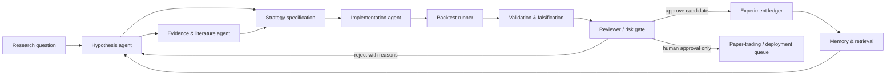
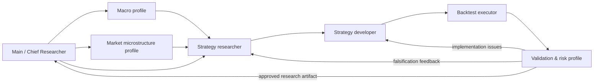
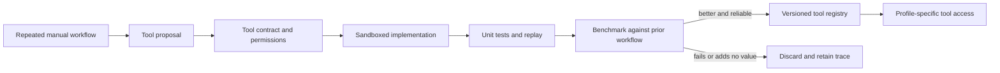

<!-- alphaXiv chat export via the page's Chat actions > Copy Markdown, saved 2026-11-03. Chat URL: https://www.alphaxiv.org/assistant/01a0150f-1bb1-748a-bbe5-c7188f8670b9 -->

# Chat Transcript: AI quant trading design

## User

I'd like you to find me the best papers about AI prompt engineering Well not the best but,... okay anyway,Alright, so prompt engineering, we are going to do harness designing. I'm trying to build quantitative research and development system. Okay, so for developing trading strategies. So I'm trying to leverage AI to do all this. I'm going to combine a lot of ideas from tools like Lean CLI, from Quant Connect, and whatnot. I also like the Deep Sea harness that was recently released. Then it's a lot. We have prompt engineering, context engineering. Well, basically, harness engineering and concepts like also loop engineering, graph engineering. We have, well, I've already given you the use case. Then also memory, the best memory for my use case. Then I wanted to also look into how to adopt some concepts with the shepherd method. I'm going to give you what I mean. It's actually an open source project. So we might go a little bit of back and forth for this session,I also like the way the Hermes agent actually works. A lot of ideas from it could work 
[[https://github.com/shepherd-agents/shepherd]]

## Aurelle

For your project, **prompt engineering should be a thin layer inside a versioned, evaluable research harness**—not the primary system design. The core unit should be a reproducible *research run*: hypothesis → data/feature work → implementation → backtest → statistical checks → review → retained artifact.

I read the [Shepherd repository](https://github.com/shepherd-agents/shepherd), and it maps unusually well to this: its model is sandboxed agent work that returns **inspectable, retained proposals**, followed by explicit selection, application, release, or discard. That is exactly the safety boundary you want around code changes, data access, and strategy candidates. Its accompanying paper, [Shepherd: Enabling Programmable Meta-Agents via Reversible Agentic Execution Traces](https://www.alphaxiv.org/abs/2605.10913), should be a foundational read.

## The reading list I’d start with

| Paper | Why it matters for your system |
|---|---|
| [AQuA: Recursively Self-Improving Quantitative Trading Research Agents](https://www.alphaxiv.org/abs/2608.12841) | Closest match to the objective: use evidence from prior quantitative experiments to improve future hypotheses and candidate strategies. |
| [AlphaCrafter: Harnessing Multi-Agent Workflows for Cross-Sectional Quantitative Trading](https://www.alphaxiv.org/abs/2605.05580) | Directly relevant multi-agent decomposition for factor discovery, signal aggregation, and portfolio construction. |
| [FinanceHarness: Autonomous Financial Deep Research Framework](https://www.alphaxiv.org/abs/2607.27853) | Useful for separating financial research collection, evidence synthesis, and downstream decision artifacts. |
| [CLQT: A Closed-Loop, Cost-Aware, Strategy-Consistent Benchmark for Diagnostic Evaluation of LLM Portfolio-Management Agents](https://www.alphaxiv.org/abs/2606.29771) | Treat evaluation as a first-class design problem: closed-loop diagnostics and costs, not merely an attractive backtest return. |
| [Shepherd: Enabling Programmable Meta-Agents via Reversible Agentic Execution Traces](https://www.alphaxiv.org/abs/2605.10913) | The execution substrate: reversible traces, supervision, forking/replay, and controlled adoption of agent-produced work. |
| [From Model Scaling to System Scaling: Scaling the Harness in Agentic AI](https://www.alphaxiv.org/abs/2605.26112) | A strong conceptual framing for why tools, persistence, modularity, auditability, and verification matter as much as the base model. |
| [Agentic Harness Engineering: Observability-Driven Automatic Evolution of Coding-Agent Harnesses](https://www.alphaxiv.org/abs/2604.25850) | Relevant if you want the system to improve its own prompts, tools, workflow topology, and policies based on observable failures. |
| [HarnessOpt-Bench: Evaluating LLMs at Harness Optimization](https://www.alphaxiv.org/abs/2608.06301) | Frames the harness as prompts + tools + control flow + memory + orchestration—very close to the vocabulary you are using. |
| [CHILL-Harness: Counterfactual Harness Learning for Efficient Reasoning in Long-Horizon Agents](https://www.alphaxiv.org/abs/2607.25825) | Worth reading for long-horizon agents that must choose between competing workflow and reasoning trajectories. |
| [Stop Hand-Holding Your Coding Agent: Engineering the Loops that Replace Step-by-Step Prompting](https://www.alphaxiv.org/abs/2607.00038) | The “loop engineering” framing: shift effort from bespoke one-shot prompts to feedback loops with tool-based verification. |
| [Backtrader-Bench: Benchmarking LLM Agents on Algorithmic Trading with Self-Generated MCQs](https://www.alphaxiv.org/abs/2608.11232) | Helps define agent evaluation for trading-code competence, where actual executable backtest outputs matter. |
| [When Agents Do Not Stop: Uncovering Infinite Agentic Loops in LLM Agents](https://www.alphaxiv.org/abs/2607.01641) | Important defensive reading: a research agent needs explicit stopping rules, budgets, and escalation paths. |

## My recommended architecture

I would not make a single “quant agent.” I would use a constrained graph of roles, where every transition emits an artifact and every artifact has provenance.



The most important constraint is that the LLM should **never be the authority on whether a strategy works**. It proposes: deterministic tools adjudicate.

For example:

- The **hypothesis agent** writes a falsifiable strategy specification: universe, holding period, signal equation, rebalance timing, costs, expected failure modes, and acceptance criteria.
- The **implementation agent** may edit a dedicated branch or Shepherd workspace, but cannot merge into the canonical research repository.
- The **backtest agent** invokes Lean CLI / QuantConnect-style deterministic jobs with pinned data versions, environment hashes, and locked cost/slippage assumptions.
- The **validation agent** checks walk-forward splits, embargoes/purging where needed, sensitivity to parameters and costs, turnover/capacity, concentration, drawdowns, and multiple-testing exposure.
- The **review gate** decides only whether the candidate has earned another experiment or human review—not whether to trade capital.

## Memory: use an experiment ledger, not “chat memory”

For quantitative R&D, the most valuable memory is an append-only, queryable **experiment ledger**. A generic vector database is useful for retrieval, but it must not become the source of truth.

I would divide memory into four layers:

1. **Evidence memory**  
   Source documents, market-data definitions, research notes, and citations. Each claim should retain source, timestamp, and applicability.

2. **Semantic strategy memory**  
   Human- and model-readable descriptions: “cross-sectional value + quality,” instruments, economic rationale, regime assumptions, known overlaps.

3. **Executable experiment memory**  
   The authoritative layer: Git commit, data snapshot ID, feature code, config, random seed, run environment, metrics, charts, and full logs.

4. **Decision memory**  
   Why a candidate was promoted, rejected, forked, or retired; especially failed hypotheses and invalid assumptions.

The retrieval policy matters more than embedding sophistication. Before proposing a new strategy, retrieve:

- nearest prior strategies by *economic rationale* and by *implemented feature set*;
- experiments on the same asset class, horizon, and universe;
- prior failures under similar regimes;
- known duplicates or highly correlated signals;
- the full validation history—not just the highest Sharpe result.

That turns “memory” into an anti-overfitting mechanism. The agent should be penalized for rediscovering rejected ideas unless it can state exactly what new data, changed assumption, or different portfolio construction makes the rerun justified.

## Where Shepherd fits

Use [Shepherd: Enabling Programmable Meta-Agents via Reversible Agentic Execution Traces](https://www.alphaxiv.org/abs/2605.10913) as the control plane for agent-created code and experiment branches:

- fork an isolated workspace per research run;
- make permissions explicit: research-data read access is distinct from code-write access;
- retain all candidate changes and outputs;
- review the diff, generated strategy specification, and test results before acceptance;
- replay a run after changing one condition—model, prompt, data range, or validation policy;
- preserve the trace for audit and postmortems.

The [Shepherd implementation](https://github.com/shepherd-agents/shepherd) is currently labeled early alpha, so I would adopt its *execution-trace and proposal lifecycle ideas* immediately, while keeping the production R&D ledger and access-control layer independently owned.

## Prompts, context, loops, and graphs—how I would separate them

Prompt engineering is the **local contract** for a role. For example, the validation agent’s prompt says what metrics to calculate, what tests are mandatory, and what it may not infer.

Context engineering is the **retrieval and state-selection policy**. It decides which prior experiments, data schemas, relevant code, market constraints, and review outcomes reach that role.

Loop engineering is the **feedback protocol**. It defines when an agent retries, what new evidence it must obtain, the stopping budget, and what failure routes back to hypothesis revision rather than blind regeneration.

Graph engineering is the **global topology and authority structure**. It specifies which nodes can call which tools, which artifacts are passed downstream, and where human or deterministic gates block progress.

Harness engineering is all four, plus observability, sandboxing, reproducibility, cost accounting, and evaluation.

For this use case, I would initially keep the graph fairly small—perhaps five roles: hypothesis, implementer, backtest runner, validator, reviewer. Add multi-agent specialization only when your experiment ledger shows a repeated bottleneck.

One clarification: when you say **“Deep Sea harness,”** do you mean a particular project or release? Please send its link. I also need the specific [Hermes](https://github.com/NousResearch/hermes-agent) agent implementation or repository you mean, since there are several projects called Hermes. Once you share those, we can turn this into a concrete v1 design: agent graph, workspace layout, schemas for experiment records, prompt contracts, Lean/QuantConnect tool boundary, and a validation gate tailored to your trading horizon.

## User

Okay, yeah, think of okay. The idea I had in mind was using profiles like the Hermes agent from Nous Research. Then we split the profiles across the different types of quantitative quants. For example, we can have like the research profile, the development profile, also the training profile, and then the main. Now, you see, the whole point of splitting them in that each profile is a mini harness in its own use case. So we can specialize a profile for the best possible use case. So it doesn't mean that the profile is okay. What this means is that the profile has the best tools for the best for okay for the job at hand. You get me?
Also, just for context, I'm using okay, I'm mostly focusing on Forex and crypto as my assets. So, yeah, that's that. So, it means you will look at stuff like macro research, micro research, strategy optimization, strategy improvement. But I'm just looking, let's first build the harness. I won't really go deep. You already know what I'm talking about

## Aurelle

The profile is a **bounded operating environment**, not merely a different prompt: each quant profile gets its own tools, context policy, memory slice, action budget, output schema, and evaluation criteria.

That is the right abstraction. Rather than one broad “trading agent” with a giant toolbelt, build several **mini-harnesses** that are excellent at one type of work and communicate through durable artifacts. The main agent is then an orchestrator and reviewer—not the system that personally performs every task.

For Forex and crypto, I would start with this profile graph:



## The profile contract

Every profile should be defined by the same harness schema, but with different contents:

```yaml
profile:
  mission: "What this profile is responsible for"
  allowed_actions: []
  prohibited_actions: []
  tools: []
  inputs: []
  retrieval_policy: []
  working_memory: {}
  durable_outputs: []
  success_metrics: []
  stop_conditions: []
  escalation_rules: []
  review_requirements: []
```

The point is to prevent profiles from leaking into each other’s jobs. A macro researcher should not be able to casually modify strategy code; a developer should not reinterpret the economic thesis; a backtest executor should not choose favorable evaluation windows.

## The initial profiles

### 1. Main / chief-research profile

This is the coordinator. It owns the research queue, allocates budgets, decides which profile runs next, compares artifacts, and creates the final research record.

It should have access to:

- the experiment ledger;
- profile outputs and reviews;
- portfolio-level constraints;
- research priorities and capital-allocation rules;
- a high-level view of existing strategies and overlap.

It should **not** directly write production code or approve a strategy for live deployment without a separate deterministic and human gate.

Its output is a research brief such as:

- research question;
- relevant market and horizon;
- why this idea is distinct from existing work;
- assigned profiles;
- cost/time budget;
- evidence required for promotion.

### 2. Macro research profile

For Forex, this profile is especially valuable. Its job is to produce a structured view of macro regimes and event risk—not to generate a buy/sell call.

Its inputs may include:

- central-bank decisions and communications;
- inflation, labor, growth, and liquidity releases;
- rate differentials and yield-curve shifts;
- fiscal and geopolitical event timelines;
- dollar-liquidity conditions;
- cross-asset relationships: rates, equities, commodities, volatility.

Its output should be a machine-readable **regime artifact**, for example:

```yaml
regime:
  horizon: "1d to 3m"
  currencies: ["USD", "EUR", "JPY"]
  dominant_drivers:
    - "rate-differential repricing"
    - "risk-off demand for USD"
  confidence: "medium"
  invalidation_conditions:
    - "central-bank guidance reversal"
    - "inflation surprise changes terminal-rate expectations"
  event_risks:
    - event: "central-bank decision"
      expected_impact_window: "0-24h"
```

This profile should be scored on calibration, usefulness in predicting *regime transitions*, and whether its stated invalidation conditions were meaningful—not on isolated P&L.

### 3. Microstructure / market-behavior profile

For crypto, this should be a first-class profile rather than an afterthought. It studies how tradability changes across venues, times, and market states.

Its scope includes:

- spreads, depth, order-book imbalance, and liquidity fragmentation;
- perpetual-futures funding, basis, and liquidation behavior;
- exchange-specific price dislocations;
- realized volatility and jump behavior;
- stablecoin flows where available;
- weekend, session, and event-time effects;
- execution capacity and slippage sensitivity.

For FX, the equivalent focus is session structure, rollover, fixing windows, liquidity changes around macro releases, and the gap between backtest assumptions and executable prices.

This profile should be able to veto a strategy on **capacity or implementability grounds**, even if its simulated Sharpe ratio is attractive.

### 4. Strategy-research profile

This is where hypotheses become candidate strategies. It should receive only curated macro and microstructure artifacts plus relevant experiment history.

Its required output is not code. It is a falsifiable specification:

```yaml
strategy_spec:
  hypothesis: "Why should this effect exist?"
  asset_universe: []
  signal_definition: []
  holding_period: ""
  rebalance_rule: ""
  portfolio_construction: ""
  risk_constraints: []
  execution_assumptions: []
  expected_failure_modes: []
  novelty_check:
    nearest_existing_strategies: []
    claimed_difference: ""
  acceptance_criteria: []
  rejection_criteria: []
```

That schema is crucial. It forces the agent to articulate what would disprove the idea *before* the development profile sees it.

### 5. Development profile

The development profile turns an approved specification into executable research code. It should have excellent software tools—repository search, test execution, static analysis, Lean CLI / QuantConnect integration—but limited authority.

Its job is to:

- implement only the written spec;
- write tests for data alignment, look-ahead bias, trading calendar handling, and order-generation logic;
- record code version, dependencies, and environment;
- flag underspecified assumptions rather than inventing them;
- produce a patch, test report, and runnable backtest configuration.

This is where the reversible-workflow idea in [Shepherd](https://github.com/shepherd-agents/shepherd) fits naturally: agent-created code stays as an inspectable proposed change until the system accepts it.

### 6. Backtest-execution profile

This should be almost entirely deterministic. The agent may schedule and interpret runs, but the actual result must come from pinned code, pinned data, and a fixed evaluation configuration.

It produces an immutable run record:

- strategy and code version;
- data version and universe;
- sample split;
- fees, spread, latency, and slippage assumptions;
- parameter values;
- all metrics;
- logs, orders, positions, equity curve, and failure states.

No profile should be allowed to overwrite this record after seeing the result.

### 7. Validation and falsification profile

This is the profile that protects you from a system optimized to discover pretty backtests.

Its job is adversarial. It should try to break every candidate using:

- walk-forward and rolling out-of-sample evaluation;
- parameter sensitivity and stability analysis;
- costs and slippage stress tests;
- execution-delay and data-latency stress;
- regime segmentation;
- exposure and correlation checks against existing strategies;
- turnover, capacity, liquidation, and venue-risk checks;
- multiple-hypothesis accounting across the research program.

The key design rule: **the researcher proposes, but the validator tries to falsify**. They should have different prompt contracts and ideally different model configurations or at least independent context windows.

## What “best tools for the job” means in practice

You are exactly right that specialization is mainly about the tool-and-context bundle.

| Profile | Primary tools | Context it should receive | Context it should *not* receive |
|---|---|---|---|
| Macro | Economic calendar, news/evidence retrieval, macro time series | Policy history, releases, regime ledger | Raw codebase and execution credentials |
| Microstructure | Tick/order-book data, funding/basis data, venue metrics | Venue-specific rules, liquidity history | Broad macro corpus unless explicitly relevant |
| Strategy research | Experiment search, feature catalog, notebooks | Prior hypotheses, failures, economic rationales | Full unfiltered backtest results across every experiment |
| Development | Lean/QuantConnect, Git, tests, sandbox | Strategy specification, data contracts, coding standards | Authority to redefine hypothesis or approve results |
| Backtest | Deterministic job runner, data snapshots | Frozen strategy config and cost model | Ability to alter specs after results |
| Validation | Statistical tests, reporting, stress-run tools | Full run artifacts, experiment lineage | The research agent’s private chain-of-thought or incentives to promote |
| Main | Ledger, workflow scheduler, review dashboard | All signed artifacts | Direct mutation rights over production systems |

The “should not receive” column is as important as the tool list. Context separation prevents result leakage and makes it harder for an agent to rationalize an already-known favorable result.

## A good v0 boundary

For your first version, I would build **four profiles only**:

1. Main coordinator  
2. Researcher: macro + strategy hypothesis  
3. Developer/backtest runner  
4. Independent validator  

Then split macro, microstructure, and optimization into dedicated profiles only after you have enough logged runs to know what is actually bottlenecking your workflow.

The first deliverable should not be a trading strategy. It should be a **complete experiment lifecycle** in which one trivial strategy can move from a written hypothesis to a sandboxed implementation, a frozen backtest, an adversarial validation report, and a retained decision record. Once that loop is reliable, the profiles can become more sophisticated without turning the system into an untraceable swarm.

## User

can you also give me papaers for agentic memeroy , skillls and tool building

## Aurelle

For your Forex/crypto research harness, I would treat **memory, skills, and tools as three different registries**:

- **Memory:** what happened and what was learned.
- **Skills:** reusable, versioned procedures for recurring work.
- **Tools:** deterministic interfaces that execute or inspect something in the outside world.

The important design rule is: **a successful run does not automatically become memory, a skill, or a tool.** It must pass a promotion gate—reproducibility, measured benefit, scope, tests, and rollback path.

## Best papers to read

| Paper | What to take for your harness |
|---|---|
| [Agentic Memory: Learning Unified Long-Term and Short-Term Memory Management for Large Language Model Agents](https://www.alphaxiv.org/abs/2601.01885) | A direct starting point for managing short- and long-term memory jointly, rather than treating retrieval as an afterthought. |
| [Agent Memory: Characterization and System Implications of Stateful Long-Horizon Workloads](https://www.alphaxiv.org/abs/2606.06448) | Helpful systems framing for stateful, long-horizon workloads—the exact situation created by iterative research and backtesting. |
| [ACM: Agentic Context Management for Long Horizon Tasks](https://www.alphaxiv.org/abs/2607.23809) | Focuses on managing accumulated task context; useful for deciding what enters a profile’s working context versus what remains in the ledger. |
| [AdMem: Advanced Memory for Task-solving Agents](https://www.alphaxiv.org/abs/2606.06787) | Relevant to organization and reuse of long-horizon task knowledge for tool-using agents. |
| [From Memory to Skills: Evidence-Grounded Co-Evolution Governance for Long-Horizon LLM Agents](https://www.alphaxiv.org/abs/2607.16621) | Probably the closest conceptual match: do not keep experience as passive retrieved traces; convert verified lessons into governed executable capability. |
| [A Comprehensive Survey on Agent Skills: Taxonomy, Techniques, and Applications](https://www.alphaxiv.org/abs/2605.07358) | Use this as a map of the skills landscape before committing to an implementation pattern. |
| [SkillOpt: Executive Strategy for Self-Evolving Agent Skills](https://www.alphaxiv.org/abs/2605.23904) | Relevant if you want an optimizer that iteratively improves a skill instead of allowing unrestricted self-revision. |
| [CoEvoSkills: Self-Evolving Agent Skills via Co-Evolutionary Verification](https://www.alphaxiv.org/abs/2604.01687) | The verification-oriented approach is valuable for finance: skills should compete against baselines and be promoted only after checks. |
| [SkillClaw: Let Skills Evolve Collectively with Agentic Evolver](https://www.alphaxiv.org/abs/2604.08377) | Useful for thinking about a library of interacting skills rather than a single monolithic procedure. |
| [Demystifying Agent Skills: Why They Work-Until They Don't](https://www.alphaxiv.org/abs/2608.14036) | Read this early as a counterweight: a skill can look useful in evaluation yet fail under task distribution changes. |
| [Tool-R0: Self-Evolving LLM Agents for Tool-Learning from Zero Data](https://www.alphaxiv.org/abs/2602.21320) | Covers learning to use tools with self-evolving agents; useful for your tool-selection and tool-call policy. |
| [AgentFactory: A Self-Evolving Framework Through Executable Subagent Accumulation and Reuse](https://www.alphaxiv.org/abs/2603.18000) | A useful direction for converting successful subagent trajectories into reusable executable subagents rather than keeping them as prose. |
| [Tool-Making and Self-Evolving LLM Agents in Low-Latency Systems](https://www.alphaxiv.org/abs/2607.08010) | Directly relevant to turning repeated code-generation patterns into maintained tools—useful for recurring data and validation tasks. |
| [CODESKILL: Learning Self-Evolving Skills for Coding Agents](https://www.alphaxiv.org/abs/2605.25430) | Applies trace-derived skill distillation to coding work; relevant to your developer profile and Lean/QuantConnect integration. |
| [Shepherd: Enabling Programmable Meta-Agents via Reversible Agentic Execution Traces](https://www.alphaxiv.org/abs/2605.10913) | The control mechanism for all of this: retain, inspect, fork, replay, select, apply, or discard agent-produced artifacts. |

## How I would implement it

### Memory: an evidence ledger with selective retrieval

Do not store raw chat transcripts as the main memory. Store structured research objects.

For a single strategy experiment, create records such as:

```yaml
experiment:
  id: "fx-momentum-2026-0041"
  status: "rejected"
  thesis: "Short-horizon trend persists after a macro surprise."
  markets: ["EURUSD", "GBPUSD", "USDJPY"]
  horizon: "4h"
  regime_tags: ["high-rate-volatility", "post-data-release"]
  code_commit: "..."
  data_snapshot: "..."
  backtest_config: "..."
  metrics: {}
  validation_outcome: "fails under realistic spread stress"
  rejection_reason: "edge disappears above 1.4x assumed costs"
  lessons:
    - "Signal is too execution-sensitive for target horizon."
  related_experiments: []
```

Then make each profile retrieve only the memory needed for its role:

- **Macro profile:** prior regime calls, economic-event behavior, evidence quality, and calibration records.
- **Strategy profile:** prior related hypotheses, strategy overlap, failed ideas, economic-rationale clusters.
- **Developer profile:** strategy specification, tool contracts, repository patterns, prior implementation failures.
- **Validator:** frozen design documents, every run artifact, known failure patterns, and promotion rules.
- **Main profile:** high-level experiment genealogy, resource usage, and portfolio-level strategy overlap.

The crucial design choice: retrieval should return **negative evidence** as aggressively as positive evidence. A rejected crypto funding strategy that failed under funding-cap changes is often more valuable than five successful-looking backtests.

### Skills: executable playbooks, not large prompts

A skill is a versioned package that tells a profile how to repeatedly accomplish a bounded job. It can include instructions, a tool sequence, a schema, deterministic checks, examples, and tests.

For instance:

```yaml
skill:
  name: "validate_fx_intraday_signal"
  version: "0.3.0"
  owner_profile: "validator"
  input_contract:
    - frozen_strategy_spec
    - executable_backtest_run
    - data_snapshot
  procedure:
    - verify_no_lookahead_bias
    - execute_rolling_walk_forward
    - stress_spread_and_slippage
    - test_session_and-event-dependence
    - assess_parameter_stability
    - compare_to_existing_strategy_exposure
  outputs:
    - validation_report
    - pass_fail_decision
    - falsification_evidence
  promotion_rule:
    - passed_on_three_distinct_candidates
    - deterministic_tests_green
    - reviewed_by_human_or_main_profile
```

For your system, an initial skill library could be:

- `build_macro_regime_brief`
- `research_fx_cross_sectional_signal`
- `research_crypto_perp_carry_signal`
- `implement_lean_strategy_from_spec`
- `check_temporal_data_leakage`
- `run_walk_forward_validation`
- `stress_execution_assumptions`
- `analyze_strategy_overlap`
- `write_experiment_postmortem`

A profile uses skills; it does not need to rediscover the entire procedure each time.

### Tool building: controlled tool proposals

Tools should be deterministic and narrow. Good trading-research tools answer one stable question or take one reliable action:

- load a pinned market-data slice;
- calculate funding-rate history;
- identify economic-event windows;
- run a Lean backtest from a frozen config;
- compute turnover, exposure, and capacity metrics;
- perform a parameter sweep;
- calculate a strategy correlation matrix;
- compare two experiment manifests;
- generate an experiment report from stored artifacts.

Bad tool design is a vague `research_market()` tool that hides data sources, transformations, assumptions, and versioning.

I would require every agent-created tool to proceed through this lifecycle:



The [Shepherd repository](https://github.com/shepherd-agents/shepherd) is a good substrate for the proposal → sandbox → inspect → accept/discard portion. A tool should never silently appear in the trusted registry because an agent created it once.

## Promotion gates

I would use separate promotion rules for each category.

| Candidate | Required proof before promotion | Example rejection |
|---|---|---|
| Memory item | Source/provenance, scope, and a clear retrieval key | “BTC trades differently on weekends” without market, period, venue, or evidence |
| Skill | Measurable improvement over the prior procedure; reproducible trace; narrow scope | A “general alpha-research skill” that works only through vague instructions |
| Tool | Typed input/output contract, tests, permissions, deterministic replay, versioning | A tool that fetches unpinned external data and changes behavior run to run |
| Strategy | Frozen code/data/config plus independent out-of-sample validation | Good in-sample Sharpe after many undocumented iterations |

## My recommendation for v1

Build the **experiment ledger first**, then add a tiny skill registry, then allow tool proposals.

Start with just three skills:

1. **Strategy specification** — turn a research idea into a falsifiable contract.
2. **Implementation and reproducibility** — compile the specification into a pinned Lean/QuantConnect run.
3. **Adversarial validation** — attempt to falsify it with temporal, cost, regime, and sensitivity checks.

And allow only two initial agent-built tool categories:

- **analysis tools:** read-only transformations, diagnostics, and reports;
- **research utilities:** code that makes repeated data or validation work cheaper.

Do **not** let agents create tools with brokerage, exchange, order-routing, secret-management, or unrestricted network privileges. Those belong behind a separate, explicit human-controlled boundary.

## User

put the quantitave factor out and we look at just agentic engineering alone what papaers do you recommend for all

## Aurelle

The best way to study agentic engineering is as a stack: **harness → tool/runtime → context and memory → skills → loops and orchestration → evaluation and traces → safe self-improvement**. Start by building a small agent system before attempting evolutionary or multi-agent complexity.

## Core curriculum: read these first

| Paper | Why it belongs in the core |
|---|---|
| [The Hitchhiker’s Guide to Agentic AI: From Foundations to Systems](https://www.alphaxiv.org/abs/2606.24937) | Broad practitioner reference across the agent stack; use it to establish a shared vocabulary and map the design space. |
| [From Question Answering to Task Completion: A Survey on Agent System and Harness Design](https://www.alphaxiv.org/abs/2606.20683) | Directly addresses the move from a chat model to a stateful system that uses tools, maintains context, and completes long-running tasks. |
| [Architectural Design Decisions in AI Agent Harnesses](https://www.alphaxiv.org/abs/2604.18071) | Helps with the non-model engineering decisions: tool mediation, context handling, delegation, safety control, and orchestration. |
| [Code as Agent Harness](https://www.alphaxiv.org/abs/2605.18747) | A useful mental model: the harness should be real, inspectable software—not an enormous invisible system prompt. |
| [From Model Scaling to System Scaling: Scaling the Harness in Agentic AI](https://www.alphaxiv.org/abs/2605.26112) | Frames agent performance as a property of the surrounding system: persistent state, tools, verification, modularity, and observability. |
| [Agentic Harness Engineering: Observability-Driven Automatic Evolution of Coding-Agent Harnesses](https://www.alphaxiv.org/abs/2604.25850) | Read after you build v1: it concerns observing harness failures and improving workflows systematically rather than tweaking prompts by intuition. |
| [Shepherd: Enabling Programmable Meta-Agents via Reversible Agentic Execution Traces](https://www.alphaxiv.org/abs/2605.10913) | The operational model for reversible agent work: fork, inspect, replay, select, apply, or discard outputs rather than accepting mutations blindly. |

## Context and memory

Memory is not an extra feature bolted onto an agent. It is the policy that decides what the agent carries forward, summarizes, retrieves, updates, and is permitted to treat as trustworthy.

| Paper | Why it matters |
|---|---|
| [Agentic Memory: Learning Unified Long-Term and Short-Term Memory Management for Large Language Model Agents](https://www.alphaxiv.org/abs/2601.01885) | A strong starting point for thinking jointly about working memory and persistent memory. |
| [Agent Memory: Characterization and System Implications of Stateful Long-Horizon Workloads](https://www.alphaxiv.org/abs/2606.06448) | Useful systems view of storage, retrieval, and statefulness in long-running agent workloads. |
| [ACM: Agentic Context Management for Long Horizon Tasks](https://www.alphaxiv.org/abs/2607.23809) | Focuses on managing the expanding context that accumulates through tool use and environment interaction. |
| [AdMem: Advanced Memory for Task-solving Agents](https://www.alphaxiv.org/abs/2606.06787) | Relevant to organizing and reusing task knowledge across extended sequences of work. |
| [From Memory to Skills: Evidence-Grounded Co-Evolution Governance for Long-Horizon LLM Agents](https://www.alphaxiv.org/abs/2607.16621) | Important bridge paper: verified experience should sometimes become a governed reusable capability, not just a retrieved text fragment. |

## Skills, reusable procedures, and tool creation

A **tool** is a bounded function such as `run_tests()` or `query_database()`. A **skill** is a reusable procedure that chooses and sequences tools, interprets output, and emits a standardized result.

| Paper | Why it matters |
|---|---|
| [A Comprehensive Survey on Agent Skills: Taxonomy, Techniques, and Applications](https://www.alphaxiv.org/abs/2605.07358) | The map of the field: use it before deciding what a “skill” means in your own harness. |
| [CoEvoSkills: Self-Evolving Agent Skills via Co-Evolutionary Verification](https://www.alphaxiv.org/abs/2604.01687) | Valuable emphasis on verification: skills need evidence of better performance, not merely a persuasive description. |
| [SkillOpt: Executive Strategy for Self-Evolving Agent Skills](https://www.alphaxiv.org/abs/2605.23904) | Relevant to deliberate, optimizer-like skill improvement rather than uncontrolled rewriting. |
| [SkillClaw: Let Skills Evolve Collectively with Agentic Evolver](https://www.alphaxiv.org/abs/2604.08377) | Useful when you have a skill library whose components interact and should improve collectively. |
| [Demystifying Agent Skills: Why They Work—Until They Don’t](https://www.alphaxiv.org/abs/2608.14036) | Essential counterweight: a skill can benchmark well yet be brittle under a changed task distribution. |
| [AgentFactory: A Self-Evolving Framework Through Executable Subagent Accumulation and Reuse](https://www.alphaxiv.org/abs/2603.18000) | Frames successful work as executable reusable subagents rather than just text reflection. |
| [Tool-R0: Self-Evolving LLM Agents for Tool-Learning from Zero Data](https://www.alphaxiv.org/abs/2602.21320) | Useful for tool-selection and learning policies. |
| [Tool-Making and Self-Evolving LLM Agents in Low-Latency Systems](https://www.alphaxiv.org/abs/2607.08010) | Directly relevant to converting recurring code-generation patterns into maintained, low-latency tools. |
| [CODESKILL: Learning Self-Evolving Skills for Coding Agents](https://www.alphaxiv.org/abs/2605.25430) | Practical reference for distilling useful coding trajectories into reusable procedural capabilities. |

## Loops, graphs, profiles, and multi-agent systems

Start with a single agent with a good loop. Introduce profiles or multi-agent topology only when different permissions, tools, context, or evaluation rules are genuinely required.

| Paper | Why it matters |
|---|---|
| [Stop Hand-Holding Your Coding Agent: Engineering the Loops that Replace Step-by-Step Prompting](https://www.alphaxiv.org/abs/2607.00038) | The practical loop-engineering argument: verification and feedback loops outperform ever-more-detailed one-shot prompting. |
| [When Agents Do Not Stop: Uncovering Infinite Agentic Loops in LLM Agents](https://www.alphaxiv.org/abs/2607.01641) | Read before giving agents autonomy; design budgets, stop rules, checkpoints, and escalation paths. |
| [Beyond Individual Intelligence: Surveying Collaboration, Failure Attribution, and Self-Evolution in LLM-based Multi-Agent Systems](https://www.alphaxiv.org/abs/2605.14892) | Covers collaboration, coordination, failure attribution, and adaptation—exactly the problems that appear once you split work among profiles. |
| [MANTA: Multi-Agent Network Topology Adaptation for Self-Evolving Multi-Agent Systems](https://www.alphaxiv.org/abs/2607.28527) | Relevant to graph engineering: task decomposition, specialization, communication, and intermediate validation. |
| [Harness Engineering for Self-Improvement](https://www.alphaxiv.org/abs/2607.harness-3) | A focused survey of harness design, workflow/context optimization, and controlled self-improvement. |
| [Self-Improvements in Modern Agentic Systems: A Survey](https://www.alphaxiv.org/abs/2607.13104) | Good higher-level framing for controllable adaptation from experience with minimal human intervention. |

## Evaluation, provenance, and safety

This is the layer that separates an interesting demo from a system you can trust with valuable work.

| Paper | Why it matters |
|---|---|
| [HarnessOpt-Bench: Evaluating LLMs at Harness Optimization](https://www.alphaxiv.org/abs/2608.06301) | Treats prompts, tools, control flow, memory, and orchestration as a harness that itself must be evaluated. |
| [From Agent Traces to Trust: A Survey of Evidence Tracing and Execution Provenance in LLM Agents](https://www.alphaxiv.org/abs/2606.04990) | Explains why provenance and execution traces are necessary for inspection, debugging, and trustworthy outcomes. |
| [JANUS: Foreseeing Latent Risk for Long-Horizon Agent Safety](https://www.alphaxiv.org/abs/2607.19913) | Safety for tool-using agents is operational: anticipate failures before an action happens, not merely filter the final text. |
| [Engineering Trustworthy Agentic AI for Critical Systems](https://www.alphaxiv.org/abs/2607.18548) | Useful for applying assurance principles—verification, bounded authority, monitoring—to consequential agentic systems. |
| [AppLooper: An Agentic Application Engineering Loop for Accountable Release with Virtual-User Feedback](https://www.alphaxiv.org/abs/2608.14093) | A useful example of accountability and iterative feedback integrated into the application-engineering loop. |

## The order I would actually read them

If you want the shortest high-value sequence, read these ten in this order:

1. [The Hitchhiker’s Guide to Agentic AI: From Foundations to Systems](https://www.alphaxiv.org/abs/2606.24937)  
2. [From Question Answering to Task Completion: A Survey on Agent System and Harness Design](https://www.alphaxiv.org/abs/2606.20683)  
3. [Code as Agent Harness](https://www.alphaxiv.org/abs/2605.18747)  
4. [Shepherd: Enabling Programmable Meta-Agents via Reversible Agentic Execution Traces](https://www.alphaxiv.org/abs/2605.10913)  
5. [Agentic Memory: Learning Unified Long-Term and Short-Term Memory Management for Large Language Model Agents](https://www.alphaxiv.org/abs/2601.01885)  
6. [A Comprehensive Survey on Agent Skills: Taxonomy, Techniques, and Applications](https://www.alphaxiv.org/abs/2605.07358)  
7. [Stop Hand-Holding Your Coding Agent: Engineering the Loops that Replace Step-by-Step Prompting](https://www.alphaxiv.org/abs/2607.00038)  
8. [From Agent Traces to Trust: A Survey of Evidence Tracing and Execution Provenance in LLM Agents](https://www.alphaxiv.org/abs/2606.04990)  
9. [Agentic Harness Engineering: Observability-Driven Automatic Evolution of Coding-Agent Harnesses](https://www.alphaxiv.org/abs/2604.25850)  
10. [Self-Improvements in Modern Agentic Systems: A Survey](https://www.alphaxiv.org/abs/2607.13104)  

The build order follows the same logic: create **one observable, permission-bounded, tool-using agent with an evaluation loop**; add structured memory; package recurring work as skills; then add profiles and multi-agent delegation; only then let the harness propose improvements to itself.

