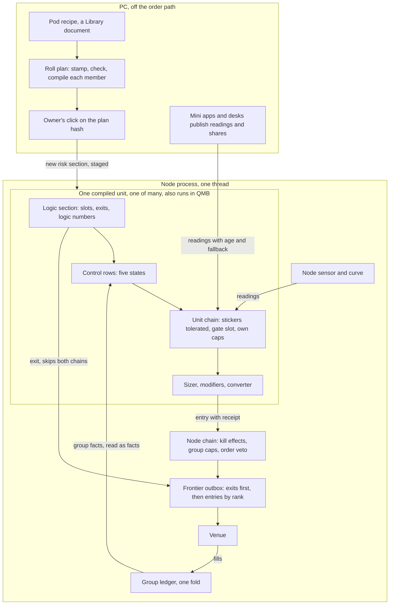

# V1, the unit owns it

Paths are under `D:\QMX-worktrees\risk-plan\tracker\risk-core\` unless they start with a package name; package paths are under `D:\QMX-worktrees\bld-repair-24\`. `PH n` is a row of `RISK-SIZING-PLACEHOLDERS.md`. `SWAP n`, `En` are rows of `unit-baseline/SWAP-CHART.md`. `S1`, `I2`, `R9`, `K7`, `V1` are core rows of `round-2/funnel/FUNNEL.md` section 3. **Probe** means my own check, `D:\Temp\v1-arch\probe.py` with results in `out-probe.txt` beside it: real `compile_unit` and `construct_unit` at the tip, the dummy template, synthetic bars. It tests mechanisms only. `[ASSUMPTION]` marks an inference nobody confirmed.

**Fork answers held:** F1 A (compiled in plus a thin group), F2 C (find, track, correct), F3 B (node sensor, unit gate slot, one curve), F4 A (one process, one node thread), F5 A (exits on the unit, fixed order, the node closes targets), F6 B (small core widened in slices), F7 C (two chains).

## 1. The paradigm in a sentence

**A unit carries every rule it obeys inside its own document; a pod is a recipe stamped into each member before it runs; the one thing above the units is a thin group on the node that holds shared caps and a shared ledger and can only cut.**

Why this is a fair reading of what exists: the unit document already has seats for `sizer`, `exit_set`, `halts` at three scopes, `reads` with a fallback, `numbers` with motion, `sessions`, `position_limit`, `context_needs` and per-market `settings` (`qml/src/qml/unit/model.py:470-492`), and the role list already names `sizing_modifier`, `veto`, `cooldown`, `invalidation`, `timeout`, `halt` (`:89-109`). The compiler refuses them by name (`qml/src/qml/compile/compiler.py:896-1014`). This design mostly turns refusals into running code, adds four document fields, and puts one small thing above the unit. His words: "look at what exactly is already there in the unit" (M49).

### What runs where at trade time



## 2. Decisions

### AD-1: The unit owns its size and its own brakes

- **Binds:** S1, S2, S4, S6, S13, S14, V7, V10.
- **Prevents:** a second evaluator above the unit; a size computed in two places.
- **Rule:** at trade time everything a member obeys that reads only its own facts or market facts is in its compiled document and runs in `HostedUnit.on_instant`, the code QMB and the node already share through `UnitSliceHandler`. Nothing above a unit computes a size. A template or a mini-app unit with no pod is the normal case, not a special one.

### AD-2: One document, two sections, defined once

- **Binds:** S14, I9, R17, `qml/unit/sections.py` (new).
- **Prevents:** builders disagreeing about what a pod edit may touch; a pod field that drifts from a unit field.
- **Rule:** one function partitions the document. **Logic section:** `markets`, `streams`, `direction`, `logic`, `exit_set`, `sessions`, `position_limit`, and every number bound by a logic slot or an exit, with their pins. **Risk section:** `sizer`, `modifiers`, `gates`, `halts`, `reads`, `tolerations`, `stages`, and every number bound only there, with their pins. A number bound in both is logic. `compiled_fingerprint = H(logic_fingerprint, risk_fingerprint, format, options)`; both parts are carried on the compiled unit. This replaces FUNNEL S14's "logic and pod fingerprints": in this shape the second one is the member's own risk section, not a pod's. Probe 2b: a risk-only edit moves the risk hash and not the logic hash; probe 2e: on the dummy, 9 numbers are logic and only `risk_fraction` is risk.

### AD-3: The node tests logic and trusts a click for risk

- **Binds:** `runtime.py:559,2756`, `promote.py:376,565`, `unit.py:672-679`, `unit_handler.py` `opened_by`.
- **Prevents:** a pod edit that re-proves 200 units; a pod edit that changes live risk unclicked; a position orphaned by a recompile.
- **Rule:** a deployment names `logic_fingerprint` (its G record must cover this), `risk_fingerprint` and the click that covered it. The node refuses when either fails. `opened_by` on positions becomes the logic fingerprint. **This is a real hazard today:** probe 4 hosted a risk-only recompile over a position the previous fingerprint opened, and the time exit never fired in 60 bars (0 exit intents; control with a matching fingerprint: 1). The pod's blocks pass their own contract tests and a safety drive (determinism, restore, state bound) per distinct risk fingerprint; G's safety half is the tool (`qml/check/layer_g.py`). A compiler format bump moves the logic fingerprint on purpose; K8 pays for it.

### AD-4: A pod is a recipe, and stamping is a pure function

- **Binds:** S14, S16, `qml/pods/expand.py`.
- **Prevents:** a pod at run time; a pod reaching into logic; rework when a unit leaves a pod.
- **Rule:** `expand(unit_document, pod_document) -> stamped_document | named refusal`. Filled pod slots replace the risk section's matching rows; empty slots leave the unit's own. The stamped document records `recipe {pod_id, version, hash, displaced}`, where `displaced` holds the rows replaced, so leaving a pod restores them. A unit may list `risk_locks` (for example `sizer`): the pod does not replace those and the plan shows the member as `locked`. A recipe row touching a logic-bound number or an exit is refused by name. `expand` is deterministic and idempotent (probe 2a, 2d). A pod owns its sizing method because it fills the sizer slot; several methods side by side are several recipes.

### AD-5: One pod edit is one plan and one click

- **Binds:** S14, K5, V4, Q6, `qml/pods/roll.py`, `qmx_host/roll.py`.
- **Prevents:** 200 hand moves; drafts reaching a live deployment; a click on something that has since changed.
- **Rule:** `roll_plan(pod@new, members)` stamps, checks and compiles every member off the node and sorts each into `risk_only`, `unchanged`, `locked`, `logic_touch` or `refused`. The plan hash is `H(pod hash, sorted (deployment, new risk fingerprint))`. The owner's one click binds to that hash, through the money door (K5). A stale plan is refused. `refused` and `locked` members stay on their old version and are named. Agents and the copilot write drafts and plans only. A plan may cover a subset, which is a canary. Each member gets a new unit version; the identity table (wired by R17) gets a section column so a risk-section edit keeps the logic record and starts a new money record.

### AD-6: A risk move happens in place

- **Binds:** `qml/protocol/unit.py` `_Core`, `_cold_reason`; `runtime.py` `_deployments`.
- **Prevents:** a cold start of logic state for a size edit; a mixed pod for minutes.
- **Rule:** `HostedUnit.move_risk(new_compiled)` works only when the logic fingerprint matches. Logic instances, derived numbers, calibrated logic numbers and open positions stay; risk instances are rebuilt. A control row keeps its state if its row id, pin and params match, or else starts by its declared cold behaviour. Snapshots carry two parts, and `_cold_reason` judges each part by its own fingerprint. The node compiles a plan's members in its one compile worker (`runtime.py:2098`), then flips all of them in one tick. An open position keeps its exits and its R; the next entry uses the new risk section.

### AD-7: Stages are compiled in

- **Binds:** I10, D31, S2, S13, `qml/unit/model.py` `Stages`.
- **Prevents:** a stage change that mints a new identity or wipes a record; "at 5,000 the math changes" needing a new unit.
- **Rule:** a risk section may declare `stages`: a selector (a fact, or a block), the anchor it is read at, its hysteresis, and for each stage the sizer, modifiers, control rows and number values in force. All stages compile into the plan, so `risk_fingerprint` covers them and the owner's click covered them. A stage move is a state change at an anchor with a `stage_move` row, never a new version. The field `move` is `rule` or `card`, per direction; templates ship `card` going up and `rule` going down. An undeclared stage is a pod edit (AD-5). Exit numbers may also vary by stage, but those rows sit in the logic section, so adding them costs a G run per member; once in, moves cost nothing, and the trade row's `stage` and `numbers_in_force` keep the record readable.

### AD-8: The thin group holds caps and a ledger, nothing else

- **Binds:** I10, S6, R9, D31, D35, `qmx.group/1`, `qmf/risk/group.py`.
- **Prevents:** the group growing into an evaluator; a cap edit touching 200 documents.
- **Rule:** a group is a document with `display_name`, `parent`, `place`, `side`, `money`, `caps`, `ledger` and `order`. A deployment names `group_id`, so the member document is untouched. A cap is a control row of scope `group` whose block answers `pass`, `shrink(quantity)` or `refuse`, plus `on_fire` (stand down at a scope, raise a kill level, card, flatten the group through `_close_scope`). A cap never raises. It runs at two moments: on an entry, and after each ledger fold, so a day stop fires with no entry pending. Caps read the ledger, the intent and its bet key. The ledger exposes group facts (`group.day_pnl`, `group.open_risk`, `group.raise_ok`, ...) on each member's fact surface; a member's own row may read them. So "facts down, cuts at the door" is the whole relation. A group edit is its own document and its own click.

**Allocation modes in this shape.** `own size under a parent limit` (default) is no share plus a cap. `split` is a member-side derivation reading `group.members`. Anything that ranks members, such as best basket or a slot rebalancer, runs off the path and publishes a share as a reading each member chose to read (AD-16), late by design. The allocator was never a trade-time thing (`E2` (c), clock table).

### AD-9: Two chains, one receipt

- **Binds:** S6, V1, R1, `qml/protocol/entry_chain.py`, `qmf/risk/chain.py`.
- **Prevents:** a link with no home; two receipts that cannot be joined; a chain that can stop an exit.
- **Rule:** the unit chain runs inside the unit, the node chain in the host. **Placement test:** a link that reads only this unit's facts and market facts it may tolerate goes in the unit chain (stickers it does not tolerate, the gate slot with its verbs, its own caps). A link that reads the account or other units goes in the node chain (kill effects, group caps, order veto: margin headroom, worst-step reserve, size band, order rate, venue stop or declared no-stop basis). The node chain is called from one seam, `UnitSliceHandler.mint_intents`, through an injected `AdmitPort`, so both hosts call it; the node's `guard`, `cross_unit_hook` and protection gate become links or stay directly behind it (`runtime.py:1100-1106,2623-2675`). Both append to one `decision_row_id`. Each chain is wrapped: an exception refuses the entry with a row. Exits never enter either chain, by property test including a faulty block.

### AD-10: A sizer answers a typed amount; one converter

- **Binds:** S1, I1, PH 1, 12, 30, `qml/blocks/api.py` `Size`, `qml/numbers/convert.py`.
- **Prevents:** a socket change per base; lots in design; a 5,000-lot answer passing (S1c); a trigger bound as a sizer (S3).
- **Rule:** a sizer returns `Amount(money_at_risk | notional | quantity)` or a skip. Today's `Size(lots)` reads as `quantity`, so the placeholder still passes. One converter reads the amount and the record and spells the venue's quantity, rounding down by default with real residue. The compiler checks the slot's face. The size band and per-trade cap live in one row, applied after the converter. A sizer gets `side` and reads moved numbers from `evidence`.

### AD-11: Named modifiers

- **Binds:** S2, D4, D13, D14, `sizing_modifier`.
- **Prevents:** hidden multipliers; a ladder law; press and brake on two ledgers.
- **Rule:** `modifiers` is an ordered list on the risk section. Each block answers a factor inside its range with a reason on the receipt. Default combination is product, or a declared combiner; a `cap` row takes the lowest. The level is one named modifier with no ladder law. A modifier may raise. The raise permission gate is a default rule reading `group.raise_ok` and unit state, removable by a reckless pod.

### AD-12: A control row runs in the unit, and states live in its snapshot

- **Binds:** S4, S10, S11, S12, PH 5, 18 to 20, 23 to 25, 28.
- **Prevents:** each brake as custom code; a brake that needs the node to exist in a backtest; shadow code that differs from live.
- **Rule:** `halts` stays the seat and each entry becomes a control row: required `reads`, `scope`, `verb` (`none`, `no_new_entries`, `reduce(factor)`, `flatten`), `on_fire`, `restore`, `until_n`, `shadow`; the rest defaulted. FUNNEL's `placement` field is struck: a row runs where its document says, the unit or the group. The control runner in `_Run.step` feeds each row its declared facts, folds to one of ACTIVE, REDUCING, BENCHED, HALTED, RESTORE per scope, writes `risk_event`, and writes `would_have` when shadowed or when it refused. State lives in the unit's snapshot, which `_write_snapshot` must also write on a state change (`runtime.py:2927` writes only on a calibrated move). A row that says `wait for hand` calls `Runtime.risk_stop` (`:2696`), its first producer. Only that row and the kill switch wait for a person. `flatten` mints exit intents; it does not use a chain.

### AD-13: Exits stay on the unit in a fixed order

- **Binds:** S3, I13, V1, V6, F5, PH 2 to 4, 9 to 11.
- **Prevents:** a pod changing what R means under a record; a faulty exit stopping an exit.
- **Rule:** every exit in `exit_set` runs per bar, fed `PositionFacts` and market evidence, on its side. Answers: `close_full`, `close_partial`, `amend_protection`, each with a reason code; a target-position type is reserved. On one bar, full beats partial beats amend, and the earlier binding breaks a tie; this is compiled, not configured. The node closes targets (`runtime.py:1849-1857`), as today. A raising exit block is skipped with a row and the next runs; if none can run, `_close_scope`. R is a declared basis on the sizer row, gross at the disaster stop by default, and stops tighten unless `allow_widen` is set. A pod never touches `exit_set`. Trails, partials and the signed stop are step 3, after R24's facts.

### AD-14: Numbers: find, track, correct, on the built engine

- **Binds:** S13, I16, D15 to D17, PH 7, 8, 22.
- **Prevents:** a second moving part; a number nobody can explain; unbounded memory.
- **Rule:** no applier object. **Find** is a replay in the Lab or at birth, ending in a new version with `Origin.found_by_replay`. **Track** is a `scaled` number, fact times multiple, computed each bar. **Correct** is the built engine (`qml/motion/engine.py`), widened: it reaches sizer, control and exit numbers, gains a bounded window on `SlowState.read`, may run with no logic stamp, and takes `cadence.at`. `authority` gets a real `off`. Every number carries range, reason, cautious direction, guard and freeze, and `never_self_tune`; a move inside range is a calibration row (`service.py:431` table), outside it a new version. `MotionSwitch` reports with and without. Presets per type turn correct on for filters and off for size.

### AD-15: One fact surface with a stated supply

- **Binds:** I1 to I4, I7, I17, `qmf/risk/facts.py`.
- **Prevents:** a fact computed differently in two hosts; three meanings of "missing".
- **Rule:** blocks declare the facts they read; `facts` is one new read surface on the unit (`_required_keys`, `unit.py:875`). The compiler compares a unit's needs with the host's provided list; an unmet need names its fallback or warns. Each fact has a timestamp and a fail mode: `open`, `closed` or `neutral`. Facts from the unit's own journal are computed in QML, so they are the same in both hosts by construction. Host facts (equity, margin, cost cells, group facts) have two adapters and a known-answer test. A truly new host fact is a core change and is said to be.

### AD-16: Readings inform, stickers refuse, and neither commands

- **Binds:** S8, S9, S10, I5, I6, R13, F3, Q4, V3, V7.
- **Prevents:** forged `source`; a stale feed reading as calm; a dead desk parking the book; a wide unit trading its whole universe on a stale board.
- **Rule:** `reads` compiles with publisher, fallback (`compute_here`, `treat_as_absent`, `no_new_entries`, `stand_aside`), stale limit and `valid_until`; the host stamps `source`. A node sensor publishes spread, tick rate and quote gaps with source `node`; an overnight workflow makes one curve artifact per world, with an age word and a flagged borrowed cold start, read by SQS, node, MIS and QMB. A sticker is a row in the stand-down table with a kind and strength; a unit's `tolerations` are in its risk section and a pod may stamp them. The kill switch is not a sticker. Sticker source failure defaults to a card and `prefer not`. The market fallback is home markets. Agent output arrives only as a reading the unit chose; by Q4's default it lands a card until he rules.

### AD-17: One thread, one place, declared order

- **Binds:** F4, S18, `runtime.py:2157,3013-3016`.
- **Prevents:** a shared cap that needs a lock; an entry storm in front of an exit; a cap always won by whoever was hosted first.
- **Rule:** per node, one `node-runtime` thread hosts all units. Caps are atomic because nothing else runs. A pod lives on one place; a group spanning places is several groups whose caps read a published fact with an age. Within a frontier, the node drives every unit, collects their intents in an outbox, and sends all exits first, then entries in the group's `order` (rank, then a per-bar hash for ties). The node chain runs on each entry at send, in that order. QMB's group driver uses the same order. **Known limit:** `client.send` blocks with up to a 5 second wait (`ctrader_account.py:110,679`), so entries at one bell go out in series. The tick's QML step itself is small (probe 3: 60 ms median for 200 units on 2 markets, no entries, no journal, no venue).

### AD-18: One decision row and one fold

- **Binds:** R1 to R4, R7 to R9, R13, S15.
- **Prevents:** "why this size?" with no answer; two risk states in two readers.
- **Rule:** the size trail is the decision row. `explain_size(row)` is one pure function used by developer, copilot, UI and triage. `RiskState` is one pure fold over journal rows, keyed by scope including `unit`, `pod`, `group`, `tag`. It is used for the group ledger, the pod card's numbers and the fleet read, and it is what restart replays. UNKNOWN when stale.

### AD-19: Land in slices; bump only on a changed decision

- **Binds:** F6, K7, K8, K9, D41.
- **Prevents:** half-shapes reaching a deployed unit; a frozen compiler.
- **Rule:** the order in section 9. Each slice ends in something a test or K7 shows. Bumps are free until the first deployment. Step 3 lands before the first live deploy or pays a re-test through K8.

### AD-20: The fixed lines are tests

- **Binds:** V1 to V6, V9, K5, K9.
- **Prevents:** the lines resting on good behaviour.
- **Rule:** exits never blocked; only the owner lowers a kill level; agents never place, size up, lower a kill level or promote, by tool table; a click binds to a hash; every other reckless setting warns and grades, and never refuses. No channel the copilot or agents can read carries the promote door.

## 3. Contracts, sketched

Each lands in the package named. New fields are additive on `qmx.unit/1`, passed through the census test and the upgrader chain.

### Sizer and modifiers (`qml/blocks/api.py`, `qml/numbers/convert.py`)

```python
class Amount:             # sizer answer; exactly one kind
    kind: Literal["money_at_risk", "notional", "quantity"]
    value: Decimal
    basis: str            # "gross_at_stop" | "tail_budget" | declared
class Skip: reason: str
class SizerInstance(Instance):
    def update(self, evidence: Facts | Mapping) -> Amount | Skip | Size: ...   # Size = legacy quantity

class Factor: value: Decimal; reason: str
class ModifierInstance(Instance):
    def update(self, evidence) -> Factor | None: ...       # None is neutral, with its fail mode

def to_quantity(amount, entry, stop_or_basis, record, rule: RoundRule) -> Converted
class Converted: quantity: Decimal; residue_r: Decimal; skipped: str | None
```

### Exits (`qml/blocks/api.py`, `qml/protocol/exits.py`, new)

```python
class PositionFacts:      # widens OwnPosition, from HeldPosition
    position_id, side, quantity, average_price, stop, targets, bars_held, mfe_r, mae_r, opened_by_logic, stage
class ExitAction:
    kind: Literal["close_full", "close_partial", "amend_protection", "target_position"]   # last reserved
    fraction: Decimal | None; new_stop: Decimal | None; reason_code: str
class ExitInstance(Instance):
    def update(self, evidence) -> Decimal | Signal | ExitAction | None: ...
```

### Controls (`qml/unit/model.py`, `qml/protocol/controls.py`, new)

```python
class ControlRow(ScopedBinding):   # lands in Halts; scope gains GROUP only in qmx.group/1
    reads: tuple[str, ...]; verb: Verb; on_fire: OnFire; restore: Restore
    until_n: ColdRule; shadow: bool
    # defaulted: attack, release, counting, fail_mode, money_series, klass, healthy_fire_rate
class Answer: verb: Verb; factor: Decimal | None; reason: str; code: str
class ScopeState: word: Literal["ACTIVE","REDUCING","BENCHED","HALTED","RESTORE"]; since; reason
```

`HaltInstance` keeps `update(evidence) -> Halt | None`, so the five shipped halts bind unchanged once the statistics exist. `Halt.action` gains `reduce` beside `no_new_entries` and `flatten` (`blocks/api.py:168-179`).

### Numbers (`qml/unit/model.py`, `qml/motion/engine.py`)

```python
class NumberSpec:         # existing fields stay
    authority: Literal["off", "motion_inside_range", "at_anchor"]
    reason: str; cautious: Literal["down","up","hold"]; guard: Guard | None
    never_self_tune: bool; stage_values: Mapping[str, str] = {}
class Motion:             # adds
    scaled_fact: str | None; window: int | None; anchor: CadenceAt | None
class SlowState: read bounded to Motion.window
```

### Document additions (`qml/unit/model.py`, `qml/unit/sections.py`)

```python
class Unit:               # new optional fields only
    modifiers: tuple[Binding, ...] = ()
    gates: tuple[Binding, ...] = ()          # gate slot, verb list on the block's answer
    tolerations: tuple[str, ...] = ()
    stages: Stages | None = None
    risk_locks: tuple[str, ...] = ()
    recipe: RecipeRef | None = None          # {pod_id, version, hash, displaced}; outside both fingerprints
    home_markets: tuple[str, ...] = ()       # allowed = markets; active arrives as a reading
class Read:  publisher: str; valid_until_s: int | None     # adds to model.py:391
class Stages: selector: str; anchor: CadenceAt; hysteresis: Decimal; move_up, move_down: Literal["rule","card"]; rows: Mapping[str, StageRow]
class StageRow: sizer: Binding | None; modifiers; controls; numbers
def sections(document) -> tuple[LogicSection, RiskSection]   # the one partition
class CompiledUnit: logic_fingerprint; risk_fingerprint       # beside compiled_fingerprint
```

### Pod and group (`qml/pods/`, `qml/compile/group.py`, `qmf/risk/group.py`; Library kinds `pod`, `group`)

```python
class Pod:  # qmx.pod/1, a real schema behind the shell kinds/pod.schema.json
    pod_id, version, method: str, slots: PodSlots, notes
class PodSlots: sizer; modifiers; gates; controls; reads; numbers; tolerations; stages   # empty = unit's own

def expand(unit, pod) -> Unit | Refusal
class MemberPlan: deployment_id; outcome: Literal["risk_only","unchanged","locked","logic_touch","refused"]
                  old_risk: str; new_risk: str; diff: tuple[Edit, ...]; problem: str | None
class RollPlan: pod_hash; members: tuple[MemberPlan, ...]; plan_hash: str; made_at; expires_at

class Group:  # qmx.group/1, replaces the book and bms shells; "Classic Book" stays a recipe name
    group_id, display_name, parent: str | None, place, side, money, caps: tuple[ControlRow, ...]
    ledger: LedgerSpec, order: Literal["rank"], ranks: Mapping[str, int], alarm_budget, share_cap
class LedgerSpec: anchors; series: Literal["realised","marked","committed"]; keys: tuple[str, ...]
class CapAnswer: Pass | Shrink(quantity, reason) | Refuse(reason)
```

### Chains and facts (`qml/protocol/entry_chain.py`, `qmf/risk/chain.py`, `qmf/risk/facts.py`)

```python
class Verdict: link: str; verb: Literal["pass","shrink","wait","warn","shadow","refuse","none"]; reason; code
class AdmitPort(Protocol):
    def admit(self, wire: Mapping, at: Instant) -> Admitted | Refused: ...    # wire quantity rewritten on shrink
# Facts: named, each Fact(value, ts, fail_mode, source)
# account.* equity, balance, open_risk, open_risk_by_bet_key, margin_headroom, budget_share, realised_since(anchor), basis
# own.*     session_loss_r, loss_streak, losing_day_streak, session_fills, spread_r, edge_band, cut_distribution, trade_rate
# market.*  quote, spread, cost_cell(hour, world), curve, gap_factor, sticker, session_state
# group.*   day_pnl, open_risk, members, cushion, raise_ok, share, stage
def fold(rows, scope, clock) -> RiskState
```

### Status and records (`packages/qmf-data/.../journal_kinds/unit.py`)

```python
class RiskState: scope; word; since; reason; stamp; money; open_risk; drawdowns; control_distances; cushion; stage; unknown: tuple[str, ...]
class DecisionRow:   # existing, adds
    inputs: Mapping[str, Fact]; steps: Wanted, Approved, Filled; verdicts: tuple[Verdict, ...]; binding: str
    logic_fp; risk_fp; recipe; group_id; stage; readings_used; trace_id; propensity; placeholders
```

Trade row v2 is FUNNEL R2 plus `stage`, `pod_version`, `risk_fp`. `would_have`, `risk_event`, `stage_move`, `risk_move` and the fill record (R7) are kinds with writers. `explain_size(row) -> Trail` lives in `qml/receipt.py`.

### Modules and owners

| Module | Package | Owns |
|---|---|---|
| `unit/model.py`, `unit/sections.py` | `qml` | The document and the one partition |
| `compile/compiler.py`, `compile/group.py` | `qml` | Lifted refusals, needs check, both fingerprints |
| `protocol/unit.py`; new `exits.py`, `controls.py`, `entry_chain.py` | `qml` | The evaluator; 1,134 lines today, split as it widens |
| `motion/engine.py` | `qml` | Correct |
| `numbers/convert.py` | `qml` | The one converter |
| `receipt.py` | `qml` | `explain_size` |
| `pods/expand.py`, `pods/roll.py` | `qml` | Recipe stamping and plans. Pure, no I/O |
| `blocks/stdlib/` and the Library | `qml`, host | Content |
| `risk/group.py`, `risk/chain.py`, `risk/facts.py`, `risk/fold.py` | `qmf-risk` | Ledger, node chain, fact names, the fold; imported by both hosts |
| `host/unit_handler.py`, new `host/group_run.py` | `qmb` | Admit seam; multi-unit replay driver |
| `app/runtime.py`, new `app/sensor.py`, `app/stand_down.py`, `protection/effect_matrix.py` | `qmn` | Adapters, outbox, move_risk, sticker scopes, kill effects on entries |
| `promote.py`, new `roll.py` | `qmx-host` | The click and its binding |
| `kinds/pod`, `group`, `template`, `pod-block` | `qmx-library` | Real schemas |
| templates `fleet-fold`, `curve-factory` | `qmx-engine` | Scripted watch, curves |

### The core list, in this shape

| Rows | Here | Struck or changed, and what replaces it |
|---|---|---|
| S1, S2, S3, S4, S13, S17, S18 | AD-10, 11, 13, 12, 14, 17 | S4's `placement` struck (AD-12) |
| S6 | AD-9 | "One chain" struck: two chains. Group stage becomes the group-cap link |
| S8, S9, S10, S11, I5, I6, R13 | AD-16; S11 is the scope list on rows and rows' keys | None |
| S12 | Roles run in the logic section, except `sizing_modifier` (AD-11) and `derivation` (AD-14) | None |
| S14 | AD-2 to AD-6 | Empty pod struck: no recipe is the default. Pod reference on the deployment struck: `recipe` in the document, `group_id` on the deployment. Deployment key gains group and lane. "Two fingerprints" is logic and risk. Slot composition rules: in `PodSlots` and AD-11. |
| S15 | The hosted unit and handler are the evaluator; Lab, paper and replay are drivers; conformance tape in K9 | Needs list stays (AD-15) |
| S16 | Shipping: `library-items` lander, real kinds, block save, Library path traced | None |
| I1 to I4, I7, I9, I13, I16, I17 | AD-15, AD-10, AD-14 | None |
| I10 | AD-7, AD-8 | "Pod may change rows at an anchor" becomes compiled-in stages |
| R1 to R4, R7 to R9, R17 | AD-18, AD-5 | None |
| K2, K5, K7, K8, K9 | AD-20, section 6, section 9 | None |
| V1 to V7, V9, V10 | AD-20, AD-1 | V10 holds for arithmetic; group facts differ in a solo run (WALKS 13) |

## 4. The placeholders, row by row

| PH | Swapped how |
|---|---|
| 1 sizer | SWAP to the fixed-fraction block grown: typed amount, costs in the denominator, reading `account.*` and `market.cost_cell`. Sits in the risk section. R17 forwards the old pin |
| 2 stop | Stays a block; reads the position after S3. Logic section |
| 3 target | Same; second target and fractions after step 3 |
| 4 time exit | Side-correct block with its own reason |
| 5 halts | Five shipped blocks bind as control rows; statistics from `own.*` |
| 6 hook | Replaced by `AdmitPort`, called in both hosts. `PASS_EVERY_ORDER` deleted |
| 7, 8 motion | AD-14; `applies_to_open_positions` lifted once `amend_protection` runs |
| 9 stop moves | Block answer plus `allow_widen`; signed distance waits for repair |
| 10 partials | Answer type now, node close at step 3 |
| 11 no stop | Declared basis (AD-10, AD-13) through compile, `enter`, handler, node gate. WALKS 2 |
| 12 rounding | The one converter with a `RoundRule`; hosts stop re-rounding after their first check |
| 13 gap | Mechanism kept; `market.gap_factor` fact |
| 14 margin | Fact plus a veto link; the entry refusal the plan promised gets built |
| 15 spec change | Producer: record change calls `Runtime.stand_down(SPEC_CHANGE, ...)` |
| 16 funding | Mechanism kept; a fact a block may read |
| 17 account facts | Live surface; `budget_share` on the deployment |
| 18 kill effects | `guard` reads the table for entries too; values open |
| 19 protection fail | `protection_escalation` row with `close` or `alarm`; constants become settings |
| 20 kill line | A group cap reading `group.money` with `on_fire`; the floor kept by V5. `qmn/capital/kill_line.py` subtracted |
| 21 netting | A setting in S18; stays refused until attribution is built |
| 22 starting numbers | Works once risk numbers can calibrate |
| 23 automatic move | A control row with `wait for hand` calls `risk_stop` |
| 24 paper after stop | Table edit stands; a template field |
| 25 risk events | Writers; new code family for user blocks (R15 census) |
| 26 judge both | `MotionSwitch` plus a fixed-size rerun; judge rule is methodology's |
| 27 correlated judging | Kept for tries |
| 28 decay alarm | Template replaced by the fleet fold; per-unit nightly card off |
| 29 replay fields | Trade row v2 and the `would_have` writer |
| 30 size sent | Kept |
| 31 pods | This whole design |

`tools/qml/placeholders.py` widens past blocks, because PH 5, 6, 18, 19, 20 are not blocks (`SWAP` 4.1 row 2).

## 5. The first baseline, from zero trades and zero fills

Empty store, fake broker (K7), `scalper-mr`.

1. `unit_new("scalper-mr", {})`. No pod needed. The template is a complete document: logic blocks, exits, risk section, labelled numbers, `origin: placeholder`.
2. `unit_check`, then compile. `needs ⊆ provides` or a named fallback; a card says "a shape, not an edge".
3. `backtest_run` on synthetic bars. Host writes a G record against the logic fingerprint. The group is absent, so the run is stamped `group: none`.
4. Promote click to paper. `Deployment{logic_fp, risk_fp, group_id: none, lane: paper, budget_share}`.
5. Node stages, compiles, warms up by the warm-up count.
6. First signal. Control rows: session-loss and account halts bind at once at zero; own-percentile bench in shadow until N trades, writing `would_have`.
7. Unit chain: no stickers; calendar dead reads `prefer not` with a card. Gate: cost cell `uncalibrated`, so the hurdle warns; the SQS floor reads a flagged borrowed curve.
8. Sizer: `equity x fraction`, costs from the pooled stressed cell, labelled. Modifier: cushion rule at zero profit gives factor 1. Converter gives quantity, or a named skip.
9. Node chain: kill effects pass; no group; veto passes (margin, band, venue stop).
10. Outbox sends. The fake broker fills. Fill row, then the first measured cost in the cell. One row in the fleet fold reading "too thin to judge".
11. K7 ends with the owner's click on the fake live lane.

**How anything changes.** Copilot or user: `unit_new(template, overrides)` by pointer for a unit's numbers and blocks; `pod_draft` then `roll_plan` for many; `group_draft` for shared caps and the kill line; `blocks_save` for a new block; a new JSON in the templates folder for a new template. Live moves take the owner's click on one hash. Inside a range, numbers move by their own rule.

## 6. Agents' doors

Read: `risk_state(scope)`, `explain_size(row)`, `fleet_read()`, roll plans. Propose: `pod_draft`, `group_draft`, cards with direction and expiry. Run: unlimited on paper and replay. Money door: outside any channel an agent reads (K5). Protected fields: floor, kill level, `never_self_tune`, plan hash. App doors: `data_reads` widens past `market` (`supervisor.py:891`) to journals and the fold; card path traced to "Needs you" (K2, UNKNOWN today).

## 7. How a developer adds things

| Adding | Files touched | Tests |
|---|---|---|
| **A sizer** | One folder in the Library, or `blocks/stdlib/<id>/1/` with `block.py`, `entry.json`, a dictionary page. Reads `evidence`. No core edit | Auto-enrolled contract test (K9 fixes `_CEILING` and enrols Library blocks), golden case, `same-decision-in-both-hosts` |
| **A brake** | One folder, face declares `reads`; one row in a template or recipe; a reason code row in `journal_kinds/unit.py` (appendable, R15) | Contract, `would_have` in shadow, cold behaviour test, exits-never-blocked property |
| **A group cap** | One folder, `component_type: group_cap`; row in a group document | Same, plus a two-member `group_run` case |
| **An instrument class** | Record rows and keys in `numbers/records.py`; a calendar package under `extensions/`; venue adapter only for a new venue; cost pool rows. No branch | Test that fails on class branching in the money path; known-answer cost check |
| **A new fact** | Name in `qmf/risk/facts.py`; two adapters (QMB handler, node runtime); provided list. Own-journal facts need one function in QML | Known-answer test in both adapters; conformance tape. This is a core change and is signed like one |

**Debugging one size.** `explain_size(row_id)` prints each step: facts with age, base amount, each modifier with range and reason, chain verdicts, converter residue, the binding link. Replay: `replay_decision(row_id)` re-runs the sizer on the row's inputs and must match, by test. Same call for developer, copilot, UI and triage.

## 8. Observability

**Rows.** Decision row (every step, both chains, one id). Trade row v2. `would_have` with `propensity`. `risk_event` with root-cause key, alert fields, closed appendable codes. Fill record with decision quote, arrival, fill, markouts. Calibration row, `stage_move`, `risk_move` (plan hash, member, old and new risk). Reading record stamped when computed. Run stamp.

**The fold.** `fold(rows, scope, clock) -> RiskState`, pure. Scopes: position, unit, pod (rows carry `recipe.pod_id`), group, account, tag. Series per row: realised, marked, committed. The cushion ledger is one scope with an anchor. Readers: node (group ledger, in process), restart catch-up, pod card, fleet template, agents. Word is UNKNOWN when any needed input is stale. One fleet read answers one query over all units. On screen, pod numbers come from here: at stake next trade, losses to kill line, room, daily loss.

## 9. Build order, in slices

F6 B: the first baseline's sockets first. **About 37 PRs**, stacked, one check per PR. A PR is about one review's worth; the split is my estimate. "Sign-in" is his demo sign-in (Q1).

| # | Slice | PRs | Ends in | Sign-in |
|---|---|---|---|---|
| 1 | Test faults (`_CEILING`, exit evidence, Library enrol), census extended | 1 | Real sizer passes CI | Before |
| 2 | Sections, two fingerprints, `opened_by` to logic, node and promote gates | 2 | Probe 4 inverted: exits fire after a risk-only recompile; format 5 | Before |
| 3 | Amount, converter, face check, size band, real receipt, `explain_size`, USDJPY fix | 2 | Same decision in both hosts; replay equals row | Before |
| 4 | Exit step 2: stack, `PositionFacts`, side, reasons, fault fall-through | 1 | Six shipped exits compile that fit; property test | Before |
| 5 | Control rows, own stats, five states, restore, shadow, `risk_event` and `would_have` writers | 3 | Five halts run in QMB and on the fake broker | Before |
| 6 | Templates: `canary`, then K7 | 2 | **First filled paper entry from zero** | Before |
| 7 | Modifiers, cushion ledger, the fold at unit scope | 2 | Size trail with a press and a brake | Before |
| 8 | Number spec, engine widened, `scaled`, window, `authority` | 2 | Risk number moves in range; shuffle control | Before |
| 9 | Facts: account, record keys, cost cells, fill record, trade row v2 | 3 | Sizer reads a measured cell | Before, venue fields checked after |
| 10 | Sessions, second stream, per-market settings, `position_limit` | 2 | Template A and B compile | Before |
| 11 | Unit chain: gate slot, stickers, tolerations, scope keys, node sensor, curve | 3 | Hurdle warns then bites; `scalper-mr`, `intraday-trend` pass K7 | Before |
| 12 | Node chain, outbox, kill effects on entries, order veto, order rate | 2 | Exits-first test; kill table read by entries | Before |
| 13 | Group: document, caps, ledger, default parent limit and day stop, `group_run` driver | 3 | Two-member and 200-member cap on the fake broker | Before |
| 14 | Pod: kinds, `expand`, `roll_plan`, click, `move_risk`; stages | 3 | One edit, 200 members, one click on the fake lane | Before |
| 15 | Reads bus, publisher, home markets, `library-items` lander, block save | 2 | A mini app's reading reaches a unit; Library path traced | Before |
| 16 | Fleet fold, app read door and card path, decay card off | 1 | One ranked row per unit | Before |
| 17 | R17 forwarding, K8 re-test | 1 | Rip-out of placeholders keeps a record | Before |
| 18 | Step 3: signed stop, amends, partials on the node, trails | 2 | Wick and partial tests on demo | **After** |

Paper trading from the `canary` starts after PR 11; `scalper-mr` after about PR 23. Nothing deploys live before slice 18 or K8.

## 10. Deferred, and what reopens each

| Deferred | Reopens if |
|---|---|
| Batch stage at a frontier (choose the best of those firing) | A pod needs it; then this shape loses to F1 B on that row |
| Sends off the tick thread | Measured send delay at a bell harms a scalper's fills, or exit delay exceeds what he accepts (F4 B or an async outbox) |
| Group across places as one atomic cap | A second node holds one account (F4 C) |
| Applier object, bandits, pooled priors | A number needs motion between anchors that facts cannot give |
| Exit swap by a pod at an anchor (F5 C) | The scalper template's stage rows prove too rigid |
| Target resting at the venue | R24's facts show node-closed targets lose on wicks |
| Netting, limit entries | A venue requires them |
| Rollout analysis, canary rules | Methodology hands a rule |
| Roll, futures route, volume on bars | Q2 |
| Stage from an agent | Q4 answered and methodology rules |

## 11. Assumptions and open questions

- `[ASSUMPTION]` G's behaviour half under a new risk section is not re-required, per Q6's default. If he rules otherwise, a pod edit costs a G run per member.
- `[ASSUMPTION]` a stage move covered by the original click satisfies REVIEW M2's rule. If not, each move is a card, and only the mechanism's speed changes.
- `[ASSUMPTION]` 200 new unit versions per pod edit are acceptable to the Library. Storage per version is one document; not measured at scale.
- UNKNOWN: real node throughput with journals and a venue at 200 units. Probe 3 covers QML only, and the dummy took no entries in that run.
- UNKNOWN: real compile time per member. Probe 1 pins all stdlib blocks: 746 ms median, about 150 s per 200 on one worker.
- UNKNOWN: whether a Library block reaches a live node end to end (S16 traces it in slice 15).
