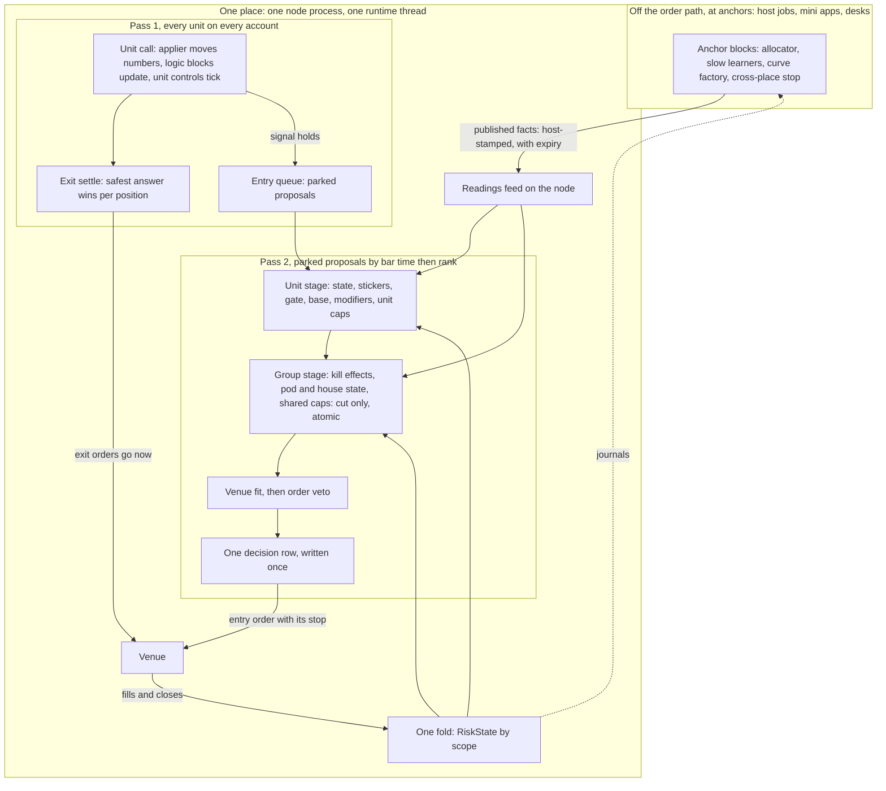
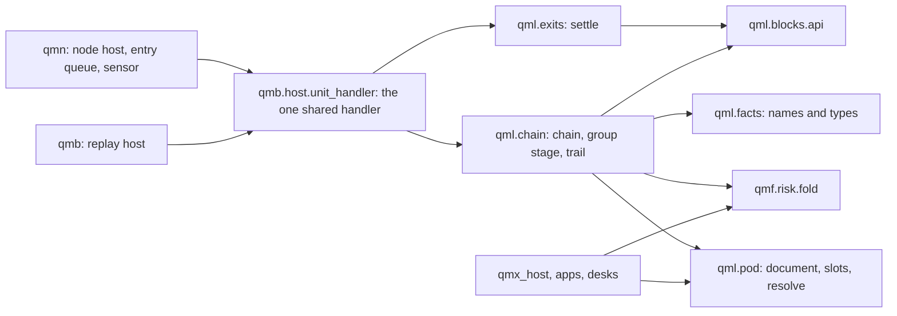

# V2: one pod document, split by scope

Written headless on 7 Nov 2026. Forks held: F1 B, F2 A, F3 B, F4 C, F5 B, F6 B, F7 A. Code read at `D:\QMX-worktrees\bld-repair-24`, tip `351e7521`. Bare paths under `round-2/`, `unit-baseline/`, `architecture/` are in `D:\QMX-worktrees\risk-plan\tracker\risk-core\`. No value is argued anywhere here; every number named is a labelled placeholder owned by the numbers talk.

**Evidence tags.** BUILT: I read it in code. PROBE: my small check under `D:\Temp\v2-pod`, which shows a mechanism behaves as described and decides nothing. PROPOSAL: this design, unbuilt. UNKNOWN: not verified. `[ASSUMPTION]`: inferred, nobody confirmed.

## 1. The paradigm, in a sentence

**A pod is one document of blocks, each block says where it runs (in the unit's own call, in one group stage on the node, or off the order path at anchors publishing facts), and an empty slot means the unit's own block, so a unit with no pod is simply on the empty pod.**

### What runs where at trade time



Exit settle reads no fold and no feed. No arrow joins pass 2 to `X1`. That is the whole of AD-7.

## 2. Words

| Word | Means |
|---|---|
| Block | One QML piece: `block.py` plus `entry.json` (BUILT, `qml/blocks/api.py:1-27`) |
| Pod | A versioned document: slots of block rows, a method name, money and members by deployment, on one place. His screen word. Absorbs the funnel's group document (I10) |
| House pod | The pod every other pod on a place has as `parent`. Holds place-wide group rows (kill effects, default parent limit, default day stop). Installed at first start. Plain pod document, no new kind |
| Place | One node process with its one runtime thread (BUILT, `runtime.py:2157`). A pod lives on one place |
| `runs_at` | The one placement field on a block row: `unit`, `group`, `anchor` |
| Stack | What a deployment runs: pod rows resolved over the unit's own rows. Has its own fingerprint |
| Chain | The one ordered list of links a new entry passes |
| Stage | A stretch of the chain: unit stage, then group stage, then venue fit and veto |
| Proposal | A unit's signal with entry, stop and targets, not yet sized |
| Trail | The list of steps on the decision row, one per link |
| Fact | A stamped value a block may read, with a declared fail mode |
| Learner / applier | A learner publishes a target with bounds. The applier moves the number, only in that number's mode |
| Sticker / toleration | A typed, expiring notice on a market scope / a unit's list of sticker kinds it ignores (`E1` section 4) |
| Desk | His hedge-fund sense, "I think" (M51): mini apps and agents that ship and tune pods. Never on the order path (`QUESTIONS.md` Q3 default) |

## 3. Decisions



`qml.exits` imports `qml.blocks.api` and nothing else from this list. A test parses its imports.

### AD-1 — One document, one placement field

- **Binds:** S14, S4, the `pod` kind, every block row.
- **Prevents:** a separate brake registry, a separate group document, a separate portfolio config, each with its own compiler and rank table.
- **Rule:** There is one document kind for risk above the logic: `qmx.pod/1`. Every row in it and in a unit's own `risk` section has `runs_at`. A block's `entry.json` lists the places it allows and the first is the default, so a newcomer never sets it. `resolve` is the only code that reads `runs_at`. A row whose declared needs the place can't provide is a check problem naming the need, never a silent move.

### AD-2 — An empty slot means the unit's own block

- **Binds:** S14, V7, four unit origins.
- **Prevents:** "no pod" as a special case; a pod that silently keeps half a unit's rules.
- **Rule:** A filled pod slot replaces the unit's rows in that slot, whole. An empty or absent slot uses the unit's rows. The deployment's pod reference may be empty. There is no merge inside a slot: a pod wanting a unit's row copies it. A unit's own sizer overridden by a pod shows a warning on the card. Every deployment also passes its place's house pod rows, so a lone unit runs one group stage that usually answers nothing.

### AD-3 — Two fingerprints: logic and stack

- **Binds:** I9, `compile_unit`, the node's G gate, `opened_by`, snapshots, promote.
- **Prevents:** a pod edit re-proving 200 units (`E2` row 3); or a pod edit changing live risk with no click (C45).
- **Rule:** `logic_fingerprint` covers markets, streams, logic slots, the exit set, their numbers, the lock of those blocks and the format. `stack_fingerprint` covers the resolved stack and its numbers. The node's G gate (`runtime.py:559-565`, `:2756`) and `opened_by` (`unit.py:673`) read logic only. A deployment pins both plus the pod version hash. Moving a live deployment to a new pod version is the owner's click bound to that hash; one click may cover many members; agents and the copilot write drafts only. Control state lives in the fold keyed by scope and row id, so a new stack version never clears a bench (CHECK B7).

### AD-4 — One ordered chain for every new entry

- **Binds:** S6, F7, both hosts.
- **Prevents:** five places that can refuse, five receipts, five failure modes (`guard`, the hook, the protection gate, an SQS gate, the veto).
- **Rule:** The chain order is fixed by slot table data and is one list across stages: unit state, stickers, gate, base, modifiers, unit caps; then kill effects, pod state, pod caps, house state, house caps; then venue fit, then order veto. Each link answers pass, a factor, a cap, wait, warn or refuse, on one answer type. The first refusal ends the walk and names itself. A `shadow` link runs, records what it would do, and changes nothing. `Runtime.guard`, the hook stub and `require_venue_resident_protective_stop` become links. Order matters (PROBE: a cap then a half gives 5, a half then a cap gives 10), so a builder never reorders by stage.

### AD-5 — The group stage only cuts

- **Binds:** every `runs_at: group` row, S2, the raise gate.
- **Prevents:** two arbiters raising against each other; a size no unit stage saw.
- **Rule:** A group link answers pass, a factor at most one, a cap, wait or refuse. A raise is decided in the unit stage from a published or fold fact, including the fact that says whether raises are allowed. This is a shape rule, not a safety policy: a reckless pod removes the caps and the raise gate and presses in the unit stage. PROBE: over 20,000 random states with raises in the unit stage, splitting the chain at any cut-only boundary gave the same answer as one pass.

### AD-6 — One decision row, written once, after the last stage and before the send

- **Binds:** R1, `explain_size`, the size trail on any screen, journal order.
- **Prevents:** a trail joined from two rows that can disagree; a group verdict lost in a crash after a unit row was written.
- **Rule:** The unit stage and group stage append to one trail in memory, in the shared handler. The row is journalled when the walk ends, refused or taken, before any order leaves (BUILT law: `test_every_entry_reaches_the_venue_with_its_stop_after_its_journal_row`). Each step stores its inputs, including group facts as read, so the row replays alone with no other unit's journal. What was filled joins by `decision_row_id` from the fill row. A crash between stages leaves no row and no order, and a re-drive computes the same row id (BUILT: `unit.py:493-504`).

### AD-7 — Two passes per bar: exits everywhere, then entries

- **Binds:** V1, `Runtime._drive`, `HostedUnit`, the handler.
- **Prevents:** an entry's venue wait delaying another unit's exit. Today a unit's `_entry` waits on the runtime thread for the venue answer and then up to 3 × 2 s for the stop to show (BUILT: `runtime.py:1010-1013`, `:1183-1190`, `:1217-1224`), and `_drive` walks units one at a time (`:3013-3016`). So unit 150's close waits for 149 units' entry sends, and a long enough bell trips the 30 s `StuckWatch`, which exits the process (`healing.py:64`, `:403-420`).
- **Rule:** Pass 1 steps every unit on every account and sends its exits. No sizer, chain link, fold read or feed read is reachable in pass 1's exit code. Pass 2 runs after pass 1 over all accounts, drains the entry queue by bar time, then rank, then deployment id, and stops at its time budget. What is left waits for the next tick and passes the group stage again on fresh facts. `HostedUnit.on_instant` returns exit answers and proposals. Sizing moves out of `_Run.enter` into `HostedUnit.price`, called only in pass 2.

### AD-8 — Exit settle is a pure function with no reads

- **Binds:** S3, F5, V1, V6.
- **Prevents:** a faulty exit block, a bad fold or a dead feed stopping an exit. This is the shared stage F5 B asks for, shown to be safe by having nothing to fail on.
- **Rule:** Every exit block for a position runs through the budgeted runner, fed `PositionFacts` and market evidence from the handler. `settle(answers, rank)` takes only those answers and returns one action per position per bar: `close_full` over `close_partial` over `amend_protection`, ties by larger quantity then tighter stop, or a declared rank on the exit set. A faulty block is passed over and written down. If every block on a position faulted, the node closes through `_close_scope` (BUILT, `runtime.py:2451`), or holds with an alarm if a row says so and the venue holds a proven stop. Control flatten and kill closes reach the same `_close_scope`; a position already closed this pass is skipped. Stops tighten only unless a row declares `allow_widen`.

### AD-9 — One wrapper and a time budget

- **Binds:** S6, K9, every call into a block.
- **Prevents:** CHECK B3's fault, where a refused frontier sets `Phase.STOPPED` and ends protective reads (BUILT: `runtime.py:3039-3046`); a hung link taking the whole node to `StuckWatch`.
- **Rule:** One `run_budgeted(fn, budget)` runs block code on a worker thread per place. A raise or an overrun from a chain link refuses that entry with `link_fault` or `link_hung`, stands the link's scope down, and nothing else. A raise or overrun in the unit's bar step isolates that unit: entries stop, venue stops stay, and its positions take the row's fault path, default close. Chain, fold and snapshot faults never return a refusal into `close_frontier`. `StuckWatch` stays as the last backstop. PROBE: a hung link answered in 57 ms at a 50 ms budget and the exit had already gone.

### AD-10 — Controls fire outside the chain; the chain reads a state word

- **Binds:** S4, five states, `on_fire`, V2.
- **Prevents:** a brake that can only act when a signal happens to pass; a chain that re-computes statistics per entry.
- **Rule:** A control row runs on the bar or on a fold event, in its place, and moves a state word per scope: ACTIVE, REDUCING, BENCHED, HALTED, RESTORE. Links read that word. `on_fire` chooses stand down at a scope, raise a kill level, or a card. Flatten goes to `_close_scope`. Only the owner's hand lowers a kill level; no effect type lowers one. A failed control reads as its row's `fail` on entries, and never touches exits.

### AD-11 — Atomic per place, eventual across places, one merge order

- **Binds:** F4, the group stage, `_drive`.
- **Prevents:** a shared cap overrun by two units on one bar; a promise of atomic caps across machines; arrival order deciding who gets room.
- **Rule:** One thread per place makes the group stage atomic. `admit` reserves what it grants until the order settles; `UNKNOWN` outcomes keep the room (PROBE: no overrun in 2,000 random runs). A warming unit reserves nothing (BUILT: warming intents are not sent, `runtime.py:1732`). Rank is a pod member field, then deployment id. A rule across places is an anchor block publishing a sticker with an expiry, and it says "as of". A pod spanning places is two pods with shares.

### AD-12 — Slow blocks publish facts and nothing else

- **Binds:** S8, V7, D37, Q4, MIS, every desk.
- **Prevents:** an app on the order path; a forged source; a stopped desk stopping trades.
- **Rule:** A `runs_at: anchor` block runs off the node's thread, in a host job on the pod's place [ASSUMPTION: a server place runs `qmx_host` too]. Its only output is a reading record through the one relay, host-stamped `source`, with `valid_until` and `knows_at`. The node's feed reads files and never calls out. A reader's stale limit and `fallback` decide what happens. Agent evidence is such a reading on kinds the unit declares; under Q4's default it lands a card and applies nothing.

### AD-13 — A learner proposes, an applier moves, authority is per number

- **Binds:** S13, F2, D15 to D17.
- **Prevents:** numbers changed by whoever computed them; two kinds of motion code.
- **Rule:** Every moving number has one applier path. A learner is any block answering `Target{value, lo, hi, reason, n, valid_until}`, and runs in the unit or at an anchor. `apply(spec, current, target, moment)` is pure and is the only writer of a number's value. Modes per number: `off` (learner runs, applier records, value stays), `at_flat`, `at_new_position`, `at_period_open`, `live`. Inside the range there is no click. Outside it, the target is clipped and a card lands; a new range is a new version. The built `calibrate` (`engine.py:127-159`) is split, not duplicated: its rule call becomes a learner, its cadence, step limit, range and wait-for-flat become the applier. Find, track and correct are three learners on one door.

### AD-14 — A base answers a typed amount; lots appear once, last

- **Binds:** S1, D1, C11, USDJPY fault.
- **Prevents:** lots leaking into rules; each base spelling quantity its own way; a trigger compiling as a sizer.
- **Rule:** A base answers `Amount(kind: money_at_risk | notional | quantity, value)`. All later links work on the amount. `spell(amount, stop, record, conversion)` in `qml/numbers/convert.py` is the only code that makes a venue quantity, after the last cut, rounding down by default, with real residue. The wire keeps saying `quantity`. Face check at compile on the sizer slot. The size band and per-trade cap are one row each in one place. Every money figure passes one conversion, including `_account()` (CHECK B5).

### AD-15 — One fact surface, declared needs, a fail mode on each

- **Binds:** I1, I2, I3, I7, S15's needs list.
- **Prevents:** three meanings of "missing"; a block that runs on one host and not another; `unsupported_blocks` by nature.
- **Rule:** A block's face lists facts it reads, each with `on_missing: open | neutral | closed`. `FACT_TABLE` says who provides each name and at which place. Compile compares needs to the place. Every read carries time and source and lands on the trail. A truly new fact is a table row plus a provider in both host adapters, and that is a kernel change, said plainly (C50).

### AD-16 — One fold, read by everyone

- **Binds:** R9, K2, the fleet watch, pod cards, group links.
- **Prevents:** a node ledger and an app ledger disagreeing; a restart losing anchors.
- **Rule:** `qmf.risk.fold.fold(state, row)` is pure and is the only code that computes risk state, keyed by scope. The node keeps it incrementally; the host recomputes it from journals; tests assert equal. At start it replays journals, settles anchors passed and stickers expired, and states UNKNOWN until reconciled. Tools read fold rows, never a status file (CHECK B3 on Windows `os.replace`).

### AD-17 — One sensor, a gate slot per unit, one curve artifact

- **Binds:** F3, S6, I6, D22, D26.
- **Prevents:** three spread measures drifting; a hard-wired SQS; the first entry waiting hours.
- **Rule:** A node-side sensor measures spread, tick rate and quote gaps and publishes with source `node`. The gate is a slot in the unit stage with verbs block, shrink, wait, warn, shadow, none. An overnight anchor job writes one curve artifact per world with an age word and a flagged borrowed cold start, read by the gate floor, the MIS and QMB. A curve is an input; a dead factory leaves yesterday's curve and an older word.

### AD-18 — Exits stay on the unit; targets rest at the venue when proved

- **Binds:** F5, D6, C32, C33, R24, I4.
- **Prevents:** R changing under a record; a wick reading differently in backtest and live; an amend wiping a stop (CHECK B6).
- **Rule:** Exit blocks are in the logic fingerprint. A pod can't swap them. An exit number may read a fact or a stage inside its range; `numbers_at_entry` is on `PositionFacts`, so moved numbers reach an open trade only when `applies_to_open_positions` says so, and then only as an amend answer. A target rests at the venue only where I4 says the venue holds it and R24 has proved it. Every amend sends both levels and reads them back. Until proved, the node closes targets as today (`runtime.py:1849-1857`) and the trade row stamps `target_held_by`.

### AD-19 — Same arithmetic in every driver

- **Binds:** S15, V10, K9.
- **Prevents:** a Lab size that differs from a live size.
- **Rule:** The chain, settle, fold and applier live in `qml` and `qmf-risk`, driven through the shared `UnitSliceHandler`. Four drivers: node, paper, QMB, Lab replay. A driver supplies only `EntryLane`, `FactSource` and its execution port. QMB with one unit uses an immediate lane and a group of one, and stamps that on the run. Several units replay through a merge lane with the node's merge order. One conformance tape runs through all four in CI; only fills, costs and latency may differ.

### AD-20 — The money door stands apart

- **Binds:** K5, V2 to V5.
- **Prevents:** a fixed line resting on an agent's good behaviour.
- **Rule:** Promotion, moving a live deployment and lowering a kill level go through a channel no agent or copilot tool can read or reach. A click binds to hash, level, markets, date and pod version. A protected field list (floor, kill levels, promote fields) has no agent write path. `pod`, `pod-block` and `template` are guarded as `unit` is in `library_save` (CHECK B4). The sandbox is unlimited on paper.

### AD-21 — Warnings, not walls

- **Binds:** V9, V7, C12, every check layer.
- **Prevents:** a canvas that refuses reckless paintings.
- **Rule:** Only the fixed lines refuse. A pod with no kill line, no caps and full Kelly compiles, warns, grades and says so in the largest type. A blank number warns; a template may demand a value before its owner's live click. A shape problem (a group raise, a row whose needs a place can't give) is a check problem because it can't run as written, and it names the fix. Every shipped template stands alone at trade time on no MIS, app, QMB card or Lab pass.

### AD-22 — Slices, and a bump only when a decision changes

- **Binds:** F6, D41, K8.
- **Prevents:** one giant widening; a frozen compiler after the first deploy.
- **Rule:** Sockets land in the slices of section 12. The format bumps only when a compiled decision changes. Step 3 lands before the first live deploy or pays a re-test. K8's re-test workflow exists before any unit is deployed live.

## 4. Contracts, as sketched types

Field names are sketches; only the shapes bind.

### 4.1 Pod, slots, stack (`qml/pod/`, owner QML; Library kind `pod`)

```python
@dataclass(frozen=True)
class BlockRow:
    row_id: str
    block: EntryRef                    # pinned with its fingerprint
    params: Mapping[str, NumberParam | ValueParam]
    runs_at: Literal["unit", "group", "anchor"] | None   # None = the face's first
    mode: Literal["live", "shadow"] = "live"
    until_n: ColdRule | None = None    # warn, shadow, or a fixed labelled fallback until n

@dataclass(frozen=True)
class SlotDef:                         # data in qml/pod/slots.json; the Lab's seven are the first table
    name: str                          # inputs, guards, allocator, gate, sizer, throttles, caps ...
    compose: Literal["one", "product", "lowest", "worst", "union", "select"]  # "select" reads a fact
    answer: AnswerKind
    order: int                         # position in the chain
    may_run_at: frozenset[RunsAt]

@dataclass(frozen=True)
class Pod:
    schema: Literal["qmx.pod/1"]
    pod_id: str; version: int; display_name: str
    method: str                        # a free word: "Book + BMS", "Model", "Simple rules"
    place: str | None
    parent: PodRef | None              # the house pod by default; a pod of pods is this field
    slots: Mapping[str, tuple[BlockRow, ...]]   # empty or absent = the unit's own
    controls: tuple[ControlRow, ...]
    tolerations: tuple[str, ...] | None
    allocation: BlockRow | None        # runs_at anchor; publishes a share fact
    scope_tags: tuple[str, ...]        # tag: keys, many to many
    alarm_budget: Mapping[str, str]; share_cap: Mapping[str, str]   # places only

# The unit document gains:  risk: Mapping[slot name, tuple[BlockRow, ...]], tolerates, pod: PodPin | None
# unit/upgrade.py maps today's sizer and halts into it.

@dataclass(frozen=True)
class Stack:
    pod: PodPin | None
    unit_links: tuple[Link, ...]; group_links: tuple[Link, ...]
    anchor_rows: tuple[BlockRow, ...]; controls: tuple[ControlRow, ...]
    stack_fingerprint: Fingerprint

def resolve(unit: Unit, pod: Pod | None, house: Pod, provides: PlaceProvides) -> Stack | tuple[Problem, ...]
```

### 4.2 The deep module, three calls (`qml/chain/engine.py`)

```python
class PodEngine:                        # one per place and account; pure given its inputs
    def run(self, proposal: Proposal, unit: UnitStage, facts: FactSource, runner: Runner) -> Verdict
    def settled(self, intent_id: str, outcome: Filled | Blocked | Unknown) -> None
    def on_event(self, row: JournalRow) -> Effects      # the fold, control rows, restores
    def at_anchor(self, anchor: Anchor, facts: FactSource) -> Published  # host side and replay only
```

The deletion test holds: remove it and sizing, caps and brakes reappear in `unit.py`, `runtime.py`, `unit_handler.py`, the Lab and `paper_lane`. Two real adapters today (node and QMB), so the seam is real.

### 4.3 Sizer, modifiers, answers (`qml/blocks/api.py`)

```python
@dataclass(frozen=True)
class Amount: kind: Literal["money_at_risk", "notional", "quantity"]; value: Decimal; basis: str

class SizerInstance(Instance, Protocol):
    def update(self, evidence: Mapping[str, object]) -> Amount | Skip | None: ...

LinkAnswer = Pass | Factor(f: Decimal, why) | Cap(amount: Amount, why) | Wait(until, why)
           | Warn(code, why) | Refuse(code, why)
# Modifier blocks (role sizing_modifier) answer Factor. A level is one named modifier; no ladder law.
# A control block answers Trip(verb, scope, why) | None (verb: no_new_entries, reduce(f), flatten).

@dataclass(frozen=True)
class Spelled: quantity: Decimal; residue_r: Decimal; refused: str | None
def spell(amount: Amount, stop: Stop, record: InstrumentRecord, conv: Conversion, rule: RoundRule) -> Spelled
```

Moved numbers arrive in `evidence` under the param name (BUILT trap, SWAP 2.1). The reference block reads `evidence`. The contract test drives a block with a moved value.

### 4.4 Proposal, chain, trail, row (`qml/chain/`, journal kinds in `qmf-data`)

```python
@dataclass(frozen=True)
class Proposal:
    row_id: str; at: Instant; deployment: str; market_id: str; side: Side
    reference: Decimal; stop: Decimal | NoStop(basis); targets: tuple[Target, ...]
    order: OrderSpec; bet_key: str; tags: tuple[str, ...]; not_before_ms: int
    slot_trail: tuple[SlotOutput, ...]; numbers_in_force: Mapping[str, ResolvedNumber]

@dataclass(frozen=True)
class Step:
    stage: Literal["unit", "group", "fit", "veto"]
    link: str; block: str | None; shadow: bool
    before: Amount | None; after: Amount | None
    answer: str; code: str; why: str
    inputs: tuple[FactUsed, ...]        # name, value, at, source, state

@dataclass(frozen=True)
class Verdict:
    outcome: Literal["taken", "refused", "waiting"]
    steps: tuple[Step, ...]; binding: str | None
    wanted: Amount | None; approved: Amount | None; spelled: Spelled | None

class EntryLane(Protocol):              # node: queue + budget; QMB: immediate; Lab: merge
    def offer(self, proposal: Proposal, finish: Callable[[Verdict], None]) -> None

def explain_size(row: DecisionRow, fill: FillRecord | None = None) -> SizeStory   # pure; one function for all readers
def replay_size(row: DecisionRow, blocks: BlockSource) -> Verdict                 # test: equals the row
```

The resting intent on the node names its proposal. `execute_resting` already answers `Ok(False)` for an unresolved intent (`runtime.py:1703-1704`), so a queued entry waits the same way, and its quantity comes from the verdict. Read, not run.

### 4.5 Exits (`qml/exits/settle.py`)

```python
@dataclass(frozen=True)
class PositionFacts:
    position_id: str; side: Side; quantity: Decimal; average_price: Decimal
    stop: Decimal | None; targets: tuple[Decimal, ...]; opened_at: Instant; bars_held: int
    mfe_r: Decimal; mae_r: Decimal; realized_r: Decimal; numbers_at_entry: Mapping[str, Decimal]

ExitAnswer = CloseFull(code, why) | ClosePartial(share_or_qty, code, why) | Amend(stop, targets, code, why)
           | TargetPosition(curve)   # reserved: refuses until step 3
           | None

def settle(answers: Sequence[tuple[str, ExitAnswer | Fault]], rank: ExitRank) -> tuple[ExitAction | None, tuple[Fault, ...]]
```

`OwnPosition` grows from `HeldPosition` (`unit_handler.py:84-100`). The time exit gets `side`, real evidence and its own reason (`unit.py:450`, `:686`, `:690`, `:701`). One instance per position, keyed as `timers` already is. Six shipped exits lift from `exit_not_built` by shape.

### 4.6 Controls (`ControlRow`, in a unit's `risk` or a pod)

```python
@dataclass(frozen=True)
class ControlRow:
    # required
    row_id: str; block: EntryRef; scope: ScopeKey | Literal["position", "unit", "pod", "account", "house"]
    verb: Literal["none", "no_new_entries", "reduce", "flatten"]
    on_fire: Literal["stand_down", "raise_kill", "card"] | tuple[str, ...]
    restore: Restore                    # rule block or hand
    until_n: ColdRule; mode: Literal["live", "shadow"]
    # defaulted
    reads: tuple[str, ...] = ()         # from the face
    runs_at: RunsAt | None = None; attack: str = "now"; release: str = "rule"
    counting: str = "money"; fail: FailMode = "neutral"; money_series: str = "realised"
    klass: Literal["tail", "timing"] = "timing"; healthy_fire_rate: str | None = None

@dataclass
class ControlState: word: Literal["ACTIVE","REDUCING","BENCHED","HALTED","RESTORE"]; factor: Decimal
                    since: Instant; why: str; expires: Instant | None; fires: int; would_have: int
```

`HALTED` waits for a hand. The protection-escalation row lifts `_escalate`'s constants (`runtime.py:1228-1243`) to `close` or `alarm`.

### 4.7 Numbers (`qml/unit/model.py`, `qml/motion/`)

```python
@dataclass(frozen=True)
class Authority:
    mode: Literal["off", "at_flat", "at_new_position", "at_period_open", "live"]
    period: str | None                  # anchor name, calendar included
    owner: Literal["user", "template", "learner"]; never_self_tune: bool

@dataclass(frozen=True)
class NumberSpec:                       # widens model.py:424-435, on every number
    kind; measure; default; range; origin   # as built; Origin gains found_by_replay
    derivation: BlockRef | FactRef | None   # the learner, or fact times a multiple (scaled)
    authority: Authority; cautious: Literal["down", "up", "hold"]
    guard: GuardSpec | None             # revert and freeze after trips
    dead_band: Decimal | None; window: int | None        # bounds SlowState.read (engine.py:124)
    applies_to_open_positions: bool = False

@dataclass(frozen=True)
class Target: value: Decimal; lo: Decimal; hi: Decimal; reason: str; n: int; learner: str; valid_until: Instant | None
def apply(spec, current, target, moment: Moment) -> Applied   # value, moved, why, clipped
```

Per-change row extends `CalibrationRow`: before, after, target, band, learner, later "did it do worse". `MotionSwitch` stays; QMB reports with and without. Motion constants become editable rows.

### 4.8 Facts (`qml/facts/`, adapters in `qmb` and `qmn`)

```python
@dataclass(frozen=True)
class Fact: name: str; value: object; at: Instant; source: str
            state: Literal["ok", "stale", "absent", "uncalibrated"]
class FactSource(Protocol):
    def read(self, name: str, scope: ScopeKey) -> Fact
```

First table: equity, balance, open risk at stops, open risk per bet key, reserved room, margin headroom, liquidation distance, budget share, realised profit since anchor, committed cushion, cost cell, stressed pooled cost, spread, tick rate, quote gap, curve ratio, gap factor, level, control word, kill level, stickers at scope, own record (spread of R, trade rate, cut distribution), day P&L, sized day sigma, raises allowed, any published reading by name. The conviction binding is a port from a logic slot, lifting `compiler.py:930-936`.

### 4.9 Readings and stickers

```python
# widens qmf.readings.record:32-36. source: "node" | "mis" | "app:<id>" | "agent:<id>", stamped by the host.
# Adds inputs, valid_until, knows_at.
class Read:   # model.py:391-396
    reading; publisher: str; version; market; fallback: compute_here | treat_as_absent | no_new_entries | stand_aside
    stale_after_s; accepts: EvidenceBounds | None       # largest cut, ttl, style scope, fail

@dataclass(frozen=True)
class Sticker:   # a row in the stand-down table (BUILT, stand_down.py), Kind.STICKER
    scope: ScopeKey; kind: str; strength: Literal["prefer_not", "no_new_entries", "flatten"]
    expires: Instant; resume: str; why: str; who: str
```

Scope keys extend the strings the node already uses (`runtime.py:2632-2637`): instrument, deployment, unit, family, class, region, currency, underlying, session, pod, tag, driver. The kill switch is not a sticker.

### 4.10 Group and pod level (`qmf/risk/fold.py`)

```python
@dataclass
class ScopeState:
    money: Series; exposure_by_bet_key: Mapping[str, Decimal]; open_risk: Decimal
    drawdown: Mapping[str, Decimal]; controls: Mapping[str, ControlState]
    cushion: Mapping[str, CushionLedger]      # anchor type, clock, realised, marked
    word: str; stamp: Instant; reason: str    # UNKNOWN when stale

class CushionLedger: anchor: Literal["fixed", "running_peak"]; clock: str; realised: Decimal; marked: Decimal
```

Pod card numbers (at stake next trade, losses to kill line, room, daily loss) are one query over `ScopeState` keyed `pod:<id>:<side>`. The list isn't bound.

### 4.11 Status and records (`qmf-data` journal kinds)

Spec is written by people, status by the runtime, with a generation stamp. Rows:

| Row | Adds to today |
|---|---|
| Decision (R1) | trail steps, wanted, approved, binding link, logic and stack fingerprints, pod version, side, trace id, readings with age, `propensity`, newly-active mark, placeholders, requested, enforced, observed |
| Trade v2 (R2) | net R as `(money + cash) / risk` (CHECK B1), gross R, costs by kind, exit mechanism and code, bar path of MAE and MFE, session, slice, cost cell, world, stage, contract month, markout, readings seen, `counts_toward_proof`, numbers in force, `target_held_by` |
| Would-have (R3) | refusing link, intended entry, stop, size so far, propensity; settled by the execution port's `protective` on later bars. Stop, target and time only: an estimate, labelled |
| Risk event (R4) | control row, scope, verb, root-cause key, event id, tags, alert fields; appendable code families |
| Fill (R7) | decision quote, arrival quote, fill, partial, reject, requote, mid at later horizons |
| Run stamp (R8) | real-tick share, quote source, gate settings, costs, `group: alone or merged`, arm id, link id, parent |
| Reading (R13) | stamped at compute, backfill flagged, one as-of query |

### 4.12 Module map

| Module | Package | Holds | Owner |
|---|---|---|---|
| `qml/pod/{model,slots,resolve}.py` | qml | document, slot table, `resolve` | QML |
| `qml/chain/{engine,links,trail,explain,runner}.py` | qml | chain, group stage, trail, budget | QML |
| `qml/exits/settle.py` | qml | rank and settle | QML |
| `qml/motion/{learner,applier}.py` | qml | from `engine.py` | QML |
| `qml/facts/{table,types}.py` | qml | names, who provides | QML |
| `qml/numbers/convert.py` | qml | `spell` beside `lots` | QML |
| `qml/protocol/unit.py` | qml | `on_instant`, `price`, exit answers | QML |
| `qmb/host/unit_handler.py` | qmb | lane hand-off, position facts, row write | shared handler |
| `qmb/host/{facts,lanes}.py` | qmb | replay `FactSource`, immediate and merge lanes | QMB |
| `qmn/app/runtime.py` | qmn | two passes, merge order, kill effects as a link | node |
| `qmn/app/{entry_lane,facts,sensor}.py` | qmn | queue with budget, node `FactSource`, spread sensor | node |
| `qmf/risk/fold.py` | qmf-risk | the fold | risk |
| `qmf/data/journal_kinds/unit.py` | qmf-data | row kinds, codes | data |
| `qmf/readings/record.py` | qmf-readings | open source | readings |
| `qmx_host/feed_relay.py`, `promote.py` | qmx-host | general relay, click on pod hash, deployment key | host |
| `qmx_library/kinds/{pod,pod-block,template}.schema.json` | qmx-library | real kinds | library |
| `qmx_apps` | qmx-apps | `library-items` lander, read door, card path | apps |
| `qmx_engine/templates/{pod-anchors,fleet-*}` | qmx-engine | anchor runner job, scripted watch | engine |
| Blocks | Library first, stdlib only for shipped defaults | every base, brake, gate | anyone |

Trap kept in the open: QML is in the node's lock, so a stdlib block bumps the money app and needs his signature (SWAP 2.2). Everything above except blocks is core and pays that once per slice before the first deploy. The Library path must be traced first (S16).

**Size of the contract, counted.** Twenty-one new public types, seven functions or protocols across the seams (`resolve`, `PodEngine`, `settle`, `apply`, `spell`, `EntryLane`, `FactSource`), one field that places anything. See section 13.

## 5. Core list, in this shape's terms

Every live row of `FUNNEL.md` section 3. Fork marks: F1=B, F3=B and F7=one chain all hold here, so nothing marked is struck.

| Row | Here | Slice |
|---|---|---|
| S1 | 4.3, AD-14 | 2 |
| S2 | throttles slot, `Factor`, level as a named modifier | 3 |
| S3 | 4.5, AD-8, AD-18 | 1, 13 |
| S4 | 4.6, AD-10 | 5 |
| S6 | 4.4, AD-4, AD-5, AD-9 | 3 |
| S8 | 4.9, AD-12; `context_needs` is a read on a second instrument | 9 |
| S9 | `sessions` compiled; window kind as a Library card, read as a fact or a `Read` | 7 |
| S10, S11 | 4.9 | 9, 5 |
| S12 | seven roles run as logic-slot wrappers; `derivation` is the learner role; `combiner` is `compose` | 3, 6 |
| S13 | 4.7, AD-13 | 6 |
| S14 | 4.1, AD-1 to AD-3 | 8 |
| S15 | AD-19; `UnitSliceHandler` widened, no second core | 3, 14 |
| S16 | lander, kinds, save row, one catalogue, trace first | 11 |
| S17 | limit per market and per open, `flat` per market and per position, second stream, override chain's market key | 7 |
| S18 | `OrderSpec`, `not_before_ms` is the entry-timing offset, partial close, netting setting, capability check | 13, 14 |
| I1 to I4 | 4.8, AD-15; record widened with capability, tags, calendars, conversion market, roll rows reserved | 4 |
| I5 | three lists; `Placement` fallback becomes home | 7 |
| I6 | AD-17 | 9 |
| I7 | tick count on bars from quotes; clocks reserved; `knows_at` | 9 |
| I9 | every row; bet key, driver, family on the proposal | 4 |
| I10 | absorbed: the pod document with `parent` and `allocation` | 8 |
| I13 | `Stop | NoStop(basis)`, `allow_widen` row | 12 |
| I16 | four keys resolve, the rest parse to their parent | 7 |
| I17 | an anchor job per unit, instrument and broker; a shown fact | 5 |
| R1 to R4, R7, R8, R13 | 4.11 | 3, 4, 5, 9 |
| R9 | 4.10, AD-16 | 5 |
| R17 | forwarding map, record rules, open-position rule, plan before change | 12 |
| K2 | read door over journals and fold; card path | 10 |
| K5 | AD-20 | 12 |
| K7 | the walk in section 7 | 10 |
| K8 | rerun G per deployed unit after a bump, report who changed | 12 |
| K9 | contract tests, in the funnel's order, plus chain-code-unreachable and needs-against-place | 0 onward |
| V1 to V7, V9, V10 | AD-7, 8, 10, 18, 20, 21, 19 | as above |

Refusals: K9's census carries `FUNNEL.md` 3.8 unchanged. `routes`, `plain_python` and `roll` stay refused for the reasons there. A stop past entry stays refused unless `allow_widen`.

**Not carried as written.** D16's shipped default (find, track, correct with no applier object) is replaced per F2 A: the same three jobs run as learners through one applier (AD-13). I10 is absorbed, not struck. Section 4.1's Numbers row changes wording only.

## 6. Every placeholder, swapped

| PH | Swap in this shape |
|---|---|
| 1 sizer | Shipped default base as a block on `Amount`. Own-stack swap keeps logic fingerprint; forwarding map from `fixed-fraction-at-stop@1` |
| 2 stop | Block read at entry as now; may read position and facts once S3 lands |
| 3 target | Second targets and fractions via `Amend` and `ClosePartial` at step 3; one fixed level stays valid |
| 4 time exit | Side-correct block on `ExitAnswer`, its own reason code |
| 5 halts | Five shipped halts become `ControlRow`s; `session-loss-limit-halt` runs at unit, `account-daily-loss-halt` at group; host computes their statistics as facts |
| 6 hook | Gone. The group stage is its replacement, called from the shared handler on both hosts |
| 7, 8 moved numbers | AD-13; `_bound_on` opens to exit and sizer bindings; open trades as amend answers only |
| 9 amendments | `Amend` answer; `allow_widen` row; signed distance is repair's and blocks step 3 |
| 10 partials | `ClosePartial`; node close with a quantity (`runtime.py:1807-1808`) at step 3 |
| 11 no stop | `NoStop(basis)` in compile, `enter`, handler, node entry; veto link accepts a declared basis |
| 12 rounding | `spell` with `RoundRule`; hosts stop re-rounding once the wire quantity is spelled once; residue real |
| 13 gap | Mechanism kept; gap factor becomes a fact |
| 14 margin | Margin headroom and liquidation distance as facts; veto link refuses a stop past liquidation |
| 15 spec change | Record change calls `Runtime.stand_down(Kind.SPEC_CHANGE, ...)`; row writes |
| 16 funding | Mechanism kept; funding and swap as facts; clock on I4 |
| 17 account | Node `FactSource`: timed balance re-read, open risk at stops, budget share; marked equity when the venue gives it, `basis` stated |
| 18 kill effects | Effect table read by the kill link for entries as well as closes; values stay his |
| 19 protection failure | Control row `close` or `alarm`; constants become settings; `hedge` is content |
| 20 kill line | A control row on a floor fact (V5), any verb, `on_fire` per pod; `qmn/capital/kill_line.py` is subtracted |
| 21 netting | S18 setting for shared protection; refusal stays by default |
| 22 starting numbers | Applier's `Target` from paper's last; per number `carry: restart | value | full_state` |
| 23 automatic move | Any control's `on_fire`; `Runtime.risk_stop` gains its producer; a rule clear is a `RESTORE` row |
| 24 paper after stop | A restore or `on_fire` choice in the row; the lifecycle table gains the transition by rule |
| 25 risk events | R4 writer; codes appended, R15 census satisfied |
| 26 judging | QMB reports with and without motion and at fixed size, stamped; which one a verdict uses is methodology's |
| 27 correlated judging | Kept for tries; live control is the group stage |
| 28 decay alarm | Replaced by the scripted fleet fold; nightly card per unit switched off in the same slice |
| 29 replay fields | Trade v2 and would-have writers |
| 30 venue size | Kept. `spell` is now the single place it comes from |
| 31 pods | This document |

The rip-out query (`tools/qml/placeholders.py`) widens past blocks to rows, so hook, tables and halts are listed (SWAP 4.1 row 2). `tools/tests/test_placeholders.py` proves it empties.

## 7. The first baseline, from zero

Templates and defaults are `FUNNEL.md` section 4. In this shape:

**Install.** First start writes one house pod for the place with three rows: kill effects link, parent limit (fixed labelled limit until N days of co-movement), portfolio day stop (reads summed planned R until N days of P&L exist; `on_fire: stand_down(all) + card`, expires next day boundary). Raise gate fact on.

**Zero trades, zero fills, to a filled entry on paper (K7).**
1. `unit_new("scalper-mr", overrides)`. The document holds logic, exit set, `risk` slots, numbers; `pod` empty. Card says "a shape, not an edge".
2. `unit_check` runs layers A to F and the needs check. Warnings: placeholders, values labelled.
3. Compile gives logic and stack fingerprints. A backtest on synthetic bars gives a G record on logic; the run is stamped `group: alone`.
4. Promote to paper. Deployment key: unit version, pod (empty), side paper. `PaperAccount` ends at the binding. Budget share from live equity, never the demo balance.
5. Warm-up. Blocks update; nothing reserves.
6. A bar closes. Pass 1: applier sees no targets; defaults stand. Controls tick: session loss zero; bench in shadow until N. No positions. Trigger holds, so a proposal parks.
7. Pass 2, unit stage: word ACTIVE. Stickers: calendar stale, so `prefer_not` and one card. Gate: cost cell `uncalibrated`, so warn. Floor: borrowed curve, flagged. Base: fraction of cushion at the stop, stressed pooled cost in the denominator. Cushion modifier: profit since anchor is zero, so one. Unit caps pass.
8. Group stage: kill GREEN, house word ACTIVE, parent limit passes, room reserved. Fit: `spell` rounds down. Veto: margin fact on paper, band, order rate, stop provable.
9. Row journalled with its trail, labels and inputs. Order sent, stop confirmed. Next bar books the fill. Fold updates. Cost cell has one sample, still labelled. Fleet row says "too thin to judge".
10. K7 goes on to the owner's promote click on the fake broker's live lane, bound to hash, and fails CI if any step stops.

**How anything changes.**
- A user or copilot: `unit_new` overrides, or a JSON pointer patch on the unit or a pod draft. `unit_check` answers. Paper takes it after a click on paper rules as today.
- Live deployment: new pod version as a draft, a diff, then the owner's click on that hash.
- Inside a number's range: nothing is asked. Outside: a card and a new version.
- A new block: the save row with its contract test.
- A template: a new JSON in `qml/unit/templates/`, listed with no other change (`SWAP` section 3).

## 8. A developer adding things

| Adding | Files | Tests | Core edit? |
|---|---|---|---|
| A sizing base | Library `component`: `block.py` answering `Amount`, `entry.json` with `component_type: sizer`, `runs_at: [unit]`, fact ports | Auto-enrolled sizer contract, golden case, face check, `replay_size` on a row | No, if its facts exist and the Library path is traced |
| A brake | Block answering `Trip | Factor | Cap | None`; a `ControlRow` in a template or pod with the required fields | Control contract, cold behaviour, shadow equals live with the action removed | No |
| An instrument class | Records with I4 fields, calendar package under `extensions/`, cost pool row, `InstrumentClass` value, venue adapter if a new venue, MIS pack | "No branch on class in the money path" test; two-host money test including a non-USD quote | Enum and records only |
| A fact | `qml/facts/table.py` row, provider in `qmb/host/facts.py` and `qmn/app/facts.py` | Provider parity test, fail-mode test, needs check | Yes, kernel, and it bumps the money app |
| A slot | A row in `slots.json`, an answer kind if truly new | Compose test | Data unless the answer kind is new |

`EXTENDING.md` is generated from the slot table, fact table, code lists and census, with a staleness test (scheduled with slice 1).

**Debugging one size.** `python -m tools.explain_size <row-id>` prints the trail: wanted, each link's before and after with inputs and ages, the binding link, spelled quantity and residue, then the fill and its gap. `replay_size` reruns it from the row. Same function behind copilot, UI and triage.

## 9. Observability

**Rows:** 4.11. **The fold:** 4.10. Every trade-time thing writes a row with one trace id from reading to fill. **Fleet read:** one query over `ScopeState` for unit, pod, family, tag, account. **Fleet watch:** a workflow template reads the fold, keeps one ranked row per unit, two lists (rank; strict bar under one fleet budget), one card per root-cause key, a morning digest, no agent. **Node meters as plain rows:** pass 1 time, pass 2 time, entries left over, budget overruns, group stage time, reservations held. Risk rows are evidence and no observability stack may drop them.

## 10. Consistency conventions

| Concern | Convention |
|---|---|
| Time | Every fact and row carries `Instant`; `knows_at` beside event time on readings |
| Money | Decimal, USD at the seam, one conversion |
| Codes | Closed, appendable; new families per user block; a new text without a code fails QMB as R15 says |
| Writers | Spec: people and drafts. Status and fold: runtime. `source`: host |
| Failure | Typed refusals in the block protocol; `run_budgeted` turns a raise into a `Fault`; nothing raises past the wrapper |
| Words | Pod, pod version, method, desk, place, stage. "Book + BMS" stays a method name |

## 11. Stack

Existing stack unchanged. No new dependency. Standard-library threads for the budget.

| Name | Version |
|---|---|
| Python | as pinned at the tip, `.python-version` |
| QML compiler format | 4 today; bumps per AD-22 |

## 12. Build order

Each slice ends in something verifiable. Bumps are free until the first live deploy. Count is PRs.

| # | Slice | Ends with | PRs |
|---|---|---|---|
| 0 | Contract test faults (`_CEILING`, exit evidence), census extended, Library block traced to a node deploy | Tests honest; trace written | 2 |
| 1 | Exit stack: position facts, side-correct timer, reason codes, `settle`, `on_instant` split, two passes on the node, wrapper | Faulty and hung exit and entry blocks: closes still go, on both hosts. Six exits lift | 3 |
| 2 | `Amount`, `spell`, face check, band, conversion | USDJPY and a cross size right; 5,000 lots refused by the band | 2 |
| 3 | Chain, trail, row, `explain_size`, `guard`, hook and gate as links, `_entry` split into prove and send, group stage, reservation, merge order, modifiers, roles | Same decision by socket in both hosts; `replay_size` equals the row | 4 |
| 4 | Facts, account facts, record widened, cost cells written from fills, trade v2, fill record, identity on rows | Sizer reads a cost cell; first calibration from a fake-broker fill | 4 |
| 5 | Control rows, states, restore, host statistics, fold, scope keys, would-have, risk events, feasibility | Five halts bind in a host; restart keeps a bench | 4 |
| 6 | Number spec, learner and applier split, modes, window, per-change row | Shuffled-outcome control; range, step, bounded state tests; sizer number moves | 3 |
| 7 | Sessions and windows, position limit, second stream, per-market settings, three market lists | Template A's two timeframes compile; intraday goes flat | 3 |
| 8 | Pod document, resolve, two fingerprints, deployment key with side, house pod, click on pod hash | A pod edit across 200 fake members under one click moves no logic fingerprint | 4 |
| 9 | Readings bus, relay, reads, sensor, curve factory, gate blocks, stickers, calendar to stickers, tick count | MIS stopped mid-run, unit keeps trading; hurdle warns then refuses on a measured cell | 5 |
| 10 | Three templates, K7, app read door, card path, scripted fleet watch, decay card off | **First filled paper entry from zero on the fake broker. The demo sign-in can use this** | 4 |
| 11 | Library lander, real kinds, save row, one catalogue, gallery seed | A mini app lands a pod that reaches paper | 3 |
| 12 | R17 forwarding, no-stop basis, K5 door, protected fields, K8 re-test | Placeholder swap keeps a record; agent path to money fails by tool table | 3 |
| 13 | **Step 3, after his sign-in and R24's facts:** signed stop, partial on the node, trails, venue-resting targets, both-level amend with read-back | Wick test equal on fake broker, then demo | 3 |
| 14 | Lab replay merge lane, conformance tape in all four drivers, limit and stop entries, netting setting, cross-place sticker | A pod of ten replays in the merge lane equal to a node run | 4 |
|  | **Total** |  | **51** |

**Before his demo sign-in:** slices 0 to 12 and most of 14, all on the fake broker, 44 to 48 PRs. **After:** 13, real cost calibration, any venue-held target, R24's answers. Step 3 lands before the first live deploy or pays a re-test (AD-22). Estimate is honest but unmeasured: `CHECK.md` said 38 to 45 for less scope, so it could reach 58.

## 13. How much machine

The test: delete a part, name what returns.

| Part | Delete it and | Keep? |
|---|---|---|
| `runs_at` | Blocks move by code, or a pod becomes three documents | Keep. Enum of three, one reader |
| Group stage | Shared caps and day stop have no atomic home | Keep. Cut only keeps it small |
| Two passes | Entries delay exits, today, at any fleet size | Keep. Needed in every shape |
| `run_budgeted` | A hang costs the whole node a restart at 30 s | Keep |
| Reservation | Two units on one bar overrun a shared cap | Keep |
| Merge order | Dict order decides who gets room | Keep. Three lines |
| Merge lane for replay | A multi-unit pod can't be replayed with its group stage | **Real cost.** Late slice |
| Learner and applier split | One function, fewer modes | **Forced by F2 A; the honest weak spot** |
| Slot table as data | A code branch per slot | Keep |
| House pod | A special portfolio config | Keep. It's a pod |

**Verdict: it can be kept from being too much machine, by four rules, and it can't be made small.** The rules: one placement field read in one place; the group stage only cuts; controls fire outside the chain; a slow block's only output is a reading. Break any and it grows a second core. What stays big is the contract count in 4.1 to 4.11 and about nine PRs (slices 3 and 8, part of 14) that a lone unit never feels. A lone unit pays one call that answers nothing: PROBE, 200 admits with three lookups each cost about 1 ms a bar in plain Decimal on a toy, against about 68 ms for 200 real dummy unit steps (median 0.34 ms each, two markets, tip code). The node's real limit is venue waits, not this arithmetic (UNKNOWN until R24).

**Assumptions.** A worker thread per place is enough to budget Python blocks; a C call that holds the GIL defeats it and `StuckWatch` then acts. A server place can run an anchor job. `execute_resting`'s waiting path holds for a queued entry (read, not run). Group rows need no cross-account atomicity inside one place beyond the shared thread.

## 14. Deferred, and what reopens each

| Deferred | Reopens when |
|---|---|
| A thread or process per account within a place | A slow venue on one account measurably delays another's exits |
| One process per pod (F4 B) | A pod's fault costs another pod money, or one thread can't carry the sends |
| Atomic caps across places | Never by this shape; a real need means a different shape |
| Pods swapping exit rows (F5 C) | A scalper's record shows stage changes need a block swap, not a number inside its range |
| Evaluating exits on quotes, not closed bars | Fast invalidation on 1m closes proves too slow; needs `input_not_built` lifted and a tick lane |
| Merging inside a slot | Copying rows into pods becomes the top complaint |
| Target-position curves | Step 3 done and a block wants them |
| Retune share cap as a shipped default | Sizes herd on a real shift (`E5` didn't test sizes) |
| Group raises | Never by this shape |
| Netting shared protection beyond the setting | A netting account becomes a main account |
| Trust ladder, Python hatch, `expressions` | An outsider's block needs them |
| Lab pods on a model's surface, Lab UI, desks, agent jobs | UI and agentic sessions |
| Futures route, `routes`, `roll` | `QUESTIONS.md` Q2 |
| Observability stack | His later choice |

**Open questions, each with the default this runs on:** Q4 (card), Q6 (one click per pod edit), Q1 (fake broker until sign-in), Q2 (no paid data), Q3 ("desk"), Q5 (lands after repair's stack). Plus for R24: does a one-level amend wipe the other level; how long does a send take; does a fill carry the stop.
