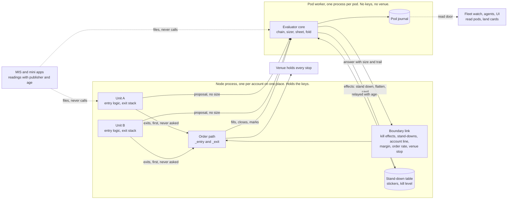
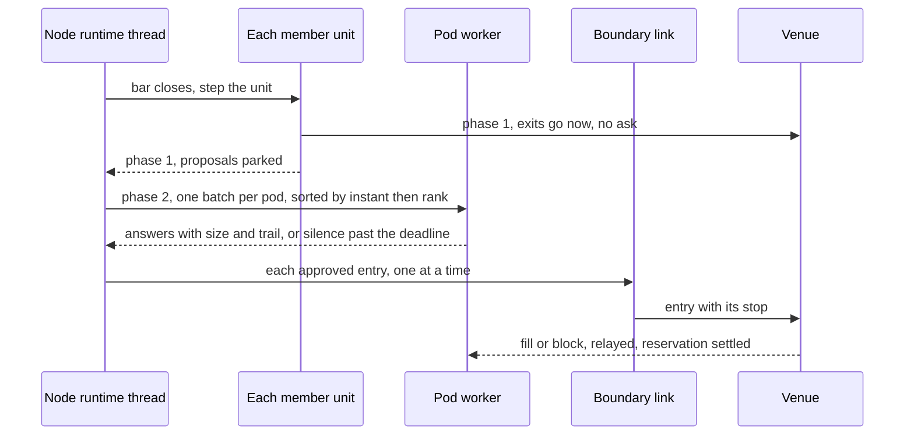

# V3: a live pod above the units

Arena version 3, round two, 7 Nov 2026. Headless: `[ASSUMPTION]` marks an inference nobody confirmed, UNKNOWN marks what I did not verify. Code read at `D:\QMX-worktrees\bld-repair-24`, tip `351e7521`. Bare `runtime.py` is `qmn/src/qmn/app/runtime.py`; `unit.py` is `qml/src/qml/protocol/unit.py`; `compiler.py` is `qml/src/qml/compile/compiler.py`; `handler` is `qmb/src/qmb/host/unit_handler.py`. Core row ids (S1, I3, R9, K7, V7) are `round-2/funnel/FUNNEL.md` section 3; `PH n` is a row of `RISK-SIZING-PLACEHOLDERS.md`; `SWAP n` is a row of `unit-baseline/SWAP-CHART.md`. Numbers here are labels, never values. Companions: `WALKS.md`, `RATIONALE.md`.

## 1. The paradigm

**In a sentence:** units say what and when; the pod says how much and whether; one evaluator per pod does that from one document, for every member, in backtest and live.

This is how a multi-manager fund works. A strategy decides the trade and how it gets out. The risk desk above it holds the money, sets the size and stops the book. Here the desk is code on the node, never agents and never a mini app.

The word is **pod** throughout: his screen word, a stack of blocks plus money and members on one place, with a live and a paper side (`UI-LOOK.md`). "Group" in the fork title and "pod" here are one thing, so I10 and S14 merge.

### What runs where at trade time



### One bar, in order



### Words

| Word | Means |
|---|---|
| **Unit** | One trading algorithm: entry logic, its exits, its logic numbers. It holds no money and no size |
| **Pod** | A versioned document: sizing method, modifiers, control rows, caps, rank, anchors. Library kind `pod` |
| **Pod deployment** | A pod version plus its members, money, place and side (live or paper). What the Portfolio card shows |
| **Pod of one** | A pod deployment with one member, generated from a template. What "a unit alone" is in this shape |
| **Evaluator** | The one pure core that answers proposals. No I/O |
| **Worker** | The child process hosting one pod's evaluator on the node |
| **Proposal** | What a unit sends: market, side, stop or declared basis, tags, optional ask. No size |
| **Ask** | A unit's optional opinion on size, a typed amount with a receipt. The old unit sizer socket, narrowed |
| **Chain** | The ordered links every entry passes. Each link passes, shrinks or refuses |
| **Boundary** | The chain's last link. It runs in the node process, so it is atomic at the account |
| **Sheet** | Every number of one pod and clock, frozen at an anchor, each with a receipt (from old candidate 2) |
| **Fact** | Measured now, never chosen, stamped with time and source |
| **Anchor** | The instant a clock or named trigger opens a new sheet |
| **Trail** | The step-by-step record of one size: the Lab's size trail and the decision row are this one thing |

## 2. What "a unit stands alone" means here

The funnel's V7 says every shipped template stands alone at trade time. **I split it. One half holds, one half is struck.**

**Holds (V7a).** A unit needs no MIS, mini app, desk, agent, QMB card or Lab pass to trade. Stop all of them and it keeps trading. A reading it needs has a stated fallback, or `stand aside`.

**Holds (V7b).** A unit's exits and its open positions need nothing above the unit. If the pod dies, a held position still runs its full exit stack and the venue still holds its stop.

**Holds (V7c).** One member's fault harms only that member: a raising unit stops itself and the rest of the pod carries on.

**Struck (the literal reading).** A unit cannot open a new position with no pod. A unit document has no size in it, so it cannot. **Reason:** the point of the shape is that size and brakes live in one place, and a second path where a unit sizes itself with no evaluator would give two arithmetics, two receipts and two failure modes. The need behind V7 is "units from any source trade with no special case" (M49), and the pod of one meets it: every shipped template carries its pod template, deploying a unit with no chosen pod generates one, and he never has to see the word.

**Restated rule:** every shipped template stands alone with its pod. With its pod's worker silent, a unit takes no new entry and exits as normal. That silence is the cost, and it is written down in `RATIONALE.md`.

## 3. Decisions

### AD-1 Units propose, pods dispose
- **Binds:** unit document, compiler, `HostedUnit`, handler.
- **Prevents:** two places computing a size.
- **Rule:** `HostedUnit.enter` mints a `Proposal` and never a quantity. `UnitEntryIntent` keeps its wire shape and is minted by the host from an approved `Answer`, so `_entry` and the wire do not change. Unit format 5 drops `/sizer` and adds optional `/ask`. `/halts` stays refused with a pointer to the pod. The upgrader moves an old sizer binding into a generated pod of one. `compiler.py:930-936`'s refusal goes with the field.

### AD-2 Every deployment has a pod
- **Binds:** promote, node, QMB, Lab, paper.
- **Prevents:** a "no pod" branch through the money path.
- **Rule:** the deployment key is unit version, pod deployment, side. No null. This lifts the second-deployment refusal (`promote.py:422-447`). A pod deployment starts before its members; a member waits with detail `pod not ready`.

### AD-3 One evaluator, state in and out
- **Binds:** node, QMB, paper, Lab replay.
- **Prevents:** Lab size differing from live size (D38).
- **Rule:** `decide`, `advance`, `on_event` are pure over `(sheet, state, facts, input) -> (output, state')`. Lives at `qml/src/qml/pod/evaluate.py`. It imports `qml.blocks.api`, which is why it is here: `qml` depends on `qmf-risk`, not the reverse (`qml/pyproject.toml:8-12`). One conformance tape runs through all four drivers in CI. Only fills, costs and latency may differ (V10). The Lab's planned `qmx_lab.pods.simulator` is a driver, and `unsupported_blocks` becomes the needs list. **Departure from S15's first option:** sizing leaves `UnitSliceHandler` instead of widening it; the handler keeps logic, position and fills, so there is still no second core for either job.

### AD-4 One chain, one trail (F7 A)
- **Binds:** every link that can pass, shrink or refuse.
- **Prevents:** five refusers with five receipts and five failure modes.
- **Rule:** one chain per pod, declared as data, last link fixed. Default order: stickers; gate; control states; allocation share; sizer; modifiers; caps; converter; boundary. Every link writes one `Step`. Refuse beats shrink. A link failure answers its row's `fail_mode`, and it can only touch entries. The boundary runs in the node process and every other link in the worker, so one chain crosses one process seam; the trail reads as one list. That is one mechanism with two hosts, and I am claiming F7 A over F7 C because there is one order, one schema and one receipt. A reader may fairly call it a very lopsided F7 C.

### AD-5 Exits never touch the evaluator (F5 B)
- **Binds:** unit, node, `Effect` type.
- **Prevents:** a pod fault stopping a close (V1).
- **Rule:** the exit stack is owned by the unit and bound on its document. Every per-bar exit runs on the unit's step, fed `PositionFacts`. The winner comes from `safest_exit(answers, rank)`, one pure shared function at `qml/src/qml/pod/rank.py`, reading the pod's `exit` band. That band is copied to the node at bind and falls back to a built-in order. So "shared stage" means shared code and one rank table, never a shared process. A faulty exit block falls to the next rank, then `_close_scope`. Exits are sent in phase one, before any ask. Proved by a property test with the worker hung, raising and dead.

### AD-6 Two phases per bar
- **Binds:** `Runtime._drive`, `NodeUnit.mint_intents`, `replay`.
- **Prevents:** arrival order deciding who gets the last room, and backtest and live disagreeing about it.
- **Rule:** phase 1 steps every member and places exits; entries park. Phase 2 sends one batch per pod sorted by bar instant, member rank, then unit id. Today `NodeUnit.mint_intents` calls `place` at once (`runtime.py:1727-1733`) and `_drive` walks units in dict order (`:3013`), so this is a real change there. A catch-up pass with several instants sorts by instant first. QMB uses the same sort.

### AD-7 One worker process per pod; one node process per account on a place (F4 B)
- **Binds:** node supervisor, relay, secrets.
- **Prevents:** a bad pod stalling other pods; pod block code sharing a process with the keys.
- **Rule:** the worker is spawned with a scrubbed environment and holds no venue client, so it cannot send an order or read a key (`qmx_apps/manifest.py:60-65`). It may run any Library block. Pods on one account share a node process and never a worker. One account stays in one node process because reconcile and `_orphans` are per account (`runtime.py`, `guard`), and two sessions would read each other's positions as orphans. **Reading of F4 B:** I isolate the part that can fail by design, block code. The venue session stays together. **Deadline rule:** an unanswered batch past `ask_deadline` marks the pod SILENT; further proposals refuse at once with `pod_silent` until a heartbeat returns, so one hung pod costs one deadline per hang, never one per unit. The supervisor replaces the worker, which recovers by fold. Mechanism check (`D:\Temp\v3-arch\ipc_check.py`, stand-in chain, this laptop): pipe round trip about 0.1 ms, a batch of 200 about 2 ms, a hung worker detected at the wait limit, replacement answering in about 0.13 s. That says the pipe is not the limit. A real chain's cost is UNKNOWN until slice 0 measures it.

### AD-8 What is atomic where
- **Binds:** every shared limit.
- **Prevents:** a cap that looks atomic and is not.
- **Rule:**

| Limit spans | Enforced | How fresh |
|---|---|---|
| One pod | Worker, in batch order, with reservations | Atomic in the pod |
| Pods on one account | Boundary link in the node process | Atomic at the account |
| Pods on one account, soft | Relayed facts inside a pod's worker | Has an age on the fact |
| Accounts or places | Stickers published at anchors, with expiry | One anchor late, stated |

The account line is the root pod of an account (`parent: null`, `scope: account`). Its rows run in the boundary, on the node's thread. **So they are restricted:** signed stdlib blocks only, no Library code, because a hung block there would stall exits on that thread. A user's own account-wide Library brake runs as a soft row with an age. This is a real strain, and `WALKS.md` 10 says so.

### AD-9 Reservations
- **Binds:** worker, node.
- **Prevents:** a crash between answer and send leaving risk counted for ever or never.
- **Rule:** an approved answer reserves its risk under `proposal_id`, in `pending_risk`. The node settles it with `placed`, `blocked` or `unknown`. An unsettled reservation is dropped after its TTL only when the relayed position list shows no such position. `decide` is idempotent on `proposal_id`.

### AD-10 Numbers at anchors, facts live (F2 B)
- **Binds:** every pod number.
- **Prevents:** numbers moving between anchors with nobody able to say why.
- **Rule:** only `derive_anchor`, one pure function, writes a sheet. Readers read the sheet in force. `authority` on a pod number is `off` or `at_anchor`. **Cuts act at once; raises wait for the next anchor.** A `scaled` number is a frozen multiple times a live fact. A multiplier may read a live ledger between anchors, with shape and bounds frozen on the sheet; permission to exceed one is a raise. **Limit of the fork:** a unit's logic numbers stay on the built motion engine, on the unit, because they are the unit's and not the pod's (`SWAP` 2.5). That engine still gets S13's bounded window. E5's find, track and correct all survive in this timing: find sets a pod version, track is the live fact, correct runs at the anchor only.

### AD-11 Anchors are pure, a restart is no reset
- **Binds:** `advance`, recovery.
- **Prevents:** a restart acting as a hidden accelerator (R9, C48).
- **Rule:** `anchor_id` is a pure function of clock and time, so `advance` is idempotent. Recovery folds the pod journal, then relayed fills and closes, before answering anything. Anchors passed while down are derived once, latest wins, with `restart_late` on the receipt. Cuts stand. A raise earned before the restart still waits for the next anchor after recovery. Stickers that expired while down are settled from the table.

### AD-12 A pod edit moves no unit fingerprint
- **Binds:** compile, promote, node gate, G.
- **Prevents:** 200 re-proofs per pod edit (E2 row 3), or a live risk change with no click (C45).
- **Rule:** size and brakes are not in the unit document, so the compiled fingerprint already is the logic fingerprint. S14's two fingerprints come free. A pod has its own hash. The node keeps its gate (`runtime.py:2756`) and adds one: the pod hash in force equals the hash the owner's click bound. Moving a live pod deployment to a new version is one click bound to that hash, covering every member. Agents and the copilot write drafts only. Paper moves freely. **Consequence:** after format 5 a new brake, base or modifier never bumps the compiler, so K8 is rarely paid.

### AD-13 Size is a typed amount; lots exist only at the venue step
- **Binds:** sizer blocks, asks, converter.
- **Prevents:** a socket change per base, the USDJPY fault, a trigger bound as a sizer.
- **Rule:** a sizer answers `Amount(kind, value)` with kind `money_at_risk`, `notional` or `quantity`. One converter (`qml/numbers/convert.py`, extended) reads kind and record, spells the venue quantity and writes the residue. It is one chain link. A face check refuses a block with the wrong output type in the sizer place; a sanity band and per-trade cap are one cap row.

### AD-14 A unit's own sizer is an ask, and the pod says whether it counts
- **Binds:** mini-app units, conviction, per-member policy.
- **Prevents:** a precedence fight per case, and a sizer outside the chain.
- **Rule:** `/ask` is an optional block bound on the unit. It runs in the unit's step, because it may need the unit's own bars and bindings, and it answers an `Amount` and a receipt on the proposal. The pod member row says `sizing: pod`, `ask` or `lower_of`. Default `pod`. A pod of one generated for a unit with an ask defaults to `ask`. **Every policy still passes the whole chain:** an ask replaces only the sizer link. The ask is in the logic fingerprint, since it is the unit's code. Its use by the pod is in the pod hash.

### AD-15 One control table
- **Binds:** brakes, accelerators, restores.
- **Prevents:** each brake as custom code; 200 copies of a brake.
- **Rule:** one `ControlRow` per control, S4's contract. `scope: member` instantiates one block and one ledger per member, so one row serves 200 units while each reads its own record. A row's `where` filters by tag. Overrides resolve through I16. **Five states per scope.** `Effect` has no variant that lowers a kill level or clears his resume. There is no placement field: every control runs in the evaluator, and the boundary set is fixed.

### AD-16 The gate lives in the pod package (F3 A)
- **Binds:** SQS rule, baseline, gate link.
- **Prevents:** a gate with its own host; the first entry waiting on a second service.
- **Rule:** `qml/src/qml/pod/sqs/` holds the rule text and baseline producer, moved before C-20, with the eight settings as rows on the block. The worker folds relayed minute rows (R19) into a same-minute baseline per instrument, persisted beside its journal. No node sensor app and no curve factory: **I6 is struck.** What replaces it: each pod's own baseline over the same rows, identical by determinism, a copy per pod. Default gate link: cost hurdle (SQS-2) over this unit's stop, with the old rule as floor; the floor warns until its baseline is earned, so nothing waits. Adding a new fast sensor is a package PR with his signature, and that is F3 A's real cost. The MIS keeps its own spread reading until retired.

### AD-17 Readings reach both readers by one path
- **Binds:** S8, unit `reads`, pod inputs.
- **Prevents:** a forged publisher; a reading used as a command.
- **Rule:** `reads` compile with publisher, fallback, stale limit, `valid_until`, on the unit document for logic and the pod document for sizing. The host stamps `source`. Readings are files, never calls. A stopped publisher only ages its readings. Home markets are the fallback for a market list (I5).

### AD-18 Only the fixed lines refuse
- **Binds:** `pod_check`, `unit_check`.
- **Prevents:** rigid walls.
- **Rule:** a reckless pod compiles, warns and grades. An unmet need names its row and fallback at check. A pod with no brakes runs. Only his click, exits, kill lowering, agents and keys are absolute (V1 to V4).

### AD-19 Records have one writer each and one trace id
- **Binds:** journals.
- **Prevents:** a size that cannot be replayed.
- **Rule:** the unit stream records proposals, logic and exits, written by the node. The pod stream records steps, sheets, states, effects and would-haves, written by the worker. A `trace_id` joins reading to fill. Risk rows are evidence and may not be dropped.

### AD-20 Agents read pods and draft
- **Binds:** K2, K5, tool table.
- **Prevents:** any agent path to money.
- **Rule:** agents get pod rows first, then units on drill. Doors: read, propose, run. Pod drafts need his click on live. Q4's default holds: an agent's de-risk reading lands a card; if he rules otherwise, it becomes a cut-only row read inside declared bounds, with expiry, and nothing else changes.

### AD-21 Target rests at the venue when the venue can hold it (F5 B)
- **Binds:** S18, I4 venue capability.
- **Prevents:** a wick reading differently in QMB and live.
- **Rule:** the destination is targets at the venue. Until R24's probes prove an amend cannot wipe the stop (CHECK B6), the node closes targets as today (`runtime.py:1849-1857`), and rows carry `target_held: node`. The flip is one capability value, not a change of shape. **Before his sign-in this version does not have what F5 B buys.**

### AD-22 Windows is first class
- **Binds:** worker, relay, status writes, clocks.
- **Prevents:** a design that only runs on POSIX.
- **Rule:** spawn only, named pipes via `multiprocessing.connection`, whole-then-replace writes, `tzdata` pinned, no POSIX calls.

## 4. Contracts

Sketches, Python-shaped. The owner package is on each.

### Proposal and answer (`qml/src/qml/pod/model.py`)

```python
@dataclass(frozen=True)
class Amount:                     # AD-13
    kind: Literal["money_at_risk", "notional", "quantity"]
    value: Decimal

@dataclass(frozen=True)
class Basis:                      # I13: what one R is for this entry
    kind: Literal["disaster_stop", "tail_budget"]
    stop: Decimal | None          # absolute price, loss side; None only with tail_budget
    tail_money: str | None        # a pod number's name when kind is tail_budget

@dataclass(frozen=True)
class Proposal:                   # minted by HostedUnit.enter, unit.py replaces :785-830
    proposal_id: str; trace_id: str; at: Instant
    unit: UnitRef                 # id, version, compiled fingerprint, family, type tag
    market: str; side: Side; reference: Decimal
    basis: Basis; targets: tuple[Target, ...]
    order: OrderSpec              # type market | limit | stop; timing offset (S18)
    tags: BetTags                 # bet key, driver, family (I9)
    ask: Amount | None; ask_receipt: Receipt | None   # AD-14
    conviction: Decimal | None    # bound from the unit's own signal (I1)
    readings_seen: tuple[ReadingRef, ...]

@dataclass(frozen=True)
class Step:                       # one line of the trail; explain_size reads these
    link: str; row: str | None; verdict: Literal["pass", "shrink", "refuse", "warn", "shadow"]
    before: Decimal | None; after: Decimal | None
    code: ReasonCode; inputs: Mapping[str, FactStamp]

@dataclass(frozen=True)
class Approved:
    proposal_id: str; amount: Amount; quantity: Decimal; residue_r: Decimal
    not_before: Instant | None; sheet_rev: str; pod_hash: str; trail: tuple[Step, ...]

@dataclass(frozen=True)
class Refused:
    proposal_id: str; code: ReasonCode; link: str; trail: tuple[Step, ...]; would_have: bool

Answer = Approved | Refused
Effect = StandDown | RiskStop | RaiseKill | Flatten | Row | Card   # no variant lowers a kill level
```

### The evaluator (`qml/src/qml/pod/evaluate.py`): the deep module

```python
def decide(sheet: Sheet, state: PodState, facts: Facts, batch: Sequence[Proposal]
           ) -> tuple[Sequence[Answer], Sequence[Effect], PodState]: ...
def advance(pod: CompiledPod, state: PodState, facts: Facts, now: Instant
            ) -> tuple[Sheet | None, Sequence[Effect], PodState]: ...   # idempotent per anchor_id
def on_event(sheet: Sheet, state: PodState, facts: Facts, event: PodEvent
             ) -> tuple[Sequence[Effect], PodState]: ...                # Fill, Close, Blocked, Mark, Sticker, HisAct
def recover(pod: CompiledPod, rows: Iterable[Row], facts: Facts) -> tuple[Sheet, PodState]: ...
def explain_size(row: DecisionRow) -> SizeExplanation: ...              # pure; used by developer, copilot, UI, triage
```

Five functions, two real adapters at the seam (`InlineEvaluator`, `WorkerEvaluator`), four drivers. Deletion test: delete it and sizing reappears in `unit.py`, the handler, `runtime.py`, the Lab and `paper_lane`.

### The sizer and modifiers (`qml/blocks/api.py`, blocks in stdlib or Library)

```python
class SizerInstance(Instance, Protocol):       # same make(params, inputs, side) as today
    def update(self, evidence: SizingEvidence) -> SizeAnswer | None: ...
class SizeAnswer: amount: Amount | None; skip_reason: str | None; receipt: Receipt
class SizingEvidence:                          # I1, one fact surface
    facts: Facts; numbers: Mapping[str, Resolved]; proposal: Proposal; member: MemberView
class ModifierInstance(Instance, Protocol):    # S2, role sizing_modifier
    def update(self, evidence: SizingEvidence) -> Modifier | None: ...
class Modifier: factor: Decimal; range: tuple[Decimal, Decimal]; reason: str; name: str
```

The level (S2) is one named modifier with no ladder law.

### Exits (`qml/blocks/api.py`, `unit.py`, `qml/pod/rank.py`)

```python
@dataclass(frozen=True)
class PositionFacts:              # E15, fed each bar to every per-bar exit, side-correct
    position_id: str; side: Side; quantity: Decimal; avg_price: Decimal
    stop: Decimal | None; targets: tuple[Decimal, ...]
    bars_held: int; r_now: Decimal; mae_r: Decimal; mfe_r: Decimal
    bid: OHLC; ask: OHLC; opened_at: Instant; numbers_in_force: Mapping[str, Decimal]

ExitAnswer = CloseFull | ClosePartial | AmendProtection | TargetPosition   # last reserved (S3), refused until step 3
class CloseFull: reason_code: str
def safest_exit(answers: Sequence[tuple[str, ExitAnswer]], rank: ExitRank) -> ExitAnswer | None: ...
```

### Controls (`qml/src/qml/pod/model.py`)

```python
@dataclass(frozen=True)
class ControlRow:                 # S4. Required fields first, the rest defaulted
    row_id: str; block: BlockRef; reads: tuple[str, ...]
    scope: str                    # member | pod | account | a scope key (S11)
    verb: Verb                    # none | no_new_entries | reduce(factor) | flatten
    on_fire: tuple[Effect_kind, ...]
    restore: Restore              # rule or hand
    until_n: ColdRule             # warn | shadow | fixed labelled fallback, with N
    shadow: bool
    where: TagFilter | None = None
    attack: str | None = None; release: str | None = None
    counting: str = "net_r"; fail_mode: FailMode = "no_new_entries"
    money_series: str = "committed"; tail_or_timing: str = "tail"; expected_fire_rate: str | None = None
```

### The pod document (`qml/src/qml/pod/model.py`, Library kind `pod`, schema `qmx.pod/1`)

```python
@dataclass(frozen=True)
class Pod:
    pod_id: str; version: int; method: str       # "Book + BMS", "Simple rules": a name, side by side
    parent: PodRef | None                        # I10
    chain: tuple[str, ...]                       # link order; boundary always last
    sizer: Binding; modifiers: tuple[Binding, ...]; combiner: Combiner
    gate: Binding | None; caps: tuple[Binding, ...]
    allocation: Binding                          # named mode, off-path, publishes shares at anchors
    controls: tuple[ControlRow, ...]
    tolerations: frozenset[str]                  # sticker kinds, per tag override
    numbers: Mapping[str, NumberSpec]            # S13, on every pod number
    overrides: OverrideChain                     # I16
    anchors: tuple[Clock, ...]; triggers: frozenset[str]
    rank: RankTable                              # one table, including the exit band
    reads: tuple[Read, ...]
    pins: tuple[Pin, ...]; preset_of: PinRef | None   # stores only what differs from its preset

@dataclass(frozen=True)
class PodDeployment:
    deployment_id: str; pod_hash: str; side: Literal["live", "paper"]
    place: Place                                 # account, node tag; one place only
    money: MoneySource                           # declared | share_of(account) | share_of(live pod)
    members: tuple[Member, ...]
class Member: unit: UnitRef; sizing: Literal["pod", "ask", "lower_of"]; rank: int; share: str | None; tags: frozenset[str]
```

### Numbers (`qml/unit/model.py`, one `NumberSpec` shared with the unit)

```python
class NumberSpec:
    kind: NumberKind; default: Decimal; range: tuple[Decimal, Decimal]; origin: Origin   # adds found_by_replay
    derivation: Derivation | None     # rule block or fact, inputs, fallback, cautious direction
    authority: Literal["off", "at_anchor", "motion_inside_range"]   # last: unit logic numbers only (AD-10)
    never_self_tune: bool; applies_to_open_positions: bool = False
    guard: NumberGuard | None         # reverts and freezes after trips
class Resolved: value: Decimal; reason: ReasonCode; sheet_rev: str     # every value carries why
class Sheet: pod_hash: str; anchor_id: str; rev: int; numbers: Mapping[str, Resolved]; shares: Mapping[str, Decimal]
```

### Facts (`qml/src/qml/pod/facts.py`, one provider per driver)

```python
@dataclass(frozen=True)
class Fact(Generic[T]): value: T | None; at: Instant; source: str; age_ns: int; fail_mode: FailMode
@dataclass(frozen=True)
class Facts:
    account: AccountFacts      # balance, marked, margin_free, leverage, realised since anchor, basis (I3)
    records: Mapping[str, InstrumentRecord]   # I4
    quotes: Mapping[str, Fact[Quote]]; costs: Mapping[str, Fact[CostCell]]   # I2, label uncalibrated
    kill: Mapping[str, KsaLevel]; stickers: tuple[Sticker, ...]               # S10
    open_risk: Mapping[str, Decimal]; pending_risk: Decimal                   # by bet key
    readings: Mapping[str, Fact[Reading]]; own_records: Mapping[str, RecordView]
    extra: Mapping[str, Fact[Decimal]]
```

### Status and records (`packages/qmf-data/.../journal_kinds/pod.py`)

```python
class PodStateRow:             # R9, the fold, keyed by scope including pod and tag
    scope: str; word: Literal["ACTIVE", "REDUCING", "BENCHED", "HALTED", "RESTORE", "SILENT", "UNKNOWN"]
    stamp: Instant; reason: ReasonCode
    money: Decimal; at_stake_next: Decimal; room_to_line: Decimal; day_loss: Decimal
    open_risk_by_key: Mapping[str, Decimal]; drawdown: Mapping[str, Decimal]
    cushion: CushionLedger; controls: Mapping[str, ControlDistance]
class CushionLedger: anchor_type: str; clock: str; scope: str; realised: Decimal; marked: Decimal | None
```

Decision row, trade row v2, would-have, risk event, fill record and run stamp as R1, R2, R3, R4, R7, R8, with `pod_hash` and `sheet_rev` on each.

### Node seam (`qmn/src/qmn/app/`)

```python
class PodLink:                 # pod_link.py. Two adapters: Inline (paper tests, QMB) and Worker
    def ask(self, batch: Sequence[Proposal], facts: Facts, deadline_ns: int) -> Sequence[Answer] | Silent: ...
    def tell(self, events: Sequence[PodEvent]) -> None: ...      # never waits
    def effects(self) -> Sequence[Effect]: ...
def boundary(approved: Approved, hosted: _Hosted, account: AccountLine) -> Pass | Refused: ...   # boundary.py
```

`boundary` absorbs today's `guard` (`runtime.py:2623-2675`), the protection gate (`:1102-1106`) and the retired `cross_unit_hook` (`:1147-1151`), and adds kill effects read from the table for entries (`SWAP 18`), account-line rows, margin, order rate.

### Agents and apps (`qmx-control/catalog.py`)

| Row | Direction | What |
|---|---|---|
| `pod_read`, `pod_units_read`, `fleet_read` | read | The fold, ranked; K2's read door |
| `pod_new`, `pod_patch`, `pod_check`, `pod_explain` | propose | Drafts only |
| `blocks_save` | propose | S16's door, with its contract test |
| `card_land` | propose | An app or agent reaches "Needs you" |
| `pod_replay` | run | Paper and tapes, unlimited |
| pod promote | money | No row. His click, in a channel agents cannot reach (K5) |

## 5. The core list in this shape

Row by row. Unmarked rows hold as the funnel wrote them. The rest say what changes here.

| Row | In this shape |
|---|---|
| S1 sizing base | Pod `/sizer`, plus unit `/ask`. Converter is a chain link (AD-13) |
| S2 modifier chain | Pod `/modifiers`, in the evaluator |
| S3 exit stack | On the unit as written. Rank from the pod, resolved on the unit's path (AD-5) |
| S4 control rows | As written, in the evaluator. **Placement field struck:** nothing varies, the boundary set is fixed (AD-15) |
| S6 entry chain | One chain (AD-4). **"Group stage" as a separate link struck:** the pod is the chain |
| S8 readings bus | Holds; two readers (AD-17) |
| S9, S10, S11, S12 | Hold. Stickers live in the node's table, relayed to the worker. Roles `sizing_modifier` run in the evaluator, the rest in the unit. Tolerations on the pod |
| S13 number spec | Holds. Authority per AD-10, `motion_inside_range` only for unit logic numbers |
| S14 pod document | **Empty pod struck:** replaced by pod of one. **Placement per row struck.** Two fingerprints by construction (AD-12). Click rule kept. A unit in a pod takes the pod's stack |
| S15 one evaluator | Holds as an outcome; the route differs (AD-3) |
| S16, S17, S18 | Hold. S18's partial close and netting wait on step 3 and a setting on the pod deployment |
| I1 fact surface | `Facts` |
| I2, I3, I4, I5, I7, I9, I13, I16 | Hold |
| I6 curve artifact | **Struck** (marked if F3=B). AD-16 replaces it |
| I10 group document | Merged into `Pod` |
| I17 feasibility | At each anchor per member, on the sheet, shown |
| R1 to R4, R7 to R9, R13 | Hold, with two streams (AD-19). R9's fold runs in the worker, and also in any reader over journals |
| R17 identity and swap | Holds, and shrinks: a sizing swap is a pod version with no unit identity event at all |
| K2, K5, K7, K9 | Hold. K9 adds: worker hung, raising or dead changes nothing about exits |
| K8 re-test | Holds, rarely paid (AD-12) |
| V1 to V6, V9, V10 | Hold |
| V7 | **Restated:** section 2 |

Refusal table (funnel 3.8), changes only. `inputs_not_built` on the sizer: gone with the field, and `/ask` takes inputs. `halts_not_built`: stays, text points at the pod. `BLOCKS_NOT_BUILT`, E1 to E18: as funnel. E8 and E9: on the pod sizer place. E3 account scope: `flatten` effect from a control. A format 5 census row for each moved field.

## 6. Swapping each placeholder

| PH | Placeholder | Swap in this shape |
|---|---|---|
| 1 | Sizer `fixed-fraction-at-stop@1` | Becomes the pod's default sizer at `@2`: answers `money_at_risk`, reads cost, converter fixes USDJPY. Unit slot goes; `/ask` remains for units that want one |
| 2 | Stop `swing-stop-buffer@1` | Stays on the unit. Other stop blocks swap by version, reading `PositionFacts` once `compiler.py:358-363` lifts |
| 3 | Target `target-r-multiple@1` | Stays on the unit. A second target after step 3 |
| 4 | Time exit | Stays on the unit. `timer()` side fix, the block's own reason code (`unit.py:450,690,701`) |
| 5 | Halts | **All five run as pod rows.** The evaluator is their host and the fold computes their statistics. `make` and `update` unchanged |
| 6 | Cross-unit hook | Retired with `PASS_EVERY_ORDER`. The chain and boundary replace it, on node and QMB |
| 7 | Motion of risk numbers | Pod numbers: sheet. Exit numbers on the unit still need `_motion` widened (`compiler.py:510-516`) |
| 8 | Moved values, open positions | `applies_to_open_positions`, default false; a position keeps its entry stamps. True acts through amend, after step 3 |
| 9 | Stop amendments | Answer type added; `allow_widen` row on the unit's stop (warned). Signed distance is repair's, and blocks step 3 |
| 10 | Partial closes | `ClosePartial`; node close with quantity. Step 3 |
| 11 | No price stop | `Basis.tail_budget`. Lift `compiler.py:500-506`, widen `enter`, handler and node entry; boundary accepts the declared basis |
| 12 | Lot rounding | Converter in the chain; rule is a row (round down default; a dither block possible). Hosts check, no longer re-round. Residue real |
| 13 | Gap through stop | Mechanism kept. A `gap_factor` fact reaches sizers and a reserve cap |
| 14 | Margin, liquidation | Boundary link adds the missing entry check; margin facts reach sizers |
| 15 | Leverage, spec change | Node producer calls `stand_down(SPEC_CHANGE)`; relayed as a sticker |
| 16 | Funding, swaps | Cost cell and a fact; a modifier may read it |
| 17 | Account facts | Live account surface on the node; relayed in `Facts`; share from allocation |
| 18 | Kill effects | Boundary reads the table for entries too. Values stay rows |
| 19 | Protection not placed | `protection_escalation` row on the pod, copied at bind, executed by the node: `close` or `alarm`; `hedge` is content |
| 20 | Kill line's verb | `floor` control on the root pod, verb a field; survives restarts (V5). `qmn/capital/kill_line.py` retires |
| 21 | Two units, netting | A setting on the pod deployment; stays refused until a member needs it. Shared attribution is easier here since the pod sees both |
| 22 | Numbers a deployment starts from | `carry: restart` or `carry` on the pod deployment. Sizing numbers now can carry |
| 23 | The one automatic move | `Effect.RiskStop` is the first production caller of `Runtime.risk_stop` |
| 24 | Paper after a risk stop | Table row stays; a pod restore rule may send a member to paper |
| 25 | Risk events | Worker writes them; appendable codes |
| 26 | Unit sizer against fixed size | Run the same proposals under a fixed-money pod. Cheap here: one replay. Which a verdict uses is methodology's |
| 27 | Correlated judging | Keep tries. The cross-unit control is the pod |
| 28 | Decay alarm | Replaced by the scripted fleet watch; the per-unit nightly card goes |
| 29 | Fields to replay | R1, R2, R3, plus the proposal tape |
| 30 | Size the venue receives | Keep. `receipt_quantity` comes from `Approved` |
| 31 | Pods | This document |

`tools/qml/placeholders.py` widens to read pods.

**Moving the sockets is small.** `unit.sizer` and `plan.sizer` appear at about 12 production sites: `check/layers.py:117,641`, `compile/compiler.py:545,820,930,1049`, `door.py:168`, `identity/diff.py:247`, `protocol/unit.py:331,792`, `tools/qml/placeholders.py:72`, by grep. `check/layer_g.py` needs a fixed proof size, since it fills what a unit asks: a stand-in pod of one with the minimum lot. `[ASSUMPTION]` nothing in layer G's verdict depends on size; read its docstring, not all of it.

## 7. The first baseline

**Ships on:** template `scalper-mr`, `intraday-trend` (with `orb` variant), `canary`. Each is a unit document plus a pod template. Values are labelled placeholders, owner numbers talk. Funnel 4.1's table holds, with this reading: sizer, gate, stickers, group row, halts and numbers sit in the pod template; exits sit on the unit; the group row's parent limit and day stop live on the root pod generated for the account.

**Walked from zero trades and zero fills to a filled entry on paper (K7):**

1. `unit_new("scalper-mr", overrides)` saves a draft unit; `unit_check` runs A to F.
2. `pod_new(from="scalper-one")` saves a draft pod of one, or the promote step generates it. `pod_check` compiles it: pins, needs against what the place provides, warnings.
3. `backtest` runs `replay_group` on synthetic bars with `InlineEvaluator`. G is on the logic fingerprint with the stand-in proof size.
4. Promote to paper. The host builds the pod deployment and unit deployment. No click needed for paper.
5. The node starts the root pod's account line, spawns the worker, stages pinned block files, compiles the pod. `recover` over an empty journal gives a first sheet: every number at its labelled default with `reason: default`. The unit warms up.
6. A bar closes; the unit fires; a `Proposal` parks. No exit is due.
7. Phase 2, the worker: stickers none. Gate: live spread and stop in R; cost cell `uncalibrated`, so it warns and passes; floor has no baseline, so it warns and passes. Controls: session loss none, day stop reads planned R, bench in shadow until N. Allocation: `own size under a parent limit`, labelled fixed limit. Sizer: fraction of the declared base at the stop, costs in the denominator from the stressed pooled cell. Cushion rule: profit since anchor is zero, multiplier one. Caps pass. Converter spells quantity.
8. Boundary: GREEN, no stand-downs, account line clear, margin fine, rate fine, stop provable. Host mints `UnitEntryIntent`.
9. `_entry` sends. Fake broker fills. `tell(Fill)` settles the reservation, starts the cost cell, moves the fold.
10. Pod row in `fleet_read`; decision row replays through `explain_size`.

K7 continues to the owner's click on the fake broker's live lane, bound to both the unit's fingerprint and the pod hash.

**How anyone changes anything:**

| Change | How | Who |
|---|---|---|
| A value, a block, a brake, `on_fire`, tolerations, method, allocation | `pod_patch`, draft, then a click on live | User, copilot writes the draft |
| One edit for 200 units | One pod version, one click | Owner |
| Entry logic, exits, logic numbers | `unit_new` overrides, new unit version, G, click | User or copilot |
| How a number derives | `numbers.x.derivation`, a pod version | User or copilot |
| A new template | A JSON in templates, plus its pod template | Copilot |
| A new block | `blocks_save` with its contract test | Copilot, on S16 |

## 8. Adding things, as a developer

| Adding | Files | Tests |
|---|---|---|
| **A sizer** | One folder `<id>/1/block.py`, `entry.json`, in the Library or stdlib. One line in a pod | Slot contract (typed amount, face check, reads moved values from evidence); a conformance case. No compiler, no node, no unit change |
| **A brake** | One folder; one `ControlRow`; a code in `journal_kinds/unit.py`. Reads existing facts or fold entries | Row contract; cold behaviour; a shadow case; fires on a tape. If it must be atomic across the account: stdlib, signature, boundary list |
| **An instrument class** | Rows only: `InstrumentClass`, record keys, calendar package, venue adapter if new. Test still fails on branching by class in the money path | Known-answer cost check; two-driver case per class |
| **A new fact** | `qml/pod/facts.py`; each provider (`qmn/app/pod_facts.py`, `qmb/host/pod_facts.py`, the Lab's); a fail mode. Or `extra` for a one-off | Conformance tape catches a missing provider. **A kernel change, said plainly (C50)** |
| **A sizing base** | Same as a sizer. A new `Amount.kind` touches the converter and its tests, nothing else |
| **A control verb** | `model.py`, `Effect`, node's effect handler | Exit property test re-runs |

### Module map

| Module | Owns | Package |
|---|---|---|
| `qml/pod/model.py`, `compile.py` | Pod document, needs check, fingerprint | qml |
| `qml/pod/evaluate.py`, `chain.py`, `sheet.py`, `fold.py`, `rank.py`, `explain.py`, `facts.py` | The evaluator | qml |
| `qml/pod/sqs/` | Gate rule and baseline (AD-16) | qml |
| `qml/protocol/unit.py` | Mints proposals; exit stack; ask | qml |
| `qml/numbers/convert.py` | The converter | qml |
| `qml/blocks/stdlib/`, Library | Sizers, modifiers, halts, exits | qml, Library |
| `qmb/host/unit_handler.py` | Position and fills; takes quantity from `Approved` | qmb |
| `qmb/host/replay.py`, `pod_facts.py` | `replay_group`, proposal tape | qmb |
| `qmn/app/pod_worker.py`, `pod_link.py`, `pod_facts.py`, `boundary.py` | Worker, seam, facts, last link | qmn |
| `qmn/app/runtime.py` | Two phases; effects; `_close_scope` | qmn |
| `qmf-data/journal_kinds/pod.py` | Pod rows | qmf-data |
| `qmx_library/kinds/pod.schema.json`, `pod-block`, `template` | Real kinds | qmx-library |
| `qmx_host/promote.py` | Pod deployment, click binding | qmx-host |
| `qmx-apps` lander | `library-items` | qmx-apps |

**One statement for the two risk worlds (D50):** new risk runs through `qml.pod` and QML blocks. `qmf-risk` keeps `unit_intent.py` and what `qmb/results/accounting.py` needs. `qmn/capital/*` and old `control_*` go with the swap's subtraction list.

An evaluator change in `qml/pod` bumps the money app and needs his signature (Call 11). **That is correct:** it is money code. A block in the Library, or a pod edit, needs only his click.

### Debugging one size

`pod_explain(trace_id)` reads the decision row and prints the trail: sizer wanted X, because these numbers (each with reason and sheet), these facts (each with age), this modifier, this cap bound, converter gave quantity and residue, boundary passed, broker filled Y. `explain_size` replays the row through the block and must give the same size; a test holds that. The same function is the Lab's size trail. Refused entries have the same trail, ending at the refusing link.

## 9. Observability

**Rows.**

| Row | Writer | Key contents |
|---|---|---|
| `proposal` | Node | Unit, market, stop or basis, tags, ask, readings seen |
| `decision` | Worker | Trail, three positions (wanted, approved, filled), binding clamp, both fingerprints, propensity |
| `sheet` | Worker | Every number, reason, rev, anchor |
| `pod_state` | Worker | The fold, per pass when changed |
| `risk_event` | Worker | Fire, tags, root-cause key, event id, alert fields |
| `would_have` | Node, unit side | Shadow position tracked under the unit's exits when a proposal is refused |
| `trade` v2 | Node | Net and gross R, costs by kind, exit reason, MAE, MFE, session, slice, cost cell, `pod_hash` |
| `fill` | Node | Decision quote, arrival quote, fill, partials, requotes, markouts |
| `run_stamp` | QMB | Real-tick share, costs, arms, member list, pod hash |

**The fold.** `PodState` is one pure fold over the pod journal and relayed events, keyed by scope: member, pod, account, tag, class. One function, three callers: the worker (live), `recover` (restart), any reader over journals (UI, watch, agents). A test holds them equal. Stale input reads UNKNOWN. A dead worker reads SILENT, written by the node.

**Fleet read.** `fleet_read` ranks pods by state, distance to lines and drift, then members inside each. One incident, one card by root-cause key: five stops on one release in a pod are one event. The fleet watch's two lists (who gets looked at, who gets acted on) run at pod level first and replace per-unit nightly cards.

## 10. Build order

F6 B: slices, each ending in something a person can run. Format 5 lands first, while no unit is deployed and bumps are free. After that, risk work does not touch the unit compiler.

| # | Slice | Ends in | PRs |
|---|---|---|---|
| 0 | Trace a Library block through `unit_new`, QMB and node deploy; measure step cost of 200 units on one thread | Two facts on disk | 1 |
| 1 | Unit format 5: `enter` mints proposals; `/ask`; upgrader; census; face check; layer G proof size | The dummy still trades through a stub answer | 3 |
| 2 | Evaluator core, chain with sizer, converter, boundary; decision row; `explain_size`; conformance tape | Same trail in both drivers on one tape | 3 |
| 3 | Real `pod` kind, `compile_pod`, pod of one, deployment key, click bound to pod hash, rehearsal on fake broker | **First filled paper entry, K7 first half** | 3 |
| 4 | Exit stack step 2, `PositionFacts`, rank, reason codes, side fix, trade row v2 | Exits close with their reasons, both hosts | 3 |
| 5 | Control rows, five states, five halts live, effects, scope keys, the fold, catch-up at start | A halt fires and restores on rehearsal; restart holds | 4 |
| 6 | Sheet, anchors, number spec, override chain | Number moves at an anchor with a receipt | 3 |
| 7 | Live account facts, cost cells, fill record, record fields; hurdle and SQS moved (claims before C-20); stickers | Gate warns then refuses on a measured cell | 4 |
| 8 | `WorkerEvaluator`, two phases, heartbeat, SILENT, relay, account line | Kill a worker on rehearsal: exits run, others trade | 3 |
| 9 | `replay_group`, members in one run, proposal tape replay | One pod of 20 on synthetic bars, same as driver tape | 3 |
| 10 | Sessions, second stream, position limit, per-market numbers, roles | All templates compile; ORB across opens | 4 |
| 11 | Readings bus, publisher, market lists | A mini app reading reaches a unit and a pod | 3 |
| 12 | Lander, save door, pins, diff, lineage, forwarding map | A mini app lands a pod and a unit | 3 |
| 13 | Scripted fleet watch, read door, card path, money door, protected list | One ranked screen; decay cards off | 3 |
| 14 | Three templates, K7 whole, K8, K9 census, `EXTENDING.md` | A stranger's walk passes end to end on the fake broker | 3 |
| 15 | **After his demo sign-in:** signed stop, trails, partials, targets at venue, netting setting, R24's facts | Step 3 on demo | 4 |

**Total: about 50 PRs.** Slices 8 and 9 are what this shape costs beyond a thin group: about 6. Slices 0 to 14 land before his sign-in, on the fake broker. Only slice 15 waits for him, and it should land before the first real deployment or it pays a re-test (D41).

## 11. Deferred

| Deferred | Reopened by |
|---|---|
| A pod swapping exit rows at an anchor (F5 C) | A scalper template needing tighter cuts by stage, with a would-have record that survives |
| Curve factory, node sensor as an app (F3 B) | Three spread measures drifting visibly, or a second gate needing a sensor without a signature |
| Learner and applier, moving numbers between anchors (F2 A) | The one-anchor lag measurably costing on a broker cost change, even with costs as live facts |
| Workers across machines, a pod spanning places | A pod that must be atomic on two places; today a mix of pods |
| Evaluator stage for a tick clock, sub-bar proposals | A unit on tick or event clocks (I7 lands) |
| Target-position curves | Step 3 landed and a curve block exists; answer type reserved |
| Netting shared protection | A member on a netting account |
| Account-scope Library blocks in the boundary, under a sandbox | A user brake that truly needs account atomicity |
| Automatic agent cuts | His answer to Q4 |
| Futures route, volume on bars, order flow | His answer to Q2 |

## 12. Assumptions and open questions

- `[ASSUMPTION]` A proposal batch at bar close is fast enough for 1m scalpers. Pipe cost measured; chain cost and 200-unit step cost UNKNOWN until slice 0.
- `[ASSUMPTION]` The node's `_orphans` and reconcile cannot be shared across processes without a rewrite, so one account means one node process. Read, not run.
- `[ASSUMPTION]` Spawning child processes is allowed under the mini-app runtime's rules for `trading-node`. UNKNOWN: not checked against `supervisor.py` limits.
- UNKNOWN: whether a Library block reaches a live node end to end (slice 0).
- UNKNOWN: whether calibration rows rebuild a cold restore for unit logic numbers.
- UNKNOWN: real rate limits at 200 units; order rate is a boundary row with a labelled value.
- Open for his overhaul review: this shape retires `/sizer` and `/halts` on the unit and makes a pod mandatory. It is the one version where a unit cannot open a trade alone. He should see that sentence.
- Skipped against the bmad skill's own process, because the arena forbids them: subagent reviewer gate; memlog (the brief allows only this folder's three files).
