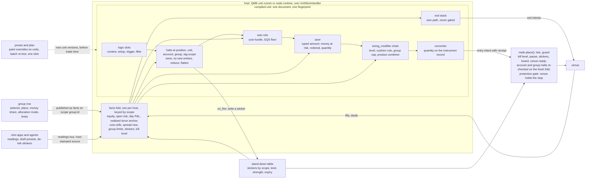

# V4, the flat unit: risk is more QML; sharing is facts, stickers, presets and groups

Fable, 7 Nov 2026, round two, architecture version 4. Shape: mine to find (lead's brief). Written under `round-2/BRIEF-COMMON.md` and `round-2/arch/ARENA-BRIEF.md`. Skills applied headless: `principle-attack-the-premise`, `bmad-architecture`, `codebase-design`, `domain-modeling`. Nobody was available to answer; `[ASSUMPTION]` marks an inference, UNKNOWN marks what I did not verify. No test suite ran. One census script ran under `D:\Temp\v4-premise\` (reads only).

**Paths.** Bare paths under `D:\QMX-worktrees\risk-plan\tracker\risk-core\`. Code at `D:\QMX-worktrees\bld-repair-24`, tip `351e7521` (7 Nov 19:01); line numbers from my own read at that tip unless a `SWAP` row is cited (`unit-baseline/SWAP-CHART.md`, read at `255f3bbf`). `FUNNEL` is `round-2/funnel/FUNNEL.md`; `S1`, `I3`, `R9`, `K8`, `V1` are its core rows; `PH n` is a row of `D:\QMX-worktrees\unit-plan\tracker\risk-sizing\build\RISK-SIZING-PLACEHOLDERS.md`; `E2` and `E5` are `round-2/expand/`; `LP` is the Lab-and-pods spine at `D:\QMX-worktrees\risk-plan\tracker\qma-v2\architecture\lab-and-pods\ARCHITECTURE-SPINE.md`.

**Words (the whole vocabulary of this shape, seven nouns).**

| Word | Means | Where it lives |
|---|---|---|
| unit | one trading algorithm as one JSON document `qmx.unit/1` plus its pinned blocks; the only thing a host compiles and runs | `qml/src/qml/unit/model.py:470-492` |
| block | one small QML piece, `entry.json` plus `block.py`; a sizer, an exit, a halt, a modifier, a gate, a reading are all blocks | `qml/src/qml/blocks/` |
| fact | a named, stamped number or word about the world, the account, the unit's own record or a group, computed once by the host and read by blocks | new registry, `qml/numbers/facts.py` (3.5) |
| sticker | a typed, expiring notice on a scope (instrument, class, account, tag...) that holds entries back or asks for a flatten; the only way one rule reaches another unit | the node's stand-down table, `qmn/src/qmn/app/stand_down.py` |
| preset | a saved set of overrides (which blocks, which numbers) that `unit_new` or a bulk patch paints onto units; versioned, pinned | the `template` Library kind, un-retired |
| group | a screen-and-money object: name, selector (units or tags), place, money share, allocation mode, limits, alarm budget; it runs nothing, it publishes facts | a new `group` Library kind |
| plan | the record of one proposed change to many units: diff, re-test verdicts, the click that binds to its hash | `qmx_host/promote.py` |

"Pod" is a screen word for a group plus the preset its members were painted with. "Brake" and "accelerator" are kinds of block (a halt, a modifier). "Receipt" is the decision row's size trail. R is the loss if the planned stop is hit.

---

## 0. The premise, attacked

Three candidates and the funnel's core list all failed his gate ("too much machine", "not what I asked", M49). Each shares one sentence it never wrote down:

> **Premise.** Risk and sizing need a second runtime object beside the unit, with its own slots, its own evaluator and its own version, so that many units can be governed as one.

Candidate 1: a guard package plus a risk-profile document plus an applier. Candidate 2: a guard plus a risk-group document. Candidate 3: a risk-profile document plus a guard plus a fact kernel. The funnel: a pod document split by placement, a group stage in the entry chain, two fingerprints, composition rules as data (`FUNNEL` S14, S6, 3.1).

**Census** (`D:\Temp\v4-premise\census.py`, rerunnable; output `census.tsv`). Words for a second object (`guard`, `profile`, `pod`, `placement`, `group stage`, `applier`, `evaluator`, `composition`, `two fingerprints`...) against the word `unit`:

| Design | "unit" | second-object words | unit's-own-field words (`sizer`, `exit`, `halt`, `reads`, `numbers`, `veto`, `block`) | second-object per "unit" |
|---|---|---|---|---|
| candidate-1 | 76 | 120 | 153 | 1.58 |
| candidate-2 | 76 | 110 | 170 | 1.45 |
| candidate-3 | 130 | 123 | 221 | 0.95 |
| funnel section 3 | 258 | 307 | 504 | 1.19 |

Every actor holds the imbalance in the same place. The skew is total: in all four, the second object is named about as often as the unit itself, and in the funnel "pod" alone appears 214 times in the core list. Something assigns that role: the Lab-and-pods spine of 16 October (`LP` AD-10: "a pod is a versioned stack of pure blocks" with "seven fixed slots"; AD-11 compiles it to Book and BMS), written before units existed (`LP` OPEN-1: "when the risk session settles the unit, only the adapter changes"), and behind it the Book lineage ("bots trade; books control bots"). The funnel's fork F1 is phrased inside the premise: "where risk rules run: unit, pod, or group" presumes the pod and the group exist as runtime things.

**Why the premise is false for this chassis.** The unit document already holds every seat the pod's seven slots name: `sizer`, `exit_set`, `halts` at three scopes, `reads`, `numbers`, and the roles `sizing_modifier`, `veto`, `cooldown`, `invalidation`, `re_entry`, `arming`, `timeout`, `regime_detector` (`model.py:89-109, 384-396, 470-492`). They are refused at compile today (`compiler.py:896-1014`), not absent. He said it himself: "the unit already has QML. It has a dictionary. If you look at the dictionary has closing mechanisms" (M49), and his first form of the pod was "templatizing it inside the unit" (`operator-words-2026-11-01.md:98`, E2 (a)). What the second object was really for is three plain needs: shared state across units, one edit for many units, and money with members on a screen. Each has a smaller home.

**Remove the asymmetry, don't compensate.** No second runtime object. Shared state is a fact the host folds once. A cross-unit effect is a sticker another unit tolerates or obeys. One edit for many is a plan over a selector, tested in a batch, clicked once. Money and members are a group row that publishes its limits as facts. Pods, profiles, guards, placements, group stages and second fingerprints are dropped, and the three plain needs are met by things the funnel already calls core (R9, S10, I9, I10, I16, K5, K8).

---

## 1. The paradigm, and the picture at trade time

**In one sentence.** A unit is one document whose risk is more QML; the host folds the world into facts; rules reach each other only through stickers; people and agents paint presets onto units and click plans; nothing else runs.

**In plain words.** Every rule that sizes a trade, stops new entries, cuts size, gates an entry on cost, or closes a position is a block in the unit's own document, like its logic. The host (QMB in a backtest, the node live, the same handler in both, `qmb/src/qmb/host/unit_handler.py:1-7`) computes every shared number once per bar: equity, open risk by scope, the day's loss, the cost of trading this hour, the spread now, what the group allows. Blocks read those numbers. When a rule needs to reach past its own unit (an account-wide day stop, "isolate crypto"), it writes a sticker on a scope; every other unit either obeys it or has declared that it tolerates that kind. A "pod" on screen is a group row (money, members, limits) plus the preset its members were painted with; neither runs at trade time. Changing something has three tiers: a fact changes live; a number moves by its own rule inside its range; a change of structure is a new version, tested in a batch and clicked once.



**Three tiers of change** (the same split Kubernetes draws between a ConfigMap, an autoscaler and a Deployment rollout; the same split n8n draws between variables, expressions and a saved workflow version):

| Tier | What | Who moves it | Reaches the unit | Click | Example |
|---|---|---|---|---|---|
| fact | a value the world or a group publishes | the host fold; a group row's owner; a rule writing a sticker; an app publishing a reading | at the next decision, with age and a declared fallback | a group row edit is his click on that row's version; stickers from rules need none; agent stickers are de-risk only and expire | the group's largest fraction; "prefer not" on gold during CPI |
| motion | a number inside its declared range | the unit's own declared rule (`derived`, `calibrated`, `state_table`) | at its cadence, journalled, reported with and without | none (`FUNNEL` D17) | the fraction stepping from 8 % to 2 % when equity crosses a line |
| structure | which blocks, which bindings, which ranges and defaults | a person or the copilot, directly or through a preset or bulk patch | a new unit version, a G record, a plan | the owner's click bound to the plan hash | swapping the sizer; adding a brake; turning the cushion rule off for the intraday units |

A thing that must flip live is a fact. A thing that changes what runs is a version. A number that should move on its own is motion. Builders who could choose incompatibly here are bound by AD-2.

---

## 2. Decisions

Each is a call two builders could make incompatibly. `[ADOPTED]` means the code or his words already settled it. Everything else is under Deferred (section 11).

### AD-1 One document, one fingerprint; risk is QML on the unit
- **Binds:** compiler, both hosts, promote, Library kinds, the Lab, the copilot tools.
- **Prevents:** a second runtime object (pod document, risk profile, guard package, group stage) with its own evaluator and version; a size the Lab computes differently from the node; a pod edit that is not a unit version.
- **Rule:** every rule that sizes, gates, stops, cuts or exits a unit's trade is a QML block bound in that unit's own document: `sizer`, `exit_set`, `halts`, the logic roles `veto`, `sizing_modifier`, `cooldown`, `invalidation`, `re_entry`, `arming`, `timeout`, `regime_detector`, plus `reads` and `numbers`. The compiled unit is the only thing a host runs and its compiled fingerprint the only one the node checks (`runtime.py:559-565, 2756` per `SWAP` 2.3). No `pod`, `risk-profile`, `risk-group` or guard package is compiled or evaluated anywhere. The `pod` and `pod-block` Library kinds retire (shells today, `qmx_library/kinds/pod.schema.json`, `SWAP 31`).

### AD-2 Three tiers of change, and nothing between them
- **Binds:** everything that can move a live unit's risk: facts, motion, versions, group rows, stickers, agents.
- **Prevents:** a live edit that bypasses the click by calling itself configuration; a structural change that pretends to be a live toggle; a pod version that reaches a running deployment without a test.
- **Rule:** (fact) a value read at the next decision with its age and the read's declared fallback, never versioned; (motion) a number moving inside its declared range by its own rule, journalled, with `authority: off` as a real mode; (structure) any change to a block, a binding, a range or a default is a new unit version that needs a G record and the owner's click on a plan (AD-11). Group row values are facts; a group row edit is the owner's click on that row's version and reaches members at their next read with no recompile. The kill switch is lowered by his hand only (fixed line).

### AD-3 Shared state is facts, folded once per host by scope key `[ADOPTED in part: R9]`
- **Binds:** the node fold, the QMB fold, every halt, sizer, modifier and gate block, the fleet fold, the UI.
- **Prevents:** each unit computing account numbers its own way; a guard with a ledger of its own; "5 % drawdown" meaning four things; the Lab's size differing from live.
- **Rule:** a fact is a named, stamped value with a scope key (`all`, `account:`, `group:`, `tag:`, `class:`, `region:`, `currency:`, `underlying:`, `session:`, `instrument:`, `unit:`, `deployment:`, `bet_key:`) and a declared fail mode (`open`, `closed`, `neutral`), listed once in a closed, appendable registry (3.5). The host computes every fact once per bar or event and hands the unit a `facts` surface. A block declares `reads: [fact names]` in its `entry.json`; compile refuses a fact the host does not provide unless the read names a fallback (the funnel's needs list, S15). No block computes an account-, group- or market-level number itself; it reads one.

### AD-4 A cross-unit effect is a sticker, never a command `[ADOPTED in part: S10]`
- **Binds:** halts' `on_fire`, the stand-down table, the node's guard, agents, apps, the kill switch.
- **Prevents:** unit A closing unit B's positions; a pod flattening its members; an agent with a command path to a unit; a rigid news rule.
- **Rule:** a rule that must act beyond its own unit writes a sticker into the node's stand-down table (`stand_down.py`, today kinds `STALE_FEED ... RISK_STOP` at `:87-94`, instrument scopes only): scope key, kind (`news`, `open`, `fix`, `isolation`, `day_stop`, or a publisher's name), strength (`prefer_not`, `no_new_entries`, `flatten`), expiry and resume rule, why, who. Every unit declares the kinds it tolerates; `flatten` means each unit flattens its own positions through its own exit path (never another unit's). Stickers dedupe by (scope, kind, cause key). An agent-placed sticker can only reduce risk and must expire (Q4's default). The kill switch is not a sticker and cannot be tolerated. A sticker source has a `fail` row, default a card and `prefer_not` (`FUNNEL` S10).

### AD-5 Account- and group-scope halts bind at place, on the one node thread
- **Binds:** the node's `place()` (`runtime.py:1738-1764`), the halt runner, the fold's update moment.
- **Prevents:** two units passing one shared cap in the same bar; a cap that holds on the receipt and not at the venue; a second guard written to fix it.
- **Rule:** the unit evaluates all its halts when it mints an intent (the receipt records them); the node re-evaluates every halt bound at `account`, `group` or `tag` scope at `place()`, against the fold updated on *send* (requested risk, not filled), on the one `node-runtime` thread (`runtime.py:2157`); the place-time answer binds and is written on the decision row beside the mint-time one. Across places (PC plus a server) the same halt reads a sticker published at an anchor, eventual by construction (fork F4 shape C). The cross-unit hook (`runtime.py:1147-1151`, `blocks/api.py:196-219`, PH 6) retires: halts at wider scopes reading folded facts are what it stood for.

### AD-6 Exits take their own path and are never gated `[ADOPTED: fixed line, V1]`
- **Binds:** `UnitSliceHandler`, the node's order path, every halt, gate, sticker and fold.
- **Prevents:** a faulty halt, a stale fold, a sticker or a hung read stopping a close.
- **Rule:** exit intents skip halts, vetoes, modifiers, stickers and the board; every per-bar exit runs, fed `PositionFacts`, answering `close_full`, `close_partial` or `amend_protection` with a reason code; a declared rank orders them, a faulty exit block falls to the next rank, then `_close_scope` (`runtime.py:2451` per `SWAP` R21); a property test proves it (`FUNNEL` K9). Stops tighten only unless a row declares `allow_widen`, warned.

### AD-7 The sizer answers a typed amount; one converter spells quantity `[ADOPTED: FUNNEL S1]`
- **Binds:** `SizerInstance`, `qml/numbers/convert.py`, the receipt, both hosts.
- **Prevents:** lots leaking into every base; a new base changing the socket; the USDJPY fault (`fixed-fraction-at-stop/1/block.py:52-53`); a trigger compiling as a sizer (`SWAP` E8).
- **Rule:** a sizer answers `Amount{kind: money_at_risk | notional | quantity, value, reason}` or a skip; a `sizing_modifier` chain answers factors with a range and a reason each, combined by a declared numeric combiner (`product` by default, `min` allowed); one converter reads the record (value per point, lot step, bounds, conversion) and spells the venue's quantity with its residue; the slot has a face check and the size band and per-trade cap live in one place. R is a declared basis per unit (gross at the disaster stop by default; a tail budget for a unit with no price stop, I13).

### AD-8 Every number carries derivation, range and reason; motion reaches every socket `[ADOPTED: FUNNEL S13]`
- **Binds:** `NumberSpec`, `_bound_on` and the stamp search in the compiler, the motion engine, every template.
- **Prevents:** "10 %, where from?" with no answer; a learned number touching open trades unasked; the engine's unbounded memory (`engine.py:124` per E5).
- **Rule:** on every number, including sizer, stop, target, per-bar exit and halt numbers: `derivation` (a rule block or a fact), `range`, `authority` (`off`, `motion_inside_range`, anchors including calendar), `owner`, reason on the resolved value, cautious direction, guard and freeze, never-self-tune marker (per template; the kill switch is the one fixed entry), `applies_to_open_positions`, a per-change record; modes `scaled` and `state_table` run (enum exists, `model.py:189-196`, refused today per `SWAP` M8); the engine's memory is a bounded window; report with and without motion (`MotionSwitch`, `unit.py:97-101`). A `state_table` number keyed on an equity or stage fact is how "at 5,000 the math changes" is said without a version.

### AD-9 Anything outside the unit reaches it only as a reading `[ADOPTED: FUNNEL S8, V7]`
- **Binds:** `reads`, the relay, the MIS and every app, agents, the decision row.
- **Prevents:** an app forging `source: app:mis`; a command path into a unit; a unit that needs the MIS to trade; a stale board trading every listed market (`runtime.py:366-369` docstring).
- **Rule:** `reads` compiles with publisher, fallback (`compute_here`, `treat_as_absent`, `no_new_entries`, `stand_aside`), stale limit and `valid_until`; record `source` is open to `app:<id>` and `agent:<id>` and stamped by the host, never the writer; the relay (`qmx_host/feed_relay.py`, MIS-only today) carries any publisher's readings to the node's feeds; a stopped publisher stops nothing; the active-market list falls back to home markets, never to every listed market. The "usual level" curve is a reading like any other, published by whoever makes it; it is content, not a kind (strikes I6 as core).

### AD-10 Presets and groups are design-time and screen-time objects; neither runs
- **Binds:** Library kinds, the Lab benches, Portfolio, the copilot tools, landers.
- **Prevents:** the pod returning as a runtime object through the Library; the Lab computing a size the node does not; a group with its own evaluator.
- **Rule:** a **preset** is a `template` item (un-retired; `template.schema.json:5` says `retired: true` today) holding a base template or none, JSON-pointer overrides (which blocks in which fields, which numbers), pins, a label and lineage; `unit_new(template, overrides)` (`qmx_tools/functions.py:843-861`) and the bulk patch apply it; a saved preset stores only what differs from its base (n8n's rule, `H3 T9`). A **group** is a `group` item: `display_name`, `parent`, `selector` (unit ids and/or tags), `place`, `money {share, allocation_mode}`, `limits {number: max | min}`, `alarm_budget`, `share_cap`; its money and limits reach units only as facts on scope `group:<id>`, read by blocks such as `group-cap@1` in the shipped templates; a unit that removes that block is warned, never refused. The screen may say "pod" for a group plus its preset; "pod version" is the preset's version; the size trail is the decision row; head to head is two presets on one logic compared in QMB as variants of one family.

### AD-11 One bulk edit is a plan: a batch re-test, one click, one rollout `[ADOPTED in part: K5, K8, V4]`
- **Binds:** promote, the copilot tools, the re-test workflow, the node's deploy.
- **Prevents:** 200 hand moves per preset edit; a pod version reaching live units without a test; agents or the copilot promoting.
- **Rule:** a patch over a selector (or a preset re-applied) produces a **plan**: the units changed, each diff, each new version's G verdict from the re-test batch on its recorded slice, and which units changed behaviour on that slice; the owner's click binds to the plan hash and covers every unit listed; the node deploys the listed versions; a plan refused if stale (Terraform's rule, `FUNNEL` D40). Agents and the copilot produce plans and drafts, never clicks. A bump of the compiler format runs the same batch over every deployed unit before it reaches a node (K8).

### AD-12 Identity and records survive a risk swap by the identity table `[ADOPTED: FUNNEL R17]`
- **Binds:** `qml/identity/table.py` (exists, unwired, `SWAP` E16), the judge, promote, the node.
- **Prevents:** the placeholder swap costing every unit its record; an open trade governed by nobody during a swap.
- **Rule:** the identity table is wired: a sizer-only swap keeps the logic record in R and pays the version pull; an exit change is a counted try; a number moving inside range is a calibration row, not a version. A forwarding map declares `fixed-fraction-at-stop@1` to a real sizer as a migration with a parameter transform. An open position is governed by the version that opened it until flat: the deployment gains a `succeeds` field so a new version may enter while the old one keeps only its exits (today a second live deployment of one unit version is refused, `promote.py:424-447`).

### AD-13 Only the fixed lines refuse; everything else warns and labels `[ADOPTED: V9]`
- **Binds:** layers B to G, promote, templates, the Lab.
- **Prevents:** the demo's "Every pod needs this" kill line as a wall; a reckless setup that cannot be painted.
- **Rule:** a missing kill line, a removed group cap, a full-Kelly sizer, a widened stop are warnings and grades in the largest type, never compile refusals; the fixed lines (agents never touch money, only he promotes, exits never blocked, only his hand lowers the kill switch, no keys printed) are the only refusals. A blank number warns; a template may demand a value before the owner's live click.

### AD-14 One handler, four drivers `[ADOPTED: FUNNEL S15]`
- **Binds:** `UnitSliceHandler`, QMB, the node, the paper lane, the Lab.
- **Prevents:** a second core beside a working one; a Lab pod simulator; five screens computing five sizes.
- **Rule:** node live, QMB, paper and Lab replay all drive `UnitSliceHandler` (`unit_handler.py:1-7`); state passes in and comes back; a conformance tape through every driver runs in CI; the Lab's `qmx_lab.pods.simulator` (`LP` AD-10) is not built; fills, costs and latency may differ, the arithmetic never.

### AD-15 QML is the SDK; a new rule is a block folder; a new fact is a kernel change said loudly
- **Binds:** developers, agents, the Library block path, the facts registry, the census.
- **Prevents:** Python slop in the money path; "one folder, zero core edits" promised where it is false (C50).
- **Rule:** a new sizer, exit, halt, modifier or gate is one block folder (stdlib with his signature, or a Library `component` through the save door, S16) plus its contract test, auto-enrolled; it may read only facts in the registry; a rule that needs a fact the fold does not compute is a fold change plus a registry row plus the census, and the dictionary page says so. `plain_python` stays refused; the Library block is the door.

---

## 3. Contracts

Sketched types, each bound to the file it lands in. Nothing here is a value.

### 3.1 The unit document (`qml/src/qml/unit/model.py`): fields added, none removed

```
ScopedBinding(Binding)                 # an exit or a halt; today scope: position|unit|account (model.py:126-129, 343-346)
  scope: position | unit | account | group | tag        # S11 keys the fold and the stand-down table share
  # halts only
  on_fire: tuple[OnFire, ...] = ()     # stand_down(scope_key, strength, expiry) | raise_kill(level) | card
  restore: Restore | None              # rule(at: day_boundary | session_close | after(n bars)) | hand; retry_then_lockout {rest, retries, lockout}
  until_n: UntilN | None               # cold behaviour before n trades/days: warn | shadow | fallback(value)
  mode: live | shadow = live           # shadow runs the block and writes a would_have row
  # exits only
  rank: int | None                     # lower wins; ties by document order
Unit                                   # + tags: tuple[str, ...] = ()        (I9's free type tag, family_id exists)
                                       # + overlays: tuple[EntryRef, ...] = ()  reserved, refused by compile until built (section 11)
Combiner.kind                          # + PRODUCT, MIN for numeric roles (sizing_modifier); logic keeps all|any|k_of_n
Read                                   # + publisher: str | None, valid_until_s, fallback gains STAND_ASIDE
NumberSpec                             # + derivation, owner, reason, cautious_direction, guard, never_self_tune; Authority gains OFF, anchors
Market.settings_record                 # already there (model.py:283), compiled for per-market, per-session numbers (I16 keys)
```

Halt answer (`blocks/api.py:168-186`): `Halt{action: none | no_new_entries | reduce(factor) | flatten, scope, reason_code}`. The compiled unit keeps one fingerprint (`compiler.py:1072-1079`); `COMPILER_FORMAT_VERSION` goes 4 to 5 once, before any unit deploys (D41).

### 3.2 The sizer, the modifier chain, the converter (`qml/blocks/api.py`, `qml/protocol/unit.py:751-836`, `qml/numbers/convert.py`)

```
SizerInstance.update(evidence) -> Amount | Skip
  evidence: facts the block declared (equity, cushion, cost_cell, open_risk..., each stamped)
            + entry_price, stop_price | None, side, record + its own params (moved values arrive under the param name)
Amount{kind: money_at_risk | notional | quantity, value: Decimal, reason}
Factor{value: Decimal, range: (lo, hi), reason}             # each sizing_modifier block's answer
convert(amount, factors, record, limits) -> Quantity{lots, residue_r, clamp: str | None}   # the one place lots exist
SizeReceipt{base: Amount, factors: [Factor by block], clamp, residue_r, cost_label, placeholders}   # on the decision row (R1)
```

A face check refuses a block whose `entry.json` output is not `amount` in the sizer slot (today a trigger compiles there, `SWAP` S3). The size band and the per-trade cap are `limits`, read from the unit's numbers and the group's facts, applied in `convert` once.

### 3.3 Exits (`unit.py:570-704`, `unit_handler.py`)

```
PositionFacts{position_id, side, quantity, average_price, stop, targets, opened_at, bars_held, mfe_r, mae_r}   # widens OwnPosition (unit.py:128-137)
ExitInstance.update(evidence: PositionFacts + series + facts + params) -> Level | ExitAnswer | None
ExitAnswer: close_full(reason) | close_partial(fraction, reason) | amend_protection(stop, targets, reason)
```

Exits run on their own path (AD-6). The target-position answer type is reserved for step 3 (curves and ladders), as the funnel does. Step 3 (trails, partials, the signed stop) waits on R24's demo facts.

### 3.4 Halts and the halt runner (`unit.py`, new `qml/protocol/halts.py`)

```
run_halts(bindings, facts, state) -> HaltFold{entries_allowed: bool, factor: Decimal, flatten: bool, fired: [(binding, Halt)], state'}
  # any no_new_entries wins; factors multiply; any flatten flattens this unit's own positions; fired halts write risk_event rows;
  # shadow halts write would_have rows; on_fire writes stickers through the host's stand-down port
```

The node calls `run_halts` again at `place()` for account/group/tag-scope bindings (AD-5). Five "states" (ACTIVE, REDUCING, BENCHED, HALTED, RESTORE) are words the fold derives from the fired set and restore rows for screens, not a state machine in core.

### 3.5 Facts (`qml/numbers/facts.py`, new; computed in `qmn/app/facts.py` and `qmb/host/facts.py`, new)

```
Fact{name, scope_key, value: Decimal | str, at: Instant, source: host | node | app:<id> | agent:<id>, fail: open | closed | neutral, stale_after_s}
REGISTRY: closed, appendable; each row {name, scopes allowed, unit kind, who computes, fail default}
  account:   equity, balance, margin_headroom, open_risk, open_risk_by_bet_key, day_pnl, realised_since_anchor(anchor), high_water
  unit:      loss_streak, losing_day_streak, session_fills, session_loss_r, trade_rate, result_spread_r, record_n
  market:    spread_now, tick_rate, quote_gap, cost_cell(hour, world), volatility(window), value_per_point, lot_step, conversion
  group:     group.share, group.limit.<number>, group.members, group.open_risk, group.day_pnl
  node:      kill_level, sticker(kind) by scope, paused, venue_ready
  published: any reading record (AD-9), by publisher
Block entry.json: reads: [fact names]; fallback per read; compile checks the host provides each (needs list)
```

The fold (R9) is one function over journals, deals and the stand-down table, keyed by scope; on the node it updates on send and on fill; in QMB on fill; a catch-up-at-start rule rebuilds it after a restart (anchors passed, stickers expired). `RiskState` for screens and agents is a read over it, with UNKNOWN when stale.

### 3.6 Readings (`model.py:391-396`, `qmf-readings` record, `feed_relay.py`)

As `FUNNEL` S8: publisher on `Read`, `valid_until`, host-stamped `source`, agent evidence as a reading with declared kinds, largest cut, time to live, style scope, fail mode; `context_needs` for a second instrument. The relay generalises from the MIS board to any publisher's landed readings, same whole-file replace, same age stamping.

### 3.7 Stickers (`qmn/app/stand_down.py`)

```
Sticker(Row){scope_key, kind: str, strength: prefer_not | no_new_entries | flatten, expires_at, resume: rule | hand, why, who: unit:<id> | rule | app:<id> | agent:<id> | hand, cause_key}
Toleration on Unit: tolerates: tuple[str, ...]      # sticker kinds this unit ignores; a group's preset may set it
blocking(scopes, tolerates) -> Held | None           # today blocking(scopes) at stand_down.py:456
```

### 3.8 The group row and the preset (`qmx_library/kinds/group.schema.json`, new; `template.schema.json`, un-retired)

```
Group{group_id, display_name, parent: str | None, selector: {units: [id], tags: [str]}, place,
      money: {share: Decimal | None, allocation_mode: own_size_under_parent_limit | split | best_basket | <block>},
      limits: {number_name: {max?, min?}}, alarm_budget, share_cap, version}
  -> published each anchor and on edit as facts on scope group:<id>; allocation_mode is a host script or a block that publishes budget_share per deployment (I3)
Preset(Template){template_id, base: template id | None, overrides: [{pointer, value}], pins, label, lineage, version}
Deployment (promote.py)  # + group_id, tags snapshot, side: live | paper, succeeds: deployment id | None
Plan{plan_id, hash, selector, patch, units: [{unit_id, from_version, to_version, g_verdict, behaviour_changed, diff}], proposed_by, click: owner | None}
```

### 3.9 Status and records

Status: the deployment row plus R22's snapshot (`runtime.py:2919-2922`), stamped with the compiled fingerprint so a status from another version reads cold; group facts carry the group version. Records, as `FUNNEL` D42, all written: decision row that replays with the receipt and both halt answers (mint, place), trade row v2 (net and gross R, costs by kind, exit mechanism and reason, MAE and MFE, session, slice, world, cost cell, markout, `counts_toward_proof`), `would_have`, `risk_event`, fill record, run stamp, reading record with as-of query, the fold. `explain_size(row)` is one pure function.

### 3.10 Module map: who owns what

| Thing | Package and module | Owner lane |
|---|---|---|
| document, roles, combiners, numbers | `qml/unit/model.py`, `parse.py`, schema, `upgrade.py` | QML |
| compile: refusals lifted, format 5, needs check, face check | `qml/compile/compiler.py` | QML |
| sizer, modifiers, exits, halt runner, receipts | `qml/protocol/unit.py`, new `qml/protocol/halts.py`, `qml/blocks/api.py` | QML |
| converter and limits | `qml/numbers/convert.py` | QML |
| facts registry | new `qml/numbers/facts.py` | QML |
| motion with bounded memory, `scaled`, `state_table`, `authority` | `qml/motion/engine.py` | QML |
| identity table wired, forwarding map | `qml/identity/table.py`, new `qml/identity/forward.py` | QML |
| blocks: `group-cap@1`, `cushion-rule@1`, `cost-hurdle@1`, `sqs-floor@1`, `fast-invalidation-cut@1`, `thesis-exit@1`, `own-percentile-bench@1`, `kill-line@1`, `parent-limit@1`, `day-stop@1` | `qml/blocks/stdlib/` or Library `component` | QML or Library |
| templates A, B, C and presets | `qml/unit/templates/`, Library `template` items | QML, Library |
| shared handler, QMB fold, trade row v2 | `qmb/host/unit_handler.py`, new `qmb/host/facts.py`, `qmb/results/journal.py` | QMB |
| node fold, stickers, place-time halts, guard reading stickers and kill effects, protection escalation row, partial close, order type | new `qmn/app/facts.py`, `stand_down.py`, `runtime.py` | node |
| node sensor (spread, tick rate), SQS rule moved before C-20, news calendar as sticker source | `qmn/app/feed_keeper.py`, claimed files (`FUNNEL` section 8) | node |
| journal kinds, reason codes | `packages/qmf-data/.../journal_kinds/unit.py` | data |
| wire format: `Amount`, `none_declared`, signed stop | `packages/qmf-risk/src/qmf/risk/unit_intent.py` | contract |
| group kind, template un-retired, pod kinds retired | `qmx-agents/packages/qmx-library/src/qmx_library/kinds/` | Library |
| plan, click on hash, `succeeds`, deployment group and tags, re-test batch | `qmx-agents/packages/qmx-host/src/qmx_host/promote.py`, new `retest.py` | host |
| relay for any publisher | `qmx-agents/packages/qmx-host/src/qmx_host/feed_relay.py` | host |
| bulk patch tool row, blocks save row, `group_*` rows | `qmx-control/catalog.py`, `qmx-tools/functions.py` | tools |
| fleet fold scripts, two lists, one incident one card | `qmx-engine/templates/` (reuse `dc`, `t7`, `dm`, `gw`, `morning-digest`, `pp`) | engine |
| Lab replay driver over the shared handler | `qmx-lab` (new, small) | Lab |

---

## 4. Every placeholder, swapped in this shape

`PH n` rows from `RISK-SIZING-PLACEHOLDERS.md`; `SWAP` verdicts in brackets.

| PH | Today | In V4 |
|---|---|---|
| 1 sizer `fixed-fraction-at-stop@1` | four facts in, lots out, literal receipt [SWAP narrow, WIDEN] | the block becomes a `money_at_risk` sizer under AD-7, reading facts it declares; the converter spells lots; the receipt is real; a forwarding map (AD-12) declares the migration; any other base is a block |
| 2 stop | bars-only level read once [SWAP narrow] | one exit block in the stack, fed `PositionFacts`; may `amend_protection` tightening only (step 3) |
| 3 target | one fixed level [SWAP narrow] | an exit block; several targets and fractions once `close_partial` lands (step 3) |
| 4 time exit | long-side, hard-coded reason [SWAP narrow] | side-correct, own reason code, fed facts |
| 5 halts | refused, no caller [WIRE, WIDEN] | halt runner in the shared handler; verbs none, no new entries, reduce, flatten; scopes position, unit, account, group, tag; statistics are facts the fold computes |
| 6 cross-unit hook | stub passes everything [WIDEN, WIRE] | retired; halts at account, group and tag scope reading folded facts, re-checked at place (AD-5) |
| 7 motion of risk numbers | refused [WIDEN] | AD-8: `_bound_on` and the stamp search accept sizer, exit and halt bindings; a rule reads R alone or a declared fact |
| 8 moved values and open positions | refused | `applies_to_open_positions` lifts; a moved exit number reaches an `amend_protection` through the exit path |
| 9 stop amendments | tighten only, no block can ask [WIRE, WIDEN] | `amend_protection` from an exit block; the signed distance (repair's `known-1`) first; `allow_widen` a warned row |
| 10 partial closes | QMB yes, node refuses [WIRE, WIDEN] | node close with a quantity (step 3) |
| 11 no price stop | refused in four places [WIDEN] | a declared basis `tail_budget` (I13); the node still rests a far disaster stop at the venue computed from it, because the protection gate (`runtime.py:1102-1106`) is kept; "no stop" means no logic stop |
| 12 lot rounding | round down, residue literal [WIDEN] | the converter is the one place; residue real; dither is a block |
| 13 gap through stop | KEEP | gap is a fact (`gap_r`) the sizer may read |
| 14 margin and liquidation | entry refusal not found [WIRE] | `margin_headroom` fact; a stock `margin-headroom@1` halt in the templates; the liquidation check at `_entry` wired |
| 15 leverage change | row exists, no producer [WIRE] | the record change writes a `spec_change` sticker (scope instrument) |
| 16 funding and swaps | KEEP | cost cells and the fold's cash events; whether funding changes size is a block reading them |
| 17 account facts | balance once at sign-in [WIDEN] | live `equity`, `balance`, `open_risk`, `margin_headroom`, `budget_share` facts on the fold |
| 18 kill effects | closes read the table, entries do not [WIDEN] | the guard reads the table for `stop_entries` and `cancel_resting_entries`; levels are facts |
| 19 protection that cannot be placed | always close and alarm [WIDEN] | a `protection_escalation` row on the deployment: `close` or `alarm`; `hedge` content |
| 20 kill line's verb | `qmn/capital/kill_line.py` not on the path [WIRE] | retired as code; `kill-line@1` is a halt block reading `equity` and a floor number (V5: the floor survives restart, owner-only) |
| 21 two units on one netting symbol | refused at host time [WIDEN] | shared protection as a deployment setting (S18); content after step 3 |
| 22 numbers a live deployment starts from | calibrated only [SWAP] | all numbers, since motion reaches them (AD-8); `succeeds` carries state across a swap (AD-12) |
| 23 the one automatic move | `risk_stop` has no producer [WIRE] | a halt's `flatten` or `no_new_entries` lands `risk_stop`; `on_fire` may write a sticker or a card |
| 24 paper after a risk stop | his click | unchanged; a restore rule on the halt may lift its own stand-down; HALTED waits for his hand |
| 25 risk events | kind declared, no writer [WIRE] | written by the halt runner and the guard, with closed appendable codes |
| 26 judge with unit sizer and fixed size | not built | report with and without motion (AD-8); the fixed-size baseline is the judge's (methodology) |
| 27 correlated exposure in judging | KEEP for tries | the bet key on intents (I9); `open_risk_by_bet_key` fact |
| 28 decay alarm | informs only [SWAP numbers] | replaced by the fleet fold's two lists (D44); the per-unit nightly card switched off |
| 29 fields to replay sizing | nothing writes them [WIRE] | decision row that replays, trade row v2, would-have writer (3.9) |
| 30 size the venue receives | KEEP | the converter's quantity equals the sent quantity (fact check kept) |
| 31 pods | design, shells | **dropped as a runtime object**; a group row plus a preset (AD-10) |

`SWAP` 1b rows E1 to E18 land as `FUNNEL` 3.8 says, with S14's rows struck and S6's group stage struck.

---

## 5. The first baseline, walked from zero

What a stranger gets with nothing set. Values are the builder's labelled placeholders, owner "numbers talk" (`FUNNEL` section 4). Every template says "a shape, not an edge".

1. **Install, first start.** `python -m qmx_host first-start` (release lane's G1 to G3 stand). No broker yet: each template ships with an `instrument` record per market it names, labelled `source: shipped`, so day one needs no broker (`[ASSUMPTION]`: closes E5's G8 if the answer is no).
2. **Make a unit.** `unit_new("scalper-mr")` writes a draft: logic slots, `sizer: fixed-fraction-money@1` (the placeholder grown), exits `disaster-stop`, `target-r`, `time-exit`, `fast-invalidation-cut` (cold: a fixed labelled distance until N winners), halts `session-loss-limit-halt` at unit scope and `account-daily-loss-halt` at account scope (both `no_new_entries`, restore at the day boundary), `own-percentile-bench` in shadow until N trades, `veto: cost-hurdle@1` (warns while its cell reads `uncalibrated`), `sizing_modifier: [cushion-rule@1 (day anchor), group-cap@1]`, `reads: []`, `tags: ["scalper"]`, `tolerates: []`. Every number has a default, a range and a reason.
3. **Check.** `unit_check` runs A to F; compile (format 5) accepts it; the needs check confirms every fact the blocks read is one the hosts provide.
4. **Backtest.** `backtest_run` on synthetic bars through the shared handler: QMB's fold supplies the unit's own facts; the gate warns; the bench shadows; G passes.
5. **Promote to paper.** His click (today's `promote.py`); the deployment carries `side: paper`, `group_id: default`, `tags`; the node compiles the staged bytes, checks the fingerprint against the G record, starts `NodeUnit`.
6. **First bar.** Logic holds. Halts: money halts bind from trade one (nothing to learn), bench shadows, `group-cap` reads `group.limit.risk_fraction` from the default group row (its shipped limit). Veto: cost hurdle warns, passes. Sizer: `equity` fact at tick one, stop from the exit block, record; answers money at risk. Modifiers: cushion rule multiplier 1 (profit since the day anchor is zero), group cap passes. Converter: quantity, residue real. Intent with receipt.
7. **Node.** `lots()`, `guard()` (kill GREEN, no stickers, venue ready), account-scope halts re-checked on the fresh fold, protection gate proves the venue holds the stop, send. Fill. Fold updates. Decision row, trade row, fill record, one fleet row.
8. **Day boundary.** Restore rules clear the day halts; the cushion anchor resets; the fleet fold ranks one unit: "too thin to judge".
9. **Live.** The owner's click on the live lane, placeholders acknowledged on the card (`promote.py:382-394`).

**How a user or the copilot changes anything** (AD-2):
- *A value, live, for a group:* edit the group row's limit → his click on the row version → members read the new fact at their next decision. No recompile.
- *A sticker by hand:* "prefer not" on gold for an hour, from the Portfolio screen; units that tolerate `hand` ignore it.
- *A number that should move itself:* set `derivation` and `authority: motion_inside_range` on it; `state_table` for a stage ladder.
- *Structure, one unit:* `unit_new(template, overrides)` or an edit → a new version → G → his click. The copilot drafts; he clicks.
- *Structure, many units:* apply a preset or a patch over a selector → a plan → the re-test batch → one click (AD-11).
- *A new block:* write it, save it through the block door (S16), bind it; the contract test enrols it.
- *A new template:* a JSON file in the templates folder, or a `template` Library item (today a new JSON there is a template with no other change, `SWAP` section 3).

**What the baseline does not do, by design:** prove an edge; set a dollar value; route by the MIS (rung 0); isolate a class by rule (the sticker exists, no rule binds); press size on open profit (the cushion rule presses with realised winnings only); need him to watch (halts restore by rule; the fleet fold ranks). It grades a reckless preset in large type and runs it.

---

## 6. The developer

### 6.1 Adding things

| Add | Files touched | Tests |
|---|---|---|
| a sizer | one folder `qml/blocks/stdlib/<id>/<v>/` (`entry.json` with `output: amount`, `reads: [...]`, `block.py`) or a Library `component` through the save door; a dictionary page | auto-enrolled in `test_socket_contracts.py` (`_CEILING` fixed first, `SWAP` E9); a golden case; the same-decision-both-hosts table gains a row |
| a brake | one halt block folder declaring `reads: [session_loss_r]` and its verbs; a binding in a template or preset | contract test; the shadow test (same block, `mode: shadow`, writes a would-have row and applies nothing); if it needs a fact the fold lacks: `facts.py` registry row, `qmn/app/facts.py` and `qmb/host/facts.py` compute it, the census names it (a kernel PR, said loudly) |
| an instrument class | rows in `qml/numbers/records.py` and the `instrument` kind (class, bucket, tick tier, calendars, commission, capability), a calendar extension, a cost profile; the converter reads the record and branches nowhere | a test that fails on `instrument_class` branching in the money path (E5 4.2 found it read in two files only); two-adapter contract tests per class (QMB fill model, node venue) |
| a fact | one registry row, one fold function per host, one census line, its fail default | a known-answer test per host; the conformance tape |
| a template or preset | one JSON | the rehearsal (K7) runs every template to a filled paper entry |
| a group | one Library item | its facts appear on the fold; a member's `group-cap` clamps |

### 6.2 Debugging one size

`explain_size(decision_row)` prints: the facts read with their stamps and sources, the sizer's amount and reason, each modifier's factor and reason, the clamp that bound, the converter's residue, the halts' answers at mint and at place, the stickers in force, the placeholders used, the version and fingerprint. Replaying the row through the blocks yields the same quantity (a test). `TraceLevel.EVERY_BAR` in QMB for the bars around it.

### 6.3 The two risk worlds

`packages/qmf-risk` still holds older sizing, control and exit modules imported by `qmb/results/accounting.py`, `qmn/capital/*`, `qmn/protection/*` (E5 4.1). V4 keeps `qmf-risk/unit_intent.py` (the wire) and `qmf/risk/door.py`, and subtracts the rest as the swap retires each: one statement per module in a module map, deleted in the lane that owns it. `qmn/capital/kill_line.py` is not on the path (`SWAP 20`) and is retired for `kill-line@1`.

---

## 7. Observability

**Rows** (all written, 3.9): decision row with the receipt and both halt answers, one trace id from reading to fill; trade row v2; `would_have`; `risk_event` with a root-cause key and event id; fill record; run stamp; reading record with as-of; calibration rows (exist). **The fold** (R9): one function over journals, deals and stickers, keyed by scope; `RiskState` words with stamp, reason and UNKNOWN; a fleet read over all units in one query; a catch-up-at-start rule. **The fleet watch** (D44) ships as scripts over the fold: one ranked row per unit, two lists, one incident one card, a morning digest; the shipped decay rule's nightly card per unit is switched off at the same time. Logs stay apart from journals (`qmn/observability`). Risk rows are evidence and may not be dropped by any stack choice.

---

## 8. Build order: slices, each ending in something verifiable

Bumps are free before the first unit deploys (D41); format 5 lands once in slice 1. Honest count: **32 PRs** (band 30 to 38). Before his demo sign-in: slices 0 to 4 and 6 (28). After: slice 5 (4).

| Slice | PRs | What lands | Verifiable end |
|---|---|---|---|
| 0 tests first | 2 | `_CEILING` and the exit-evidence test fixed (`SWAP` E9, E10); census extended to `authority`, `reads`, `tags`, `overlays`; module map with one statement per `qmf-risk` module; `EXTENDING.md` generated skeleton with a staleness test | CI green; the census lists every refused field with run, refuse or label |
| 1 QML sockets, one bump | 8 | (a) sizer typed amount, modifier chain with `product` and `min`, converter and limits in one place, real receipt, face check; (b) exits fed `PositionFacts`, three verbs, rank, side-correct timer, own path; (c) halt runner with verbs, `on_fire`, restore, `until_n`, shadow, scopes; (d) roles run: `sizing_modifier`, `veto`, `cooldown`, `invalidation`, `re_entry`, `arming`, `timeout`, `regime_detector`; (e) `reads` compiled with publisher, fallback, stale; (f) `sessions`, `settings_record` per market and session, `position_limit` per market and open, two streams; (g) numbers: motion on every socket, bounded window, `authority: off`, `scaled`, `state_table`, calendar cadence, reason and derivation; (h) facts registry, `reads:` in `entry.json`, needs check at compile, `tags`, `tolerates`, reserved `overlays` | `SWAP` probes S2, T2, T4, T6, H1, M1 to M8, O1 to O4 now compile or refuse by stated rule; the dummy still trades; same-decision-both-hosts on the dummy |
| 2 facts, fold, stickers, records | 6 | (a) node fold by scope on send and fill, live equity, margin, streaks; (b) QMB fold from fills, trade row v2, `r_after_costs` with costs; (c) cost cells written from fills, instrument record fields (commission, tags, capability), the `uncalibrated` fallback; (d) stickers with kinds, strength, expiry, tolerations, fail row; guard reads kill effects for entries; scope keys; place-time re-check of account/group halts; (e) node sensor publishes `spread_now`, `tick_rate`; SQS rule moved before C-20; news calendar as a sticker source; relay for any publisher; (f) decision row that replays, `explain_size`, `would_have` and `risk_event` writers, fill record, root-cause key | an account-scope halt stops an entry on the fake broker and writes a `risk_stop`; a sticker written by one unit's halt holds a second unit back and a third that tolerates it trades; `explain_size` replays a row to the same quantity |
| 3 groups, presets, plans | 5 | (a) `template` un-retired as preset, `group` kind, `pod` and `pod-block` retired; (b) group facts published on scope `group:<id>`; allocation mode publishing `budget_share`; (c) bulk patch tool row over a selector producing a plan; (d) plan-before-change, click bound to the plan hash and to a group row version; `succeeds` on the deployment; (e) re-test batch (K8); identity table wired; forwarding map `fixed-fraction-at-stop@1` to the real sizer | edit one group row: three units' next sizes clamp with no recompile; one preset patch over three units: a plan, three G verdicts, one click, three deployments |
| 4 templates, rehearsal, fleet | 4 | (a) blocks `group-cap`, `cushion-rule`, `cost-hurdle`, `sqs-floor`, `fast-invalidation-cut`, `thesis-exit`, `own-percentile-bench`, `kill-line`, `parent-limit`, `day-stop`; (b) templates A `scalper-mr`, B `intraday-trend` with `orb` variant, C `canary`, shipped instrument records; (c) rehearsal K7 from zero to a filled paper entry to a fleet row to the owner's click on the fake live lane; (d) fleet fold scripts, two lists, one incident one card, decay card off | the rehearsal passes for A, B and C; the digest says "too thin to judge" |
| 5 node, after demo sign-in | 4 | (a) signed stop distance and `amend_protection` from exit blocks (trails); (b) partial close on the node; (c) target at the venue or the node, per R24's answer; (d) order type limit and stop, entry-timing offset, shared protection on netting as a setting | a trailing stop moves the venue stop on the demo account; a partial close fills |
| 6 Lab and shipping | 3 | (a) Lab replay driver over the shared handler, conformance tape in CI; (b) `library-items` lander for static content, `library/` in the pack, blocks save row, a Library block traced end to end (`unit_new` to QMB to node); (c) `kill_line.py` retired, `qmf-risk` modules subtracted per the map | one tape, four drivers, one trail; a Library sizer trades on the fake broker |

Slices 0 to 2 are the swap chart's WIDEN and WIRE rows; slice 3 is the only new idea this version adds (plans and group facts); slice 4 is content on the sockets.

---

## 9. What this strikes from the funnel's core, and what it throws away from the chassis

**Struck from `FUNNEL` section 3, with what replaces it:**

| Row | Struck part | Replaced by |
|---|---|---|
| S14 pod document and placement | the whole row: pod reference on the deployment, two fingerprints, slot composition rules as data, placement per block, "pod owns the method", the empty pod, the pod-version click | AD-10 (group row and preset), AD-11 (plan and click), AD-12 (one fingerprint, identity table), numeric combiners on the unit (3.1) |
| S6 entry chain | the group stage link; "one ordered chain" as a new mechanism | halts at wider scopes re-checked at place (AD-5); the roles already run in a fixed order and write their verdicts on the decision row; the node's `guard` and protection gate stay the node's chain (fork F7 shape C) |
| S4 control rows | the `placement` field; the "registry row" as a thing apart from the binding | fields on `ScopedBinding` (3.1); a brake is a block binding, nothing else |
| I6 one curve artifact | as a core kind | a reading (AD-9); content |
| S15 one evaluator | "the pod simulator as a driver" | the Lab drives the shared handler (AD-14) |
| S16 shipping seats | real `pod` and `pod-block` kinds | `template` un-retired, `group` added, the two shells retired |
| I10 group document | unchanged in substance; gains `selector` and `limits`, loses "a pod may change a member's sizing rows at an anchor under S14's click rule" | a stage change is a `state_table` number (motion) or a plan (structure) |
| V4, K5 | "and to a pod version when a live deployment moves to one" | "and to a plan hash, and to a group row version" |

Everything else in section 3 stands as written: S1 to S3, S8 to S13, S17, S18, I1 to I5, I7, I9, I13, I16, I17, R1 to R4, R7 to R9, R13, R17, K2, K5, K7 to K9, V1 to V3, V5 to V7, V9, V10.

**Thrown away from the chassis, and what it costs:**

| Thing | State | Cost |
|---|---|---|
| `pod.schema.json`, `pod-block.schema.json` | 700-byte shells | none |
| the cross-unit hook stub (`runtime.py:1147-1151`, `blocks/api.py:196-219`) and its test | placeholder, PH 6 | one test deleted; the PH row closed |
| `qmn/capital/kill_line.py` | not imported by `qmn/app` (`SWAP 20`) | one block and one dictionary page replace it |
| the narrow-only `Placement` board read (`runtime.py:333-369`) | built, unwired relay (R18) | folded into `reads` with home-market fallback; R18's relay file stays as the transport |
| `LP` AD-10, AD-11, OPEN-1, OPEN-4 (seven slots, `PodCompilerPort` to Book and BMS, `qmx_lab.pods.simulator`) | designs, unbuilt (`qmx_control/lab.py:22`) | the Lab's Pods bench is redrawn as a preset editor over the unit's own fields; the UI session's (M55: the UI binds nothing); an overhaul he goes through (Appendix E, O11 widened) |
| `qmf-risk` old sizing, control and exit modules | imported by `accounting.py`, `qmn/capital/*`, `qmn/protection/*` | subtraction per module map, in the owning lanes (slice 6) |

Nothing built and running is removed from the money path before its replacement passes the conformance tape.

---

## 10. The walks and the fixed lines

`WALKS.md` beside this file walks the thirteen. The fixed lines: agents never place on a live account, size up, lower a kill level or promote; their output is a draft preset, a plan proposal, a reading or a de-risk sticker with expiry (AD-4, AD-9, AD-11). Only he promotes: the click on a plan hash, a group row version or a deployment (AD-11, V4). Exits are never blocked (AD-6). Only his hand lowers the kill switch (AD-2, AD-4). Keys and tokens are never printed; `TRADING_GRANT_SECRETS` stays the node's alone (`manifest.py:61-66`).

---

## 11. Deferred, with what reopens each

| Deferred | Why it can wait | Reopens when |
|---|---|---|
| **Overlays at compile** (a declarative "for units matching this selector, these overrides"): the `overlays` field is reserved on `Unit` and refused | presets plus bulk patch produce the same compiled units; a declarative record is provenance, and pins and lineage carry it | the fleet fold shows members drifting from their preset faster than plans can carry, or a limit must clamp at compile rather than live |
| **A pod as a runtime object** | every pod in `E2`'s gallery of twenty is expressible as a preset plus a group row plus facts and stickers (`WALKS.md` 8, 12) | a cross-unit rule needs state that cannot be a fact plus a halt plus a sticker, such as an allocator that must decide per order atomically across units |
| Multi-unit replay in QMB | the Lab replay driver over recorded intents covers it (AD-14) | a group-scope halt's backtest must see other units' trades |
| Atomic caps across two places | fork F4 shape C: stickers at anchors | a pod spanning PC and server is wanted with per-order caps |
| The learner-and-applier object, bandits, pooled priors | fork F2; the built engine does the applier's job (E5 2.1) | X4-60 or herding on sizes shows the engine's step rule too slow or too crowded |
| The Python hatch, the trust ladder | the Library block is the door (AD-15) | an idea QML cannot express after the roles run |
| Netting on one symbol, limit and stop entries, target at the venue | S18 fields; wait on R24 and step 3 | demo facts arrive |
| A curve artifact as a kind | a reading suffices | three publishers disagree on "usual" and a unit must pin one |
| Exit rows a group may swap at an anchor without a version (fork F5 C) | R changes under the record; V4 makes it a plan | the record question (would-have rows under a changed exit) is settled by methodology |
| Values: fractions, limits, k, allowances, K and the strict bar | numbers talk | after the baseline trades on paper |

---

## 12. Assumptions and open questions

- `[ASSUMPTION]` A G record per changed unit is cheap enough to batch nightly for 200 units. UNKNOWN: G's wall time per unit on a recorded slice. If it is minutes, K8 needs a worker pool, not a redesign.
- `[ASSUMPTION]` The node processes each hosted unit's slice (mint then place) before the next unit's on the one thread. UNKNOWN (E2 UNKNOWN 3). If it mints all then places all, AD-5's place-time re-check is what makes a shared cap hold; it is designed for that case already.
- UNKNOWN: whether a Library block reaches a live node end to end (`SWAP` section 3); slice 6 traces it before "one folder, zero core edits" is promised.
- UNKNOWN: whether shipped instrument records can stand in for a bound account's records at `unit_check` (E5 G8).
- UNKNOWN: the latency of ten halt evaluations per entry at 200 units on 1m bars; the blocks are pure arithmetic over facts already folded, so I expect it below the venue round trip, unmeasured.
- Q to him, none. Pod questions are configuration here: a group row field, a sticker kind, a halt binding. The lead's `QUESTIONS.md` Q1 to Q6 stand; Q6 is answered by AD-11 in this shape (one click per plan, the plan covers the members).
