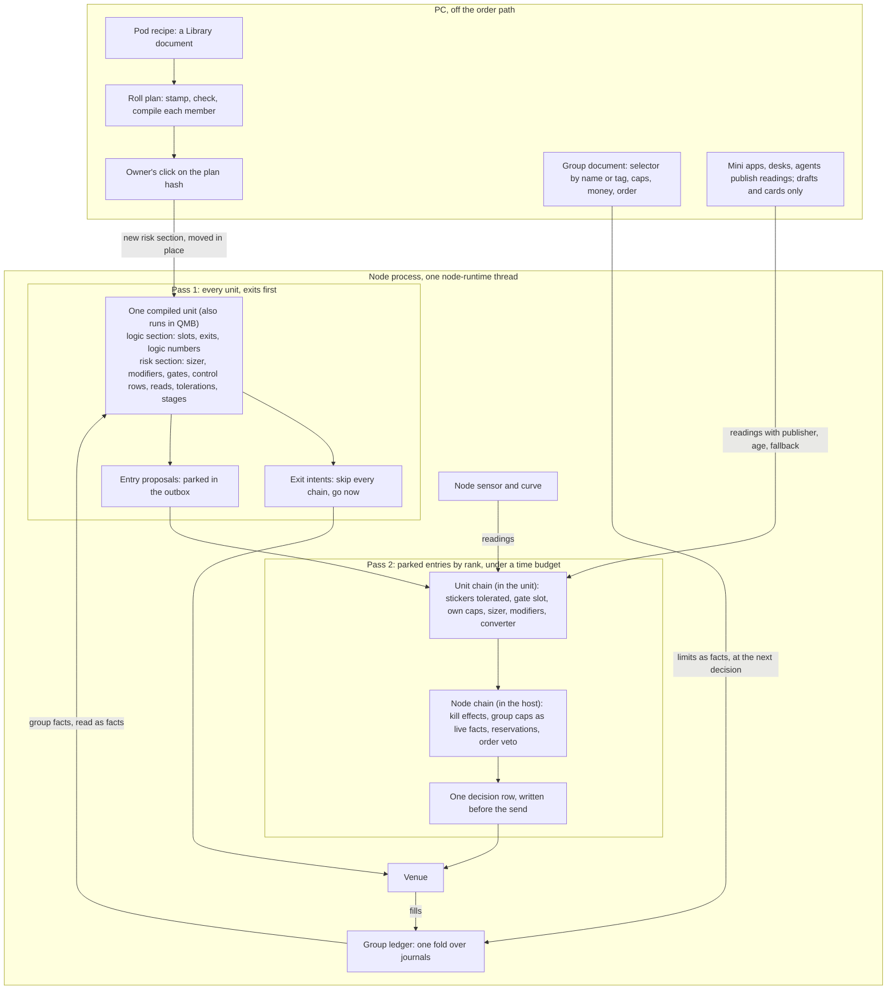
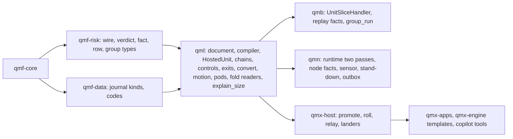

# The fold: the unit owns it, with thirteen grafts

Written headless, 7 Nov 2026, as the fold of four architecture versions under `round-2/arch/COMPARE.md`. Base is V1; the thirteen grafts and twelve findings of COMPARE sections 4 and 5 are taken, each named where it lands. Paths are under `D:\QMX-worktrees\risk-plan\tracker\risk-core\` unless they start with a package name; package paths are under `D:\QMX-worktrees\bld-repair-24\`, tip `351e7521`, where every code line cited here was re-read today. `PH n` is a row of `RISK-SIZING-PLACEHOLDERS.md`; `SWAP n` and `En` are rows of `unit-baseline/SWAP-CHART.md`; `S1`, `I2`, `R9`, `K7`, `V1` are core rows of `round-2/funnel/FUNNEL.md` section 3; `G n` is a graft of COMPARE section 4; `F n` is a finding of COMPARE section 5; `Mn` is his message. Numbers are labelled placeholders, owner "numbers talk"; none is argued here. `[ASSUMPTION]` marks an inference nobody confirmed; UNKNOWN marks what was not verified.

**Fork answers held (from V1, grafts in brackets):** F1 A compiled in plus a thin group [G6: group limits as live facts; G13: group order as a block]; F2 C find, track, correct; F3 B node sensor, unit gate slot, one curve; F4 A one process, one node thread [G1: time budget; G2: one wrapper]; F5 A exits on the unit, fixed order, the node closes targets; F6 B small core widened in slices; F7 C two chains [G4: one decision row written before the send].

## 1. The paradigm in a sentence

**A unit carries every rule it obeys inside its own document, split into a logic part and a risk part with a hash each; a pod is a recipe stamped into each member before it runs; the one thing above the units is a thin group on the node that holds shared caps as live facts and a shared ledger and can only cut; the node drives all units on one thread in two passes per bar, exits first.**

Why this is a fair reading of what exists: the unit document already has seats for `sizer`, `exit_set`, `halts`, `reads`, `numbers`, `sessions`, `position_limit`, `context_needs` and per-market settings (`qml/src/qml/unit/model.py:470-492`), and the compiler refuses most of them by name (`compile/compiler.py:896-1014`). This design turns refusals into running code, adds a handful of optional document fields, puts one small thing above the unit, and reorders one loop on the node. His words: "look at what exactly is already there in the unit" (M49); "Design for complexity. Don't design a complex system." (M8).

### What runs where at trade time



## 2. Decisions

Each is a call two builders could make incompatibly. `[ADOPTED]` means the code or his words already settled it. `[G n]` names the graft taken; `[F n]` the finding answered.

### AD-1 The unit owns its size and its own brakes

- **Binds:** S1, S2, S4, S6, S13, S14, V7, V10.
- **Prevents:** a second evaluator above the unit; a size computed in two places; "no pod" as a special case.
- **Rule:** at trade time everything a member obeys that reads only its own facts or market facts is in its compiled document and runs in `HostedUnit`, the code QMB and the node already share through `UnitSliceHandler` (`qmb/src/qmb/host/unit_handler.py:1-7`). Nothing above a unit computes a size. A template or a mini-app unit with no pod and no group is the normal case. **Door kept open at low cost:** sizing is a separate call, `HostedUnit.price(proposal)`, invoked by the host right after `on_instant` on the same tick; if he later picks a pod that governs (section 12), only the caller of `price` moves.

### AD-2 One document, two sections, two fingerprints; three tiers of change

- **Binds:** S14, I9, R17, `qml/unit/sections.py` (new), every builder who asks "does this need a click?" [G7, V4 AD-2].
- **Prevents:** builders disagreeing about what a pod edit may touch; a size edit re-proving logic; a live edit that bypasses the click by calling itself configuration.
- **Rule:** one function partitions the document. **Logic section:** `markets`, `streams`, `direction`, `logic`, `exit_set`, `sessions`, `position_limit`, and every number bound by a logic slot or an exit, with their pins. **Risk section:** `sizer`, `modifiers`, `gates`, `halts`, `reads`, `tolerations`, `stages`, and every number bound only there. A number bound in both is logic. `compiled_fingerprint = H(logic_fingerprint, risk_fingerprint, format, options)` (today the whole document hashes in at `compiler.py:1072-1079`). **Three tiers, the builders' rule:** a *fact* changes live and reaches the unit at its next decision with its age; a *number* moves by its own rule inside its declared range with no click; a change of *structure* (a block, a binding, a range, a default) is a new version. Group limit values are facts (AD-8). A thing that must flip live is a fact; a thing that changes what runs is a version.

### AD-3 The node tests logic and trusts a click for risk; never a new fingerprint over a held trade

- **Binds:** `runtime.py:2756`, `promote.py`, `unit.py:672-674` (`opened_by`), `unit_handler.py` [F4, F5].
- **Prevents:** a pod edit that re-proves 200 units; a pod edit that changes live risk unclicked; a held position whose per-bar exits go silent after a recompile (COMPARE's rerun: 0 exit intents in 60 bars against 1).
- **Rule:** a deployment names `logic_fingerprint` (its G record must cover this), `risk_fingerprint`, and the click that covered it; the node refuses when either fails. `opened_by` on positions becomes the logic fingerprint. **No host ever runs a different compiled fingerprint over a held trade except by `move_risk` (AD-6), which keeps the logic fingerprint, or by a drain (`withdrawn` then flat, `runtime.py:2640-2641, 2746-2748`, mostly built).** A compiler format bump moves the logic fingerprint on purpose and pays K8. The pod's blocks pass their own contract tests and G's safety half (`qml/check/layer_g.py`: determinism, restore, state bound) per distinct risk fingerprint.

### AD-4 A pod is a recipe; stamping is a pure function; drift is reported

- **Binds:** S14, S16, `qml/pods/expand.py`, the fleet fold [G10, V4 W8].
- **Prevents:** a pod at run time; a pod reaching into logic; rework when a unit leaves a pod; hand edits after stamping going unseen.
- **Rule:** `expand(unit_document, pod_document) -> stamped_document | named refusal`. Filled pod slots replace the risk section's matching rows; empty slots leave the unit's own. The stamped document records `recipe` (pod id, version, hash, and `displaced`, the rows replaced, so leaving a pod restores them). A unit may list `risk_locks` (for example `sizer`): the pod does not replace those and the plan shows the member as `locked`. A recipe row touching a logic-bound number or an exit is refused by name. `expand` is deterministic and idempotent. **Drift report:** the fleet fold lists every member whose risk section differs from its recipe at its version, by row; the pod card says "12 of 14 follow the recipe". A pod owns its sizing method because it fills the sizer slot; several methods side by side are several recipes.

### AD-5 One pod edit is one plan and one click; a group edit is its own click

- **Binds:** S14, K5, V4, Q6, `qml/pods/roll.py`, `qmx_host/roll.py`.
- **Prevents:** 200 hand moves; drafts reaching a live deployment; a click on something that has since changed.
- **Rule:** `roll_plan(pod@new, members)` stamps, checks and compiles every member off the node and sorts each into `risk_only`, `unchanged`, `locked`, `logic_touch` or `refused`. The plan hash is `H(pod hash, sorted (deployment, new risk fingerprint))`. The owner's one click binds to that hash through the money door (K5); a stale plan is refused. `refused` and `locked` members stay on their old version and are named. A plan may cover a subset, which is a canary. Each member gets a new unit version; the identity table (R17) gets a section column so a risk-section edit keeps the logic record and starts a new money record. A group document edit (AD-8) is a separate click on that row's version and touches no member document. Agents and the copilot write drafts and plans only.

### AD-6 A risk move happens in place

- **Binds:** `qml/protocol/unit.py` `_Core`, `_cold_reason` (`unit.py:990-991`); `runtime.py` `_deployments` [F5].
- **Prevents:** a cold start of logic state for a size edit; a mixed pod for minutes.
- **Rule:** `HostedUnit.move_risk(new_compiled)` works only when the logic fingerprint matches. Logic instances, derived numbers, calibrated logic numbers and open positions stay; risk instances are rebuilt. A control row keeps its state if its row id, pin and params match, or else starts by its declared cold behaviour; since states are derived from the fold (AD-12), nothing is copied. Snapshots carry two parts and `_cold_reason` judges each by its own fingerprint. The node compiles a plan's members on its one compile worker (`runtime.py:2098`), then flips all of them in one tick. An open position keeps its exits and its R; the next entry uses the new risk section.

### AD-7 Stages are compiled in

- **Binds:** I10, S2, S13, `qml/unit/model.py` `Stages`.
- **Prevents:** a stage change that mints a new identity or wipes a record; "at 5,000 the math changes" (M51) needing a new unit.
- **Rule:** a risk section may declare `stages`: a selector (a fact, or a block), the anchor it is read at, hysteresis, and for each stage the sizer, modifiers, control rows and number values in force. All stages compile into the plan, so the risk fingerprint covers them and one click covered them. A stage move is a state change at an anchor with a `stage_move` row, never a new version. `move` is `rule` or `card`, per direction; templates ship `card` going up and `rule` going down (COMPARE §6 row 2 default). An undeclared stage is a pod edit (AD-5). Exit numbers may vary by stage but sit in the logic section, so adding them costs a G run per member once.

### AD-8 The thin group: caps as live facts, a ledger, an order; nothing else

- **Binds:** I10, S6, R9, D31, D35, `qmx.group/1`, `qmf/risk/group.py` (types), `qml/group/caps.py` (runner) [G6 V4 AD-10, G8 V4 3.8, G13 V3 phase 2, G5 reservations].
- **Prevents:** the group growing into an evaluator; a cap edit touching 200 documents; a shared cap overrun by two units on one bar; whoever was hosted first always winning the room.
- **Rule:** a group is a document with `display_name`, `parent`, `selector` (unit ids and/or tags, many-to-many), `place`, `side`, `money`, `limits`, `caps`, `ledger`, `order`, `alarm_budget`, `share_cap`. **Membership** is by selector; a deployment may also name `group_id`; the member document is untouched either way. **Limits are facts:** every number in `limits` and `money` is published on scope `group:<id>` at edit and at each anchor; a member's cap row or modifier row reads it at its next decision, so one edit reaches 200 units with no recompile; the edit is the owner's click on the group row's version. **Caps** are control rows of scope `group` whose block answers `pass`, `shrink(quantity)` or `refuse`, plus `on_fire`; a cap never raises; it runs at two moments: on an entry in pass 2, and after each ledger fold, so a day stop fires with no entry pending. **Reservations:** room granted at admit is held under the intent id until the venue settles it as placed, blocked or unknown; an unknown outcome keeps the room; a warming unit reserves nothing. **Order** is a block slot on the group, `rank` by default (rank, then a per-bar hash for ties); its answer sorts the outbox's entries for this group, so "take the best of those firing this bar" is sayable later as content with no socket change. The ledger exposes group facts (`group.day_pnl`, `group.open_risk`, `group.raise_ok`, `group.cushion`, `group.members`, `group.limit.<name>`) on each member's fact surface. **A row may bind `enabled` to a fact**, so a recipe can switch a modifier on and off for a whole pod through one group fact (walk 12). Allocation modes: `own size under a parent limit` (default) is no share plus a cap; `split` is a member-side derivation reading `group.members`; anything that ranks members runs off the path and publishes a share as a reading (AD-16). **Places:** a group lives on one place (one node process); a group spanning places (the PC and a server) is several groups whose caps read a published fact with an age, eventual by construction; the PC holds everything first and a server stands in or expands, never replaces.

### AD-9 Two chains, one receipt, one wrapper, one row before the send

- **Binds:** S6, V1, R1, `qml/protocol/entry_chain.py` (unit chain), `qml/chain/node_chain.py` (node chain runner), `qmf/risk/chain.py` (verdict types) [G2 V2 AD-9, G3 V2 AD-8, G4 V2 AD-6; F3, F8].
- **Prevents:** a link with no home; two receipts that cannot be joined; a chain that can stop an exit; a refused frontier ending that unit's exits (`runtime.py:3040-3046` sets STOPPED today); a hung link taking down the node; a crash between stages leaving a row with no order or an order with no row.
- **Rule:** the unit chain runs inside the unit; the node chain in the host. **Placement test:** a link that reads only this unit's facts and market facts it may tolerate goes in the unit chain (stickers not tolerated, the gate slot, its own caps). A link that reads the account or other units goes in the node chain (kill effects, group caps, reservations, order veto: margin headroom, worst-step reserve, size band, order rate, venue stop or declared no-stop basis). The node chain is called from one seam, `UnitSliceHandler.mint_intents`, through an injected `AdmitPort`, so both hosts call it; the node's `guard`, `cross_unit_hook` and protection gate become links or stay directly behind it (`runtime.py:1100-1106, 2623-2675`). **One wrapper:** `run_budgeted(fn, budget)` runs every chain link and control row on a worker thread with a time limit; a raise or an overrun refuses that entry with `link_fault` or `link_hung`, stands that link's scope down, and never returns a refusal into `close_frontier`. The unit's own bar step is wrapped once the wrapper is tested on Windows; until then `StuckWatch` stays the backstop (`healing.py:64`). **One row:** both chains append to one in-memory trail; the decision row is journalled once, after the last link and before any order leaves, with every input stored (facts as read with age and source, group facts included), so it replays alone. **Import test:** exit code (`qml/protocol/exits.py`) imports nothing from `entry_chain`, `node_chain`, `fold` or the readings feed; a test parses its imports. Exits never enter either chain, by property test including a faulty block and a hung link.

### AD-10 A sizer answers a typed amount; one converter spells the venue's quantity

- **Binds:** S1, I1, PH 1, 12, 30, `qml/blocks/api.py` `Amount`, `qml/numbers/convert.py`.
- **Prevents:** a socket change per base; lots in design; a 5,000-lot answer passing (`SWAP` S1c); a trigger bound as a sizer (`SWAP` S3); the USDJPY fault (`fixed-fraction-at-stop/1/block.py:52-53`).
- **Rule:** a sizer returns `Amount(kind: money_at_risk | notional | quantity, value, basis)` or a `Skip`. Today's `Size(lots)` reads as `quantity`, so the placeholder still passes. One converter reads the amount, the declared R basis and the instrument record (value per point, lot step and bounds, conversion) and spells the venue's quantity, rounding down by default with real residue; hosts stop re-rounding after their first check. The compiler checks the slot's face (`output: amount`). The size band and per-trade cap live in one row, applied after the converter. A sizer gets `side` and reads moved numbers from `evidence`. **Why lots (M49):** lots are the venue's word for a quantity of one instrument; a rule speaks in money at risk or notional, which is the same across instruments; the converter is the only place lots exist, and the wire already says `quantity`.

### AD-11 Named modifiers; the level is one of them

- **Binds:** S2, D4, D13, D14, `sizing_modifier` role.
- **Prevents:** hidden multipliers; a ladder law; press and brake on two ledgers.
- **Rule:** `modifiers` is an ordered list on the risk section. Each block answers a factor inside its declared range with a reason on the receipt. Default combination is product, or a declared combiner; a `cap` row takes the lowest. The level is one named modifier with no ladder law. A modifier may raise. The raise permission gate is a default row reading `group.raise_ok` and unit state, removable by a reckless recipe. House money and reverse house money are one `cushion-rule` modifier reading one cushion ledger (R9 scope): a fixed anchor presses and brakes, a running-peak anchor only brakes; the press gate is a block in front.

### AD-12 A control row runs in the unit; states are read from the fold; the snapshot is a cache

- **Binds:** S4, S10, S11, S12, PH 5, 18 to 20, 23 to 25, 28 [G9 V4 3.4, V2 AD-16; F9].
- **Prevents:** each brake as custom code; a brake that needs the node to exist in a backtest; a brake state lost on restart because the snapshot writes only when a calibrated number moves (`runtime.py:2919-2927`); state copied by hand on a pod edit.
- **Rule:** `halts` stays the seat and each entry is a control row: required `reads`, `scope`, `verb` (`none`, `no_new_entries`, `reduce(factor)`, `flatten`), `on_fire` (stand down at a scope, raise a kill level, card), `restore` (rule or hand), `until_n` (cold behaviour: warn, shadow, or a fixed labelled fallback), `shadow`; the rest defaulted (attack, release, counting, fail mode, money series, class, healthy fire rate). FUNNEL's `placement` field is struck: a row runs where its document says, the unit or the group. The control runner in `_Run.step` feeds each row its declared facts and writes `risk_event` (and `would_have` when shadowed or when it refused). **The five words ACTIVE, REDUCING, BENCHED, HALTED, RESTORE per scope are derived by the fold (AD-18) from `risk_event` and restore rows; the node keeps the fold incrementally and the snapshot caches it; a restart or a `move_risk` rebuilds state from rows and copies nothing.** A row that says `wait for hand` calls `Runtime.risk_stop` (`runtime.py:2696`), its first producer. Only that row and the kill switch wait for a person. `flatten` mints exit intents through the unit's own exit path. The shipped five halts bind unchanged once their `own.*` statistics exist.

### AD-13 Exits stay on the unit in a fixed order; shaped for a quote clock

- **Binds:** S3, I13, V1, V6, F5, PH 2 to 4, 9 to 11 [F12].
- **Prevents:** a pod changing what R means under a record; a faulty exit stopping an exit; a later tick lane reworking the exit answer.
- **Rule:** every exit in `exit_set` runs per bar, fed `PositionFacts` and market evidence, on its side. Answers: `close_full`, `close_partial`, `amend_protection`, each with a reason code; a `target_position` type is reserved. On one bar, full beats partial beats amend, and the earlier binding breaks a tie; this is compiled, not configured. The node closes targets as today (`runtime.py:1849-1857`). A raising exit block is skipped with a row and the next runs; if none can run, `_close_scope` (`runtime.py:2451`). R is a declared basis on the sizer row, gross at the disaster stop by default; stops tighten unless `allow_widen` is set. A pod never touches `exit_set`. **Step 2 now:** stack, `PositionFacts`, side, reasons, fault fall-through. **Step 3 after the demo facts:** signed stop distance, amends, partials on the node, trails, venue-resting targets. **Shaped for later:** `ExitInstance.update` takes an `evidence` mapping whose clock is a field, so a quote clock feeds it later with no answer-type change; the stream input widening (`compiler.py:976-981`) is deferred, not designed around.

### AD-14 Numbers: find, track, correct, on the built engine; authority on every number

- **Binds:** S13, I16, D15 to D17, PH 7, 8, 22, E12, E18.
- **Prevents:** a second moving part; a number nobody can explain; unbounded memory (`engine.py:124`); a learned number touching open trades unasked.
- **Rule:** no applier object. **Find** is a replay in the Lab or at birth, ending in a new version with `Origin.found_by_replay`. **Track** is a `scaled` number, fact times multiple, computed each bar. **Correct** is the built engine (`qml/motion/engine.py`), widened: `_bound_on` and the stamp search (`compiler.py:510-516, 620-631`) accept sizer, control and exit bindings; a bounded window on `SlowState.read`; may run with no logic stamp; takes `cadence.at`; its constants (`min_trades`, `shrink_k`, cadence) are editable rows. **Every number carries:** `derivation` (rule block or fact), `range`, `authority` (`off`, `motion_inside_range`, `at_anchor`), `owner` (`user`, `template`, `learner`), `reason` on the resolved value, `cautious` direction, `guard` (revert and freeze after trips), `never_self_tune`, `applies_to_open_positions`, and a per-change record. A move inside range is a calibration row; outside it a new version. `MotionSwitch` reports with and without. Presets per type turn correct on for filters and off for size. **Evidence stated once:** E5's tables show only that the mechanism behaved as described and did not run away (MODEL); they do not prove the default.

### AD-15 One fact surface with a stated supply and a fail mode

- **Binds:** I1 to I4, I7, I17, `qmf/risk/facts.py` (names), adapters in `qmb/host/facts.py` and `qmn/app/facts.py`.
- **Prevents:** a fact computed differently in two hosts; three meanings of "missing".
- **Rule:** blocks declare the facts they read in `entry.json`; `facts` is one read surface on the unit (`_required_keys`, `unit.py:875`). The compiler compares a unit's needs with the host's provided list; an unmet need names its fallback or warns. Each fact has a timestamp, a source and a fail mode: `open`, `closed` or `neutral`. Facts from the unit's own journal are computed in QML, so they are the same in both hosts by construction. Host facts (equity, margin, cost cells, group facts) have two adapters and a known-answer test. A truly new host fact is a core change and is said to be. **Costs are observed facts:** cost cells per instrument, broker, hour, session and world are written from fills, labelled `uncalibrated` until N, with a class-pooled stressed fallback that decays to measured; the instrument record gains a commission key; two residuals are kept apart (signal before costs; cost against model).

### AD-16 Readings inform, stickers refuse, and neither commands

- **Binds:** S8, S9, S10, I5, I6, R13, F3, Q4, V3, V7.
- **Prevents:** forged `source`; a stale feed reading as calm; a dead desk parking the book; a wide unit trading its whole universe on a stale board (`runtime.py:366-369` docstring).
- **Rule:** `reads` compiles with `publisher`, `fallback` (`compute_here`, `treat_as_absent`, `no_new_entries`, `stand_aside`), stale limit and `valid_until`; the host stamps `source` (`node`, `mis`, `app:<id>`, `agent:<id>`); inputs are named on each record. The relay (`qmx_host/feed_relay.py`) carries any publisher's readings to the node. A node sensor publishes spread, tick rate and quote gaps with source `node`; an overnight job makes one curve artifact per world with an age word and a flagged borrowed cold start, read by SQS, node, MIS and QMB. **Three market lists:** `markets` (allowed), `home_markets`, and `active` as a reading; the fallback of any list or board is home markets, never every listed market. A sticker is a row in the stand-down table (`qmn/app/stand_down.py`) with scope key, kind, strength (`prefer_not`, `no_new_entries`, `flatten`), expiry, resume rule, why, who; a unit's `tolerations` are in its risk section and a pod may stamp them. The kill switch is not a sticker. Each sticker source has a `fail` row; the default is a card and `prefer_not`. An agent-placed sticker can only reduce risk and must expire; under Q4's default it lands a card and applies nothing.

### AD-17 One thread, two passes, an outbox with a time budget

- **Binds:** F4, S18, `runtime.py:2157` (one thread), `:3013-3018` (`_drive`), `:1727-1733` (mint then place), `:1182-1190` (`_protected`), `:1701-1714` (parked entry), `healing.py:64` (30 s watchdog) [G1 V2 AD-7; F1, F2, F7, F10].
- **Prevents:** a shared cap that needs a lock; an entry's venue wait delaying another unit's exit; a long bell killing the node; a parked entry reading as "warming up" and being dropped.
- **Rule:** per node, one `node-runtime` thread hosts all units; caps are atomic because nothing else runs. **Pass 1** steps every unit on every account and sends its exit intents at once; no chain, fold or feed is reachable from exit code (AD-9). Entry proposals are parked in the outbox with `not_before`. **Pass 2** drains the outbox by bar time, then the group's `order` answer (rank, then per-bar hash), runs the unit chain and node chain on each, writes the row, sends, and **stops at a time budget** (a labelled placeholder well under the watchdog's 30 s); what is left waits for the next tick and passes both chains again on fresh facts. **Parked-entry fix [F7]:** an entry not yet placed is neither skipped nor marked done; `execute_resting` treats a parked entry like an `Unknown` (returns `Ok(False)`) until pass 2 reaches it or its `not_before` expires, and then writes a `Skip` with reason `budget_expired`. QMB's `group_run` driver uses the same order. **Known limit:** `client.send` holds a lock and waits up to 5 s (`ctrader_account.py:110, 679`), so entries and exits at one bell go out in series; the budget protects the node, not the fills; meters (pass 1 time, pass 2 time, entries left over, sends per bar) are plain rows, and sends off the thread reopen if measured delay harms fills (section 11).

### AD-18 One decision row and one fold; restart is no reset

- **Binds:** R1 to R4, R7 to R9, R13, S15 [G11 V3 RAT, G12 V3 AD-11].
- **Prevents:** "why this size?" with no answer; two risk states in two readers; a restart acting as a hidden accelerator.
- **Rule:** the size trail is the decision row. `explain_size(row)` is one pure function used by developer, copilot, UI and triage; `replay_decision(row)` re-runs the sizer on the row's stored inputs and must match, by test. `fold(rows, scope, clock) -> RiskState` is one pure function over journal rows, keyed by scope including `position`, `unit`, `pod`, `group`, `account`, `tag`; it derives control words, cushion ledgers, open risk by bet key, drawdowns and distances; UNKNOWN when any needed input is stale. It is used for the group ledger (in process), the pod card, the fleet read, agents, and restart replay. **Restart rules:** an anchor's id is a pure function of clock and time, so settling anchors is idempotent; recovery folds journals and broker deals before answering any entry; anchors passed while down are derived once, latest wins, marked `restart_late`; **cuts stand; a raise earned before the restart waits for the next anchor**; stickers expired while down are settled from the table; until the group ledger is rebuilt, group caps read UNKNOWN and refuse entries, exits free. **Proposal tape:** each unit's entry proposals (market, side, reference, stop or basis, tags, numbers in force) are journalled as rows, so a size search replays them under a different risk section cheaply; this is exploring, and a QMB rerun is the evidence (methodology's rule).

### AD-19 Land in slices; bump only on a changed decision

- **Binds:** F6, K7, K8, K9, D41.
- **Prevents:** half-shapes reaching a deployed unit; a frozen compiler.
- **Rule:** the order in section 10. Each slice ends in something a test or K7 shows. Format bumps are free until the first live deployment and happen only when a compiled decision changes; format 5 lands in slice 1. Step 3 lands before the first live deploy or pays a re-test through K8. Three stop points (A, B, C) each leave a whole baseline.

### AD-20 The fixed lines are tests; everything else warns

- **Binds:** V1 to V6, V9, K5, K9.
- **Prevents:** the lines resting on good behaviour; a canvas that refuses reckless paintings.
- **Rule:** exits never blocked (property test); only the owner lowers a kill level; agents never place, size up, lower a kill level or promote, by tool table (`tools/money_path_scan.py`); a click binds to a hash; no channel the copilot or agents can read carries the promote door; a protected field list (floor, kill level, `never_self_tune`, plan hash) has no agent write path. Every other reckless setting (no kill line, no caps, full Kelly, a widened stop, a stopless live unit) warns and grades in the largest type and never refuses.

### AD-21 Who owns what: block-running code lives in `qml`; `qmf-risk` holds types

- **Binds:** every module in section 7 [F8].
- **Prevents:** a runner in `qmf-risk` that cannot import `qml.blocks.api` (`packages/qmf-risk/pyproject.toml` depends only on `qmf-core`; `qml/pyproject.toml` depends on `qmf-risk`).
- **Rule:** the dependency direction is fixed as drawn. Verdict, fact, control-row and group types live in `qmf-risk` so both hosts and the wire share them. Anything that runs a block (the control runner, the unit chain, the node chain runner, group caps, `expand`, `roll_plan`, `explain_size`, the fold's row readers) lives in `qml`. Hosts (`qmb`, `qmn`) import `qml` and adapt facts, ports and lanes. `qmx-host` and apps import `qml` for plans and the fold, never the hosts.



### AD-22 The no-stop path is one declared basis through six places

- **Binds:** PH 11, I13, S6, `compiler.py:500-506`, `unit.py:764-766`, `unit_handler.py:560`, `runtime.py:1065, 1102-1106, 1182-1190`, `qmn/order/path.py:561`, `venue/live.py:1012` [F6].
- **Prevents:** a stopless entry compiling, sending, and then being closed at once by the protection wait; a gate on another order path refusing what the entry path accepted.
- **Rule:** a unit with no price stop declares `basis: tail_budget` on its sizer row. The same declared basis must pass: (1) compile, lifting `stop_not_built`; (2) `enter`, which stops skipping on no stop; (3) the handler and node entry, which read `none_declared` (already on the wire, `unit_intent.py:69-73`) instead of a `Decimal`; (4) the node chain's venue-stop veto, which accepts a declared basis and warns in large type; (5) **the post-send protection wait `_protected`, which must not expect a stop for a no-stop entry and must not call `_escalate`;** (6) every other order path that carries the gate (`order/path.py`, `venue/live.py`), each checked by one test that a stopless entry survives. The converter divides money at risk by the declared distance. The shipped template default is a far disaster stop with the cut in front; the true no-stop form is expressible and warned.

## 3. Contracts, sketched

Each lands in the package named (AD-21). New fields are additive on `qmx.unit/1`, passed through the census test and the upgrader chain.

### Sizer, modifiers, converter (`qml/blocks/api.py`, `qml/numbers/convert.py`)

```python
class Amount:                      # sizer answer; exactly one kind
    kind: Literal["money_at_risk", "notional", "quantity"]
    value: Decimal
    basis: Literal["gross_at_stop", "tail_budget"] | str
class Skip: reason: str
class SizerInstance(Instance):
    def update(self, evidence: Facts | Mapping) -> Amount | Skip | Size: ...   # Size = legacy quantity

class Factor: value: Decimal; range: tuple[Decimal, Decimal]; reason: str
class ModifierInstance(Instance):
    def update(self, evidence) -> Factor | None: ...        # None is neutral, with its fail mode

def to_quantity(amount, entry, stop_or_basis, record, rule: RoundRule) -> Converted
class Converted: quantity: Decimal; residue_r: Decimal; skipped: str | None
```

### Exits (`qml/blocks/api.py`, `qml/protocol/exits.py`, new)

```python
class PositionFacts:               # widens OwnPosition (unit.py:128-137) from HeldPosition
    position_id; side; quantity; average_price; stop; targets; bars_held; mfe_r; mae_r
    opened_by_logic; stage; numbers_at_entry
class ExitAction:
    kind: Literal["close_full", "close_partial", "amend_protection", "target_position"]   # last reserved
    fraction: Decimal | None; new_stop: Decimal | None; reason_code: str
class ExitInstance(Instance):
    def update(self, evidence) -> Decimal | Signal | ExitAction | None: ...   # evidence.clock is a field
```

### Controls (`qmf/risk/controls.py` types; runner in `qml/protocol/controls.py`, new)

```python
class ControlRow(ScopedBinding):   # lands in Halts; scope gains GROUP, TAG
    reads: tuple[str, ...]; verb: Verb; on_fire: OnFire; restore: Restore
    until_n: ColdRule; shadow: bool; enabled: str | bool = True   # a fact name gates the row
    # defaulted: attack, release, counting, fail_mode, money_series, klass, healthy_fire_rate
class Answer: verb: Verb; factor: Decimal | None; reason: str; code: str
class ScopeState: word: Literal["ACTIVE","REDUCING","BENCHED","HALTED","RESTORE"]; since; reason   # derived by fold
```

`HaltInstance` keeps `update(evidence) -> Halt | None`; `Halt.action` gains `reduce` (`blocks/api.py:168-179`).

### Numbers (`qml/unit/model.py`, `qml/motion/engine.py`)

```python
class NumberSpec:                  # existing fields stay
    derivation: BlockRef | FactRef | None
    authority: Literal["off", "motion_inside_range", "at_anchor"]
    owner: Literal["user", "template", "learner"]
    reason: str; cautious: Literal["down", "up", "hold"]; guard: Guard | None
    never_self_tune: bool; applies_to_open_positions: bool = False
    stage_values: Mapping[str, str] = {}
class Motion:                      # adds
    scaled_fact: str | None; window: int | None; anchor: CadenceAt | None
    min_trades: int; shrink_k: Decimal        # were constants (engine.py:39-44)
class SlowState: read bounded to Motion.window
```

### Document additions (`qml/unit/model.py`, `qml/unit/sections.py`)

```python
class Unit:                        # new optional fields only
    modifiers: tuple[Binding, ...] = ()
    gates: tuple[Binding, ...] = ()           # gate slot; verbs block, shrink, wait, warn, shadow, none
    tolerations: tuple[str, ...] = ()
    stages: Stages | None = None
    risk_locks: tuple[str, ...] = ()
    recipe: RecipeRef | None = None           # pod id, version, hash, displaced; outside both fingerprints
    home_markets: tuple[str, ...] = ()        # allowed = markets; active arrives as a reading
    tags: tuple[str, ...] = ()                # group selectors, fold scope
class Read: publisher: str; valid_until_s: int | None; fallback gains STAND_ASIDE     # model.py:391
class Stages: selector: str; anchor: CadenceAt; hysteresis: Decimal
              move_up: Literal["rule","card"]; move_down: Literal["rule","card"]; rows: Mapping[str, StageRow]
class StageRow: sizer: Binding | None; modifiers; controls; numbers
def sections(document) -> tuple[LogicSection, RiskSection]      # the one partition
class CompiledUnit: logic_fingerprint; risk_fingerprint          # beside compiled_fingerprint
class HostedUnit:
    def on_instant(...) -> tuple[ExitIntents, Proposals]        # pass 1
    def price(self, proposal, facts, admit: AdmitPort) -> Decision   # pass 2; the one door a governing pod would move
    def move_risk(self, new_compiled) -> Moved | Refused
```

### Pod and group (`qml/pods/`, `qmf/risk/group.py` types, `qml/group/caps.py` runner; Library kinds `pod`, `group`, `template`)

```python
class Pod:   # qmx.pod/1, a real schema behind kinds/pod.schema.json
    pod_id; version; method: str; slots: PodSlots; notes
class PodSlots: sizer; modifiers; gates; controls; reads; numbers; tolerations; stages   # empty = unit's own

def expand(unit, pod) -> Unit | Refusal
class MemberPlan: deployment_id; outcome: Literal["risk_only","unchanged","locked","logic_touch","refused"]
                  old_risk: str; new_risk: str; diff: tuple[Edit, ...]; problem: str | None
class RollPlan: pod_hash; members: tuple[MemberPlan, ...]; plan_hash: str; made_at; expires_at
def drift(members, pod) -> tuple[Drift, ...]           # member, row, recipe value, found value

class Group:   # qmx.group/1, replaces the book and bms shells; "Classic Book" stays a recipe name
    group_id; display_name; parent: str | None; selector: Selector; place; side; version
    money: Money; limits: Mapping[str, Decimal]          # published as facts on group:<id>
    caps: tuple[ControlRow, ...]; ledger: LedgerSpec
    order: Binding                                       # rank@1 by default; a block
    alarm_budget; share_cap
class Selector: units: tuple[str, ...]; tags: tuple[str, ...]
class LedgerSpec: anchors; series: Literal["realised","marked","committed"]; keys: tuple[str, ...]
class CapAnswer: Pass | Shrink(quantity, reason) | Refuse(reason)
class Reservation: intent_id; quantity_r; granted_at; outcome: Literal["pending","placed","blocked","unknown"]
class Preset:  # Library kind `template`, un-retired: overrides only
    template_id; base: str | None; overrides: tuple[PointerEdit, ...]; pins; label; lineage; version
```

### Chains and facts (`qml/protocol/entry_chain.py`, `qml/chain/node_chain.py`, `qmf/risk/chain.py`, `qmf/risk/facts.py`)

```python
class Verdict: link: str; verb: Literal["pass","shrink","wait","warn","shadow","refuse","none"]; reason; code
               inputs: tuple[FactUsed, ...]           # name, value, at, source, state
class AdmitPort(Protocol):
    def admit(self, wire: Mapping, at: Instant) -> Admitted | Refused: ...    # wire quantity rewritten on shrink
def run_budgeted(fn, budget_ms) -> Result | Fault      # one wrapper; Fault = link_fault | link_hung
# Facts: Fact(value, ts, fail_mode, source, state: ok | stale | absent | uncalibrated)
# account.* equity, balance, open_risk, open_risk_by_bet_key, margin_headroom, liquidation_distance,
#           budget_share, realised_since(anchor), basis
# own.*     session_loss_r, loss_streak, losing_day_streak, session_fills, spread_r, edge_band,
#           cut_distribution, trade_rate, record_n
# market.*  quote, spread, tick_rate, quote_gap, cost_cell(hour, world), curve, gap_factor,
#           sticker(kind), session_state, event_clock
# group.*   day_pnl, open_risk, members, cushion, raise_ok, share, stage, limit.<name>
# node.*    kill_level, paused, venue_ready
def fold(rows, scope, clock) -> RiskState
```

### Status and records (`packages/qmf-data/.../journal_kinds/unit.py`)

```python
class RiskState: scope; word; since; reason; stamp; money; open_risk; drawdowns; control_distances
                 cushion; stage; reservations; unknown: tuple[str, ...]
class DecisionRow:   # existing, adds
    inputs: Mapping[str, Fact]; steps: Wanted, Approved, Filled; verdicts: tuple[Verdict, ...]; binding: str
    logic_fp; risk_fp; recipe; group_id; stage; readings_used; trace_id; propensity; placeholders
    written_before_send: bool
```

Rows written: decision row v2, trade row v2 (R2 plus `stage`, `pod_version`, `risk_fp`, `target_held_by`), `would_have` (with `propensity`), `risk_event` (root-cause key, event id, alert fields, appendable codes), calibration row, `stage_move`, `risk_move` (plan hash, member, old and new risk), `reservation`, fill record (R7: decision quote, arrival quote, fill, partial, reject, requote, markouts), reading record (R13, stamped at compute, as-of query), run stamp (R8, `group: none | alone | merged`), `proposal` tape, `drift`. `explain_size(row) -> Trail` lives in `qml/receipt.py`.

### Consistency conventions

| Concern | Convention |
|---|---|
| Time | Every fact and row carries an `Instant`; readings carry `knows_at` beside event time; an anchor id is a pure function of clock and time |
| Money | `Decimal`; USD at the seam; one conversion in the converter; every money figure passes it, `_account()` included |
| Codes | Closed, appendable reason codes; a new family per user block; a new text without a code fails QMB as R15 says; live writes `unlisted` |
| Writers | Spec is written by people and drafts; status, rows and the fold by the runtime; `source` by the host, never the publisher |
| Failure | Typed refusals in the block protocol; `run_budgeted` turns a raise or overrun into a `Fault`; nothing raises past the wrapper into `close_frontier` |
| Labels | Every shipped value carries `origin: placeholder`, a reason, a range and the owner "numbers talk"; the card shows the label |
| Words | Unit, block, recipe (a pod document), pod (on screen: recipe plus group), pod version, method, group, desk, sticker, toleration, fold, trail. "Book + BMS" is a method name; "Classic Book" a recipe name |
| Windows | First class: `spawn` only, whole-then-replace file writes, no POSIX-only calls, `tzdata` pinned; the wrapper and the budget are tested on Windows before they guard the bar step |
| Clicks | A click binds to one hash (plan, group row version, deployment) and is refused when stale |

### Stack

No new runtime dependency. Standard-library threads for the budget.

| Name | Version |
|---|---|
| Python | 3.14, as pinned at the tip (`requires-python >=3.14,<3.15`) |
| QML compiler format | 4 at the tip; 5 once, in slice 1 |
| uv build backend | 0.12, as pinned at the tip |

## 4. The core list, in this shape

Every live row of FUNNEL section 3 lands or is struck with a reason.

| Rows | Here | Struck or changed, and what replaces it |
|---|---|---|
| S1, S2, S3 | AD-10, AD-11, AD-13 | None |
| S4 | AD-12 | `placement` struck: a row runs where its document says (unit or group). States derived by the fold, not a state machine |
| S6 | AD-9, AD-17 | "One chain" struck: two chains, one row, one wrapper. "Group stage" becomes the group-cap link plus reservations in the node chain |
| S8, S9, S10, S11 | AD-16; S9 `sessions` compiled and a window card kind; S11 is the scope list on rows and fold keys | None |
| S12 | Roles run in the logic section, except `sizing_modifier` (AD-11) and `derivation` (AD-14); `combiner` gains `product`, `min` | None |
| S13 | AD-14 | None |
| S14 | AD-2 to AD-7 | Empty pod struck: no recipe is the default. Pod reference on the deployment struck: `recipe` in the document, `group_id` or selector on the group. "Two fingerprints" are logic and risk. Slot composition rules live in `PodSlots` and AD-11. Click rule kept |
| S15 | `HostedUnit` plus `UnitSliceHandler` are the evaluator; node, paper, QMB, Lab replay are drivers through `AdmitPort`, `FactSource`, exec port; conformance tape in K9; `group_run` for multi-unit replay | Needs list stays (AD-15) |
| S16 | `library-items` lander, real `pod`, `group`, `template` kinds, `blocks_save` door, Library block traced end to end before "one folder" is promised | None |
| S17 | Slice 9: `position_limit` per market and per open, second stream, per-market settings through I16's market key | None |
| S18 | `OrderSpec` on the intent, `not_before` as the timing offset, partial close on the node (step 3), netting as a setting, venue capability from I4 at compile | None |
| I1 to I4, I7, I9, I13, I16, I17 | AD-15, AD-10, AD-22, I9 adds `tags`, I17 a shown verdict at anchors | None |
| I5 | AD-16 three lists, home fallback | None |
| I6 | AD-16 one curve artifact (F3 B held) | None |
| I10 | AD-7, AD-8 | "Pod may change rows at an anchor" becomes compiled-in stages or a live group fact |
| R1 to R4, R7 to R9, R13, R17 | AD-18, AD-5, section 9 | R1 gains `written_before_send` and stored inputs |
| K2 | Section 8 doors: app read door widened to journals and the fold; card path to "Needs you" | None |
| K5, K7, K8, K9 | AD-20, section 5, section 7, section 10 | K9 adds: import test on exit code; parked-entry test; no-stop path survives six places |
| V1 to V7, V9, V10 | AD-20, AD-1, AD-9, AD-13 | V10 holds for arithmetic; group facts differ in a solo run (stamped `group: none`) |

Refusals (FUNNEL 3.8): all placed as that table says; `routes`, `plain_python` and `roll` stay refused for the reasons there; a stop past entry stays refused unless `allow_widen`; the census carries the table.

## 5. The swap: 31 placeholders and 18 extra sockets

**Verdict words** (SWAP's): SWAP, a block or setting changes; WIDEN, the socket changes first; WIRE, the piece exists and gets a caller; KEEP. Slice numbers are section 10's.

| PH | Placeholder | Verdict | How, in this shape | Slice |
|---|---|---|---|---|
| 1 | Sizer `fixed-fraction-at-stop@1` | WIDEN then SWAP | `Amount`, converter, face check, receipt from the answer; grown block reads `account.*` and `market.cost_cell`; forwarding map `@1 -> real@1` (R17) | 2, 8, 16 |
| 2 | Stop `swing-stop-buffer@1` | WIDEN | An exit block fed `PositionFacts`; may `amend_protection` at step 3 | 3, 17 |
| 3 | Target `target-r-multiple@1` | WIDEN | Second target and fractions after step 3; one fixed level stays valid | 3, 17 |
| 4 | Time exit `time-exit-bars@1` | WIDEN | Side passed (`unit.py:450`), real evidence (`:686`), the block's own reason (`:690, 701`) | 3 |
| 5 | Halts | WIRE and WIDEN | Five shipped blocks bind as control rows; `own.*` statistics computed in QML; `risk_stop` producer | 4 |
| 6 | Cross-unit hook | WIDEN and WIRE | Replaced by `AdmitPort` and the node chain, called in both hosts; `PASS_EVERY_ORDER` deleted | 11 |
| 7 | Motion of risk numbers | WIDEN | AD-14: `_bound_on` and stamp search accept sizer, exit and control bindings | 7 |
| 8 | Moved values and open positions | WIDEN | `applies_to_open_positions` lifts once `amend_protection` runs | 7, 17 |
| 9 | Stop amendments | WIRE and WIDEN | `amend_protection` answer; `allow_widen` row; signed distance (repair's `known-1`) first | 3 (answer type), 17 |
| 10 | Partial closes | WIRE (QMB), WIDEN (node) | Answer type now; node close with a quantity at step 3 (`runtime.py:1807-1808`) | 3, 17 |
| 11 | No price stop | WIDEN | AD-22: six places | 11 |
| 12 | Rounding, minimum lot | WIDEN | The one converter with a `RoundRule`; hosts stop re-rounding after their first check; residue real | 2 |
| 13 | Gap through the stop | KEEP | `market.gap_factor` fact a sizer may read | 8 |
| 14 | Margin and liquidation | WIRE then WIDEN | `account.margin_headroom`, `liquidation_distance` facts; order veto refuses a stop past liquidation | 8, 11 |
| 15 | Leverage and spec changes | WIRE | Record change calls `Runtime.stand_down(SPEC_CHANGE, ...)`; writes a `spec_change` sticker | 10 |
| 16 | Funding and swaps | KEEP | Cost cell and a fact a block may read | 8 |
| 17 | Account facts | WIDEN | Live account surface on the node: timed balance re-read, open risk at stops, margin, `budget_share` on the deployment; marked equity when the venue gives it, `basis` stated | 8 |
| 18 | Kill effects per level | WIDEN | `guard` becomes a node-chain link reading the table for `stop_entries` and `cancel_resting_entries`; values open | 11 |
| 19 | Protection that cannot be placed | WIDEN | `protection_escalation` row: `close` or `alarm`; constants (`runtime.py:179-187`) become settings; `hedge` content | 11 |
| 20 | Kill line's verb | WIRE | A group cap reading `group.money` and a floor fact, `on_fire` per group; the floor survives restart (V5); `qmn/capital/kill_line.py` subtracted | 12 |
| 21 | Two units on one netting symbol | WIDEN | A setting in S18; stays refused until attribution is built | 17 |
| 22 | Starting numbers for live | SWAP | Works once risk numbers calibrate (PH 7); two-part snapshots carry | 7 |
| 23 | The one automatic move | WIRE | A control row with `wait for hand` calls `risk_stop`; `flatten` through the exit path | 4 |
| 24 | Paper after a risk stop | SWAP | Lifecycle table edit; a restore rule may send a member to paper | 4 |
| 25 | Risk events in journals | WIRE | Writers; new code family for user blocks (R15 census) | 4 |
| 26 | Judge with unit sizer and fixed size | WIRE | `MotionSwitch` plus a fixed-size rerun on the proposal tape; the judge rule is methodology's | 15 |
| 27 | Correlated judging | KEEP | Tries; the live control is the bet key and group cap | 12 |
| 28 | Decay alarm | SWAP and WIRE | Template replaced by the fleet fold; nightly per-unit card off | 15 |
| 29 | Fields to replay sizing | WIRE | Decision row v2 with inputs, trade row v2, `would_have` writer | 2, 4, 8 |
| 30 | Size the venue receives | KEEP | The converter's quantity equals the sent quantity (test kept) | 2 |
| 31 | Pods | Built here | AD-4 to AD-7, slice 13 | 13 |

| E | Socket or limit | Verdict | How | Slice |
|---|---|---|---|---|
| E1 | `reads` refused | WIDEN | AD-16 `reads` with publisher, fallback, stale, `valid_until`; `reading:<id>:<market>` surface | 14 |
| E2 | Eleven roles do not run | WIDEN per role | `sizing_modifier` in the risk section (slice 6); `veto`, `cooldown`, `invalidation`, `re_entry`, `arming`, `timeout`, `regime_detector` in logic slots; `derivation`, `combiner` added | 6, 9 |
| E3 | Exits at unit or account scope | WIDEN / stays | Unit scope lifts with S17; account scope stays an exit refusal: it is the control verb `flatten` | 9 |
| E4 | One position per market | WIDEN | `position_limit` per market and per open | 9 |
| E5 | Per-market settings | WIDEN | `settings_record` per market through I16's market key | 9 |
| E6 | `sessions` | WIDEN | Compiled with the record's clock; window card kind | 9 |
| E6 | `context_needs` | WIDEN | A read on a second instrument with aligned clocks | 14 |
| E6 | `routes`, `plain_python`, `roll` | stays refused | One venue; the Library block is the Python door; `roll` waits on a futures route (Q2); the record field is reserved on I4 | none |
| `streams_not_built` | Second stream | WIDEN | Template A's 1m and 5m | 9 |
| E7 | Spread, SQS, news in `guard` | WIRE | Gate slot in the unit chain; node sensor; stickers | 10 |
| E8 | Sizer slot has no type check or ceiling | WIDEN | Face check; size band in one row | 2 |
| E9 | `_CEILING = 0.005` in the contract test | WIDEN | Fixed first | 0 |
| E10 | Exit contract test feeds refused evidence | WIDEN | Fixed first | 0 |
| E11 | Library blocks not enrolled | WIDEN | Enrolled in the contract test | 0 |
| E12 | Motion rule gets only `{strength, r}` | WIDEN | Rule reads R and declared facts | 7 |
| E13 | `r_after_costs` holds no costs | WIDEN | Trade row v2; R17 says what old rows mean | 8 |
| E14 | Market entries only | WIDEN | `OrderSpec` on the intent; limit and stop entries at step 3 | 17 |
| E15 | `OwnPosition` lacks facts | WIDEN | `PositionFacts` from `HeldPosition` | 3 |
| E16 | Identity table unwired | WIRE | R17 forwarding map, `classify` called by promote and the judge | 16 |
| E17 | Too-thin count | value | Numbers talk and methodology | none |
| E18 | Motion constants | WIDEN | Editable rows on `Motion` | 7 |

`tools/qml/placeholders.py` widens past blocks to rows, so PH 5, 6, 18, 19, 20 are listed (`SWAP` 4.1 row 2), and `tools/tests/test_placeholders.py` proves the rip-out list empties.

## 6. The first baseline, from zero trades and zero fills

Empty store, fake broker (K7), template `canary` first, then `scalper-mr`. Values are labelled placeholders, owner numbers talk; every card says "a shape, not an edge".

1. `unit_new("canary", {})`. No pod, no group. The template is a complete document: logic blocks, exits, a risk section (fixed money per trade, one position, kill switch only, labelled "no brakes" in the largest type), labelled numbers, `origin: placeholder`. Instrument records for the template's markets ship with it, labelled `source: shipped`, so day one needs no broker (`[ASSUMPTION]`: closes E5 G8; `unit_check` accepts a shipped record).
2. `unit_check`, then compile. `needs ⊆ provides` or a named fallback; two fingerprints.
3. `backtest_run` on synthetic bars. The host writes a G record against the logic fingerprint; the run is stamped `group: none`.
4. Promote click to paper. `Deployment(logic_fp, risk_fp, group_id: none, lane: paper, budget_share)`.
5. The node stages, compiles, warms up by the warm-up count.
6. First signal, pass 1: exits none; a proposal parks. Pass 2: unit chain (no stickers; gate warns on an `uncalibrated` cell; sizer answers money at risk; converter spells quantity or a named skip); node chain (kill GREEN, no group, veto passes); the row is written with every input; the send. The fake broker fills. Fill row; first measured cost in the cell; one row in the fleet fold reading "too thin to judge".
7. `scalper-mr` repeats the walk with control rows: session-loss and account-daily halts bind at zero; the own-percentile bench in shadow until N trades, writing `would_have`; the cushion rule at zero profit gives factor 1; the fast-invalidation cut uses a fixed labelled distance until N winners exist.
8. K7 ends with the owner's click on the fake broker's live lane, bound to both fingerprints.

**Shipped on, per FUNNEL 4.1 and 4.2:** sizer fixed fraction of a declared base at the stop with costs in the denominator; exits disaster stop, R target, side-correct time exit (plus the fast-invalidation cut in `scalper-mr`, the thesis exit in `intraday-trend`); halts `session-loss-limit-halt` at unit scope and `account-daily-loss-halt` at account scope, restore by rule at the day boundary; gate SQS-2 cost hurdle with SQS-1 as the floor, SQS-3 in shadow, SQS-4 off on the modifier chain; stickers from the news calendar, both FX legs tagged, a dead calendar lands a card and reads `prefer_not`; group row (when a group exists) with `own size under a parent limit`, a portfolio day stop `on_fire: stand_down(all) + card` expiring at the day boundary, raise gate on; numbers find, track, correct with per-type presets; the scripted fleet watch with the decay card off; records all written; kill effects read by entries.

**How anything changes.** Copilot or user: `unit_new(template, overrides)` by JSON pointer; `unit_patch` on a draft; `pod_draft` then `roll_plan` for many; `group_draft` for shared caps, money and the kill line; `blocks_save` for a new block; a new JSON in the templates folder or a `template` Library item for a new template. Live moves take the owner's click on one hash. Inside a range, numbers move by their own rule. A group limit edit is one click on the row and reaches members at their next decision.

**One evaluator, four drivers.** The evaluator is `HostedUnit` (`on_instant`, `price`, `move_risk`) behind `UnitSliceHandler`, the code QMB and the node already share. A driver supplies only an `AdmitPort` (the node chain), a `FactSource` (node facts or replay facts) and an execution port. Four drivers: node live, paper lane, QMB, Lab replay. QMB with one unit uses an immediate admit and `group: none`, stamped on the run; several units replay through `group_run` with the node's pass-2 order and reservations. The Lab previews `expand(sample, pod)` and drives replay through the same seams, so its size trail is the decision row. One conformance tape (recorded proposals and facts) runs through all four drivers in CI with an identical trail required; only fills, costs and latency may differ (V10). A block the Lab can run and the node cannot is an unmet need by name, never a Lab-only block by nature.

## 7. How a developer adds things, and keeps it maintainable

### Module map and owners

| Module | Package | Owns |
|---|---|---|
| `unit/model.py`, `unit/sections.py`, `unit/upgrade.py`, schema | `qml` | The document, the one partition, the upgrader chain |
| `compile/compiler.py`, `compile/group.py` | `qml` | Lifted refusals, needs check, face check, both fingerprints, format 5 |
| `protocol/unit.py`; new `exits.py`, `controls.py`, `entry_chain.py` | `qml` | `HostedUnit`, `on_instant`, `price`, `move_risk`; 1,134 lines today, split as it widens |
| `chain/node_chain.py`, `chain/budget.py` | `qml` | Node chain links, reservations, `run_budgeted` |
| `group/caps.py`, `group/ledger.py` | `qml` | Group cap runner, ledger fold, order block runner |
| `motion/engine.py` | `qml` | Correct, widened |
| `numbers/convert.py`, `numbers/records.py` | `qml` | The one converter; record keys |
| `receipt.py`, `fold.py` | `qml` | `explain_size`, `replay_decision`, `fold` |
| `pods/expand.py`, `pods/roll.py`, `pods/drift.py` | `qml` | Recipe stamping, plans, drift. Pure, no I/O |
| `blocks/stdlib/` and the Library | `qml`, host | Content; stdlib needs his signature (Call 11), Library does not |
| `risk/chain.py`, `risk/facts.py`, `risk/controls.py`, `risk/group.py`, `risk/unit_intent.py` | `qmf-risk` | Verdict, fact, row, group types; the wire (`none_declared`, signed stop) |
| `data/journal_kinds/unit.py` | `qmf-data` | Row kinds, appendable codes |
| `host/unit_handler.py`, new `host/facts.py`, `host/group_run.py` | `qmb` | Admit seam, replay facts, multi-unit replay driver with the node's order |
| `app/runtime.py`, new `app/outbox.py`, `app/facts.py`, `app/sensor.py`, `app/stand_down.py`, `protection/effect_matrix.py` | `qmn` | Two passes, outbox and budget, node facts, sensor, stickers, kill effects on entries |
| `promote.py`, new `roll.py`, `retest.py`, `feed_relay.py` | `qmx-host` | The click and its binding, re-test workflow, relay for any publisher |
| `kinds/pod`, `group`, `template` (un-retired), `pod-block` retired into `component` | `qmx-library` | Real schemas |
| templates `fleet-fold`, `curve-factory` | `qmx-engine` | Scripted watch, curves |
| `catalog.py`, `functions.py` | `qmx-control`, `qmx-tools` | Tool rows in section 8 |

**One statement per `qmf-risk` module** says which world it belongs to (new risk through QML blocks, or the wire and accounting); what the swap retires (`qmn/capital/*`, old `control_*`) is subtracted in the owning lane once the conformance tape passes.

### Adding

| Adding | Files touched | Tests |
|---|---|---|
| **A sizer** | One folder in the Library (`component` with `entry.json` `output: amount`, `reads`, `block.py`) or `blocks/stdlib/<id>/1/` with a dictionary page. No core edit | Auto-enrolled contract test (reads a moved value from `evidence`), golden case, `same-decision-in-both-hosts`, `replay_decision` on a row |
| **A brake** | One folder; face declares `reads` and verbs; one row in a template or recipe; a reason code row (appendable) | Contract; `would_have` in shadow; cold behaviour; exits-never-blocked property |
| **A group cap** | One folder, `component_type: group_cap`; a row in a group document | Same, plus a two-member `group_run` case |
| **An instrument class** | Record rows and keys in `numbers/records.py`; a calendar package under `extensions/`; venue adapter only for a new venue; cost pool rows. No branch | A test that fails on `instrument_class` branching in the money path; known-answer cost check per class |
| **A new fact** | Name in `qmf/risk/facts.py`; two adapters (`qmb/host/facts.py`, `qmn/app/facts.py`); provided list. Own-journal facts need one function in QML | Known-answer test in both adapters; conformance tape. A core change, said plainly |
| **A template** | One JSON in `qml/unit/templates/` or a `template` Library item (overrides only) | K7 runs every template to a filled paper entry |
| **A pod or group** | One Library item | Gallery item compiles with `expand` against each template; group facts appear on the fold |

### Debugging one size

`explain_size(row_id)` prints each step: facts with age and source, base amount and basis, each modifier with range and reason, each chain verdict with its inputs, the binding link, the converter's residue, the reservation, the fill and its gap. `replay_decision(row_id)` re-runs the sizer on the row's stored inputs and must match, by test. One function for developer, copilot, UI and triage; `TraceLevel.EVERY_BAR` in QMB for the bars around it. Logs stay apart from journals (`qmn/observability`); one trace id from reading to fill lands on both.

### Contract tests (K9), in order

1. Same decision in both hosts, by socket (block, bar sequence, expected answer through QMB and the node). 2. Exits never blocked, as a property, including a faulty exit block, a hung chain link, a dead fold. 3. Exit code cannot import the chain, fold or feed. 4. Every refused field runs, refuses with a reason, or is labelled; the census extended to `authority`, `reads`, `tags`, `stages`, `recipe`. 5. Every number has a reason and range at check. 6. Motion: range, step, flat, bounded state, shuffled-outcome control. 7. Every template reaches paper on rehearsal (K7). 8. No agent path to money, by tool table. 9. `RiskState` from one fold in every reader. 10. Known-answer cost check per cost block. 11. A parked entry waits and never reads "warming up". 12. A stopless entry survives all six places (AD-22). 13. The conformance tape through four drivers. 14. `_CEILING` and the exit-evidence test faults fixed before any real block lands.

### Versions and migrations

`COMPILER_FORMAT_VERSION` 4 to 5 once, in slice 1, before any unit deploys. A census test fails on any new schema field until it is run, refused or labelled. The upgrader chain and the "newer than I read" refusal stay. Snapshots carry two parts, each judged by its own fingerprint; a cold restore of risk state is rebuilt from `risk_event` and calibration rows by the fold, so nothing is lost. A forwarding map (`qml/identity/forward.py`) declares `old@v -> new@v` with a parameter transform; the identity table is wired so promote and the judge classify a swap (sizer-only keeps the logic record; an exit change is a counted try). The deployment gains `succeeds` so a new version may enter while the old one keeps only its exits until flat. A `.qmxunit` or `.qmxpod` name for the JSON is tooling config, no core change. **Re-test workflow (K8):** after any format bump, rerun G per deployed unit on its recorded slice on a worker pool, report which units changed behaviour, and refuse the bump at the node until the report exists.

### `EXTENDING.md`

One page per thing added, each ending in the test that proves it. **Generated,** with a staleness test: the socket list and each slot's face; refused fields with their reasons (`_shape_problems`); block answer shapes; the fact registry with providers; reason codes and journal kinds; the module map above; the tool rows. **Written:** why each seat exists, the traps (`make` gets starting values and `evidence` carries moved ones; a stdlib block bumps the money app; two risk worlds), how to add each thing, debugging one size, and the three tiers of change.

## 8. Doors: copilot, agents, apps

**Copilot and user tools (catalog rows).** Existing: `unit_new(template, overrides)`, `unit_check`, `unit_explain`, `blocks_find`, `blocks_get`, `blocks_check`, `blocks_match`, `backtest_run`, `judge_run`, `journal_query`, `library_save` (artifacts). New: `unit_patch(draft, pointer_edits)`; `blocks_save(entry, source)` with the contract test, Library `component` only (the Python path: a block is `block.py` behind a face, scanned by layer F, enrolled in the contract test; `plain_python` stays refused; stdlib needs his signature); `template_save(json)`; `pod_draft`, `pod_check`, `pod_explain`; `roll_plan(pod, members)`; `group_draft`, `group_check`; `risk_state(scope)`; `explain_size(row)`; `replay_decision(row)`; `fleet_read()`; `drift_report(pod)`; `sticker_propose(scope, kind, strength, expiry, why)` which lands a card; `card_land`. Every row declares direction (read, propose, run). **Money door:** promote, moving a live deployment to a plan, lowering a kill level, the floor: no row; his click in a channel no agent reads (K5).

**Agents.** Read: `risk_state`, `explain_size`, `fleet_read`, roll plans, drift. Propose: `pod_draft`, `group_draft`, cards with direction and expiry, de-risk stickers as cards (Q4 default). Run: unlimited on paper and replay. Protected fields: floor, kill level, `never_self_tune`, plan hash. Everything about who runs them, when, with which memory, Shepherd, departments, and whether a de-risk reading may apply itself is handed to the agentic session (OPEN.md).

**Apps.** `data_reads` widens past `market` (`supervisor.py:891`) to `journals` and `fold`; a card-landing path to "Needs you" is traced (K2; UNKNOWN today); `library-items` lander lands pods, presets, blocks and templates at publish; a published reading travels by the relay with host-stamped `source`.

**The scripted fleet watch** (replaces the decay flood): template `fleet-fold` reads the fold once a night and on demand: one ranked row per unit (state, distance to lines, drift from recipe, money since anchor), two lists (who gets looked at, by rank under K; who gets acted on, by a strict bar under one fleet budget), one incident one card by root-cause key, a morning digest; no agent; the shipped decay rule's per-unit nightly card is switched off in the same slice. From zero every row reads "too thin to judge".

## 9. Observability

**Rows:** section 3. **The fold:** `fold(rows, scope, clock) -> RiskState`, pure; scopes position, unit, pod (rows carry `recipe.pod_id`), group, account, tag; series realised, marked, committed; the cushion ledger is one scope with an anchor. Readers: node (in process, incremental), restart catch-up, pod card, fleet template, agents, the UI (as data: at stake next trade, losses to kill line, room, daily loss, state word, drift). Word is UNKNOWN when any needed input is stale. **Node meters as plain rows:** pass 1 time, pass 2 time, entries left over, budget overruns, sends per bar, reservations held, compile queue depth. Risk rows are evidence; no observability stack may drop them.

## 10. Build order, in slices

About **44 PRs**, stacked, one check per PR, light verification per PR. A PR is about one review's worth; the split is an estimate, unmeasured. "Sign-in" is his demo sign-in (Q1). Three stop points each leave a whole baseline.

| # | Slice | PRs | Ends in, verifiable | Sign-in |
|---|---|---|---|---|
| 0 | Tests first: `_CEILING`, exit evidence, Library enrol, census extended; one statement per `qmf-risk` module; `EXTENDING.md` skeleton with staleness test | 2 | CI honest; a real sizer passes | Before |
| 1 | Sections, two fingerprints, `opened_by` to logic, node and promote gates, format 5 | 2 | COMPARE's probe inverted: exits fire after a risk-only recompile | Before |
| 2 | `Amount`, converter, face check, size band, `price` as its own call, real receipt, decision row v2 with stored inputs written before send, `explain_size`, `replay_decision`, USDJPY fix | 3 | Same decision in both hosts; replay equals row | Before |
| 3 | Exit step 2: stack, `PositionFacts`, side, reasons, fault fall-through; import test | 2 | Six shipped exits compile that fit; property test | Before |
| 4 | Control rows, `own.*` stats, words from the fold, restore, shadow, `risk_event` and `would_have` writers, `risk_stop` producer | 3 | Five halts run in QMB and on the fake broker; restart keeps a bench from rows | Before |
| 5 | Templates `canary`, shipped instrument records, K7 rehearsal | 2 | **First filled paper entry from zero (about PR 14). Stop point A: one unit trades on paper with brakes** | Before |
| 6 | Modifiers, cushion ledger, fold at unit scope, `enabled` by fact | 2 | Size trail with a press and a brake | Before |
| 7 | Number spec, engine widened, `scaled`, window, `authority`, editable constants, found-by-replay | 2 | A risk number moves in range; shuffle control | Before |
| 8 | Facts: account surface, record keys and commission, cost cells from fills, fill record, trade row v2 | 3 | Sizer reads a measured cell | Before; venue fields checked after |
| 9 | Sessions, second stream, per-market settings, `position_limit`, roles, window card | 2 | Templates A and B compile | Before |
| 10 | Unit chain: gate slot, stickers and tolerations, scope keys, node sensor, curve factory, `run_budgeted` on links; SQS rule and producer moved before C-20 | 3 | Hurdle warns then bites; `scalper-mr` and `intraday-trend` pass K7 | Before |
| 11 | Node chain, outbox two passes, time budget, parked-entry fix, kill effects on entries, order veto, no-stop path through six places | 3 | Exits-first test; a long bell leaves entries over and the node lives; a stopless entry survives. **Stop point B: the whole single-unit baseline, three templates, no group, no pod** (about PR 29) | Before |
| 12 | Group: document with selector, limits as facts, caps, ledger, reservations, `order` block (rank), default parent limit and day stop, `group_run` driver, restart rules | 4 | Two-member and 200-member cap on the fake broker; one limit edit reaches members with no recompile; restart holds cuts and defers raises | Before |
| 13 | Pod: real kinds, `expand`, `roll_plan`, click, `move_risk`, stages, drift report, gallery seed | 3 | One edit, 200 members, one click on the fake lane; drift listed | Before |
| 14 | Reads bus, publisher, home markets, `library-items` lander, `blocks_save`, `template` un-retired, Library block traced to a node deploy | 3 | A mini app's reading reaches a unit; a Library sizer trades on the fake broker | Before |
| 15 | Fleet fold, app read door and card path, decay card off, proposal tape, fixed-size rerun | 2 | One ranked row per unit; a size search replays a tape | Before |
| 16 | R17 forwarding, identity table wired, `succeeds`, K8 re-test workflow | 1 | Placeholder rip-out keeps a record. **Stop point C: the whole baseline with group, pods, shipping** (about PR 42) | Before |
| 17 | Step 3: signed stop, amends with read-back, partials on the node, trails, venue-resting targets per R24 | 2 | Wick and partial tests on demo | **After** |

Paper trading from `canary` starts after slice 5; `scalper-mr` after slice 10. Nothing deploys live before slice 17 or K8. If "too much machine" turns out true at stop point B, slices 12 to 16 are opt-in and the single-unit baseline stands alone.

## 11. Deferred, and what reopens each

| Deferred | Reopens if |
|---|---|
| Content for the group `order` block beyond `rank` (best of those firing) | A recipe needs it; the field exists |
| Sends off the tick thread, or a thread per account | Measured send delay at a bell harms fills, or exit delay exceeds what he accepts |
| A worker process per pod (V3 AD-7) | Hung blocks happen in practice despite the wrapper, or a C call holding the GIL defeats it |
| Group across places as one atomic cap | A second node holds one account |
| Applier object, bandits, pooled priors | A number needs motion between anchors that facts cannot give |
| Exit swap by a pod at an anchor (F5 C) | The scalper template's stage rows prove too rigid |
| Target resting at the venue | R24's facts show node-closed targets lose on wicks |
| Quote-clock exits (stream input widened) | Fast invalidation on 1m closes proves too slow |
| Netting shared protection, limit entries | A venue requires them |
| Rollout analysis, canary rules | Methodology hands a rule |
| Roll, futures route, volume on bars, order flow | Q2 |
| Stage from an agent; de-risk reading applying itself | Q4 answered and methodology rules |
| Observability stack choice | His later choice; rows are evidence either way |
| Lab UI, pod benches, desks, agent jobs | UI and agentic sessions |

## 12. If you want a pod that governs

COMPARE §4: "If you picture the pod as a live thing that governs its members, choose V2 and keep V1's slices as its order." Here is what that costs on this fold, slice by slice.

| Slice | Changes | Reused | Rework |
|---|---|---|---|
| 0 to 9 | Nothing. The second fingerprint is named `stack` instead of `risk`; the partition function is the same | All | None |
| 10 | Each row gains `runs_at: unit | group | anchor`, read by one function; links are the same | All links, wrapper, sensor | One field, one reader: under 1 PR |
| 11 | The node chain's link set becomes the pod's `runs_at: group` rows; `price` is called from pass 2 instead of right after `on_instant` (AD-1 kept that door) | Outbox, budget, parked-entry fix, veto, no-stop path | Half a PR: move one call |
| 12 | The group document is absorbed into a house pod (a pod every other pod has as `parent`); limits-as-facts, caps, ledger, reservations, order all stay | Caps runner, ledger, reservations, order block, `group_run` | 1 to 2 PRs: kind rename, selector becomes member rows |
| 13 | **The real fork.** `expand`, `roll_plan`, `move_risk` and the drift report are replaced by `resolve(unit, pod, house) -> Stack`, a stack fingerprint, a pod reference on the deployment, and a click on the pod hash | Kinds, click binding, stages (as pod rows), G on logic only | 3 PRs dropped, about 4 built |
| 14 to 17 | Nothing | All | None |

**Net:** about 48 to 51 PRs instead of 44, and a merge lane for multi-unit replay arrives a slice later. **Decide by stop point B.** Everything before it is shared; only slices 12 and 13 differ. What you gain: one pod is one document; a pod edit writes one document, not 200 versions; comparing two whole setups is plainer; a pod on screen is one thing on disk. What you lose: a unit alone pays one group call that answers nothing; the early stopping point stays, but the pod machinery is bigger once you pass it.

## 13. Assumptions and open items

See `OPEN.md` for every open item with the default the build runs on and who decides. Assumptions carried in this spine: G's behaviour half is not re-required under a new risk section (Q6 default); a stage move covered by the original click satisfies REVIEW M2; 200 unit versions per pod edit are acceptable to the Library; a worker thread suffices to budget Python block code on Windows; shipped instrument records are accepted by `unit_check`; a G run per unit is cheap enough to batch for K8. UNKNOWN until measured: real node throughput at 200 units with journals and a venue; real compile time per member; whether a Library block reaches a live node end to end (slice 14 traces it); real send times (demo).
