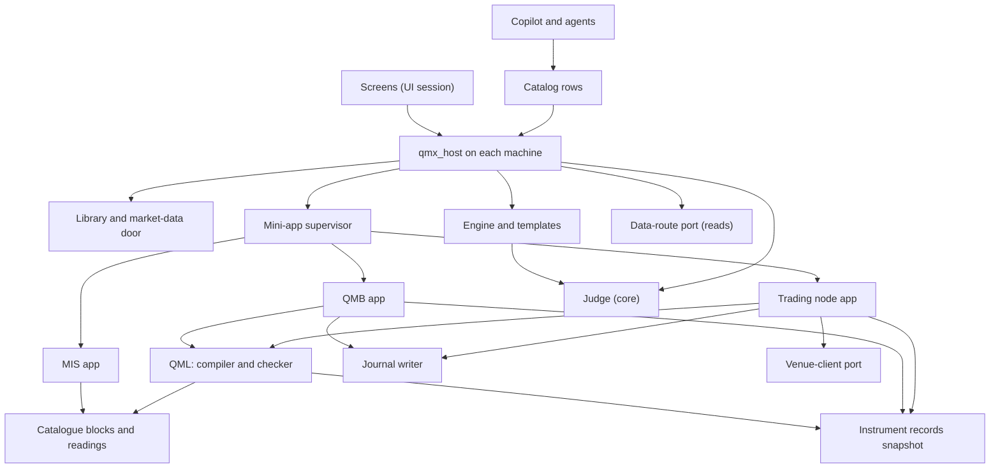
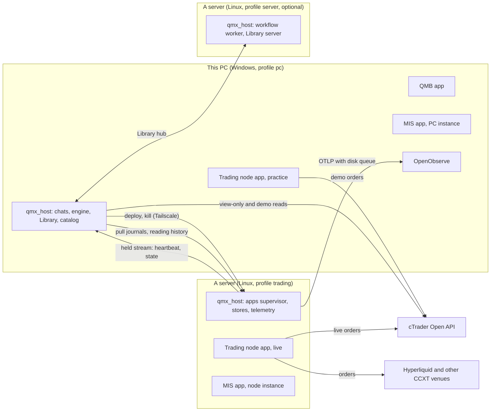

# Architecture Spine: QMX unit system, Level 0

Code truth: `origin/engine/base` at `c93407ca`. Words: `architecture/funnel/versions/GLOSSARY.md`. Every connection's detail: `architecture/01-connections.md` (the master every part's contracts must match). Proofs by running code: `level-0/blast-radius.md`. Calls the ledger did not settle: `level-0/LEAD-CALLS.md`. Rulings are STATE.md's; where this spine and STATE.md differ, STATE.md wins.

## Design Paradigm

**Microkernel (plug-in) architecture on the existing one-host core, with ports and adapters at the market edge.** The kernel is the small set of parts that must always agree with themselves; QMX keeps exactly one copy of each. Plug-ins are mini apps on the built mini-app core, reached only through their operations and their landed results. Content (units, entries, templates, cards) is Library data. Venues and data sources sit behind two ports. A unit is a pure compiled callback; hosts drive it (functional core, imperative shell).

| Layer | What lives there | Where (EXISTS path or NEW) |
| --- | --- | --- |
| Base (built, kept) | one host per machine, the Library, the engine, the catalog, the harness and copilot, the mini-app core | `qmx-agents/packages/qmx-host`, `qmx-library`, `qmx-engine`, `qmx-control`, `qma-harness`, `qmx-apps` |
| Kernel: authoring | QML, the dictionary and catalogue, the unit template, the checker | `qml/` (EXISTS), catalogue code in `packages/qmf-indicators` (EXISTS) and `packages/qmf-readings` (NEW, moved from `qmn/src/qmn/mis`) |
| Kernel: judging and records | the judge, study spec, try ledger, baseline cards; journals; instrument, venue and account records | `qmx-agents/packages/qmx-judge` (NEW); `packages/qmf-data` journal writer (EXISTS, extended); Library kind files (NEW) |
| Kernel: market edge | the venue-client port and the data-route port | `packages/qmf-venue` (EXISTS laws); read adapters `qmx-agents/packages/qmx-broker` (EXISTS) |
| Plug-ins (mini apps) | QMB (`runs`), the trading node (`money`), the MIS publisher (`shows`) | `qmx-agents/apps/qmb`, `apps/trading-node`, `apps/mis` (NEW folders); libraries `qmb/` (EXISTS), node organs `qmn/src/qmn/*` (EXISTS) |
| Content | units, dictionary entries, reading cards, workflow templates | the Library; `qmx-engine/src/qmx_engine/templates/` (EXISTS) |

## Inherited Invariants

Read-only here; Level 1 spines inherit them too. QMA v2 decision ids are the spines' own (`tracker/qma-v2/architecture/<spine>/ARCHITECTURE-SPINE.md`).

| Inherited | From | Binds here |
| --- | --- | --- |
| AD-1 pure orchestrator; AD-2 one definition format; AD-23 one writer per store | workflow-engine spine | templates are content on the one engine; nothing here adds a scheduler |
| AD-19 a mini app is a pack; AD-64 ask an operation or leave a result, one home per app instance | workflow-engine spine | QMB, the node and the MIS talk only through operations and landed results |
| AD-52 one composition root `qmx_host` | workflow-engine spine | the trading profile (AD-45) is a profile of the same host, not a second program |
| AD-60 engine agents work inside their attempt overlay | workflow-engine spine | built as designed (AD-32); its skip after probe P-PERM is a build gap, not a design change |
| AD-61 one operation catalog; toolsets are the unit of scope | workflow-engine spine | every unit door is a catalog row (AD-31) |
| AD-65 one heartbeat per host; AD-69 two monitoring layers from one event source | workflow-engine spine | node heartbeats carry clock evidence (AD-42) |
| AD-67 one connections registry; credentials by scope; agents read, never trade; AD-70 no workflow step holds a live-trading credential | workflow-engine spine | the live grant lives only with the node on its machine (AD-37) |
| AD-72 This PC or a place, recorded on every run | workflow-engine spine | every QMB run and deployment records its place |
| AD-1 one Library; AD-2 identity is content; AD-3 kinds are schema files; AD-5 one writer per store; AD-6 archive, never delete; AD-14 offline is normal | library-and-data spine | the Library changes only by addition (AD-29) |
| AD-25 price partitions beside the Library with dataset cards; AD-28 one market-data door | library-and-data spine | journals and reading history are partitions on the same key (AD-27) |
| AD-29 one `backtest-result` shape through one landing step | library-and-data spine | extended additively by QMB (AD-34) |
| AD-31 fills are partitions, round trips are `trade` items, a journal is a collection | library-and-data spine | the unit's round-trip record (AD-27) |
| AD-16 the identity rule is a table | lab-and-pods spine | one table, extended for units (AD-23) |
| AD-10 to AD-12 pods designed, unbuilt until the unit work settles them | lab-and-pods spine | pods stay unbuilt; the risk session decides how they fill the socket (AD-24) |
| CT-13, CT-18, CT-19, CT-20, CT-29 | `docs/contracts/` | the journal, capability, command, event and exit-record laws, addable never redefined |

## Invariants & Rules



Arrows mean "may import or call". Nothing points up: QML imports no host, app, venue or Library module (its scaffold test already bans `qmf.venue` and console scripts); apps never import each other; the judge imports no QMB version; only the node app reaches the venue-client port's order calls.

### AD-1. The kernel and the one way to add a thing

- **Binds:** all parts
- **Prevents:** growth by editing kernel code; two copies of anything that must agree with itself
- **Rule:** the kernel is P1 to P7 plus the built base; the three mini apps are P11, P12 and the MIS publisher in P13. Adding a thing never edits kernel code: a venue is a capability declaration plus an adapter behind the venue-client or data-route port; a market class is instrument records, calendar data and a dictionary pack; a reading is a catalogue block plus a reading card; a QMB version is an app version implementing the QMB contract that passes the conformance pack; a unit kind is a template document; a risk or sizing method is blocks for the socket slots; a workflow is a template folder. A change that cannot be added this way is a kernel change and needs its own spine amendment.

### AD-2. Units stand alone [ADOPTED]

- **Binds:** P1, P2, P12, P13, P14, every connection
- **Prevents:** a router, the MIS, the Library, the PC or any cross-machine link stopping a unit from trading
- **Rule:** the trading path (feed, unit, local guards, order, protection at the broker, journal) runs on one machine with only what is on that machine: the feed keeper, the compiled unit and its calibrated values, the instrument snapshots, the deployment record and the journal tail. Every other input is an optional read surface with `stale_after` and a declared fallback; QML's compiler refuses a rule input that is not local to the trading machine. Ledger CC-12; standing order 10.

### AD-3. Only the node sends orders; only he promotes; one automatic stop [ADOPTED]

- **Binds:** P8, P10, P12, P14, P2
- **Prevents:** an order path on any QMX host; an agent promotion; an automatic resume after a risk stop
- **Rule:** order calls exist only in the trading node app's venue clients (CHECKED: no order call in QMX host source, `blast-radius.md` item 8). Moving a unit or a market toward live, binding a live account and resuming after a risk stop are his clicks; the one automatic move is the unit's own risk rule stopping it, logged. Agents propose; node operations that change trading are his. Ledger CC-11; rulings 27, 135 (in code, `qmx_broker/adapters.py:103-146`).

### AD-4. Local first, Windows on the PC, Linux servers for live, one code [ADOPTED]

- **Binds:** all parts
- **Prevents:** a feature that only a server has; a Linux-only design on his PC
- **Rule:** every part runs on This PC alone, natively on Windows (Job objects, Credential Manager, the `tzdata` package). A server runs the same code in a named host profile (AD-45); it stands in or extends, never replaces. Linux is required only for a server's supervision (systemd) and its time service (chrony); WSL is the fallback for the node only. Ledger CC-06, CC-14, N-03.

### AD-5. Same code in research and live

- **Binds:** P1, P2, P11, P12, P13
- **Prevents:** backtest and live disagreeing by construction
- **Rule:** the compiled unit callback, its motion engine, its reading blocks and its local guards run identically in QMB's replay and in the node; the node's loop keeps driving QMB's `run_slice` unforked (`qmn/src/qmn/loop/driver.py`). The named differences belong to the host that drives the unit: the clock source, the data source and the fill model. A nightly replay of each live day through QMB compares decisions per unit.

### AD-6. Versioned contracts, addable never redefined

- **Binds:** P7 and every shape crossing a part or a machine
- **Prevents:** silent breakage after a one-sided update
- **Rule:** every crossing shape is JSON Schema 2020-12 with a `schema_version`; fields and kinds may be added, meanings never change; a breaking change is a new version plus an upgrade script; readers read every version they support. Every cross-machine connect states both sides' contract versions; on a mismatch the node keeps trading what it has and refuses new deployments until they match.

### AD-7. Immutable records, pinned versions

- **Binds:** P1, P2, P3, P5, P6, P11, P12
- **Prevents:** a result that cannot be reproduced; a live unit changing because shared content changed
- **Rule:** units pin blocks, entries and readings as `id@version`; deployments pin a unit version; results pin data card versions, the tester version and the checker and judge versions. A fix makes a successor linked to its parent; nothing is edited in place (Library AD-2, AD-6).

### AD-8. One owner per stream, credential, position and deployment

- **Binds:** P5, P12, P13, P14
- **Prevents:** two writers on one journal; two nodes on one account; a token refresh logging out another machine
- **Rule:** one writer per journal partition (the key includes the writing machine); one feed keeper per venue and environment per machine; one refresher per credential and one cTrader app per trading machine; a deployment names exactly one machine identity and a node refuses any deployment naming another; every client order id carries the node's id, so the start-up reconcile treats orders or positions from another node as a foreign claimant and refuses that account with an alert. No lease service on a third machine.

### AD-9. Typed market facts and units of measure

- **Binds:** P1, P2, P4, P11, P12
- **Prevents:** a stop ten times too wide; one unit meaning different risks at two brokers
- **Rule:** every number crossing a boundary is exact (QMF `ExactRational`, `Money`) and carries its unit kind (price distance, ticks, pips, ATR multiple, percent, bars, seconds, money, R). Conversions happen only through an instrument record; pips are an error unless the source states pips and the record defines a pip for that market; floats from a venue are converted once at the venue boundary.

### AD-10. One time scale

- **Binds:** all parts
- **Prevents:** a session rule an hour off in a DST week; data recorded on a drifting clock passing as good
- **Rule:** every stamp is UTC nanoseconds (QMF `Instant`) or ISO-8601 UTC text; market events carry venue time where the venue gives one and receive time always; sessions are rules in the market's own zone from versioned calendars; a machine's own zone never enters a rule. Every machine reports its zone, clock offset, sync state and `tzdata` version; rows written while the offset is unproven carry `clock_ok = false`.

### AD-11. Deterministic checks at the door

- **Binds:** P1, P3, P6, P8, P9, P11
- **Prevents:** an agent checking its own work; a false positive that trains agents to route around checks; a path that skips the check
- **Rule:** every check is a script, compiler, linter or test, returns every problem at once (kind, where as a JSON pointer, message, hint) with the checker's version, refuses only proven violations and only warns on heuristics. It runs at the door the artifact must pass (the Library save, the QMB run, the node deploy); in-loop paths are additions. A CI gate runs each checker over a known-good corpus (every example and admitted unit, every ported block) and fails the build on any error there.

### AD-12. Fail closed for new risk, open for protection

- **Binds:** P12, P13, P14, P15
- **Prevents:** protection that waits on something that can be down
- **Rule:** on any fault (stale feed, clock past the halt band, journal unwritable, disk alarm, venue not ready) new entries stop while exits, broker-side stops and the kill switch keep working; nothing on that path waits on the PC, the MIS, telemetry, the Library or an agent. The node's journal-before-dispatch gate is kept (`qmn/src/qmn/journal_dispatch.py`).

### AD-13. Unknown is a state; ids everywhere; operations converge

- **Binds:** P5, P12, P14, P9, every connection
- **Prevents:** a resend that opens a position twice; a retry that lands a record twice; a setup that breaks if run again
- **Rule:** an order outcome may be UNKNOWN and is never resent blind (CT-19 law kept): before any resend the node reads open orders and positions by client order id. Every event, fill, saved item and shipped partition has an id; receiving it twice changes nothing. Setup steps, deployments and shipping are idempotent and converge to a desired state.

### AD-14. Numbers are named settings; no invented caps

- **Binds:** all parts
- **Prevents:** a hidden limit; a magic number in code
- **Rule:** every threshold, cadence, window and budget is a named setting with a starting default, editable in the UI; limits are the provider's own. Defaults appear in Level 1 files with their origin; none is a cap (standing orders 5, 9; ruling 106).

### AD-15. Placeholders are labelled blocks, shown and never refused

- **Binds:** P1, P2, P11, P12
- **Prevents:** a placeholder reaching money unseen; a refusal that blocks the demo
- **Rule:** stand-in exits, sizers, halts and kill-switch values are ordinary blocks whose catalogue card says `origin: placeholder` and names the risk session as owner. The unit card, the promotion card and every trade row show the label; the rip-out list is a query over units using placeholder blocks. Nothing refuses a placeholder; his click decides (lead's review, settlement 3).

### AD-16. QML is the one unit library

- **Binds:** P1, P2, P11, P12
- **Prevents:** two meanings of one unit; hand-built factories; a second runtime language
- **Rule:** QML's door is five verbs: `new`, `check`, `compile`, `find`, `explain` (backtest is QMB's; promote is his click). `compile` turns a unit document into an object that satisfies today's structural `BotFactory` seam (CHECKED: a factory built at run time is accepted by `construct_bot` unchanged, `blast-radius.md` item 2), plus a compiled fingerprint and a decision-trace schema; the closure is what runs, a generated Python rendering is a read-only view. Composition (slots, combiners) is data; leaf conditions stay code inside tested blocks. QML stays pure Python 3.14 with no console script, no subprocess and no venue import (its scaffold tests stay green); entry points for hooks live in `qmx-tools`.

### AD-17. One checker, reached four ways

- **Binds:** P1, P2, P6, P8, P9, P11
- **Prevents:** a unit that passes on three instants valued 1, 2, 3 and trades nonsense; a check only the editor sees
- **Rule:** the checker runs layers in order and returns every problem: A schema, B references, C numbers and units of measure, D data levels against the instrument records, E completeness (placeholders warn), F code safety (the scan, widened for agent-written blocks to `importlib`, `__import__`, `eval`, `exec` and unseeded random; warnings only for human plain Python), G behaviour on a recorded slice of at least the derived warm-up plus a margin, in QMB's sandbox, fed to QML's unchanged `evaluate_layer2` verdict (CHECKED: the verdict is a pure function of observations, `blast-radius.md` item 3). The in-process `loaded_in_isolation` stamp never counts as proof. One function is reached by the `unit_check` catalog row, the Library save of a `unit` (AD-29), the unit-check step of templates, and, after a probe, a core-plugin hook calling `python -m qmx_tools.unit_check`.

### AD-18. A unit's size travels as CT-23 format version 3

- **Binds:** P1, P2, P11, P12, `packages/qmf-risk`
- **Prevents:** a unit's size silently dropped and the Book sizing the trade instead
- **Rule:** a unit's entry intent carrying its sizer's quantity and its exit set is a new CT-23 contract format version (3) with its own typed family; it is never an extra key on format 1 or 2. CHECKED by running both doors: an unknown key such as `requested_quantity` is accepted and dropped, while a format-3 stamp is refused as an unsupported capability by `parse_inbound_intent` and `accept_intents` (`blast-radius.md` item 1). QML's door and the node accept format 3 only from units; the Book path (formats 1 and 2, `requested_r` refused) stays unchanged for the risk session to keep or remove.

### AD-19. The dictionary and the catalogue

- **Binds:** P1, P13, P4, P8, P9
- **Prevents:** agents citing words with no meaning; a concept lost in an old folder; a word meaning two things across classes
- **Rule:** every concept is one Library item of the `component` kind, extended (component types gain trigger, exit, sizer, motion, reading, combiner, calendar, context), with three faces: trader words, machine spec (inputs with data level and fallback, output type, parameters as number specs), implementation (code reference, fingerprint, golden, no-future and warm-up tests). Status is computed by script, never typed. Entries are role-neutral; a multi-meaning word carries a per-class meaning table. A catalogue snapshot ships as QML package data so the node never needs the Library. All 239 entries are ported, never lost; growth goes through the authoring door with no cap.

### AD-20. Old law lifted for units, subtracted from the surface

- **Binds:** P1, P2, P11, P12
- **Prevents:** a builder taking a refusal from an old ruling as current law
- **Rule:** for units only: "the bot may not size" gives way to AD-18; the two exit kinds become addable kinds; "a tuned set mints a new bot" (`qml/src/qml/declaration/bot.py:618-628`) gives way to AD-22; `STAGE0_NEVER_SIZES` and `refuse_invented_exits` become labels; the graph-compile and mint refusals (`qml/src/qml/research/projection.py:203-255`) give way to the compiler. Refusal functions and `GAP_*` constants that contradict the rulings leave QML's public surface (kept private for their tests). The Book path stays in code for the risk session.

### AD-21. One home of record for a unit

- **Binds:** P2, P6, P11, P12
- **Prevents:** two registries holding different truths about one unit
- **Rule:** a unit is a Library item of the governed `unit` kind with schema `qmx.unit/1`, landing as a draft that waits for his yes; any `qmf-registry` record is derived from it when QMB or the node loads the unit. A plain-Python unit is the same document in manifest form (its slots, numbers and data needs declared, its logic one Python block), with the same journal, lineage and tries. Every unit links to its source.

### AD-22. Three kinds of number, and how they move

- **Binds:** P1, P2, P5, P11, P12
- **Prevents:** live tuning that was never tested; a moving number with no receipt; motion on few trades
- **Rule:** every number is a fixed number, a calibrated number or a derived value, declared with kind, unit kind, range, step, default, motion, authority, origin and `applies_to_open_positions` (default false). Calibrated numbers move only inside their range, one step at a time, after a minimum count, shrunk toward their default, as a pure function of journal rows up to a watermark, and never mid-position. The motion runs inside QMB's replay exactly as live and both motion on and off are reported. Identity covers ranges and motion rules, not values. Every move is a calibration row.

### AD-23. One identity table, one lifecycle machine

- **Binds:** P2, P3, P9, P12, the Lab
- **Prevents:** two tables deciding "is this a new unit"; two versions trading one market; an open trade's exits changed by a new version
- **Rule:** the type of edit decides new version or new unit by one table: the Lab's `settings.lab.identity_rule` (Lab AD-16), extended with the unit edit labels, read by QML, the judge and the Lab. Each unit has one lifecycle state machine with a state per market (draft, tested, parked, paper, live, stopped, retired); only he moves toward live; only a risk rule moves to stopped. One admitted version per unit and market at a time. A position belongs to the version that opened it until flat. On one instant exits run before entries; a unit holds one position per instrument unless it declares more.

### AD-24. The risk socket

- **Binds:** P2, P12, P11, the risk session
- **Prevents:** the risk session's design forcing a rework of the unit or the node
- **Rule:** a unit has an exit set and halts at position, unit and account scope, one sizer, and the host that drives the unit (the node live, QMB in replay, by AD-5) calls a cross-unit hook before every order; each slot is a typed contract that today's placeholder blocks already implement. The slots read only local inputs: entry and stop, instrument facts, account facts, the unit's own journal in R, market statistics, his limits. Exit and sizing maths, the kill-switch effect values and the hook's content are the risk session's (ledger R-01, R-04).

### AD-25. The referee stays home

- **Binds:** P3, P11, P9, P8
- **Prevents:** the score following the tester; luck from the best-looking market reaching his card
- **Rule:** the judge, the study spec, the try ledger and baseline cards are core (package `qmx-judge`), outside every QMB version. The core landing issues every run id and lands one append-only try row per run; family counts and effective tries are computed at read, so concurrent runs never write one shared record. The judge refuses results without a core run id. A study spec is written before any run; editing it after reading a result is a counted try. Every judged market is a try, pulled toward the unit's whole result; correlated markets count as one; every result also shows the fixed-size baseline. Scripts decide; agents explain.

### AD-26. Market facts as versioned records

- **Binds:** P4, P1, P11, P12, P13, P14
- **Prevents:** a sizer reading a raw venue document live; a replay using today's facts for a past date
- **Rule:** one `instrument` item per (venue, symbol), a `venue` item (rate limits, rationed actions, cancel-on-disconnect, trigger basis) and an `account` item (broker, demo or live, netting or hedging, futures type), versioned, refreshed from the venue (API facts daily and on every change event, broker documents weekly, exchange documents monthly). Each carries the data-level table with its three splits and licence, and versioned calendars in the market's zone. Every trading machine holds a snapshot of the records its deployments use. Futures records exist now as `specified`.

### AD-27. Journals: one envelope, typed kinds, one writer

- **Binds:** P5, P11, P12, P13, P8, P9
- **Prevents:** one thin row shape for everything; market facts copied into every unit journal; a world mislabelled
- **Rule:** every record carries one envelope (ids, writer and sequence, venue, receive and write times, `clock_ok`, world, unit and version, market, account, platform, machine, run, trace id, build, links) over CT-13's vocabulary, with typed kinds per stream: the unit journal (the node writes paper, demo and live; for backtest and stress QMB writes the same kinds into the `backtest-result`'s own blobs, so a run's journal is one record), the market journal (the feed keeper), the node journal, reading history (`source = node` for the node's guards, `source = mis` for the MIS app), notes (agents only). QMB and the node write only through P5's writer library, which owns the mapping onto the Library's existing partition key and commits through the machine's market-data door (its single writer, Library AD-28). The Library `trade` item is the round-trip record for paper, demo, live and imported fills (Library AD-31). Every decision is a row, taken or not; world is stamped by the venue reader.

### AD-28. Results come home by pull

- **Binds:** P5, P12, P13, P0, connections X3
- **Prevents:** a node that needs the PC to trade; journals lost while the PC is away
- **Rule:** the node always writes locally first. A job on This PC pulls each reachable node's closed partitions and live tail (journals and the node's reading history), idempotent by writer id and sequence, verifies them and commits through the PC's market-data door; the node keeps every partition until the PC confirms a verified copy, under a disk guard where tick recording stops first. The pull uses a host pass; the known run-pass failure at a server's door (G2 §6) is fixed before any PC-minted run relies on a server.

### AD-29. The Library changes only by addition

- **Binds:** P6, P1, P2, P3, P4, P5
- **Prevents:** damage to the store everything rests on (ruling 51)
- **Rule:** additions only: the real `unit` schema; the extended `component` kind; new kinds (`instrument`, `venue`, `account`, `study-spec`, `verdict`, `baseline-card`, `proposal-card`, `death-certificate`, `forecast`); the kind check returns every problem while keeping the first as its message head (28 shipped test lines compare message text, `blast-radius.md` item 6); a kind file may name a registered checker that the save runs (an additive amendment of Library AD-3: the roster stays data). Kept as built: one writer, archive never delete, governed drafts, refs and edges, the market-data door.

### AD-30. New shapes ride doors that exist

- **Binds:** P7, all parts
- **Prevents:** a second door beside the catalog that splits the copilot's reach from the workflows'
- **Rule:** the new shapes (the unit document, the check result, the QMB operations and result extension, the node operations and provides, the journal envelope and kinds, the reading card and stamped reading, the instrument, venue and account records, CT-23 format 3) are carried by catalog rows, mini-app operations and Library kinds; no new internal API service. Catalog row schemas carry `schema_version`; the OpenAPI title follows the host build. Every app's outputs are namespaced by app id; core names are reserved.

### AD-31. The copilot and agents, by registration only

- **Binds:** P8, P11, P12, P13
- **Prevents:** a unit tool the copilot cannot see; agents in the fast lane; agent judgement deciding
- **Rule:** the unit doors are rows in a core toolset (`unit_new`, `unit_check`, `unit_explain`, `blocks_find`, `journal_query`, `readings_query`, `instrument_get`); the existing `backtest` rows forward to the QMB app through the core landing; the node's read operations are reachable as rows; the default copilot home lists `app:qmb`, `app:trading-node` and `app:mis` (a shipped setting, no code). Skills `build-unit`, judging and `build-mini-app` are filled; a test pins that every agent-visible core row is on the default copilot surface. Agents work only in the slow lane, write only notes and drafts, never edit QMB, the study spec after results, the try ledger or his holdout choice. Ruling 24: no other change to the agent system.

### AD-32. Workflows are content; the engine changes only with a core reason

- **Binds:** P9, the engine
- **Prevents:** copied gate scripts; caps disguised as defaults; engine changes without a reason from its design
- **Rule:** templates are folders on the one engine. The shared pieces are built once: the `judge` subworkflow, the conveyor with a loop guard, one lineage writer, the death certificate, the forecast ledger with a scoring script, the receipts grader, the data-quality check, the proposal card, the unit-check step. Shipped templates are fixed surgically (the family holdout and the 60/20/20 split become study settings off by default; loop counts become editable numbers). Engine changes are only those its own design carries: AGW as engine AD-60 designed it (the skipped agent-step file writes, ruling 49), and the `library` node kind either gets its executor or is marked unavailable (engine AD-5's vocabulary).

### AD-33. The mini-app core, fixed only where it blocks

- **Binds:** P10, P11, P12, P13
- **Prevents:** rebuilding what the core gives; a mini app other than the node holding an order path
- **Rule:** QMB, the trading node and the MIS ship as first-party apps in `qmx-agents/apps/`, installed and enabled by one click on the first-start card. The money gate stays as built: publishing each node version needs his bound signature; a restart of the active signed version needs none (`qmx_apps/supervisor.py:542-547`). Only the `trading-node` app id may hold an order-capable venue client, enforced at install. A mini app may hold a unit's logic for research, backtests and paper and publish it as a unit item, never trade it (a template, a Should). Breaker defaults stay; the node app sets its own values in its manifest. One fix where the core truly blocks (ruling 46): the supervisor has a `restart` operation but no automatic restart after a breaker trip, so a manifest gains an opt-in restart with back-off (off by default, on for `trading-node`); every trip and restart stays logged.

### AD-34. QMB is a mini app with a contract

- **Binds:** P11, P3, P8, P9, the Lab
- **Prevents:** a QMB variant changing the score; QMB's house rules broken by a door that spawns processes inside it
- **Rule:** QMB is an app (risk `runs`, kind `both`) whose operations (`backtest`, `sweep`, `walk_forward`, `robustness`, `optimize`, `whatif`, `status`, `results`, `compare`, `instruments`) and `backtest-result` extension are the QMB contract any version implements. Versions install side by side; a call pins `(app, version)`; the default is a named setting; a version becomes default only after reproducing the conformance pack (golden runs of the dummy unit), which the core runs. QMB spawns nothing; the app runtime is the process boundary. The core keeps PR 204's one landing function, the run id, the principal stamp and the try ledger: whichever door starts a run (a `backtest` row, an `app:qmb` tool, `app_op`, the Lab's port), the finished result reaches the Library only through that landing, and the QMB app holds no Library write grant of its own. Amends engine AD-31 and Lab AD-5: the `qmb` placement becomes the QMB app's instance home.

### AD-35. Inside QMB: the loop rebuilt, the measuring kept

- **Binds:** P11
- **Prevents:** the only lookback limit (memory growing with the square of the steps); results only in money
- **Rule:** the replay reader keeps only the unit's derived warm-up plus its declared lookback (no step cap); replay reads quotes, trades or bars as the data card declares; execution inputs are data (cost, fill, financing, slippage adapters and the instrument record named in the run config); the unit's socket replaces the Book admission context for units; sizes round down to the lot step and skip below the minimum with the residue recorded; funding is a scheduled cash event; margin and liquidation are a port; calendars come from instrument records; results carry money and R, excursions in R, receipts, slices, the cost split and the run's unit journal (signal, calibration and state rows, AD-27), and say "costs uncalibrated" while GAP-0048 is open. The optimiser, robustness batteries, sweeps, synthetic series and exact money are kept.

### AD-36. The trading node: one money app, organs kept, shell replaced

- **Binds:** P12
- **Prevents:** 98,000 lines of a never-run node carried into the first live trade; a compatibility layer between the old shell and the new
- **Rule:** the node is the `trading-node` app (risk `money`). Its organs stay as libraries: the venue laws, the cTrader client with reconnect and gap replay, the capability check, the order pacer and UNKNOWN per stream, reconcile, protection (kill switch, windows, dead zones), the kill line, clock bands, the loop over `run_slice`, the virtual ledger rekeyed per unit, the one-refresher rule, the liveness heartbeat, live intake and history bootstrap. Its shell (host, seats, promotion, Book paper, doors, deploy recipes, bench, the proof campaigns, the Grafana stack) is replaced and deleted in the same wave once the new shell trades on demo, moving the three outside callers found by scan (`blast-radius.md` item 5). A live host profile is new: the only registered profile today is offline replay.

### AD-37. Node placements and keys

- **Binds:** P12, P14, P0
- **Prevents:** a live key where agents work; one grant on two machines
- **Rule:** practice: the node app on This PC, Windows native under the apps supervisor, trading demo accounts with a demo-only grant (allowed on the PC today), plus the PC's view-only live grant for shadow runs. Live: the node app on a server in the trading profile (AD-45), the live grant stored only by the node app in that machine's own store; every other QMX host keeps refusing live-capable grants. WSL only as the fallback. Each trading machine registers its own cTrader app; Hyperliquid trading uses one agent wallet per trading process with its expiry on the passport.

### AD-38. The node keeps returning to what he asked for

- **Binds:** P12, P15
- **Prevents:** a crash leaving an orphan or doubled position; a heal undoing a risk stop
- **Rule:** a deployment carries the pinned unit document, every pinned block's code and fingerprint, the calibrated values and the instrument snapshots; the node compiles the unit itself and refuses to trade it if the compiled fingerprint differs from the one QMB tested. The node's volume holds the desired state (deployments, accounts, modes, snapshots, unshipped journals); a restored backup lands units as drafts and never cuts over into a running node. On every start the node reconciles with the broker first (broker wins; a position with no owner is protected and flagged, never adopted), rebuilds positions, restores calibration, re-places missing protection, warms up from its own recording without trading, then allows entries. Technical faults heal with back-off (the inner supervisor for the loop, the supervisor's opt-in restart for the app process, AD-33); a repeated fault stands down entries alive; a risk stop survives restarts and waits for his resume. A health stop and a risk stop are different words on every screen. Units are added and removed one at a time; a node restart is only for node code.

### AD-39. The order path and protection

- **Binds:** P12, P14, P2
- **Prevents:** an unprotected position when the node dies; Book-level paper standing in for a unit's own paper
- **Rule:** unit intent (CT-23 format 3), then local guards (kill-switch level, clock band, feed freshness, spread against the unit's cost target, windows), then the cross-unit hook (placeholder), then a CT-19 command whose client order id is the trade's trace id tagged with the node id, then the venue client, then CT-20 events recorded before they are interpreted, then reconcile, then the journal. Protection is placed with the order where the venue allows, and re-placed after any venue cancel where it does not (the venue's protection rule, AD-41). Each unit has its own paper lane per market on demo accounts; DEC-0261's "no per-bot paper" is lifted for units.

### AD-40. The MIS reads and publishes; no unit needs it

- **Binds:** P13, P1, P12, P9
- **Prevents:** a unit waiting on the MIS; QMB and live computing a reading with different code
- **Rule:** every reading is a catalogue block with a reading card (tier, clock, data level and fallback chain, lag, minimum sample, valid classes, three outputs, health word). Execution-health readings (spread against usual, spread quality, quote gaps, feed state, degraded sensors, liquidity stress) run inside the node as its guards and are stamped into reading history by the node. Market-state readings (volatility state, trend against range, efficiency ratio, variance ratio, Hurst, calendar states, funding and open interest, roll state, cash open, fix windows, currency strength, dispersion) are published by the `mis` app: an instance on each trading machine (reading that machine's market-data store) and one on This PC (slow tier, cross-market readings, the board, models in shadow). Each reading series has one writer: the series key includes the source and the machine, and the PC instance never recomputes a tier a trading machine publishes for its own markets. Units read readings through a declared `reads` list with a fallback (`compute_here`, `treat_as_absent`, `no_new_entries`). New readings and models run in shadow and go live only with his yes. "Regime" means trend against range; the shipped volatility buckets are "volatility state".

### AD-41. Two ports at the market edge

- **Binds:** P14, P12, P4, P11, P13
- **Prevents:** a closed venue list in the kernel; a charting platform as a data dependency; a tick count called volume
- **Rule:** the venue-client port (orders, positions, fills, reconcile; capability declaration plus measured profile; unmapped error means UNKNOWN plus an alarm) has adapters `ctrader` (kept) and `ccxt` (new: Binance, Bybit, Hyperliquid through the pinned CCXT class first, a native client only if the testnet probe fails); the venue kind list opens to `ccxt` (`qmn/src/qmn/venue/port.py:40-45`). Futures clients (Rithmic R|Protocol, CQG WebAPI) are declared placeholders, not code. The data-route port (levels offered with their splits and licence, subscribe, history) normalises prints, quotes, books and bars into one internal format. Order flow comes in three layers: free crypto tapes (level 4), computed broker-side estimates on cTrader labelled as estimates (levels 2 and 3), a paid futures route he switches on later. Each venue's protection rule is a port rule. MT5 stays a declaration; the PC's CCXT reads open to contract markets (no order code exists on any host, `blast-radius.md` item 8).

### AD-42. One place to look

- **Binds:** P15, P12, P13, P11
- **Prevents:** two monitoring stacks; "process up" read as healthy; a log flood starving the journal
- **Rule:** every process sends OpenTelemetry through the one telemetry switch; OpenObserve on This PC is the home; a server runs a collector with a disk queue that ships to the PC when reachable and may run its own OpenObserve as a stand-in; QMN's Grafana, Loki and Prometheus stack is deleted. Health is progress: the last decision per unit, the last quote per symbol, the last journal write. Heartbeats carry state, reason, clock evidence (AD-10), version and last broker contact; alarms fire only inside open calendars and wake him for a short named list; telemetry off shows as off. Logs and journals have separate disk budgets; logs are rate-limited with a dropped count.

### AD-43. Clocks on every machine, calendars for every market

- **Binds:** P15, P4, P12, P9
- **Prevents:** his stopped Windows Time silently corrupting cTrader's receive-time stamps; a forex-only calendar holding crypto on Saturdays
- **Rule:** This PC runs the Windows Time service with a good source (turning it on is his click, proposed by a doctor line); Linux servers run chrony with four or more sources and no smeared sources mixed; every trading machine keeps the node's clock bands (warn, no new entries, halt). Calendars beyond forex (exchange sessions, daily breaks, holidays, expiries, per-index breaks, 24/7 activity sessions, funding clocks) are versioned data with a maximum age; the forex-shaped `market_open` precheck becomes a per-instrument calendar check. One zone rule: storage in UTC, market-tied jobs in the market's zone, his own routines in This PC's zone. The `tzdata` pin's age is checked and each DST mismatch week is announced ahead.

### AD-44. Networking between machines

- **Binds:** every cross-machine connection in `01-connections.md`, P0, P12, P15
- **Prevents:** a network link on the order path; a dropped link losing data; a node placed far from its broker
- **Rule:** nothing that crosses machines is on the order path, except the node's own link to its venue. Every cross-machine link rides a transport that exists: REST and SSE (with `Last-Event-ID` resume) and MCP over streamable HTTP on the host's one port behind one bearer; the PC host on loopback and server hosts bound to their Tailscale address only; one held stream per reachable owned node into the PC's merged inbox; host-to-host passes and `POST /api/data/read` for data; the Library hub's replication; OpenTelemetry over the tailnet with a disk-backed queue. Every link tolerates loss: control calls to an unreachable node wait as desired state, never fail; streams resume; data is backfilled by id. A trading node is placed near its broker's servers (the PC's measured TCP handshake to cTrader is about 160 ms, against about 0.5 ms for in-process fan-out, research 31).

### AD-45. Host profiles

- **Binds:** P0, P12, P10
- **Prevents:** agents working where a live key lives; a special "trading server" machine kind on his screens
- **Rule:** one `qmx_host` program per machine in a profile: `pc` (everything; the default), `server` (workflow worker and Library server, as built by PR 232), and `trading` (the apps supervisor, the trading node app, the MIS instance, the market-data store and journal store, telemetry; no chats, no agent workflow steps). A server enters the trading profile when he binds a live account to the trading node app on it; no machine kind is named on his screens; in his words, "A server can be a server." (T3:1102). The connect dialog gains a "Trading node" choice on the shipped step runner: practice on This PC first, then the same checked steps on a server.

## The parts

Each part names its verdict, whether it exists, what it owns and must never own, its rules (AD ids above), its language and runtime, Windows and Linux, local first, the seam through which later growth plugs in, and the catalogue cases it owns (every one of the 267 cases and 18 risk rows is owned exactly once; CHECKED by `score.py`).

### P0 The host

- **Verdict:** core. **EXISTS:** `qmx-agents/packages/qmx-host` (one process per QMX folder, `HO/host.py:1-20`); trading profile NEW.
- **Owns:** composing every part on a machine; profiles (AD-45); the first-start card (adds one click for the three apps); the connect dialog's step runner (adds the "Trading node" choice); the doctor (adds a clock line).
- **Never owns:** trading logic, orders, unit logic.
- **Rules:** AD-4, AD-44, AD-45. **Language:** Python. **Windows and Linux:** both, first-class on Windows (CI on `windows-2025`). **Local first:** `pc` is the default profile.
- **Growth seam:** a new profile is a setting; a new connect choice is a step-runner kind.
- **Cases:** OP-01, OP-02, OP-04, OP-06, OP-07, OP-08, OP-09, OP-11.

### P1 QML with the dictionary

- **Verdict:** core. **EXISTS:** `qml/` (48 files, 385 tests pass on Windows, G1 §1.1); the 239 entries outside the repo in `Desktop\Stats\dictionary`; the five verbs, the compiler, layers A to G, the extended catalogue NEW.
- **Owns:** the runtime seam (factory, callback, intents, evidence with `knowable_at`, state); the compiler; the checker; the catalogue and the dictionary entries; the five-verb door; the motion engine inside the compiled callback; units of measure.
- **Never owns:** backtests, orders, storage, judging, promotion, market facts, publishing readings.
- **Rules:** AD-5, AD-9, AD-11, AD-16, AD-17, AD-18, AD-19, AD-20, AD-22. **Language and runtime:** Python 3.14, in process of whatever hosts it, because every venue speaks a wire protocol and the network, not Python, is the floor (research 54 §2, research 31). **Windows and Linux:** both. **Local first:** runs anywhere; the node uses its package-data snapshot.
- **Growth seam:** a block, reading, motion mode or number kind is catalogue data plus code with golden tests; QML's code does not change.
- **Cases:** QML-01, QML-02, QML-03, QML-04, QML-05, QML-07, QML-08, QML-09, QML-10, QML-11, QML-12, QML-13, QML-14, QML-15, QML-16, QML-17, QML-18, QML-19, QML-20, QML-21, QML-22, QML-23, QML-24, QML-25, QML-26.

### P2 The unit template

- **Verdict:** core (a Library kind, a schema and templates). **EXISTS:** the `unit` kind with empty fields (`qmx-library/src/qmx_library/kinds/unit.schema.json`); `qmx.unit/1`, the dummy unit, the identity rows, the lifecycle machine NEW.
- **Owns:** the unit document's shape and the number spec; the identity-by-edit rows for units; the lifecycle machine with a state per market; the risk socket's slot contracts; the templates, the dummy unit first.
- **Never owns:** running, storing engine internals, risk maths.
- **Rules:** AD-2, AD-15, AD-21, AD-22, AD-23, AD-24. **Language:** JSON Schema 2020-12 for the document; Python for the lifecycle. **Local first:** a unit is his content and travels with it (PR 231's save classes).
- **Growth seam:** a new unit kind is a template; per-market settings live inside the document now, with a schema version step to linked items if a unit trades very many markets.
- **Cases:** UT-01, UT-02, UT-03, UT-04, UT-05, UT-06, UT-07, UT-08, UT-09, UT-11, UT-12, UT-13, UT-15, UT-16, UT-17, UT-18, UT-19, UT-20, UT-21, UT-23, OP-03, OP-05.

### P3 The judge and the try ledger

- **Verdict:** core. **EXISTS:** `_shared/overfit-gates` and the copied gate scripts in `b` and `d3` (G2 §4); the shipped `b` defaults; **NEW:** `qmx-agents/packages/qmx-judge`, the study spec, baseline cards.
- **Owns:** the default chain (claim card, signal check against random entries, cost stress, walk-forward, try-corrected verdict), presets, shrinkage, effective-try clustering, the try ledger (a family record in the Library), verdicts, baseline cards, the decay comparison.
- **Never owns:** computing backtests; promotion.
- **Rules:** AD-7, AD-11, AD-25. **Language:** Python, pure functions called by the landing and the `judge` subworkflow. **Local first:** on This PC.
- **Growth seam:** a new check is an opt-in step on the judge card; a new preset is data.
- **Cases:** QB-09, QB-10, QB-11, QB-13, QB-22, MIS-11, AG-06, WF-11, WF-12.

### P4 Instrument, venue and account records

- **Verdict:** core. **EXISTS:** `ValueFactor` as a type, the forex calendar, the connections registry (engine AD-67); the kinds, refresh jobs and snapshots NEW.
- **Owns:** the facts per market, venue and account; the data-level table; calendars as data; refresh jobs (workflow templates on a host with a read grant); snapshots for trading machines.
- **Never owns:** live quotes; trading.
- **Rules:** AD-9, AD-10, AD-26, AD-43. **Language:** Library kind files; refresh scripts in Python. **Local first:** refreshed on This PC; snapshots travel with deployments.
- **Growth seam:** a new class or venue is records plus a refresh adapter.
- **Cases:** QML-06, QB-06, LD-02, LD-13, TN-25, TN-26, EX-13, EX-14, EX-22, CK-12.

### P5 Journals and records

- **Verdict:** core. **EXISTS:** CT-13 events (`packages/qmf-data/src/qmf/data/journal.py`), CT-29 exit records, the `trade` kind, fill partitions; the envelope, kinds, writer library, `journal_query` and the pull job NEW.
- **Owns:** the envelope and kinds; one writer per partition; partitions and cards; the agents' read door and daily digests; the pull from nodes.
- **Never owns:** operational telemetry; agent verdicts (agents write notes only).
- **Rules:** AD-8, AD-13, AD-27, AD-28. **Language:** Python; Parquet partitions. **Windows and Linux:** both; on his PC under the QMX folder on D:. **Local first:** the PC holds every journal; nodes queue until pulled.
- **Growth seam:** a new record kind is addable under the envelope.
- **Cases:** JR-01, JR-02, JR-03, JR-04, JR-05, JR-06, JR-07, JR-08, JR-09, JR-10, JR-11, JR-12, JR-13, JR-14, JR-15, JR-16, JR-17.

### P6 The Library

- **Verdict:** core, the centre. **EXISTS:** `qmx-agents/packages/qmx-library` (store, kinds, landing, refs, edges, market-data door).
- **Owns:** the store of record, kinds, governed landing, lineage, dataset cards, the market-data door.
- **Never owns:** running code, live trading state, secrets (Library AD-1).
- **Rules:** AD-7, AD-29. **Language:** Python. **Local first:** This PC is the primary (rulings 136, 140 to 143).
- **Growth seam:** a kind is a schema file; a checker is named in it.
- **Cases:** LD-01, LD-03, LD-04, LD-05, LD-06, LD-07, LD-08, LD-09, LD-10, LD-11, LD-12, LD-14, LD-15, LD-16, LD-17.

### P7 Contracts and APIs

- **Verdict:** core. **EXISTS:** the catalog, REST and MCP on one port, the error shape, store versions, CT-13 to CT-34; API versioning NEW.
- **Owns:** the rules every crossing shape follows; the list of new shapes; the external ports' contracts; the cross-machine handshake.
- **Never owns:** a separate internal API service.
- **Rules:** AD-6, AD-13, AD-30. **Growth seam:** addable fields and kinds; new versions with upgrade scripts.
- **Cases:** CA-01, CA-02, CA-03, CA-04, CA-05, CA-06, CA-07, CA-08, CA-09, CA-10, CA-11, CA-12.

### P8 The copilot and agents

- **Verdict:** core, built; changed by registration only. **EXISTS:** `qma-harness`, `qmx-control` catalog, the core plugin `qmx-agents/plugin`.
- **Owns:** unit doors as rows; skills; the hook after a probe; the parity test; slow-lane agent jobs (as templates).
- **Never owns:** the fast lane, orders, the study spec after results, QMB's code.
- **Rules:** AD-3, AD-11, AD-31. **Language:** Python (rows), Markdown (skills). **Local first:** chats run on This PC by default.
- **Growth seam:** a new tool is one catalog row; the copilot gets it by default.
- **Cases:** AG-01, AG-02, AG-03, AG-04, AG-05, AG-07, AG-08, AG-09, AG-10, AG-11, AG-12, AG-13, AG-14, AG-15, AG-16.

### P9 Workflows and templates

- **Verdict:** the engine is core (built); templates are content. **EXISTS:** `qmx-engine` (12 node kinds, 45 templates, 22 runnable); the shared pieces and first families NEW.
- **Owns:** the shared core pieces; the first families (build and prove, run on every market, where its rules hold, overnight loop, unit review, session-close review, pre-session shortlist, weekly market selection, decay check, node watcher, dictionary expansion, librarian, daily data review); the surgical fixes.
- **Never owns:** a second scheduler; agent self-judging.
- **Rules:** AD-11, AD-14, AD-32. **Language:** `qmx.workflow/1` documents; Python script steps. **Local first:** templates run on This PC by default (engine AD-72).
- **Growth seam:** a template is a folder; unmet needs install as validated drafts naming what they wait for.
- **Cases:** WF-01, WF-02, WF-03, WF-04, WF-05, WF-06, WF-07, WF-08, WF-09, WF-10, WF-13, WF-14.

### P10 The mini-app core

- **Verdict:** core, built; fixed only where it blocks. **EXISTS:** `qmx-agents/packages/qmx-apps` (manifest, supervisor, road, Job objects, Docker tier).
- **Owns:** app manifests, operations, provides and feeds, homes, isolation, the breaker, the money signature gate, publication.
- **Never owns:** domain logic.
- **Rules:** AD-1, AD-33. **Windows and Linux:** Job object on Windows, Docker tier elsewhere.
- **Growth seam:** an app is a manifest plus an MCP server; a template for unit-holding research apps is a Should.
- **Cases:** MA-01, MA-02, MA-03, MA-04, MA-05, MA-06, MA-07, MA-08, MA-09, MA-10.

### P11 QMB

- **Verdict:** **mini app** (`qmb`, risk `runs`), installed by default. **EXISTS:** `qmb/` (91,252 lines, its measuring parts tested; a trading replay that fills and ledgers a fixture bot, CHECKED: 9 tests pass, one closed trade at -1.06R, `blast-radius.md` item 4); PR 204's landing (open). **NEW:** the app, the windowed reader, the typed-partition entry, a runner that trades a unit, R results, the conformance pack.
- **Owns:** replay, stress, optimise, walk-forward, robustness, what-if and sweeps for compiled units; results; the QMB contract.
- **Never owns:** run ids, the try ledger, the landing, the judge, live trading.
- **Rules:** AD-5, AD-34, AD-35. **Language:** Python. **Windows and Linux:** Job object on Windows (fixes PR 204's POSIX-only memory limit). **Local first:** on This PC; a server instance is capacity he adds.
- **Growth seam:** a new version or variant installs beside the current one, pinned per call.
- **Cases:** QB-01, QB-02, QB-03, QB-04, QB-05, QB-07, QB-08, QB-12, QB-14, QB-15, QB-16, QB-17, QB-18, QB-19, QB-20, QB-21, QB-23, QB-24.

### P12 The trading node

- **Verdict:** **mini app** (`trading-node`, risk `money`), installed by default for practice. **EXISTS:** the organs in `qmn/src/qmn/` and `packages/qmf-venue` (never run against a broker, G3 §1.1); **NEW:** the shell (app, inner supervisor, desired state, live profile, per-unit paper, feed keeper as the app's lifeline), the passport, the trading profile.
- **Owns:** the only order path; deployments; feed keepers; the unit runtime; local guards and execution-health readings; protection; reconcile; the kill switch and kill line; clock bands; healing; local journals; the heartbeat.
- **Never owns:** research; chats or agent steps on its machine in the trading profile; any key but its own machine's.
- **Rules:** AD-2, AD-3, AD-8, AD-12, AD-13, AD-36, AD-37, AD-38, AD-39. **Language:** Python (the organs are Python; the network is the floor). **Windows and Linux:** practice native on Windows; live on Linux servers under systemd; WSL fallback. **Local first:** practice on This PC first, then the same app on a server.
- **Growth seam:** a new venue is a venue-client adapter; a new placement is a profile; risk content plugs into the socket.
- **Cases:** UT-10, UT-14, UT-22, TN-01, TN-02, TN-03, TN-04, TN-05, TN-06, TN-07, TN-08, TN-09, TN-10, TN-11, TN-12, TN-13, TN-14, TN-15, TN-16, TN-17, TN-18, TN-19, TN-20, TN-21, TN-22, TN-23, TN-24, TN-27, TN-28, TN-29, TN-30, TN-31, TN-32, TN-33, TN-34, OP-10.

### P13 The MIS

- **Verdict:** reading blocks are **core**; the publisher is a **mini app** (`mis`, risk `shows`) with a PC instance and one per trading machine. **EXISTS:** `qmn/src/qmn/mis/` (12,654 lines: execution-health labelers, a quantile fit, an untrained volatility classifier; publishes to the Book door and kill switch only); the four homes for its output (G4b Q6). **NEW:** `packages/qmf-readings` (moved, not rewritten), market-state defaults for every class, the app, reading cards.
- **Owns:** reading cards and default packs per class; publishing reading history, events and the board; models in shadow.
- **Never owns:** a unit's decision; the trade path; training (the Lab's placement does it).
- **Rules:** AD-2, AD-5, AD-40. **Language:** Python. **Local first:** the PC instance works alone on Library history.
- **Growth seam:** a reading is a catalogue block plus a card; a model is a learned block in shadow.
- **His questions (ruling 48), answered in one paragraph.** The MIS runs where trading runs and on his PC: each trading node installs an MIS instance that reads that node's markets and writes what it sees, and his PC runs the slow readings, the readings that compare markets, and any models he trains later. It starts with indicators and simple statistics, not models: volatility against its usual level, spread and activity against usual, whether a market is trending or ranging, sessions and calendar windows, funding and open interest for perps, the roll for futures, the cash open for indices, the fix windows for gold, and currency strength across pairs, each with the time it was read. Models come later through the Lab, run beside the defaults in shadow, and go live only with his yes, behind the same reading shape, so no unit changes when a model replaces a default. Its data is the node's live feed and the Library's history, which he downloads. Its screen is a section of each trading node's page plus the MIS tab on his PC.
- **Cases:** MIS-01, MIS-02, MIS-03, MIS-04, MIS-05, MIS-06, MIS-07, MIS-08, MIS-09, MIS-10, MIS-12, MIS-13, MIS-14.

### P14 External connections

- **Verdict:** core ports, adapters behind them. **EXISTS:** cTrader Open API over protobuf on port 5035 with OAuth on This PC (reads), the cTrader live client in the node (never run), CCXT 4.5.85 spot reads, Dukascopy and Binance Vision downloaders, a Databento key check; CCXT order adapter, contract reads, futures placeholders NEW.
- **Owns:** the two ports; adapters; per-venue protection rules; sign-in flows (each venue's own web page; keys in the machine's store).
- **Never owns:** an order call outside the node; passwords.
- **Rules:** AD-8, AD-9, AD-41, AD-44. **Language:** Python adapters over each venue's wire protocol (protobuf or JSON over TCP or WebSocket). **Local first:** reads on This PC.
- **Growth seam:** a venue is a declaration plus an adapter; a data route is a level declaration plus an adapter.
- **Cases:** EX-01, EX-02, EX-03, EX-04, EX-05, EX-06, EX-07, EX-08, EX-09, EX-10, EX-11, EX-12, EX-15, EX-16, EX-17, EX-18, EX-19, EX-20, EX-21.

### P15 DevOps and clocks

- **Verdict:** core. **EXISTS:** the one telemetry switch, OpenObserve v1.1.2 pinned for Windows, heartbeats, the doctor, QMF time types, the forex calendar; per-machine clock evidence, more calendars, the deletion of the second stack NEW.
- **Owns:** observability, health, alarms, disk budgets, clock discipline, calendars' freshness, the zone rule.
- **Never owns:** the record of trading (journals are).
- **Rules:** AD-10, AD-42, AD-43. **Windows and Linux:** Windows Time on the PC; chrony on servers.
- **Growth seam:** a new source sends OTLP through the switch.
- **Cases:** DO-01, DO-02, DO-03, DO-04, DO-05, DO-06, DO-07, DO-08, DO-09, DO-10, DO-11, DO-12, DO-13, DO-14, CK-01, CK-02, CK-03, CK-04, CK-05, CK-06, CK-07, CK-08, CK-09, CK-10, CK-11, CK-13.

## Networking between machines

The master table is `01-connections.md` §3 (transport, latency it tolerates, how often and how much crosses, on the order path or not, reconnect and backfill, placement). The rules are AD-44. In short:

| Link | Transport (EXISTS unless marked) | On the order path | When it is down |
| --- | --- | --- | --- |
| Node to its venue | cTrader: TLS protobuf on 5035, one long-lived session per environment per machine; CCXT: REST and WebSocket (NEW) | yes, the only one | no new entries; protection already at the broker; reconnect with back-off, gap replay, capabilities re-verified before entries |
| His click on the PC to the node (deploy, pause, resume, kill, flatten, mode) | app operation at the node's home over the host's port on Tailscale, host pass | no | waits as desired state; the kill also has the node's own screen and the broker's app |
| Node to the PC inbox (heartbeat, state, guard events) | held stream per reachable node, SSE with resume | no | PC shows "unreachable since" with the last values |
| PC pulls journals and reading history from the node | host-to-host data read with a host pass (NEW job) | no | node keeps everything until a verified copy lands |
| Telemetry | OTLP over the tailnet, collector with a disk queue | no | dropped lines counted; trading unaffected |
| PC and a QMX server Library | the Library hub's replication | no | offline is normal (Library AD-14) |
| Remote workflow steps | run passes and `POST /api/data/read` | no | known gap: a pass minted on the PC fails at a server's door; fixed before use |

## Consistency Conventions

| Concern | Convention |
| --- | --- |
| Names | the glossary's words; code keeps QMB's banned words out (`engine`, `kernel`, `exam`, `plugin`, `snapshot` in QMB source); app ids `qmb`, `trading-node`, `mis`; catalog rows `<toolset>_<op>` |
| Ids | content fingerprints `fp1:sha256:...`; pins `id@version`; trace id from source to trade, equal to the client order id tagged with the node id |
| Times | UTC nanoseconds or ISO-8601 UTC text; venue and receive time on market events; zones named (IANA) |
| Numbers | exact types with a unit kind; no binary float for money or prices past the venue boundary |
| Errors | the shipped shape `error: code, message` (tools add `next_step`); checks return every problem as kind, where (JSON pointer), message, hint, with the checker version |
| Records | envelope plus kind; one writer per partition; append only; archive, never delete |
| Settings | every number a named, UI-editable setting with a starting default and its origin |
| Secrets | keys only in each machine's own store (Credential Manager on This PC, an owner-only vault file on a server); never in the Library, journals, logs or a deployment; one redaction seam on every write (engine AD-37); the secret scan on every commit |
| Ownership of shared shapes | CT-23 format 3, the unit document, the catalogue entry and the reading card schema are defined by Level 1 A; the QMB contract, journal kinds and the judge's records by Level 1 B; node operations, deployments and the instrument, venue and account records by Level 1 C; the others consume and propose changes |
| Placeholders | `origin: placeholder` on the block's card, shown on unit cards, promotion cards and trades |
| Tests | every PR keeps the shipped tests green (`just ci` on Windows and the Linux lanes); the checker's known-good corpus gate |

## Stack

Versions read from the lockfiles at `c93407ca` (CHECKED) and against the vendors' pages on 31 Oct (CHECKED with Exa where marked in `reviews/review-currency.md`). These are pins the code owns; this spine changes none of them.

| Name | Version |
| --- | --- |
| Python (QML requires 3.14.x) | 3.14.6 |
| claude-agent-sdk | 0.2.166 |
| ccxt | 4.5.85 |
| OpenObserve | v1.1.2 |
| TA-Lib | 0.7.1 |
| FastAPI | 0.142.2 |
| pyarrow | 25.0.1 |
| jsonschema | 4.26.0 |
| protobuf | 7.36.0 |
| cronsim | 2.7 |
| optuna | 4.9.0 |
| tzdata | 2025.2 |
| cTrader Open API descriptor | openapi-91.pb |

## Structural Seed

### Containers and placements



### Source tree (new and touched)

```text
qml/                                  # P1, upgraded in place (door, compiler, checker layers)
packages/qmf-readings/                # P13 reading blocks, moved from qmn/src/qmn/mis (NEW)
packages/qmf-risk/                    # CT-23 format 3 family for units (touched, Book path kept)
packages/qmf-data/                    # journal envelope and writer (extended)
qmb/                                  # P11 library, loop rebuilt, measuring kept
qmn/src/qmn/                          # P12 organs kept; shell replaced by qmn/src/qmn/app/
qmx-agents/apps/qmb/                  # app.toml + MCP server over the qmb library (NEW)
qmx-agents/apps/trading-node/         # app.toml + server over the node shell (NEW)
qmx-agents/apps/mis/                  # app.toml + server over qmf-readings (NEW)
qmx-agents/packages/qmx-judge/        # P3 (NEW)
qmx-agents/packages/qmx-library/      # kinds added; validator returns every problem
qmx-agents/packages/qmx-control/      # catalog rows added
qmx-agents/packages/qmx-engine/       # shared template pieces; AGW; library node kind
qmx-agents/packages/qmx-host/         # trading profile; connect choice; doctor clock line
qmx-agents/packages/qmx-broker/       # CCXT contract reads
qmx-agents/plugin/                    # skills; hook after a probe
```

### Seams (from `codebase-design`)

| Seam | Interface | Adapters today or planned | Real or hypothetical |
| --- | --- | --- | --- |
| BotFactory (QML runtime) | `construct(declaration, assignment, read_surfaces)` returning a callback | compiled units; plain-Python units; callers QMB and the node | real (two callers, structural, CHECKED) |
| The checker | `check(document)` returning every problem | one function reached four ways | one module; the entry points are not adapters |
| The QMB contract | the app's operations and result shape | today's QMB; any variant; the conformance pack as test adapter | real |
| Venue-client port | sessions, submit, observations, reconcile, capabilities | `ctrader`; `ccxt`; replay and conformance kinds | real; futures clients hypothetical (declared, not code) |
| Data-route port | levels, subscribe, history | cTrader, CCXT venues, Dukascopy, Binance Vision | real; Databento hypothetical |
| Reads (unit to readings) | declared `reads` with a fallback, served as read surfaces | the node's local store; QMB's history; compute here | real |
| Risk socket | exit set, sizer, halts, cross-unit hook | placeholder blocks; the risk session's blocks | real once the risk session lands; today one adapter, kept because the ruling asks for the connector |

## For the risk session

Every place risk and sizing plugs in, with today's placeholder. The pack is `RISK-SIZING-PACK.md`; nothing here designs the maths.

| Plug-in point | Where | Today's placeholder |
| --- | --- | --- |
| Sizer slot | unit document (AD-24) | 0.5% of equity at risk at the stop, rounded down to the lot step, skipped with a reason below the minimum lot (`funnel/solutions/unit.md` §8) |
| Exit set, at position, unit and account scope | unit document | a protective stop beyond the last swing point plus a buffer, a 2R target, a 48-bar time-out |
| Halts, at position, unit and account scope | unit document | empty, shown as a warning on the card |
| Motion of risk numbers (which move with the market, which with the record) | number spec (AD-22) | none move; `applies_to_open_positions` false |
| The cross-unit hook before every order | node order path (AD-39) | passes every order; the MIS publishes dispersion and herding counts for it |
| Budget share the sizer reads | socket inputs | the account's equity |
| Kill-switch effect values per level | node protection (kept organ) | labelled placeholder defaults (blank in code today, GAP-0050) |
| The kill line's verb (flatten or stop) | node capital (kept organ) | code kept, unused until the risk session picks the verb |
| Which risk rules count as the one automatic stop; the action after a decay alarm | lifecycle (AD-23), decay check (AD-32) | the decay check informs only; nothing moves a unit by itself except an explicit risk stop |
| Paper after a risk stop (direct, or his click) | lifecycle | his click |
| A broker stop on every live order | venue protection rule (AD-41) | every placeholder exit set places its stop with the order |
| Rounding and the minimum lot on small accounts | QMB and the node (AD-35) | round down; skip below the minimum; residue in R |
| Netting accounts and unit conflicts | account record (AD-26), node ledger per unit | one virtual position per unit; the venue nets |
| Margin and liquidation, and stops on mark price | QMB port (AD-35); trigger basis in the venue record | port exists, values from instrument records |
| Judging with the unit's sizer and with fixed size | judge (AD-25) | both always shown |
| Fields to replay any sizing later | journal trade rows (AD-27) | equity before, session, streak, tuned values, would-have rows of stopped units |
| Pods | Lab AD-10 to AD-12 | designed, unbuilt; the risk session decides whether pods compile into socket blocks |

## Amended decisions

Each change to an inherited decision, with its reason in one line. Everything not listed stays as decided.

| Decision | Where | Change | Reason |
| --- | --- | --- | --- |
| engine AD-31 (QMB machine as a `qmb` placement with one `qmb_backtest` door) | workflow-engine spine | QMB is a mini app; its operations are the door; the `backtest` rows and `app_op` reach it | variants side by side (ruling 22) |
| Lab AD-5 (QmbPort default adapter `app_op qmb_backtest` on the `qmb` placement) | lab-and-pods spine | the default adapter is `app_op` to the QMB app | as above |
| Lab AD-17 (labelers reach the node as candidates through `NodePort`) | lab-and-pods spine | labelers are reading blocks; going live is his yes in the MIS app | readings are one code in QMB and live (AD-40) |
| Library AD-3 (kinds added by schema file, never by code) | library-and-data spine | additive: a kind file may name a registered checker | the unit save must run QML's checker, and the roster stays data |
| engine AD-69 (OpenObserve and the collector on the server) | workflow-engine spine | OpenObserve's home is This PC; a server's collector ships to it with a disk queue and may run a stand-in | the PC is home (ruling 136) |
| DEC-0147, DEC-0154 ("the bot may not size") | `docs/decisions` | for units, CT-23 format 3 carries the size; the Book path stays | the unit owns its sizing (STATE correction 2) |
| DEC-0148 (no partial close) | `docs/decisions` | exit kinds are addable for units | the unit owns its exits (R-04) |
| DEC-0175 (no conditions in declarations) | `docs/decisions` | composition is data in unit documents; leaf conditions stay code | QML Shape A |
| DEC-0409, DEC-0411 (no mint, no graph compile) | `docs/decisions` | the compiler replaces both refusals | the gold mine's chain completes |
| DEC-0015 (no futures or options ever) | `docs/decisions` | futures records and accounts are designed now | ruling 29 |
| DEC-0261 (no per-bot paper or warm-up on the node) | `docs/decisions` | per-unit paper lanes; warm-up from the node's own recording, no trading while warming | judging needs per-unit paper |
| DEC-0262 (one product, two placements) | `docs/decisions` | realised by the node app's two placements | kept in spirit |
| QML seat rule "a tuned set mints a new bot" (`bot.py:618-628`) | code | numbers move inside declared ranges by declared motion | AD-22 |
| QMN "MIS publishes to the Book door and kill switch, never bots" (`signal_snapshot.py:1-4`) | code | readings are catalogue blocks units may compute and read | M-01 |
| Mini-app supervisor: a breaker trip stays down until someone calls `restart` (`qmx_apps/supervisor.py:828`, `:863`) | code | an opt-in restart with back-off per manifest, off by default, on for the node | the node must heal itself (ruling 35); a fix where the core truly blocks (ruling 46) |

## Deferred

| Item | Why it can wait | Who |
| --- | --- | --- |
| The exact `qmx.unit/1` schema, number kinds and combiner vocabulary | the shape is fixed here; fields are Part A's | Level 1 A |
| The dictionary's first content wave and its packs' order | the form comes first; content is a build packet with no cap | Level 1 A, then builders |
| The judge's presets' values and the study-spec schema | numbers are settings | Level 1 B |
| Journal kind schemas and the closed, appendable reason-code list | the envelope is fixed here | Level 1 B |
| Which shipped templates are built first and which stay drafts | content | Level 1 B |
| The node's inner supervisor (reuse QMN's crash-loop fold or not), the safe-to-restart test, which four ambiguous `host` modules are dead | inside the node | Level 1 C, with a blast-radius run |
| The Hyperliquid testnet probe's pass marks; duplicate client-order-id behaviour per venue | facts to prove | Level 1 C |
| A provider and region study for trading servers by distance to the broker | placement numbers | Level 1 C |
| Whether the MIS PC and node instances share one version pin | an app-version policy | Level 1 C |
| Data-route port and feed keeper sharing one interface | inside the edge | Level 1 C |
| The Library's leftover primary-flip code (`qmx_host/host.py:58`, `:635-682`) | not on the unit path; ruling 136 cancelled its card | backlog |
| Generated UI client types; webhook sender signatures | the UI session; backlog | others |
| Exit and sizing maths; kill-switch values; pods | the risk session | risk session |
| The doc pass over `docs/` after the build | docs are older than the code | scheduled after the build |
| Screens | design proposals and notes only, appended to the UI notes by Level 1; no UI code (ruling 45) | the UI session |
| The copilot's methodology | out of scope (ruling 54) | a later session |
| The packet order | the build plan's job; Level 0 asks only that the dummy unit be an early thin slice and that the node come late but before the demo pass mark | P2 |
