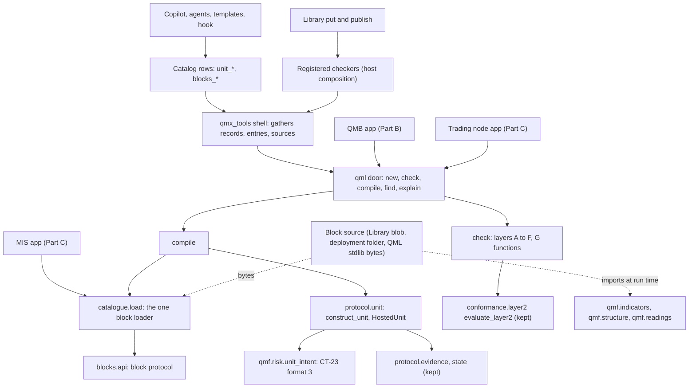

# Architecture Spine: QML, the dictionary, the unit template and its checker

Code truth: `origin/engine/base` at `c93407ca`, read at `D:\QMX-worktrees\engine-base-read\` (paths below are relative to it). Parent: the Level 0 spine, binding and read-only; its decisions are cited as L0 AD-n. This part's own decisions are AD-101 to AD-120. Words: `funnel/versions/GLOSSARY.md`. Labels: CHECKED means read at the cited line or run (script named, in `blast-radius.md`); INFERRED means judgement.

## In plain words

1. A unit is a trading plan with named parts. Each part is a tested piece of code from QMX's catalogue. QML puts the pieces together, checks them and turns the plan into the code QMB and the trading node already run.
2. Every number in a unit says what it measures and how it may move: never, every bar with the market, or slowly from the unit's own trades inside a range he approved. Every slow move leaves a receipt. The rules themselves change only as a new version he approves.
3. Scripts check a unit at every door: while an agent writes it, when it is saved, before it is published, before it is compiled, and on real recorded prices before QMB tests it or the node trades it. They report every problem at once and refuse only what is provably wrong.
4. The dictionary keeps all 239 old entries as pages QMX itself stores, adds every market class now, and grows through the same checked door the agents use.
5. Exits and sizing are clearly labelled stand-ins until the risk session replaces them; nothing refuses a stand-in, and every trade shows the label.

## Design Paradigm

**Functional core, imperative shell.** QML is a pure Python library: it reads nothing, writes nothing and spawns nothing; hosts hand it bytes and records and drive the callbacks it returns. Its public door is five verbs; the depth sits behind them. Content (units, entries, block source, templates) is Library data. One loader turns block source into callables. Every check is a pure function run at the door the artifact must pass.

| Layer | What lives there | Where (EXISTS path or NEW) |
| --- | --- | --- |
| Door | `new`, `check`, `compile`, `find`, `explain` | `qml/src/qml/door.py` (NEW), re-exported by `qml/__init__.py` |
| Kernel modules | the unit model and schema; numbers, measures and motion; the compiler; the unit runtime door; the block loader and block API; the checker; identity and lifecycle | `qml/src/qml/unit/`, `numbers/`, `compile/`, `protocol/unit.py`, `catalogue/`, `blocks/`, `check/`, `identity/`, `lifecycle/` (all NEW) beside the kept `protocol/`, `footprint/`, `conformance/`, `declaration/`, `logic/` (EXISTS) |
| Contract family | CT-23 format 3, the unit's sized intent | `packages/qmf-risk/src/qmf/risk/unit_intent.py` (NEW; `door.py` untouched) |
| Store | the `unit` kind's real shape, the `component` kind's entry face, kind-file checks, every problem returned | `qmx-agents/packages/qmx-library/src/qmx_library/kinds/` (EXISTS, additions) |
| Shell for agents | catalog rows in two new core toolsets, the check entry point, skills, the hook after its probe | `qmx-control/.../catalog.py`, `qmx-tools/.../functions.py` and `unit_check.py`, `qma-harness/.../tools.py:668`, `qmx-agents/plugin/` (EXISTS, additions) |
| Content | QML's own blocks, ported and new dictionary entries, the dummy unit and its broken twins | `qml/src/qml/blocks/stdlib/` source files read as bytes by hosts; Library items |

## Inherited Invariants

| Inherited | From | Binds here |
| --- | --- | --- |
| L0 AD-2 units stand alone; QML-22 | Level 0 | the compiler refuses non-local rule inputs and any read of another unit's output (AD-104, AD-105) |
| L0 AD-5 same code in research and live | Level 0 | one compiled closure, one motion engine, one block code in QMB and the node; hosts own clock, data and fills (AD-106, AD-107) |
| L0 AD-7 immutable records, pinned versions | Level 0 | units pin blocks and entries as `id@version` with fingerprints; a fix is a successor (AD-109, AD-114) |
| L0 AD-9 typed market facts and units of measure | Level 0 | every number carries a measure; conversions only through an instrument record (AD-103) |
| L0 AD-11 deterministic checks at the door | Level 0 | every problem at once, proven violations refuse, heuristics warn, corpus CI gate (AD-110) |
| L0 AD-14 named settings, no invented caps | Level 0 | every threshold here is a named setting with a starting default (`CONTRACTS.md` §9) |
| L0 AD-15 placeholders are labelled blocks | Level 0 | placeholder blocks carry `origin: placeholder`; nothing refuses them (AD-116) |
| L0 AD-16 QML is the one unit library; five verbs | Level 0 | AD-101, AD-106 (refined, see Conflicts row 4) |
| L0 AD-17 one checker reached four ways; layer G two halves | Level 0 | AD-110, AD-111 (door table refined, see Conflicts row 1) |
| L0 AD-18 a unit's size travels as CT-23 format 3 | Level 0 | AD-108 |
| L0 AD-19 the dictionary is the extended `component` kind | Level 0 | AD-113 (premise corrected, see Conflicts row 2) |
| L0 AD-20 old law lifted for units, subtracted from the surface | Level 0 | AD-120 (refined, see Conflicts row 3) |
| L0 AD-21 one home of record: the governed `unit` kind, `qmx.unit/1` | Level 0 | AD-102, AD-112 |
| L0 AD-22 three kinds of number and how they move | Level 0 | AD-103 |
| L0 AD-23 one identity table, one lifecycle machine | Level 0 | AD-115 |
| L0 AD-24 the risk socket | Level 0 | AD-116 |
| L0 AD-29 the Library changes only by addition | Level 0 | AD-112 |
| L0 AD-30 new shapes ride doors that exist | Level 0 | rows, kinds and the unit door; no new service (AD-117) |
| L0 AD-31 the copilot and agents by registration only | Level 0 | AD-117 |
| L0 AD-47 one block loader; Part A designs it | Level 0 | AD-109 |
| Library AD-1, AD-3, AD-5, AD-6 | library-and-data spine | the Library imports no QML; checkers are registered by the host; one writer; archive, never delete |
| engine AD-61 one operation catalog | workflow-engine spine | every unit door is a catalog row |

## Conflicts with Level 0, surfaced

None is overridden here; each states the code fact, how this part keeps the Level 0 rule's purpose, and the wording the lead may fold in.

| # | Level 0 text | Code fact (CHECKED) | How this part honours it |
| --- | --- | --- | --- |
| 1 | AD-17 door table: "the Library save of a `unit` runs A to F" | `qmx-library/tests/test_view.py:110-128` saves a schema-minimal item of every live kind, the unit kind included; a save-time deep check refuses it (run, `blast-radius.md` BR-A1) | the save (`put`) runs layer A, the shape, every problem; publish (his yes on a draft) runs A to F; `compile` runs A to F itself and refuses, so nothing unchecked can run, be tested or be published (AD-111) |
| 2 | AD-19 and funnel LC-07: the `component` kind "has no writer" | mini apps land `provides` schemas as `component` items (`qmx_control/library.py:312-330`, `migrate/from_apps.py:66-70`) and migrated CT-34 confluences map to it (`migrate/from_registry.py:34`) | a component is a dictionary entry only when its fields carry `entry.schema = "qmx.entry/1"`; every other component item is left exactly as today (AD-113; run, BR-A1) |
| 3 | AD-20: "`STAGE0_NEVER_SIZES` and `refuse_invented_exits` become labels" | shipped tests pin both as refusals (`qml/tests/test_research_stage0.py:100`, `test_research_collapse.py:82`) | Stage 0 stays as built; the unit path never calls Stage 0; labels live on the unit document (`origin`); old-law names leave only the top-level `qml` surface (AD-120; run, BR-A3) |
| 4 | AD-16: compile's object "is accepted by `construct_bot` unchanged" | true for construction; but `HostedBot.on_instant` sends every intent through `accept_intents`, which refuses a format-3 intent (run, BR-A4); adding a QML protocol version 2 fails two shipped tests (run, BR-A6) | units are hosted through a new unit door (`construct_unit`); the compiled factory still satisfies `BotFactory`, so `construct_bot` on a unit fails closed at its first sized intent (AD-107) |
| 5 | AD-9: unit kinds "price distance, ticks, pips, ATR multiple, percent, bars, seconds, money, R" | QMF's `UnitKind` is a closed enum of ten members, "addable in a later spine amendment, never redefined" (`packages/qmf-core/src/qmf/core/exact.py:125-144`) | QML owns a richer measure vocabulary and maps each measure to a QMF `UnitKind` by one table; QMF is not amended (AD-103) |
| 6 | AD-31: rows "in a core toolset" | `qmx-tools/tests/test_tools.py:374-375` counts tools per stdio server (`research` 3); the harness keeps a second roster `DOMAIN_GROUPS` (`qma-harness/src/qma/harness/tools.py:668`) | two new core toolsets, `unit` and `blocks`; the harness derives `DOMAIN_GROUPS` from the catalog rows, one line, every shipped test result unchanged (AD-117; run, BR-A2) |

## Invariants & Rules



Arrows mean "may import or call". QML imports only `qmf-core`, `qmf-registry` and `qmf-risk` (its scaffold test pins this, `qml/tests/test_scaffold.py:67-70`); block source may import QMF packages because it is loaded at run time in a host that has them. The Library imports no QML: checkers reach it only by registration. Nothing in QML imports a host, an app, the Library or a venue.

### AD-101. One pure door with five verbs

- **Binds:** P1, every caller of QML
- **Prevents:** callers learning QML's 190 names; a verb that hides I/O; two ways to do one thing
- **Rule:** QML's door is `new(template, overrides)`, `check(document, context)`, `compile(document, context)`, `find(query, index)`, `explain(document, context)`, in `qml/src/qml/door.py`, each a pure function over data the host passes (`CheckContext`: the pinned entries and their source bytes, the instrument-record snapshot, the identity table, the settings). No verb reads a file, a clock, the network or the Library. Backtest is QMB's and promote is his click; neither is a verb. QML's dependencies, its no-console-script law and its banned imports stay as they are; entry points (`python -m qmx_tools.unit_check`) live in `qmx-tools`.

### AD-102. The unit document: one typed model, one generated schema

- **Binds:** P2, every author, the Library `unit` kind, QMB, the node, the UI
- **Prevents:** a JSON Schema and a Python model that drift; a shape check that blocks a draft for being unfinished; float drift in numbers
- **Rule:** the unit document `qmx.unit/1` is defined once, as QML's typed model (`qml/src/qml/unit/`). The JSON Schema 2020-12 in the Library's `unit.schema.json` is generated from that model and committed; a test fails when they differ. The schema holds shape only (types, required keys, enums); completeness (at least one market, a trigger, an exit set) is layer E and identity rules are layers B and C, so a half-written draft saves and lists its gaps. Numbers are decimal strings parsed to exact values. `markets` stays a top-level field, because the shipped page reads `fields.markets` (`qmx-library/src/qmx_library/kinds/unit.schema.json`, Markets tab). Every number is declared once under `numbers` and bound by name. A unit that trades both sides states each side's bindings, or an explicit `mirror_of` on blocks that declare mirroring (QML-17). A unit holds one position per instrument unless it declares more (UT-15). Field by field: `CONTRACTS.md` §1.

### AD-103. Numbers: three kinds, one measure each, two speeds of motion

- **Binds:** P1, P2, QMB's optimiser, the node, the risk session
- **Prevents:** a stop ten times too wide; live tuning that was never tested; motion on few trades; a slow rule creeping into fast numbers
- **Rule:** every number is a `NumberSpec`: kind (`fixed`, `calibrated`, `derived`), measure, range (min, max, step), default, motion, authority, origin, `applies_to_open_positions` (default false). The kind fixes the motion modes allowed: `fixed` never moves; `derived` moves every bar from the market (`scaled`, `percentile_of_own_history`, `state_table`); `calibrated` moves slowly from the unit's own record (`shrink_from_own_trades`, `learned`). Measures are QML's vocabulary (price distance, ticks, pips, ATR multiple, percent, ratio, bars, seconds, money, R, lots, count, probability, category, flag), each mapped to one QMF `UnitKind` by a table (`CONTRACTS.md` §2). A conversion between measures happens only through an instrument record; pips are an error unless the source states pips and the record defines a pip for that market. Calibrated motion is a pure function of the unit's closed-trade rows up to a watermark: a minimum count first, shrinkage toward the default by n/(n+k), at most one step per update, never outside the range, never while a position is open on that instrument, run at instants the cadence names. Every slow move is a calibration row in the unit's step output. The calibrator's sufficient statistics live in the unit's state, so a host feeds `own_journal` only the trades this hosted unit closed in its own run or deployment after its starting watermark: in QMB the run's trades, on the node the deployment's trades, starting from the calibrated state the deployment carries (L0 AD-38); replay and live therefore run one rule over the trades each one saw. Hosts can run a unit with motion off, so QMB reports both. Identity covers ranges and motion rules, never values.

### AD-104. Slots, roles and combiners: composition is data, conditions are code

- **Binds:** P1, P2, every block author
- **Prevents:** 154 free-text roles; a combiner whose tie or empty input means nothing; a live dependency between units; an exit and an entry racing on one instant
- **Rule:** a slot names a typed role from one closed-and-addable vocabulary (context, location, setup, trigger, confirmation, filter, veto, entry order, invalidation, regime detector, sizing modifier, arming, timeout, cooldown, re-entry; and the socket roles exit, sizer, halt). A slot binds blocks by pin plus number names plus input refs and joins them with one combiner from `all`, `any`, `k_of_n`, `weighted` (weights, open and close thresholds), `sequence` (within N bars), `veto`; every combiner's result is `signal` or `no_signal` with a reason, ties and absent inputs included, and its declaration states what absent inputs mean (QML-21). Leaf conditions are code inside blocks. On one instant the compiled unit runs exits before entries; opposite entries from one unit on one instant are both dropped with a decision row. Composition across units happens only at build time, by copying pinned bindings into one document; no read kind names another unit's output, so the compiler cannot express a live unit-to-unit read (QML-22).

### AD-105. Knowable times and local inputs

- **Binds:** P1, P2, QMB's fill model (Part B), the node runtime (Part C)
- **Prevents:** a confirmation filled at the trigger bar; a forming bar acted on; an hour's close read early; a unit that needs a remote part to trade
- **Rule:** a stream declares its input: `closed_bars` (the default), `quotes` or `ticks`; hosts hand only closed bars unless the stream declares otherwise (QML-19). A higher-timeframe bar is derived from its base stream and is knowable only at its close in the venue's day boundary from the instrument record's calendar (QML-20). Every entry intent carries `not_before`, the latest `knowable_at` of every sample its decision read; QMB fills at the first price after it and the node never sends before it (QML-18). Rule inputs are local to the trading machine: market streams, the unit's own position and own closed trades (host-injected read surfaces with `knowable_at`), calendars, instrument facts, pinned weights, and readings listed under `reads`, each with `stale_after` and a fallback (`compute_here`, `treat_as_absent`, `no_new_entries`). Readings a unit cannot compute itself (trained models) may not declare `compute_here`.

### AD-106. The compiler

- **Binds:** P1, QMB, the node, the MIS app's blocks
- **Prevents:** a hand-built factory per host; a generated Python file drifting from what ran; a recompile that silently differs
- **Rule:** `compile(document, context)` first runs `check` A to F and refuses a document with any error. It returns a `CompiledUnit`: a factory that satisfies the structural `BotFactory` seam, the `Footprint` it consumes (QL-4, so `derive_horizon` gives the warm-up), a parameter projection as QML `ParameterSpec`s (so QMB's optimiser reads it unchanged), the decision-trace schema, the block lock, and the compiled fingerprint: fp1 over the document's fingerprint, the block lock's fingerprint, QML's compiler format version and every compiler option that can change a decision (the port quantum); package SemVer never enters (DEC-0180), and options that cannot change a decision (the trace level) stay out. The closure is what runs; a generated Python rendering is a read-only view for diffs. A compiler change that alters behaviour bumps the compiler format version, which makes a new fingerprint, which a node refuses until QMB has tested it.

### AD-107. The unit door: hosting a compiled unit

- **Binds:** P1, QMB's runner (Part B), the node shell (Part C), checker layer G
- **Prevents:** a unit's size dropped by the Book door; a version change rewriting an open trade's exits; state from another version loaded silently; trading while cold
- **Rule:** hosts run units through `qml.protocol.unit`: `construct_unit(compiled, assignment, read_surfaces, scope_id, state_scope, state_bound, trace_level, motion)` and `restore_unit(snapshot, ...)` return a `HostedUnit`, whose `on_instant(instant)` returns a `UnitStep`: intents admitted by `accept_unit_intents` (CT-23 format 3 only), decision rows, calibration rows and state events. `construct_bot`, `HostedBot` and `accept_intents` stay unchanged and refuse a unit's sized intent. A hosted unit suppresses entries until every stream has its derived warm-up, and says so as a state event; exits still run. It emits exit intents only for positions its own compiled fingerprint opened, so a position belongs to the version that opened it until flat (UT-04). Its snapshot carries the compiled fingerprint and a state schema version; a mismatch on restore starts the unit from a declared cold state and returns a `cold_start` event with the reason, never a guess (UT-09). Decision rows are written for taken and skipped signals and near misses by default; every-bar rows only at `trace_level = every_bar`. Every row id is fp1 over the host's scope id (the QMB run id, or the node's deployment id), the instant and the row's ordinal, so a rerun writes the same ids and two deployments of one unit never collide.

### AD-108. CT-23 format 3: the unit's sized intent

- **Binds:** P1, `packages/qmf-risk`, QMB, the node, journals
- **Prevents:** a size travelling as an extra key and being dropped; the Book path changing; an exit kind no host can execute
- **Rule:** format 3 is a new family in `qmf.risk.unit_intent`, beside `door.py`, which is not edited; the Book door keeps refusing format 3 and the unit door accepts only format 3. A `UnitEntryIntent` carries the unit's pins, instrument and market id, direction, reason code, execution target, order (type and prices), quantity in lots with the sizer's receipt, protection (a stop price, or `none_declared`, which marks R undefined), targets, `not_before`, the placeholder labels of every block that shaped it, and the decision row id. A `UnitExitIntent` is `close_full`, `close_partial` (quantity) or `amend_protection`; by default an amendment may tighten a stop and never widen it, a law the risk session may change. Intent identities carry `intent_family` and `kind`, so the kept Layer 2 harness reads them. Field by field: `CONTRACTS.md` §4.

### AD-109. The one block loader

- **Binds:** P1, QMB's sandbox, the trading node, the MIS app, checker layer F
- **Prevents:** two paths for block code; a fingerprint that differs by line endings; agent code loading itself; a block whose state grows with history
- **Rule:** `qml.catalogue.load(lock, sources, weights)` is the only code that turns block source into callables. For each pin in the lock it requires the source bytes, normalises line endings to LF, computes the block fingerprint (fp1 over the path `block.py` and the normalised UTF-8 text), compares it with the pin, compiles the text under the name `qmlblock:<entry>@<version>` into a fresh module namespace, and requires the module to export `BLOCK`, an object meeting the block protocol of `qml.blocks.api`. It returns every problem at once (`block_missing`, `block_fingerprint_mismatch`, `block_compile_error`, `block_protocol`, `weights_missing`, `weights_fingerprint_mismatch`), never the first only. Hosts read bytes: QMB from Library blobs, the node and the MIS app from the deployment's block folder (`CONTRACTS.md` §6), and QML's own blocks from QML's package files read by the host; QML reads none of them itself. Block outputs crossing a slot port are exact values quantised to a named port quantum; a block may compute in floats inside. A block's state is bounded by its declared bound whatever the history length (QML-04). A learned block's weights arrive as a pinned file through the loader with their fingerprint (QML-13).

### AD-110. The checker: every problem, proven violations only

- **Binds:** P1, P2, every door in AD-111
- **Prevents:** an agent checking its own work; a false positive that trains agents to route around checks; a spilled answer hiding the failing problem; a loop that never ends
- **Rule:** `check` runs layers in order and returns every problem of every layer that can run: A shape, B references, C numbers and measures, D data levels and calendars against the instrument records, E completeness (placeholders warn), F code safety (the kept scan; for blocks whose origin is an agent, `importlib`, `__import__`, `eval`, `exec` and unseeded random are errors; for human plain Python they warn; numeric literals compared inside block logic warn, QML-16). Layer G is two functions for QMB's sandbox: the safety half feeds the unchanged `evaluate_layer2`, and the behaviour report (trades or the declared "may not trade on this slice", each exit fired or unfired, a constant signal, one side only, a shuffled-day control whose decisions match the real ones) is warnings only. Errors are only facts decidable from the document, the entries and the records. The result leads with counts and errors, groups identical problems with all their pointers, and carries the checker version, the entry and record snapshot ids and a problem-set fingerprint; the same problem set twice running is reported as `no_progress` (AG-11, AG-15). A CI gate runs the checker over a known-good corpus (every template, example and admitted unit, every QML block and ported entry) and fails the build on any error there. A disputed error is a checker bug: its document joins the corpus and the build stays red until the checker is fixed. Shape: `CONTRACTS.md` §3.

### AD-111. Which door runs which layers

- **Binds:** P1, P8, P11, P12, the Library, templates
- **Prevents:** a path that skips the check; a slow check inside an 8 s hook; a node trading a fingerprint nobody tested
- **Rule:**

| Door | Layers | Notes |
| --- | --- | --- |
| `unit_check` row, the template unit-check step, the hook after its probe | A to F | pure, milliseconds to a few seconds; the hook's timeout is a setting (8 s) |
| Library `put` of a `unit` | A (the kind's generated JSON Schema), every problem | keeps `test_view.py` green; a draft may be unfinished |
| Library publish of a `unit` (his yes on a draft) | A to F | refuses with every problem |
| Library `put` of a `component` whose fields carry `entry.schema = "qmx.entry/1"` | the entry checker (AD-113) | other component items are not checked as entries |
| `compile` | A to F | refuses; so QMB, the node and the MIS can never run an unchecked document |
| QMB run | needs a G record for the exact compiled fingerprint; QMB runs G in its sandbox when none exists | Part B runs it |
| node deploy | needs a passing G safety verdict and its report for the exact compiled fingerprint; refuses otherwise | Part C enforces it |

G's result lands as a `test-report` record (an existing kind, extended additively) through the core landing, linked `tests` to the unit version and keyed by the compiled fingerprint, so QMB and the node find it by that key (`CONTRACTS.md` §3.3).

### AD-112. The Library additions

- **Binds:** P6, the `unit`, `component` and `test-report` kinds, the host composition root
- **Prevents:** the Library importing QML; a check that silently does not run; shipped refusal text changing; a kind meaning two things without a marker
- **Rule:** additions only (L0 AD-29). (1) The kind check returns every problem (message and JSON pointer) on the refusal, and keeps the first problem's message as the refusal text, so the 28 shipped test lines comparing text stay green. (2) A kind file may list `checks`, each naming a checker, the event it runs on (`put` or `publish`) and an optional `applies_when` (a JSON pointer and a value); the host registers checker functions by name at composition; a check that applies with no registered checker refuses `checker_unavailable`, so a missing checker never passes silently. (3) The `unit` kind moves to `schema_version` 2 with the generated shape and a publish check `qml.unit/1`. (4) The `component` kind gains the new `component_type` values, the optional `entry` object, the `status` annotation and a put check `qml.entry/1` applying when `/entry/schema` is `qmx.entry/1`. (5) `test-report` gains optional fields for check results. Proven by running the Library's 101 tests and the control package's tests on a patched copy (BR-A1).

### AD-113. The dictionary entry `qmx.entry/1`

- **Binds:** P1, every block, the MIS reading cards, the checker's layers B and D, Part C's instrument records
- **Prevents:** agents citing words with no meaning; a word meaning two things across classes; a status typed by hand; a proxy passing as the real thing
- **Rule:** an entry is one `component` item with three faces: trader (definition, boundaries, recognition, eligible roles from AD-104's vocabulary, a meaning per market class, sources with exact quotes and dates), machine (inputs with their data level and fallback chain with expected loss, output type and measure, parameters as `NumberSpec`s with origin labels, warm-up rule, confirmation lag, minimum sample, expected lag, transfer status per class, mirroring) and implementation (code blob, golden values with their reference, the no-future test, the warm-up test, the recursive-settle length). Aliases are unique across the catalogue; a word whose meaning changes by class has one entry with a meaning table, and becomes two entries linked `same-word-as` only when the code differs. Status (`named`, `specified`, `implemented`, `tested on data`, `used in a unit`) is computed by a script from evidence and written as an annotation, never typed. Evaluation words (Sharpe, PBO, walk-forward) live in a judging glossary, not here. The data-level vocabulary (levels 0 to 6 with the volume, depth and derivatives-clock splits and the licence) is owned here and used by Part C's instrument records, so layer D compares one vocabulary. A reading is an entry with `component_type: reading` and a reading card (`CONTRACTS.md` §5.3).

### AD-114. The dictionary's port, first wave and growth

- **Binds:** P1, the build plan, Part B's dictionary-expansion and librarian templates
- **Prevents:** an entry lost or left in an old folder; expansion capped or guessed; a block fix changing live units
- **Rule:** a port script reads the four Stats files through QML's parser (it reads all 239 today, G1 §2.2), maps the twelve fields onto the three faces, maps the 154 role strings through a table (unmapped strings logged for review, never guessed), rewrites "crypto spot only" market lines as per-class transfer status (`not_assessed` where no evidence exists), keeps the nine slug collisions as separate entries, and lands every entry as a draft in one collection; a count check proves 239 in and 239 out. A frozen copy of the four source files and their fingerprints goes into the repo as the port's input. The first content wave is a build packet with a grounding brief and no cap: every concept in research 45 and the census gaps, futures entries as `specified`, implementations with golden tests for everything computable from bars and quotes. Later growth uses the same door: the `blocks_*` rows, the entry checker and the `build-unit` skill, inside Part B's dictionary-expansion template. A block fix is a new entry version; a script lists the units that pin the old one and makes successor drafts with re-tests queued; live units keep their pins until he promotes.

### AD-115. One identity table, one lifecycle machine

- **Binds:** P2, the judge and the Lab (they read the same table), the node, QMB
- **Prevents:** two tables deciding "is this a new unit"; two versions trading one market; an agent moving a unit toward live
- **Rule:** the identity table is a core setting, `units.identity_table`, shipped with a default (Lab AD-16's rows plus the unit edit labels, `CONTRACTS.md` §7) and handed to QML as data. `qml.identity.classify(old, new, table)` diffs two documents structurally into edit labels and returns, per label, calibration row, new version or new unit, whether it is a counted try and whether his click is needed before live; the judge and the Lab call this function rather than diffing documents themselves. The lifecycle is a pure machine in `qml.lifecycle`: a state per unit per market (draft, tested, parked, paper, live, stopped, retired), a transition table naming who may cause each move (the judge's verdict, his click, the unit's own risk rule), and `fold(events)` giving the current states. Only his click moves toward live; tested to paper is his click by default, with an automatic switch that ships off (R0-14); only a risk rule moves to stopped; stopped to anything is his click, and that click names the stop event it clears, so a stop that arrives later from another machine is never cleared by an earlier click whatever the two clocks say. One admitted version per unit and market: admitting a new version on a market retires or parks the old one there in the same click. Events ride Part B's journal as their own kind; this part owns their body (`CONTRACTS.md` §8).

### AD-116. The risk socket's slot contracts

- **Binds:** P2, the risk session, QMB, the node
- **Prevents:** the risk session's design forcing a rework; a placeholder reaching money unseen; a socket that presumes where risk lives
- **Rule:** the socket is four typed slot contracts: exit blocks (position, unit and account scope), one sizer, halts (position, unit and account scope), and the cross-unit hook the host calls before every order. Each slot's inputs are local (entry and stop prices, instrument facts, account facts, the unit's own record in R, market statistics, his limits) plus the optional read surfaces of AD-105, each with its fallback (L0 AD-24). Placeholder blocks are ordinary blocks whose entry says `origin: placeholder` and names the risk session as owner; the unit card, the promotion card and every trade's intent carry their labels; the rip-out list is a query over units pinning placeholder blocks; nothing refuses them. Contracts: `CONTRACTS.md` §4.3; places and today's stand-ins: `RISK-SIZING-POINTS.md`.

### AD-117. The authoring doors for agents and the copilot

- **Binds:** P8, the core plugin, the catalog, the harness
- **Prevents:** a unit tool the copilot cannot see; a hook as the only check; the unit path writing old kinds
- **Rule:** the doors are catalog rows in two new core toolsets: `unit_new`, `unit_check`, `unit_explain` and `blocks_find`, `blocks_get`, `blocks_check`, `blocks_match`; saving goes through the existing `library_save` row and the Library's checks. The harness derives its in-process domain groups from the catalog rows instead of keeping a second list (`qma-harness/src/qma/harness/tools.py:668`, reason: two rosters must agree, BR-A2). The functions live in `qmx_tools`, gather the pinned entries, source bytes and record snapshot from the Library, and call the QML door. The `build-unit` skill says when to call each row, to start from a template, to find blocks before writing one, to loop until the result is empty and to stop on `no_progress`. A PostToolUse hook in the core plugin, matched on the Library save tool and on unit file writes, runs `python -m qmx_tools.unit_check` after its probe passes (C4 gap); until then the rows, the template step, publish and compile cover every path. A test pins that every agent-visible core row is on the default copilot surface; a test pins that the unit path writes no `bot` or `strategy` item (QML-24). A plain-Python unit is the same document in manifest form: one block holds its whole logic; the same journal, lineage and tries apply.

### AD-118. Templates and the dummy unit

- **Binds:** P2, QMB's conformance pack (Part B), the node's self-test (Part C), the newcomer's first unit
- **Prevents:** a proof on a throwaway; a template that only shows the happy path
- **Rule:** a template is a unit document with defaults and origins. The first is the dummy: a trend pullback on EURUSD and XAUUSD, M15, built only from blocks that wrap code QMX already runs (EMA, ROC, RSI, swing points), with one derived number (`rsi_low`, the 20th percentile of RSI's last 500 bars) and one calibrated number (`min_trend_strength`, moved nightly or every 20 closed trades by a shrunk rule from its own trades), and placeholder exits and sizer (`2-unit-template-numbers-lifecycle.md` §6). Its three broken twins (always long, an exit that cannot fire, a constant signal) and three broken documents (a stop in pips on gold with no pip defined, a depth block on a bars-only market with no fallback, a number outside its range) ship as test fixtures. The dummy installs out of the box.

### AD-119. Versions, environment and upgrades

- **Binds:** P1, P2, every app bundle that hosts QML
- **Prevents:** a wrong interpreter failing silently; a stored unit no longer loading; a checker change flipping a live unit unseen
- **Rule:** QML exposes `environment_check()`, which names a wrong Python (QML needs 3.14.x) or a wrong TA-Lib build in plain words; the `unit_check` row and every app's self-test call it (QML-25). The unit document, the entry, the check result and the step output each carry a schema version; each new version ships an upgrader from the previous one and a test that loads every older shape (UT-19). Every check result records the checker version; a checker upgrade re-checks stored units by script and marks older verdicts as superseded; a live unit that fails a newer checker raises a card for him and keeps trading the version it was deployed with (UT-03).

### AD-120. Subtract first

- **Binds:** P1, the first build slice
- **Prevents:** a builder taking an old refusal as current law
- **Rule:** the 23 old-law names (refusal functions, `GAP_*` and `*_EPIC(S)` constants) leave the top-level `qml` surface and stay importable from their submodules; nothing imports them from the top level (BR-A3: 0 callers, 385 QML tests pass). Stage 0, `promote_tuned_assignment`, the Book door and `HostedBot` stay as built; the unit path uses none of them.

## The cases this part owns

Every case Level 0 gives P1 and P2 (47), plus AG-11 and AG-15 handed over from P8, plus QML-06's QML side (P4 owns the case). R1 checks this table by script; `scratchpad\l1a\coverage_a.py` already does: 0 missing.

| Case | Handling | Where |
| --- | --- | --- |
| QML-01 | every implemented block passes a cut-against-full test (value at t from data cut at t equals the value on full data, tolerance a setting) before its status can be `implemented` | AD-113, 4-dictionary §3 |
| QML-02 | the entry declares its confirmation lag; the cut-against-full test catches a missing one | AD-113 |
| QML-03 | the recursive-settle check runs each recursive block with several warm-up lengths and records the length where values agree; the block's warm-up is at least that | AD-113, AD-109 |
| QML-04 | block state is bounded by its declared bound whatever the history; a test replays a week of ticks and asserts the retained observations never exceed the bound, and records time per update | AD-109 |
| QML-05 | every number has a measure; a price distance converts only through the instrument record; pips error unless source-stated and defined; one unit run on EURUSD, USDJPY, XAUUSD and an index compares distances in ATR | AD-103 |
| QML-06 | (owned by P4, Part C; the QML side here) conversions read the market's own instrument record (contract size, digits, value per point), so the same unit on two brokers gives the same risk in R | AD-103, CONTRACTS §2 |
| QML-07 | roles are one typed vocabulary; the checker refuses an unknown role and names the nearest; the port maps the 154 strings by table | AD-104, AD-114 |
| QML-08 | a slot may bind only a block with code; citing a `named` or `specified` entry is an error that points at the block template; a plain-Python block tagged "outside QML" is allowed with a warning | AD-110, AD-113 |
| QML-09 | each block declares the data level it needs with the three splits; a real-volume block on a tick-count feed is refused unless declared a proxy | AD-113, AD-110 layer D |
| QML-10 | transfer status is data per class; layer D refuses a block on a class marked `not_transferable` and warns on `not_assessed` | AD-113 |
| QML-11 | units pin `entry@version`; an edit makes a successor and lists the units on the old one | AD-114 |
| QML-12 | a block fix is a new version; a script makes successor drafts of the units that use it and queues re-tests; live units keep their pins until he promotes | AD-114 |
| QML-13 | a learned block's weights arrive as a pinned file with a fingerprint through the loader; a retrain inside declared bounds is a calibration row; outside them a new version | AD-109, AD-115 |
| QML-14 | determinism runs twice on real recorded bars in layer G; unseeded random is an error for agent blocks | AD-110 |
| QML-15 | the scan is widened for agent blocks; the real wall is QMB's child process; the in-process isolation stamp is never proof | AD-110, AD-111 |
| QML-16 | numeric literals compared inside block logic are a warning, never a refusal | AD-110 |
| QML-17 | a both-sides unit states each side, or an explicit `mirror_of` on blocks that declare mirroring; an implicit mirror is refused | AD-102 |
| QML-18 | every entry intent carries `not_before`, the last input's knowable time; QMB and the node use it | AD-105, AD-108 |
| QML-19 | streams take closed bars unless they declare tick or quote input; the same in QMB and the node | AD-105 |
| QML-20 | higher-timeframe bars are knowable only at their close in the venue's day boundary from the record's calendar | AD-105 |
| QML-21 | every combiner returns `signal` or `no_signal` with a reason, ties and absent inputs included; a combiner without its absent-input rule is refused | AD-104 |
| QML-22 | no read kind can name another unit's output; composition is at build time into one document | AD-104 |
| QML-23 | old-law names leave the top-level surface; Stage 0 stays for research only; the unit path uses none | AD-120 |
| QML-24 | the unit's home of record is the Library `unit` item; any registry record is derived; a test pins that the unit path never writes `bot` or `strategy` | AD-117 |
| QML-25 | `environment_check()` names a wrong interpreter; each app bundle pins Python 3.14 | AD-119 |
| QML-26 | floats never cross a port: venue floats convert once at the venue boundary (Part C) and block outputs are quantised exact values | AD-109 |
| UT-01 | layer G's behaviour report beside the unchanged safety verdict; the dummy and its three broken twins pass the verdict and the report names each twin's fault | AD-110, AD-118 |
| UT-02 | errors only for proven violations, heuristics warn, each problem has a kind, a pointer, a message and a hint; a disputed error becomes a checker bug and a corpus document | AD-110 |
| UT-03 | every verdict records the checker version; an upgrade re-checks by script and marks old verdicts superseded; a live unit never flips silently | AD-119 |
| UT-04 | a position belongs to the version that opened it; a hosted unit manages exits only for its own positions | AD-107 |
| UT-05 | calibrated motion needs a minimum count, shrinks toward the default, moves one step at most, never leaves its range; each move is a calibration row | AD-103 |
| UT-06 | motion never leaves the tested range; which risk numbers may move is the risk session's | AD-103, RISK-SIZING-POINTS |
| UT-07 | placeholder labels ride the unit card, the promotion card and every intent and trade | AD-116, AD-108 |
| UT-08 | a unit with no price stop declares `none_declared`; R shows as undefined and results are flagged; the rule is the risk session's | AD-108, RISK-SIZING-POINTS |
| UT-09 | state carries the compiled fingerprint and a state schema version; a mismatch starts cold with a logged reason | AD-107 |
| UT-11 | the host records the warm-up source; QML's `seam_check` compares the last warm-up bar with the first live bar against a named setting and returns a flag the host journals | AD-107, CONTRACTS §4.5 |
| UT-12 | blocks declare data levels; placement on a market without them is refused unless a fallback or proxy is declared | AD-110 layer D |
| UT-13 | sessions name the market's zone and calendar; a market with no calendar is refused at layer D | AD-105, AD-110 |
| UT-15 | one position per instrument unless declared; the compiled unit suppresses entries at its limit | AD-102 |
| UT-16 | exits before entries on one instant; opposite entries are both dropped with a decision row | AD-104 |
| UT-17 | the type of edit decides, by one table, through `qml.identity.classify` | AD-115 |
| UT-18 | an empty exit set is an error; no time-bounded exit is a warning; an expiring contract with no exit before expiry or roll is an error | AD-110, 3-checker §2 |
| UT-19 | each schema version ships an upgrader and a test loading every older shape | AD-119 |
| UT-20 | a plain-Python unit runs through the same unit door: the callback shape, declared inputs, declared state | AD-117, AD-107 |
| UT-21 | layer E refuses a unit with no source on its claim card; "his own idea, dated" is a source kind | AD-110 |
| UT-23 | one admitted version per unit and market; admitting a new one retires or parks the old in the same click | AD-115 |
| OP-03 | the promotion card shows `qml.diff` of the documents and the pinned blocks against what is live (UI note) | AD-115, UI-NEEDS §4 |
| OP-05 | editing a number is a new version by the identity table, effective for new positions; open positions keep the version that opened them | AD-115, AD-107 |
| AG-11 | the result's problem-set fingerprint; the same set twice is `no_progress`, and the skill and the template loop stop and report | AD-110 |
| AG-15 | the result leads with counts and errors and groups identical problems, so a spilled answer's head shows the failures | AD-110 |

**Cases found by this part** (new to the catalogue; for R1's fold):

| Id | What happens | Handling |
| --- | --- | --- |
| A-NEW-1 | the same block source checked out with CRLF on Windows and LF on Linux gets two fingerprints (`qml/src/qml/logic/__init__.py:331-339` keeps bytes as given) | the loader fingerprints LF-normalised text (AD-109) |
| A-NEW-2 | the Library's write redaction rewrites a key-shaped literal inside block source, so the stored source differs from what was checked (BR-A5) | the entry checker refuses source the redaction would change; the loader fingerprints the bytes it receives |
| A-NEW-3 | a dictionary checker on the `component` kind refuses the mini apps' provides components | the `entry.schema` marker decides which components are entries (AD-112, AD-113) |
| A-NEW-4 | a save-time deep check of `unit` refuses the shipped every-kind view test | put checks shape; publish and compile check everything (AD-111) |
| A-NEW-5 | a new domain toolset is invisible to chats because the harness keeps its own list | the harness derives the list from the catalog (AD-117) |

## Handover items settled

| Source | Settled in |
| --- | --- |
| R0-03 behaviour report beside the verdict | AD-110, CONTRACTS §3.2, BUILD-SLICES A8 |
| R0-07 the one block loader | AD-109, CONTRACTS §6, 1-qml-door-compiler-runtime §5 |
| R0-12 the door table and where G is stored | AD-111 |
| R0-14 tested to paper is his click by default | AD-115 |
| R0-18 the identity table as a core setting handed to QML | AD-115, CONTRACTS §7 |
| R0-19 no unit-to-unit read; socket reads local plus optional surfaces | AD-104, AD-105, AD-116 |
| QML-04, QML-13, QML-17 to QML-22, QML-25, UT-01, UT-09, UT-11, OP-03, AG-11, AG-15 | the case table above |

## Consistency Conventions

| Concern | Convention |
| --- | --- |
| Names | the glossary's words; QML modules by domain (`unit`, `numbers`, `compile`, `catalogue`, `blocks`, `check`, `identity`, `lifecycle`), never by phase; catalog rows `unit_*` and `blocks_*`; block modules `qmlblock:<entry>@<version>`; entry ids lowercase kebab, family-scoped when slugs collide |
| Ids and pins | `entry_id@version` plus fingerprint in every lock; fingerprints `fp1:sha256:`; the compiled fingerprint is the unit's runtime identity; package SemVer never enters identity |
| Numbers | decimal strings in documents, exact values in code, a measure on every number, port outputs quantised to the port quantum |
| Times | evidence `knowable_at` in UTC nanoseconds; sessions in the market's zone from versioned calendars; cadences evaluated at instants, never from a wall clock |
| Problems | `kind`, `where` (JSON pointer), `message`, `hint`, `layer`, optional `nearest`; every problem returned; counts first |
| Errors at QML's edge | QML keeps its typed refusals inside; the door returns problems for checks and a `CompiledUnit` or the check result for compile |
| Schemas | JSON Schema 2020-12 with a `schema` marker and version; generated from QML's model; additive changes only; a breaking change is a new version plus an upgrader |
| Settings | every threshold is a named setting with a starting default and its origin (`CONTRACTS.md` §9) |
| Placeholders | `origin: placeholder` on the entry; labels on intents, trades, cards |
| Tests | every slice keeps the shipped tests green; the corpus gate; tests call the door and assert literal results |

## Stack

Pins the code owns; this part changes none. Read from the lockfiles at `c93407ca` (CHECKED by the Level 0 author, `level-0/ARCHITECTURE-SPINE.md` Stack); Python checked in this run's environment.

| Name | Version |
| --- | --- |
| Python (QML requires 3.14.x) | 3.14.6 |
| TA-Lib (C library and wrapper, the indicator reference) | 0.7.1 |
| jsonschema (Library side only; QML takes no new dependency) | 4.26.0 |
| claude-agent-sdk (hooks probe) | 0.2.166 |
| fastmcp (qmx-tools servers) | 4.0.11 |
| pyarrow (recorded slices for layer G) | 25.0.1 |

## Structural Seed

### Source tree (new and touched)

```text
qml/src/qml/
  door.py                    # the five verbs (NEW)
  unit/                      # model.py, parse.py (layer A), schema.py (generated JSON Schema), upgrade.py (NEW)
  numbers/                   # NumberSpec, measures and the UnitKind table, conversions (NEW)
  motion/                    # the motion engine and calibration rows (NEW)
  compile/                   # compiler, closure, trace schema, rendering (NEW)
  protocol/unit.py           # construct_unit, restore_unit, HostedUnit, accept_unit_intents (NEW)
  catalogue/                 # loader.py, entry.py (qmx.entry/1 model), index.py, status.py, roles.py (NEW)
  blocks/api.py              # the block protocol and helpers (NEW)
  blocks/stdlib/             # QML's own block sources, read as bytes by hosts (NEW)
  check/                     # layers A to F, G collector and behaviour report, result (NEW)
  identity/                  # classify and diff (NEW)
  lifecycle/                 # machine, transition table, fold (NEW)
  environment.py             # environment_check (NEW)
  __init__.py                # old-law names removed from the top level (touched)
packages/qmf-risk/src/qmf/risk/unit_intent.py   # CT-23 format 3 (NEW)
qmx-agents/packages/qmx-library/src/qmx_library/kinds/   # every problem, checks, unit v2, component entry face (touched)
qmx-agents/packages/qmx-control/src/qmx_control/catalog.py   # two toolsets, seven rows (touched)
qmx-agents/packages/qmx-tools/src/qmx_tools/    # functions.py rows, unit_check.py entry point, gather.py (touched, NEW)
qmx-agents/packages/qma-harness/src/qma/harness/tools.py   # DOMAIN_GROUPS derived (one line, touched)
qmx-agents/packages/qmx-host/                   # registers the two checkers at composition (touched)
qmx-agents/plugin/skills/build-unit/            # the skill (NEW); hooks/hooks.json after the probe (NEW, Should)
qml/catalogue-seed/stats-2026-08-26/            # frozen copy of the four dictionary files plus fingerprints (NEW)
tools/dictionary/                               # port, status, index, upgrade-pins scripts (NEW)
```

### Seams (`codebase-design`)

| Seam | Interface | Adapters | Real or hypothetical |
| --- | --- | --- | --- |
| The QML door | five pure verbs over data | the catalog rows, the Library checkers, QMB, the node, the MIS app, templates | one module, many callers; the callers are not adapters |
| `BotFactory` (structural, kept) | `construct(declaration, assignment, read_surfaces)` | compiled units, plain-Python units, bots | real (two hosts, CHECKED `blast-radius.md` L0 item 2) |
| The unit door | `construct_unit`, `restore_unit`, `HostedUnit.on_instant -> UnitStep` | QMB's runner, the node shell, layer G's collector | real: three callers, two worlds |
| The block protocol | `BLOCK.make(params, inputs) -> instance`; `instance.update(evidence) -> output`; `export_state`, `import_state` | every catalogue block, placeholder blocks, the risk session's blocks | real: many adapters |
| The loader | `load(lock, sources, weights) -> loaded or problems` | QMB's sandbox, the node, the MIS app, `compile` | one module, three callers |
| The checker | `check(document, context) -> CheckResult` | four door entry points | one function; the doors are not adapters |
| Read surfaces | `at(instant)` (kept `ReadSurface`) | market streams, `own_position`, `own_journal`, readings, weights | real |
| Library checks | a kind file's `checks` plus a registry | `qml.unit/1`, `qml.entry/1` | real: two checkers |
| The risk socket | four slot contracts | placeholder blocks; the risk session's blocks | real once the risk session lands; one adapter today, kept because the ruling asks for the connector |

### Where QML runs and how it ships

| Concern | Rule |
| --- | --- |
| Processes | QML runs in process in whatever hosts it: the host and its workflow script steps on This PC, QMB's app and its sandbox child, the trading node app and the MIS app on This PC and on servers |
| Operating systems | Windows natively on This PC, Linux on servers; nothing in QML is OS-specific; block fingerprints ignore line endings |
| Interpreter | Python 3.14.x in every app bundle; `environment_check()` names a wrong one |
| What a server needs | the app bundle (QML inside) and the deployment's block folder; never the Library or This PC (L0 AD-2) |
| CI | `just ci` on `windows-2025` and the Linux lanes; the corpus gate and the generated-schema test are part of it |
| Local first | every door works on This PC alone; servers only run deployed units |

### A unit from words to trades


## Capability → Architecture Map

| Ledger row | What it asks | Lives in | Governed by |
| --- | --- | --- | --- |
| Q-01, Q-02 | QML first, a library like React, nothing assumed | QML door and modules | AD-101 to AD-111 |
| Q-03, Q-07 | deep modules, JSON schemas, simple mental models | door, generated schema | AD-101, AD-102 |
| Q-04, CC-03 | not new; build on what exists | kept factory, footprint, conformance, scan | AD-106, AD-107, AD-110 |
| Q-05, Q-06, A-06, CC-10 | deterministic checks while agents write; hooks; no false positives | checker, rows, hook, corpus gate | AD-110, AD-111, AD-117 |
| Q-09, C-02 | how agents write units and know they are correct | the authoring doors | AD-117, 3-checker §5 |
| Q-10 | language not assumed | Python kept: the network is the floor (research 54 §2, research 31) | 1-qml §7 |
| Q-12, U-06 | how if-else rules tune themselves, shown concretely | numbers and motion; the dummy's two moving numbers | AD-103, AD-118 |
| Q-13 | hybrids | build-time composition | AD-104 |
| Q-15 | declared skeleton, coded blocks, compiled once | compiler | AD-104, AD-106 |
| D-01 to D-10 | the dictionary rebuilt in form, 239 kept, beyond FX, directions, no cap | entry form, port, wave, growth | AD-113, AD-114, 4-dictionary |
| U-01 to U-05, U-07 | a unit is one complete algorithm, a template, placeholders, the dummy | unit document, socket, dummy | AD-102, AD-116, AD-118 |
| U-09, U-11 to U-13 | one idea on 1m and 5m; market settings and market version | numbers per market, identity table | AD-103, AD-115 |
| U-15 | lineage to the source | claim card sources required | AD-110 layer E |
| U-16 | malleable, never a cage | open role vocabulary, plain-Python units | AD-104, AD-117 |
| CC-08 | plain Python always possible | plain-Python units, human Python warns only | AD-110, AD-117 |
| CC-07 | nothing capped | no cap on problems, blocks, entries or units | AD-110, AD-114 |
| CC-11 | only he promotes | lifecycle machine | AD-115 |
| CC-12 | units stand alone | local inputs only | AD-105 |
| R-01, R-04, U-04, C-06 | risk and exits a socket; placeholders | slot contracts | AD-116 |
| UI-01, R-02 | write the UI needs and the risk points down | `UI-NEEDS.md`, `RISK-SIZING-POINTS.md` | this folder |

## Deferred

| Item | Why it can wait | Who |
| --- | --- | --- |
| The QMB runner that drives `HostedUnit` on Library data, the `own_journal` feed in replay, results in R | QMB is Part B's; the unit door and step shapes are fixed here | Part B |
| The node shell hosting units, the deployment record, the warm-up source and `own_position` feed | the node is Part C's; the folder layout and door are fixed here | Part C |
| Instrument, venue and account record schemas and their refresh jobs | Part C owns them; the fields this part reads are listed in `CONTRACTS.md` §2.3 | Part C |
| The dictionary-expansion and librarian workflow templates | templates are Part B's; the doors and directions are fixed here | Part B |
| The journal kinds that carry decision, calibration, state and lifecycle rows | Part B owns the envelope and kinds; bodies are fixed here | Part B |
| Exit and sizing maths, halts' content, the cross-unit hook's content, which risk numbers move | the risk session | risk session |
| A compiled hot path for tick-speed units; exporting a unit to a cBot or EA for a cross-check | the network is the floor at 1-minute speed | parked |
| Units reading other units live | breaks standing alone; build-time composition instead | parked |
| The perps twin of the dummy | after the first slice runs (funnel LC-13) | build plan |
| Screens | proposals only (`UI-NEEDS.md`); no UI code (ruling 45) | the UI session |
