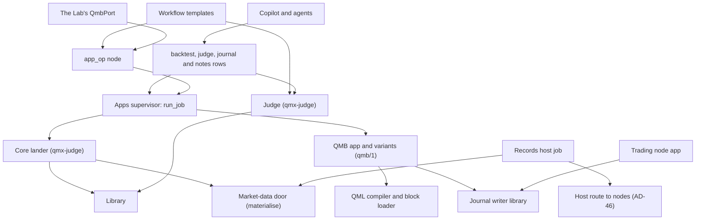
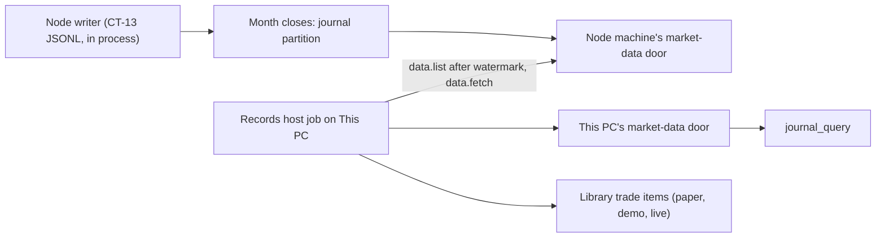

# Architecture Spine: part B, QMB, the judge, journals, the Library data and workflow templates

Code truth: `origin/engine/base` at `c93407ca`, read at `D:\QMX-worktrees\engine-base-read\`. Parent: `architecture/level-0/ARCHITECTURE-SPINE.md` (AD-1 to AD-47, binding and read-only). Connections master: `architecture/01-connections.md`. Words: `architecture/funnel/versions/GLOSSARY.md`. Part B's decisions are numbered AD-201 onward, so they never collide with Level 0's AD-1 to AD-47 or another part's ids. Each sub-area has its own file (companions above); this spine fixes only what two builders one level down could otherwise build incompatibly. Labels: CHECKED (read at `path:line`, or run, with the command named) and INFERRED.

**In plain words, for him.** QMB becomes an app inside QMX that agents and workflows ask to test a unit, and it answers with a result in money and in R. QMX itself, never QMB, counts every test and keeps the score, so a second QMB can be installed and compared without changing a verdict. Every unit keeps one journal across backtest, stress, paper and live, written by one writer per stream and brought home to his PC. The workflow templates do the slow analysis between sessions, read the journals and the MIS's published readings, and only ever propose.

## Design Paradigm

**Ports and adapters around a scoring core.** The core issues run ids, counts tries, lands results and judges them; QMB is an adapter behind one job contract (`qmb/1`), so any tester that honours the contract plugs in. Journals are **append-only typed event records** in one envelope, one writer per stream. Workflow templates are content on the existing engine (engine AD-1, AD-2).

| Layer | What lives there | Where (EXISTS path or NEW) |
| --- | --- | --- |
| Scoring core | run records, the lander, the try ledger, the judge, study specs, verdicts, baseline cards | `qmx-agents/packages/qmx-judge` (NEW); PR 204's `land` moved here from `qmb/src/qmb/host/library_landing.py` (EXISTS) |
| Tester adapters (mini apps) | QMB and any variant implementing `qmb/1` | `qmx-agents/apps/qmb/` (NEW app over the `qmb/` library, EXISTS) |
| Records | the journal envelope, kinds and writer library; partitions on the market-data store | `packages/qmf-data/src/qmf/data/` (EXISTS: CT-13 `journal.py`, `store/journal.py`, `series.py`; extended) |
| Library additions | new kinds and additive fields | `qmx-agents/packages/qmx-library/src/qmx_library/kinds/` (EXISTS, additions only) |
| Homecoming | the records host job beside backups | `qmx-agents/packages/qmx-host/src/qmx_host/records.py` (NEW, the `backups.py` pattern) |
| Content | workflow templates and their shared pieces | `qmx-agents/packages/qmx-engine/src/qmx_engine/templates/` (EXISTS, 45 templates) |
| Core fixes | jobs with inputs and results, a named lander on outputs; AGW; the `library` node kind | `qmx-apps` `supervisor.py`, `bootstrap.py`, `manifest.py`, `artifacts.py`; `qmx-engine` `nodes/app_op.py`, `policy.py`, `definition/registry.py` (EXISTS, surgical) |

## Inherited Invariants

| Inherited | From | Binds here |
| --- | --- | --- |
| AD-1 one way to add a thing; a QMB version is an app implementing the QMB contract that passes the conformance pack | Level 0 | AD-201, AD-206 |
| AD-2 units stand alone | Level 0 | nothing here is on a trading path; journals are written locally first (AD-209) |
| AD-5 same code in research and live; nightly replay of each live day | Level 0 | AD-205 (`replay_check`), AD-210 (the recorded feed comes home) |
| AD-6 versioned contracts with an overlap window | Level 0 | every shape in `CONTRACTS.md` |
| AD-7 immutable records, pinned versions | Level 0 | results pin card, tester, checker and judge versions (AD-204, AD-207) |
| AD-8 one owner per stream | Level 0 | AD-208, AD-209 (machine in the partition key) |
| AD-11 deterministic checks at the door | Level 0 | AD-207, AD-213 |
| AD-13 operations converge; ids everywhere | Level 0 | AD-202, AD-210 |
| AD-14 numbers are named settings | Level 0 | AD-216 |
| AD-15 placeholders labelled, never refused | Level 0 | results and trades carry the labels (AD-205) |
| AD-17 one checker; a QMB run needs a recorded G verdict | Level 0 | AD-202 step 2, `behaviour_check` job (AD-204) |
| AD-22 motion runs inside QMB's replay; on and off reported | Level 0 | AD-205 |
| AD-25 the referee stays home; one try row per run | Level 0 | AD-207 |
| AD-27 journals: one envelope, typed kinds, one writer; worlds `paper` and `demo` | Level 0 | AD-208, AD-209 |
| AD-28 results come home by pull | Level 0 | AD-210 |
| AD-29 the Library changes only by addition; `bot` and `strategy` stay | Level 0 | AD-212 |
| AD-30 new shapes ride doors that exist | Level 0 | no new internal service anywhere in this part |
| AD-31 agents in the slow lane only, notes and drafts only | Level 0 | AD-211, AD-213 |
| AD-32 workflows are content; the engine changes only with a core reason | Level 0 | AD-214 |
| AD-33 the mini-app core fixed only where it blocks | Level 0 | AD-203 |
| AD-34 QMB is a mini app with a contract; the core keeps the landing, run id, principal stamp and try ledger | Level 0 | AD-201 to AD-204 (two refinements surfaced under "Conflicts with the parent") |
| AD-35 inside QMB: the loop rebuilt, the measuring kept | Level 0 | AD-205 |
| AD-46 the PC reaches a node through one host-pass route | Level 0 | AD-210 (`data.list`, `data.fetch`), AD-215 (`apps.job`) |
| engine AD-1 pure orchestrator; AD-2 one definition format; AD-18 memory is a port; AD-60 agents work in their overlay; AD-63 context references; AD-64 ask or leave | workflow-engine spine | AD-213, AD-214, AD-203 |

## Invariants & Rules



Arrows mean "may import or call". QMB imports no core package, opens no Library and no market-data door, and issues no run id. The judge imports no QMB version. The apps supervisor imports nothing of the judge: the host injects the lander into it.

### AD-201. QMB is the first mini app: one app id per tester, runs as jobs

- **Binds:** P11, P10, the copilot's home preset, the Lab's `QmbPort`
- **Prevents:** two QMB variants that cannot run at once; a long backtest killed by the supervisor's 30 s call timeout (`qmx_apps/supervisor.py:957-963`, CHECKED); a variant that changes the score
- **Rule:** QMB ships as the first-party app `qmb` in `qmx-agents/apps/qmb/`, risk `runs`, kind `headless` until the UI session adds its screen folder (the manifest refuses `both` without a `ui` folder, `qmx_apps/manifest.py:309-310`, CHECKED). Its runs (`backtest`, `sweep`, `walk_forward`, `robustness`, `optimize`, `whatif`, `replay_check`, `behaviour_check`, `conformance`) are **job entrypoints**, because jobs wait as long as they run in the app's own queue (`supervisor.py:986-1043`, CHECKED). Its MCP server serves two quick operations, `capabilities` and `instruments` (`state = none`, `approval = read`). A new QMB **version** is the same app id with a higher version; a QMB **variant** that runs beside it is its own app id implementing `qmb/1` (the supervisor runs one instance per app id, `supervisor.py:570`, CHECKED). The default tester is the setting `[qmb] default_tester = "qmb@<version>"`.

### AD-202. One run path, whatever the door

- **Binds:** the `backtest` rows, `app_op`, AD-46 `apps.job`, the Lab's port, the QMB app, `qmx-judge`
- **Prevents:** a door that runs QMB without counting the try or landing through the one landing (QB-09); a killed run that leaves no trace (QB-20); an agent reading a result nobody judged
- **Rule:** every run follows five steps, and every door reaches step 1 only through the supervisor's `run_job`: (1) **open**: the core lander named by the tester's manifest validates the run request, checks the unit's recorded G verdict for its compiled fingerprint (AD-17; none recorded means a `behaviour_check` job runs first), mints the run id, appends the try row `opened`, and materialises the run's inputs into `data/runs/<run_id>/in/` of the app's volume (partitions through the market-data door with the study's holdout, the unit document, its pinned block sources, the instrument snapshots); (2) the job runs inside the QMB app and writes its bundle files to `data/runs/<run_id>/out/`; (3) the job **leaves** its result bundle under `provides.backtest-result`; (4) **close**: the host's Library sink hands that output to the lander, which verifies every file fingerprint, lands one `backtest-result` through PR 204's `land` (moved into `qmx-judge`), and appends the try row `landed`; (5) on a job error, an app stop or a kill, the supervisor calls the lander's `fail`, which lands the result with `status = failed` or `killed` and no measures. Open and close are idempotent by run id. The principal is the door's caller as the host names it (`agent:<session>` for any chat, the copilot included; `run:<run_id>` for a workflow; `user` for his click), never rewritten to `operator`; a study's "every admitted market" is resolved at open and pinned into the request and the try row. On host start the lander reconciles every ticket still `opened` against the tester's job queue: an answer waiting in the queue is closed, a request still queued is waited on again, anything else fails with the reason "host restarted".

### AD-203. Two fixes to the mini-app core, and no more

- **Binds:** `qmx_apps` (`supervisor.run_job`, `bootstrap.run_job`, `manifest.Contract`, `artifacts.ArtifactStore.save`), `qmx_engine/nodes/app_op.py`, the host's Library sink
- **Prevents:** workflows unable to tell a QMB job what to run (a job request today is `{"job": job}` only, `supervisor.py:1022`, and `run()` takes no argument, `bootstrap.py:195-205`, CHECKED); the one-landing rule holding for some doors only
- **Rule:** (1) a job request may carry `inputs`, a job's `run` may take one parameter, and the job's returned JSON comes back as `result`; a request without `inputs` is byte-identical to today's and a `run()` without a parameter runs unchanged; `app_op` passes `parameters.inputs` merged over its `in` port and calls the two-argument runner when there are none. Reason from the engine's own design: engine AD-64, "`feeds` (an input it accepts, wired by a trigger or a node input)". (2) a `[provides.<name>]` contract may name a registered core `lander`; install refuses an unknown lander name; the supervisor asks that lander to open before it queues any job of that app and to fail it when the job does not finish; the host's Library sink hands outputs under that contract to the lander instead of landing a plain `artifact`. Reason: engine AD-64, "*Leave* is landing an artifact under a declared output name". Breaker defaults, isolation, the money gate and the 30 s call timeout stay as built. CHECKED by running real code: `blast-radius` below.

### AD-204. The QMB contract `qmb/1`

- **Binds:** every tester app, the lander, the conformance pack
- **Prevents:** two testers reading a run request or writing a bundle differently; a tester that judges, counts or lands on its own
- **Rule:** a tester implements the run kinds of AD-201 as jobs over two schemas, `qmx.qmb.run-request/1` in and `qmx.qmb.result-bundle/1` out (field by field in `CONTRACTS.md`), and serves `capabilities` (contract version, run kinds, data levels, fill models, cost and carry adapters, instrument classes it can replay). A tester reads only its run's input folder and writes only its output folder; it never opens the Library or the market-data door, never mints a run id, never computes a verdict, and must echo the run id it was given. Its bundle carries money and R side by side, the run's unit journal (AD-208 kinds), its daily R stream, receipts, slices, the tester id and version, and the labels `zero_trades`, `costs_uncalibrated` and the placeholder blocks used.

### AD-205. Inside QMB: the replay rebuilt around the unit, the measuring kept

- **Binds:** `qmb/` (`host/replay.py`, `host/replay_execution.py`, `runloop/`, `execution/`, `results/`, `data/generate.py`), the QMB app's jobs
- **Prevents:** memory growing with the square of the steps (`replay.py:557-571`, CHECKED: every frame holds every sample so far); quotes as the only replayable data (`replay.py:608-626`); a fill at the stop price after a gap; results only in money
- **Rule:** the reader keeps a window of the unit's derived warm-up plus its declared lookback per stream, never the whole history, and has no step cap; it replays quotes, trades or bars as the data card declares, building bars from ticks in the venue's own day boundary (QB-21); execution inputs are data named in the run request (fill, cost, slippage, carry, margin adapters and the instrument records); the unit's risk socket replaces `BookAdmissionContext` for units (AD-24); a stop that a gap jumps fills at the first tradable price and the loss is recorded in R as it fell (QB-07, RS-13); sizes round down to the lot step and skip below the minimum with the residue journaled (QB-08); swaps, index financing, perps funding and index dividends are scheduled cash events at venue time (QB-04, LD-13); futures replay contract by contract with the roll as an event (QB-05); a data hole is an event the unit sees, never bridged (QB-18); motion runs as live with on and off both reported (AD-22); a rerun of the same fingerprinted request reproduces the same trade list (QB-14). The optimiser, robustness batteries, sweeps, synthetic series, exact money, ports and fingerprints are kept.

### AD-206. Conformance, versions and variants

- **Binds:** the core conformance runner in `qmx-judge`, the `[qmb] default_tester` setting, every tester app
- **Prevents:** a tester that quietly computes different numbers becoming the default (QB-13); a result read against the wrong tester (MA-07)
- **Rule:** the conformance pack is golden runs of Part A's dummy unit over a fixture dataset shipped with the pack (fixed data fingerprints, seed and cost profile) with their expected trade-list hashes, which pin the QML, checker and adapter versions they were made with and are regenerated only by the core's script, in the PR that changes one of those versions, never by a tester. The core runs the pack as `conformance` jobs against a tester app and version and lands a `test-report`. Setting `[qmb] default_tester` to a tester without a passing report for that exact version is refused with the report's diff. Every `backtest-result` records `tester = {app, version}`; the judge pools a family's results only within one tester version unless a passing parity report links the two versions.

### AD-207. The judge stays in the core

- **Binds:** P3, `qmx-judge`, the `judge` subworkflow, the `judge_run` row, the `try`, `study-spec`, `verdict`, `baseline-card`, `proposal-card` kinds
- **Prevents:** the score following the tester; the luckiest market reaching his card (QB-10); an agent's agreement standing in for proof (AG-06)
- **Rule:** the judge is pure functions over a study spec, landed results and try rows. A study spec is written before any run and is also the UI-editable run config; a quick run gets an implicit spec, marked `quick`. Every try is one append-only `try` item (a run, a spec edit after a result exists, a shortlisted market, a paper market picked by reading backtests, a what-if rerun); family counts and effective tries are computed at read by clustering daily R streams. The default chain runs cheapest first (claim card, signal against random entries, cost stress, walk-forward, try-corrected verdict); every market is judged by one rule, shrunk toward the unit's whole result by n/(n+k) with k's estimator fixed in the spec, correlated markets counted as one. Every check states what it can and cannot fail on (MIS-11). A zero-trade result is labelled and never a pass (QB-15). Verdicts record the judge, checker and tester versions (WF-12). Scripts decide; agents explain; he promotes.

### AD-208. One journal envelope, typed kinds, one writer per stream

- **Binds:** P5, every writer (QMB, the trading node, the feed keeper, the MIS app's reading history), `journal_query`
- **Prevents:** one thin row shape for everything (his 31 Oct ruling 14); a world mislabelled (JR-05); market facts copied into unit rows (JR-10); a decision whose inputs are lost (MIS-10)
- **Rule:** every record is `qmx.journal.envelope/1` (ids, writer and gapless sequence, venue, receive and write times, `clock_ok`, `backfilled`, world, unit and version, market id, account, platform, machine, run, trace id, build, links) around a kind body `qmx.journal.<stream>.<kind>/1`. Streams and kinds: unit journal (`signal`, `order`, `fill`, `trade`, `calibration`, `state`, `guard`, `risk_event`, `would_have`, `data_event`), market journal (`minute`, `offset`), node journal (`lifecycle`, `passport`, `reconcile`, `kill_level`, `clock_band`, `feed_health`, `disk_guard`, `gap`, `stand_down`, `spec_change`), reading history (body owned by Part C). World is one of `backtest`, `stress`, `paper`, `demo`, `live`, `shadow`, `synthetic`, stamped by the writer from the run (QMB) or from the account the venue reader proved plus the deployment's lane (the node, AD-27), never by the unit. Every `signal` row carries the value, source and version of every reading the unit computed or read. Skip reasons come from one closed, appendable list. A fill's record id is `<venue>:<deal id>`, so a replayed fill appends nothing and two venues never collide. R is computed by one function in the writer library from the entry's frozen initial risk (CT-29's risk face), used by QMB and the node alike (AD-5). One writer per partition: a stream may have several writers only for different kinds (the feed keeper writes `minute`, the daily data review writes `offset`). A kind is added, never redefined.

### AD-209. Where journals live: append in process, ship closed months

- **Binds:** `packages/qmf-data` (`store/journal.py`, `series.py`, `store/engines/typed.py`), the node app, QMB's bundle, the market-data door
- **Prevents:** the host as a step before a send (AD-12); two writers on one partition; a backtest's millions of rows becoming Library items
- **Rule:** the hot path is the built CT-13 `JournalStore` (one-writer JSONL streams per world, fsync, idempotent re-append, `qmf-data/src/qmf/data/store/journal.py:1-16`, CHECKED), in process wherever the writer runs. A closed month (its end plus a settlement setting, default one day) rolls into one journal partition in that machine's market-data store, committed through its door after the fact, at key `journal-<stream> / <subject> / <kind> / <world>.<machine> / <yyyy>-<mm>`, with columns `t` (the writer's monotonic epoch-millisecond stamp), `seq` and `record` (the canonical JSON of envelope and body). A row's partition month is the month of its `t`. The CT-13 store's own world rooms are `live`, `replay` and `simulated` (`qmf-core/src/qmf/core/fingerprint.py:412-424`, CHECKED): every hot-path stream (paper, demo, live, shadow) sits in the `live` room, and the envelope's `world` carries the finer world; backtest, stress and synthetic records never use the hot path (QMB's bundle mode writes them). The writer seals a closed month as a file in its own volume; the machine's host commits it through its own door (the records job's local half, AD-210), so an app never opens the door. This needs one text column type and one rule for `journal-*` sources in the typed store, and nothing else in it changes (CHECKED by running the `qmf-data` suite, `blast-radius` below). QMB writes the same kinds into its result bundle instead, so a run's journal is one Library record.

### AD-210. Records come home by a host job

- **Binds:** `qmx_host/records.py` (NEW), AD-46 `data.list` and `data.fetch`, the node app's `journal_tail`, the PC's market-data door, the Library `trade` kind
- **Prevents:** a node that needs the PC to trade; a week offline losing journals (JR-16); a fill replayed twice (JR-07); a second scheduler in the engine
- **Rule:** the job has two halves. Its local half runs on every machine, servers included: it commits each closed month that a writer sealed in an app's volume through that machine's own door. Its remote half runs on This PC only. QMX's upkeep job "Bring node records home" runs on This PC beside the backup rounds (the `qmx_host/backups.py` host-job pattern, listed on `GET /api/maintenance`, `qmx_host/maintenance.py:1-15`, CHECKED), on by default with its own off switch. Each round, per reachable node: `data.list(after = watermark)`, `data.fetch` each new closed partition, verify its fingerprint, commit it through This PC's door, then advance the watermark; the next `data.list` with that watermark is the node's proof of a verified copy, after which the node may delete those partitions past a retention setting. The live tail comes by `apps.ask journal_tail` and lands in This PC's own tail stream marked `backfilled = false`; closed months replace it. Every round lands one `maintenance-result`. The same job projects each closed paper, demo and live round trip into one Library `trade` item (identity by account, position id and world, so a re-projection lands nothing new).

### AD-211. Agents read journals through one door and write notes only

- **Binds:** P8 rows `journal_query`, `notes_write`; the `note` kind; templates
- **Prevents:** agents writing joins by hand; an agent's analysis read later as a record (JR-11); a number from training memory (AG-12); instructions smuggled in through a source (AG-07)
- **Rule:** `journal_query` takes a required time window and answers from closed partitions plus the tail, with a prebuilt trades-with-context view and a script-made daily digest per unit; a query past the data says where the data stops. Agents write only `note` items (extended additively: what the note is about, its kind, its receipts, its claim window, its marked sources, its expiry). Every number in an agent's output cites a tool receipt, checked by the receipts grader; outside sources enter an agent step as marked data, never as instructions.

### AD-212. The Library grows by addition only

- **Binds:** P6, `qmx_library/kinds/`
- **Prevents:** damage to the store everything rests on (ruling 51)
- **Rule:** new kinds `try`, `study-spec`, `verdict`, `baseline-card`, `proposal-card`, `death-certificate`, `forecast` (record class); additive fields, each kind's `schema_version` raised by one, on `backtest-result` (run fields, status, blob slots `trades`, `equity`, `journal/*`, `daily_r`, `slices`, `receipts`), `note`, `paper-run`, `trade` and `dataset` (`source_clock`, `seams`, `stitching`, `rolls`). Nothing on this part's paths writes `bot` or `strategy` (pinned by a test, R0-17). Kind page tabs are data in the kind file, so the screens this part proposes need no UI code.

### AD-213. Workflow templates: shared pieces once, honest needs, scripts decide

- **Binds:** P9, `qmx_engine/templates/`, the slow lane (STATE midday ruling 44)
- **Prevents:** copied gate scripts; caps disguised as defaults; templates waiting on a door that will never come; a forecast marked by the agent that made it (WF-11)
- **Rule:** the shared pieces are built once (the `judge` subworkflow, the conveyor, the lineage writer, the death certificate, the forecast ledger with its scoring script, the receipts grader, the data-quality check, the proposal card, the unit-check step, the calendar-open trigger check). The slow-lane families enhance shipped drafts by replacing each draft's one read script with `journal_query`, Library reads and the MIS's published readings (never the MIS model), and by setting `meta.needs` to what they truly wait for. Every gate is a script or a grader; agent and model steps produce data only (engine AD-1). Market-tied triggers run in the market's zone from its calendar, and the shared calendar piece is the only source of open, close and session times (no template hard-codes one); his routines run in This PC's zone. Loop counts and windows are editable numbers. Every proposal waits for his click.

### AD-214. The engine changes in exactly two places

- **Binds:** `qmx_engine/policy.py`, the harness `engine` policy and launch options, `qmx_engine/definition/registry.py`, `nodes/app_op.py`
- **Prevents:** engine changes with no reason from its design session (ruling 49); an agent step offered a shell it never declared
- **Rule:** (1) **AGW**, as engine AD-60 designed it: an agent step writes only inside its attempt overlay, keeps only its declared `outputs.files`, is offered exactly the built-ins it declares (CHECKED by running the harness's selection code, `blast-radius` below), and carries `Bash` and `PowerShell` in `disallowed_tools` unless declared; the packet reruns probe P-PERM on the real launch path before it ships. (2) The `library` node kind is marked unavailable, because `@run` and `@library` references in a workflow's inputs already pull a past run's output (engine AD-63, data round). The `app_op` inputs of AD-203 are the engine half of that mini-app fix, carried by engine AD-64. Nothing else in the engine changes; templates are content.

### AD-215. Where QMB runs, and who yields

- **Binds:** the QMB app's homes, AD-46 `apps.job`, a shared machine
- **Prevents:** a research run starving a live path (QB-17); a server-homed run that lands nowhere
- **Rule:** QMB's home is This PC by default; a server instance is capacity he adds. A job for a server-homed tester goes through `app_op`'s `remote` path and AD-46 `apps.job`, opens and lands with that server host's own lander on that server's run ref, and reaches This PC's `main` when This PC lands it, as every server-homed run does while This PC is primary (Library AD-14, AD-19 as amended by ruling 136). QMB's own logs stay as built (`logs/supervisor.jsonl`: jobs completed, errors, breaker trips), and each run emits OpenTelemetry spans (run id, kind, phase, progress, duration) through the one telemetry switch (Level 0 AD-42). QMB lowers its own process priority at start (below normal on Windows, `nice` 10 on Linux; setting `[qmb] process_priority`), which the app's Job object allows (`qmx_apps/windows_job.py:35-37` sets kill-on-close and memory only, CHECKED). Windows is first-class: nothing in this part needs Linux.

### AD-216. Every number is a named setting with a starting default

- **Binds:** all of part B
- **Prevents:** a hidden cap; a magic number in a template or the judge
- **Rule:** every threshold, window, cadence and preset value in this part is a setting with its default and origin, listed in the sub-area files (`qmb.md` §8, `judge.md` §6, `journals.md` §7, `workflows.md` §6). None is a cap: limits are the provider's or the machine's own.

## The sub-areas

| Sub-area | File | Verdict, with the reason | Exists | Added |
| --- | --- | --- | --- | --- |
| QMB | `qmb.md` | **mini app**: he must be able to build a new version, improve it or run variants (ruling 22) | `qmb/` (91,252 lines, G1 §4.1); PR 204 (open) | the app, jobs, the windowed reader, a runner that trades a unit, R, realism rules, conformance |
| The judge and try ledger | `judge.md` | **core**: a swapped tester must not change the score | gate scripts copied in `b` and `d3` (G2 §4) | `qmx-judge`, the kinds, the chain, presets |
| Journals | `journals.md` | **core**: one envelope every writer and reader shares | CT-13 events and store, CT-29, `trade` kind, fill partitions (G1 §7) | envelope, kinds, writer library, journal partitions, the records host job, `journal_query` |
| The Library's data | `library-data.md` | **core**: the centre (ruling 51) | kinds, landing, market-data door, dataset cards (G2 §3) | kinds and fields, data-card rules, stamp check, data-quality check |
| Workflow templates | `workflows.md` | **content on the core engine** | 45 templates, 22 runnable (G4b Q1) | shared pieces, slow-lane families, surgical fixes |
| Mini-app core and engine fixes | `mini-app-core.md` | **core, fixed only where it blocks** (rulings 46, 49, 53) | `qmx-apps`, `qmx-engine` | jobs with inputs and results, a named lander, AGW, `library` kind unavailable, examples in CI |

## Every catalogue case this part owns

Owned by Level 0's part sections P3, P5, P6, P9 and P11, plus the cases handed to B in `HANDOVER-TO-PARTS.md`. Each line says the handling; the file and section hold the detail and the check.

| Id | Handling | Where |
| --- | --- | --- |
| QB-01 | Windowed reader keeps warm-up plus declared lookback per stream; a test shows memory flat in run length | AD-205; `qmb.md` §4 |
| QB-02 | Replay reads quotes, trades or bars as the data card declares; trades and bars use a declared spread model and a lower-fidelity label | AD-205; `qmb.md` §4 |
| QB-03 | Costs per broker, account type, instrument and hour of week come from the market journal; a run without a calibrated profile is labelled `costs_uncalibrated` | AD-205; `qmb.md` §4; `journals.md` §3 |
| QB-04 | Swaps (triple day), index financing and perps funding are scheduled cash events at venue time from the instrument record | AD-205; `qmb.md` §4 |
| QB-05 | The data card records stitching and roll dates; QMB replays futures contract by contract and the roll is an event the unit sees | AD-205; `library-data.md` §3 |
| QB-07 | A gapped stop fills at the first tradable price; the loss is recorded in R as it fell | AD-205; `qmb.md` §4 |
| QB-08 | Sizes round down to the lot step, skip below the minimum, residue journaled in R; the rule is a slot setting for the risk session | AD-205; `RISK-SIZING-POINTS.md` |
| QB-09 | The judge refuses a result with no core run id; every run is opened by the core in the supervisor's job path; scripts that read prices directly produce no verdict | AD-202, AD-207 |
| QB-10 | Every market judged by one rule written first, shrunk toward the unit's whole result, every market a counted try, correlated markets one record | AD-207; `judge.md` §3 |
| QB-11 | The run request carries the model that built the unit and its training cutoff from the unit's lineage; the study offers a window after the cutoff | AD-204; `judge.md` §2 |
| QB-12 | `b-build-and-prove`'s family holdout and 60/20/20 split become study settings, off by default | AD-213; `workflows.md` §4 |
| QB-13 | Every result records its tester and version; the judge pools only within one tester version unless a parity report links them | AD-206 |
| QB-14 | A rerun of a fingerprinted request reproduces the trade list exactly; the conformance pack checks it on every tester | AD-205, AD-206 |
| QB-15 | A result with zero trades carries `zero_trades = true` and the judge never passes it | AD-204, AD-207 |
| QB-16 | The synthetic generator takes the instrument record's class (FX, metal, index CFD, crypto spot, perp, future) | AD-205; `qmb.md` §4 |
| QB-17 | QMB lowers its own process priority at start, so live paths win on a shared machine | AD-215 |
| QB-18 | A data preflight counts missing minutes against the instrument calendar; a hole past the setting refuses unless the study allows gaps; the unit sees a `data_event` gap, never a bridged bar | AD-205; `qmb.md` §4 |
| QB-19 | Every result carries R beside money: trades, expectancy, drawdown, MAE and MFE in R | AD-204 |
| QB-20 | A killed run lands as `status = killed`, never a partial result, through the lander's `fail` | AD-202 |
| QB-21 | Bars are built from ticks in the venue's own day boundary read from the instrument record | AD-205 |
| QB-22 | What-if views that can only worsen a result stay uncounted views; filters that can improve it are counted reruns with their own try rows | AD-207; `judge.md` §4 |
| QB-23 | The nightly `replay_check` job replays each live day from the quotes and bars the node recorded and pulled home, and compares decisions per unit | AD-205, AD-210; `workflows.md` §3 |
| QB-24 | QMB's image is immutable and hashed; results are written only into its run's output folder, verified by fingerprint and landed only by the core; agents have no write path into either | AD-202, AD-204 |
| MIS-10 | Every `signal` row carries value, source and version of every reading the unit computed or read, so the unit journal keeps what the unit computed while the MIS was down | AD-208 |
| MIS-11 | Each judge check and proof declares what it can and cannot fail on; the shuffled-readings proof is marked "cannot fail when the unit computes its own inputs" | AD-207; `judge.md` §3 |
| AG-06 | Verdicts come from scripts over results and try rows; agent votes or agreement are never an input | AD-207 |
| AG-07 | Outside sources enter agent steps as marked data blocks; numbers come only from tool receipts | AD-211; `workflows.md` §2 |
| AG-12 | Every number in an agent's output cites a tool receipt; the receipts grader recomputes where cheap and fails the step otherwise | AD-211, AD-213 |
| WF-01 | Each draft names the door it waits for in plain words; drafts this build frees get their real needs | AD-213 |
| WF-02 | Market-tied templates use the shared calendar-open trigger check, which reads each instrument's calendar; no forex rule holds crypto on Saturdays | AD-213; `workflows.md` §2 |
| WF-03 | One default zone setting for his routines; market-tied triggers state the market's zone | AD-213 |
| WF-04 | Reviews key on each market's session close from its calendar, or a named UTC hour (default 00:00) for 24/7 markets | AD-213 |
| WF-05 | Conveyor triggers filter out their own producer and dedupe by intent key (engine AD-64), so a landing never re-fires the template that made it | AD-213; `workflows.md` §2 |
| WF-06 | A PC-minted run pass at a server's door is Part C's recheck (connections X6); part B's templates run on This PC until it passes | consumed from C |
| WF-07 | Long work runs as a job or a script step with a handle; an agent's QMB wait is 240 s, below the prompt cache's five minutes, then it gets the run id | AD-201; `qmb.md` §8 |
| WF-08 | The `library` node kind is marked unavailable; validation refuses it with its reason | AD-214 |
| WF-09 | A template update publishes a new version; his edited copy stays as its own variant (`install.py:1-8`, CHECKED: idempotent by content hash) | AD-213 |
| WF-10 | Webhook signatures stay backlog: no template in this part uses a webhook trigger | `workflows.md` §5 |
| WF-11 | Calls are written as dated `forecast` items before the session and scored after it by a script against the market | AD-213; `judge.md` §5 |
| WF-12 | Verdicts record the judge version; a new judge version judges again beside the old verdict, never over it | AD-207 |
| WF-13 | A run whose home died is adopted once as built (HP ADOPT); the records host job and QMB runs converge by run id | as built; AD-202 |
| WF-14 | Missed runs catch up once or are marked skipped by the trigger's setting (HP BUG1, built); each slow-lane template states its choice | AD-213 |
| JR-01 | The partition key holds world and machine; a demo twin and the live copy never write one file | AD-209 |
| JR-02 | The writer library's append fails loudly on any write error; the node's journal-before-dispatch gate (kept, Part C) blocks the entry and lets stops through | AD-209; consumed by C |
| JR-03 | Journals never pass through the telemetry exporter and have their own disk floor; logs are rate-limited by Part C | AD-209 |
| JR-04 | Every decision is a `signal` row, taken, skipped with its reason or blocked by a guard; missed trades are computed later by replay | AD-208 |
| JR-05 | World is stamped by the writer from the run or the proved account and lane, never by the unit | AD-208 |
| JR-06 | Every row carries its world; figures are computed per world; back to paper is a `state` row | AD-208 |
| JR-07 | A fill's record id is the venue deal id; re-appending it changes nothing; a re-projected trade lands nothing new | AD-209, AD-210 |
| JR-08 | Rows carry `backfilled`; live statistics exclude backfilled rows unless asked | AD-208, AD-211 |
| JR-09 | Rows carry venue and receive time, `clock_ok` and the clock offset; merges across writers order by venue time where given and flag `clock_ok = false` rows | AD-208 |
| JR-10 | Market facts live once in the market journal; unit rows link to its minute | AD-208 |
| JR-11 | Agent analysis is a `note` item, a separate kind with receipts, never a journal row | AD-211 |
| JR-12 | Every record carries its kind's `schema_version`; old rows stay readable under theirs | AD-208 |
| JR-13 | Nothing is dropped silently: an append that cannot be written returns a refusal; a provider limit shows as an error | AD-209 |
| JR-14 | Every artifact a tool writes lands as a Library draft or published item: QMB's bundle through the lander, template outputs through the run's ref | AD-202, AD-213 |
| JR-15 | A trade without initial risk is flagged `r_missing` and never averaged in as zero R | AD-208; `journals.md` §3 |
| JR-16 | The node keeps every partition until This PC's watermark proves a verified copy; a week offline loses nothing | AD-210 |
| JR-17 | A failed effect is a row; the node's re-decision (Part C) is a new `signal` row linked to it | AD-208 |
| LD-01 | An empty open hour is a fetch failure until a retry and a second source agree; the data-quality check counts it against the calendar | AD-212; `library-data.md` §4 |
| LD-03 | A per-file timestamp-unit check at import (milliseconds, microseconds, nanoseconds by magnitude); a seam is written on the data card | AD-212 |
| LD-04 | Cadence seams are recorded on the card; any result crossing one names it | AD-212, AD-204 |
| LD-05 | A replaced upstream file is a new card version; results pin the version they read (built `replaced`, `corrections`) | as built; AD-204 |
| LD-06 | A run with missing data refuses at open, naming each missing month and the download template that fetches it | AD-202 |
| LD-07 | Trading machines read snapshots, never the Library (Part C's deployment, AD-38); this part only consumes | consumed from C |
| LD-08 | Every QMB read carries its run id and study; agent market reads carry the chat principal and an optional study, logged by the door | AD-202; `library-data.md` §4 |
| LD-09 | The disk guard stops tick recording first and journals last; a full disk stops recording loudly (Part C wires the recorder) | AD-209 |
| LD-10 | Licence stays on the card, never raised with him | as built |
| LD-11 | Journal hot paths append and never rename onto a file a backup reads; the price store's rename retry stays as the last guard | AD-209; `library-data.md` §4 |
| LD-12 | A cross-source offset check keyed by the market id lands `offset` rows in the market journal | AD-208; `library-data.md` §4 |
| LD-14 | Two agents editing one item: branch and merge as built (PR 195) | as built |
| LD-15 | One writer per database file as built; journals are JSONL streams and door-committed partitions | as built; AD-209 |
| LD-16 | Every data card states its source clock; conversion happens once at import | AD-212 |
| LD-17 | Saves are idempotent by intended object id (built outbox); open and close of a run are idempotent by run id | as built; AD-202 |
| RS-13 | A gap through the stop is recorded in R as it fell, never capped at 1R; the sizing answer is the risk session's | AD-205; `RISK-SIZING-POINTS.md` |
| MA-03 | The examples that import deleted code are fixed or removed, and every example and first-party app is built and tested in CI | AD-203; `mini-app-core.md` §4 |

**Taken on here because P8 and P10 have no Level 1 owner** (lead's call LC-B-19; the lead may move them):

| Id | Handling | Where |
| --- | --- | --- |
| MA-01 | A research app's breaker trip is a health stop of research; only the node sends orders | AD-201 |
| MA-04 | Provides contracts are versioned; a changed shape runs the built consumer check (engine AD-64) and keeps the old version for the overlap window | AD-203 |
| MA-06 | `app_op {app: qmb}` works once the QMB app is installed by the first-start click | AD-201 |
| MA-07 | `[qmb] default_tester` names the default; every result records the tester | AD-206 |
| MA-08 | A memory limit he set that kills a run lands `status = killed` with the limit in the reason | AD-202 |
| MA-09 | Reading another app's output is a Library read and works offline (built) | as built |
| MA-10 | Provides names are namespaced by app id; a variant's `backtest-result` is `qmb-<variant>/backtest-result` | AD-201 |
| AG-05 | Workflow agent steps author units as JSON output or a Library save and, after AGW, as files in their overlay; a script step checks them | AD-214 |
| AG-14 | When a model provider is down the slow lane fails and says so; nothing in the fast lane waits on an agent | AD-213 |

## The review findings handed to part B

| Finding | Settled |
| --- | --- |
| R0-01 | QMB's runs are jobs, which always run in the app instance's home (`Placements.state_of` answers `instance` for a job); a server-homed QMB is asked through `app_op`'s `remote` path and AD-46 `apps.job`, carrying the inputs and the caller's principal, and lands at that home (AD-215). Its two operations are `state = none`, `approval = read`. Jobs count as `domain_write` for AD-46's principal rule, so an agent may start a run; nothing in QMB is `manage`. |
| R0-06 | The writer library maps every stream onto the Library's existing partition key (`source / subject / kind / variant / year / month`, `qmf-data/src/qmf/data/series.py:188-203`, CHECKED) as AD-209 states, and commits only closed months through the machine's own door after the fact; the node's before-dispatch write stays its in-process append store. |
| R0-17 | `note` and `paper-run` are extended additively (AD-212); a test walks every write path of this part (the lander, the records job, `notes_write`, template saves) and asserts none writes `bot` or `strategy`. |
| R0-19 | Worlds `paper` and `demo` are both demo-account worlds, defined in the envelope's world list (AD-208): `paper` for a unit's paper lane, `demo` for other demo work. |

## Consistency Conventions

| Concern | Convention |
| --- | --- |
| Words | the glossary's; QMB's banned words stay out of `qmb/` source (`engine`, `kernel`, `exam`, `plugin`, `snapshot`, `qmb/tests/test_qmb_scaffold.py:33-47`) |
| Ids | run id `qmbr-<machine>-<ulid>` minted only by the lander; record id `<writer>/<seq>` per journal stream; fill record id `<venue>:<deal id>`; content fingerprints `fp1:sha256:...` |
| Times | UTC nanoseconds inside records; journal partitions' `t` is the writer's monotonic epoch milliseconds (the store reads `t` in milliseconds, `series.py:690-692`, CHECKED) |
| Numbers | exact types with a unit kind (AD-9); R beside money everywhere; settings named `[qmb]`, `[judge]`, `[journals]`, `[records]`, `[templates]` |
| Errors | refusals as the shipped shape `error: code, message`; checks return every problem (AD-11) |
| Records | envelope plus kind; append only; a kind added, never redefined |
| Versions | every shape carries `schema_version`; a kind file's `schema_version` rises by one with each additive change |
| Placeholders | every result and trade row lists the unit's placeholder blocks (AD-15) |
| Tests | every PR keeps the shipped tests green (`just ci` on Windows); a PR that frees a template updates the shipped tests that pin its old draft status, named in the slice (`qmx-engine/tests/test_templates.py:613-620`, `test_install_through_host.py:34-38`, CHECKED) |

## Stack

Pins the code owns at `c93407ca` (CHECKED in Level 0's stack table); this part adds no dependency.

| Name | Version |
| --- | --- |
| Python | 3.14.6 |
| pyarrow | 25.0.1 |
| jsonschema | 4.26.0 |
| optuna | 4.9.0 |
| FastAPI | 0.142.2 |
| claude-agent-sdk | 0.2.166 |
| cronsim | 2.7 |
| tzdata | 2025.2 |

## Structural Seed

### One QMB run, from any door

```mermaid
sequenceDiagram
  participant D as Door (row, app_op, Lab, apps.job)
  participant S as Apps supervisor
  participant L as Core lander (qmx-judge)
  participant Q as QMB app job
  participant B as Library
  D->>S: run_job(qmb, backtest, inputs, principal)
  S->>L: open(request, principal, tester)
  L->>B: try row opened; materialise inputs into run folder
  L-->>S: run id
  S->>Q: queued job with inputs and run id
  Q-->>S: result bundle left under provides.backtest-result
  S->>L: close(bundle) through the Library sink
  L->>B: backtest-result landed; try row landed
  S-->>D: run id, result id, status
```

### Records home



### Source tree (new and touched)

```text
qmx-agents/apps/qmb/                       # app.toml, server.py, jobs/*.py, pyproject.toml, uv.lock (NEW)
qmx-agents/packages/qmx-judge/             # run records, lander, try ledger, judge, conformance (NEW)
qmx-agents/packages/qmx-apps/              # run_job inputs and result; Contract.lander; sink routing
qmx-agents/packages/qmx-engine/            # app_op inputs; policy AGW form; library kind unavailable; templates
qmx-agents/packages/qmx-host/              # records.py host job; lander composed into the supervisor
qmx-agents/packages/qmx-library/           # new kinds and additive fields
qmx-agents/packages/qmx-tools/             # backtest rows reshaped; journal_query; notes_write
qmx-agents/packages/qmx-control/           # catalog rows
packages/qmf-data/                         # envelope, kinds, writer library; text column and journal rule
qmb/                                       # windowed reader; typed-partition execution entry; unit runner; R
examples/apps/                             # broken examples fixed or removed; tested in CI
```

### Seams (from `codebase-design`)

| Seam | Interface | Adapters | Real or hypothetical | Deletion test |
| --- | --- | --- | --- | --- |
| The QMB contract | jobs over `run-request/1` and `result-bundle/1`; `capabilities` | `qmb`; any variant app; the conformance pack's fixture tester | real (the default plus the pack's fake in tests, a variant later) | delete it and every door reimplements run setup and landing |
| The lander | `open(request, principal, tester)`, `close(bundle)`, `fail(ticket, reason)` | `qmb-run` in `qmx-judge`; a test fake | one adapter, kept because the supervisor must not import the judge | delete it and the supervisor learns QMB |
| The journal writer | `append(kind, body)`, `seal(month)`, `ship(door)`; `read(query)` | the node's in-process store; QMB's bundle mode; the PC's tail | real (two writers, two modes) | delete it and every writer maps keys and envelopes itself |
| The judge | `judge(spec, results, tries)` returning a verdict | one; presets are data | one module | delete it and gates are copied into templates again |
| `journal_query` | a window and a filter, rows and digests out | one row | one module | delete it and agents write joins |

## Blast radius: the facts each change to shipped code is safe because of

| Change | The one fact | How sure |
| --- | --- | --- |
| Jobs take inputs and return a result; `app_op` passes inputs (AD-203 fix 1) | a request without inputs is byte-identical, a `run()` without a parameter is called as today, and `app_op` without inputs calls the two-argument runner | ran (step 4): `scratchpad/l1b/patch_jobs.py` on an overlay copy, then the shipped `test_app2a_app_op.py`, `test_app2b_routing.py`, `qmx-apps/tests/test_apps.py` and the new `l1b/tests/test_job_inputs.py`: 36 passed (`mini-app-core.md` §5) |
| Provides may name a lander (AD-203 fix 2) | an app with no `lander` lands exactly as today, because the sink is only re-routed for a contract that names one | unproven (step 2: `qmx_apps/artifacts.py:109-151`, the sink is one call); its slice carries the test |
| Journal text column and rule (AD-209) | every existing kind keeps its columns and freeze rule, because the new rule matches only sources starting `journal-` | ran (step 4): `scratchpad/l1b/patch_journal.py`, then the whole `packages/qmf-data/tests` suite (584 passed, 3 skipped) plus `l1b/tests/test_journal_partition.py` (1 passed). Found on the way, in shipped code: on Windows a refused row in `SeriesStore.commit` raises `PermissionError` instead of a refusal (reproduced unpatched by `l1b/refused_row_windows.py`); slice B8 fixes it (`journals.md` §6) |
| AGW (AD-214) | a workflow agent step is offered exactly the built-ins it declares, so the P-PERM A3 case (an undeclared Bash that the CLI auto-allows) cannot arise in a real step | ran (step 4) for the selection: `scratchpad/l1b/agw_offered_tools.py` printed "PROVEN: a step declaring Write and Edit is offered no Bash and no PowerShell"; that the CLI never runs a tool absent from `tools` is INFERRED and is rechecked by the packet's P-PERM rerun |
| Moving PR 204's `land` into `qmx-judge` | its only callers are `qmx_tools/service.py:14` and two test files (CHECKED by grep: `qmb/tests/test_library_landing.py:9`, `qmx-tools/tests/test_tools.py:12`) | step 2; callers migrate and the old module is deleted in the same PR |
| Kind files gain fields and a `schema_version` | a replica that lacks the new version refuses those objects by name and keeps the rest (`qmx_library/store.py:2436-2441`, `outbox.py:208-213`, CHECKED) | step 2; each kind slice runs `qmx-library/tests` |

## Conflicts with the parent (surfaced, not overridden)

| Parent decision | What this part needs | Proposed amendment |
| --- | --- | --- |
| AD-34: QMB's operations include `status`, `results` and `compare` | they read the core run record and landed results, so the core rows answer them; a tester serves only `capabilities` and `instruments` besides its jobs | AD-34's list reads "run kinds as jobs, plus `capabilities` and `instruments`; status, results and compare are the core's `backtest` rows" |
| AD-34: QMB is risk `runs`, kind `both` | the manifest refuses `both` without a `ui` folder, and ruling 45 bars UI code | `headless` now; `both` when the UI session adds the folder |
| AD-32: engine changes are AGW and the `library` node kind | `app_op` passes inputs (AD-203), carried by engine AD-64 | add the `app_op` inputs line to AD-32's list |
| Connections C10: the door is `backtest_and_land` called by each door | the door is the supervisor's job path with the lander the manifest names | C10 reads "supervisor job path, lander `qmb-run`" |
| Connections C11: QMB reads the market-data door | the core materialises a run's partitions into the run folder; QMB reads files only | C11's "From" becomes the core lander |
| LC-A0-21: the QMB tool wait is 600 s | 240 s for agent callers, below the prompt cache's five minutes (WF-07) | the default changes; workflows still wait for the whole job |

## Deferred

| Item | Why it can wait | Who |
| --- | --- | --- |
| Several QMB jobs at once in one app instance | the bootstrap answers one job at a time (`bootstrap.py:213-228`); a sweep parallelises inside through QMB's orchestrator, its allowed home for child processes | a later core setting if one queue proves slow |
| Typed columns per journal kind | one `record` column serves every kind; a reader that needs speed adds a typed rule later | when a query proves slow |
| A GA sampler, a compiled speed path, ML inside QMB | the Lab holds training; samplers are adapters | parked (`funnel/solutions/qmb.md` §13) |
| Portfolio optimisation and performance-over-time studies from journals | templates for the risk session and later | risk session |
| The judge's preset values beyond the two shipped presets | numbers are settings | him, in use |
| Webhook sender signatures | not on any unit path | backlog |
| Where the recorded G verdict lives with the unit | Part A's (R0-12); part B lands the behaviour check as a `test-report` keyed by the compiled fingerprint until A names another home | Level 1 A |
| AD-46 verbs field by field and the remote principal rule | Part C's | Level 1 C |
| Screens | proposals only (`UI-NEEDS.md`) | the UI session |
