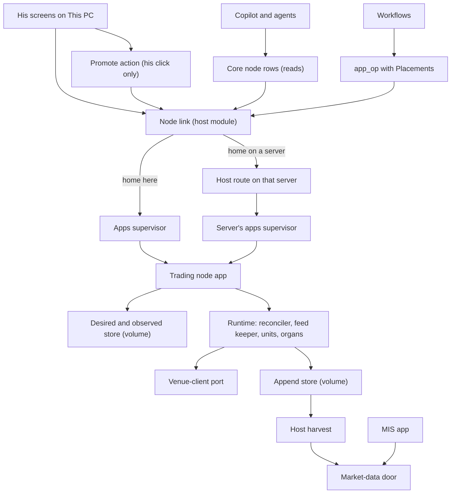
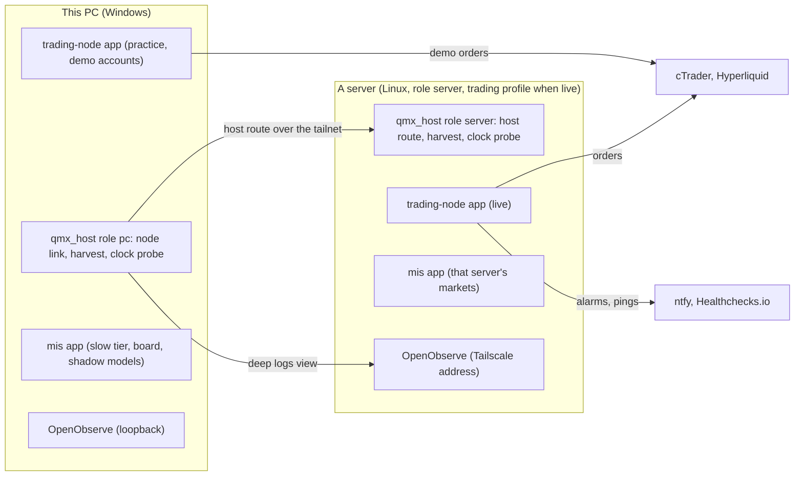
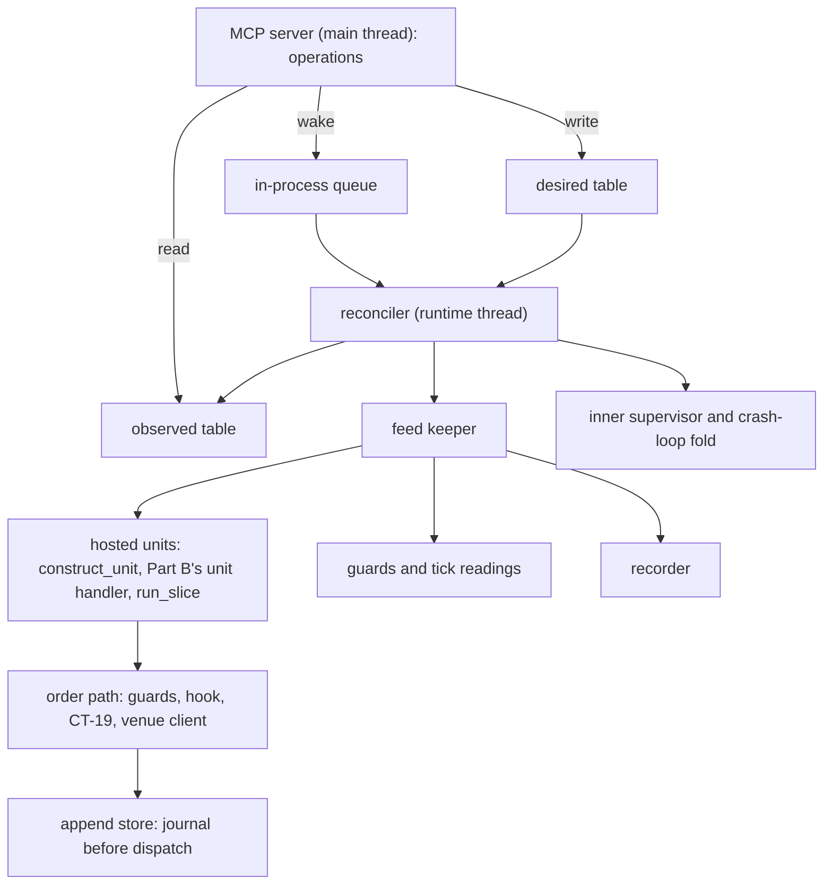

# Architecture Spine: Part C, the trading node, the MIS and the market edge

Code truth: `origin/engine/base` at `c93407ca`, read at `D:\QMX-worktrees\engine-base-read\` (CHECKED: only `build/wu4`, PR 204, and two October-19 fix branches hold commits not on it, none touching the node). Parent: `architecture/level-0/ARCHITECTURE-SPINE.md` (AD-1 to AD-47, binding and read-only here). Amended on 1 Nov by the R1 fix round: what changed, finding by finding, is `architecture/review/R1-FIXES-X1-C.md`. Words: `architecture/funnel/versions/GLOSSARY.md` plus the words Level 0 adds. Labels: CHECKED means read at the path and line, or run (the script is named); INFERRED means judgement. Proofs by running code: `BLAST-RADIUS.md` in this folder (items C1 to C9). New decisions here are numbered from AD-301 so parts A, B and C never share an id.

Detail lives in one file per area, each with what exists, what is added, what must not break, how it is checked, its cases and its growth seam: `NODE.md` (the trading node), `MIS.md`, `EXTERNAL.md` (venues and data routes), `RECORDS.md` (instrument, venue and account records), `DEVOPS-CLOCKS.md`, `NETWORKING.md`. Every shape is field by field in `CONTRACTS.md`.

## In plain words (for him)

- The trading node is an app inside QMX. On your PC it trades practice accounts. On a rented Linux server it trades live. It is the only thing in QMX that can send an order.
- You tell it what you want: which unit, on which markets, on which account. It writes that down and keeps returning to it. If it crashes, it restarts, checks the broker first, puts back any missing stop, and carries on. A risk stop waits for you.
- Your PC talks to every server through one door. Your clicks change trading; an agent can only look.
- A unit moves to paper or to live only when you click. That click is written down, and the same click sends the unit to the node with everything it needs.
- The MIS looks at markets and writes down what it saw, with the time. It starts with indicators and simple statistics. Models you train later in the Lab slot in behind the same shape. No unit needs it to trade.
- Every machine proves its clock. Every time is stored in UTC. Sessions follow each market's own city, so a Singapore node and a London node agree.
- When your PC is off, a server can still reach your phone: an alarm through ntfy, and a watcher that shouts when the server goes quiet.

## Design Paradigm

**A desired-state reconciler inside a money mini app, with ports and adapters at the market edge and a functional core of kept organs.** Every node operation only writes what he asked for (desired state) or reads what the node last saw (observed state); one control loop inside the node converges the venue and the units to the desired state, as Kubernetes controllers do. The kept QMN organs are the functional core (pure laws, reconcile, protection, clock bands, the loop over QMB's `run_slice`, which drives units through Part A's unit door and Part B's one shared unit handler). The new shell is thin and imperative. Venues and data sources sit behind the two Level 0 ports.

| Layer | What lives there | Where (EXISTS path or NEW) |
| --- | --- | --- |
| Node app shell | manifest, MCP server, desired-state store, reconciler, inner supervisor, identity, grant store, feed keeper wiring | `qmx-agents/apps/trading-node/` (NEW) over `qmn/src/qmn/app/` (NEW package) |
| Kept organs (functional core) | venue laws, cTrader client, reconnect, capability check, pacer and UNKNOWN, reconcile, protection, kill switch, kill line, clock bands, loop, ledger, liveness, alerts | `packages/qmf-venue` (EXISTS), `qmn/src/qmn/{venue,order,reconcile,protection,capital,time,loop,ledger,observability/liveness.py,observability/alerts.py}` (EXISTS) |
| Market-edge adapters | `ctrader` (kept), `ccxt` (NEW), futures placeholders, data routes | `qmn/src/qmn/venue/` (EXISTS, opened), `qmn/src/qmn/venue/ccxt_client.py` (NEW), `qmx-agents/packages/qmx-broker` (EXISTS reads) |
| MIS publisher app | reading runner over catalogue blocks, history, board | `qmx-agents/apps/mis/` (NEW) over `packages/qmf-readings` (NEW, moved from `qmn/src/qmn/mis`) |
| Host side (every machine) | host route, node link with deployment staging, the promote action (This PC), trading-profile and holdout facts, clock probe, connect-dialog kind, log shipping | `qmx-agents/packages/qmx-host` (EXISTS, extended) |
| Records | `instrument`, `venue`, `account` kinds and refresh templates | `qmx-agents/packages/qmx-library/src/qmx_library/kinds/` (NEW files), `qmx-engine/src/qmx_engine/templates/` (NEW folders) |

## Inherited Invariants

Read-only. Each binds this part as Level 0 wrote it; this spine designs under it and never re-derives it.

| Inherited | From parent | Binds here |
| --- | --- | --- |
| AD-2 units stand alone; host and supervisor on the trading path | Level 0 | nothing a unit needs to trade crosses machines; the node app's process lives under its host's supervisor |
| AD-3 only the node sends orders; only he promotes; one automatic stop | Level 0 | no operation places an order; `manage` operations are his |
| AD-4 local first, Windows on the PC, Linux servers for live | Level 0 | the practice node runs native on Windows; WSL only as his fallback |
| AD-5 same code in research and live | Level 0 | the loop keeps driving QMB's `run_slice` unforked, through the one unit handler Part B builds in B5b over Part A's `HostedUnit` (R1 A-C3); recorded feed pulled home for the nightly replay |
| AD-6 versioned contracts with an overlap window | Level 0 | every verb argument and answer carries `schema_version`; mismatched contract versions refuse new deployments only |
| AD-8 one owner per stream, credential, position and deployment | Level 0 | node tags on every order; one node per account; one feed keeper per venue and environment per machine |
| AD-10 one time scale | Level 0 | UTC nanoseconds; venue and receive time; `clock_ok` |
| AD-12 fail closed for new risk, open for protection | Level 0 | every stand-down keeps exits, broker stops and the kill switch |
| AD-13 unknown is a state; ids everywhere; operations converge | Level 0 | no blind resend; idempotent operations by op id |
| AD-14 numbers are named settings | Level 0 | every number below is a setting with a starting default |
| AD-26 market facts as versioned records | Level 0 | records designed in `RECORDS.md` |
| AD-27, AD-28 journals and the pull | Level 0 | the node's before-dispatch write is its own append store; Part B's records job harvests every append store on its machine into that machine's store (sealed months, the open month of bars and readings every minute, ticks hourly); results come home by pull; Part B owns the writer library, the records job and the pull job |
| AD-33 the mini-app core, fixed only where it blocks | Level 0 | Level 0's one list of six core changes (R1 CF-4); this part builds items 3 to 6 (restart with back-off, the read-only market root, the host-facts file, the server's secret reader) as slices C-05a to C-05d, and proposes one more for that list: a volume's `data/grants/` never leaves its machine (AD-306) |
| AD-36 organs kept, shell replaced | Level 0 | the cut in AD-323 |
| AD-37 placements and keys | Level 0 | the grant store in AD-306 (one wording conflict surfaced, CF-1) |
| AD-38 the node keeps returning to what he asked for | Level 0 | the stand-down table is inherited as is; identity in AD-305 |
| AD-39 the order path and protection | Level 0 | per-venue protection in AD-308 |
| AD-40 the MIS reads and publishes | Level 0 | instances and tiers in AD-313 |
| AD-41 two ports at the market edge | Level 0 | adapters in AD-310 and AD-311 |
| AD-42 one place to look | Level 0 | OpenObserve per machine; alarm and liveness senders in AD-318 |
| AD-43 clocks and calendars | Level 0 | AD-319, AD-320 |
| AD-44 networking between machines | Level 0 | nothing connects into This PC; `NETWORKING.md` |
| AD-45 host roles and the trading rule | Level 0 | the profile as host facts in AD-307 |
| AD-46 the host route | Level 0 | verbs field by field in `CONTRACTS.md`; the node link in AD-303 |

## Invariants & Rules



Arrows mean "may call or read". Nothing points up: the runtime never calls the host, the MIS app never calls the node, the node link is the only host module that asks a node anything (a chat on This PC may also reach the practice node's operations through the harness; AD-303 says how the node orders both), and only the runtime reaches the venue-client port's order calls.

### AD-301. The node app is a desired-state reconciler in one process

- **Binds:** P12, AD-5, AD-16, AD-36, AD-38
- **Prevents:** an operation that blocks on trading work and trips the supervisor's call timeout; two writers on one piece of node state; a crash that loses what he asked for; a second run-slice handler that hosts units differently from QMB
- **Rule:** the `trading-node` app is one process under its host's apps supervisor: the MCP server on the main thread, the runtime on its own thread with its own event loop, and the bootstrap's heartbeat thread. The runtime hosts every unit through Part A's `construct_unit` (`restore_unit` after a restart) and `HostedUnit`, never `construct_bot` (which refuses a sized intent), and drives it with QMB's `run_slice` through the one shared unit handler Part B builds in slice B5b (`qmb/src/qmb/host/unit_handler.py`); the node imports that handler and never writes its own. Each `UnitStep`'s intents go to the order path; its decision, calibration and state rows go to Part B's writer, whose record id for those rows is Part A's row id, so a slice re-run after a crash writes no double rows. The volume holds one SQLite store with two owned tables: `desired` (written only by operation handlers, one row per change, each with an op id) and `observed` (written only by the runtime, latest values plus an append-only event list). Handlers write `desired`, wake the runtime through an in-process queue, and answer from `observed`; they never call into the runtime and never wait for the venue. The runtime reconciles toward `desired` on every wake and every `reconcile_tick_ms` (default 200). A runtime that makes no progress for `stuck_after_s` (default 30) exits the process with reason `runtime_stuck`, logged, so the supervisor's restart brings it back (AD-315). Losing options and reasons: `NODE.md` §2.

### AD-302. The node's operations: a closed set that never raises

- **Binds:** P12, P10, AD-33, AD-46, connections X1, X7
- **Prevents:** a second node started lazily on the caller's machine; a node killed by three bad calls; an agent changing trading
- **Rule:** every operation declares `state = "instance"` (an operation with `state = "none"` starts the app on the caller's machine, CHECKED `brc3_lazy.py`). Reads (`status`, `units`, `positions`, `journal_tail`, `passport`, `deployments`) declare `approval = "domain_write"` and `reversibility = "none"`, because the manifest refuses an instance read (`qmx_apps/manifest.py:324-327`, CHECKED `brc4_manifest.py`); agents reach node state only through the core `node` rows, which are reads. Changes (`deploy`, `withdraw`, `pause`, `resume`, `kill`, `flatten`, `bind`, `confirm_same_node`, `take_over`, `sign_in_begin`, `sign_in_code`, `self_test`, `rotate_keys`) declare `approval = "manage"`. Every handler answers within `op_answer_budget_ms` (default 2,000) and never raises: a refusal is an answer `ok = false` with a code, because every tool exception counts toward the breaker and the default breaker kills the app at three (`qmx_apps/supervisor.py:884-934`, `:815-823`, CHECKED `brc2_breaker.py`). The manifest sets `[breaker] max_errors = 1000` and `heartbeat_timeout = 30`. No operation places an order. On This PC the copilot sees the practice node's operations as tools, because the harness serves every app running on the machine (`qma-harness/src/qma/harness/tools.py:538-588`); each `manage` one asks him first (R35) and the practice node holds demo grants only; those calls skip the node link, and AD-303 says how the node orders them. A server's node offers agents reads only. The node declares no job, so the route's job verb never reaches it (AD-304).

### AD-303. One node link on every host

- **Binds:** P0, P8, P9, AD-46, AD-47, connections X1, X2, X3, X5, X7
- **Prevents:** three callers each inventing a remote path; an agent's ask minted as his; a click lost while the server is down; an older change undoing a newer one; a deployment too large for one call
- **Rule:** one host module, `qmx_host.node_link`, is the only host code that asks a node app anything; on its home, the host route's `apps.ask` to the trading node goes through it too. It resolves a node's home from the place rows; when the home is this machine it calls the local supervisor; otherwise it asks through AD-46 on the home's host route. It mints every host pass with the real caller's principal (`Caller.principal`: `operator` for his UI bearer, `agent:<id>`, `run:<id>`), never the constant the engine's forwarders use (`qmx_host/host.py:1155`, CHECKED `brc1_principal.py`). It keeps the latest answer per node and read, marked "unreachable since" with the last values. Every `manage` change it carries passes a per-node outbox in the host's store, in order, keyed by op id and stamped `issued_at` from this host's clock, whether the node is reachable or not; it is retried with back-off until the node answers, and the node treats a repeated op id as done. It is not the only path: on This PC a chat reaches the practice node's operations through the harness (`qma-harness/src/qma/harness/tools.py:538-560`), and his approval prompt is his click there. So the node, not the outbox, keeps the order: it applies changes in arrival order through its `desired` table (a direct call is stamped on arrival) and answers `superseded` to a change whose `issued_at` is older than the newest change it applied for the same scope; `kill` and `flatten` always apply. Before it asks `deploy`, the node link on the node's home stages the deployment's files: each file the document names by fingerprint (`CONTRACTS.md` §3) is copied from that machine's Library into `data/deployments/<deployment_id>/in/` of the node's volume and verified; a file that Library does not hold yet (a server waiting for the hub, X5) answers `files_missing` with the fingerprints, and This PC's outbox retries. Four callers use it: the core `node` toolset rows (`node_state` moved here off `qmn.doors`, plus `node_units`, `node_positions`, `node_journal_tail`, `node_passport`), the UI's node routes, the promote action (AD-324), and `app_op`'s `Placements.remote`.

### AD-304. The host route answers a closed verb set

- **Binds:** P0, P7, AD-46
- **Prevents:** a route that answers any app tool; a verb whose arguments drift between builds; an agent starting a job on a money app
- **Rule:** `POST /api/host/forward` takes one body `{verb, args, schema_version}` and answers `{ok, value | code, message, schema_version}`. It verifies the host pass against this host's place name and expiry first. Verbs: `apps.ask` (a declared operation of an app homed here, pin revalidated; a `manage` operation answers only when the pass principal is `operator`; an ask to the trading node goes through this host's node link, AD-303), `apps.job` (an app job with optional `inputs`, the `remote` side of `app_op`; for an app whose manifest risk is `money` it answers only when the pass principal is `operator`), `heartbeats` (newest rows per subject plus this host's clock facts), `data.list` (closed and open partitions after a watermark, with an optional `confirmed` list of fingerprints This PC now holds), `data.fetch` (one file by fingerprint, streamed). Each verb answers inside `route_answer_budget_s` (default 8); `data.fetch` streams with no budget. A new verb is a spine amendment. The control server's OpenAPI document states the host build's version instead of the fixed `0.1.0` (`qmx_control/server.py:415`, CHECKED), so a client can tell builds apart (CA-01). Field by field: `CONTRACTS.md` §1.

### AD-305. Node identity, tags and attribution

- **Binds:** P12, AD-8, AD-13, AD-38, cases TN-04, MA-02, TN-01, TN-02
- **Prevents:** two nodes on one account; a cloned disk trading beside the original; an orphan adopted silently; a dead node's positions left unowned
- **Rule:** at first start the node mints an install id (128 random bits) and records it with the machine fingerprint (Windows `MachineGuid`, Linux `/etc/machine-id`) in its volume. The node tag is the first 8 base-32 characters of the install id. Every order carries it, with the trade's trace id fixed as a ULID (26 characters): cTrader `clientOrderId` = `q<tag>-<ULID>` (36 characters, under the venue's 50) and `label` = `qmx:<tag>:<unit tag>` (under 100), checked by the encoder; Hyperliquid `cloid` = the tag's 5 bytes plus the first 11 bytes of SHA-256 of the ULID, journaled with its trace. At start and on every reconnect, reconcile attributes each open position and order: mine (my tag and in my journal), foreign (another tag), untagged, or twin (my tag but not in my journal). Foreign or twin refuses that account and alerts; untagged is protected and flagged, never adopted (AD-38). A machine fingerprint that differs from the minted one refuses all trading until his `confirm_same_node` click (a provider move) or `take_over` (a new node adopting a dead node's tagged positions under protection, after he confirms the old one is gone; This PC then re-issues the dead node's deployments for the new identity). On Hyperliquid, whose positions carry no tag, the account record's owner is the only proof; one node per subaccount.

### AD-306. The node's keys and its own trading grant

- **Binds:** P12, P14, AD-37, AD-33, connections C27, E8
- **Prevents:** a node that cannot start on a server; a refreshed grant lost; a live grant on a machine where agents work; a live grant copied off its machine by a backup or a move
- **Rule:** the node manifest names one secret, `qmx/trading-node-keys` (`NODE_KEYS`), a JSON document of this machine's static keys: venue registrations (cTrader trading app id and secret), Hyperliquid agent wallets with expiry, and alarm destinations. Install refuses any other app that names it (the Level 0 secret map). The document exists, possibly empty, from the first setup step, so a node with no venue keys still starts and shows each venue as "not set up". The refreshed cTrader grant lives in the node's own grant store, keyed by install id and app id: Credential Manager entries `qmx/node-<tag>-ctrader` on Windows, written only by the node, and an owner-only file in its volume (`data/grants/`) on Linux. One refresher per grant, store before discard (QMN's rotation rule, `qmn/src/qmn/secrets/rotation.py`). A volume's `data/grants/` never leaves its machine: today a file there is classed `content` and sent by every backup (`qmx_home/classes.py:119`) and copied by the snapshot a move or the road check makes (`qmx_apps/volume.py:261-285`), CHECKED by running both (`BLAST-RADIUS.md` C11); two one-line changes fix it, a `secret` backup rule for `data/apps/*/data/grants/**` and a skip in `snapshot()`. The grant stays in the volume rather than the host's vault, because the one refresher is the node and an app cannot write outside its volume (`qmx_apps/bootstrap.py:93-100`). After a move he signs in again. The sign-in is two node operations: `sign_in_begin` returns the consent link for the node's own app and This PC's loopback receiver; `sign_in_code` exchanges the one code This PC relays. A grant that can trade a live account is kept only when the host facts say the trading profile is on (AD-307); otherwise it is discarded with the host's own `LiveGrant` message. On a server the supervisor reads `NODE_KEYS` from the host's owner-only vault (`<home>/vault/trading-node-keys`), because keyring has no backend on a headless Linux server (`keyring/backends/fail.py` raises, CHECKED in the pinned package).

### AD-307. The trading profile is host facts the node can read and the host enforces

- **Binds:** P0, P12, AD-45
- **Prevents:** a live grant on a host that runs chats or agent steps; the node trusting an argument an agent could forge
- **Rule:** `[host] trading_profile` is a host setting that only the connect dialog's "bind live" step writes, over SSH, after it turns chats and agent steps off; This PC refuses it. When it is on, the host mounts no chat routes and its engine refuses to place an agent or llm step there. The host writes its facts (`placement`, `role`, `trading_profile`, `chats`, `agent_steps`, `holdout`, `at`, `schema_version`; `holdout` is the Settings `[data]` default seal the market-data door applies, `qmx_host/market_data.py:1232-1255`) to `road/host/facts.json` in every app volume it supervises, before the app starts and on every change, so a volume moved to a new home is rewritten by that home first; the app cannot write `road/` (`qmx_apps/bootstrap.py:93-100`). The node reads it before keeping a live-capable grant and every `reconcile_tick`; if the profile turns off while a live grant is held, the node stops new entries on live bindings and asks him to unbind.

### AD-308. Protection follows each venue's own rule

- **Binds:** P12, P14, AD-12, AD-39, AD-41, cases TN-03, TN-08, TN-09, TN-23, EX-11, UT-14
- **Prevents:** an unprotected position when the node dies; a stop that covers a partial fill wrongly; a venue switch that cancels the stops
- **Rule:** the capability declaration names one protective-stop form per venue and order type, and the protection gate (`qmn/src/qmn/order/protection.py`) refuses an entry whose form it cannot prove. cTrader: `entry-relative` (`relativeStopLoss` on the order itself, `packages/qmf-venue/src/qmf/venue/encode.py:617-621`); a partial fill keeps the stop on what filled. Hyperliquid: `position-trigger-after-fill` (the entry as an IOC or limit order, then on each fill event a reduce-only stop trigger with grouping `positionTpsl`, which CCXT 4.5.85 sends as a whole-position order of size 0, so it follows the position, `ccxt/hyperliquid.py:1576-1579`, `:2254-2262` in the pinned package; parent-order children are never used, because a cancelled partial parent cancels them, per Hyperliquid's TP/SL page). If protection is not confirmed within `protect_confirm_ms` (default 2,000) after `protect_retry_max` (default 3) attempts, the node closes that position reduce-only, a labelled placeholder action for the risk session, and raises a protection-escalation alarm. `scheduleCancel` is never sent. Open orders stay under `open_orders_margin` (default 900) of Hyperliquid's 1,000. On a netting account or subaccount, at most one unit per symbol (deploy refuses a second): a placeholder rule until the risk session designs shared protection.

### AD-309. One feed keeper per venue and environment per machine

- **Binds:** P12, P14, AD-8, AD-12, cases EX-01, EX-02, TN-19, TN-21
- **Prevents:** two connections knocking each other off; a unit reading a stale or half-rebuilt book; volume invented from tick counts
- **Rule:** the feed keeper lives inside the node app (its lifeline depends on no other app). It owns one long session per (venue, environment) on its machine, one subscription per symbol, and fans out in process to units, guards, the reading runner and the recorder. It normalises every source into four events (print, quote, book update, bar; `CONTRACTS.md` §6), each with venue time when given and receive time always. A one-sided cTrader spot event keeps the other side's last value. After every reconnect the book is rebuilt from a fresh snapshot or full depth before any reader sees it, and readers see `book_state = rebuilding` until then. "Connected" means authenticated, subscribed and capabilities re-verified; a silent socket past the venue heartbeat bound forces a reconnect. A tick count is never written as volume. The recorder writes bars always and ticks for symbols whose live units' data cards name ticks, into the node's append store as series rows through Part B's writer library (B8); the MIS app writes its reading records through the same library.

### AD-310. The venue-client port opens to `ccxt`; MT5 and futures stay declarations

- **Binds:** P14, AD-41, CA-04, cases EX-07, EX-08, EX-16, EX-17, EX-21
- **Prevents:** a closed venue list in the node's law; a venue behaviour assumed instead of measured
- **Rule:** `VenueClientKind` gains `ccxt` (`qmn/src/qmn/venue/port.py:40-45`). The `ccxt` client maps the five CT-19 command kinds onto CCXT 4.5.85's unified calls and streams for Hyperliquid first, Binance and Bybit next; anything unmapped is UNKNOWN plus an alarm (the CT-18 law). Each venue's capability declaration states its protective-stop form, trigger basis (mark or last), rate limits, rationed actions, manual-login or server bans, desktop-app needs and sandbox; setup refuses an unattended node on a venue that declares a manual login or a server ban. A CCXT upgrade re-verifies every declared capability on testnet before any live order. Futures clients (Rithmic R|Protocol, CQG WebAPI) and MT5 are declarations with no code. On This PC the CCXT read adapter's spot-only filter (`qmx_broker/adapters.py:330-339`) opens to contract markets for reads; it stays read-only.

### AD-311. Order flow in three labelled layers behind the data-route port

- **Binds:** P13, P14, AD-41, cases EX-03, EX-12, EX-15
- **Prevents:** a tick count called volume; a CFD unit trusting a proxy tape without the gap measured; a paid feed assumed by the core
- **Rule:** level 4 (trades with aggressor side) comes free from Hyperliquid, Binance and Bybit; cTrader instruments get computed broker-side estimates (tick-rule imbalance, quote pressure, depth imbalance) as reading blocks labelled `estimate: broker-side` at levels 2 and 3; real futures order flow is a data route he switches on later. That route ships now as a working placeholder: a `file` adapter that reads trades and depth in Databento's published schemas from a folder he fills, so a futures-data unit can be written, checked and backtested; with no files the level is absent and declared fallbacks apply. A proxy series for a CFD (a futures tape for an index CFD) is recorded on the same clock as the CFD and their gap is a reading.

### AD-312. Instrument, venue and account records, and who notices a change

- **Binds:** P4, AD-26, cases QML-06, TN-25, TN-26, RS-18, EX-06, EX-13, EX-14, EX-22, LD-13, QB-06
- **Prevents:** a sizer reading a raw venue document; two detectors disagreeing about a broker change; one market named two ways
- **Rule:** three governed-record kinds land in the Library: `instrument` (one per venue and symbol, with `market_id`), `venue`, and `account`; each version is immutable, and refresh templates on This PC write new versions from the venue daily and on change events, broker documents weekly, exchange documents monthly. A deployment carries the snapshot of every record it uses. On the trading machine the node is the authoritative detector for its own symbols: a venue change event or a re-verification that finds a different lot step, margin, digits, leverage or trading mode writes a spec-change event, stands that symbol's units down (the inherited stand-down row) and leaves the change card for his click; the PC's next refresh lands the matching record version. Field lists: `RECORDS.md`.

### AD-313. The MIS: two kinds of instance, one reading runner, one writer per series

- **Binds:** P13, AD-2, AD-5, AD-40, ruling 48, ruling 50, ruling 55
- **Prevents:** a unit waiting on the MIS; QMB and live computing one reading two ways; two writers on one reading series; an app with no way to read market data
- **Rule:** the reading runner is one module in `packages/qmf-readings` that runs catalogue reading blocks over normalised events or bars on tier clocks. Tick-tier readings on a trading machine run inside the node (only the node holds the tick stream) and are stamped `source = node`. The `mis` app runs bar, session and day tiers: one instance on each trading machine for that machine's markets, and one on This PC for the slow tier, the cross-market readings, the board and models in shadow. The `mis` app reads its machine's market-data store through a read-only root the supervisor hands to apps whose manifest declares `data_reads = ["market"]` (`QMX_MARKET_ROOT`; writes outside the volume stay refused by the bootstrap's audit hook), including the open month of bars that Part B's records job harvests into that store every `[records] open_harvest_s` (default 60). It skips every month the host facts' `holdout` seals (AD-307), because the raw root bypasses the door's holdout and read log, so no reading over a sealed month lands in history where agents read it. A reading series key carries reading id@version, tier, source and machine, and each (reading, tier) pair has one writer kind; This PC never recomputes a tier a trading machine publishes for its own markets. A reading with a new version, or a model, runs in shadow and goes live only on his yes. Agents reach readings only through the slow lane: the core row `readings_query` over reading history (`CONTRACTS.md` §12, slice C-24). Detail and his questions: `MIS.md`.

### AD-314. The stamped reading record and the default packs

- **Binds:** P13, P5, P1, connections §5
- **Prevents:** a reading used as fresh when it is stale; a past label rewritten; a reading valid for forex applied to a 24/7 market
- **Rule:** every published reading is one record under Part B's journal envelope with kind `reading`: reading id and version, block fingerprint, source (`node` or `mis`) and machine in the body (Part B's envelope has no source field), market id and instrument, tier, time base, the three outputs (value, percentile against the market's own usual for that minute of its session, word), health word, data level used (Part A's `qmx.data-level/1`) and fallback step taken, inputs' last receive time, computed time and `stale_after`. Records are append-only; a correction is a new record linked to the old. Every class in the instrument record's class enum (`RECORDS.md` §2) has a default pack (`MIS.md` §4), named `<class>-<n>` and pinned by id and version on the MIS configuration; a market gets only the readings its data levels allow.

### AD-315. Healing at two levels, and the safe-to-restart test

- **Binds:** P12, P10, AD-33, AD-38, cases TN-12, TN-13, TN-16, TN-27, DO-10
- **Prevents:** a crash loop that keeps trading; a restart that undoes a risk stop; a host update during an open order
- **Rule:** the inner supervisor restarts the runtime thread after an exception with back-off (`inner_backoff_s` 1, doubling to 60). Boot stamps are recorded in the volume by QMN's `CrashLoopFold`, moved out of `qmn.host._supervision` into `qmn/src/qmn/app/healing.py`; past `crash_loop_k` restarts in `crash_loop_t` (5 in 10 minutes) the node stands down alive and waits for his resume. The outer level is item 3 of Level 0's core change list (slice C-05a): a manifest `[breaker] restart = "backoff"` (off by default, on for `trading-node` and `mis`, and QMB opts in too, R1-B-09) makes the supervisor start the app again after a trip with back-off (5 s doubling to 300 s), each trip and start logged; a `money` app restarts only its active signed version (`qmx_apps/supervisor.py:542-547`). Every start reconciles first. `status` reports `safe_to_restart` with reasons: no command in flight or UNKNOWN, every open position's stop observed at the venue, reconcile clean, journal synced. A host update or a node release waits for his click while it is false.

### AD-316. Setup is one connect-dialog kind, run on This PC first

- **Binds:** P0, P12, AD-45, connections X8, cases TN-11, TN-31, TN-32, OP-01, OP-02, TN-14
- **Prevents:** a node that can only be set up by hand; a half-finished setup that cannot be resumed
- **Rule:** the connect dialog gains one kind, `trading-node`, on the shipped step runner (`qmx_host/connect.py:374-389`), with two placements: This PC (practice) and a server. Its steps are rerun-safe and named: start the cTrader trading-app request (a waiting step), write the keys document, check the clock, install and enable the node and MIS apps (his signature publishes the node version), sign in on the venue's page, measure the round trip to each venue, run the self-test, land the passport, write the place row last. On a server the shipped server steps run first (firewall with its undo, Tailscale bind, `qmx-recover`), then chrony with four sources. WSL is a placement only when he picks it; then the installer sets both idle timeouts and a time service.

### AD-317. A deployment is a document the node compiles after it answers

- **Binds:** P12, P1, AD-17, AD-38, AD-47, cases UT-10, TN-16, UT-22
- **Prevents:** a deploy that restarts every unit; a unit traded with a fingerprint QMB never tested; a deploy that trips the call timeout; a unit too large to deploy
- **Rule:** `deploy` takes the deployment document (`CONTRACTS.md` §3), which the promote action builds (AD-324) and which names its files by fingerprint instead of carrying them, so a deployment of any size fits one call; the node link has staged those files into the node's volume first (AD-303). `deploy` answers `accepted` at once; the runtime then loads the staged blocks through the one block loader, compiles, and refuses if the compiled fingerprint differs from the recorded G result's. Preflight refusals are named: another node's identity, an unknown account, a missing record snapshot, a staged file missing or not matching its fingerprint, a placeholder on a live binding without his acknowledgement flag, two units on one symbol of a netting account, a venue capability the unit needs and the venue lacks, a version mismatch with the PC. A unit warms up from the node's own recording, then from broker history, trading nothing until its warm-up is complete, shown as "warming up n of m". Units are added and removed one at a time; recalibration runs where the unit runs, from its local journal.

### AD-318. Alarms and liveness reach his phone while This PC is off

- **Binds:** P12, P15, AD-42, connections E11, E12, cases OP-04, DO-11, TN-28
- **Prevents:** a dead server nobody notices; an alarm flood that trains him to ignore alarms; an alarm path that can stop trading
- **Rule:** the kept `AlertPublisher` delivers the closed push list through a `NotificationChannel` adapter for ntfy (an HTTPS POST to a topic he picks; the topic is a secret in `NODE_KEYS`). The kept `LivenessHeartbeat` pings a Healthchecks.io check URL every `liveness_interval_s` (default 60); the watcher alerts him, through ntfy too, when pings stop for its period plus grace. Both are on once setup records a destination. Alarms fire only inside the market's open calendar, except node-down, protection escalation and clock halt. A failed send is counted and retried; neither sender touches trading.

### AD-319. Every machine proves its clock

- **Binds:** P15, P0, P12, AD-10, AD-43, cases CK-01, CK-06, CK-08, CK-09, TN-14, TN-33
- **Prevents:** cTrader receive-time stamps on a drifting clock passing as good; a Hyperliquid signature refused for its nonce window
- **Rule:** one clock probe (an SNTP query in the standard library to the machine's sources, by default `0.pool.ntp.org` to `3.pool.ntp.org`, never mixed with Google's or AWS's smeared servers) runs in every host every `clock_probe_s` (default 60) and in the node every `reconcile_tick`. Its facts (zone, offset, sync source and state, `tzdata` version, band) ride every host heartbeat as an optional `clock` field and the node's `status`; cross-machine readers parse heartbeats tolerantly, because today's model refuses an unknown field (`qmx_engine/heartbeat.py:120-160`, CHECKED `brc7_heartbeat.py`). The node keeps QMN's bands (ok 10 ms, warn 25, no new entries 100, halt 250) and checks the band before signing a Hyperliquid action. Rows written while the offset is unproven carry `clock_ok = false`. On This PC the doctor shows a line when Windows Time is stopped and offers to start it (his click).

### AD-320. Calendars are versioned data; rules live in the market's zone

- **Binds:** P4, P15, AD-43, cases CK-02, CK-03, CK-05, CK-10, CK-12, CK-13, LD-02, OP-09, TN-20
- **Prevents:** a forex calendar holding crypto shut on Saturday; a London rule an hour off in a mismatch week
- **Rule:** each instrument record names a calendar id@version (forex 17:00 New York, CME and other exchange sessions, per-index breaks, 24/7 with funding clocks), stored as data with `calendar_max_age_days` (31); an older calendar is flagged suspect. Storage is UTC; market-tied jobs run in the market's zone; his routines in This PC's zone; a machine's own zone never enters a rule. The engine's forex-shaped `market_open` precheck (`qmx_engine/triggers/preflight.py:14-16`, `:309-314`) becomes a per-market calendar check. Baselines run in venue session time; a short history after a DST change shows as thin. 24/7 durations are calendar time or closed trades. The doctor flags a `tzdata` pin older than 180 days and announces each zone mismatch week 7 days ahead.

### AD-321. Telemetry has one switch, one home per machine, and is never on the trading path

- **Binds:** P15, AD-42, connections X4, C28, cases DO-01, DO-02, DO-03, DO-04, TN-28
- **Prevents:** two monitoring stacks; app logs with no home; trading waiting on telemetry
- **Rule:** apps write JSONL logs in their own volume, as the supervisor already does (`qmx_apps/supervisor.py:1233-1238`); the host ships app logs, heartbeats and spans to its machine's OpenObserve through the engine exporter when `[telemetry] send_to` is on, dropping and counting under pressure. A server's OpenObserve binds the Tailscale address (`ZO_HTTP_ADDR` set in its unit, so a firewall mistake cannot expose it); This PC opens it over the tailnet (reachable today through `ufw allow in on tailscale0`, `qmx-recover.sh:542`, and OpenObserve's empty-address default of 0.0.0.0). QMN's Grafana, Loki and Prometheus files are deleted. Off shows as off.

### AD-322. Updates reach a server from This PC and never cut over by themselves

- **Binds:** P0, P12, connections X10, cases TN-17, DO-07, DO-05, DO-06
- **Prevents:** a server running a build the PC never tested; a restored backup trading
- **Rule:** host builds go to a server through the step runner (the X8 pattern, with `qmx-recover rollback`), only on his click and only while the node reports `safe_to_restart`. Node and MIS app versions travel as Library `mini-app` items over the hub replication; the server installs a version from its replica when his signed publish (node) or his enable (MIS) names it, then the node restarts on it at a safe point. Every connect states both sides' contract versions; on a mismatch the node keeps trading what it has and refuses new deployments. The passport records the image digest and journal rows carry their writer's build. A restore lands units as drafts and never cuts over into a running node.

### AD-323. The shell cut migrates callers and deletes in one wave

- **Binds:** P12, AD-36, case TN-34, TN-27
- **Prevents:** a compatibility layer between old and new shells; a kept organ broken by a deleted import
- **Rule:** once the new shell trades on demo, one wave moves the names kept organs and their tests use (`StandDownTrigger`, `allocate_writer_ids`, `CrashLoopFold`, `BootAttemptStamp`, `SafePointSnapshot`) into `qmn/src/qmn/app/`, repoints those tests (`qmn/tests/test_qmn_time.py:19`, `test_qmn_roster.py:37`, `test_qmn_hygiene.py:22-36`), confirms the outside callers Level 0 named are gone (the agent's node-state tool moved in slice C-06; the kill line, bench fold and MIS register calls moved before the cut), and deletes `qmn.host` (with `runtime_risk_gate`, `fencing`, `lineage_persist`, `registry_mint`, whose only source importer is `qmn/host/__init__.py`, CHECKED `brc6_host_modules.py`), `seats`, `promotion`, `paper`, `doors`, `bench`, the rest of `observability`, the deploy recipes and the Grafana stack, with the tests of what it deletes. The kill line's breach acts through the Level 0 placeholder. The test that every order carries its stop at the broker runs before and after; the import scan reruns on the PR head and must show no importer of a deleted module.

### AD-324. His click promotes, and the same click deploys

- **Binds:** P0, P2, P12, AD-3, AD-16, AD-17, AD-23, AD-38, connections X1
- **Prevents:** a promotion nobody records; an agent's move toward live; a deployment written by hand; a live unit starting from numbers no lane ran
- **Rule:** one host route on This PC, `POST /api/units/promote` (`CONTRACTS.md` §13), answers only to the principal `operator`, as the seal move does (`qmx_host/market_data.py:1201-1210`, CHECKED); it is not a catalog row, so no agent or workflow sees it. For one unit version and market it records the move through Part B's host lifecycle writer (`qmx_host/lifecycle.py` `record_move`, slice B13), which folds the unit's events with Part A's `qml.lifecycle.fold`, refuses a move the transition table refuses, and appends the `qmx.lifecycle/1` event (`by: {kind: his_click, principal: operator}`); and, for a move into paper or live, builds the deployment document from the Library (the unit document, its pinned block files by fingerprint, the G `test-report` for its compiled fingerprint, the starting numbers, the instrument, venue and account snapshots, the lane) and asks `deploy` through the node link. A move to parked or retired asks `withdraw` (when flat); admitting a version on a market where another is on paper or live parks or retires the other in the same click (Part A's rule). The paper lane starts from the unit's defaults, as QMB tested it; the live lane starts from the paper lane's last calibrated values, read from its harvested calibration rows with their watermark, and the calibrator's statistics restart from that watermark (LC-C-39). A live move onto a live-world account also needs a host in the trading profile (AD-307); a live move with placeholders needs his tick. The event id and the deployment id derive from the op id, so a repeated click lands nothing new. A risk stop is the node's own lifecycle event (`by: {kind: risk_rule}`), written through the same writer.

## The cases this part owns

Every case Level 0 gave parts P0, P4, P12, P13, P14 and P15, plus the cases the handover gave Part C, less MIS-10 (Part B's), plus the six R1 gave it (R1-L0-01: CA-01, CA-03 shared with Parts A and B, CA-04, CA-06, CA-11, MA-05). 120 rows; checked by script. Fuller handling lives in the area file named.

| Case | Handling | Where |
| --- | --- | --- |
| CA-01 | Every host-route answer carries `schema_version`; the control server's OpenAPI document states the host build's version, not the fixed `0.1.0`; a test in slice C-06 reads both | AD-304; `CONTRACTS.md` §1 |
| CA-03 | Shared with Parts A (A1, the format) and B (B5b and B6, QMB's fills): slice C-12a asserts that the quantity the conformance venue receives equals the sizer receipt's quantity after lot rounding, so a door that drops the size fails the build | AD-301; `BUILD-SLICES.md` C-12a |
| CA-04 | A new venue is a capability declaration plus an adapter behind the port; `VenueClientKind` gains `ccxt` in its own branch (slice C-16) | AD-310 |
| CA-06 | Both sides state their contract versions on connect; on a mismatch the node keeps trading and refuses new deployments (test in slice C-19) | AD-322; `NETWORKING.md` §5 |
| CA-10 | The observer token's expiry shows on its Settings row and on the doctor 7 days ahead; renewal is his click; nothing renews it | AD-321; `DEVOPS-CLOCKS.md` §6 |
| CA-11 | No browser stream rides these links: the node and MIS screens read the node link's latest values and answers, so no stream needs resuming; a stream added later resumes by `Last-Event-ID` | AD-303; `UI-NEEDS.md` §8 |
| CK-01 | The clock probe reports every machine's offset; data written unproven carries `clock_ok = false`; the doctor offers to start Windows Time | AD-319 |
| CK-02 | Session rules live in the market's zone; a calendar test runs across both 2026 mismatch weeks | AD-320; `DEVOPS-CLOCKS.md` §3 |
| CK-03 | No rule reads a machine's zone; two nodes in two zones compute one session from one instant (a test with both zones) | AD-320 |
| CK-04 | The doctor shows the `tzdata` pin's age and flags it past 180 days | AD-320 |
| CK-05 | The broker's daily boundary is measured per broker at connect and stored on the venue record; one conversion at the venue boundary | AD-312; `RECORDS.md` §2 |
| CK-06 | Setup installs chrony with one source kind; the probe refuses mixed smeared and unsmeared sources | AD-319; `DEVOPS-CLOCKS.md` §2 |
| CK-07 | Host paths that used the machine zone (`qmx_host/host.py:788`, `first_start.py:1512`, `__main__.py:195`) stamp UTC and show his zone on screen only | AD-320; `DEVOPS-CLOCKS.md` §3 |
| CK-08 | The WSL placement installs a time service and the node waits for sync before trading | AD-316, AD-319 |
| CK-09 | The node checks its band before signing a Hyperliquid action; past the halt band it signs nothing new | AD-319 |
| CK-10 | Same-minute baselines run in venue session time; the reading's health shows `thin` until 20 post-change weeks exist | AD-320; `MIS.md` §5 |
| CK-11 | Kept as built: cronsim runs a skipped time once after and a repeated time once | AD-320 |
| CK-12 | Calendars carry a version and a maximum age; an older one is flagged suspect on the record and the node's checks | AD-320; `RECORDS.md` §4 |
| CK-13 | Durations for 24/7 markets are calendar time or closed trades; the soak shows calendar days | AD-320 |
| DO-01 | QMN's Grafana, Loki and Prometheus files are deleted in the shell cut; OpenObserve is the one stack | AD-321, AD-323 |
| DO-02 | Telemetry off shows as a line on the doctor and the node page | AD-321 |
| DO-03 | Slice C-04 starts OpenObserve on This PC with real host and app events, and C-17 on a server | AD-321; `BUILD-SLICES.md` |
| DO-04 | Each known gap is closed or listed with an owner in `DEVOPS-CLOCKS.md` §5 | AD-321 |
| DO-05 | A restore drill or restored backup never cuts over; units land as drafts | AD-322 |
| DO-06 | A restored unit lands as a draft linked to its old version; no live state resumes | AD-322 |
| DO-07 | The node keeps trading its version; contract versions are compared on connect; mismatch refuses new deployments only | AD-322 |
| DO-08 | The node's tests already run in `just ci` on Windows (`tools/test_all.py:61-62`); the Linux lane triggers on `build/**` and `engine/base` too | `DEVOPS-CLOCKS.md` §5 |
| DO-09 | The secret scan runs on every commit; `NODE_KEYS` and grants are never written to the repo, logs or journals | AD-306 |
| DO-10 | Health is progress: the node's `status` reports last decision per unit, last quote per symbol, last journal write; a stuck runtime exits for restart | AD-301, AD-315 |
| DO-11 | Alarms fire only inside open calendars except node-down, protection escalation and clock halt; the push list is closed | AD-318 |
| DO-12 | Kept as built: the firewall's five-minute undo and `qmx-recover` | AD-316 |
| DO-13 | Kept as built: stores open, upgrade after a copy or refuse by name | AD-322 |
| DO-14 | Kept as built: one redaction seam; the node's logs pass it; secrets are named, never valued, in logs | AD-306, AD-321 |
| EX-01 | A one-sided spot event keeps the other side's last value | AD-309 |
| EX-02 | The book is rebuilt after every reconnect before any reader sees it; readers see `book_state = rebuilding` (test in slice C-12a: a session dropped mid-book) | AD-309 |
| EX-03 | Data levels are declared per venue; cTrader offers no tape or volume; a tick count is never labelled volume | AD-309, AD-311 |
| EX-04 | History pages by the venue's own limits (one side, one week, five a second); retention is measured once on demo and stored on the venue record | AD-310; `EXTERNAL.md` §2 |
| EX-05 | A broker switching the Open API off is a venue state with its reason; no new entries; protection stays at the broker | AD-310 |
| EX-06 | Each instrument record names a `market_id`; comparisons across venues key on it | AD-312 |
| EX-07 | The capability declaration is measured per venue; a unit needing a missing capability is refused at deploy | AD-310, AD-317 |
| EX-08 | CCXT is pinned; an upgrade re-verifies every declared capability on testnet before any live order | AD-310 |
| EX-09 | The recorder starts with the Hyperliquid link, because the venue keeps only 5,000 candles | AD-309 |
| EX-10 | One agent wallet per trading process; its expiry is on the passport; a renewal card 14 days ahead | AD-306; `EXTERNAL.md` §3 |
| EX-11 | Open orders stay under 900 of Hyperliquid's 1,000 so protection can always be placed | AD-308 |
| EX-12 | The futures data route is a seam with a working file placeholder; nothing in the core assumes a feed | AD-311 |
| EX-13 | A futures unit names a root and a roll rule; each trade names its contract; the record lists the months | AD-312; `RECORDS.md` §3 |
| EX-14 | A cTrader futures-style CFD's at-expiry rule lives on the record; the close-only event is mapped to a market event | AD-312 |
| EX-15 | A proxy series and its CFD are recorded on one clock; their gap is a reading | AD-311 |
| EX-16 | A venue's manual login or server ban is in its capability record; setup refuses an unattended node there | AD-310 |
| EX-17 | Limits are the venue's own, read as data, with back-off; a 429 is a typed refusal | AD-310 |
| EX-18 | Protection is at the venue before an outage starts; during it, no new entries | AD-308, AD-309 |
| EX-19 | Journals keep demo and live apart by world; costs are calibrated per world | AD-27 (inherited); `EXTERNAL.md` §5 |
| EX-20 | Funding is a calendar event, a reading and a cost; the instrument record carries its interval | AD-312, AD-314 |
| EX-21 | MT5 is a declaration; its capability record says it needs Windows and a terminal per account | AD-310 |
| EX-22 | A listing or delisting is a record event; a held symbol delisted stands its units down for his click | AD-312 |
| LD-02 | Completeness is judged against each instrument's own calendar | AD-320 |
| LD-13 | Dividend events per index CFD live on the instrument record as dated cash events that QMB replays | AD-312; `RECORDS.md` §3 |
| MA-02 | His take-over click lets a new node adopt the dead node's tagged positions under protection | AD-305 |
| MA-05 | His signature binds a version, not a restart: the opt-in restart starts only the active signed version (test in slice C-05a) | AD-315 |
| MIS-01 | Readings are library code a unit runs itself; a unit with the MIS cut off still trades (test) | AD-313 |
| MIS-02 | Every reading carries computed time, inputs' receive time and `stale_after`; stale reads as absent | AD-314 |
| MIS-03 | "Regime" means trend against range; the shipped buckets are renamed "volatility state" (his word to veto) | AD-314; `MIS.md` §7 |
| MIS-04 | One golden replay runs one recorded day through a unit, QMB and the reading runner and compares per reading id and version | AD-313; `MIS.md` §8 |
| MIS-05 | Records are append-only with their time and version; QMB asks what was published then | AD-314 |
| MIS-06 | Each reading declares its price input; mean-reversion readings on short bars use mid or one side and a bounce check | AD-314; `MIS.md` §4 |
| MIS-07 | Each reading declares its tier and time base; direction readings live on session and day tiers | AD-314 |
| MIS-08 | Sessions come from each instrument's calendar; 24/7 markets use measured activity sessions | AD-320 |
| MIS-09 | A missing shortlist changes nothing on the node; units trade their admitted markets on their own conditions | AD-313 |
| MIS-12 | A new reading or vocabulary is a new version; old records keep theirs | AD-314 |
| MIS-13 | Node readings come home with the pull, MIS node-instance readings too, the open month within a harvest; templates read them from history through `readings_query` (slice C-24) | AD-313, AD-28 |
| MIS-14 | Every fallback step a reading takes is recorded on the record and counted on the reading's health | AD-314 |
| OP-01 | First start shows each step's state and what to do, including the node kind's steps | AD-316 |
| OP-02 | Slice C-14 is the first real start on his folder with his sign-ins, a named early step | `BUILD-SLICES.md` |
| OP-04 | Nothing on the node waits on him except promotion and resume; alarms and liveness reach his phone; a morning digest lists failures | AD-318 |
| OP-06 | Disk per drive is on the doctor; the node's volume and WSL's disk location are shown | `DEVOPS-CLOCKS.md` §6 |
| OP-07 | "Node setup" on his screens means the trading node; the QMX server setup is "connect a server" | `UI-NEEDS.md` §1 |
| OP-08 | Every node figure shows its world (paper, demo, live) | AD-27 (inherited); `UI-NEEDS.md` §2 |
| OP-09 | The node and MIS screens say a market is shut and until when, from the calendars | AD-320; `UI-NEEDS.md` §2 |
| OP-10 | `kill` is idempotent by op id and escalate-only; `resume` shows the open causes first | AD-302, AD-303 |
| OP-11 | Names are labels; identity is the id; a node, unit or reading is found by id | AD-305 |
| QB-06 | The record carries a futures CFD's at-expiry action and date; QMB replays it | AD-312 |
| QML-06 | One record per venue and symbol with `contract_size`, `digits` and `value_per_point` under Part A's key names; a conversion check computes value per point two ways; a key-parity test pins the names | AD-312; `RECORDS.md` §2 |
| RS-18 | Leverage and margin are versioned record fields; a change stands the symbol's units down until his click | AD-312 |
| TN-01 | UNKNOWN is a state; before any resend the node reads open orders by client order id and positions by tag; the drill (the answer to a send is lost; the node does not resend and ends with one position) runs on the conformance venue in slice C-12b and on demo in C-15 | AD-305; `NODE.md` §6 |
| TN-02 | Start reconciles before any unit runs; an untagged position is protected and flagged, never adopted | AD-305 |
| TN-03 | Every position already has its stop at the broker; the kill waits in the node link's outbox; the node page names the broker's own app | AD-303, AD-308 |
| TN-04 | Install id plus machine fingerprint; a mismatch refuses until his click; a live twin is caught by own-tagged activity missing from the journal | AD-305 |
| TN-05 | One cTrader app and grant per trading machine; one refresher; expiry on the passport; the refresh drill on demo in slice C-15 (a forced refresh stores the new grant before discarding the old, the session comes back ready, a second refresher is refused) | AD-306 |
| TN-06 | Maintenance windows are on the venue record's calendar; reconnect with back-off; no entries until re-verified; exits allowed | AD-309, AD-312 |
| TN-07 | An exchange halt or price limit is a market event every unit sees: no entries; the journal records it | AD-312; `NODE.md` §5 |
| TN-08 | No order without its stop at the broker; the protection gate refuses otherwise | AD-308 |
| TN-09 | Hyperliquid stops are position-scope reduce-only triggers; `scheduleCancel` is never sent; protection is re-placed after any cancel | AD-308 |
| TN-10 | Every boot value has a starting default; the first run is slice C-12a on the conformance venue, the first demo run C-14 | AD-315; `NODE.md` §9 |
| TN-11 | Every setup step reruns; the dialog names the failed step | AD-316 |
| TN-12 | Two healing levels with back-off; the crash-loop fold stands down alive | AD-315 |
| TN-13 | After a reboot the node reconciles, warms up, then trades | AD-315, AD-317 |
| TN-14 | The WSL placement sets both idle timeouts, a time service and a D: disk where possible; the node refuses an unsynced clock | AD-316 |
| TN-15 | A sleep or power loss on This PC is logged as a gap; the node reconciles on wake before entries | AD-38 (inherited); `NODE.md` §7 |
| TN-16 | Units are added and removed one at a time; a node restart is only for node code | AD-317 |
| TN-17 | The passport records the image digest; rows carry their writer's build | AD-322 |
| TN-18 | Disk alarms before full; tick recording stops first; journals last; exits still go | `NODE.md` §7 |
| TN-19 | A silent socket past the heartbeat bound forces a reconnect; connected is not ready; no entry until ready (test in slice C-12a) | AD-309 |
| TN-20 | A symbol is stale only inside its open calendar | AD-320 |
| TN-21 | One feed keeper per connection fans out to every unit on the machine | AD-309 |
| TN-22 | Venue budgets are data; the pacer keeps a share for cancels and stops | AD-308, AD-310 |
| TN-23 | Protection follows the filled quantity on each venue's own rule; the unit sees the real position | AD-308 |
| TN-24 | A typed rejection reaches the unit, which backs off by its declared rule; an unmapped code is UNKNOWN plus an alarm | AD-310; `NODE.md` §6 |
| TN-25 | A spec change is an event and a new record version; the symbol's units stand down until his click | AD-312 |
| TN-26 | A close-only switch is a market event: no entries, exits allowed | AD-312 |
| TN-27 | The proof campaigns and readiness packets are deleted in the shell cut | AD-323 |
| TN-28 | Telemetry is fire-and-forget; a test stops OpenObserve and shows units still trading | AD-321 |
| TN-29 | A false clock halt is journaled with its reason; resume is his; the band numbers are settings | AD-319 |
| TN-30 | The node owns its own grant store on whichever machine it runs | AD-306 |
| TN-31 | Setup starts the cTrader trading-app request on day one and shows it as a waiting step | AD-316 |
| TN-32 | Setup measures the round trip to each venue and shows it on the passport | AD-316 |
| TN-33 | A clock step or pause marks a suspect window; no entries until a resync, as FR-12 | AD-319 |
| TN-34 | A test proves every order has its stop at the broker, before and after the cut | AD-323 |
| UT-10 | A unit warms from the node's recording, then broker history; no trade while warming; warming is a state | AD-317 |
| UT-14 | The account record says netting or hedging; on netting, one unit per symbol (placeholder for the risk session) | AD-308 |
| UT-22 | Recalibration runs where the unit runs, from its local journal | AD-317 |

**The review findings handed to this part.**

| Finding | Settled by |
| --- | --- |
| R0-01 | AD-303, AD-304, `CONTRACTS.md` §1; reads declared `domain_write` (AD-302); X6 rechecked: a PC-minted run pass verifies at a paired server (`BLAST-RADIUS.md` C9) |
| R0-02 | AD-321: This PC opens a server's OpenObserve over the tailnet; the unit binds the Tailscale address |
| R0-04 | AD-306, AD-307; the host's refusal, token name and tests stay |
| R0-05 | AD-305; demo probes in slice C-15 |
| R0-06 | AD-301: the before-dispatch write is the node's append store in process; Part B ships closed partitions |
| R0-08 | AD-322 (updates), AD-306 (Hyperliquid agent wallet entered on the trading machine), `NETWORKING.md` §4 |
| R0-09 | AD-318 |
| R0-10 | AD-323 |
| R0-13 | AD-306: only `trading-node` may name `qmx/trading-node-keys`; the Docker tier allow-list names only its venues; the evidence word `proposal_only` is replaced for the node by `sends_orders` (`NODE.md` §10) |
| R0-14 | the stand-down table is inherited as is; the soaks show on the release and binding cards (`UI-NEEDS.md` §2) |
| R0-15 | AD-303: state is latest values; events come by the pull |
| R0-16 | AD-307 |
| R0-19 | AD-2 inherited (host and supervisor on the path); AD-6's overlap window on every verb (AD-304); `market_id` (AD-312) |

**Also handled here, owned elsewhere.** MA-01 (only the node sends orders; a research app's breaker stops research only). CA-06, MA-05 and CA-11 moved into the table above when R1 gave them to this part.

**The R1 findings for this part** (`review/R1-findings.md`, "Findings for part C", and the clash settlements naming this folder) are settled line by line in `review/R1-FIXES-X1-C.md`.

## His MIS questions, answered

Ruling 48 asked these; ruling 55 asked for a core that needs no training. Plain answers; detail in `MIS.md`.

- **Where does it live?** In two places, one code. On each trading server, the node computes the fast readings it already sees tick by tick, and a small MIS app beside it computes the slower ones for that server's markets. On your PC, the MIS app computes the slow and cross-market readings, the board, and any model you train.
- **Does it need a screen?** Yes, two views of one thing: a "Readings" section on each node's page (its markets, now and recent), and the MIS tab on your PC (every market, history, shadow models, your yes).
- **Indicators or models first?** Indicators and simple statistics first, because they need no training and work on any market: volatility against its usual level, spread and activity against usual, trend against range, session windows, funding for perps, the roll for futures, the cash open for indices, the gold fixes, currency strength. Models come later through the Lab, in shadow, behind the same reading shape.
- **How are models trained?** In the Lab's training placement on your PC, on Library history, landing with their data fingerprints. A model reading runs beside the default in shadow and goes live only when you say yes. No unit changes when one replaces another.
- **Where does the data come from?** The node's live feed on each server, and the Library's history on your PC, which you download.
- **Can it work on one market alone?** Yes. A reading is computed per market from that market's own data, with its own usual levels; a market with fewer data levels gets fewer readings, not wrong ones. A whole MIS for one market is just a configuration naming one market.

## Consistency Conventions

Level 0's conventions hold. This part adds:

| Concern | Convention |
| --- | --- |
| Node words on screens | Setting up, Starting, Ready, Trading, Healing, Paused, Stopped by a risk rule, Stopped by a health check, Unreachable since `<time>`; a risk stop and a health stop never share a word |
| Node tag | 8 base-32 characters from the install id; in every client order id, cTrader label and Hyperliquid cloid |
| Operation answers | `{ok, value}` or `{ok: false, code, message, next_step}`; never an exception |
| Desired changes | one row per change with an op id (ULID) and `issued_at`; a repeated op id answers its first result; a change older than the newest applied for its scope answers `superseded`, except `kill` and `flatten` |
| Deployment files | named by fingerprint in the document, staged by the home's node link into `data/deployments/<deployment_id>/in/`, never inlined; no size limit |
| Instrument classes | one enum with underscores (`RECORDS.md` §2), used by records, packs and every part |
| Reading series key | source (`node` or `mis`), reading id and version, tier, market id, instrument, machine |
| Trace id | a ULID (26 characters); the cloid is the tag's 5 bytes plus the first 11 bytes of SHA-256 of the ULID |
| Recorded feed key | source `<venue>.<env>.<place>`, subject the symbol, kind `ticks`, `bar-m1`, `book` or `trades` |
| Secrets | `qmx/trading-node-keys` (static, per machine); `qmx/node-<tag>-ctrader` grants on Windows; `data/grants/` on Linux, machine-bound (no backup, no move); never in a deployment, journal, log or the Library |
| Settings | every number in this part is a named setting with its default in the area file that owns it |

## Stack

Pins this part relies on, read from the lockfiles at `c93407ca` or the vendors' pages on 31 Oct (CHECKED). This part changes no pin.

| Name | Version |
| --- | --- |
| Python | 3.14.6 |
| ccxt (includes Hyperliquid and the streaming classes) | 4.5.85 |
| cTrader Open API descriptor | openapi-91.pb |
| OpenObserve | v1.1.2 |
| keyring | 25.7.0 |
| tzdata | 2025.2 (flagged by AD-320's age check) |
| ntfy (hosted service; publish is one HTTPS POST) | service, no client library |
| Healthchecks.io (hosted service; ping URL) | service, no client library |

## Structural Seed

### Placements



### Inside the node app



### Source tree (new and touched)

```text
qmn/src/qmn/app/                      # the new shell: store, reconciler, identity, grants, healing, operations
qmn/src/qmn/venue/ccxt_client.py      # the ccxt venue client (NEW)
qmn/src/qmn/venue/port.py             # VenueClientKind gains ccxt
qmn/src/qmn/order/protection.py       # a second protective-stop form
packages/qmf-readings/                # reading blocks moved from qmn/src/qmn/mis, plus the reading runner
qmx-agents/apps/trading-node/         # app.toml, server.py, pyproject.toml, uv.lock
qmx-agents/apps/mis/                  # app.toml, server.py, pyproject.toml, uv.lock
qmx-agents/packages/qmx-host/         # host route, node_link with staging, promote action, host facts, trading profile, clock probe, connect kind, log shipping
qmx-agents/packages/qmx-apps/         # [breaker] restart, QMX_MARKET_ROOT for data_reads market, host-facts file, snapshot skips data/grants
qmx-agents/packages/qmx-home/         # one backup rule: data/apps/*/data/grants/** is secret
qmx-agents/packages/qmx-control/      # node, instrument and readings rows; secret reader for a server; OpenAPI version
qmx-agents/packages/qmx-engine/       # app_op Placements; per-market calendar check
qmx-agents/packages/qmx-library/      # instrument, venue, account kind files
qmx-agents/packages/qmx-broker/       # CCXT contract reads
extensions/qmf-calendar-*/            # calendars beyond forex as data
```

### Seams

| Seam | Interface | Adapters | Real or hypothetical |
| --- | --- | --- | --- |
| Node link | `ask(node, operation, arguments, caller)` returning an answer or a queued receipt; stages a deployment's files on the home | local supervisor; host route | real (two adapters) |
| Promote action | `promote(op_id, unit, market, to, node?, account?)` returning the lifecycle event and the node's answer | his UI route on This PC | real (one) |
| Venue-client port | sessions, submit, observations, reconcile, capabilities | `ctrader`, `ccxt`, replay, conformance | real |
| Data-route port | levels, subscribe, history | cTrader, CCXT venues, Dukascopy, Binance Vision, `file` placeholder | real |
| Notification channel | `deliver(alert)` | ntfy; recording double | real (production and test) |
| Liveness sink | `ping()` | Healthchecks.io; watcher double | real |
| Grant store | `read`, `replace` | Credential Manager; volume file | real (one per platform) |
| Reading runner | `run(pack, events or bars, clock)` returning stamped records | the node's tick tier; the MIS app | real (two hosts) |

## Conflicts with the parent, surfaced

Level 0 binds; this part does not apply these itself. R1 settled all seven as accepted (`review/R1-findings.md`, "Clash settlements"), with refinements: CF-4 became Level 0's one list of six core changes (this part builds items 3 to 6 as slices C-05a to C-05d); CF-5's fingerprint list won over Part B's watermark and Part B builds it in B16; CF-6 splits readings by tier. The Level 0 fixer applies them there. One more core change surfaced in the fix round, for that list: a volume's `data/grants/` never leaves its machine (AD-306, `BLAST-RADIUS.md` C11).

| Id | Level 0 text | What the code shows | Proposal |
| --- | --- | --- | --- |
| CF-1 | AD-37: on Linux the node keeps its grant in "QMN's node secret store, `qmn/src/qmn/secrets/`" | that store needs systemd credentials (`CREDENTIALS_DIRECTORY`, `qmn/src/qmn/secrets/store.py:1-8`), and the supervisor passes an app only a fixed environment (`qmx_apps/supervisor.py:598-632`), so a supervised node app never sees them | the grant store is an owner-only file in the node's volume on Linux, with QMN's rotation rule kept (AD-306) |
| CF-2 | AD-45: "the code's two roles: This PC or `server`" | the code has three: `pc`, `node`, `server` (`qmx_host/host.py:141`); the shipped setup rewrites the unit to `server` (`qmx_control/node.py:488-509`) | read AD-45 as "a trading server runs role `server`"; nothing in this part uses role `node` |
| CF-3 | connections X1 lists an operation `mode` | a bound account's world is proven by the venue (demo or live), so a separate mode duplicates `bind` | X1's list replaces `mode` with `bind` (world from the venue) and adds `confirm_same_node`, `withdraw`, `sign_in_begin`, `sign_in_code`, `self_test`, `rotate_keys` (`CONTRACTS.md` "Contract changes") |
| CF-4 | AD-33 names one core fix (the opt-in restart) | the node and the MIS also need the server's secret reader (AD-306), the read-only market root (AD-313) and the host-facts file (AD-307) to work at all | three more surgical core changes under ruling 46, each with its blast radius in `BLAST-RADIUS.md` |
| CF-5 | AD-28: "The node keeps every partition until the PC confirms a verified copy" | the door pins only PC-born files (`qmx_host/market_data.py:593-600`, CHECKED `brc5_harvest.py`) | the door also pins node-born partitions on a server until This PC's `data.list` call lists their fingerprints as confirmed (Part B builds it in its harvest packet) |
| CF-6 | AD-40: market-state readings are "published by the `mis` app"; execution-health readings run in the node | tick-tier market-state readings (tick rate, depth, order-flow pressure) need the tick stream, which only the node holds (AD-8), while the `mis` app sees bars harvested once a minute | tick-tier readings of every kind on a trading machine run in the node and are stamped `source = node`; the `mis` app keeps bar, session and day tiers (AD-313) |
| CF-7 | Level 0's risk table and the catalogue's UT-14 proof: "one virtual position per unit; the venue nets" | per-unit broker stops cannot sit on one netted position, so two units on one symbol of a netting account would share one stop | refuse a second unit on one symbol of a netting account or Hyperliquid subaccount, labelled a placeholder for the risk session (AD-308, `RISK-SIZING-POINTS.md`) |

## Deferred

| Item | Why it can wait | Who |
| --- | --- | --- |
| The board read inside the node (connections C25) | optional; with no board a unit trades every admitted market on its own conditions, which is the declared fallback (MIS-09); it needs a host feed relay | a later slice (C-22) |
| A passive second trading server | one node to start (ledger N-07) | backlog |
| Native Hyperliquid client | only if the testnet probe fails CCXT (slice C-16) | Part C, on probe failure |
| MT5, Rithmic, CQG clients | declarations now; he picks a futures broker later | later |
| Pruning a server's market-data store | nothing deletes today; a prune must only delete PC-confirmed partitions (CF-5) | backlog |
| Exact provider and region per venue | defaults named (`NETWORKING.md` §6); the passport's measured round trip decides | his setup, measured |
| Kill-switch effect values, the kill line's verb, the cross-unit hook, exits and sizing | the risk session | risk session |
| Screens | proposals only (`UI-NEEDS.md`) | the UI session |
