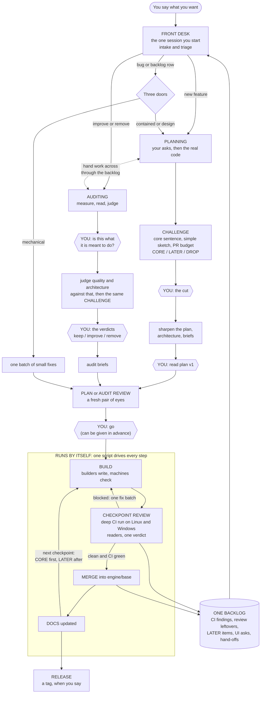

# The factory: design and change list (13 November 2026)

## Revision 1 (13 November, late evening): after his answers

His answers are in `FACTORY-CALLS-2026-11-13.md`. The pictures are in `FACTORY-DIAGRAMS-2026-11-13.md` (seven small diagrams with plain captions and a builder's key under each). What changed in this file:

1. **Name.** It is "the factory", independent of QMX. QMX is its first project. Home: `D:/factory/`, with QMX's own settings in `D:/factory/projects/qmx/`. No codename. (Sections 3.6, 9.)
2. **The audit branch starts with intent.** It first recovers what the area is meant to do (PR descriptions, plans, his words), confirms the unclear parts with him in plain words, and only then judges quality and architecture against that. The challenger runs inside audits: a restructure or a decoupling must name what it measurably improves. Removals he cannot judge from code are decided by Fable with a plain-words explanation each; he is asked only what he can see or use. Planning's `funnel-subtract` and the audit now share one removal mechanism. (Sections 2.3, 2.4, 3.4.)
3. **H9 has two options,** with a recommendation: recover intent for every area in one go, then judge and build one cluster at a time. He holds this until morning. (Section 8.)
4. **H6 answered:** tags only, no staging branch; a `release/vN` branch is cut only when a released version needs a fix; the UI merges into `engine/base` as its own folder. (Sections 2.10, 8.)
5. **H15 is no longer a rule.** Planning, auditing, reviewing and building run at the same time. Section 3.7 says how that is made safe and what is truly one-at-a-time.
6. **Code standards (H11).** There are few today and nobody sat down and set them. They are derived during the first audit, picked by Fable where packages disagree, confirmed with him where they are product-flavoured, then written into the repo. (Sections 2.4, 7, unit U30.)
7. **Models.** The factory stays Claude Code only. Another model arrives as a `--model` name through a proxy, so the Orca option is dropped. Fable stays scarce: one seat at a time across the whole machine, each seat one line of settings that can be turned down to Opus.
8. **Words.** "Napkin" is now "a simple sketch"; "PR budget" is explained where it first appears.
9. **One index** (his later note): `D:/factory/INDEX.toml`, the file every session and agent reads first: each phase's skill, inputs, outputs, gate and next step, the loops, and where memory, rules, standards and records live. (Sections 3.8, 11.9, unit U40.)
10. **The graph and its loops, written down:** every loop has an exit and a number of rounds after which it stops and asks him. (Section 3.9; diagram 6.)
11. **Skills are composed, not picked:** section 3.10 names the BMad, poteto, pstack and Matt Pocock pieces each phase is built from.
12. **Built for the builders** (his later word: depth where depth helps). Three new sections: 11 (the contracts the lanes share: file formats, command lines, exit codes), 12 (a buildable spec for every unit), 13 (the edge-case scenario suite in full: every matrix row, every loop limit, ten cross-branch hand-offs, nine drills on the real machine).
13. **Units.** Changed: U02, U05, U12, U13, U20, U21, U22, U26, U28, U30, U31, and U17 is split in two. New: U17a (the stashed GitHub backend goes onto the branch first, switched off, because it touches 13 kit files later units also touch), U38 (claims, the merge queue, the worker pool), U39 (UI checks in CI), U40 (the index), U41 (commit the UI folder). Removed: LATER proposal L5 (Orca). **U01, U03, U04 and U06 keep their files and their proofs.** Their specs in section 12 say more than the one-line rows did: U03 also seeds `CLAIMS.tsv` and adds an `add_plain` command helper; U04 also gives `ship gate` and `ship phase --set` and `--words`, and reads the extra index keys (`project`, `area`, `gates.intent`, `gates.verdicts`); U06 also adds a three-line `clock.py` and an optional fallback model per role.

Status: design only. Nothing here is built. The only files written are this one and `FACTORY-DIAGRAMS-2026-11-13.md`. Written by one Fable agent on his ask ("I may require you to bring in Febo ... maybe for each phase", 18:49 UTC).

Read for it: `HIS-WORDS-2026-11-13.md` in full, `GAP-AUDIT`, `JOURNEY`, `RESUME`, the eleven named memory notes, `SHIPPING-METHOD.md`, `PLANNING-FUNNEL.md`, `BUILD-PHASE-REDESIGN.md`, `EDGE-CASES-2026-11-12.md`, everything under `standing/`, the twelve local skills, and the six groundings. Facts rechecked today: `origin/ci/github` is `9eb140303`, `origin/ship/kit` is `51d95409a`, `origin/engine/base` is `3ae41ffcb`, the ship-kit stash is still `stash@{0}`, `engine/base` has no branch protection (404), the repo's default branch is `main`, PR #1 is open, and `claude --help` (version 2.1.322) lists `-p`, `--model`, `--effort`, `--permission-mode`, `--permission-prompts none`, `--settings`, `--session-id`, `--name`, `--output-format json` and `--disallowedTools`.

Words used below:
- **Front desk**: the one session he starts and talks to.
- **Conveyor**: one script, `ship chain`, that runs every step after his go.
- **Worker**: one headless Claude Code run (`claude -p`) started by the conveyor for one job.
- **Project**: a codebase the factory ships. QMX is the first. Everything that is true only for QMX sits in its project folder, `D:/factory/projects/qmx/`.
- **Program**: one folder holding one piece of work from his words to merged code.
- **PR budget**: a rough count of PRs agreed up front, from a simple sketch of the logic, before any detailed planning. Scope bends to fit the budget, not the other way round.
- **Checkpoint**: 5 to 8 slices that are reviewed and merged together (the old "stop point").

---

## 1. Overview, in plain words



1. **You start one session and say what you want.** That session is the front desk. It is the only place you are ever asked anything.
2. **Two branches feed the same build.** PLANNING adds a feature. AUDITING improves or removes what exists. A bug goes through one of three doors by how far it reaches.
3. **Planning now has a CHALLENGE stage.** A Fable agent says in one sentence what you are really asking for, draws the simple logic as a small sketch, sets a PR budget (a rough PR count agreed up front), and sorts every idea: CORE (built first, proves the feature works), LATER (nice-to-haves, built after the core is proven), DROP (only with your yes). It is allowed to say no.
4. **Auditing is its own phase, and it starts with intent.** It first works out what the area is meant to do, from the PR descriptions, the plans and your own words, and checks the unclear parts with you in plain words. Only then does it judge the code against that: does it deliver, can the tests fail, is the architecture simple to explain, is it maintainable, does it recover by itself. The same challenge runs here: a restructure must name what it makes better, or it is dropped. You get a verdict per part (keep, improve, remove, and what replaces it). Removals you could not judge from code are decided by Fable and explained to you in plain words.
5. **The branches hand work to each other.** An audit that finds a redesign or a missing feature parks it for planning. A plan whose area is too shaky asks for an audit first. Each crossing is a row in the one backlog and needs your yes.
6. **You are asked only at a few points:** in planning, the cut (after the challenge) and plan v1; in an audit, the intent check and the verdicts; then go. Always plain words, at most 4 questions at a time, each with a recommendation. You can give "go" in advance.
7. **After go, nothing needs you.** One script, the conveyor, starts each agent, runs each check, and waits. No agent sits waiting on a test. It builds a checkpoint, reviews it against the plan, fixes what the review found, merges, updates the docs, and takes the next checkpoint.
8. **A merge needs two yeses from machines and agents, none from you:** the review is clean, and CI is green on Linux and Windows for that exact code. `main` still moves only by your click.
9. **CORE checkpoints are built first.** The last CORE checkpoint must show the core sentence is true on the real thing. LATER checkpoints start only after that.
10. **Every phase says what touches the UI.** Each plan has an Interfaces section, each brief an `API:` line, and a generated contract file in the repo shows every route. A later UI agent wires from that file, not from guesses.
11. **CI findings never get lost.** Old findings, flaky tests, review leftovers, LATER items and UI asks all land in one backlog. The front desk shows it to you and nothing is pulled from it without your yes.
12. **A power cut, a usage limit or a closed app does not lose work.** Every step writes a file when it finishes, so the conveyor picks up at the first step with no file. Recovery is a script, never an agent's memory.
13. **Staging means a release-candidate tag,** tested by CI and then run on your demo account on your PC. There is no staging branch, and hosting waits.
14. **Several things can run at once.** Planning, auditing and reviewing only read, so any number can run. Two builds can run together when they touch different files. Only three things take turns: merging into `engine/base`, writing the shared records, and the Fable seat.

---

## 2. Phase by phase

Every phase has the same seven lines. "Gate" is the script that must pass before the next phase starts.

### Models and effort

| Seat | Model | Why |
|---|---|---|
| Front desk, planning lead, every stage agent not named below | Opus 5.5, effort high | His default (CLAUDE.md), "Opus 5.5 in high" (18:26) |
| Challenger (planning, and the audit's cut) | **Fable**, one agent | He asked for it (18:20); judgement on scope is the whole job |
| Technical decision batch (stage 5 answer-linker) | **Fable**, one agent per batch | His 12 Nov 13:55 word; already in the funnel |
| Audit judgement (verdicts, the removal calls he cannot judge, the cut) | **Fable**, one agent per area or cluster | "Fable may be needed here" (18:49); his H10 answer: "Fable helps make the calls" |
| Fixed-line fault walk at a checkpoint that touches exits, brakes, the kill switch or money | **Fable**, one agent | The walk that would have caught four of the six high bugs. He said yes (H3) |
| Audit intent recovery, builders, fixers, readers, grounding, plan review, docs, verdict writer | Opus 5.5, effort high | "Builders always Opus"; intent recovery is collecting and comparing sources, which Opus already does in the funnel |
| Anything else | Never Fable, never Sonnet for substance | Standing rule |

**Fable stays scarce** (his H3 answer: it is costly, the promotion will end, he may downgrade). Four seats, and one machine-wide lock (`fable.lock`) so only one Fable agent runs at a time across every program. Each seat is one line in the project's settings (`roles`), so turning a seat down to Opus is a one-word change. When Fable cannot be started, Opus stands in and the log says so.

**Other models later.** The factory stays Claude Code only (his answer). A model that arrives through a proxy inside Claude Code is just another `--model` name on a worker's start. No other harness is designed for. The front-desk skill's first step sets its own session to Opus 5.5 high and says so in one line, because his default session model is Fable at xhigh (SYSTEM-AUDIT F5).

### 2.1 Intake and triage (the front desk)

- **Purpose.** Turn his words, or a backlog row, into the right start: a plan, an audit, or a door.
- **In → out.** His message, `_records/BACKLOG.tsv`, `ship phase` output → a program folder `D:/QMX-worktrees/plans/<slug>/` with `PROGRAM.yaml` (`kind:` set), or a one-line answer.
- **Who.** The front-desk session, skill `factory` (replaces `ship-next`, `ship-build`, `stop-review`, `ship-merge`, and the trigger part of `plan-review`). Opus 5.5 high.
- **Gate.** `ship phase` (replaces `phase_state.py`): it refuses to start a second anything on a program whose lock is held. Triage rule: a new feature goes to planning; "improve, remove, clean, audit" goes to auditing; a bug or backlog row gets a door from its blast radius (mechanical, contained, design). When the door is unclear, one Opus agent tags it with the `blast-radius` lens.
- **UI.** A UI ask (from `_records/` rows of source `ui-ask`) is treated like any other row: it becomes an ask only on his yes.
- **Hands off.** Starts `plan-feature` or `audit-area` in the same session, or builds a sweep program for mechanical rows.
- **He sees.** One line: what it understood, which branch, which folder. For "continue" or "where are we": the state in plain words and what waits on him.

### 2.2 Planning (the funnel)

- **Purpose.** Remove ambiguity until any model could build it. Unchanged from 12 Nov, with the challenge stage added after grounding.
- **In → out.** His asks → `SCOPE.md`, `GROUND.md`, `CHALLENGE.md`, `PLAN.md`, `ANNEAL-LOG.md`, `EDGE-CASES.md`, `CAN-CHANGE.md`, `REMOVED.md`, `arch/ARCH.md` (now with `## Interfaces` beside `## Operations`), `SLICES.md`, briefs, `PROGRAM.yaml`.
- **Who.** The front desk is the lead (skill `plan-feature`). Stage agents are Opus 5.5 high, one skill each: `funnel-expand`, `funnel-ground`, `funnel-challenge` (Fable), `funnel-anneal`, `funnel-subtract`, `funnel-architect`, `funnel-handoff`. The lead alone writes decision files and asks him.
- **Gate.** `check_chain.py --stage <stage>` after every stage, `check_plan.py` at handoff.
- **UI.** Grounding reads `contracts/` (the generated API contract) and the open UI asks. The architecture must answer "what does this add, change or remove at the UI's door, and which screen uses it", even when the answer is "none, because ...". Every brief gets an `API:` line.
- **Hands off.** Writes the program folder, commits it on the `plans` branch, and starts the conveyor at plan review.
- **He sees.** The restatement and asks (start); the cut (after the challenge); plan v1 as a short explainer page with the open decisions (after annealing). If he is away, the batch waits in `WAITING.md` and work that does not depend on it goes on.

### 2.3 Challenge (new stage 2b, between Ground and Self-annealing)

- **Purpose.** Call him out. Stop a 3-PR idea becoming 70 PRs. Order CORE before LATER.
- **In → out.** `SCOPE.md`, `GROUND.md`, decisions, his rulings, the two tests in the project rules ("is it configuration?", "if left out now, does the core get reworked later?") → `CHALLENGE.md`:
  1. **Core sentence**: one sentence, at most 25 words, a checkable statement of what is true when the feature works, quoting him.
  2. **Premise**: the one thing every ask assumes, written down and attacked once.
  3. **Simple sketch**: the logic as 5 to 10 plain lines or one small diagram, and the thinnest end-to-end path that proves the core sentence.
  4. **PR budget**: `core <n>, later <m>, checkpoints <k>`, a rough count read off the sketch. The budget is set first and scope bends to fit it.
  5. **Verdict table**: every ask, proposal and not-yet-specified item is CORE, LATER or DROP, with one line of reason and its evidence.
  6. **Call-outs**: noise and bloat, one line each, with evidence. No quota: "nothing to call out" is a valid result.
- **Who.** One fresh Fable agent, skill `funnel-challenge`, spawning nothing. It reads poteto-mode's "No is an acceptable answer", steelmans each ask and then attacks it in two voices (forge-idea's method), and uses named elicitation methods (pre-mortem, Occam, subtraction, reframe). A short party round runs only on contested rows.
- **Gate.** `check_chain.py --stage challenge`: every item has exactly one verdict; the core sentence and the budget line exist; every call-out carries evidence; a DROP or a demotion of one of **his** asks has a decision file `For: him` with his quoted answer. The agent may drop or park its own proposals. It only recommends on his.
- **UI.** A screen he asked for is judged like any ask. A route nobody's screen needs is a call-out.
- **Hands off.** `CHALLENGE.md` to annealing, which now works only on CORE and LATER. A new proposal raised later is LATER by default. Plan lines inherit their ask's verdict. `funnel-handoff` puts every CORE checkpoint before any LATER one, and the last CORE checkpoint's done line is the core sentence.
- **In audits too.** The same skill runs in audit mode inside the audit's judgement (section 2.4, stage 5). There the things being sorted are proposed improvements, and a restructure or decoupling is CORE only when it names what it measurably improves.
- **He sees.** The cut: the core sentence, the sketch, the budget, and at most 4 questions (the core sentence, the budget, any DROP of his own ask, contested calls), each with a recommendation. Growth past the budget later needs his yes, and the challenger is asked again why it grew.

### 2.4 Audit (its own branch, intent first)

His model (13 Nov, late): "Auditing requires you to know what is right and what is wrong. You can't just audit without knowing what something is meant to be doing." So the audit has two halves. First it recovers and confirms what the area is **meant** to do. Then it judges what is **there** against that.

- **Purpose.** Improve or remove what exists, judged as a senior engineer leading engineers would. Never delete without knowing why and what replaces it.
- **Unit.** One area (a package or app plus its seams), or a cluster of areas audited together. His main areas: QMB, QML, QMA, QMF (it still exists: `packages/qmf-*`, about 87,000 lines), the Library, the mini apps and workflows, and the DevOps layer of each.
- **In → out.** His mandate and the area → `SCOPE.md` (mandate quoted), `CENSUS.md`, `INTENT.md`, `readers/*.md`, `FINDINGS.tsv`, `CAN-CHANGE.md`, `AUDIT.md`, an explainer page, then by door: briefs, or a hand-off row.

**The stages.**

| # | Stage | Who | What comes out |
|---|---|---|---|
| 1 | **Census** | script (`census.py`) | Size, biggest files, test and quality numbers, routes, registries, and the **intent sources** for the area: its merged PRs with their descriptions, the plans and decision records that name it, the docs that describe it, his own turns about it (`his_words.py`), the journeys that touch it |
| 2 | **Intent recovery** | Opus readers | `INTENT.md`: what the area is meant to do, as plain "it should ..." lines (`N1`, `N2`, ...), each with its sources. Beside them, the **ambiguities**: sources that disagree, intent nobody wrote down, things an agent decided that he never saw, and plans or PRs that promised something |
| 3 | **Intent check** | him, at the front desk | A short explainer page ("this is what we think QMB is for") and at most 4 plain-word questions per batch, none about code. His answers settle the `N` lines. These are the yardstick for everything after |
| 4 | **Quality and architecture, against the confirmed intent** | a probe script, then Opus readers in parallel | Per `N` line: delivered, partly, not delivered, or **built though nobody asked**. Then the lenses below. Findings in `FINDINGS.tsv` |
| 5 | **Judgement and the cut** | one Fable agent, then an Opus screen | `AUDIT.md`: the area explained on one page with two diagrams; a verdict per part; the removal calls; the cut against a PR budget |
| 6 | **The verdicts** | him, at the front desk | The explainer page, and only the questions he can answer |
| 7 | **Handoff by door** | script or light funnel | Briefs, or a hand-off row to planning |

Stages 1, 2, 4, 5 and 7 run on the conveyor. If he is away at stage 3, stage 4 starts on the `N` lines that had no ambiguity and waits on the rest.

**Stage 4, the lenses.** One reader per part of the area. Each first writes how the part works in plain words.
- **Delivers the intent.** For each `N` line: where the code does it, or that it does not. Code that serves no `N` line is listed with who calls it.
- **Tests that cannot fail.** `probe_tests.py` runs the "returns nothing" probe first (a test that still passes when its subject returns nothing is a false green); mutmut survivors come from the CI baseline. The reader classifies each hit (rewrite, delete, keep) with the probe output as evidence.
- **Architecture.** The deletion test, depth, seams, and "can a new reader find where X comes from in 30 seconds". High level and low level.
- **Maintainability and standards.** Patterns that are unusual, opinionated, tribal or consistent, and where packages disagree with each other. This is where QMX's code standards come from (see below).
- **Operations.** Logging, monitoring, self-recovery, backend operations, and the stores (torn writes, migrations, backups).
- **The UI surface.** Routes no screen needs, model-only rows a screen needs, error shapes.

"This is fine" is a welcome answer. There is no quota. A `must` needs a run or a walk as proof.

**Stage 5, judgement.** One Fable agent reads the census, the confirmed intent and every reader's notes.
- **Verdict per part:** KEEP, IMPROVE, REMOVE, ASK HIM, WAIT. Each has why, **what replaces it** ("nothing, because ..." is allowed), its door, and whether it is one-way.
- **The challenge runs here** (`funnel-challenge` in audit mode). Every proposed improvement is CORE, LATER or DROP against a PR budget. A restructure or a decoupling (for example, moving mini apps and workflows out of QMX) is a **candidate, not a given**: it is CORE only when the agent names what it measurably improves (a number: load time, test run time, lines a reader must hold, coupling counted as imports across the seam, mutants killed) and the evidence that it will. Otherwise it is LATER or DROP. "It would be cleaner" is not a reason.
- **Who decides a removal** (his H10 answer). He often cannot tell what code does, so he is not asked to judge code.

  | The removal | Who decides | What he gets |
  |---|---|---|
  | Changes nothing he can see or use: dead code, duplicates, old paths nothing calls, tests that cannot fail, code built though nobody asked and nobody uses | **Fable decides**, logged as "Fable decided X because Y" | One plain line each in the explainer: what it was, why it goes, what replaces it, "you will notice nothing" |
  | Takes away something he can see, use or was promised: a feature, a screen's data, a setting, a way of working | **He decides** | A plain-word question with a recommendation: "QMB can do X today. Nothing uses it. Keep it?" |
  | Touches a fixed line (money, exits, the kill switch, keys, promotion to live), or data he owns on disk | **He decides** | The same, with what could go wrong |

  A fresh Opus agent then screens Fable's list for a product call hidden in technical clothes, the same screen the funnel's stage 5 uses. Anything it catches moves to him.
- **Size shown as a number:** lines out against lines in, per verdict. A number to look at, never a target.

**Stage 7, handoff by door.** Mechanical rows: `sweep_briefs.py` writes the briefs; no annealing, no architecture. Contained rows: a light funnel (lenses 1 to 4 and 7, an element index, handoff). Design rows and missing features: a hand-off row to planning (section 3.3). The audit never plans a feature itself.

**One removal mechanism for both branches.** Planning already removes code: `funnel-subtract` lists what a plan may delete in the area it touches. The audit uses the **same skill at area scale**, the same row (`X` rows in `CAN-CHANGE.md`: what, serves, callers, blast radius, frees, decider), the same ledger (`REMOVED.md`, moved to the project's records at merge), the same `remove` slice kind and callers proof, and the same review walk. Two things are added to the row for both branches: `Replaced by:` and a plain-words line. The decider rule above applies in planning too. So "removed, and why" is one list, whichever branch removed it.

**Where code standards come from** (his question: "do we have any yet, who set them?"). Today there are a few and nobody set them as standards: the dependency-direction rule from the architecture he ratified, the money-arithmetic scan, the linter settings, the failure register, and the "traps" list an agent wrote on 12 Nov from past failures. So they are **derived, then confirmed**:
1. The first audit's standards lens writes down what the code already does consistently, and where packages do the same thing two ways.
2. At judgement, Fable picks one way for each disagreement and says why in a line.
3. He confirms only the ones that are really product rules (for example "configuration, never caps", which is already his).
4. They are written as small one-rule files in the repo with an index, and wherever a rule can be a lint or a script it becomes one, so it is enforced by a machine and not by review comments.
Each later audit adds to the same list.

- **Who.** Skill `audit-area`. The front desk runs stages 3 and 6.
- **Gate.** `check_chain.py --kind audit`: every ambiguity is answered by him or marked "not needed for this audit, because"; every finding names the `N` line it is judged against, or "no intent line"; every finding has a verdict; every approved IMPROVE or REMOVE reaches a brief, a LATER row or a hand-off row; every REMOVE has `Replaced by:`, a callers fact and its plain-words line; every removal in the "he decides" rows has his yes; every restructure marked CORE names its measure.
- **UI.** The sixth lens above. A removal that changes the contract counts as "takes away something he can use".
- **Hands off.** To audit review, with `kind: audit` in `PROGRAM.yaml`, then the same build, checkpoint review and merge.
- **He sees.** Twice, both as a short page: "what this is meant to do" (stage 3), and "what stays, what goes, what replaces it, size before and after" (stage 6). Each time, at most 4 questions.

### 2.5 Plan review or audit review

- **Purpose.** A fresh session checks the plan before anything is built. Planning and review are close: the review judges against his words, the challenge and the plan (or the audit's approved verdicts).
- **In → out.** The program folder → `plan-review/scope.md`, `logic.md`, `prs.md`, `grounding.md`, `FIXES.md`, `QUESTIONS.md`.
- **Who.** A worker (Opus 5.5 high) that runs four readers as subagents and waits for them in the same turn. The scope reader also reads `CHALLENGE.md` (did LATER stay LATER, does the slice count fit the budget) or `AUDIT.md` (does each slice close an approved finding). A sweep program gets the scripts and the grounding reader only.
- **Gate.** `check_chain.py --stage handoff` and `check_plan.py` pass; `FIXES.md` is empty after one round trip (a short planner-fix worker applies it; no session messages); `gates.go` is set.
- **UI.** The `prs.md` reader checks every brief's `API:` line against the architecture's Interfaces rows.
- **Hands off.** `gates.go` set means the conveyor arms the build. If he gave go in advance and the review is clean, within budget and has no question, the conveyor writes `gates.go: {by: him, source: <his advance go>, advance: yes}` itself.
- **He sees.** Nothing when it is clean and go was given in advance. Otherwise at most 4 questions, the proposals pick list, and "go?".

### 2.6 Build

- **Purpose.** Turn briefs into landed slices. No AI reviewer per slice (his 12 Nov ruling).
- **In → out.** `SLICES.md`, briefs, chain packets → slice branches, PRs into the build branch, `evidence/`, `checks/`, `state.json`.
- **Who.** The conveyor's build loop, `ship run`, is a **script**. It is the old rules card as code: fill seats in lane order, `dispatch`, start a builder worker in its worktree, read `READY <sha>` or `BLOCKED <reason>` from the worker's result, `verify_ready`, `slice_checks`, `land`. Builders are Opus 5.5 high workers; a red check goes to a fresh fixer; a second red parks the slice. Builders never wait on a check. There is no coordinator session any more.
- **Before it arms.** `gates.go` is set, and the program **claims its files** (the union of its slices' file lists) in the shared claims list. Where another live program already claims a file, only the slices that overlap wait; the rest build (section 3.7). Seats come from one machine-wide pool, so two programs building together share the laptop instead of doubling the load.
- **Gate (per slice, scripts).** Files inside the brief; the `TRACE:` line; no credit line; the brief's facts and the SAFETY fact; lint, types (ratchet), touched tests; the parent rule **by slice kind** (below); Vulture and Skylos with no new finding; the contract check (the routes that changed equal the brief's `API:` line). The Linux slice run on GitHub is awaited by the script, with a time limit.
- **Slice kinds** (a new `kind` column in `SLICES.md`):

  | Kind | What it is | Parent rule |
  |---|---|---|
  | `feature` | new behaviour | each new test fails at the parent on an assertion and passes at the head |
  | `pin` | a photo of today's behaviour before a change | each new test passes at the parent **and** the head, and the probe shows it fails when its subject returns nothing |
  | `refactor` | same behaviour, better shape | the pins it depends on stay green; no new mutant survivors in changed functions |
  | `remove` | delete code | the callers fact is zero across both workspaces and every registry; a deleted test carries its probe output or dies with its subject; `Replaced by:` is filled |
  | `docs` | docs only | docs lint |

- **UI.** A backend slice writes the route and regenerates `contracts/`; it writes no UI code (project rule). UI wiring is its own program kind, `wire`, later.
- **Hands off.** `CHECKPOINT <X> built` → the conveyor starts the checkpoint review and keeps pre-building the next checkpoint on files the review cannot touch.
- **He sees.** Nothing, unless something truly waits on him (`WAITS-ON-YOU.md`). "Where are we" at the front desk answers by ask: "S2: 3 of 4 slices landed, one parked".

### 2.7 Checkpoint review

- **Purpose.** The only AI review. It looks inside each slice and across them, against the plan or the audit's intent.
- **In → out.** The checkpoint's commits, the chain, `REVIEW.md` rules → `stop-review/<X>/MAP.md`, reader notes, `REVIEW.md` (verdict), and on BLOCKED a fix program.
- **Who.** All started by the conveyor:
  1. the deep run on GitHub for the exact tip (script; local Windows run only as the fallback);
  2. `ship trace --stop <X>` writes the map (script);
  3. readers as parallel workers (Opus 5.5 high), one per architecture element plus the chain walk, the fault walk (Fable on fixed-line checkpoints), the operations walk, and for audit kinds the equivalence, callers and finding-closed walks;
  4. when the readers and the deep run are done, one verdict worker (Opus 5.5 high) screens the builder decisions, reads `summary.json` from CI, and writes one verdict.
- **Gate.** `VERDICT: CLEAN` with an END line for the tip, and the deep run green for that tip. A reader that does not finish in its time limit is restarted once, then its element is "not read", which blocks. BLOCKED means one fix batch as a fix program (`kind: fix`), then round 2, which judges only whether each finding is fixed and whether the fix adds a new one, with a full deep run on the fix tip. No third round.
- **UI.** The API walk: `ship contract-diff <from>..<tip>` lists every route, payload and stream that changed. An undeclared change is Important.
- **Hands off.** CLEAN → merge. Pre-existing and Nit findings, and every builder `findings.md` line → backlog rows. At the last CORE checkpoint the verdict must also answer: is the core sentence true on the real thing?
- **He sees.** Nothing unless round 2 is still blocked.

### 2.8 Merge

- **Purpose.** Land a clean checkpoint without him.
- **Who.** A **script**, `ship merge <X>`. No agent runs `gh pr merge`.
- **Steps.** (0) Take the **merge lock**: one merge into `engine/base` at a time, across every program. A second program's merge waits its turn. (1) Every BLOCKED record has a later CLEAN. (2) The build branch tip is the reviewed tip. (3) If `engine/base` moved (another program merged first), merge it into the build branch, **regenerate the shared generated files** (`uv.lock`, the quality baselines with gone rows pruned, the contract dump) by script, never by hand, and run the deep run on that commit; a real conflict becomes a one-slice fix program. (4) Open or reuse the PR with the body the verdict worker wrote. (5) Wait for the required `gate` check. (6) `gh pr merge --merge`, then prove the reviewed tip is an ancestor of `engine/base`. (7) `ship merged <X>`; move the checkpoint's removal rows to `_records/REMOVED.md`; update the backlog; release the claims of the slices that merged; release the merge lock. (8) Start the docs step.
- **Gate.** Branch protection on `engine/base`: the `gate` check required, branch up to date, no bypass (he said yes, H4, "as long as the review is thorough"). The script cannot merge on red even if it tried.
- **UI.** The merge note has a "For the UI" block from the contract diff, also appended to `contracts/CHANGELOG.md` by the docs step.
- **Hands off.** The next checkpoint opens and its pre-built slices land. After the last one: `run_report`, `teardown`.
- **He sees.** Per ask, in his words: "You asked for X. Now true: ... Parked: ... For the next plan: ...". For an audit: "Removed N lines. What replaces them: ... Proof nothing changed for you: ...".

### 2.9 Docs

- **Purpose.** Docs catch up after every merge, for both branches. The backfill rides on audits.
- **In → out.** The merged checkpoint's `DOC:` lines → `docs/_pending.tsv` → a small PR `docs/<program>-<X>` into `engine/base`.
- **Who.** A script collects the lines and flags any slice that changed a mapped area's code but said `DOC: none` (needs `code_paths:` per component). One docs worker (Opus 5.5) edits only the docs the lines name, with the code as truth, stamps each claim `verified: <commit>`, and marks a decision record superseded when its code went.
- **Gate.** Docs lint and citation check (the documentation-factory's `lint_docs.py` and `check_citations.py`); a docs-only PR passes the `gate` on that alone and merges itself. A docs failure never blocks code; it becomes a backlog row.
- **Backfill.** An audited area's one-page explanation becomes its component doc, with `code_paths:` added. No separate sweep of the 700 old PRs: areas are documented as they are audited or first touched.
- **UI.** `contracts/CHANGELOG.md` and the screen map are updated here.
- **He sees.** One line in the merge note: which docs changed.

### 2.10 Release and deploy

- **Purpose.** Say what "staging" and "deployment" mean for QMX now, with no paid hosting.
- **His question (H6): a staging branch, `release/vN` branches, or tags only?** **Recommendation: tags only, plus a release branch cut on demand.**

  | Option | Verdict | Why |
  |---|---|---|
  | A staging branch | No | It is a second place where code waits. Every change would be merged twice and tested twice, and the two drift. A tag freezes a commit just as well, with nothing to keep in step |
  | Tags on `engine/base` (`v0.x.y-rc.N`, then `v0.x.y`) | **Yes, the default** | One line of code, one gate. A candidate is "this exact commit", tested by CI, then run on his demo account |
  | `release/vN` branches | **Only when needed** | Cut from the `vN` tag on the day a released version needs a fix while `engine/base` has already moved on. The fix lands on `engine/base` first, then is copied to `release/vN`, which has the same protection and gate. Until that day no release branch exists |

- **Staging** is therefore a release-candidate tag on an `engine/base` commit that passed the gate. It runs the release level in CI. Then the candidate runs on his demo account on his PC for as long as he sets. Then the real tag.
- **Does the UI merge into `engine/base`? Recommendation: yes, as its own folder (`apps/qmx-desk`), at the points he approves.** His first release is "a combined one with the UI", a tag can only freeze one commit, and the contract check needs the backend and the UI side by side. A UI that lives on its own branch for months drifts, which is what happened to the stub still sitting on `engine/base`. How: first commit it to `ui-redesign` (he said yes, H12). When he approves a design round, that round merges into `engine/base` through the same gate, with a UI build-and-lint job added to CI. It needs no wiring to merge: a screen on demo data touches no backend code. Wiring comes later as `wire` programs. The UI design loop itself stays his, outside the factory.
- **Release level in CI, in three steps as the pieces exist:**
  - R0, now: the deep run on both systems, a start with no data on both, the node-on-a-fresh-server test, **every red blocks** (the known-reds list is ignored), a release verdict, and a GitHub Release with notes built from the merge records.
  - R1, when an installer program has shipped: build the installer and install it once.
  - R2, when the UI is wired: build the UI and run a browser smoke test.
- **Deploy** in the factory means only this release-and-install path. Promoting a unit, putting a node on a server and switching node code are product features; CI proves them on free runners, and real hosting waits by his word. Every architecture's Operations section gains one line: "Deployment: how this change reaches a running QMX".
- **Who.** Scripts and CI. He makes the tag (or says "tag it").
- **He sees.** The release notes and a red or green verdict.

### 2.11 "Continue"

- **Purpose.** One word that always does the right thing.
- **Who.** The `factory` skill. It triggers only on a QMX program word or pipeline phrase ("continue the run", "continue pod-scalping"), never on a bare "continue" in an unrelated session.
- **What it does.** Runs `ship phase`. Then: answers what waits on him (reads `WAITING.md` and `WAITS-ON-YOU.md`, takes his answer, routes it, un-parks a slice if its checkpoint is still open); restarts a dead conveyor with `ship chain --resume`; or says it is running and starts nothing.
- **He sees.** Where the program is, in plain words, and the one thing he can do.

---

## 3. The connections

### 3.1 One backlog

`D:/QMX-worktrees/plans/_records/BACKLOG.tsv`, on the `plans` branch, rendered to `BACKLOG.md` for him. Only `ship backlog` writes it, under the factory lock.

| Column | Values |
|---|---|
| `id` | `B-<n>`, never reused |
| `source` | `ci-vulture`, `ci-skylos`, `ci-mutmut`, `ci-types`, `known-red`, `flaky`, `review` (Pre-existing or Nit), `builder` (a `findings.md` line), `parked` (a slice that was parked when its checkpoint merged), `audit`, `later` (a LATER item), `ui-ask`, `handoff`, `his-ask` |
| `what`, `where` | plain words; file and line where there is one |
| `first_seen`, `program` | date; the program that raised it |
| `touches` | a fixed line, or none |
| `door` | `mechanical`, `contained`, `design`, or `triage` (not yet judged) |
| `status` | `open`, `planned in <program>`, `closed <sha>`, `dropped (<his words>)` |
| `hops` | how many times it crossed between branches |

Feeds: `tools/ci/backlog.py` after every merge and every nightly walk (baseline rows, known reds, flaky tests, non-blocking notes, walk survivors); the verdict worker (Pre-existing, Nit); the checkpoint (builder findings); the challenge and the audit (LATER rows); crossings (hand-off rows); the front desk (his "queue this").

Rule: builders never read the backlog. Only intake pulls from it, and only with his yes.

### 3.2 The three bug doors (his 12 Nov ruling)

| Door | Test | Path |
|---|---|---|
| Mechanical | one obvious fix, no behaviour he can see changes, no fixed line | grouped into a **sweep program**: briefs from a script, scripts-only plan review plus a grounding reader, build, a light checkpoint review (scripts and one reader), merge |
| Contained | one area, behaviour changes, blast radius known | light funnel: ground, lenses 1 to 4 and 7, element index, handoff; the challenge is one paragraph |
| Design | crosses areas, or touches a fixed line, or needs a product call | the full funnel, challenge included |

### 3.3 Audit and plan, both directions

The link is simple: **either branch can leave a row in the backlog for the other, and he says yes before it is picked up.** The row points at the folder that holds the context, so nothing is retold from memory.

| Crossing | When | How the context travels | His part |
|---|---|---|---|
| Audit → plan | A finding is design-level, or a feature is missing | A backlog row `source: handoff`, `door: design`, pointing at the audit folder. Planning starts with `inputs.audit: <folder>` in `PROGRAM.yaml`; `funnel-expand` reads the confirmed intent (`INTENT.md`), `AUDIT.md`, the finding ids and his approval quote; `funnel-ground` takes the audit's facts as its starting ground | His yes to start it (it is new scope) |
| Plan → audit | Grounding shows the area is not fit to build on: nobody can say what it is meant to do, its tests mostly cannot fail, or it disagrees with its own docs | The planner proposes "audit this area first" at the cut. A scoped audit (`audit-area --scope <paths> --for <program>`) runs its stages 1 to 5 on just those paths; its `INTENT.md` and `AUDIT.md` join the program's ground | His yes at the cut |
| LATER → later checkpoints | The core sentence is proven at the last CORE checkpoint | LATER asks already carry verdicts and plan lines. Their briefs are written only then (`handoff: deferred`), on the new tip, so they are not stale. LATER items not in this program go to the backlog | None, if they fit the LATER budget he agreed |
| Review → planner | A builder or reader says the plan itself is wrong (`BLOCKED chain`) | `CHAIN-ISSUES.md`, shown in the checkpoint's map. Briefs never change mid-run, so the verdict worker puts a mechanical one into the fix batch as a slice that cites the chain id; a product call waits on him | Only product calls |

A row that has crossed once (`hops: 1`) and wants to cross back goes to him, so the two branches cannot bounce work between them.

**Removing code is the same in both branches** (section 2.4, "One removal mechanism"): `funnel-subtract`, the same `X` row with `Replaced by:` and a plain-words line, the same `REMOVED.md` ledger, the same `remove` slice kind, the same decider rule. Planning uses it on the area a plan touches; an audit uses it on the whole area.

### 3.4 Chain ids added

- `N<n>`: an intent line in an audit's `INTENT.md` ("it should ..."), with its sources and, once he has answered, his quoted confirmation.
- `F<n>`: an audit finding (`FINDINGS.tsv`). Columns as the 5 Nov audit used, plus `intent` (the `N` line it is judged against, or "no intent line"), `verdict`, `replaced_by`, `plain_words`, `decider` (`fable` or `him`), `door`, `one_way`, and for a restructure `measure`.
- Verdict on every `S`, `P` and not-yet-specified item, and on every proposed audit improvement: `core`, `later` or `drop` (`CHALLENGE.md`, or the cut inside `AUDIT.md`).
- `I<n>`: an Interfaces row in `arch/ARCH.md`: operation id or stream, route, payload and error shape, the screen or journey that uses it, and `new`, `changed` or `removed`.
- `X` rows (can-change) gain `Replaced by:` and a plain-words line, in both branches.
- In an audit program, `S1` is his mandate quote, his intent confirmations are asks quoting his answers, and each batch of verdicts he approves is an ask quoting his approval. Plan lines cite `N` and `F` ids.

### 3.5 `PROGRAM.yaml`, version 2

One parser in the ship kit (`program.py`) reads it; `ship phase`, `check_plan.py`, `check_chain.py` and the conveyor all use that parser. Today the ship scripts never read the index and three readers use three sets of regexes (SYSTEM-AUDIT, "The program index").

| Field | Written by | Read by | Fixes |
|---|---|---|---|
| `project` (`qmx`), `program`, `kind` (`feature`, `audit`, `sweep`, `fix`, `wire`), `parent` (fix and scoped-audit programs) | planner, audit handoff, verdict worker | everyone | Fix-ness came from the folder name (F6); nothing knew an audit from a plan; nothing knew which project |
| `inputs` (`audit:`, `backlog: [B-ids]`, `ui_asks: [B-ids]`) | intake | expand, ground | Hand-offs had no carrier |
| `area` (the paths an audit or a plan is about) | intake | the claims list (a notice, section 3.7); the census | Nothing said what a program was looking at before it had slices |
| `build_branch` (`build/<name>`, checked), `parent_tip` | planner | conveyor | The prefix was unchecked |
| `core_sentence`, `budget: {core, later, checkpoints, raised: [D-ids]}` | challenge or audit judgement, front desk | handoff checks, plan review, verdict worker | No budget existed |
| `gates`: `cut` and `plan` (planning), `intent` and `verdicts` (audit), `go` (both); each `{by, at, source, advance}` | front desk; the conveyor for an advance go; the verdict worker for a fix program (`by: stop-review`) | `ship phase`; `ship run` refuses to arm without `gates.go` | `scope_gate` was read by `phase_state` only (F10) and never set on fix programs (F6) |
| `stop_points[]`: `id`, `tier` (`core`, `later`), `done_when`, `handoff` (`ready`, `deferred`) | planner | `check_plan` (every ready stop has a slice; order equals `SLICES.md` order), merge note quotes `done_when` | Empty stops wedged the run (F7); `done_when` was never read (F25) |
| `chains[]`: `ask`, `verdict`, `plan`, `arch`, `interfaces`, `slices`, `edge_cases`, `intent`, `findings` | planner | `check_chain`, chain packets, `ship trace` | `chains` was missing from the template (F25) |
| `abandoned: <date>` | front desk | `ship phase` reads it as done; `ship teardown` runs | No abandon path (F19) |

Removed: `repo`, `target_branch`, `ship`, `standing`, `worktree_root` (they are facts about the project, so they live once in the project profile, `D:/factory/projects/qmx/project.toml`), `planner_session` (no session messages any more), `files[]` and `run_files` (written, never read), `stop_points[].merged` (the one copy is `state.json`, written by `ship merged`).

Run-time state lives in `state.json` and `chain.lock` and is written only by scripts. `{FROM}` for a checkpoint is the previous checkpoint's reviewed tip, never a merge sha on `engine/base` (F14).

### 3.6 Where things live

The factory is its own thing. QMX is the first project it ships.

| What | Where | Why |
|---|---|---|
| The factory: its skills, their prompts, templates and scripts | `D:/factory/` (its own git repo; `skills/`), each skill linked into the project's `.claude/skills/` | His words: the phase skills stay on his machine, not in QMX (18:06); skills carry scripts (18:34); "version control" (18:30); and the factory is independent of QMX (his answer). No codename, by his standing preference |
| What is true only for QMX | `D:/factory/projects/qmx/`: `project.toml` (the repo path, the target branch, the worktree folder, the CI workflow, the shared generated files, which model sits in which seat), `PROJECT-RULES.md` (his rulings, the fixed lines, the QMX traps), the QMX review notes | A second project would be a second folder here. Skills read the profile and name no QMX path themselves. Nothing more is built for a second project until one exists (his 12 Nov word: "let's only do it for QMX") |
| The conveyor and the gates | the ship kit, branch `ship/kit`, `tools/ship/` in the QMX repo | Already there, with tests. It reads the project profile. Moving it into `D:/factory/` is LATER proposal L3, worth doing when a second project appears |
| CI code and baselines | the QMX repo: `.github/workflows/qmx-ci.yml`, `tools/ci/`, `ci/baselines/` | CI must find them |
| Code standards | the QMX repo: `conventions/standards/*.md` with `index.yml`, written after the first audit derives them | Rules about the code travel with the code, so every builder's worktree has them |
| The UI contract | the QMX repo: `contracts/` | Generated from the code, checked by CI |
| Program folders and the records (`BACKLOG.tsv`, `REMOVED.md`, `PREFIXES.md`, `CLAIMS.tsv`) | `D:/QMX-worktrees/plans/`, a worktree of branch `plans`, committed and pushed at every phase end | Plans are in git and off the laptop; nothing writes in his main checkout (F3, F11) |
| His research and the method notes | `tracker/` on `main`, as today | "Research lives in the repo" |

Rule of thumb for scripts: runs in CI → `tools/ci`; drives a run → the ship kit; belongs to one phase's thinking → that skill's `scripts/` folder.

### 3.7 Running several things at once

His answer to H15: not a fixed rule. Building, auditing, planning and reviewing can run at the same time, and the factory must make that safe. The idea in one line: **reading is free, writing takes a claim, and merging takes turns.**

**What runs together with no limit.** Anything that only reads: planning sessions, an audit's census, intent and quality stages, plan and audit reviews, checkpoint readers (each works in its own frozen copy of one commit), CI runs (GitHub's machines), docs PRs.

**Builds run together when their files differ.**
- At go, a program **claims** its files: the union of its slices' file lists, written to `_records/CLAIMS.tsv` by `ship claims`.
- If no live claim overlaps, it builds at once beside the others.
- If some files overlap, only the slices that touch them wait (`blocked-by claim <program>`); the rest build. A waiting slice is not a failure and does not count toward the breaker. It starts when the other program's checkpoint holding those files has merged, and its brief's facts are rerun on the new code first.
- Files that are written by a script, not by a person, are never claimed (`uv.lock`, the quality baselines, the contract dump; the list is in the project profile). They are rebuilt at merge time.

**Audits and plans leave a notice, not a lock.** A program that is only reading registers its `area` as a notice. Notices never block. They do two things: the front desk tells him when a plan and an audit are looking at the same area ("an audit of QMB is running; plan on top of its result, or go ahead?"), and because every fact is rerun at the current tip before a handoff, a build that merged into the area in the meantime is always seen. So nobody waits to read, and nobody trusts an old read.

**What is truly one at a time.**

| One at a time | Why | Held by |
|---|---|---|
| Merging into `engine/base` | Each merge must be tested on top of the one before it. The second merger takes the first's code into its branch, reruns the deep run on that, then merges | `merge.lock` |
| Two programs writing the same file | Two builders in one file is a conflict waiting to happen | the claims list |
| Landings on one program's own build branch | As today: one `land` at a time | the program's `chain.lock` |
| Writes to the shared records (backlog, removed list, prefixes, claims) | One small write at a time, each a commit | `records.lock` |
| The Fable seat | His word: scarce, never side by side | `fable.lock` |
| One conveyor and one front desk per program | Two drivers on one program would fight | `chain.lock` |
| The laptop's own heavy test run | A machine limit, not a rule: the local Windows suite runs one at a time | the worker pool |

**The laptop is shared.** Worker seats come from one machine-wide pool (a setting), so three programs do not start nine builders. It is a budget for the machine, never a cap on an agent.

**What catches the quiet clash.** Two programs can touch different files and still break each other. Claims cannot see that. The deep run on the merge result does: the second program to merge is always tested with the first one's code in it.

### 3.8 The factory index: one file every session and agent reads first

His note: BMad works as a cluster because it has an index (bmad-help's catalog, the spine, project-context); poteto-mode has its list of principles and cookbooks. "Every agent always knows where to find who, what, and what to do when." The factory gets the same thing, once: `D:/factory/INDEX.toml`.

| Part of the index | What it holds | Borrowed from |
|---|---|---|
| `phases:` one row per phase and stage | its plain-word triggers ("plan", "audit", "continue", "where are we", "this is broken"); the skill and the skills it is composed from (3.10); who runs it and on which seat; what it reads; what it writes; its gate script; **what comes next**; the loops it can enter | bmad-help's catalog: a table an agent reads to answer "what now" |
| `loops:` one row per loop | where it starts and returns to, its exit condition, how many rounds before it stops and asks him (3.9) | new |
| `where:` | the project profile, his rulings and memory, the project rules, the code standards, the records (backlog, removed list, claims), the method notes, the contract | BMad's project-context and spine: one place that says where the truth lives |
| `principles:` | a short list, one line each, with the file that explains it (scripts gate and agents think; builders never wait; his words are quoted, never settled by an agent; removed stays removed; configuration, never caps; ...) | poteto-mode's index of principles |

How it is used:
- **Every session and every worker reads its own row first.** Each skill and each worker prompt opens with "Read `D:/factory/INDEX.toml`; your row is `<phase>`". A worker needs nothing else to know its inputs, its outputs and where it hands off.
- **The front desk routes plain words with it.** His words are matched against the triggers, then against `ship phase` for the program he means. This replaces six skills each guessing from its own description (F24).
- **It cannot drift.** `check_index.py` fails when a row names a skill, script or file that does not exist, when a `next` points nowhere, when a loop has no exit or no round count, or when its phase names differ from the ones `ship phase` prints.

### 3.9 The graph and its loops

The factory is a graph of steps (the pictures in `FACTORY-DIAGRAMS-2026-11-13.md`; diagram 6 shows the loops). Every place it can go round has a written exit and a number of rounds after which it **stops and asks him**. That number is a setting and a safety valve, not a cap on thinking: a loop that reaches it does not quietly give up, it writes what is still open into `WAITS-ON-YOU.md`.

| Loop | Goes round between | Exit | Rounds before it asks him |
|---|---|---|---|
| Questions to him (planning cut, audit intent, audit verdicts) | the agent's open questions ↔ his answers | no open question is left that only he can answer | 3 batches of 4; the rest are listed, with what can go on without them |
| Self-annealing (plan, then technical) | a round of lenses ↔ the plan | a round raises no new question and no answer arrived during it | 5 rounds |
| He changes his mind | his new words → the earliest stage they touch | the checks pass again from that stage | none: it is his call each time |
| Plan review ↔ planner | mechanical fixes ↔ the checks | both checks pass and `FIXES.md` is empty | 1 round trip, then the open fixes go to him |
| A slice's fix round | red check → fresh fixer → recheck | green | 1 fix round; a second red parks the slice |
| A worker dying | restart | it returns READY or BLOCKED | 3 restarts, then parked |
| Checkpoint fix batch | review BLOCKED → fix program → round 2 | round 2 CLEAN | 2 rounds; no third |
| A reader that does not finish | restart | its notes end DONE | 1 restart, then "not read", which blocks |
| Waiting on CI | queue ↔ wait | the run finishes | 2 long waits |
| Merge when `engine/base` moved | take the new base → deep run → gate | the gate is green on a branch that is up to date | 2 tries, then he is told who keeps merging first |
| Budget growth | handoff over budget → the challenger says why | he says yes, or scope is cut to fit | every raise is his |
| CORE then LATER | last CORE checkpoint merged → LATER briefs written → build | the LATER budget is used or the LATER list is empty | none: bounded by the budget |
| Audit ↔ plan | a hand-off row crosses | the row is closed | 1 crossing; a second goes to him |
| Backlog | a finding → a row → intake → a program → the row closes | the row is closed or dropped in his words | none: nothing leaves the backlog without his yes |

### 3.10 What each phase is composed from

Skills are combined, not picked one at a time. Each factory skill is a composition: it takes the parts named here, adapted to run in one agent with nobody to ask, and carries its deterministic steps as scripts. This table is the `composed_from` column of the index.

| Phase | BMad | poteto-mode and pstack | Matt Pocock | The factory's own |
|---|---|---|---|---|
| Intake and triage | bmad-help's catalog routing | `blast-radius` (which door); poteto's "is this a fact or a call" test | | the index, `ship phase`, the backlog |
| Expand | `bmad-brainstorming` (headless, deep asks only), `bmad-technical-research` for unfamiliar parts | | Wayfinder's map (destination, out of scope, not yet specified); `domain-modeling` (sharpen fuzzy words) | `his_words.py` |
| Ground | | `how`, `why` (code history, read inline), `blast-radius` evidence levels | | facts as command plus output; the contract and UI asks |
| Challenge | `bmad-forge-idea` (attack mode, two voices), `bmad-advanced-elicitation` (pre-mortem, Occam, subtraction, reframe, assumption audit), `bmad-brainstorming`'s converge sheet (must, should, could, won't), `bmad-party-mode` on contested rows only | poteto's "No is an acceptable answer"; `principle-attack-the-premise`, `-subtract-before-you-add`, `-laziness-protocol`, `-experience-first`; `figure-it-out` (frame the goal as a checkable sentence) | `grilling` (ask the whole frontier, each with a recommended answer; stop when it is empty) | his two tests; the PR budget; the checker |
| Self-annealing | `bmad-review` edge-case and verification-gap lenses, `bmad-party-mode` (session mode) | `principle-attack-the-premise`; `principle-subtract-before-you-add` as `funnel-subtract` | `codebase-design` (the deletion test) | linking logic; the stop rule; the "removed, and why" list |
| Architecture | `bmad-architecture` (headless spine, `lint_spine.py`); `bmad-ux` (headless key flows) for `wire` plans | `blast-radius`; `principle-foundational-thinking`, `-model-the-domain`, `-boundary-discipline`, `-make-operations-idempotent` | `improve-codebase-architecture` steps 1 and 2 (deepening); `codebase-design` vocabulary | `## Operations` and `## Interfaces`, always asked |
| Technical self-annealing | `bmad-review` lenses in one agent | | | the Fable answer-linker; the Opus screen |
| Handoff | | `principle-sequence-verifiable-units` | the vertical-slice rule; the `/pr` body (PR body v2) | checkpoints, lanes, slice kinds, chain packets |
| Plan or audit review | `bmad-review` (adversarial, edge-case, verification-gap) in one agent, with no findings quota | poteto-mode; `principle-attack-the-premise` | `codebase-design` vocabulary | the grounding read; both checkers |
| Build | | `how`, `blast-radius` without its arena step, `unslop`, `technical-writing`, the `principle-*` skills the brief names; poteto's Refactoring playbook for `pin` and `refactor` slices; `principle-migrate-callers-then-delete-legacy-apis` for `remove` slices | `tdd` | the brief, the chain packet, the project rules |
| Checkpoint review | `bmad-code-review`'s deletion check; `bmad-review` verification-gap lens; `bmad-testarch-nfr` categories for the operations walk | poteto-mode; `principle-test-behavior-not-implementation` (the "returns nothing" probe) | | `slice-review`, the walks, the Claude Code team's review rules (`REVIEW.md`) |
| Audit: intent | | `why` (why a thing exists) | `grilling` (the intent questions); `domain-modeling` | the 12 Nov intent and scope audit formats; the census |
| Audit: quality and architecture | `bmad-testarch-trace` (intent to tests), `bmad-architecture` in validate mode, `bmad-testarch-nfr`, `bmad-project-context` (audit a rules block) | `how`; `principle-test-behavior-not-implementation`; `principle-minimize-reader-load`; `blast-radius` | `improve-codebase-architecture` steps 1 and 2; `codebase-design` | Agent OS's discover lens and one-rule-per-file format; the probe and callers scripts; mutmut |
| Audit: judgement | the challenge's set, in audit mode | `principle-subtract-before-you-add` | | `funnel-subtract` at area scale; the decider rule; tech-debt scoring (`engineering:tech-debt`) for ranking |
| Docs | documentation-factory's style rules, `lint_docs.py`, `check_citations.py`; `bmad-project-context` | `technical-writing`, `unslop` | | `DOC:` lines; verified-at-commit stamps |

Left out on purpose: `bmad-review`'s forced ten findings as a quota (his 27 Aug ruling: agents told to find problems manufacture them), every BMad CIS workshop (none runs without a person), `wayfinder` as a process (it needs a tracker and a human per ticket), and any skill that spawns its own helpers.

---


## 4. Unattended chaining

### The mechanism

**Fable decided: one script, the conveyor (`ship chain`), runs as its own Windows process and starts every agent as a headless Claude Code run. No session starts another session.**

SYSTEM-AUDIT F1 is right: the app refuses `start_session` on any turn he did not start, and the fallback card opens in the wrong folder. Every hand-off after planning falls on such a turn. So the design stops asking the app to chain.

```
front desk (his session)
   └─ starts, detached:  python ship chain --program <P>
                              │  loop: read files → run the next step → wait for its done-file
                              ├─ script steps: dispatch, verify_ready, slice_checks, land,
                              │                trace, merge, backlog, docs collect
                              ├─ CI steps:     gh workflow run / gh run watch / gh pr checks
                              └─ agent steps:  claude -p "<prompt>" --model claude-opus-5-5 --effort high
                                               --settings <role>.json --permission-mode dontAsk
                                               --permission-prompts none --disallowedTools Agent
                                               --session-id <uuid> --name "<role>: <program> <id>"
                                               --output-format json        (working folder = its worktree)
```

- **Model and effort are named on every start,** so nothing inherits his Fable default (F5), and a Fable seat is just `--model fable` on that one start.
- **Settings are passed explicitly** (`--settings`), so the write-guard hook and the depth limit load every time, in any folder (F16, F31). No "restart so the hook loads".
- **Nothing can hang on a permission prompt:** `--permission-prompts none` refuses what the allow-list does not cover (F17, edge case 8). Never `bypassPermissions`: his broker keys are on this machine.
- **Plan login, no API spend:** the runs do not use `--bare`, so they use his Claude login.
- **Each worker has a session id and a name,** written to `state.json`. He can open any worker's transcript with `claude --resume <name>`.
- **The front desk is told when something needs him:** it runs `ship chain --follow <P>` as a background command, which exits when the conveyor writes WAITS, finishes or dies. That wakes the front desk, which tells him in a line or asks with AskUserQuestion. If that session is gone, the same lines sit in `WAITS-ON-YOU.md` and "continue" finds them.

### Why this one

| Option | Verdict | Why |
|---|---|---|
| **Script conveyor + headless runs** | **Chosen** | Survives the app closing; restarts from files; costs no usage while waiting; names the model per run; needs no nested agents |
| One long-lived coordinator session with subagents | Rejected | Its job is a routing table, which is a script's job. It re-reads its context on every tick after the cache expires, compacts and drifts, looks dead during a usage limit (two coordinators, F9), dies with the app, cannot restart itself (F16) and cannot start a Fable seat from Opus (F5) |
| Desktop `start_session` chaining (today) | Rejected | Refused on automated turns (F1) |
| Desktop scheduled tasks | Fallback only | They need the app open and run "on next launch"; fine as a second way to call `ship chain --resume-all` |
| Orca or another harness | Dropped | His answer: other models may come later through a proxy inside Claude Code, so the factory stays Claude Code only. A proxied model is one more `--model` name passed to `launch()` |

Against his constraints:
- **His machine.** One Python process per program, and workers drawn from one machine-wide pool (a setting, 3 to start) plus the local Windows checks. The heavy suites run on GitHub.
- **Power cuts.** On battery, or on mains with no internet or no GitHub, the conveyor holds: nothing new starts, nothing is counted as a failed attempt (F8). If the laptop dies, every finished step already has its file. He said yes to H1, so a Windows scheduled task runs `ship chain --resume-all` at logon; "continue" does the same by hand.
- **Usage limits.** A worker that ends on a limit is a restart, not an attempt. The conveyor records the reset time and sleeps until then. Nothing polls an agent in the meantime. A worker that dies three times is parked for him (`max_restarts`).
- **Depth limit of 1.** The conveyor is not an agent, so builders and readers are top-level runs with the Agent tool switched off. Only the planning lead (his session) and the plan-review worker use subagents, one level deep, and the plan-review worker waits for them inside one turn, so it never depends on being woken.

### Failure handling, in one place

| Event | The conveyor's response |
|---|---|
| It is killed or the laptop restarts | `--resume`: check `chain.lock` (pid dead), `ship recover` (save leftovers as a patch, reset to the last pushed sha, mark seats dead), carry on at the first step with no done-file |
| A second conveyor is started on the program | Refused: `chain.lock` holds a live pid |
| A worker returns no READY or BLOCKED line | Restart, up to `max_restarts`, then park as `manual` with the result text |
| A worker runs past its time limit with no push and no heartbeat | Stop that one worker, `ship recover --slice <id>`, restart it. Other builders are untouched (F18) |
| GitHub or the network is down | HOLD; `verify_ready` and `land` return "unreachable" (exit 3) and are retried on the next loop |
| A CI run sits queued | Wait up to the setting (12 h), once more, then WAITS with the run URL (F22) |
| Something truly needs him | Write `WAITS-ON-YOU.md`, keep working on everything that does not depend on it, exit `--follow` |
| Every step it can do is done | `run_report`, `teardown`, the final note |

The whole chain is proved without spending usage: the kit gets a fake launcher that writes canned results, and a test suite runs a scratch program from go to merged while killing the conveyor at every step boundary and injecting each failure in section 6 (change unit U12).

---

## 5. CI and quality: the final shape

One workflow, `.github/workflows/qmx-ci.yml`, on free GitHub runners. One driver, `tools/ci/qci.py`.

| Level | Starts on | Runs | Who waits |
|---|---|---|---|
| **Slice** | push to `slice/**` | Linux: format, lint, types (ratchet), touched tests, the parent rule by slice kind, Vulture and Skylos on changed files, contract check. Windows slice checks run on the laptop, as agreed 12 Nov 17:03 | `ship run`, with a time limit |
| **Land** | push to `build/**` | Touched tests on the merged batch, Linux and Windows. Only new reds block | `ship land` |
| **Deep** | started by the conveyor for an exact commit, at each checkpoint (and again on the merge result if `engine/base` moved, and on the fix tip in round 2) | Whole suite on both systems, lint, types, Vulture, Skylos against the checkpoint's start, mutmut on changed functions, the node-on-a-fresh-server test, the Linux node lane. A summary job always writes `summary.json` and `summary.md`: every red (new, known or flaky), every new quality line, mutant counts, skipped jobs, the run URL | the conveyor; the verdict worker reads the summary |
| **Gate** | a PR into `engine/base` | Passes only when a green deep run exists for the PR's exact head. It reruns nothing the deep run already ran. A docs-only PR passes on docs lint | `ship merge` |
| **Walk** | nightly schedule | mutmut over one of 24 parts of the whole repo. Not a gate; survivors become backlog rows | nobody |
| **Baseline** | push to `baseline/**` | Retakes a baseline (Skylos by top folder so it finishes; known reds from one full deep run on both systems) | by hand, rarely |
| **Release** | a `v*` tag on a gated `engine/base` commit | Section 2.10 | he looks at the verdict |

**The gate and branch protection.** `engine/base` requires the `gate` check, requires the branch to be up to date, and allows no bypass, his own token included. That is what makes "before merging, CI has to work" a fact and not a prompt line. Until one deep run has gone green on `engine/base`, **nothing merges**: merging on a local-only gate was never his ruling (GAP 2.5).

**One ratchet.** `ci/baselines/` in the repo is the only baseline: `vulture.txt`, `skylos.txt`, `mutmut.txt`, `pyright.txt` (new), `known-reds.txt`. The ship kit reads these files and calls `qci.py` for local runs; the second set in `ship-quality` is deleted before it is ever used. Only a new finding blocks. Baselines only shrink: a test fails any PR whose baseline file gains a line (outside a `baseline/**` branch), and `ship merge` runs `qci ratchet --prune` under the merge lock, so rows that are fixed or deleted leave the file in a script commit (`ratchet: prune <n> rows`) and two programs never edit a baseline at once. Types join the ratchet, so old Linux typing errors stop turning every slice red (F2) while the real fix (T-22) ships as the first program.

**Flaky tests.** A red test is rerun once in the same shard. If it passes, it is reported FLAKY, does not block, and becomes a mechanical backlog row. Exception: if the slice touched that test's module, it blocks.

**The backlog loop.** Section 3.1. Findings have exactly one place to go, and one way back in: intake, through the three doors.

**The mutmut rule, said plainly:** the old "kill rate never below 68%" floor is replaced by "no new survivors in changed code, and the baseline only shrinks". He should know this changed (call H16).

**Not agreed and removed:** the second ratchet; the node tests running twice (deep and gate); `.gitlab-ci.yml` as a second pipeline nobody runs (call H7); GitHub as the kit's default backend before CI can be green (it stays `local` until the first green deep run).

---

## 6. Edge-case matrix

"Detected by" names the script. Every response is deterministic unless it says an agent or he decides.

| # | Failure | Where it bites | Designed response | Detected by |
|---|---|---|---|---|
| 1 | Power cut, battery lasts | build, review, merge | HOLD: nothing new starts; running workers finish and push; resume when mains, internet and GitHub are back | conveyor loop |
| 2 | Laptop dies or restarts | any | Scheduled resume at logon (H1) or "continue"; recover seats; carry on from files | `ship chain --resume` |
| 3 | Internet or GitHub down on mains | build, review, merge | HOLD; "unreachable" is retried, never a fix round, never a park | exit code 3 |
| 4 | Usage limit | any worker | Counted as a restart; sleep until the reset time; no polling | worker result |
| 5 | The app is closed or updates | any | No effect on the conveyor. The front desk is gone; WAITS files hold his questions | — |
| 6 | Context fills in a long session | planning lead | Stage work is in agents and files; "continue planning" resumes at the first failing check; a half round is deleted and rerun | `check_chain` |
| 7 | A worker hangs | build, review | Time limit and heartbeat; stop only that worker; restart; three times → parked | conveyor |
| 8 | A worker replies nonsense | build | No READY or BLOCKED line → restart; then park with the text | conveyor |
| 9 | He is away at a gate | planning, audit, review | The batch waits in `WAITING.md`; independent work goes on; nothing past the gate starts | `ship phase` |
| 10 | He answers days later | any gate, a parked slice | The front desk routes the answer. A parked slice is un-parked if its checkpoint is still open, else it becomes a backlog row | `ship unpark`, backlog |
| 11 | He changes his mind mid-plan | planning | His words into `SCOPE.md`; changed ids retired; rerun from the earliest stage whose input changed; the challenge reruns on the changed asks | `check_chain` |
| 12 | He changes his mind mid-build | build | The front desk stops the conveyor at the next checkpoint boundary, never mid-slice; landed work stays; the change goes through planning | `ship chain --stop-after <X>` |
| 13 | He abandons a program | any | `abandoned:` in the index; teardown; open rows go to the backlog | `ship phase` |
| 14 | Budget overrun at handoff | planning | Refused unless `budget.raised` cites his yes; the challenger says why it grew | `check_plan` |
| 15 | He insists on something the challenger marked DROP | challenge | It is his ask: his word wins and is recorded as his decision. The challenger's reason stays in the file | decision file |
| 16 | The challenger finds nothing to cut | challenge | Valid. No quota, no invented call-outs | — |
| 17 | A LATER item hidden in a CORE slice | handoff | Refused | `check_chain --stage handoff` |
| 18 | The core sentence is not true at the last CORE checkpoint | review | BLOCKED like any Important; LATER does not start | verdict |
| 19 | LATER briefs would be stale | after the core | They are written only after the core merges, on the new tip | `handoff: deferred` |
| 20 | An audit finds a design-level problem | audit | Hand-off row to planning; the audit does not plan it; his yes to start | `check_chain --kind audit` |
| 21 | A plan's area is not fit to build on | planning | "Audit first" proposed at the cut; scoped audit feeds the ground | planner |
| 22 | A hand-off row is lost or bounces | both branches | Every crossing is a backlog row with a status and `hops`; a second crossing goes to him | `ship backlog` |
| 23 | An audit and a plan look at the same area at once | intake, planning, audit | Both go on (reading is free). Each leaves a notice; the front desk tells him and asks whether the plan should build on the audit's result. A merge into the area marks the other's facts stale; they are rerun before its handoff | `ship claims` (notices) |
| 24 | A removal breaks something that looks it up by name | build, review | The callers fact covers both workspaces and every registry in `conventions/registries.toml`; the callers walk rechecks at the tip; the list grows when a new kind is found | `callers.py` |
| 25 | A refactor quietly changes behaviour | build, review | Pins must stay green from the checkpoint's start to its tip; mutmut on changed functions | slice kind rule, equivalence walk |
| 26 | A one-way door nobody approved | audit, review | Blocks; WAITS with the row | `check_chain`, verdict |
| 27 | A brief is wrong about the code | build | Facts rerun at dispatch; mismatch parks the slice; a wrong plan line is `BLOCKED chain` to the planner | `dispatch` |
| 28 | `engine/base` moved since planning | arm | Rerun every brief's facts at the target tip; failures go to a grounding worker | `ship facts --tip` |
| 29 | `engine/base` moved during the build | merge | Merge it into the build branch; deep run on that commit; then gate | `ship merge` |
| 30 | Merge conflict | merge | A one-slice fix program that does the merge; round 2 | `ship merge` |
| 31 | Every slice of a checkpoint parked, or an empty checkpoint | build, review | Recorded as merged-with-reason; the parked list goes to WAITS; later checkpoints are not held hostage | `ship review` |
| 32 | Round 2 still blocked | review | No third round; WAITS in plain words; later checkpoints that do not depend on it may pre-build but not land | verdict |
| 33 | CI cannot go green (queue stuck, runner outage) | review, merge | Wait, retry once, then WAITS; no local-only merge | `ship ci` |
| 34 | A flaky test | any CI level | Rerun once; FLAKY does not block unless the slice touched it; backlog row | `qci.py` |
| 35 | A reader never finishes | review | Restart once; then "not read", which blocks | conveyor |
| 36 | Two conveyors or two front desks on one program | any | The lock refuses the second | `chain.lock` |
| 37 | Disk nearly full | arm | Warning under 20 GB free; stale worktrees of shipped programs are removed by the end step after their pushes are confirmed | preflight |
| 38 | `gh` is switched to the old account | any | Every `gh` call names `-R mubarakhimself-byte/QMX`; preflight prints the active account | preflight |
| 39 | Someone deletes a live `build/*` branch during house-cleaning | build | `land` reports "branch gone" as WAITS, not a retry loop; preflight lists the branches a run owns | `ship land` |
| 40 | The docs step fails | docs | Backlog row; code is not blocked; the next docs step picks the pending lines up | docs gate |
| 41 | A route changed that the brief did not declare | build | Slice red | contract check |
| 42 | The contract file is stale | any | CI fails when the dump and the code differ | drift job |
| 43 | Fable cannot be started | challenge, audit, fault walk | Opus stands in; the log and the note to him say so | launcher |
| 44 | Two programs' records collide | merge | One writer at a time under `records.lock`; records live on the `plans` branch, not in his checkout | `ship backlog` |
| 46 | Two programs want to build the same file | build | The later program's overlapping slices wait (`blocked-by claim`), the rest build; a waiting slice is not a failure. Its facts are rerun on the new code before it starts | `ship claims` |
| 47 | Two programs finish a checkpoint at the same moment | merge | The merge lock gives turns. The second takes the first's code into its branch, regenerates the script-written files, reruns the deep run, then merges | `merge.lock` |
| 48 | Two programs touch different files but break each other | merge | Claims cannot see it; the deep run on the merge result does. The second program gets the fix batch | `ship merge` |
| 49 | One program keeps merging first and another never gets its turn | merge | After 2 tries the waiting program goes first: the lock is handed to the oldest waiter | `merge.lock` |
| 50 | A claim is left behind by a dead or abandoned program | build | Claims carry the program's lock; a claim whose program has no live conveyor and is merged or abandoned is released by `ship claims --sweep` at every arm | `ship claims` |
| 51 | He is away at the audit's intent check | audit | Quality work starts on the intent lines that had no ambiguity; findings that depend on an open question wait | `ship phase` |
| 52 | His answer changes what an area is meant to do after the quality stage ran | audit | The findings judged against the changed `N` lines are re-judged; the others stand | `check_chain --kind audit` |
| 53 | The intent sources contradict each other and he does not remember | audit | The question is asked as a choice between two plain outcomes with a recommendation; "leave it as it works today" is always an allowed answer | intent check |
| 54 | Fable decides a removal that turns out to take away something he uses | audit, review | The Opus screen is the first net; the callers proof and the pins are the second; the merge note lists every Fable-decided removal in plain words, and each is one revertable commit | screen, `remove` kind |
| 55 | A restructure is marked CORE with no measure | audit | Refused | `check_chain --kind audit` |
| 56 | Two Fable seats are due at once | any | The second waits for `fable.lock`; if it would hold a program for long, Opus stands in only where the project settings allow | launcher |
| 57 | A loop reaches its round limit | any | It stops and writes what is still open to `WAITS-ON-YOU.md`; it never quietly gives up or carries on | the index's `loops` |
| 58 | The index and the skills disagree | any | Refused before any run starts | `check_index.py` |
| 45 | He or another session edits the main checkout | build | No effect unless a code root or `HEAD` changed there | narrowed `main-check` |

---

## 7. Answers to the open questions, by id

"Fable decided" marks a technical call. "His" marks a call for him. **Revision 1:** he has answered most of them; where a row says "His (Hn)", read his answer in section 8. Still open: H9 (held until morning) and his yes on the H6 recommendation.

### AUDIT-BRANCH-GROUNDING

| Q | Answer |
|---|---|
| Q1 unit | **Fable decided (a) with (b)'s yardstick, revised:** one area (or a cluster of areas) plus its seams, judged against its **confirmed intent**, because that is his model: you cannot audit without knowing what a thing is meant to do. A scripted census of every area comes first. Whether intent is recovered for every area in one go is H9 |
| Q2 hand to build | **Fable decided (c):** by door, because that is his 12 Nov ruling and it stops every cleanup paying for annealing |
| Q3 where asks come from | **Fable decided (c) with a small (b):** his mandate is S1; each verdict batch he approves is an ask quoting his approval; a new `F` id links findings to slices, because one vague quote for every slice would defeat the chain |
| Q4 false greens | **Fable decided (b):** scripts measure (probe, mutmut), then one reader per package classifies with the probe output as evidence, because measurement cannot manufacture findings and classification needs the reason written down. What happens to the `qa/` folder is an audit verdict, so it comes to him then |
| Q5 behaviour-preserving slices | **Fable decided (b) made checkable by (a):** a `pin` slice first, then the change, with a `kind` column so the parent rule is right per kind, because today's rule rejects every pin |
| Q6 nothing still calls it | **Fable decided (b):** static search plus registry scans from one list file that grows. A runtime trace is a LATER proposal |
| Q7 standards | **Fable decided (a), derived not invented:** QMX has few standards today and nobody set them as such. The first audit's standards lens derives them from the code; Fable picks one way where packages disagree; he confirms only the product-flavoured ones; then they are written as indexed one-rule files in the repo and turned into lints where they can be. Agent OS gives the format and the discover lens only; its commands are not installed (they are interactive and ship no content) |
| Q8 docs | **Fable decided (a) plus (b), no (c):** a docs step after every merge for both branches, and the backfill as each audit's first output. No Greptile (no paid bots). Confirmed with him (H14) |
| Q9 models | **Fable decided (b):** Opus for intent recovery and every reader, at high effort; one Fable judgement seat per area or cluster, which also makes the removal calls he cannot judge. He said yes to the seat (H3) and asked that Fable stay scarce |
| Q10 crossings | **Fable decided (a) through (c):** one intake; each crossing is a backlog row; he approves at a gate that already exists. (b) is rejected because it slows every plan |
| Q11 reviewing removals | **Fable decided (a), with (b) for sweeps and (c) changed by his H10 answer:** the same review with walks by kind; scripts and one reader for mechanical sweeps. Who decides a removal follows the table in section 2.4: Fable decides what he cannot see, with a plain line each; he decides what he can see, use or was promised, and anything on a fixed line or his data, in plain words |
| Q12 what he sees | **Fable decided (c):** two short explainer pages per area (the intent, then the verdicts) and at most 4 questions each time, following his own feedback on explainers and short replies |
| Q13 first audit | **His (H9), held until morning.** Two options and a recommendation are in section 8 |
| Q14 growth gate | **Fable decided (a), and he said the same:** the challenger runs inside the audit. Every improvement is CORE, LATER or DROP against a PR budget, and a restructure must name what it measurably improves. Lines out against lines in is shown as a number, never a gate, because a line target rewards deleting the wrong things |

Gaps 1 to 17 in its section 5.2 are closed by units U04 (the program kind), U05, U08, U10, U15, U21, U26 to U30 and U36 (section 9). Gap 18 is the SYSTEM-AUDIT list below.

### UI-AND-DEPLOY-GROUNDING

| Q | Answer |
|---|---|
| Q1 source of truth | **Fable decided (c):** `contracts/host-openapi.json` dumped from the running code and checked by CI, `contracts/apps.json` from the app manifests, a short hand-kept `contracts/events.md` for streams, and `contracts/SCREENS.md` mapping screens to operation ids |
| Q2 where each phase says it | **Fable decided:** architecture `## Interfaces` (always asked); brief `API:` line (the word "door" stays reserved for one-way or two-way); builders write the route and regenerate the contract, never UI code; the slice check compares declared against actual; the checkpoint runs the API walk; audits have a UI-surface lens; the merge note has a "For the UI" block |
| Q3 UI asks | **Fable decided:** rows in the one backlog (`source: ui-ask`), imported once from the three existing lists; each becomes an ask only on his yes |
| Q4 when the UI is wired | **Fable decided:** as its own `wire` programs after the backend lands, from the contract diff. The UI design loop stays his, outside the factory. The UI code itself merges into `engine/base` as its own folder at the design rounds he approves (section 2.10) |
| Q5 untracked `apps/qmx-desk` | **His (H12).** Recommendation: commit it to `ui-redesign` now |
| Q6 desktop shell and token | **Fable decided:** a product program to plan (a backlog row, `door: design`), not factory plumbing |
| Q7 staging | **His to confirm (H6).** Recommendation: a release-candidate tag, then a soak on his demo account on his PC |
| Q8 what deploy covers | **Fable decided:** only release and install. The other three meanings are product features proved by CI |
| Q9 release level | **His (H6).** Recommendation: R0 now, R1 and R2 as their programs ship; every red blocks a release; tags only on gated `engine/base` commits |
| Q10 node deploy test | **Fable decided:** keep the free fresh-server test in the deep run; no scheduled run on his VPS while hosting waits |
| Q11 BMad CIS | **Fable decided: not in the pipeline.** No CIS skill can run without a person. CIS stays for his live UI design sessions; `bmad-ux` in headless mode writes the key flows inside a `wire` plan, with a route column |
| Q12 UI verification | **Fable decided:** a generated `verify-qmx-desk` skill when the first `wire` program is planned. Knip and Stryker for the UI are LATER |
| Q13 contract tests | **Fable decided:** a contract diff, not Pact, because QMX has one boundary. A removed or changed route that a screen uses is a one-way door declared in the plan |

### CI-INTENT-CHECK, the 17 fixes

| # | Answer | Unit |
|---|---|---|
| 1 | Do it, as the first program through the factory (mechanical door) | U19 |
| 2 | Yes | U14 |
| 3 | Retake after PR #1 merges; "every red blocks a release" is his to confirm (H6) | U16, U18 |
| 4 | **His (H5).** Recommendation: make `engine/base` the default branch | U18, U35 |
| 5 | **His (H4).** Recommendation: yes | U18 |
| 6, 8, 12 | Yes | U15 |
| 7, 10 | Yes; `local` stays the default until the first green deep run | U17a, U17b |
| 9 | Yes, by replacing the prompts, not patching them | U09, U10, U13 |
| 11 | Yes, as section 3.1 (one backlog on the `plans` branch, not a file in his checkout) | U33, U34 |
| 13 | **His (H6)** | U37 |
| 14 | **His (H7).** Recommendation: remove the file, keep GitLab as a mirror | U16 |
| 15, 16 | Yes | U16, U35 |
| 17 | Tell him (H16) | U22 |

Its section 4 item 5 (a CI branch that edits product code and tests): **Fable decided** those five edits are reviewed by the verdict of U19's program, not waved through with PR #1; U18 lists them in the PR body.

### CHALLENGER-SKILLS

- Placement (stage 2b, one fresh Fable agent, after Ground, before Self-annealing): **adopted.**
- Composition steps 0 to 7: **adopted, with one cut. Fable decided to drop `verdict.py`** because the verdict is the judgement Fable is there for; the checker enforces the form, the budget and who decided. The rubric (his two tests, the "would it ship on its own" test, necessity now, two real consumers, speculation, premature optimisation, drift from the core sentence) stays as columns in the table.
- "Configurability excess" is not a reason to cut in QMX: settings are how QMX works. **Adopted.**
- Nothing is installed from skills.sh; concepts are borrowed (Shape Up's appetite, scoping-changes' test, necessity-audit's dimensions). **Fable decided,** because two of the candidates failed an audit or have almost no installs.
- `his_words.py` returned no turns for 13 Nov: fixed and tested in U21 before the challenge relies on it.

### SYSTEM-AUDIT, F1 to F37

| F | Decision | Unit |
|---|---|---|
| F1, F16, F17, F28, F29 | Dissolved by the conveyor and headless runs | U06, U11 |
| F2 | Types join the ratchet; T-22 fixed for real as the first program | U14, U19 |
| F3 | `main-check` guards only `HEAD` and code roots; records move to the `plans` branch | U03, U08 |
| F4 | Merge is a script behind a required gate; merge result and fix tip both get a deep run | U10, U18 |
| F5 | Model and effort named on every start; the front desk sets itself to Opus | U06, U13 |
| F6, F14, F30 | `ship phase` on the v2 index; `kind: fix`; liveness from the lock; WAITS files read | U04 |
| F7 | Every ready stop has a slice; order checked; empty checkpoint rule | U05, U09 |
| F8 | HOLD on any outage; "unreachable" is its own exit code | U07 |
| F9 | Lock with a pid; reader time limit; `max_restarts` | U07, U09 |
| F10 | `ship run` refuses to arm without `gates.go` | U08 |
| F11 | Program folders in `D:/QMX-worktrees/plans/<slug>/`, in git | U03 |
| F12, F13, F24, F26 | Prompts rewritten once; placeholder and stale-word check; triggers need a program word; old-PR lookup falls back to `git log` | U13 |
| F15 | No session messages; `FIXES.md` and a planner-fix worker | U11, U13 |
| F18 | `ship recover --slice` | U07 |
| F19 | `ship unpark`, answer routing, `abandoned:` | U04, U13 |
| F20 | Programs build together under file claims, and merge one at a time under a lock (section 3.7); a real conflict becomes a one-slice fix program | U10, U38 |
| F21 | `ship facts --tip` at arm | U08 |
| F22 | `quality` local only when CI is unavailable; two long waits then WAITS | U09, U17b |
| F23 | No long review session exists any more | U09 |
| F25 | Index v2 | U04, U05 |
| F27, F32 | Disk warning; `-R` on every `gh` call; account line | U08 |
| F31 | Depth and the Agent tool set per start | U06 |
| F33 | Fable seats recorded in the project CLAUDE.md after his yes | U22 |
| F34, F35 | One ratchet; the kit backend is on the branch early but switched off (U17a) and switched on after the first green deep run; mutmut uses the CI baseline | U17a, U17b |
| F36 | Power watching is part of the conveyor loop; nothing is left running | U07 |
| F37 | Test date computed from now | U01 |

### Yesterday's open questions

| Item | Answer |
|---|---|
| Redesign Q3, Fable for the fault walk | His (H3). Recommendation: yes |
| Redesign Q5, a self-recovery promise with no test | **Fable decided it stays Important and blocks,** because a part failing quietly caused four of the six high bugs and he asked for self-recovery in every feature |
| GAP 2.5, merging on a local gate | **Fable decided no:** his only words were "before merging, CI has to work" |
| GAP 2.1, queued plans converted one to one | Superseded by his 17:45 word: remaining work goes through the funnel, challenge included. U22 fixes the CLAUDE.md line |
| GAP 2.3, the merge memories | His 13:34 word stands (the review merges into `engine/base`); the two older memory notes are corrected in U22; confirmed once in H4 |
| GAP 3.2, DeepSeek Harness still running | Not a factory part, but it can take over a run store. Listed in section 10 for his go |
| GAP 3.4, kill levels and `flatten` | Product questions for the pod session, not the factory |

---

## 8. His calls

Revision 1. He answered on 13 Nov at about 22:45 (`FACTORY-CALLS-2026-11-13.md`). First what is settled, then the three things still open.

### Settled

| Call | His answer | What the design does with it |
|---|---|---|
| Name | Not "QMX factory"; independent of QMX | "The factory", in `D:/factory/`; QMX is `projects/qmx/` (section 3.6) |
| Models | Other models may come through a proxy inside Claude Code | Claude Code only; the Orca option is dropped |
| H1 conveyor and restart task | Yes. His part ends at planning | As designed; the logon task is installed by U11 |
| H2 go in advance | Yes | As designed |
| H3 Fable seats | Yes, and keep Fable scarce | Four seats, one at a time across the machine, each one line of settings |
| H4 checkpoints merge themselves | Yes, as long as the review is thorough | As designed; protection and the gate make it real |
| H5 default branch `engine/base` | Yes | U18 |
| H7 remove `.gitlab-ci.yml` | Yes | U16 |
| H8 merge PR #1, first program is the Linux typing fix | Yes | U18, U19 |
| H10 who decides a removal | Yes and no: he cannot judge code | Fable decides what he cannot see, with a plain line each; he is asked only what he can see, use or was promised (section 2.4) |
| H11 code standards | "Do we have any yet, who set them?" Left to the lead | Few, and nobody set them. Derived in the first audit, picked by Fable, confirmed by him where they are product rules, then written into the repo (section 2.4, U30) |
| H12 commit `apps/qmx-desk` | Yes | U41 |
| H13 PR budget | The word "napkin" was new; explained in chat | Renamed "a simple sketch and a PR budget", explained where it first appears. The rule stands: growth past the budget needs his yes |
| H14 docs after merges, backfill with audits | Yes: audit first, docs catch up after | As designed (section 2.9) |
| H15 one build at a time | Not a fixed rule | Replaced by section 3.7: reading is free, writing takes a claim, merging takes turns |
| H16 mutation rule | Confirmed | As designed |

### Still open

**H9 (he holds this until morning). How the auditing runs.**

His main areas: QMB, QML, QMA, QMF, the Library, the mini apps and workflows, and each area's DevOps layer. One thing to settle with it: **the trading node (`qmn`, about 106,000 lines) is not on that list.** I have put it with the mini apps, because it is the trading-node app; say so if it should stand alone.

| Option | What happens | For | Against |
|---|---|---|---|
| A. One area at a time, QMB first | Intent, judgement and build for QMB; then the next | The first improvement lands soonest; one small report at a time | What QMB is meant to do depends on what units and QML are meant to do. Each audit would re-ask you things the last one touched |
| B. Everything in one go, clustered | Intent, judgement and build plans for every cluster, all running together | One big push; nothing waits | About 540,000 lines judged at once; a report nobody can read in a sitting; six Fable judgements back to back; the last cluster's briefs are stale by the time the first cluster's removals have merged |
| **C. Intent for everything in one go; judgement and build one cluster at a time** | The census and the intent recovery run across every area at once. You get **one** list of unclear points, with the ones that cut across areas first. Then each cluster is judged and built in turn; clusters that share no files can overlap | Your mental model of the whole of QMX is confirmed once, while it is fresh, and it settles the book-or-unit doubt in the same sitting. Reading is cheap and runs on Opus. Fable is used once per cluster, when its turn comes. Each cluster is judged on today's code, not last week's | The first code change lands a little later than in A |

**Recommendation: C.** It is your "one go, clustered" for the part that is cheap and that everything else depends on (knowing what each thing is meant to do), and one cluster at a time for the part that is costly and goes stale (judging and changing code).

Suggested clusters and order, to be corrected by the census numbers: (1) QMB; (2) QML with QMF, which is where the book-or-unit question lives; (3) QMA; (4) the Library, the mini apps and workflows, with the decoupling question judged by the challenger; (5) the DevOps layer across all of them, with `scripts/live` (about 43,000 lines and almost no tests) and the old `qa/` test folder.

**H6. Your question, my answer: tags only, and a release branch only when needed.**

| | Recommendation | Why |
|---|---|---|
| A staging branch? | No | A second place where code waits means every change is merged and tested twice, and the two drift. A release-candidate tag freezes one commit just as well |
| `release/v1`, `release/v2` branches? | Only on the day a released version needs a fix while `engine/base` has moved on. Cut from the tag, same protection, same gate | Until someone depends on an old version there is nothing for such a branch to hold |
| Does the UI merge into `engine/base`? | Yes, as its own folder, at the design rounds you approve | Your first release is "a combined one with the UI". A tag freezes one commit, so the UI has to be in it. A UI on its own branch drifts. It needs no wiring to merge; wiring comes later |

Say yes, or say what to change.

**H11b. Back up the factory folder off this laptop?** `D:/factory/` is a local git folder. Recommendation: push it to a private GitHub repo on the new account. Private repos are free, it holds no keys, and a disk fault would otherwise lose every skill and prompt.

## 9. The change list, in build order

**These tables are the map. The buildable spec for every unit is in section 12, the contracts they share in section 11, and the scenario suite in section 13.**

Revision 1 marks: **(same)** unchanged since the first version, **(changed)**, **(new)**. The four KIT units that may start now keep their files and proofs: U01, U03, U04, U06. One sequencing point for the KIT lane: **U17a goes in right after U01**, before the others build on the kit, because the stash it lands touches `__main__.py`, `settings.py`, `recover.py`, `verify_ready.py` and the very test U01 fixes. If U03, U04 or U06 have already started on the old head, they keep their additions to `__main__.py` and `settings.py` in one block at the end, and U17a is merged under them.

Writers. A writer works its units in order; two writers run at the same time because their files do not overlap.

| Writer | Owns |
|---|---|
| **KIT** | `D:/QMX-worktrees/ship-kit/tools/ship/**` (branch `ship/kit`) |
| **CI** | `D:/QMX-worktrees/ci-github`: `.github/workflows/**`, `tools/ci/**`, `ci/baselines/**`, `tools/tests/test_ci_*.py`, `tools/contract_dump.py`, `contracts/**` |
| **SKILLS** | `D:/factory/**` (the index, skills, prompts, templates, funnel and audit scripts, the QMX project profile) |
| **LEAD** | the main session itself: `tracker/shipping-method/*.md`, the project `CLAUDE.md`, memory notes, GitHub settings, anything needing his click |
| **PROD** | product code on `engine/base`, only through the factory |

The list is ordered the way the factory itself would order it: CORE first (one program goes from go to merged with nobody watching, behind a real gate), then his asks in his order (challenge, audit), then the loops. LATER proposals are at the end and are not started without his yes.

### Checkpoint 0: clear the ground

| Unit | Writer | Touches | Proof | Closes |
|---|---|---|---|---|
| **U01** Fix the date-bomb test **(same)** | KIT | `tests/test_dispatch_recover.py` | `python -m pytest tools/ship` passes 71 at the new head | F37 |
| **U17a** The stashed GitHub backend, on the branch and switched off **(new: split from U17)** | KIT | `git stash apply stash@{0}` in the ship-kit worktree: 13 changed files plus `ci.py` and `tests/test_ci.py`; `settings.py` default `"local"`; U01's version of the date test kept | kit suite green (the stash's 88 tests); `ship --help` lists `ci`; `ship nightly` on the fixture stays local | part of CI fix 10; F34 (part) |
| **U02** The factory's home **(changed: name, folder, project profile)** | SKILLS | create `D:/factory` (git); move the 12 local skills and `standing/` (prompts, templates, `funnel/`, `check_plan.py`) into `D:/factory/skills/`; `projects/qmx/project.toml` (repo path, target branch, worktree folder, CI workflow, shared generated files, seats and model per role) and `projects/qmx/PROJECT-RULES.md`; `install.py` links each skill into `QMX/.claude/skills/` | `install.py --check` lists every link OK; funnel fixtures 20 of 20 from the new home; no skill file names a QMX path (a grep for `Desktop/QMX` and `QMX-worktrees` under `skills/` finds nothing) | GAP 3.1, GAP 1.5, his 18:06 and 18:34 words, his "independent of QMX", F3 (part) |
| **U40** The factory index **(new)** | SKILLS | `D:/factory/INDEX.toml` (`phases`, `loops`, `where`, `principles`, `composed_from`), `check_index.py` | the checker fails on a row naming a missing skill or script, a `next` that points nowhere, a loop with no exit or no round count, and a phase name `ship phase` does not print. Each later SKILLS unit adds its own rows | his "every agent always knows where to find who, what, and what to do when"; F24 (with U13) |
| **U03** Plans worktree and records **(same)** | KIT | `layout.py`, new `records.py` (`ship records init`): branch `plans`, worktree `D:/QMX-worktrees/plans`, `_records/BACKLOG.tsv`, `REMOVED.md`, `PREFIXES.md` | test: init twice gives the same tree; the prefix clash check finds a clash in `plans/*/SLICES.md` | F11, F3 (records), Remains 25 |
| **U04** Index v2 parser and `ship phase` **(same)** | KIT | new `program.py`, `phase.py`; retire `phase_state.py` | fixture tests: fix folder routes to build not plan review; a running review is "running"; WAITS files give "waits-on-him"; `abandoned` gives done; `{FROM}` is the reviewed tip | F6, F14, F19, F25, F30 |
| **U05** Templates v2 and plan checks **(changed: more fields)** | SKILLS | `templates/PROGRAM.yaml` (with `project`, `area`, the five gates), `SLICES.md` (`kind`), `BRIEF.md` (`Kind:`, `API:`), `SCOPE.md`, the `X` row (`Replaced by:`, a plain-words line, `Decider:`); `check_plan.py` | old 5 fixtures updated and passing; new failing fixtures: empty ready stop, stop order mismatch, bad branch prefix; Svelte markup in a fact block passes | F7, F25, audit gaps 3, 7 and 12, FUNNEL-CHANGES "not done" |

### Checkpoint 1: the conveyor (CORE: go to merged with nobody watching)

| Unit | Writer | Touches | Proof | Closes | Waits on |
|---|---|---|---|---|---|
| **U06** Launcher and spike **(same; H1 is answered yes)** | KIT | new `launch.py` (one `launch()` for a headless run; a fake launcher for tests); `roles/*.json` settings | a spike log showing: a detached conveyor outlives the session that started it; the hook from `--settings` refuses a write outside the worktree; a tool outside the allow-list is refused with no prompt; the result reports the named model; the result JSON parses; the limit error's shape is recorded | F1 (mechanism), F5, F17, F28, F31 | nothing |
| **U07** `ship run`, the build loop **(same)** | KIT | new `run.py`; `recover.py` (`--slice`); `verify_ready.py` (exit 3); `power_watch.py` folded in; `settings.py` (`max_restarts`) | end-to-end test on a scratch repo with the fake launcher: 6 slices in 2 lanes land; rerun after a kill mid-land gives the same tip; a fake limit sleeps and resumes; fake GitHub-down holds and parks nothing; a silent builder parks after 3 restarts | F8, F9, F18, F36; edge cases 8, 10, 15, 21 | U04, U06 |
| **U08** Arm checks **(same)** | KIT | `preflight.py` (narrow `main-check`, disk warning, account line), new `facts.py` (`ship facts --tip`), `-R` in `gitx.py` | tests: an edit under `tracker/` does not stop a run and an edit under a code root does; a moved target tip reruns facts; arming without `gates.go` is refused | F3, F10, F21, F27, F32, Remains 10 | U04 |
| **U09** `ship trace` and `ship review` **(same)** | KIT | new `trace.py`, `review.py` | fake-launcher tests: CLEAN path writes the verdict gate; BLOCKED writes a `kind: fix` program with `gates.go` and reaches round 2; a reader past its limit becomes "not read"; an empty checkpoint is recorded with its reason | F6, F7, F9, F13, F22, F23, Remains 11 | U07 |
| **U10** `ship merge` **(same)** | KIT | new `merge.py` | tests with a fake `gh`: a red gate refuses; a moved base triggers a deep run on the merge commit; a conflict writes a one-slice fix program; removal rows land in `_records/REMOVED.md` | F4, CI fix 9, audit gaps 14 and 15 | U03, U09 |
| **U11** `ship chain`, `--follow`, `--resume-all` **(same; the logon task is now installed, H1)** | KIT | new `chain.py`; `scheduled_task.py` | a two-checkpoint scratch program runs from plan review to done; the same test with the conveyor killed at each step boundary ends in the same state | F1, F15, F29 | U07 to U10 |
| **U38** Claims, locks and the worker pool **(new)** | KIT | new `claims.py` (`ship claims`: claim, notice, release, sweep; `_records/CLAIMS.tsv`), new `locks.py` (`merge.lock` with oldest-waiter-first, `records.lock`, `fable.lock`, the machine-wide worker pool); calls added in `run.py` (claim at arm, `blocked-by claim`), `merge.py` (merge lock, regenerate shared generated files, `ratchet --prune`, release claims), `launch.py` (Fable lock, pool), `records.py` (records lock) | fake-launcher tests with two scratch programs: disjoint files build side by side; one shared file makes only that slice wait and it starts after the other's merge; two merges at once go one after the other and the second is deep-tested on the first's code; a stale claim is swept; two Fable workers never overlap | his H15 answer; F20; section 6 rows 46 to 50 and 56 | U11 |
| **U12** Chaos suite **(changed: specified in full in section 13)** | KIT | `tests/chaos.py` (the harness), `tests/test_chain_chaos.py`, `DRILLS.md` | every row of section 6 marked with a script has a passing test, including rows 20 to 23 (cross-branch hand-offs) with fixture programs of `kind: audit`, and row 57: each loop in section 3.9 stops at its round count and writes WAITS | his "edge cases across the entire system"; his "loop engineering" | U11, U38 |
| **U13** Worker prompts and the front desk **(changed: routed by the index)** | SKILLS | rewrite `BUILDER`, reader (`slice-review`), `VERDICT` (from `STOP-REVIEW`), `PLAN-REVIEW`, `GROUNDING` for headless runs, each opening with its index row and reading the project profile; new `factory` skill that routes his plain words through `INDEX.toml` and `ship phase`; delete `COORDINATOR`, `RULES-CARD`, `NEXT-PHASE`, `MERGE`, `REVIEWER`, and the skills `ship-next`, `ship-build`, `stop-review`, `ship-merge`, `plan-review`. Until U38 lands, the `factory` skill starts one build at a time | `check_prompts.py`: every placeholder is one the launcher fills; none of `gitlab`, `CI paused`, `integration`, `start_session`, `SendMessage`, `Orca` remains; a trigger list test (a bare "continue" does not fire; "this is broken" routes to the doors); `check_index.py` passes | F12, F13, F15, F19, F24, F26 | U06, U40 |

### Checkpoint 2: CI can say yes (CORE; the CI writer runs beside checkpoint 1)

| Unit | Writer | Touches | Proof | Closes | Waits on |
|---|---|---|---|---|---|
| **U14** Types ratchet, Skylos by diff **(same)** | CI | `qci.py` (`job_lint`, Skylos base), `ratchet.py`, `ci/baselines/pyright.txt` | driver tests; a slice run on a branch that touches `qmn` is green on Linux; a `baseline/**` run finishes Skylos under the cap | F2, CI fix 2 | |
| **U15** Flaky rerun, summary, guard, prune **(same)** | CI | `qci.py` (`job_tests`, new `job_summary`, `ratchet --prune`), `qmx-ci.yml` (summary job, `if: always()`), `tools/tests/test_ci_driver.py` | a deliberately red run still uploads `summary.json`; the guard test fails a PR that adds a baseline line; a known timing test reports FLAKY | CI fixes 6, 8, 12; audit gap 8 | U14 |
| **U16** Gate trims, release rule **(same; H7 is yes)** | CI | `qmx-ci.yml` (gate skips what the deep run ran; docs-only path; release ignores known reds), remove `.gitlab-ci.yml` | a gate run on a deep-tested head takes minutes; a release dry run fails on a known red | CI fixes 3 (rule), 14, 15 | U15 |
| **U17b** One ratchet in the kit **(changed: the stash itself moved to U17a)** | KIT | `quality.py`, `slice_checks.py`, `nightly.py`, `land.py`, README: baselines and known reds read from the repo's `ci/baselines/`; `summary.json` read when the backend is GitHub; `ship-quality` and `baseline-reds.txt` gone | kit suite green; `ship quality` reads `ci/baselines`; no file names `ship-quality`, `baseline-reds` or `quality_dir` | CI fixes 7, 10; F22, F34, F35 | U11, U15 |
| **U18** Repo settings and PR #1 **(same; H4, H5 and H8 are yes)** | LEAD | merge PR #1; retake `known-reds.txt` from one full deep run (both systems) and the Skylos baseline; branch protection; default branch | `gh api .../branches/engine%2Fbase/protection` returns the required `gate` and `enforce_admins`; preflight's protection push is rejected; one deep run on `engine/base` is green or lists only T-22 work | CI fixes 3, 4, 5; GAP 2.5 | U14 to U16 |
| **U41** Commit the UI folder **(new; H12 is yes)** | LEAD | `apps/qmx-desk` and the kit notes, committed and pushed on `ui-redesign` | `git ls-tree -r origin/ui-redesign apps/qmx-desk` lists its files | UI Q5 | nothing |
| **U19** First program: `ci-green` **(same)** | PROD | the Linux typing fix (T-22) and the leftovers of PR #1's product edits, as a mechanical-door sweep | a green deep run on `engine/base`; the run report shows go to merged with no click | CI fix 1, T-22, "no end-to-end run yet" | U11 to U13, U17b, U18 |

### Checkpoint 3: the challenge (his first ask today; the SKILLS writer runs beside checkpoints 1 and 2)

| Unit | Writer | Touches | Proof | Closes | Waits on |
|---|---|---|---|---|---|
| **U20** `funnel-challenge` **(changed: also an audit mode)** | SKILLS | new skill (composed as section 3.10 says) and `CHALLENGE.md` template; an audit mode that sorts proposed improvements and requires a `measure` on any restructure marked CORE; `CHAIN.md` (verdicts, budget); `check_chain.py` (`challenge` stage) and fixtures; its index rows | fixtures: pass; a DROP of his ask with no decision fails; a CORE restructure with no measure fails | his 18:20 ask; his "decoupling is a candidate, not a given"; SYSTEM-AUDIT's registration points 3 to 5, 7 | U40 |
| **U21** What follows the challenge **(changed: the shared removal row)** | SKILLS | `funnel-anneal` (lens 6, inherited verdicts, light round), `funnel-subtract` (`Replaced by:`, the plain-words line, the decider rule, an area-scale mode the audit calls), `funnel-handoff` (CORE before LATER, proof checkpoint, deferred handoff, hard budget), `check_chain.py` (anneal, handoff), the plan-review scope reader, `plan-feature` and its prompt, `his_words.py` | fixtures: a LATER ask inside a CORE slice fails; a budget overrun with no decision fails; an `X` row with no `Replaced by:` fails; `his_words.py grill --since 2026-11-13` prints at least one turn | his 18:26 CORE-then-LATER words; "planning already removes code"; registration points 1, 2, 6, 9 | U20 |
| **U22** The written method **(changed: more to record)** | LEAD | `SHIPPING-METHOD.md` (draft 5: the factory, not "QMX factory"; no Orca section; concurrency), `PLANNING-FUNNEL.md`, project `CLAUDE.md` (Fable seats, skill list, the "converted one to one" line), the memory notes named in GAP 2, a memory note for his 13 Nov answers | a grep of the method for `GitLab`, `local gate`, `four sessions`, `Orca` finds nothing stale; he has seen the diagrams | F33; GAP 1.5, 1.6, 1.9, 2.1 to 2.4, 2.7 | H6 |

### Checkpoint 4: interfaces

| Unit | Writer | Touches | Proof | Closes | Waits on |
|---|---|---|---|---|---|
| **U23** Contract dump and drift check **(same)** | CI | `tools/contract_dump.py`, `contracts/host-openapi.json`, `contracts/apps.json`, `contracts/events.md`, a drift job at slice level | adding a route without regenerating fails the job | UI Q1, Q13 | U18 |
| **U24** Interfaces in planning **(same)** | SKILLS | `funnel-ground` (reads `contracts/` and UI asks), `funnel-architect` (`## Interfaces`), `funnel-handoff` (`API:` line, chain packet), `check_chain.py` (every `I` row reaches a brief) | fixture: an Interfaces row with no brief fails; "none, because" passes | UI Q2, Q3 | U21 |
| **U25** Contract diff in the run **(same)** | KIT | new `contract.py` (`ship contract-diff`), `slice_checks.py`, `trace.py`, `merge.py` (the "For the UI" block) | test: a changed route not in the brief's `API:` line turns the slice red | UI Q2 | U10, U23 |
| **U39** UI checks in CI **(new)** | CI | `qmx-ci.yml` and `qci.py`: a build-and-lint job for `apps/qmx-desk`, run when its paths change | a PR that breaks the UI build is red; a backend-only PR does not run the job | UI Q4, Q12 (part); H6 (the UI in `engine/base`) | U41; his yes on H6 and his approval of a design round |

### Checkpoint 5: the audit branch

| Unit | Writer | Touches | Proof | Closes | Waits on |
|---|---|---|---|---|---|
| **U26** `audit-area`, intent first **(changed: redesigned)** | SKILLS | new skill (composed as section 3.10 says), with: `scripts/census.py` (sizes, quality numbers, and the intent sources: PR descriptions, plans, docs, his turns, journeys); the intent-recovery prompt and `INTENT.md` template (`N` lines, ambiguities); the intent explainer page; the quality reader prompt (six lenses, each finding judged against an `N` line); the judgement prompt (Fable: verdicts, the cut, the decider table) and the Opus screen prompt; `FINDINGS.tsv` lint; `AUDIT.md` and verdict explainer templates; its index rows | `census.py qmb` at `3ae41ffcb` prints 109,540 code lines in 218 files and lists its merged PRs; lint fails a finding with no `N` line or "no intent line", a `must` with no proof, a REMOVE with no plain-words line, a "he decides" removal with `decider: fable` | his audit model; his 18:40 and 18:49 asks; Q1, Q9, Q12 | U20, U21, U40 |
| **U27** Probe and callers scripts **(same)** | SKILLS | `scripts/probe_tests.py`, `scripts/callers.py` | on a fixture package the probe flags the test that cannot fail and not the real one; `callers.py` finds a name used only in an app manifest | Q4, Q6 | |
| **U28** Audit handoff **(changed: intent ids and gates)** | SKILLS | `CHAIN.md` (`N` and `F` ids); `check_chain.py` (`--kind audit`: the intent gate, verdicts, removals, measures); `scripts/sweep_briefs.py`; `funnel-expand` and `funnel-ground` (`inputs.audit`, reading `INTENT.md`) | fixtures: an open ambiguity with no answer fails; a REMOVE with no `Replaced by:` fails; a "he decides" removal with no yes fails; a design finding with no hand-off row fails | Q2, Q3, Q10, Q14; audit gaps 1, 2 | U26 |
| **U29** Slice kinds and walks by kind **(same)** | KIT | `slice_checks.py` (parent rule by kind, probe evidence, removed-package handling), `plan.py` (`kind` column), `trace.py` (equivalence, callers, finding-closed inputs) | one test per kind: a `pin` that passes at the parent is green; a `feature` test that passes at the parent is red; a `remove` with a live caller is red | Q5, Q11; audit gaps 4 to 6, 9 to 11, 13 | U09 |
| **U31** First audit **(changed: follows H9)** | PROD | With option C: the census and intent recovery for every area, one list of unclear points for him, then cluster 1 through judgement and build. With option A: QMB only | he has the intent page and has answered the cross-area questions; then the first verdict page | Q13 | U26 to U28; **H9** |
| **U30** Code standards, derived then written **(changed: now after the first audit)** | PROD | `conventions/standards/*.md`, `index.yml`, `conventions/registries.toml`, from the first audit's standards lens and Fable's picks, with the existing rules (dependency direction, money arithmetic, the failure register, the traps) folded in; lints or script checks for the rules that can be machine-checked (a sweep program) | the index names every file; each standard cites where the code already follows it; the builder prompt loads only the standards whose paths match the brief | Q7; his "who set them?" | U31's first judgement; his confirmation of the product-flavoured ones |

### Checkpoint 6: the loops

| Unit | Writer | Touches | Proof | Closes | Waits on |
|---|---|---|---|---|---|
| **U32** Backlog rows from CI **(same)** | CI | `tools/ci/backlog.py` | on the last deep run it prints one row per baseline finding, known red and flaky test, with stable ids | CI fix 11 (emit) | U15 |
| **U33** `ship backlog` and harvest **(same)** | KIT | new `backlog.py` (add, close, render), `review.py` and `merge.py` hooks | test: a merge closes the rows its slices fixed and adds the review's Pre-existing rows; two writers cannot interleave | CI fix 11; "is there any backlog coming from the runs" | U03, U10 |
| **U34** Triage at the front desk **(same)** | SKILLS | `factory` skill (doors, pull with his yes, UI-ask import) | a scripted intake over fixture rows proposes one sweep and one light plan | GAP 1.9 | U13, U33 |
| **U35** Nightly walk and shard times **(same; H5 is yes)** | CI | `qmx-ci.yml` schedule; `durations.json` | one scheduled walk has run and its survivors are in the backlog | CI fixes 4, 16 | U18 |
| **U36** Docs step **(same; H14 is yes)** | KIT and SKILLS, different files | KIT: new `docs.py` (collect `DOC:` lines, `code_paths:` flag, open and merge the docs PR). SKILLS: docs worker prompt; audit explainer to component doc | after U19's merge a docs PR exists, passes docs lint and merges itself | GAP 3.9; audit Q8, gap 16 | U10 |

### Checkpoint 7: release

| Unit | Writer | Touches | Proof | Closes | Waits on |
|---|---|---|---|---|---|
| **U37** Release level R0 **(same, plus the release-branch rule)** | CI | `qmx-ci.yml` release jobs, `qci.py` release verdict and notes; the gate also runs on PRs into `release/v*` | an `-rc.1` tag on a gated commit produces a verdict and a draft GitHub Release | CI fix 13; UI Q7, Q9 | U16; his yes on H6 |

### LATER (my proposals; none starts without his yes)

| Proposal | Why it is not CORE |
|---|---|
| L1. Run the funnel's without-him stages (ground, architect, technical, handoff) on the conveyor too | Planning works in his session today; this only helps when he leaves mid-plan |
| L2. A Windows notification when something waits on him | The WAITS file and the front desk already tell him |
| L3. Move the ship kit out of the QMX repo into `D:/factory/` | It works where it is; worth doing when a second project appears |
| L4. A runtime trace to find callers that only exist when QMX runs | The registry scan covers the known kinds |
| L6. Release steps R1 (installer) and R2 (UI browser test) | They need programs that do not exist yet |
| L7. Knip and Stryker for the UI | When the first `wire` program is planned |

Removed in revision 1: L5 (Orca as a second launcher). The UI build check moved from L7 to U39.

---

## 10. What to subtract first

Remove before adding. Each line names what goes and what does its job afterwards.

| Remove | Replaced by |
|---|---|
| The coordinator session, `COORDINATOR.md`, `RULES-CARD.md`, the 600-second heartbeat, the 30-wake hand-over, liveness by `LOG.md` age | `ship run`, a script, and `chain.lock` |
| `NEXT-PHASE.md`, every `start_session` hand-off and proposal card, `notes/SESSIONS.md`, `planner_session`, the SendMessage round trip | `ship chain`, and `FIXES.md` with a planner-fix worker |
| The review's own power section, its `loop` heartbeat, the `ship power` exit-2 dance, `power_watch` as a separate background command | Power, network and GitHub watching inside the conveyor loop |
| The skills `ship-next`, `ship-build`, `stop-review`, `ship-merge`, `plan-review` and their fill-a-prompt indirection | One front-desk skill, `factory`; worker prompts started by the launcher |
| `MERGE.md` and an agent running `gh pr merge` | `ship merge` |
| `phase_state.py` and three sets of index regexes | `program.py` and `ship phase` |
| `REVIEWER.md`, `slice_verdict_required`, `check_verdict.py`, `references/later-rounds.md` | Nothing: the per-slice reviewer was retired on 12 Nov |
| The second quality ratchet: `ship-quality`, `baseline-<tool>.tsv`, the kit's own `BACKLOG.md`, the per-program `baseline-reds.txt` | `ci/baselines/` and the one backlog |
| `PROGRAM.yaml` fields `ship`, `standing`, `worktree_root`, `planner_session`, `files[]`, `run_files`, `stop_points[].merged`, `scope_gate` | the project profile (`project.toml`), `gates`, `state.json` |
| "Any change in the main checkout stops the run" | A check on `HEAD` and code roots only |
| Hand-written `END` lines and `how.md` on builder evidence | The run's own result record, and two short sections in `report.md` |
| `tracker/shipping-method/standing/` (only ever staged, never committed) | The factory home; code standards in `conventions/standards/` |
| `.gitlab-ci.yml`, every "CI is paused", "Later, on GitLab" and "local gate" line (H7) | `qmx-ci.yml` and the required gate |
| The node tests running at both deep and gate | Deep only |
| `PLANNING-FUNNEL-PROPOSAL.md`, `FUNNEL-SKILL-PLAN.md`, `FUNNEL-CHANGES.md`, `BUILD-PHASE-REDESIGN.md` as live reading | Moved to `tracker/shipping-method/history/` once draft 5 of the method exists, so no agent reads a superseded plan |
| `verdict.py` and a second full party round in the challenge (designed, never built) | The checker and Fable's judgement |
| Stale memory lines (branch model with staging, "pays GitLab minutes", `METHOD.md`, "merge only when asked" for `engine/base`) | Corrected in U22 |
| Outside the factory, for his go: the DeepSeek Harness that still starts with Windows and can take over a run store (GAP 3.2); about 219 worktrees of shipped work | He said "don't allow that deep seek thing"; the end step's cleanup |

---

## 11. Contracts the lanes share

Builders in different lanes meet at these file formats and command lines. A unit may add to a contract; it may not change one without changing this section first. "The kit" is `D:/QMX-worktrees/ship-kit/tools/ship` (standard library only, Python 3.12 or later, as its README says). Facts about the kit below were read at `51d95409a`.

### 11.1 Paths and the project profile

| Thing | Path |
|---|---|
| The factory | `D:/factory/` (git repo). `INDEX.toml`, `skills/<skill>/`, `projects/<project>/`, `run/` (machine-wide locks, not in git) |
| QMX's profile | `D:/factory/projects/qmx/project.toml`, `PROJECT-RULES.md`, `REVIEW.md` |
| Shared funnel scripts | `D:/factory/skills/factory-core/scripts/` (`check_chain.py`, `check_plan.py`, `chain_packet.py`, `his_words.py`, `check_index.py`, `check_prompts.py`), with `tests/` beside them and `CHAIN.md` in `references/` |
| Templates | in the skill that writes the file: `funnel-handoff/templates/` (`PROGRAM.yaml`, `SLICES.md`, `BRIEF.md`, `checks.toml`), `funnel-expand/templates/SCOPE.md`, `funnel-challenge/templates/CHALLENGE.md`, `audit-area/templates/` (`INTENT.md`, `FINDINGS.tsv`, `AUDIT.md`) |
| Worker prompts | `D:/factory/skills/factory/prompts/<role>.md` |
| Plans and records | `D:/QMX-worktrees/plans/<slug>/` and `D:/QMX-worktrees/plans/_records/` (worktree of branch `plans`) |

`project.toml` is written by U02. The kit reads it through `ship.profile` (added by U38), found from `PROGRAM.yaml`'s `project` and the kit setting `factory_home` (default `D:/factory`, overridden by the environment variable `FACTORY_HOME`). Before U38, kit commands take what they need as arguments or from `state.json`, so no early KIT unit depends on the SKILLS lane.

```toml
[project]
name = "qmx"
repo = "C:/Users/Mubarak/Desktop/QMX"
remote = "origin"
github = "mubarakhimself-byte/QMX"          # every gh call passes -R with this
target_branch = "engine/base"
protected_branches = ["main", "engine/base"]
worktree_root = "D:/QMX-worktrees"
plans = "D:/QMX-worktrees/plans"
ship = "D:/QMX-worktrees/ship-kit/tools/ship"
ci_workflow = "qmx-ci.yml"
code_roots = ["qmb", "qmn", "qml", "packages", "qmx-agents", "apps", "tools", "scripts", "qa"]
shared_generated = ["uv.lock", "**/uv.lock", "ci/baselines/*", "contracts/host-openapi.json", "contracts/apps.json"]
rules = "D:/factory/projects/qmx/PROJECT-RULES.md"
review_rules = "D:/factory/projects/qmx/REVIEW.md"
memory = "C:/Users/Mubarak/.claude/projects/C--Users-Mubarak-Desktop-QMX/memory"
old_github = "MubarakHimself/QMX"           # read-only: PR bodies from before 13 Nov; never pushed to

[pool]
workers = 3                                  # headless runs at once, across every program on this machine

[roles.builder]                              # one table per role; see 11.3 for the list
model = "claude-opus-5-5"
effort = "high"
```

A skill never writes a QMX path. It reads `{PROJECT}` values the front desk or the launcher fills from this file.

### 11.2 The program folder, version 2

```
<plans>/<slug>/
  PROGRAM.yaml      index v2 (11.4); written by the planner or audit handoff; gates written by `ship gate`
  phase.json        {"phase": "<name>", "status": "running|done|waits", "at": "<iso>", "by": "<role or script>"}; written only by `ship phase --set`
  SCOPE.md GROUND.md CHALLENGE.md PLAN.md ANNEAL-LOG.md EDGE-CASES.md CAN-CHANGE.md REMOVED.md decisions/ arch/   (planning)
  CENSUS.md INTENT.md readers/ FINDINGS.tsv AUDIT.md explainer/                                                  (audit)
  SLICES.md slices/<id>/BRIEF.md slices/<id>/CHAIN.md checks.toml ship.toml
  WAITING.md        questions for him while a gate is open; lines "- [ ] <question>" become "- [x] <question> :: <his answer, quoted, with source>"
  plan-review/      scope.md logic.md prs.md grounding.md FIXES.md QUESTIONS.md REVIEW.md
  state.json state.lock chain.lock HOLD ARMED.md main-status.txt evidence/ checks/ runs/ heartbeat/ leftovers.md
  workers/<id>/     one folder per headless run: prompt.md, result.json, stdout.log, stderr.log
  notes/            WAITS-ON-YOU.md (same "- [ ]" lines), CHAIN-ISSUES.md, stop-<X>.json
  stop-review/<X>/  START.json MAP.md <reader>.md REVIEW.md REVIEW-2.md
  merge/<X>.md merge/<X>-pr.md
  docs/<X>.json     the docs step's record
  RUN-REPORT.md
```

- `notes/stop-<X>.json`: `{"stop": "A", "from": "<sha>", "tip": "<sha>", "landed": ["id", ...], "parked": ["id", ...], "at": "<iso>"}`. Written by `ship run` when `status.checkpoint_line` says built. `from` is `parent_tip` for the first stop, else the previous stop's reviewed tip.
- `plan-review/REVIEW.md` ends with two lines: `RESULT: CLEAN|FIXES|QUESTIONS` and `END plan-review <parent_tip>`.
- `stop-review/<X>/REVIEW.md` keeps the shape in the project's `REVIEW.md` (`VERDICT: CLEAN|BLOCKED`, last line `END <40-char tip> checkpoint-<X>-round-<n>`).
- A reader's notes file ends with the line `DONE`.
- `merge/<X>.md` holds the line `MERGED <target sha>` once merged, or `EMPTY <reason>` for a checkpoint with no commits.
- `chain.lock`: `{"pid": 1234, "started": "<iso>", "program": "<slug>", "step": "<name>", "children": [{"pid": 1, "role": "builder", "id": "s1", "session": "<uuid>", "started": "<iso>"}]}`. The conveyor rewrites it every loop. It is alive when `proc.pid_alive(pid)` is true.

### 11.3 Workers: how a headless run is started and what it returns

The command line (built only by `launch.py`):

```
<settings.claude...> -p <prompt text>
    --model <role.model> --effort <role.effort>
    --settings <kit>/roles/<role>.json
    --permission-mode dontAsk --permission-prompts none
    [--disallowedTools Agent]            (every role except plan-review)
    --add-dir <program folder> [--add-dir <factory home>]
    --session-id <uuid4> --name "<role>: <program> <id>"
    [--fallback-model <role.fallback>]   (Fable roles: claude-opus-5-5)
    --output-format json
```

- Working folder: the slice worktree for builders and fixers; a frozen checkout (`worktree.checkout_copy`) for readers and grounding; the program folder for plan review, verdict, docs and planner-fix.
- Never `--bare` (it would skip the plan login) and never `bypassPermissions`.
- Environment: the kit's `env_no_prompt()`, plus `SHIP_PROGRAM`, `SHIP_SLICE`, `SHIP_ROLE`, and `CLAUDE_CODE_MAX_SUBAGENT_SPAWN_DEPTH` (`0` for every role except plan-review, which gets `1`).
- `settings.claude` is a new kit setting, default `("claude",)`, so tests replace it with `(python, tests/fake_claude.py)` exactly as `settings.gh` is replaced by `fake_gh.py` today.
- Stdout is saved to `workers/<id>/stdout.log` and parsed as JSON. The fields used are the final text (`result`) and `session_id`. The spike (U06) records the real shape, including what a usage-limit ending looks like, in `roles/RESULT-SHAPE.md`, and the parser follows that file.

The reply contract: **the last non-blank line of the final text** is one of

| Line | Meaning |
|---|---|
| `READY <40-char sha>` | builder or fixer: pushed and done |
| `BLOCKED brief-mismatch <fact id>` / `BLOCKED chain <chain id> <why>` / `BLOCKED files <path> <why>` / `BLOCKED <other reason>` | builder cannot go on |
| `DONE <path>` | any other role: its output file is finished |
| `WAITS <path>` | the role needs him; the path holds `- [ ]` lines |

`launch.Result.kind`: `ok` (a contract line was found), `nocontract` (the run ended with none), `limit` (usage limit; `limit_reset` holds the ISO time, or now plus `limit_backoff_s` when none could be read), `timeout` (killed at `role.timeout_s`), `crash` (non-zero exit or unparsable output).

Roles (defaults live in `roles/roles.toml` in the kit; a project profile may override model and effort):

| Role | Model | Agent tool | Timeout | Settings file allows |
|---|---|---|---|---|
| `builder`, `fixer` | opus, high | off | 3 h | write inside its worktree and its evidence folder; `git` there; `python -m ship timed`; no network tools |
| `reader` | opus, high | off | 2 h | read anywhere under the checkout and the program folder; write only its notes file; run `ship timed` probes |
| `fault-reader` | fable, high | off | 2 h | as `reader` |
| `verdict` | opus, high | off | 1 h | write under `stop-review/<X>/`, `merge/`, and a sibling `<program>-fix-<X>/` folder |
| `plan-review` | opus, high | **on**, depth 1 | 3 h | write under `plan-review/`; its subagents are started in the foreground in one turn |
| `planner-fix`, `later-handoff`, `sweep-handoff` | opus, high | off | 2 h | write the plan files of the program folder |
| `grounding` | opus, high | off | 2 h | write `plan-review/grounding.md` or `grounding/REPORT.md` |
| `challenger`, `audit-judge`, `answer-linker` | fable, high | off | 2 h | write `CHALLENGE.md` / `AUDIT.md`, `CAN-CHANGE.md` / `decisions/proposed/` |
| `audit-intent`, `audit-reader`, `audit-screen` | opus, high | off | 2 h | write `INTENT.md` / `readers/<part>.md` / `AUDIT-SCREEN.md` |
| `docs` | opus, high | off | 1 h | write inside its docs worktree |

Every role's settings file carries the kit's write-guard hook (`python -m ship hook --program <program>`) for `PreToolUse` on Write, Edit and Bash, as the coordinator's arm step writes today.

### 11.4 `PROGRAM.yaml`, version 2: an example and the grammar

```yaml
project: qmx
program: pod-scalping
kind: feature                # feature | audit | sweep | fix | wire
parent: null                 # the program this one fixes or serves, or null
area: [qml/src/qml/pod, qmn/src/qmn/app]
inputs:
  audit: null
  backlog: [B-12, B-40]
  ui_asks: []
build_branch: build/pod-scalping
parent_tip: 3ae41ffcb2b7dcaf934063f1682ed330efe969cb
core_sentence: "A scalping book with its numbers filled in can run one unit on demo."
budget:
  core: 3
  later: 2
  checkpoints: 1
  raised: []
gates:
  cut: {by: him, at: 2026-11-14, source: "dd8f4ab2:L7001", advance: no}
  plan: {by: him, at: 2026-11-14, source: "dd8f4ab2:L7240", advance: yes}
  go: null
stop_points:
  - id: A
    tier: core
    done_when: "the scalping book trades one unit on the demo account"
    handoff: ready
  - id: B
    tier: later
    done_when: "house-money sizing can be switched on"
    handoff: deferred
chains:
  - ask: S1
    verdict: core
    plan: [S1.a, S1.b]
    arch: [A1]
    interfaces: [I1]
    slices: [ps-01, ps-02, ps-03]
    edge_cases: [E1, E2]
    intent: []
    findings: []
abandoned: null
```

The parser (`ship.program`) reads this subset only and fails with the line number on anything else: two-space indentation; `key: scalar`; `key:` followed by an indented mapping or a `- ` list; inline lists `[a, b]` of scalars; inline mappings `{k: v, k: v}` of scalars; scalars are `null`, `yes`/`no`/`true`/`false`, integers, double-quoted strings, or bare words up to a ` #` comment. No anchors, no multi-line strings, no tabs. Gates are written by the kit (`ship gate`), which rewrites only the `gates:` block and leaves every other byte alone.

Audit programs use `gates: {intent: ..., verdicts: ..., go: ...}`. A fix program is written with `kind: fix`, `parent: <program>`, one stop, and `gates: {go: {by: stop-review, at: <date>, source: "stop-review/<X>/REVIEW.md", advance: yes}}`.

### 11.5 The records

All under `<plans>/_records/`, each write one commit on branch `plans` made under `records.lock`.

- `BACKLOG.tsv`, tab-separated, header row: `id source what where first_seen program touches door status hops`. Ids `B-<n>`, taken as max plus one under the lock. `source` is one of `ci-vulture`, `ci-skylos`, `ci-mutmut`, `ci-types`, `known-red`, `flaky`, `review`, `builder`, `parked`, `audit`, `later`, `ui-ask`, `handoff`, `his-ask`. `ship backlog render` writes `BACKLOG.md` beside it (open rows grouped by door, then closed).
- `CLAIMS.tsv`, header: `program kind pattern since released`. `kind` is `claim` or `notice`; `pattern` uses the same pattern rules as a `SLICES.md` files cell (`ship.plan.overlaps` decides overlap); `released` is empty while live.
- `REMOVED.md`: rows in the shape `standing/funnel/CHAIN.md` gives, plus two fields: `- **R-<program>-<n>** <what>. Why: <reason>. Replaced by: <path or "nothing, because ...">. In plain words: <one line he can read>. Decided by: him (<source>) | fable (<AUDIT.md or decision file>) | agent. Status: planned (<program>, <date>) | removed <sha>`.
- `PREFIXES.md`: one line per program prefix, as today.

### 11.6 Locks

| Lock | File | Taken by | Released | A dead holder |
|---|---|---|---|---|
| one conveyor per program | `<program>/chain.lock` | `ship chain`, `ship run` | at exit | taken over when its pid is dead |
| state writes | `<program>/state.lock` | every state write (exists today, `state.locked`) | at once | as today |
| one merge at a time | `D:/factory/run/merge-<project>.lock` (JSON: pid, program, stop, since, plus a `queue` list of waiters with their first-asked time) | `ship merge` | after step 7 | taken over when its pid is dead; the oldest waiter goes next |
| one records writer | `<plans>/_records/records.lock` | `ship backlog`, `ship claims`, removal moves, prefix registration | at once | taken over when its pid is dead |
| one Fable agent | `D:/factory/run/fable.lock` | `launch()` when `role.model` starts with `fable` | when the run ends | taken over when its pid is dead |
| the worker pool | `D:/factory/run/pool/<pid>-<n>.slot` files, at most `[pool].workers` | `launch()` | when the run ends | a slot whose pid is dead is deleted |

All use the same create-exclusive, write-pid, take-over-if-dead pattern as `state.locked` today.

### 11.7 `ship phase`: the words and the rules

Output, one `key: value` per line: `program`, `project`, `kind`, `folder`, `next`, `why`, `status`, `conveyor`, and where they apply `stage`, `stop`, `round`, `from`, `tip`, `reviewed_tip`, `parent`, `fix_program`, `build_folder`, `waits`.

`status` is `idle`, `running` (a live `chain.lock`), `waits-on-him` (an unanswered `- [ ]` line in `WAITING.md` or `notes/WAITS-ON-YOU.md`), `done`, or `abandoned`. `next` is still computed when the status is `running` or `waits-on-him`.

`next` is the first rule that matches:

| # | When | `next` |
|---|---|---|
| 1 | no `PROGRAM.yaml` | `intake` |
| 2 | `abandoned` is set | `done` (status `abandoned`) |
| 3 | no `SLICES.md`, kind `feature` or `wire` | `plan`, with `stage` from `phase.json` |
| 4 | no `SLICES.md`, kind `audit` | `audit`, with `stage` from `phase.json` (`census`, `intent`, `intent-check`, `quality`, `judgement`, `verdicts`, `audit-handoff`) |
| 5 | no `SLICES.md`, kind `sweep` | `sweep-handoff` |
| 6 | kind is not `fix`, `gates.go` is null, no `plan-review/REVIEW.md` | `review` |
| 7 | kind is not `fix`, `gates.go` is null, review `RESULT: FIXES` | `planner-fix` |
| 8 | kind is not `fix`, `gates.go` is null, review `RESULT: CLEAN`, and the last gate before go has `advance: yes` | `go` (the conveyor writes the gate) |
| 9 | kind is not `fix`, `gates.go` is null, otherwise | `go`, status `waits-on-him` |
| 10 | no `state.json` | `arm` |
| 11 | for the first stop not in `state.merged`: `handoff: deferred` and no slice names it | `later-handoff` |
| 12 | that stop: no `notes/stop-<X>.json` (legacy: `notes/stop-<X>.md` with a 40-char sha) | `build` |
| 13 | that stop: `merge/<X>.md` holds `EMPTY` | treat as merged, go on |
| 14 | that stop: no `stop-review/<X>/REVIEW.md` | `checkpoint-review`, `round: 1` |
| 15 | that stop: round 1 BLOCKED, the fix program `<program>-fix-<X>` has no `notes/stop-<X>.json` | `build`, with `build_folder` the fix program |
| 16 | that stop: round 1 BLOCKED, fix program built, no `REVIEW-2.md` | `checkpoint-review`, `round: 2` |
| 17 | that stop: `REVIEW-2.md` BLOCKED | `waits`, status `waits-on-him` |
| 18 | that stop: the latest verdict is CLEAN | `merge` |
| 19 | every stop merged, some `docs/<X>.json` missing | `docs` |
| 20 | every stop merged | `done` |

For a program of kind `fix`, rules 6 to 9 are skipped and rule 12 onward read its own single stop; `ship phase` on a fix folder also prints `parent`.

`from` for a stop is the previous stop's reviewed tip (the END sha of its last CLEAN verdict), else `parent_tip`. It is never a sha on the target branch.

### 11.8 The conveyor's steps

`ship chain --program P` is one poll loop (period `chain_poll_s`, default 20 s) over activities. Each activity has a `tick()` that starts at most one thing and never blocks. Long scripts (`slice_checks`, `land`, CI waits) are child processes of the kit's own CLI; agents are `launch()` handles.

| Activity | Starts when `ship phase` says | Does | Its done-file |
|---|---|---|---|
| Review | `review` | `check_chain --stage handoff`, `check_plan`; a `plan-review` worker | `plan-review/REVIEW.md` |
| PlannerFix | `planner-fix` | one `planner-fix` worker; reruns both checks; then Review once more. A second `FIXES` result writes WAITS | `plan-review/FIXES.applied.md` |
| Go | `go`, not waiting | `ship gate go --advance` | `gates.go` |
| Arm | `arm` | `init`, `preflight`, `facts --tip`, `claims claim` | `state.json`, `ARMED.md` |
| Build | `build` (and for pre-building, whenever `status` lists `PREBUILD`) | the `ship run` loop | `notes/stop-<X>.json` |
| Checkpoint | `checkpoint-review` | start the deep run; `trace`; readers; when all are `DONE` and the deep run has a summary, the `verdict` worker | `REVIEW.md` or `REVIEW-2.md` |
| Fix | rule 15 | Arm and Build on the fix folder, as a nested program under the same conveyor | the fix folder's `notes/stop-<X>.json` |
| Merge | `merge` | `ship merge <X>` | `merge/<X>.md` |
| Docs | `docs` | `ship docs <X>` and one `docs` worker; never blocks the next stop | `docs/<X>.json` |
| LaterHandoff | `later-handoff` | one `later-handoff` worker, then Review in sweep mode (scripts and the grounding reader) | slices for that stop |
| Audit | `audit` with a `stage` that needs no person | the audit's script and worker stages (census, intent, quality, judgement, screen, audit-handoff) | each stage's file; `phase.json` |
| Finish | `done` | `run_report`, `teardown`, `claims release --all`, the final note | `RUN-REPORT.md` |

The loop also, every tick: refreshes `chain.lock`; reads power, network and GitHub (the old `power_watch.step`) and sets or clears `HOLD`; sleeps until `usage_reset_at` when it is in the future; and exits with code 10 after writing WAITS when no activity can move without him. Exit codes of `ship chain`: 0 finished, 10 waits on him, 11 held by a lock, 1 an error it could not route (the text is in WAITS).

`ship chain --follow P` prints one line per state change and exits (0, 10 or 1) when the conveyor finishes, waits or is found dead. `ship chain --resume-all --plans DIR` starts a conveyor for every program whose `phase.json` says `running` and whose `chain.lock` is dead. `ship chain --stop-after <X>` writes `STOP-AFTER` so the conveyor exits after that stop merges.

### 11.9 `INDEX.toml`: the schema and the first rows

```toml
[where]
profile = "D:/factory/projects/{project}/project.toml"
rules = "D:/factory/projects/{project}/PROJECT-RULES.md"
review_rules = "D:/factory/projects/{project}/REVIEW.md"
memory = "{profile.memory}"
standards = "{profile.repo}/conventions/standards/index.yml"
records = "{profile.plans}/_records"
contract = "{profile.repo}/contracts"
method = "{profile.repo}/tracker/shipping-method/SHIPPING-METHOD.md"
chain_ids = "D:/factory/skills/factory-core/references/CHAIN.md"

[[principles]]
line = "Scripts gate, agents think, recovery is deterministic."
see = "D:/factory/skills/factory/references/principles.md#scripts-gate"
# ... one table per principle

[[phases]]
id = "challenge"
branch = "planning"
triggers = []                               # stages inside a branch have none; the branch entry has them
skill = "funnel-challenge"
composed_from = ["bmad-forge-idea", "bmad-advanced-elicitation", "bmad-brainstorming:converge", "bmad-party-mode", "grilling", "poteto-mode:autonomy", "principle-attack-the-premise", "principle-subtract-before-you-add", "principle-laziness-protocol", "principle-experience-first", "figure-it-out:frame"]
runs = "worker"                             # front-desk | worker | script
role = "challenger"
reads = ["SCOPE.md", "GROUND.md", "decisions/", "{where.rules}"]
writes = ["CHALLENGE.md", "challenge/", "decisions/proposed/"]
gate = "check_chain.py --stage challenge"
next = "cut"
loops = ["questions-to-him"]

[[loops]]
id = "questions-to-him"
between = ["challenge", "cut"]
exit = "no open question is left that only he can answer"
rounds = 3
then = "list what is still open in WAITING.md with what can go on without it"
```

Required keys per phase: `id`, `branch` (`intake`, `planning`, `audit`, `shared`), `skill` or `script`, `runs`, `reads`, `writes`, `gate`, `next`. Branch entry rows (`id = "plan"`, `"audit"`, `"bug"`, `"continue"`, `"status"`) carry `triggers`: plain phrases the front desk matches case-insensitively. The phase ids are exactly the `next` and `stage` words of 11.7 plus the planning stages (`expand`, `ground`, `challenge`, `cut`, `anneal`, `plan-v1`, `architect`, `technical`, `handoff`).

### 11.10 The planning and audit files that are new

`CHALLENGE.md`:

```markdown
# Challenge: <program>

Core sentence: "<at most 25 words, checkable>" (built from: "<his quote>" <source>)
Premise: <the one thing every ask assumes>. Holds because: <evidence> | Doubtful because: <evidence>

## Simple sketch
<5 to 10 plain lines, or one small diagram: the thinnest end-to-end path that proves the core sentence>
Not in the first path: <named non-goals>

PR budget: core <n>, later <m>, checkpoints <k>

## Verdicts
| Item | Verdict | Left out now, is the core reworked later? | Is it configuration? | Would it ship on its own? | Why, in one line | Evidence | Decider |
|---|---|---|---|---|---|---|---|
| S1 | core | yes | no | - | ... | GROUND.md F3 | him (D4) |
| P2 | later | no | no | yes | ... | qmb/src/...:120 | agent |

## Call-outs
- <what>. Why it is bloat: <line>. Evidence: <quote with source | GROUND fact | file:line>. Recommended: <later|drop>
(or the single line "Nothing to call out.")
```

`INTENT.md`:

```markdown
# What <area> is meant to do

## Intent lines
- **N1** (rev 1) It should <plain words>. Sources: <PR #171 "title"; tracker/...:12; dd8f4ab2:L2600>. Status: confirmed (<his quote, source>) | clear (sources agree) | open (A3)

## Ambiguities
- **A3** <the unclear point, in plain words, no code names>. Sources disagree: <X says ...; Y says ...> | Nobody wrote it down | An agent decided it: <where>.
  Choices: (1) <plain outcome>, (2) <plain outcome>, (3) leave it as it works today. Recommendation: <n>, because <line>.
  Blocks: <N ids whose judgement waits on this, or "nothing">

## Promised but unclear whether delivered
- <plan or PR promise>. Source: <...>. (Checked in the quality stage.)
```

`FINDINGS.tsv` header: `id grade kind part location what intent level proof verdict replaced_by plain_words decider door one_way measure fix_size lines_out lines_in`. `grade` is `must`, `should` or `leave`; `kind` is one of `bug false-green test-delete slop spec-miss scope-creep dead plan-gap arch standards ops ui`; `level` is the evidence level 1 to 5 (a `must` needs 3 or more); `decider` is `fable` or `him`; `measure` is required when `kind` is `arch` and the cut says `core`.

`AUDIT.md` sections, in order: `## In one page` (what it is for, whether it does that, two Mermaid diagrams), `## Verdicts` (a table per part: verdict, why, replaced by, door, one-way, decider), `## The cut` (PR budget; CORE, LATER, DROP rows; lines out and in), `## Decided by Fable` (each removal as one plain line), `## For him` (the questions, each with choices and a recommendation), `## Standards found` (pattern, where it holds, where packages disagree, the pick and why), `## Hand-offs` (rows for planning).

### 11.11 CI: the summary and the commands the kit calls

`ci-out/summary.json`, written by a job that always runs:

```json
{"sha": "...", "ref": "...", "run_id": 1, "url": "...", "level": "deep", "green": false,
 "jobs": [{"name": "suite-linux-3", "result": "failure", "seconds": 512}],
 "reds": [{"id": "pkg/tests/test_x.py::test_y", "system": "linux", "kind": "new|known|flaky"}],
 "quality": [{"tool": "vulture|skylos|mutmut|pyright", "key": "...", "file": "...", "kind": "new|gone"}],
 "mutants": {"killed": 10, "survived": 2, "new_survivors": 1},
 "skipped": ["docker-node"]}
```

Kit commands that touch CI (from the stashed backend, kept): `ship ci start --level deep [--ref SHA]`, `ship ci status --wait`, `ship ci gate --pr N --wait` (exit 0 only when the gate check is green). New: `ship ci summary --sha SHA` downloads `summary.json` into `checks/_nightly/<tip8>/`.

### 11.12 New kit commands and their exit codes

| Command | Exit |
|---|---|
| `ship records init --repo R --plans P` / `commit --plans P -m MSG` / `prefix --plans P --repo R <prefix>` | 0; `prefix` exits 1 on a clash and prints each clash |
| `ship phase [--program P \| --all --plans P] [--set PHASE --status S --by WHO]` | 0 |
| `ship gate <name> --by him --source "<src>" [--advance]` | 0; 1 when the gate is not one the program's kind has |
| `ship facts --tip SHA [--slices ids]` | 0 all pass; 1 and one line per failing fact |
| `ship run [--once]` | 0 checkpoint built or nothing left; 10 waits; 11 lock held; 1 breaker or stop |
| `ship unpark <id> --why TEXT` | 0; 1 when the slice's checkpoint has merged |
| `ship abandon --why TEXT` | 0 |
| `ship trace --stop X` | 0; 1 on an unchained commit, an edge case with no passing test, or a failed removal guard |
| `ship review X [--round N]` | 0 CLEAN; 2 BLOCKED; 10 waits |
| `ship merge X` | 0 merged or already merged; 2 refused by the gate; 3 unreachable (retry); 10 waits |
| `ship chain ...` | 11.8 |
| `ship claims claim\|notice\|release\|sweep\|list --program P` | 0; `claim` prints each `blocked-by claim` line and still exits 0 |
| `ship backlog add\|close\|render\|list` | 0 |
| `ship contract-diff A..B` | 0; prints one line per added, changed or removed operation |
| `ship docs X` | 0; 1 when the docs PR failed (a backlog row is added) |

Exit code 3 always means "the network or GitHub could not be reached; try again later", and never counts as a failed attempt.

---

## 12. Unit specs, for builders

Each unit below can be built from its text, the contracts in section 11, and the files it names. Common rules for every builder:

- Read the files named under "Read first" before writing. Where this text and the code disagree on a fact, stop and say so; do not build around it.
- Touch only the files the unit names. A unit that needs another file says `BLOCKED files <path>` in its report.
- Kit code is standard library only, Python 3.12, Windows first (PowerShell 7 and Git Bash), Linux too. New kit code gets tests in `tools/ship/tests/` using `tests/fixture.py`'s `RepoCase` (real git repos in a temp folder). Run the whole kit suite before saying done: `python -m pytest tools/ship` from `D:/QMX-worktrees/ship-kit`.
- New kit commands are registered in `__main__.py`. Put each unit's `cmd_*` functions and `add(...)` lines in one block at the end of their list, so two units' additions never touch the same lines. Commands that take no `--program` use a second helper, `add_plain(name, fn, *args)`, which U03 adds beside `add`.
- New kit settings go at the end of `Settings` in `settings.py`, each with its default and a comment.
- No model or tool credit line in any commit. Commit messages: `ship: <plain words>` (kit), `ci: <plain words>` (CI), `factory: <plain words>` (the factory repo).
- A builder never waits on a long command. The kit suite (about 4 to 7 minutes) is the longest thing a KIT builder runs itself.

**KIT lane order** (one writer, in this order): U01, U17a, U03, U04, U06, U07, U08, U09, U10, U11, U38, U12, U17b, U25, U29, U33, U36 (kit half). If U03, U04 and U06 are being built side by side instead, each keeps its `__main__.py` and `settings.py` additions in one block as said above, and U17a goes in as soon as U01 is in.

### Checkpoint 0

#### U01. Fix the date-bomb test (KIT)

- **Read first.** `tools/ship/tests/test_dispatch_recover.py` lines 90 to 122 (`Recover.test_dead_seat_leftovers_saved_reset_to_pushed_and_restart_counted`).
- **The fault.** The test passes `usage_reset="2026-11-13T05:00:00+00:00"` and expects dispatch to refuse until then. That time has passed, so `Refused` is no longer raised.
- **Change.** At the top of the test compute `future = (dt.datetime.now(dt.timezone.utc) + dt.timedelta(days=1)).isoformat(timespec="seconds")`. Use `future` in the `recover(...)` call, in the two `assertEqual` lines that quote the time, and build the regex as `"usage limit resets at " + re.escape(future[:10])`. Nothing else in the file changes. Do not apply the stash here.
- **Proof.** `python -m pytest tools/ship` prints 71 passed at the new head.
- **Done when.** One commit, `ship: compute the usage-reset test time from now`, on `ship/kit`, pushed.

#### U17a. Put the stashed GitHub backend on the branch, switched off (KIT) (new split of U17)

- **Why now.** `stash@{0}` ("WIP GitHub CI backend, stopped 13 Nov before grounding") changes 13 kit files that later units also change (`recover.py`, `verify_ready.py`, `settings.py`, `__main__.py`, `land.py`, `nightly.py`, `slice_checks.py`, `state.py`, `status.py`, `suite.py`, `tests/fake_gh.py`, `tests/fixture.py`, `tests/test_dispatch_recover.py`) and adds `ci.py` and `tests/test_ci.py`. Landing it first means every later unit builds on one tree.
- **Change.** In `D:/QMX-worktrees/ship-kit`: `git stash apply stash@{0}` (apply, not pop; the stash stays until the commit is pushed). In `tests/test_dispatch_recover.py` keep U01's computed time and drop the stash's `2099` literal. In `settings.py` set the backend setting's default to `"local"` (the stash defaults to `"github"`). Change nothing else.
- **Proof.** `python -m pytest tools/ship` passes (the stash's 88 tests, with U01's version of the one test). `python -m ship --help` lists the `ci` command. With no `ship.toml` override, `ship nightly` on the fixture runs locally and prints no GitHub line.
- **Done when.** One commit `ship: GitHub CI backend, off by default`, pushed; then `git stash drop stash@{0}`.

#### U02. The factory's home (SKILLS)

- **Read first.** `C:/Users/Mubarak/Desktop/QMX/.claude/skills/` (the 12 folders named below), `C:/Users/Mubarak/Desktop/QMX/tracker/shipping-method/standing/` in full, section 11.1.
- **Create** `D:/factory/` and `git init` it. `.gitignore`: `run/`, `__pycache__/`, `*.pyc`.
- **Copy** (copy, never delete from the QMX checkout; the lead removes the originals later with his go):

  | From | To |
  |---|---|
  | `.claude/skills/{plan-feature, plan-review, ship-build, stop-review, ship-merge, ship-next, funnel-expand, funnel-ground, funnel-anneal, funnel-subtract, funnel-architect, funnel-handoff}` | `D:/factory/skills/<same name>/` |
  | `standing/funnel/CHAIN.md` | `skills/factory-core/references/CHAIN.md` |
  | `standing/funnel/{check_chain.py, chain_packet.py, his_words.py}`, `standing/check_plan.py`, `standing/phase_state.py` | `skills/factory-core/scripts/` |
  | `standing/funnel/tests/` | `skills/factory-core/tests/` |
  | `standing/templates/{PROGRAM.yaml, SLICES.md, BRIEF.md, checks.toml}` | `skills/funnel-handoff/templates/` |
  | `standing/templates/SCOPE.md` | `skills/funnel-expand/templates/` |
  | `standing/prompts/*.md`, `standing/RULES-CARD.md`, `standing/README.md` | `skills/factory-core/prompts/` (they stay usable until U13 replaces them) |
  | `standing/skills/slice-review/` | `skills/slice-review/` |
  | `standing/PROJECT-RULES.md`, `standing/REVIEW.md` | `projects/qmx/` |

- **Write** `projects/qmx/project.toml` exactly as section 11.1 shows, and `skills/factory-core/scripts/profile.py`: `load(project: str = "qmx", home: Path | None = None) -> dict` reading that file with `tomllib` (home from the argument, else `FACTORY_HOME`, else `D:/factory`).
- **Replace paths.** In every copied file, every path under `.../tracker/shipping-method/standing` becomes its new `D:/factory/...` path. In skill and prompt text, `C:/Users/Mubarak/Desktop/QMX` becomes `{PROJECT.repo}`, `D:/QMX-worktrees` becomes `{PROJECT.worktree_root}`, the memory folder becomes `{PROJECT.memory}`, and each skill's first section gains one line: "Values in `{PROJECT.*}` come from `D:/factory/projects/<project>/project.toml`; the project is `qmx` unless the brief names another." In scripts, hard-coded roots become arguments or `profile.load()` values (`phase_state.py`'s `ROOT` becomes `profile["plans"]` plus the legacy `worktree_root` glob).
- **Write** `install.py`: `python install.py --project qmx [--check]`. For each folder under `skills/` that has a `SKILL.md` with front-matter `name:`, make `<repo>/.claude/skills/<name>` a directory junction to it (`cmd /c mklink /J` on Windows, a symlink elsewhere). An existing real folder of the same name is first moved to `D:/factory/run/replaced/<name>-<timestamp>/`. It never touches a folder it does not own (the BMad skills stay as they are). `--check` prints `OK <name> -> <target>`, `MISSING <name>` or `NOT-A-LINK <name>` and exits 1 on any that is not OK.
- **Proof.** `python install.py --project qmx --check` prints 12 `OK` lines (13 with `slice-review` if it has front matter; `factory-core` has no `SKILL.md` and is not linked). `python D:/factory/skills/factory-core/tests/test_check_chain.py` prints 20 of 20. `grep -rn "Desktop/QMX\|QMX-worktrees\|shipping-method/standing" D:/factory/skills` prints nothing.
- **Done when.** Committed in `D:/factory` as `factory: home, QMX profile, skills moved in`. Report the list of originals now safe to remove from the QMX checkout, for the lead.
- **Leave alone.** The QMX checkout's `tracker/` and its git index. Every `bmad-*` skill.

#### U40. The factory index (SKILLS)

- **Read first.** Sections 3.8, 3.9, 3.10 and 11.9; the copied skills from U02.
- **Write** `D:/factory/INDEX.toml` with `[where]`, `[[principles]]`, `[[phases]]` and `[[loops]]` as 11.9 defines. First rows: the five branch entries (`plan`, `audit`, `bug`, `continue`, `status`, each with `triggers`), the planning stages that exist today (`expand`, `ground`, `anneal`, `architect`, `technical`, `handoff`) and the shared phases (`review`, `go`, `arm`, `build`, `checkpoint-review`, `fix`, `merge`, `docs`, `done`), each pointing at the skill, prompt or kit command that runs it today. A phase whose skill or script does not exist yet is not added; the unit that builds it adds its row (U20 adds `challenge` and `cut`; U26 adds the audit stages; U13 updates the shared ones). All 14 loops of section 3.9 go in now, each with `exit`, `rounds` and `then`.
- **Write** `skills/factory/references/principles.md` (one short paragraph per principle the index lists) and `skills/factory-core/scripts/check_index.py`. The checker fails, with one line each, when: a required key is missing; `skill` names no folder under `skills/`; `script` names no file; `composed_from` names a skill that is neither under `skills/`, nor installed in `{PROJECT.repo}/.claude/skills`, `~/.claude/skills` or `~/.agents/skills` (a `name:part` entry checks only `name`); `next` names no phase id; a loop lacks `exit` or `rounds`; a phase id in the `shared` or `audit` branch is not a word `ship phase` can print (the list is read from `python <ship> phase --words`, added by U04; when that command is missing the check prints `SKIP phase-words` and passes).
- **Proof.** `python check_index.py` passes on the real index. `tests/test_check_index.py` holds one broken copy per rule above and expects each to fail on its own line.
- **Done when.** Committed. Every later SKILLS unit runs `check_index.py` as part of its proof.

#### U03. Plans worktree and records (KIT)

- **Read first.** `layout.py`, `gitx.py`, `worktree.py`, `tests/fixture.py`; sections 11.2, 11.5, 11.6.
- **`layout.py`.** Add a frozen dataclass `Records(dir: Path)` with properties `backlog` (`BACKLOG.tsv`), `backlog_md`, `removed` (`REMOVED.md`), `prefixes` (`PREFIXES.md`), `claims` (`CLAIMS.tsv`) and `lock` (`records.lock`), and a helper `records_of(plans: Path) -> Records` returning `Records(plans / "_records")`. Add `Program.project_file` (`PROGRAM.yaml`), `Program.phase_file` (`phase.json`), `Program.chain_lock`, `Program.waiting` (`WAITING.md`), `Program.waits` (`notes/WAITS-ON-YOU.md`), `Program.workers` (`workers/`), `Program.stop_note(stop)` (`notes/stop-<stop>.json`), `Program.stop_review(stop)` and `Program.merge_note(stop)`.
- **New `records.py`.**
  - `init(repo: Path, plans: Path, remote: str, settings) -> list[str]`. If `plans` is already a worktree on branch `plans`, it only fills in what is missing. Otherwise: when `refs/heads/plans` exists on the remote, `git worktree add <plans> plans` after a fetch; when it does not, `git worktree add --orphan -b plans <plans>` (git here is 2.55, which has `--orphan`), then write the seed files and make the first commit. Seed files: `README.md` (three lines: what this branch is), `.gitignore` (`*/checks/`, `*/runs/`, `*/tmp/`, `*/heartbeat/`, `*/workers/*/stdout.log`, `*.lock`, `*.tmp`), `_records/BACKLOG.tsv` (the header row of 11.5), `_records/CLAIMS.tsv` (its header row), `_records/REMOVED.md` (the header text of today's `tracker/REMOVED.md`, with the row shape of 11.5), `_records/PREFIXES.md` (today's text, with the grep path changed to `<plans>/*/SLICES.md`, and the one line `- rc: risk build (rc-01 to rc-69), 2026-11`). It never touches the main checkout's working tree or index.
  - `locked(records: Records)`: a context manager with the same create-exclusive, take-over-if-dead pattern as `state.locked`.
  - `commit(plans: Path, message: str, settings, push: bool = True) -> str | None`: `git add -A`, commit when anything is staged, push `plans`; returns the sha or `None`. A push that cannot reach the remote is reported as `UNREACHABLE` and leaves the commit local (the next commit pushes both).
  - `prefix_clashes(plans: Path, repo: Path, remote: str, prefix: str, settings) -> list[str]`: rows of any `<plans>/*/SLICES.md` whose first cell starts `<prefix>-`, and remote heads matching `slice/<prefix>-*`.
- **`__main__.py`.** Add `add_plain`, and `records init --repo R --plans P [--remote origin]`, `records commit --plans P -m MSG`, `records prefix --plans P --repo R [--remote origin] <prefix>` (exit 1 and one line per clash).
- **Tests** (`tests/test_records.py`): init on a fresh fixture repo makes the branch, the worktree and the five seed files, and pushes; a second init changes nothing (same tree sha, no new commit); init when the remote already has `plans` checks it out; `prefix_clashes` finds a `| ab-01 |` row planted in `plans/x/SLICES.md` and a pushed `slice/ab-01` branch, and finds nothing for `zz`; two processes holding `locked` never overlap (start a second holder in a subprocess and assert it waited).
- **Done when.** Kit suite green; commit `ship: plans worktree and shared records`.
- **Leave alone.** The real `D:/QMX-worktrees/plans` is created by the lead running the command once after this unit is in; the unit itself only works on fixtures.

#### U04. Index v2 parser and `ship phase` (KIT)

- **Read first.** `D:/factory/skills/factory-core/scripts/phase_state.py` (or its original under `standing/`), `state.py`, `status.py` (`checkpoint_line`), sections 11.2, 11.4, 11.7.
- **New `program.py`.**
  - `parse(text: str) -> dict` for the YAML subset of 11.4; `ProgramError(line_no, message)` on anything outside it.
  - `@dataclass Index` with the fields of the example (missing optional keys default to `None`, `[]` or `{}`); `load(program: Program) -> Index`; `Index.gate(name) -> dict | None`; `Index.stops -> list[Stop]` in file order; `Index.last_gate_before_go()` returning `plan` (feature, wire), `verdicts` (audit) or `None` (sweep).
  - `set_gate(program, name, by, source, advance, at=None)`: rewrites only the `gates:` block of `PROGRAM.yaml` (whole-then-replace file write), refusing a gate name the kind does not have (`cut`, `plan`, `go` for feature and wire; `intent`, `verdicts`, `go` for audit; `go` for sweep and fix).
  - `legacy(text) -> Index`: reads a version-1 file (no `kind`, a `scope_gate:` line, folder name ending `-fix-<X>`) into the same object, so old fixtures still load: `scope_gate` becomes `gates.go`, a `-fix-` folder name becomes `kind: fix`.
- **New `phase.py`.**
  - `read(program: Program, settings) -> dict` implementing the 20 rules of 11.7, in order, returning the key-value pairs listed there. "Built" comes from `notes/stop-<X>.json` (or a legacy `stop-<X>.md` holding a 40-character sha). Verdicts are read as `phase_state.verdict` does today (`VERDICT:` and the `END <sha>` line). `status` is computed from `chain.lock` (alive by `proc.pid_alive`), `abandoned`, and unanswered `- [ ]` lines in `WAITING.md` and `notes/WAITS-ON-YOU.md`.
  - `set_phase(program, phase, status, by)`: writes `phase.json` (whole-then-replace).
  - `WORDS`: the tuple of every `next` and `stage` word.
- **`__main__.py`.** `phase --program P` (prints the pairs), `phase --all --plans P` (one block per folder holding a `PROGRAM.yaml`, blank line between), `phase --program P --set PHASE --status S --by WHO`, `phase --words` (one word per line; uses `add_plain`), and `gate --program P <name> --by WHO --source SRC [--advance]`.
- **Tests** (`tests/test_phase.py`, fixtures built in a temp folder): one test per rule 1 to 20; a fix folder with no go gate routes to `build`, never `review`; a checkpoint with `notes/stop-A.json`, no `REVIEW.md` and a live `chain.lock` reads `next: checkpoint-review`, `status: running`; an unanswered line in `notes/WAITS-ON-YOU.md` reads `status: waits-on-him` and an answered one does not; `abandoned` reads `done`; for stop B, `from` is stop A's reviewed tip and not the target sha; `set_gate` leaves every byte outside the `gates:` block unchanged; `parse` rejects a tab and a multi-line string with the line number; a version-1 fixture loads through `legacy`.
- **Done when.** Kit suite green; commit `ship: one index parser and ship phase`. The old `phase_state.py` is not deleted here (it lives in the factory repo; U13 removes it).

#### U05. Templates v2 and plan checks (SKILLS)

- **Read first.** The templates under `skills/funnel-handoff/templates/` and `skills/funnel-expand/templates/`, `skills/factory-core/scripts/check_plan.py`, `skills/factory-core/references/CHAIN.md`, sections 11.4 and 3.4.
- **`PROGRAM.yaml` template.** Rewrite to the example in 11.4, with a comment line above each field saying who writes it, and three ready-to-copy `gates:` blocks (feature, audit, sweep). Remove `repo`, `target_branch`, `worktree_root`, `ship`, `standing`, `planner_session`, `scope_gate`, `files:`, `run_files:` and `merged:`.
- **`SLICES.md` template.** Add columns `kind` (`feature`, `pin`, `refactor`, `remove`, `docs`; default `feature` when the column is absent) and `tier` is not a column: a slice's tier is its stop's tier. Extend the how-to comment: a `refactor` slice names the `pin` slices it depends on; a `remove` slice's files include what the removal forces (pins, counts, census rows, `app.toml`, workspace members, `tools/test_all.py`, `tools/ci.py`).
- **`BRIEF.md` template.** Header line gains `Kind: <kind>.` Section 6's last sentence becomes kind-specific (the parent rule of section 2.6). Section 7 gains, for `remove` slices, "Callers fact" (a `fact` block whose expected output is empty, exit 1) and "Replaced by". Section 11 gains `- API: <operation ids added, changed or removed, or "none">`.
- **`SCOPE.md` template.** After "His asks" add a line "Verdicts and the PR budget are in `CHALLENGE.md`."
- **`CHAIN.md`.** The `X` row shape gains `Replaced by: ...` and `In plain words: ...`; `Decider:` values become `him`, `fable` or `agents`.
- **`check_plan.py`.** Read the index through the kit parser (`sys.path` insert of the `ship` folder given as its second argument, then `from ship.program import parse`). New FAIL checks: `stop-has-slice` (every stop with `handoff: ready` has at least one slice); `stop-order` (stops appear in `SLICES.md` in the order `stop_points` lists them); `branch-prefix` (`build_branch` starts `build/`); `kind-known` (each slice's kind is one of the five); `budget` (count of slices in `core` stops is at most `budget.core`, and in `later` stops at most `budget.later`, unless `budget.raised` is non-empty; skipped when `budget` is absent); `gates-shape` (the gates present are the ones the kind has). Change: strip ```` ```fact ```` blocks before the `<...>` placeholder scan, so real output containing angle brackets passes. Keep `CHECKPOINT_WARN_ABOVE` as a warning.
- **Proof.** The five existing fixtures (v00, v02, v06, v20, v22) are converted to version 2 and pass. New fixtures, each failing on exactly one named check: an empty ready stop; `SLICES.md` naming stop B before A; `build_branch: pods`; a slice of kind `rewrite`; four core slices with `budget.core: 3`. One passing fixture has Svelte markup (`<script lang="ts">`) inside a fact block.
- **Done when.** Committed; `check_index.py` still passes.

### Checkpoint 1

#### U06. Launcher and spike (KIT)

- **Read first.** `proc.py`, `gitx.py` (`env_no_prompt`), `wrapper.py`, `hook.py`, `settings.py`, `tests/fake_gh.py`; section 11.3. Run `claude --help` once.
- **New `roles/`** in the kit: `roles.toml` (the table of 11.3: per role `model`, `effort`, `agent_tool` true or false, `timeout_s`, `settings` file name) and one Claude settings file per role (`builder.json`, `reader.json`, `verdict.json`, `plan-review.json`, `planner.json`, `docs.json`, `audit.json`). Each settings file has `hooks.PreToolUse` for `Write|Edit|Bash` running `python <kit> hook --program ${SHIP_PROGRAM}`, an `env` block with `CLAUDE_CODE_MAX_SUBAGENT_SPAWN_DEPTH`, and `permissions.allow` listing only what the role needs (for a builder: `Read`, `Glob`, `Grep`, `Write`, `Edit`, `Bash(git *)`, `Bash(python *)`, `Bash(uv run --no-sync *)`; no `WebFetch`, no `WebSearch`, no MCP tools).
- **New `launch.py`.**
  - `load_roles(settings, profile: dict | None = None) -> dict[str, Role]`; `Role(name, model, effort, agent_tool, timeout_s, settings_file, fallback=None)`. A role with `fallback` set (every Fable role falls back to `claude-opus-5-5`) gets `--fallback-model <fallback>` on its command line; when the result names a model other than the one asked for, `Result.fell_back` is true and `workers/<id>/result.json` holds `FALLBACK <role> <model>`.
  - `launch(role, prompt, cwd, program, worker_id, settings, extra_env=None) -> Handle`. It writes `workers/<worker_id>/prompt.md`, builds the argv of 11.3 from `settings.claude`, and starts it with `subprocess.Popen` using `proc.popen_group_kwargs()`, stdin from the null device, stdout and stderr to files in the worker folder. `Handle.poll() -> Result | None` (kills the tree and returns `kind="timeout"` past `role.timeout_s`), `Handle.kill()`, `Handle.pid`, `Handle.session_id`.
  - `parse_result(stdout_text, rc) -> Result` following `roles/RESULT-SHAPE.md`; `contract_line(text) -> tuple[str, str] | None` returning the last non-blank line when it starts `READY `, `BLOCKED `, `DONE ` or `WAITS `.
  - `run(...) -> Result`: launch, then poll every 2 seconds until done.
  - New `clock.py`: `now() -> datetime` (UTC). When the environment variable `SHIP_FAKE_NOW` names a file, it returns the ISO time written there; otherwise the real time. Every later unit that compares times (`run.py`, `review.py`, `merge.py`, `chain.py`, `locks.py`) calls `clock.now()`, so the chaos suite can move time.
  - New settings: `claude: tuple = ("claude",)`, `factory_home: str = "D:/factory"`, `limit_patterns: tuple = ("usage limit", "rate limit")`, `limit_backoff_s: int = 1800`, `max_restarts: int = 3`.
- **New `tests/fake_claude.py`.** A stand-in for the CLI. It reads the file named by `FAKE_CLAUDE_SCRIPT`: a JSON list of rules `{"match": "<substring of --name>", "times": 1, "steps": [...], "reply": "READY {head}", "kind": "ok|limit|hang|garbage|crash", "sleep_s": 0}`. The first rule whose `match` is in the `--name` value and whose `times` is not used up applies (the count is kept in a sidecar file). Steps run in the working folder: `{"write": {"<relative path>": "<text>"}}`, `{"git": ["add", "-A"]}`, `{"commit": "<message>"}`, `{"push": true}`, `{"file": {"<absolute path with {program}, {evidence}>": "<text with {head}>"}}`. `{head}` in a reply or a file is `git rev-parse HEAD` after the steps. It prints one JSON object in the recorded result shape; `limit` prints the recorded limit shape; `garbage` prints text with no contract line; `crash` exits 2; `hang` sleeps until killed. It appends its argv as one JSON line to `<program>/fake-claude.log`.
- **The spike** (`python -m ship spike --program <scratch program folder>`; real `claude`, cheapest model for every probe except the model probe). It writes `workers/spike/SPIKE.md` with one PASS or FAIL line per probe and saves the raw outputs:
  1. a run started by a detached parent is still alive after the parent exits (start `ship spike --child` detached, exit, check the pid);
  2. with `--settings roles/builder.json`, a Write to a path outside the worktree is refused by the hook;
  3. with `--permission-prompts none`, a tool outside the allow-list is refused and the run still ends on its own;
  4. the result names the model that was asked for;
  5. the result JSON parses, and `session_id` equals the `--session-id` passed;
  6. the working folder is the one given, and no trust prompt appears in a folder never opened before;
  7. `claude auth status` (or the result's own fields) shows the plan login is in use, not an API key.
  Then it writes `roles/RESULT-SHAPE.md`: the field names of a normal result, and of a usage-limit ending if one was seen (if none was seen, it says so, and the limit is detected by `limit_patterns` until one is recorded).
- **Tests** (`tests/test_launch.py`, with the fake): the argv holds the role's model, effort and settings file, `--permission-prompts none`, and `--disallowedTools Agent` only when `agent_tool` is false; a `READY {head}` reply is read as `kind="ok"` with the sha; `garbage` gives `nocontract`; `limit` gives `limit` with a reset time; `hang` is killed at the timeout and gives `timeout`; `crash` gives `crash`; a Fable role whose fake result names the fallback model gives `fell_back`; `clock.now()` follows `SHIP_FAKE_NOW`; the environment holds no `ANTHROPIC` or `CLAUDE` variable from the parent except the depth variable.
- **Done when.** Kit suite green; `SPIKE.md` shows seven PASS lines (a FAIL stops the checkpoint: report it, do not work around it); commit `ship: headless launcher, roles and spike`.

#### U07. `ship run`, the build loop (KIT)

- **Read first.** `skills/factory-core/prompts/RULES-CARD.md` (the table this unit turns into code), `dispatch.py`, `recover.py`, `status.py`, `verify_ready.py`, `land.py`, `power_watch.py`, `state.py`; sections 11.3, 11.8.
- **New `run.py`.** `class Build` with `tick(now) -> list[str]` (log lines) and `done() -> bool`; `run(program, settings, once=False) -> int`.
  - It holds `chain.lock` for the program (11.6); a live holder means exit 11.
  - Each tick, in this order:
    1. `main_check`; exit 1 writes WAITS and stops the build.
    2. Power and network (`power_watch.step`); `HOLD` set means: route finished work, start nothing.
    3. `state.usage_reset_at` in the future means: route finished work, start nothing.
    4. Route every finished child, by this table:

       | What finished | Next |
       |---|---|
       | builder `READY <sha>` | start `verify_ready <id> <sha>` as a child; 0: start `slice_checks <id>`; 1: fix round with the failure lines; 3: leave the slice as it is and try again next tick |
       | `slice_checks` 0 | queue the slice for `land` |
       | `slice_checks` 1 | fix round with `checks/<id>/<head8>/summary.txt` |
       | `land` prints `PASS land-<id>` | done |
       | `land` prints `HELD [...]` | nothing (pre-built; lands after the open checkpoint merges) |
       | `land` prints `RECHECK <id>` | `slice_checks <id>` again, then `land`; not a fix round |
       | `land` prints `FAIL land-tests` for two or more slices | `land <id>` one at a time; the one that goes red gets a fix round |
       | `land` prints `FAIL land-<id>` | fix round with the reason |
       | `land` prints `FAIL land-push` or exits 3 | `land` again next tick |
       | builder `BLOCKED brief-mismatch <fact>` | `park --cause manual`, a WAITS line |
       | builder `BLOCKED chain <id> <why>` or `BLOCKED files <path> <why>` | `park --cause manual`, a line in `notes/CHAIN-ISSUES.md`; not a WAITS line |
       | builder `BLOCKED <other>` | `park --cause manual`, a WAITS line |
       | builder `kind="limit"` | `recover(only=<id>, usage_reset=<reset>)`; restart after the reset |
       | builder `nocontract`, `crash` or `timeout` | `recover(only=<id>)`, then a restart; at `max_restarts` restarts, park `manual` with "restarted N times" and the last 20 lines of its stdout |
    5. `status`: a `STALE <id>` line kills only that child's process tree, then `recover(only=<id>)` and a restart. `BREAKER` writes WAITS and stops the build.
    6. Fill free seats in the order: dead slices, slices waiting for a fix round, "could start" in lane order, then `PREBUILD`. For each: `dispatch <id>`; exit 2 is logged and skipped, exit 3 is a park; exit 0 starts a `builder` (or `fixer` for a fix round) with the prompt file `<prompt_dir>/BUILDER.md` filled from the dispatch JSON. One `land` runs at a time.
    7. When `status.checkpoint_line` says built and `notes/stop-<X>.json` does not exist, write it (11.2).
  - Fix round means `dispatch <id>` again and a fresh `fixer` with the paths of the reason files.
  - A fill-in function `render(prompt_path, values) -> str` replaces `{NAME}` placeholders and raises on any left unfilled. New setting `prompt_dir` (default `<factory_home>/skills/factory/prompts`).
- **Build branch gone.** Each tick reads the remote build branch. When the remote answers and the branch is not there, write the WAITS line "build branch `<name>` is gone from the remote" and return 10; do not retry `land`.
- **`recover.py`.** `recover(..., only: str | None = None)`: with `only`, mark dead and reset just that slice.
- **`state.py` and `ship unpark`.** `TRANSITIONS[PARKED]` gains `PENDING`. `State.unpark(slice_id, why)` is allowed only while the slice's checkpoint is the open one and its cause was `manual` or `brief-mismatch`; it moves the slice to `pending`, clears `reason`, and moves every slice that was `blocked-by` it back to `pending`. After the checkpoint has merged it raises `StateError` ("checkpoint merged; this is a backlog row now"). Command: `unpark <id> --why TEXT`.
- **`dispatch.py`.** A restart when `sl.restarts >= settings.max_restarts` parks the slice (`ParkCause.MANUAL`, "restarted N times") and returns `Parked`.
- **`verify_ready.py`.** A `GitError` from the remote read or from `gh` raises `Unreachable`; `cmd_verify_ready` returns 3 and the slice's status is not changed.
- **`power_watch.py`.** `step()` also sets `HOLD` when the network or GitHub probe fails on mains, and clears it when the probes pass again (the `power_settle_s` wait still applies only after a return from battery). `on_mains()` returns the value of `SHIP_FAKE_MAINS` (`1` or `0`) when that variable is set. `watch()` stays for hand use.
- **`__main__.py`.** `run [--once]`.
- **Tests** (`tests/test_run.py`, fake launcher, fake `gh`): six slices in two lanes all land and `notes/stop-A.json` is written with the tip; killing `run` mid-landing (stop after a named tick) and running it again ends at the same build tip with every slice landed once; a builder rule of kind `limit` sets `usage_reset_at`, nothing starts before it, and the slice restarts after it with `restarts == 1` and `attempts == 1`; with the remote made unreachable (rename the bare repo) the loop sets `HOLD`, parks nothing, counts no attempt, and carries on when it is back; a builder that returns `garbage` three times is parked `manual` and the others still land; a `STALE` slice is restarted while a healthy one keeps its seat; a second `run` on the same program exits 11; `unpark` works while the checkpoint is open and is refused after it merged; deleting the remote build branch ends the run with exit 10 and one WAITS line.
- **Done when.** Kit suite green; commit `ship: run, the build loop`.

#### U08. Arm checks (KIT)

- **Read first.** `preflight.py`, `armed.py`, `gitx.py`, `verify_ready.py` (`_gh`), `ci.py` (`Gh`), `suite.py` (`load_packages`).
- **`preflight.py`.**
  - `snapshot_main` and `main_check` compare only `HEAD` (the commit and the branch name) and `git status --porcelain --untracked-files=all -- <roots>`, where the roots are the package roots from `checks.toml` plus `tools`. A change under `tracker/`, `.claude/` or any path outside the roots no longer stops a run.
  - New checks in `checks()`: `gate-go` (FAIL when `program.load(...)` shows no `gates.go`; a version-1 file uses `scope_gate`); `disk` (WARN, never FAIL, when the worktree root's drive has under 20 GB free); `gh-account` (FAIL when the active `gh` account is not the owner of the repo's GitHub slug; PASS prints the account).
- **New `facts.py`.** `facts_at(program, tip, settings, only: list[str] | None = None) -> tuple[bool, list[str]]`: a frozen checkout of `tip` (`worktree.checkout_copy`), every brief's facts through `dispatch.run_facts`, results in `checks/_facts/<tip8>/summary.txt`, one `FAIL <slice> <fact>` line per mismatch. `python -m ship facts --program P --tip SHA [--slices a,b]`.
- **`gitx.py`.** `gh_slug(repo, remote, timeout) -> str` (`owner/name` parsed from `git remote get-url`, for both `https://github.com/o/n.git` and `git@github.com:o/n.git`). Every `gh` call in the kit passes `-R <slug>`: `verify_ready._gh` and `ci.Gh`. `tests/fake_gh.py` accepts and ignores a leading `-R <slug>`.
- **Tests** (`tests/test_arm.py`): a new file under `tracker/` in the fixture's main checkout leaves `main-check` at exit 0, and an edit under `pkg/` gives exit 1; a commit on the target after planning makes `facts --tip <new target tip>` rerun and report a planted mismatch; `preflight` on a program with no go gate prints `FAIL gate-go`; the argv recorded by the fake `gh` holds `-R`.
- **Done when.** Kit suite green; commit `ship: arm checks, facts at a tip, gh -R`.

#### U09. `ship trace` and `ship review` (KIT)

- **Read first.** `skills/factory-core/prompts/STOP-REVIEW.md` (the steps this unit turns into code), `projects/qmx/REVIEW.md`, `skills/slice-review/SKILL.md`, `ci.py` (`start`, `read_run`, `wait`), `nightly.py`, `quality.py`, `worktree.py` (`checkout_copy`, `drop_copy`); sections 11.2, 11.3, 11.8.
- **New `trace.py`.** `trace(program, stop, settings) -> tuple[bool, list[str]]` writes `stop-review/<stop>/MAP.md` from `PROGRAM.yaml` (`chains`), `state.json`, each brief's `Chain:` line and `git log --reverse --name-only --format="%H %s" <from>..<tip>`:
  - per ask: its plan lines, elements, interfaces and slices, each slice's state and landed commit;
  - commits with no chain: a subject that starts with neither a slice id of this program or its fix programs, nor `ratchet:`; each is a FAIL line;
  - seams: every element, edge case or file that two or more slices of the stop touched;
  - the scenario ledger: every `E` id the stop's briefs carry (section 7a lines), the test named for it, and that test's result from `checks/` (a missing or failing test is a FAIL line);
  - removed rows on the stop's files (from the program's `REMOVED.md` and the records), and for each row that has a guard fact, the guard's result at the tip;
  - every `DECISION` line from `evidence/*/*/report.md` and every line of `notes/CHAIN-ISSUES.md`.
  It exits 1 when any FAIL line was written; the review still runs, and the verdict worker must turn each FAIL into an Important.
- **New `review.py`.** `class Checkpoint(program, stop, round)` with `tick()` and `result()`; `review(program, stop, settings, round=None) -> int`.
  1. Read `from` and `tip` from `notes/stop-<stop>.json` (round 2: the fix program's); write `stop-review/<stop>/START.json`.
  2. Empty checkpoint (`git rev-list --count from..tip` is 0): write `merge/<stop>.md` with `EMPTY no commits; parked: <ids>`, run `mark_merged`, add one WAITS line per parked slice, return 0.
  3. Start the deep run for the tip: `ci.start(level="deep")` when the backend is `github`, else `nightly` then `quality --from <from>` as one child process. Do not wait.
  4. `trace`.
  5. Readers, each a `launch()` in its own frozen checkout `<worktree_root>/stop-<program>-<stop>-<name>`, notes at `stop-review/<stop>/<name>.md`:
     - one `element-<A>` per architecture element that has a slice in this stop (from `chains[].arch`); a program with no `arch` (sweep, fix) gets one reader named `batch`;
     - `chain` (down the chain, up from the code);
     - `faults`, only when `GROUND.md` has a non-empty "Fixed lines touched" section; role `fault-reader` (11.3);
     - `operations`, only when `arch/ARCH.md` has an `## Operations` section;
     - round 2 gets a single reader, `round-2`, for the fix diff.
     A reader is done when its notes end with the line `DONE`. One that returns without it, or times out, is restarted once; a second failure writes the notes file as `NOT READ <why>` then `DONE`.
  6. When every reader is done and the deep run has a summary (`checks/_nightly/<tip8>/summary.txt`, plus `summary.json` on the GitHub backend), start the `verdict` worker with the paths of the map, the notes, the summaries and the rules. A deep run still queued after `ci_wait_timeout_s` twice writes WAITS and returns 10.
  7. Read the verdict file (`REVIEW.md`, or `REVIEW-2.md` in round 2) with the same regexes as `phase.py`. Refuse a verdict whose END sha is not the tip, or that says CLEAN while a `NOT READ` note, a trace FAIL or a red deep run stands: write WAITS and return 10.
  8. CLEAN returns 0. Round 1 BLOCKED: the fix program folder `<program>-fix-<stop>` must exist with `kind: fix`, `parent`, a go gate `by: stop-review`, one stop, and pass `check_plan.py` (run as a child; the script path comes from `settings.factory_home`); then return 2. Round 2 BLOCKED: write each open finding to WAITS and return 2.
  9. Drop every reader checkout.
- **`__main__.py`.** `trace --stop X`, `review X [--round N]`.
- **Tests** (`tests/test_review.py`, fake launcher scripting each reader's notes and the verdict file): the CLEAN path returns 0 and leaves no checkout behind; a BLOCKED verdict with a scripted fix folder returns 2 and `ship phase` on the parent then says `build` with `build_folder` the fix folder; a reader scripted to hang becomes `NOT READ` and a CLEAN verdict is then refused; an empty checkpoint writes `EMPTY`, records the merge and lists the parked slices; a commit `oops: stray` on the build branch makes `trace` exit 1 and name it; the fault reader starts only when the fixture's `GROUND.md` lists a fixed line.
- **Done when.** Kit suite green; commit `ship: trace and the checkpoint review`.

#### U10. `ship merge` (KIT)

- **Read first.** The Merge section of `skills/factory-core/prompts/STOP-REVIEW.md`, `ci.py` (`gate`), `land.py` (`regenerate_locks`), `records.py`, `tests/fake_gh.py`.
- **New `merge.py`.** `merge(program, stop, settings) -> int`, each step safe to run twice:
  1. Already merged (`stop` in `state.merged` and `merge/<stop>.md` holds `MERGED`): return 0.
  2. Every `VERDICT: BLOCKED` under `stop-review/<stop>/` and the fix folder is followed by a later CLEAN for the same stop; otherwise WAITS, return 10.
  3. The remote build branch tip equals the reviewed tip (the END sha of the latest CLEAN verdict). If not: WAITS, return 10.
  4. Fetch the target. If the reviewed tip does not contain the target tip, merge the target into the build branch in a frozen checkout (`git merge --no-ff`), regenerate any `uv.lock` the merge touched with `settings.lock_cmd`, push, start a deep run on that commit and wait for it; a red run or a conflict writes a one-slice fix program (`<program>-fix-<stop>`, slice `<prefix>-<stop>-fix-merge`, files: the conflicted paths) and returns 2. The new tip becomes the merge tip and is written to `merge/<stop>.md` as `MERGE-BASE <sha>`.
  5. Reuse the open PR (`gh pr list --head <build_branch> --base <target>`) or create it with `--body-file merge/<stop>-pr.md` (written by the verdict worker; if missing, WAITS).
  6. `ci.gate(pr, wait=True)`: not green returns 2 with the check's URL in WAITS; unreachable returns 3.
  7. `gh pr merge <pr> --merge`. A refusal by GitHub is written to WAITS, return 2. Then fetch and prove `is_ancestor(merge tip, origin/<target>)`.
  8. Write `merge/<stop>.md` (`PR`, the reviewed tip, the new target sha, the deep run's lines, `MERGED <target sha>`); `mark_merged(stop)`; move the stop's rows from the program's `REMOVED.md` to `_records/REMOVED.md` with the sha, under `records.locked`, and `records.commit`.
- **`tests/fake_gh.py`.** Add `pr merge <url> --merge` (performs the merge in the bare remote with `git`, refusing when a file `fake-gh-gate-red` exists), `pr checks`, and whatever `ci.gate` calls.
- **`__main__.py`.** `merge X`.
- **Tests** (`tests/test_merge.py`): a clean, green checkpoint merges and `engine`-side ancestry holds; run twice, the second run returns 0 and makes no commit; a red gate returns 2 and nothing merges; a target that moved (a commit pushed to the target after the review) leads to a merge commit on the build branch and a second deep run before the PR merges; a conflicting target commit writes the one-slice fix program; the removal row appears in `_records/REMOVED.md` with the sha.
- **Done when.** Kit suite green; commit `ship: merge as a script`.

#### U11. `ship chain`, `--follow`, `--resume-all` (KIT)

- **Read first.** `run.py`, `review.py`, `merge.py`, `phase.py`; section 11.8.
- **New `chain.py`.** The poll loop of 11.8 with one class per activity (`tick()`, `done()`), driven by `phase.read()` on every loop. Activities that need a worker prompt take it from `settings.prompt_dir`. Details:
  - `--detach` re-executes the same command with `subprocess.Popen` flags `DETACHED_PROCESS | CREATE_NEW_PROCESS_GROUP | CREATE_NO_WINDOW` on Windows (`start_new_session=True` elsewhere), stdout and stderr to `<program>/chain.log`, prints the pid and exits 0.
  - Review: runs the two checkers as children (paths from `settings.factory_home`); any FAIL goes straight to `planner-fix`. Otherwise one `plan-review` worker. `RESULT: QUESTIONS` copies `plan-review/QUESTIONS.md` lines into `WAITING.md` and the loop exits 10.
  - Go: when rule 8 of 11.7 holds, `program.set_gate("go", by="him", source=<the advance gate's source>, advance=True)`.
  - Arm: `init_state`, `preflight`, `facts_at(parent_tip)`, and when the target tip differs from `parent_tip`, `facts_at(target tip)`; failing facts start one `grounding` worker for just those slices; what it cannot fix parks the slice at dispatch as today.
  - Build and Checkpoint run side by side: while a checkpoint is in review, Build keeps pre-building.
  - Fix: on review exit 2 in round 1, Arm and Build on the fix folder, then Checkpoint round 2 on the parent.
  - Docs and LaterHandoff: stubs that call `docs.py` and the `later-handoff` prompt when they exist, and otherwise log `SKIP` and mark the step done (U36 and U21 fill them).
  - Audit: runs the stage named in `phase.json`: `census` and `probe` as scripts (paths under `<factory_home>/skills/audit-area/scripts/`), `intent`, `quality` (one `audit-reader` per part listed in `CENSUS.md`), `judgement` (`audit-judge`, then `audit-screen`), `audit-handoff`. After each it calls `set_phase`. After `intent`, when `INTENT.md` holds an open ambiguity, it copies the questions into `WAITING.md` and still goes on to `quality` (reading does not wait for him); it exits 10 before `judgement` while `gates.intent` is unset, and again at `verdicts` until `gates.verdicts` is set. Until U26 exists the activity logs `SKIP`.
  - Finish: `run_report`, `teardown`, the final note appended to `RUN-REPORT.md`.
  - WAITS lines are appended to `notes/WAITS-ON-YOU.md` as `- [ ] <what he must decide> (see <file>)`.
- **`ship abandon --program P --why TEXT`**: kill the conveyor and its children (the pids in `chain.lock`), `recover`, `teardown`, release the program's claims when `claims.py` exists, write `abandoned: <date>` into `PROGRAM.yaml` and the reason into `notes/ABANDONED.md`, set `phase.json` to `done`. When `backlog.py` exists, every slice not landed becomes a backlog row of source `parked`.
- **`--follow P`**: poll `phase.read()` every 20 seconds, print a line when `next`, `status` or the WAITS count changes, exit 0 on `done`, 10 on `waits-on-him`, 1 when `phase.json` says running and `chain.lock` is dead for two polls.
- **`--resume-all --plans DIR`**: for every program folder whose `phase.json` status is `running` and whose `chain.lock` is dead, run `recover` then start `chain --detach`. It prints one line per program.
- **New `scheduled_task.py`.** `install(plans, settings)` creates the Windows task `factory-resume` with `schtasks /Create /F /TN factory-resume /SC ONLOGON /RL LIMITED /TR "<python> <kit> chain --resume-all --plans <plans>"` and a second trigger every 15 minutes; `remove()` deletes it; both print the exact undo. `chain --install-task` and `chain --remove-task` call them. He has said yes to this (H1); the lead runs `--install-task` once.
- **Tests** (`tests/test_chain.py`, fake launcher and fake `gh`): a two-checkpoint scratch program goes from `review` to `done` in one `chain` run; the same program, with the conveyor killed after each activity finishes (a test hook `SHIP_CHAIN_STOP_AFTER=<activity>:<n>`), and restarted with plain `chain`, ends with the same merged tips and no slice landed twice; `--follow` exits 10 when a scripted reviewer writes QUESTIONS; `--resume-all` starts a conveyor only for the program whose lock is dead; a second `chain` on a running program exits 11; `abandon` mid-build leaves no process, no armed machine setting and `ship phase` saying `done`, `abandoned`.
- **Done when.** Kit suite green; commit `ship: chain, the conveyor`.

#### U38. Claims, locks and the worker pool (KIT) (new)

- **Read first.** `plan.py` (`overlaps`), `records.py`, `launch.py`, `run.py`, `merge.py`; sections 3.7, 11.5, 11.6.
- **New `profile.py`.** `load(index: Index, settings) -> dict` reading `<factory_home>/projects/<project>/project.toml`; a missing file returns the built-in defaults (`shared_generated = ["uv.lock", "**/uv.lock"]`, `pool.workers = settings.seats`).
- **New `locks.py`.** `FileLock(path)` (the shared create-exclusive, pid, take-over-if-dead pattern, with `try_take()` and a context manager); `merge_lock(project, settings)` with a queue: a waiter appends `{pid, program, since}` to the lock file's `queue` under a short guard lock, and may take the lock only when it is free and it is the oldest live waiter; `fable_lock(settings)`; `Pool(settings, size)` with `take() -> Slot | None` and `Slot.release()`, sweeping slots whose pid is dead.
- **New `claims.py`.** Rows in `_records/CLAIMS.tsv` (11.5), every change under `records.locked` and committed.
  - `claim(program, patterns)`: adds `claim` rows for patterns not already claimed by this program; returns the overlaps with other programs' live claims as `(pattern, other_program, other_pattern)`. Patterns matching `shared_generated` are never claimed.
  - `notice(program, patterns)`, `release(program, patterns=None)`, `live(exclude=None)`.
  - `sweep()`: releases every row whose program folder is `abandoned`, is `done`, or no longer exists.
  - `blocked_slices(state, overlaps)`: the slices whose files overlap another program's live claim.
- **Wiring.**
  - `run.py`: at the first tick, `claims.sweep()` then `claims.claim(program, all slice files)`. A slice in `blocked_slices` is not dispatched; `status` shows it as `blocked-by claim <program>`; it is not a park and not an attempt. Each tick re-reads live claims; when the overlap is gone, the slice becomes dispatchable (dispatch reruns its facts as always).
  - `launch.py`: `launch()` takes a pool slot first (no free slot returns `None`, and the caller tries next tick); a role whose model starts `fable` also takes `fable_lock`, returning `None` while it is held. Both are released when the handle finishes or is killed.
  - `merge.py`: step 0 takes `merge_lock` (not free: return 11, the conveyor retries next tick; the queue keeps its place). In step 4, after merging the target, regenerate every `shared_generated` file that has a generator in the profile (`[generators]` table: pattern to argv, for example `"ci/baselines/*" = ["python", "tools/ci/qci.py", "ratchet", "--prune"]`, `"contracts/*.json" = ["python", "tools/contract_dump.py"]`), commit them as `ratchet: prune <n> rows` or `contract: regenerate`. After step 8: `claims.release(program, files of the merged stop's slices)` and release the merge lock.
  - `chain.py` Finish: `claims.release(program)`.
- **`__main__.py`.** `claims claim|notice|release|sweep|list --program P`.
- **Tests** (`tests/test_claims.py`, `tests/test_locks.py`): two fixture programs on one remote with disjoint files both build and land in the same test; with one shared file, only the slice naming it shows `blocked-by claim`, and after the other program merges and releases, it dispatches and its facts are rerun; two `merge` calls started together finish one after the other, and the second's merge commit contains the first's code and had its own deep run; three waiters take the merge lock in the order they asked; a claim of a deleted program folder is swept; two fake Fable workers never have overlapping start-to-end intervals in `fake-claude.log`; with `pool.workers = 2`, never more than two fake workers run at once across both programs.
- **Done when.** Kit suite green; commit `ship: claims, the merge queue and the worker pool`.

#### U12. The chaos suite (KIT)

Specified in full in section 13. Files: `tests/test_chain_chaos.py`, `tests/chaos.py` (the harness). Done when every scripted row of section 13 has a passing test and the drill checklist of 13.4 is committed as `tools/ship/DRILLS.md`.

#### U13. Worker prompts and the front desk (SKILLS)

- **Read first.** Every file under `skills/factory-core/prompts/`, the six phase skills, `skills/slice-review/SKILL.md`, the kit's `run.py`, `review.py`, `chain.py` (for the placeholders each one fills); sections 2, 3.8, 11.3, 11.7.
- **Write `skills/factory/prompts/`**, one file per role of 11.3. Every prompt has the same skeleton:
  1. "Read `D:/factory/INDEX.toml`; your row is `<phase>`." and "Read `{RULES}` in full."
  2. What you are given (the placeholders, each a real path).
  3. What to do, in numbered steps.
  4. What you never do (spawn agents, wait on a long command, write outside the listed paths, ask him anything).
  5. "End your final message with exactly one line:" and the contract line for the role.
  The prompts and their sources:

  | File | From | Changes |
  |---|---|---|
  | `BUILDER.md` (also used for `fixer`, with `{KIND}`) | today's `BUILDER.md` | Evidence goes to `{EVIDENCE}`; no hand-written `END` lines; `how.md` becomes two short sections in `report.md`; the kind's parent rule (section 2.6); `API:` line duty (regenerate the contract when the brief's `API:` line is not "none"); the reply line |
  | `READER.md` | `skills/slice-review/SKILL.md` and the walks of `STOP-REVIEW.md` round 1 step 3 | One prompt with a `{WALK}` section per reader name (`element`, `batch`, `chain`, `faults`, `operations`, `equivalence`, `callers`, `findings`, `round-2`); notes end with `DONE` |
  | `VERDICT.md` | `STOP-REVIEW.md` round 1 steps 4 to 8, round 2, and the PR-body part of Merge step 3 | Reads `summary.json`; turns every trace FAIL and `NOT READ` into an Important; at the last CORE stop answers "is the core sentence true on the real thing" with a run; writes `merge/<X>-pr.md` with "For the UI" and, for audit kinds, the plain-words removal list; on BLOCKED writes the fix program (kind `fix`, the go gate, briefs with a failing test first) |
  | `PLAN-REVIEW.md` | today's file | Four subagents started in the foreground in one message; no session messages; fixes to `FIXES.md`; questions to `QUESTIONS.md`; reads `CHALLENGE.md` or `AUDIT.md`; ends with the two result lines of 11.2 |
  | `PLANNER-FIX.md` | the "resume and apply" part of `PLAN.md` | Applies `FIXES.md`, reruns `chain_packet.py`, renames the file to `FIXES.applied.md` |
  | `GROUNDING.md` | today's file | Old-PR lookup: `gh -R {PROJECT.old_github} pr list --search <sha>` when it answers, else `git log --format=%B -1 <sha>` |
  | `LATER-HANDOFF.md`, `SWEEP-HANDOFF.md`, `DOCS.md` | new, short | Written with U21, U28 and U36; this unit creates them as stubs that say "not built yet" so the launcher's fill check has a file |
- **Write the `factory` skill** (`skills/factory/SKILL.md`), the only skill he triggers after this unit. Its description names QMX and the pipeline phrases ("plan", "audit", "continue the run", "continue <program>", "where are we with <program>", "this is broken", "go", "merge stop", "abandon <program>"); it says not to fire on a bare "continue" in a session that names no program. Steps:
  1. Set this session to Opus 5.5 at high effort if it is not, and say so in one line.
  2. Read `INDEX.toml`. Match his words to a branch entry's `triggers`. If he names a program, or exactly one program is not done, run `python {PROJECT.ship} phase --program <folder>`; otherwise `phase --all --plans {PROJECT.plans}` and say what is open.
  3. Route: `plan` runs the `plan-feature` skill here; `audit` runs `audit-area` here; `bug` runs the triage of U34; `status` prints the phase in plain words; `continue` does what the table in section 2.11 says (answer what waits, restart a dead conveyor with `chain --detach`, or say it is running).
  4. At a gate, ask him with AskUserQuestion, at most four questions, recommendation first; write each answer through `ship gate` and into `WAITING.md` as an answered line with his quoted words and their source.
  5. After go: `python {PROJECT.ship} chain --program <folder> --detach`, then `chain --follow <folder>` as a background command; when it exits, tell him in one line what happened, or ask what it wrote to WAITS.
  6. Until `ship claims` exists (`python {PROJECT.ship} claims list` fails), start a build only when no other program's `ship phase` says `build`, `checkpoint-review` or `merge`.
- **Delete** from the factory repo: `skills/ship-next`, `ship-build`, `stop-review`, `ship-merge`, `plan-review`, and from `skills/factory-core/prompts/`: `COORDINATOR.md`, `RULES-CARD.md`, `NEXT-PHASE.md`, `MERGE.md`, `REVIEWER.md`, `STOP-REVIEW.md`, `PLAN-REVIEW.md`, `BUILDER.md`, `GROUNDING.md` (their content now lives in `skills/factory/prompts/`), and `skills/factory-core/scripts/phase_state.py`. Update `plan-feature` to end by handing to the `factory` skill's step 5 instead of starting a session. Run `install.py` so the removed skills' links disappear and `factory` is linked.
- **Write `skills/factory-core/scripts/check_prompts.py`.** For each prompt file: every `{NAME}` is in the kit's fill table for that role (the table is a small TOML file, `skills/factory/prompts/placeholders.toml`, which this unit writes from reading `run.py`, `review.py` and `chain.py`); the last section names the role's contract line; none of the words `gitlab`, `CI paused`, `CI is paused`, `integration`, `start_session`, `SendMessage`, `Orca`, `coordinator` appears.
- **Update the index** rows for every shared phase, and run `check_index.py`.
- **Proof.** `check_prompts.py` and `check_index.py` pass. `tests/test_triggers.py`: a table of his phrases against the expected route ("continue" with no program named gives no route; "continue the run" gives `continue`; "this is broken" gives `bug`; "audit QMB" gives `audit`). One dry run on a scratch program with the real launcher and the cheapest model shows a builder prompt filled with no placeholder left.
- **Done when.** Committed in the factory repo; `install.py --check` is clean.

### Checkpoint 2

The CI writer works in `D:/QMX-worktrees/ci-github` on branch `ci/github` (PR #1). Read first, for all three units: `.github/workflows/qmx-ci.yml` and `tools/ci/qci.py` in full, `tools/ci/ratchet.py`, `tools/ci/pull_reds.py`, `tools/tests/test_ci_driver.py`, and `tracker/ci/CI-INTENT-CHECK-2026-11-13.md` (the line numbers there point at `9eb140303`).

#### U14. Types ratchet, Skylos by diff (CI)

- **Types.** In `job_lint` (`qci.py`, about line 443), `types` no longer fails on any error. Run pyright with JSON output per touched folder, turn each diagnostic into a ratchet key `(file, rule, message with numbers stripped)` using `ratchet.py`'s existing keying, and apply `ratchet_verdict` against a new baseline file `ci/baselines/pyright.txt`: only a new key in a file the change touched blocks. At level `baseline` the job writes the file. `fmt-check` and `lint` stay strict.
- **Skylos.** In `job_skylos` (about line 725) pass `--diff-base` at level `deep` as well as `slice`; the base at `deep` is the merge-base with the target branch (the same commit `mutate_targets` uses). At level `baseline`, scan one top-level folder per matrix job (`qmb`, `qmn`, `qml`, `packages`, `qmx-agents`, `tools`, `apps`, `scripts`) and concatenate the parts into `ci/baselines/skylos.txt` in a final job; add that matrix to `qmx-ci.yml`'s baseline level.
- **Tests** (`tools/tests/test_ci_driver.py`): a pyright diagnostic present in the baseline does not fail a slice; a new one in a touched file does; a new one in an untouched file is reported as a note and does not fail; the Skylos command at `deep` contains `--diff-base`.
- **Proof on GitHub.** Push to a `baseline/types-<date>` branch and commit the produced `pyright.txt` and `skylos.txt`; then a slice-level run on a scratch `slice/ci-probe` branch that touches one file under `qmn/` is green on Linux.
- **Done when.** Commits on `ci/github`: `ci: types join the ratchet`, `ci: skylos scans the change at deep, folders at baseline`, and the baseline files.

#### U15. Flaky rerun, summary, guard, prune (CI)

- **Flaky.** In `job_tests` (about line 369): after a shard's first run, rerun only the red test ids once, in the same job. A test that passes on the rerun is recorded as `flaky` in the shard's result file, printed as `FLAKY <id>`, and does not make the job fail, unless its test module is in the change's touched files (then it stays red).
- **Summary.** New `job_summary` and a `summary` job in `qmx-ci.yml` with `needs:` every job of the level and `if: always()`. It downloads the level's artifacts and writes `ci-out/summary.json` (section 11.11) and `summary.md` (the same content as a short table), uploaded as the artifact `summary`. `job_verdict` (the green stamp the gate reads) is unchanged.
- **Guard.** A test in `tools/tests/test_ci_driver.py` that fails when `git diff --numstat <merge-base>..HEAD -- ci/baselines/` shows added lines in any baseline file, unless the branch name starts `baseline/`. `ratchet_verdict` also returns the baseline keys it did not see (`gone`), and the tool jobs print them as notes.
- **Prune.** `python tools/ci/qci.py ratchet --prune [--tools ...]`: reads the latest tool outputs in `ci-out/` (or runs the tools on the changed files when none are there), removes `gone` keys from each baseline file, prints `PRUNED <tool> <n>`, and exits 0. It never adds a line.
- **Tests.** A red test that passes on rerun is reported flaky and the job passes; the same test in a touched module fails the job; `job_summary` over fixture artifacts with one red job still writes `summary.json` with `green: false` and the red listed; the guard fails on an added baseline line and passes on a removed one; prune removes a gone key and leaves the others in order.
- **Done when.** Commits on `ci/github`; one deliberately red deep run on a scratch branch shows a `summary` artifact.

#### U16. Gate trims, release rule (CI)

- **Gate.** In `qmx-ci.yml`, `docker-node` and `qmn-lane` run at `deep` and `release` only; the `gate` job passes on the deep verdict for the exact head alone. Add a path rule: a PR whose diff touches only `docs/**`, `contracts/CHANGELOG.md` or `*.md` runs `docs-lint` and the gate passes on that.
- **Release.** In `tests_verdict` (about line 429): at level `release`, known reds count as reds. Add a `release-verdict` step that fails when the tagged commit is not an ancestor of `origin/engine/base` or of a `release/v*` branch, or has no green deep verdict.
- **GitLab.** Delete `.gitlab-ci.yml` (he said yes, H7) and any `ci_host.py` branch that only it used, keeping `ci_host.py`'s GitHub and laptop paths.
- **Tests.** Driver tests for: a docs-only change list selects only `docs-lint`; a known red at `release` fails; at `deep` it does not.
- **Done when.** Commits on `ci/github`; a gate run on a head that already has a deep verdict finishes in minutes and its job list holds no `docker-node`.

#### U17b. One ratchet in the kit (KIT)

- **Read first.** `quality.py`, `slice_checks.py`, `nightly.py`, the kit README's "Quality ratchet" part, `tools/ci/ratchet.py` and `qci.py` on `ci/github`.
- **Change.** `quality.py` reads baselines from `<repo checkout>/ci/baselines/<tool>.txt` with the same keying as `tools/ci/ratchet.py` (import it from the checkout's `tools/ci` when present; otherwise the tool is reported `NOTRUN no baseline`). Remove `quality_dir`, `baseline-<tool>.tsv`, `write_backlog` and the `baseline` command's writing of anything outside the checkout (the command now prints "run the `baseline` level in CI" and exits 1). `slice_checks` uses the same reader. When the backend is `github` and a deep run exists for the tip, `checkpoint_quality` reads `summary.json`'s `quality` list instead of running the tools. Remove the per-program `baseline-reds.txt`: `land` and `nightly` read `ci/baselines/known-reds.txt` from the checkout.
- **Tests.** Update `tests/test_quality.py`, `test_land.py`, `test_nightly.py` to plant baselines under the fixture repo's `ci/baselines/`. `grep -rn "ship-quality\|baseline-reds\|quality_dir" tools/ship` prints nothing.
- **Done when.** Kit suite green; README updated; commit `ship: one ratchet, read from the repo`.

#### U18. Repo settings and PR #1 (LEAD)

He has said yes to each (H4, H5, H8). In order:
1. After U14 to U16 are on `ci/github` and its own slice run is green: list in PR #1's body the five product-file edits the CI branch made (`qmn/src/qmn/host/qa_debt_matrix.py`, `qmn/tests/test_qmn_deploy_switch.py`, `tools/tests/test_readiness_gate.py`, the deleted `tools/tests/test_mutation_workflow.py`, one `pyproject.toml` line), then merge PR #1 into `engine/base` (`gh pr merge 1 --merge -R mubarakhimself-byte/QMX`).
2. Start one deep run on `engine/base` (`gh workflow run qmx-ci.yml --ref engine/base -f level=deep`). When it ends, `python tools/ci/pull_reds.py <run id>` on a `baseline/known-reds-<date>` branch, covering both systems; commit; merge.
3. Make `engine/base` the default branch (`gh repo edit --default-branch engine/base`).
4. Protect `engine/base`: required status check `gate`, "require branches to be up to date", no bypass for administrators, no force pushes, no deletion (`gh api -X PUT repos/mubarakhimself-byte/QMX/branches/engine%2Fbase/protection` with `required_status_checks: {strict: true, contexts: ["gate"]}`, `enforce_admins: true`, `required_pull_request_reviews: null`, `restrictions: null`, `allow_force_pushes: false`, `allow_deletions: false`).
5. Run `python <kit> records init --repo C:/Users/Mubarak/Desktop/QMX --plans D:/QMX-worktrees/plans` and `chain --install-task --plans D:/QMX-worktrees/plans`.
- **Proof.** `gh api repos/mubarakhimself-byte/QMX/branches/engine%2Fbase/protection` returns the settings; `gh repo view --json defaultBranchRef` says `engine/base`; a kit `preflight --protection-push-test` on a scratch program prints the push was rejected; the deep run is green or its only reds are the Linux typing set that U19 fixes.

#### U41. Commit the UI folder (LEAD) (new)

In `C:/Users/Mubarak/Desktop/QMX-worktrees/ui-redesign`: read `git status`; add `apps/qmx-desk/` (check its `.gitignore` covers `node_modules`, `.svelte-kit`, `build`) and the untracked kit notes under `.scratch/ui-design-kit/kit/` (`RESUME.md`, `DESIGN-LOG.md`, `BACKEND-ASKS.md` and the rest); commit as `ui: qmx-desk as it stands, and the design kit notes`; push `ui-redesign`. Proof: `git ls-tree -r origin/ui-redesign apps/qmx-desk | wc -l` is above zero, and no file over 5 MB or with a secret pattern was added (scan the staged list before committing). Then import `BACKEND-ASKS.md` into the backlog once `ship backlog` exists (U33).

#### U19. First program: `ci-green` (PROD)

The factory's first real run, and the proof for checkpoints 1 and 2. A sweep program (`kind: sweep`), prefix `cg`, folder `D:/QMX-worktrees/plans/ci-green/`.
- **Scope.** T-22 in `tracker/ci/ISSUES-2026-11-12.md`: platform guards around Windows-only calls (`ctypes.WinDLL`, `CREATE_NO_WINDOW`, the credential code) in `qma-harness`, `qmx-apps`, `qmx-engine`, `qmx-home`, `qmx-host` and `qmn` so pyright passes on Linux; the `qmx-apps` format and unused-import fixes; a second look at the five product edits PR #1 carried. Each fixed diagnostic's row leaves `ci/baselines/pyright.txt` in the same slice (a forced file).
- **Slices.** One per package, in lanes that share no files; one checkpoint. Briefs are written by hand this once (the sweep generator is U28), from the template, each with its facts (the pyright diagnostics as `git grep` facts on the offending lines) and a SAFETY fact.
- **Run.** `ship gate go`, then `chain --detach`. Nobody touches it until it ends.
- **Proof.** `RUN-REPORT.md` shows review, build, checkpoint review, merge with no manual step; `engine/base` has a green deep run; `ci/baselines/pyright.txt` lost the fixed rows. Then run the drills of section 13.4 that need a real program.
- **If it stops.** Every stop is a finding against a unit of checkpoint 1 or 2. Fix the unit, not the program.

### Checkpoint 3

#### U20. `funnel-challenge` (SKILLS)

- **Read first.** `tracker/shipping-method/CHALLENGER-SKILLS-2026-11-13.md` in full (the composition, section 4), `skills/funnel-anneal/SKILL.md` and `references/lenses.md` (for the house style of a funnel skill), `skills/funnel-subtract/SKILL.md`, `skills/factory-core/scripts/check_chain.py` (how a stage check is written, `STAGES`, `check_expand`'s quote matching), `skills/factory-core/tests/`; sections 2.3, 3.10, 11.10. Read these source skills for what to borrow, and copy the ideas, not the files: `~/.agents/skills/grilling/SKILL.md`; `{PROJECT.repo}/.claude/skills/bmad-forge-idea/SKILL.md`; `bmad-advanced-elicitation` (`assets/methods.csv` rows 22, 24, 31, 43, 45, 51, 59, 64); `bmad-brainstorming/references/converge.md`; `bmad-party-mode` (session mode, `--non-interactive`); poteto-mode's Autonomy and question-classification parts; `principle-attack-the-premise`, `principle-subtract-before-you-add`, `principle-laziness-protocol`, `principle-experience-first`; `figure-it-out` Phase A.
- **Write `skills/funnel-challenge/SKILL.md`** for one agent that spawns nothing and asks nobody. Inputs: the program folder, the mode (`plan` or `audit`). Steps, each ending in what it hands on:
  0. Posture: "No is an acceptable answer"; a fact is looked up, never asked; his two tests; never the words "minimal viable".
  1. Core sentence and premise (plan mode: from `SCOPE.md`'s Destination quote; audit mode: from the mandate and the confirmed `N` lines).
  2. The simple sketch and the PR budget.
  3. Verdicts: one row per `S`, `P` and not-yet-specified item (plan mode), or per proposed improvement in `FINDINGS.tsv` with verdict IMPROVE or REMOVE (audit mode). Steelman, then attack in two voices. Fill the three test columns. Rules: "left out now, the core is reworked later" means CORE; "it is configuration" means it ships as a named setting inside the CORE item it belongs to; neither means LATER at most; an item that rebuilds a removed row, contradicts a ruling or crosses a fixed line is recommended DROP. Audit mode adds: a row of kind `arch` (a restructure or decoupling) is CORE only with a filled `measure` (what number improves, from what to what, and the evidence); otherwise LATER or DROP.
  4. Call-outs, with evidence, no quota.
  5. Contested rows only: one short party round, saved to `challenge/debate.md`; the disagreement becomes a question.
  6. Questions for him: the frontier only, at most four, recommendation first, in the order core sentence, budget, any DROP or demotion of his own ask, contested calls. Written as proposed decision files under `decisions/proposed/` (`For: him`); the lead turns them into real `D` files.
  7. Record: a DROP he agreed becomes an `R` row in the program's `REMOVED.md` with `no code change`. Run the check.
  Who decides: the agent may park or drop its own proposals; it only recommends on his asks.
- **Write** `templates/CHALLENGE.md` (11.10) and add to `CHAIN.md`: the verdict vocabulary, the budget line, where each lives.
- **`check_chain.py`.** Add `challenge` to `STAGES` between `ground` and `anneal`, with `check_challenge`: `CHALLENGE.md` exists; the core sentence line exists, is one sentence of at most 25 words, and its quote matches the transcript (reuse the matching `check_expand` uses); the `PR budget:` line has three integers; every live `S`, `P` and not-yet-specified id in `SCOPE.md` has exactly one verdict row with a verdict from the vocabulary; every call-out has an evidence field that is a quote with a source, a `GROUND.md` fact id, or `file:line`; a DROP or LATER on an `S` row has `Decider: him (D<n>)` and that decision file is settled with his quote; with `--kind audit`, the rows are the IMPROVE and REMOVE findings and an `arch` row marked core has a non-empty `measure`. Add a light path: when `SCOPE.md` says `Expand depth: light`, the call-out and debate parts are not required.
- **Fixtures** (in `skills/factory-core/tests/`, added to the `EXPECTED` table): pass (plan); pass (audit); fail: his ask marked drop with no decision; fail: core sentence of 31 words; fail: no budget line; fail: a call-out with no evidence; fail (audit): core restructure with no measure.
- **Index.** Add the `challenge` and `cut` rows and the `funnel-challenge` composition; `check_index.py` passes.
- **Done when.** Fixture table green (27 of 27); committed; `install.py` links the new skill.

#### U21. What follows the challenge (SKILLS)

- **Read first.** `skills/funnel-anneal` (with `references/lenses.md`, `references/answer-linker.md`), `funnel-subtract`, `funnel-handoff`, `plan-feature`, `factory-core/prompts/PLAN.md`, `factory/prompts/PLAN-REVIEW.md`, `check_chain.py` (`check_anneal`, `check_handoff`, `check_layout`), `his_words.py`, `tracker/shipping-method/PLANNING-FUNNEL.md`.
- **`plan-feature` and `PLAN.md`.** Stage list becomes: 1 expand, 2 ground, 2b challenge, 3 self-annealing, 4 technical lens, 5 technical self-annealing, 6 handoff. He is asked at 1, 2b (the cut), 3 (decision batches, then plan v1) and, only for hidden product calls, 5. At plan v1 the lead also asks "go when the review is clean?" and writes `gates.plan` with `advance`. The challenger is the Fable agent of 2b; the answer-linker stays the Fable agent of 5. Fold `PLAN.md` into `skills/plan-feature/SKILL.md` itself (one file, no fill-a-prompt step). `plan-feature` writes `phase.json` through `ship phase --set` at each stage end.
- **`funnel-anneal`.** Lens 6: anything new is a Proposal with verdict `later` unless he promotes it. Every plan line carries its ask's verdict (`- **S2.a** [later] ...`). An ask whose verdict is `later` gets the light round (lenses 1 to 4 and 7). Annealing never touches a `drop` item.
- **`funnel-subtract`.** Every `X` row gets `Replaced by:` and `In plain words:`. The decider rule of section 2.4 (the three-row table) is stated in the skill. A `--scope area` mode takes a list of paths instead of "the area the plan touches" (the audit calls it).
- **`funnel-handoff`.** Every `core` stop comes before any `later` stop. The last `core` stop's `done_when` is the core sentence. `later` stops are written with `handoff: deferred` and no slices. Slice counts are checked against the budget. A `--later <stop>` mode writes the briefs for one deferred stop on the current target tip (this is what `LATER-HANDOFF.md` runs; write that prompt now).
- **`check_chain.py`.** `anneal`: every plan line has its ask's verdict; a `P` created after the challenge is `later` until a settled decision promotes it; no plan line marked `core` serves only a `later` ask. `handoff`: no slice in a `core` stop serves a `later` ask; a `drop` ask has no slice; core stops precede later stops; slice counts fit the budget unless `budget.raised` names a settled decision of his; every `X` row has both new fields. Replace the soft `SLICES_PER_ASK_WARN` growth line with the budget check (keep the warning as INFO).
- **Plan-review scope reader.** Reads `CHALLENGE.md`: did LATER stay LATER, do the slices fit the budget, is the last core stop's done line the core sentence.
- **New `scripts/resume.py <program>`.** Runs each stage check in order and prints `stage: <first that fails>`; lists any leftover `rounds/round-<n>.md` as `leftover:`; lists every open `For: him` decision as `ask: D<n>`; prints `ask: list` when more than three batches of questions are open. `plan-feature`'s resume step calls it instead of describing the procedure in prose.
- **Round limits.** `check_rounds` reads the round count for `self-annealing` from `INDEX.toml` (5): more rounds than that in one mode with no stop line fails with "round limit: ask him", unless `WAITING.md` lists the open questions under "still open, and what can go on without it".
- **`his_words.py`.** On 13 Nov it returned no turns for any pattern. Find why (the transcript folder list, or the date filter) and fix it; add `--since`.
- **`PLANNING-FUNNEL.md`** is the lead's (U22); give the lead the exact replacement text for its stage table and "Models" rule in the unit report.
- **Fixtures.** New failing ones: a later ask inside a core slice; an over-budget plan with no decision; an `X` row with no `Replaced by:`; a later stop listed before a core stop; six anneal rounds with no stop line (`anneal-round-limit`); a half-finished plan (`resume-mid-anneal`) on which `resume.py` prints the stage, the leftover round file and the open decision. `python his_words.py grill --since 2026-11-13` prints at least one turn.
- **Done when.** Fixture table green; `check_index.py` passes; committed. (`check_prompts.py` arrives with U13, per BUILD-LOG D-L8.)

#### U22. The written method (LEAD)

Rewrite `tracker/shipping-method/SHIPPING-METHOD.md` as draft 5 from this design (the factory, the two branches, the conveyor, the gate, concurrency; no "four sessions", no Orca section, no GitLab, no local gate), and `PLANNING-FUNNEL.md` with stage 2b. In the project `CLAUDE.md`: name the factory and its index as the first thing to read; list the Fable seats he approved; replace the skill list; remove the line "Plans already queued ... are converted to briefs one to one". Correct the memory notes GAP-AUDIT section 2 lists (branch model, paying for CI, the merge rule for `engine/base`, the v3 note's stale lines) and add one note for his 13 Nov answers. With his go, remove `tracker/shipping-method/standing/` from the main checkout (it now lives in `D:/factory`) and move the superseded proposals to `tracker/shipping-method/history/`. Proof: a grep of the two method files for `GitLab`, `local gate`, `four sessions`, `Orca`, `start_session` prints nothing.

### Checkpoint 4

#### U23. Contract dump and drift check (CI)

- **Read first.** `qmx-agents/packages/qmx-control/src/qmx_control/server.py` (how the FastAPI app is built; OpenAPI is served at run time behind the bearer), `service.py` (`rest=(...)` rows), `catalog.py` (`rest_routes`), every `qmx-agents/apps/*/app.toml`; `tracker/shipping-method/UI-AND-DEPLOY-GROUNDING-2026-11-13.md` section 2.
- **Write `tools/contract_dump.py`.** It builds the app object in-process with a temp home and the test keyring (no server, no network), calls its `openapi()` and writes `contracts/host-openapi.json` with sorted keys and stable formatting; reads each `app.toml` and writes `contracts/apps.json` (`{app_id: {version, kind, operations: [...]}}`). `--check` regenerates into memory and exits 1 with a diff summary when the files on disk differ.
- **Write by hand** `contracts/events.md` (each SSE topic under `/api/events/{topic}`, its payload fields, who writes it, taken from the code) and `contracts/README.md` (what each file is, that the JSON files are generated and never edited by hand, the three error shapes).
- **CI.** A `contract` step in the slice-level lint job: `python tools/contract_dump.py --check`. A test in `tools/tests/test_contract_dump.py`.
- **Proof.** On a scratch branch, add one `rest=` row without regenerating: the job is red and names the operation. Regenerate: green.
- **Done when.** Committed on a `slice/` branch through the factory (a contained-door program), or on `ci/github` before PR #1 merges, whichever comes first.

#### U24. Interfaces in planning (SKILLS)

- **`funnel-ground`.** Also reads `{PROJECT.repo}/contracts/` (the operations and streams in the planned area) and the open backlog rows of source `ui-ask`; `GROUND.md` gets a `## UI surface today` section.
- **`funnel-architect`.** A required `## Interfaces` section beside `## Operations`, asked whether or not he mentioned the UI. Rows `- **I1** (S1.a) <new|changed|removed> <operation id or stream> <method and route> | payload: <fields> | errors: <shape> | used by: <screen or journey, or "no screen yet">`, or the single line "Interfaces: none, because <reason>". A `removed` or `changed` row whose "used by" names a screen is a one-way door and is listed in the questions for him.
- **`funnel-handoff`.** Each brief's section 11 gets `API:` with the operation ids of the `I` rows its slice implements, or "none"; the chain packet (`chain_packet.py`) includes the `I` rows.
- **`check_chain.py`.** `arch`: the section exists; `handoff`: every `I` row is in exactly one brief's `API:` line, and every id in an `API:` line is an `I` row.
- **`factory` skill.** A one-time import: read the three UI ask lists (`BACKEND-ASKS.md` in the UI kit, `WIRING-PLAN.md` section 5, `UI-HANDOFF.md` section 26) and add each ask as a backlog row of source `ui-ask`, deduplicated, through `ship backlog add`.
- **Fixtures.** An `I` row with no brief fails; "none, because" passes; an `API:` id that is not an `I` row fails.

#### U25. Contract diff in the run (KIT)

- **New `contract.py`.** `diff(repo, a, b, settings) -> list[Change]` comparing `contracts/host-openapi.json` and `contracts/apps.json` at two commits (`git show`): operations added, removed, or changed (method, path, request or response schema hash). `python -m ship contract-diff A..B --program P`.
- **`slice_checks.py`.** A check `contract`: the set of operation ids changed between the slice's parent and head equals the set in the brief's `API:` line ("none" means the empty set). A brief with no `API:` line (written before this unit) is `NOTRUN contract`.
- **`trace.py`.** `MAP.md` gets "API changes in this checkpoint" from `diff(from, tip)`.
- **`merge.py`.** `merge/<X>.md` gets a `## For the UI` block from the same diff.
- **Tests.** A slice that adds a route named in its `API:` line is green; the same slice with `API: none` is red; the merge note lists the operation.

#### U39. UI checks in CI (CI) (new)

When `apps/qmx-desk` is on a branch headed for `engine/base` (after U41 and his yes on H6): a `ui` job at levels `land`, `deep` and `gate`, run only when the change touches `apps/qmx-desk/**`: `pnpm install --frozen-lockfile`, `pnpm lint`, `pnpm check`, `pnpm build`. No browser test yet (that is R2). The driver gets `job_ui`. Proof: a PR that breaks the build is red; a backend-only PR's job list has no `ui`.

### Checkpoint 5

#### U26. `audit-area`, intent first (SKILLS)

- **Read first.** Section 2.4 in full, 3.4, 3.10, 11.10; `tracker/shipping-method/AUDIT-BRANCH-GROUNDING-2026-11-13.md`; `tracker/risk-audit-2026-11-12/PLAN-INTENT-A-2026-11-12.md` and `SCOPE-AUDIT-2026-11-12.md` (the house formats for intent and scope audits); `~/.claude/agents/qmx-auditor.md` (the stance: "this is fine" is welcome, no quota, "what goes wrong for him, and when?"); `tracker/release-inventory/MERGED-PRS.md` and `JOURNEYS.md`; `skills/funnel-challenge` and `funnel-subtract` (called by this skill).
- **`skills/audit-area/SKILL.md`** (the lead's part, run at the front desk): take the mandate in his words and the area; write the program folder with `kind: audit`, `area`, `SCOPE.md` (mandate quoted as S1); register a notice (`ship claims notice`, when it exists); start the conveyor (`chain --detach`), which runs the stages that need nobody; at `intent-check` and `verdicts` show the explainer page and ask the questions, at most four per batch, writing answers as answered lines in `WAITING.md` and into `INTENT.md` / decision files with his quoted words; at the verdicts gate also ask "go when the review is clean?"; set the gates through `ship gate`.
- **`scripts/census.py <area paths...> --repo R --tip SHA --out CENSUS.md`** (standard library; reads git blobs, never a checkout's working files): code and test lines by the counting rule in the audit grounding's section 3.4; file count; the ten largest files; test function count; per quality tool, the rows of `ci/baselines/*.txt` whose path is in the area; routes (`rest=(` rows and `@router.` registrations) in the area; registries that name the area (from `conventions/registries.toml` when present); and the **intent sources**: merged PRs touching the area (`git log --merges --first-parent <target> -- <paths>` for sha and title; body from `gh pr view -R <github>` and, for PRs before 13 Nov, `-R <old_github>` when it answers, else the merge commit message); plan and decision files naming the area (a grep over `tracker/`, `_bmad-output/`, `docs/decisions/`); docs describing it (`docs/components/`, `docs/architecture/`), marked "claims, not truth"; his own turns about it (`his_words.py <area words>`); journeys touching it (`JOURNEYS.md` rows). It also proposes the parts of the area (top-level sub-packages, split where one is over about 15,000 lines), one reader each.
- **Prompts** (in `skills/audit-area/prompts/`, each with the skeleton of U13):
  - `INTENT.md` (role `audit-intent`): from the census's intent sources only (it does not judge code), write `INTENT.md` (11.10). Rules: every `N` line has at least one source; where sources disagree, are silent, or an agent decided without him, write an ambiguity with plain-word choices, a recommendation and what it blocks; "leave it as it works today" is always a choice; no code names in anything he will read.
  - `QUALITY.md` (role `audit-reader`, one per part): first "how this part works" in plain words; then the six lenses of section 2.4; each finding is a `FINDINGS.tsv` row judged against an `N` line or "no intent line"; a `must` needs evidence level 3 or more; the stance lines from `qmx-auditor`. The false-green lens reads `probe/<part>.tsv` (written by the probe script before the readers start) and classifies each hit.
  - `JUDGE.md` (role `audit-judge`, Fable): write `AUDIT.md` (11.10) and fill each finding's `verdict`, `replaced_by`, `plain_words`, `decider`, `door`, `one_way`; run `funnel-subtract --scope area` for the REMOVE rows and `funnel-challenge` in audit mode for the cut; apply the decider table; write the standards section.
  - `SCREEN.md` (role `audit-screen`, Opus): read only "Decided by Fable" and the matching rows; move to "For him" any removal that takes away something he can see, use or was promised, touches a fixed line, or touches data he owns; write `AUDIT-SCREEN.md` with one line per row checked, ending `DONE`.
- **Templates.** `INTENT.md`, `FINDINGS.tsv`, `AUDIT.md`, and two explainer pages (`explainer/intent.html`, `explainer/verdicts.html`: one self-contained HTML file each, plain words, the diagrams, the questions with their choices; no build step).
- **`scripts/lint_findings.py`.** Fails a row with: an unknown `grade`, `kind` or `verdict`; no `intent`; `must` with `level` under 3 or an empty `proof`; REMOVE with an empty `replaced_by` or `plain_words`; `decider: fable` on a row whose `one_way` is yes and whose `what` or `kind` marks it as user-visible (`kind` in `spec-miss`, `ui`, or `touches` a fixed line); `kind: arch` marked core with no `measure`.
- **Index.** Add the audit rows (`census`, `intent`, `intent-check`, `quality`, `judgement`, `verdicts`, `audit-handoff`).
- **Proof.** `census.py qmb --repo {PROJECT.repo} --tip 3ae41ffcb2b7dcaf934063f1682ed330efe969cb` prints 109,540 code lines in 218 files and a non-empty PR list; `lint_findings.py` fails each bad fixture row on its own line and passes a good file; `check_index.py` and `check_prompts.py` pass.
- **Done when.** Committed; `install.py` links `audit-area`.

#### U27. Probe and callers scripts (SKILLS)

- **`skills/audit-area/scripts/probe_tests.py <package root> --checkout DIR --out probe/<part>.tsv --ship <kit>`.** For each test function in the package: find the subject it imports from the package under test (the first imported name from a non-test module it calls); run the test once normally, then once with that subject monkeypatched to return `None` (a generated `conftest` plugin in a temp folder, passed with `-p`); a test that passes both times is a hit. Every pytest run goes through `ship timed` (time limit, own temp folder, fake keyring). Output columns: `test_id subject normal patched verdict` with verdict `cannot-fail`, `can-fail`, `no-subject` or `error`. It works in a frozen checkout and writes nothing there.
- **`skills/audit-area/scripts/callers.py <symbol or path> --repo R --tip SHA [--registries FILE]`.** Static callers by `git grep` at the tip across both workspaces, plus one scan per registry kind listed in `conventions/registries.toml` (each entry: a name, the paths to search, a pattern built from the symbol): censuses, `app.toml` manifests, tool-count tests, the stdlib lock, reason-code lists, `contracts/*.json`. It prints `CALLER <kind> <file>:<line>` lines and exits 1 when any exist. Until U30 writes the registries file, the script uses a built-in list of those six kinds.
- **Tests.** A fixture package with one tautological test and one real test: only the first is `cannot-fail`. A name used only in a fixture `app.toml` is found by `callers.py`.

#### U28. Audit handoff (SKILLS)

- **`CHAIN.md`.** Add `N`, ambiguity `A` and `F` ids, the `FINDINGS.tsv` columns, and how an audit program's asks are formed (section 3.4).
- **`check_chain.py --kind audit`**, with stages `census`, `intent`, `intent-check`, `quality`, `judgement`, `verdicts`, `handoff`:
  - `intent`: every `N` line has a source; every ambiguity has choices and a recommendation.
  - `intent-check`: every ambiguity is answered with his quoted words and a source, or marked "not needed for this audit, because"; `gates.intent` is set.
  - `quality`: `lint_findings.py` passes; every part in `CENSUS.md` has a reader file ending `DONE`.
  - `judgement`: every finding's `intent` cell names the revision it was judged against (`N2@1`; an `N` line's revision goes up by one each time his answer changes it) and matches the current revision in `INTENT.md`, otherwise the finding must be re-judged; every finding has a verdict; every REMOVE has `replaced_by`, `plain_words` and a callers fact; `AUDIT-SCREEN.md` ends `DONE`; every core `arch` row has a measure.
  - `verdicts`: every row whose `decider` is `him` has his answer; `gates.verdicts` is set.
  - `handoff`: every approved IMPROVE or REMOVE is in a brief's `Chain:` line, a backlog row of source `later`, or a hand-off row; every design-door finding has a hand-off row; then the ordinary handoff checks.
- **`scripts/sweep_briefs.py <program>`.** For mechanical-door rows: group by file into lanes that share no file, one slice per group, write `SLICES.md` and each brief from the template with the kind (`remove`, `refactor`, `feature` or `docs`), the callers fact for removals (from `callers.py`), a SAFETY fact, and the merge request lines. One checkpoint per 8 slices.
- **`SWEEP-HANDOFF.md` and the audit-handoff step.** Contained rows go through the light funnel (lenses 1 to 4 and 7 of `funnel-anneal`, the element index of `funnel-architect`, `funnel-handoff`); design rows and missing features become backlog rows (`ship backlog add --source handoff --door design --where <audit folder>`).
- **`funnel-expand` and `funnel-ground`.** When `inputs.audit` is set: expand reads `INTENT.md`, `AUDIT.md` and the hand-off row and quotes his approval; ground starts from the audit's facts and reruns them at the tip.
- **Fixtures.** One passing audit program; failing: an open ambiguity; a REMOVE with no `Replaced by`; a `him` removal with no answer; a design finding with no hand-off row; a core restructure with no measure; a finding judged against an old revision of its intent line (`intent-changed-after-quality`). Passing: an ambiguity answered "leave it as it works today" (`leave-it-as-it-works`).

#### U29. Slice kinds and walks by kind (KIT)

- **`plan.py`, `state.py`.** `OPTIONAL_COLUMNS` gains `kind`; `Slice.kind: str = "feature"`; an unknown kind raises `PlanError`.
- **`slice_checks.py`.** `fail_at_parent` becomes `parent_rule(kind, ...)`:
  - `feature`: as today.
  - `pin`: each new test must pass at the parent and at the head; then the probe (the same monkeypatch technique as U27, implemented here in the kit as `probe.py`) must show each new test fails when its subject returns `None`; the probe log is saved as evidence. A new test that fails at the parent is red ("a pin must describe today's behaviour").
  - `refactor`: no new test is required; every test file of the `pin` slices it depends on is run at the head and must pass; no test file may be deleted.
  - `remove`: the brief's callers fact must hold at the head; a deleted test file needs either its subject deleted in the same slice or a `probe` line in `evidence/.../report.md` naming it as `cannot-fail`; `Replaced by:` in the brief is not empty.
  - `docs`: only paths under `docs/`, `contracts/CHANGELOG.md` or `*.md` may change.
  A slice that deletes a package root: lint, types and tests are run for the packages that remain; the deleted package's commands are skipped with `NOTRUN removed-package`; the check fails if `checks.toml`, `tools/test_all.py` or `tools/ci.py` still names the removed root at the head.
- **`trace.py`.** For stops with `pin`, `refactor` or `remove` slices, `MAP.md` gains the inputs of three more walks, and `review.py` starts their readers: `equivalence` (the pin tests, with results at `from` and at `tip`, run by the script and written into the map); `callers` (for each removed symbol or path, `callers`-style greps at the tip); `findings` (audit programs: each `F` id the stop's slices claim, with its `proof` command for the reader to rerun).
- **Tests.** One per kind, as the section 9 row lists, plus: a refactor that deletes a pin test is red; a remove slice that deletes a package and leaves it in `checks.toml` is red.

#### U31. First audit (PROD)

Waits on H9. With option C: the lead starts one audit program per cluster (five programs), each runs `census` and `intent` on the conveyor at once (they only read); the front desk merges their ambiguities into one list, cross-area ones first, and asks him in batches of four; then cluster 1 goes through quality, judgement, the verdicts gate, handoff, and the build. With option A: one program, QMB. Either way the first judgement's "Standards found" section feeds U30. Proof: he has the intent page and has answered; then the first verdict page; then the first audit checkpoint merges through the gate.

#### U30. Code standards, derived then written (PROD)

A sweep program after the first audit's judgement. Input: `AUDIT.md`'s "Standards found" (the patterns, the disagreements, Fable's pick and reason for each), his confirmation of the product-flavoured ones, and the code rules that exist today (`projects/qmx/PROJECT-RULES.md`'s "traps" section, `conventions/failure-register.md`, the dependency-direction test, the money scan). Output in the repo: `conventions/standards/<area>/<rule>.md` (one rule per file: the rule first, a short code example from QMX, where it already holds, why), `conventions/standards/index.yml` (one line per file: path, one-sentence description, the path globs it applies to), `conventions/registries.toml` (the registry kinds `callers.py` scans). Where a rule can be checked by a machine, the same program adds the lint rule or script check and names it in the file. Then: the builder prompt loads only the standards whose globs match the brief's files (a small `standards_for(files)` helper in `factory-core/scripts/`), and the traps section of `PROJECT-RULES.md` shrinks to a pointer. Proof: the index names every file; every standard cites at least one place the code follows it; a builder prompt for a `qml` slice lists the `qml` standards and not the `qmb` ones.

### Checkpoint 6

#### U32. Backlog rows from CI (CI)

`tools/ci/backlog.py --run <deep run id> [--walk <run id>] --out rows.tsv`: one row per line of each `ci/baselines/*.txt` (source `ci-<tool>`), per known red, per flaky test in the run's `summary.json`, per non-blocking note, per walk survivor. Columns as 11.5 without `id`, `status`, `hops`; a stable `key` column (tool plus the ratchet key) so the kit can match rows across runs. Door by rule where it is certain (an unused import, a format or lint finding, a flaky test: `mechanical`), else `triage`. `touches` is set when the file is in `ci/baselines/mutmut-modules.txt`. Test: fixture artifacts in, expected rows out.

#### U33. `ship backlog` and harvest (KIT)

- **New `backlog.py`.** `add(records, row) -> id`, `close(records, id_or_key, sha)`, `drop(records, id, his_words)`, `list(records, **filters)`, `render(records)` (writes `BACKLOG.md`), `sync(records, rows_tsv)` (adds rows whose `key` is new, closes open rows whose `key` is gone, never reopens a dropped row). `add(..., crossed_from=<id>)` sets `hops` to that row's hops plus one, and refuses with "second crossing: ask him" when that would be 2; `list(needs_him=True)` returns the rows so refused against. `close` needs a sha and `drop` needs his quoted words; nothing else ends a row. All under `records.locked`, each ending in `records.commit`.
- **Hooks.** `review.py`: after a verdict, add its Pre-existing and Nit findings (parsed from the verdict file's sections) and every line of the stop's builders' `findings.md`. `merge.py`: after a merge, `ship ci summary`, then `python tools/ci/backlog.py` in the target checkout and `sync`; close the rows listed in the program's `inputs.backlog` that the stop's slices cite; add one row of source `parked` for each slice of the stop that was parked when it merged; add one row of source `later` for each LATER item of the program's `CHALLENGE.md` or `AUDIT.md` that no stop holds (once, at the last stop).
- **`__main__.py`.** `backlog add|close|drop|list|render|sync` (plain commands taking `--plans`).
- **Tests.** A merge closes the rows its slices fixed and adds the review's Pre-existing rows; `sync` twice changes nothing; two writers started together both land their rows.

#### U34. Triage at the front desk (SKILLS)

In the `factory` skill, the `bug` route and a "what is in the backlog" route: list open rows by door; for rows marked `triage`, start one Opus agent with the `blast-radius` lens to propose a door for each (mechanical means: one obvious fix, nothing he can see changes, no fixed line; contained means: one area, behaviour changes, blast radius known; design means: crosses areas, or a fixed line, or a product call), and write the doors back with `ship backlog`. Then propose, with at most four questions: "pull these N mechanical rows as one sweep?", "plan this contained fix?", "this one needs a full plan: start it?". On yes: a sweep program from `sweep_briefs.py`, or `plan-feature` at light or full depth with `inputs.backlog` set. Nothing is pulled without his yes. Proof: a scripted intake over fixture rows proposes one sweep and one light plan and starts neither.

#### U35. Nightly walk and shard times (CI)

With `engine/base` the default branch, the `schedule` trigger in `qmx-ci.yml` runs level `walk`. Confirm one scheduled run happens; make the walk job upload its survivors where `backlog.py` reads them. Write `tools/ci/durations.json` from the first green deep run (test file to seconds) and make the shard splitter balance by time, falling back to file count for unknown files.

#### U36. Docs step (KIT and SKILLS)

- **KIT, new `docs.py`.** `docs(program, stop, settings) -> int`: collect every `DOC:` line from the stop's slice PR bodies (`evidence/<id>/<attempt>/pr.md`) into `docs/<stop>-pending.tsv` (`slice doc_path what`); for each slice whose changed files fall under a component's `code_paths:` (read from `docs/dependencies.yaml` when it has that field) but whose line is `DOC: none`, add a `FLAG` row; if there is nothing to do, write `docs/<stop>.json` with `{"result": "none"}`; otherwise create a worktree on branch `docs/<program>-<stop>` from the target tip, start one `docs` worker there, and when it returns `DONE`, push, open a PR into the target, wait for the gate (docs-only path), merge, and write `docs/<stop>.json`. Any failure adds a backlog row and returns 1; it never blocks the next stop.
- **SKILLS, `DOCS.md`.** Edit only the docs the pending rows name; the code at the target tip is the truth; stamp each changed claim `verified: <sha>`; append to the doc's changelog; mark a decision record superseded when the row says its code was removed; append the stop's "For the UI" block to `contracts/CHANGELOG.md`; run `lint_docs.py` and `check_citations.py` from the documentation-factory skill; for an audit program, write the area's one-page explanation from `AUDIT.md` as its component doc and add `code_paths:`.
- **Tests.** A stop with one `DOC:` line produces a docs PR that merges; a stop with none writes `none`; a failing docs lint adds a backlog row and returns 1 while `ship phase` still moves on.

### Checkpoint 7

#### U37. Release level R0 (CI)

In `qmx-ci.yml`, the `release` level (tags `v*`, including `-rc.N`): the deep jobs, `smoke-linux` and `smoke-windows`, `docker-node`, `qmn-lane`, the `release-verdict` step of U16, and a final job that creates a draft GitHub Release whose notes are built by `qci.py release-notes` from the merge commits since the previous tag (each checkpoint PR's plain-words line and its "For the UI" block). The `gate` workflow trigger also covers PRs into `release/v*`. Proof: an `-rc.1` tag on a gated commit produces a verdict and a draft release; a tag on an ungated commit fails `release-verdict`.

---

## 13. The edge-case scenario suite (the chaos suite)

Every row of the matrix in section 6, and every hand-off between the two branches, has a named scenario here: what is set up, what is broken on purpose, and the exact state the factory must end in. A scenario is one of four kinds:

- **chaos**: an end-to-end run of the conveyor on a scratch repo with scripted agents, in `tools/ship/tests/test_chain_chaos.py` (unit U12; the concurrency ones are in U38's test files and are listed here so the suite is whole);
- **kit**: a narrower test owned by the unit that builds the part;
- **fixture**: a program-folder fixture checked by `check_chain.py`, `check_plan.py`, `check_index.py` or a lint, in `D:/factory/skills/factory-core/tests/`;
- **drill**: something only the real machine can show, done once by hand from `tools/ship/DRILLS.md` during U19 and recorded there.

No scenario spends usage except the drills.

### 13.1 The harness (`tools/ship/tests/chaos.py`, unit U12)

`class ChaosCase(RepoCase)` builds on the kit's fixture (a bare remote, a clone, real git):

- **A version-2 program.** `self.make_program(kind="feature", stops=("A", "B"), slices=...)` writes `PROGRAM.yaml` (11.4), `SLICES.md` with `stop`, `lane` and `kind` columns, a brief and `CHAIN.md` per slice, `checks.toml`, `ship.toml` (fake `gh`, fake `claude`, `chain_poll_s = 0`, small timeouts), and a target branch `engine/base` in the remote. Default: stop A has four slices in two lanes (`a1`, `a2` in lane 1; `a3`, `a4` in lane 2), stop B has two (`b1`, `b2`) on files A does not touch. `make_program(kind="audit", ...)` also writes `INTENT.md`, `FINDINGS.tsv` and `AUDIT.md` fixtures.
- **The happy script.** `self.happy()` writes a `FAKE_CLAUDE_SCRIPT` in which: `plan-review` writes `plan-review/REVIEW.md` with `RESULT: CLEAN`; each `builder` writes its slice's file and a test that fails at the parent, commits, pushes, writes the evidence files and replies `READY {head}`; each reader writes its notes ending `DONE`; `verdict` writes a CLEAN `REVIEW.md` with the right END line and `merge/<X>-pr.md`; `docs` replies `DONE`.
- **Overrides.** `self.script(match, kind=..., times=..., steps=..., reply=...)` puts a rule ahead of the happy ones (for example `self.script("builder: a2", kind="garbage", times=3)`).
- **Faults.**
  - `self.kill_after(activity, n)` sets `SHIP_CHAIN_STOP_AFTER`, making the conveyor exit hard (`os._exit(137)`) right after the n-th completion of that activity; `self.kill_children()` kills every pid in `chain.lock`.
  - `self.remote_down()` and `self.remote_up()` rename the bare remote and back.
  - `self.mains(False)` sets `SHIP_FAKE_MAINS=0` (read by `power_watch.on_mains` only when the variable is set).
  - `self.clock(iso)` and `self.advance(seconds)` write `SHIP_FAKE_NOW` to a file the kit's `clock.now()` reads when the variable names one (a three-line `clock.py`, used by `run.py`, `chain.py`, `review.py`, `merge.py` and `locks.py` for every time comparison).
  - `self.gate(red=True)`, `self.deep(result="queued"|"red"|"green")` drive the fake `gh`'s checks and runs.
  - `self.target_commit(files)` pushes a commit to the target branch from a side clone.
- **Driving.** `self.chain(*args) -> int` runs `python -m ship chain --program P` to its exit; `self.chain_until_done(max_runs=20)` reruns it after every exit that a fault caused, asserting it never needs more than `max_runs`.
- **Reading the end state.** `self.end_state()` returns a dict: `phase` (from `ship phase`), `merged` (the stops in `state.merged`), `target_has` (slice ids whose commits are ancestors of the target), `landed_once` (true when each landed slice id appears in exactly one commit subject on the build branch), each slice's `status`, `attempts` and `restarts`, `waits` (the unanswered lines), `locks` (lock files still held), `claims` (live rows), `orphans` (pids from any `chain.lock` or worker folder still alive), `backlog` (rows). `self.assert_converged(...)` compares against what the scenario expects and always also asserts: no orphan process, no held lock, `landed_once`, and that no slice's `attempts` grew because of an infrastructure fault.

**The property every chaos scenario shares:** after the fault is cleared and the conveyor is started again, the program reaches the same end state as an undisturbed run, with the same merged commits' contents, and nothing counted as a failed attempt that was not a quality failure.

### 13.2 The matrix rows

| Row | Scenario | Kind, owner | Set up | Break | Must end as |
|---|---|---|---|---|---|
| 1 | `test_battery_holds_then_resumes` | chaos, U12 | happy program, build under way | `mains(False)` while two builders run | `HOLD` exists; the two running builders' results are routed; no new dispatch while held; after `mains(True)` and the settle time, the run finishes; converged |
| 2 | `test_dead_laptop_resume_all` | chaos, U12 | happy; `a2`'s builder has pushed one commit and has an unpushed one | `kill_after("build", 2)` then `kill_children()`; then `chain --resume-all` | `evidence/a2/1/leftover.patch` holds the unpushed work; `a2` restarted with `restarts == 1`, `attempts == 1`; converged |
| 3 | `test_remote_down_is_not_a_failure` | chaos, U12 (and kit, U07) | happy | `remote_down()` when `a1` is at `verify_ready`; `remote_up()` after three ticks | `HOLD` during the outage; `verify_ready` returned 3; nothing parked; no attempt counted; converged |
| 4 | `test_usage_limit_sleeps` | chaos, U12 (and kit, U07) | happy | `script("builder: a1", kind="limit")`; `clock` before the reset | no dispatch before the reset; after `advance` past it `a1` restarts; `restarts == 1`, `attempts == 1`; converged |
| 5 | `test_detached_conveyor_outlives_parent` | chaos, U12; drill D3 | happy | start `chain --detach` from a parent process that exits at once | the conveyor's pid is alive after the parent is gone; the run finishes |
| 6 | `resume-mid-anneal` | fixture, U21 | a program folder with stages 1 to 2b passing, a half-written `rounds/round-3.md`, one open `For: him` decision | none | `resume.py` prints `stage: anneal`, `leftover: rounds/round-3.md`, `ask: D4`; `check_chain --stage anneal` fails, `--stage challenge` passes |
| 7 | `test_hung_builder_restarted_alone` | chaos, U12 (and kit, U07) | happy; `liveness_stale_s = 2` | `script("builder: a1", kind="hang")` once | only `a1`'s process tree is killed; `a3`'s dispatch id is unchanged; `a1` restarts and lands; converged |
| 8 | `test_garbage_builder_parks_after_three` | chaos, U12 | happy | `script("builder: a2", kind="garbage", times=3)` | `a2` parked `manual: restarted 3 times`; one WAITS line with its last output; the other slices of A land; the checkpoint is built and reviewed without `a2`; converged with `a2` absent from the target |
| 9 | `test_away_at_go` | chaos, U12 | happy, but `plan-review` writes `RESULT: QUESTIONS` and two lines in `QUESTIONS.md` | none | `chain` exits 10; `WAITING.md` has the two `- [ ]` lines; `ship phase` says `go`, `waits-on-him`; no `state.json` exists |
| 10a | `test_answer_then_go` | chaos, U12 | the end state of row 9 | mark both lines answered; `ship gate go --by him --source test` | `chain` runs to done; converged |
| 10b | `test_unpark_while_open_else_backlog` | kit, U07 and U33 | `a2` parked `manual` | (i) `ship unpark a2` while A is open; (ii) the same after A merged | (i) `a2` is `pending` again and lands; (ii) refused, and a backlog row of source `parked` exists for it |
| 11 | `retired-id-cited` | fixture, exists today | `SCOPE.md` with `~~S1.b~~ retired`, a brief still citing `S1.b` | none | `check_chain --stage handoff` fails on the retired id |
| 12 | `test_stop_after_checkpoint` | chaos, U12 | happy, two stops | `chain --stop-after A` | exits 0 after A merges; `b1` and `b2` may be built but are not landed; `ship phase` says `build` for B, `idle`; a later plain `chain` finishes B |
| 13 | `test_abandon` | chaos, U12 | happy, mid-build | `ship abandon --why test` | the conveyor and its children are gone; `ARMED.md` torn down; claims released; `abandoned:` set; `ship phase` says `done`, `abandoned`; `--resume-all` does not start it; each unlanded slice is a backlog row |
| 14 | `over-budget` | fixture, U05 and U21 | four core slices, `budget.core: 3` | none | `check_plan` fails on `budget`; with `budget.raised: [D7]` and D7 settled in his words it passes |
| 15 | `he-overrules-a-drop` | fixture, U20 | the challenger recommended drop for S3; decision D5 holds his words keeping it | none | passes; the S3 row is `core` or `later` with `Decider: him (D5)` and the challenger's reason still in the "Why" cell |
| 16 | `nothing-to-call-out` | fixture, U20 | `CHALLENGE.md` whose call-outs section is the single line | none | passes |
| 17 | `later-in-core-slice` | fixture, U21 | a slice in stop A (core) whose `Chain:` cites a plan line of a later ask | none | `check_chain --stage handoff` fails |
| 18 | `test_core_not_proven_blocks_later` | chaos, U12 | stop A core, stop B later and deferred | the `verdict` script writes BLOCKED at A with the finding "core sentence not true" and a fix folder | the fix program builds; no `later-handoff` worker is started before A merges; converged after a scripted clean round 2 |
| 19 | `test_later_briefs_written_after_core` | chaos, U12 | as row 18, clean | none | the first `later-handoff` entry in `fake-claude.log` comes after `merge/A.md` says MERGED; B's facts log is for a tip that contains A's merge |
| 20 | `design-finding-needs-handoff` | fixture, U28; chaos X1 | an audit program with one design-door finding and no hand-off row | none | `check_chain --kind audit --stage handoff` fails; with the row it passes |
| 21 | `audit-first` | fixture, U28; chaos X2 | a feature program whose cut decision says "audit first" | none | `check_chain --stage anneal` fails until `GROUND.md` cites the scoped audit's `AUDIT.md` |
| 22 | `test_handoff_row_bounce` | kit, U33 | a hand-off row `B-1` (hops 0) | add a row crossing back with `crossed_from=B-1`, then a third | the second row has `hops: 1`; the third is refused with "second crossing: ask him" and `B-1` is listed by `backlog list --needs-him` |
| 23 | `test_notice_overlap_is_reported` | kit, U38 | an audit program and a feature program whose `area` paths overlap | `ship claims notice` for both | the second call prints `OVERLAP notice <other program>` and exits 0; neither is blocked |
| 24 | `test_remove_with_live_caller` | kit, U29; `callers` fixture, U27 | a `remove` slice whose symbol is still named in a fixture `app.toml` | none | `slice_checks` is red on the callers fact; `callers.py` exits 1 naming the manifest |
| 25 | `test_refactor_breaks_pin` | kit, U29 | a `pin` slice landed; a `refactor` slice that changes the pinned output | none | `slice_checks` red: the pin fails at the head |
| 26 | `unapproved-one-way-door` | fixture, U28 | a REMOVE row, `one_way: yes`, `decider: him`, no answer | none | `check_chain --kind audit --stage verdicts` fails |
| 27 | `test_wrong_brief_parks_and_chain_issue_routes` | chaos, U12 | `a1`'s brief has a fact that is false at the tip; `a3`'s builder replies `BLOCKED chain S1.a wrong` | none | `a1` parked `brief-mismatch` with a WAITS line; `a3` parked with a line in `notes/CHAIN-ISSUES.md` and no WAITS line; `MAP.md` lists the chain issue |
| 28 | `test_target_moved_before_arm` | chaos, U12 (and kit, U08) | happy | `target_commit` that makes `a2`'s fact false, before `chain` starts | `facts --tip <target>` ran; one `grounding` worker was started, for `a2` only |
| 29 | `test_target_moved_during_build` | chaos, U12 (and kit, U10) | happy | `target_commit` on unrelated files after A's review is CLEAN | the build branch has a merge commit of the target; a second deep run was started for it; the PR merged after it; converged |
| 30 | `test_merge_conflict_becomes_fix_program` | kit, U10 | A clean | `target_commit` editing a file A edited | `merge` returns 2; `<program>-fix-A` exists with one slice `…-fix-merge` naming the conflicted file |
| 31 | `test_all_parked_checkpoint_is_empty` | chaos, U12 | happy | every A builder returns `BLOCKED brief-mismatch F1` | `merge/A.md` says `EMPTY`; A is in `state.merged`; four WAITS lines; B builds, is reviewed and merges |
| 32 | `test_round_two_blocked_waits` | chaos, U12 | happy | the verdict is BLOCKED in round 1 and again in round 2 | `chain` exits 10; WAITS holds each open finding; nothing merged; `b1`, `b2` built but not landed |
| 33 | `test_ci_stuck_waits_no_local_merge` | chaos, U12 | backend `github`; `deep("queued")` forever; `ci_wait_timeout_s = 1` | none | after two waits, exit 10 with the run URL in WAITS; no verdict worker started; nothing merged |
| 34 | flaky rerun | kit (CI driver), U15 | the driver tests of U15 | | as U15's tests say |
| 35 | `test_reader_not_read_blocks` | kit, U09 | happy | the `chain` reader hangs twice | its notes say `NOT READ`; a CLEAN verdict is refused; exit 10 |
| 36 | `test_second_conveyor_refused` | kit, U07 and U11 | a conveyor running | start another | exit 11; the first is undisturbed |
| 37 | `test_low_disk_warns_only` | kit, U08 | `shutil.disk_usage` patched to 5 GB free | `preflight` | a `WARN disk` line; exit 0 |
| 38 | `test_wrong_gh_account_refuses_arm` | kit, U08 | fake `gh auth status` reports another account | `preflight` | `FAIL gh-account`; exit 1 |
| 39 | `test_build_branch_deleted` | chaos, U12 | happy, mid-build | delete the build branch on the remote | `chain` exits 10 with "build branch gone" in WAITS; it does not loop on `land` |
| 40 | `test_docs_failure_never_blocks` | kit, U36 | a stop with a `DOC:` line; the fake docs lint fails | none | `docs` returns 1; a backlog row exists; `ship phase` has moved on to the next stop |
| 41 | `test_undeclared_route_is_red` | kit, U25 | a slice adds an operation; brief says `API: none` | none | `slice_checks` red on `contract` |
| 42 | contract drift | kit (CI), U23 | a route added without regenerating | none | `contract_dump.py --check` exits 1 |
| 43 | `test_fable_falls_back_and_says_so` | kit, U06 | a role with model `fable` and `fallback` set; the fake reports the fallback model in its result | none | `Result.fell_back` is true; the worker's `result.json` and the run report say `FALLBACK <role> <model>` |
| 44 | `test_two_record_writers` | kit, U03 and U33 | two processes adding backlog rows | start together | both rows present; ids differ; two commits on `plans` |
| 45 | `test_tracker_edit_does_not_stop_a_run` | kit, U08 | a run armed | write a file under `tracker/` in the main checkout | `main-check` exits 0 |
| 46 | `test_shared_file_makes_one_slice_wait` | kit, U38 | two programs; one file in common | both `chain` | only that slice is `blocked-by claim`; it lands after the other's merge with fresh facts; both programs converge |
| 47 | `test_two_merges_take_turns` | kit, U38 | two programs whose A stops are both CLEAN | both `merge A` at once | one after the other; the second's merge commit contains the first's code and had its own deep run |
| 48 | `test_quiet_clash_caught_on_merge_result` | kit, U38 | two programs on different files; the fake deep run is scripted red only for a commit containing both | both `chain` | the second program gets a fix program; the first is merged |
| 49 | `test_oldest_waiter_goes_first` | kit, U38 | three waiters on the merge lock | release | they take it in the order they first asked |
| 50 | `test_stale_claim_swept` | kit, U38 | a claim whose program folder was deleted | another program arms | the row is released; the new program is not blocked |
| 51 | `test_away_at_intent_check` | chaos, U12 (audit fixture); also X3 | an audit program whose `intent` worker leaves one ambiguity that blocks `N2` | none | `WAITING.md` holds the question; the `audit-reader` workers still ran; no `audit-judge` started; `chain` exits 10 |
| 52 | `intent-changed-after-quality` | fixture, U28 | `INTENT.md` has `N2` at revision 2; a finding cites `N2@1` | none | `check_chain --kind audit --stage judgement` fails naming the finding; it passes when the finding cites `N2@2` |
| 53 | `leave-it-as-it-works` | fixture, U28 | an ambiguity answered with choice 3 | none | `--stage intent-check` passes |
| 54 | `fable-decides-visible-removal` | fixture (`lint_findings`), U26; drill D8 | a REMOVE row, kind `ui`, `decider: fable` | none | the lint fails the row |
| 55 | `core-restructure-no-measure` | fixture, U20 | an `arch` row marked core, empty `measure` | none | `check_chain --kind audit --stage challenge` fails |
| 56 | `test_one_fable_at_a_time` | kit, U38 | two programs each due a Fable worker | both tick | the two runs' intervals in `fake-claude.log` do not overlap |
| 57 | the loop limits | section 13.3 | | | |
| 58 | `index-drift` | fixture, U40 | an index row naming a skill that does not exist | none | `check_index.py` fails on that row |

### 13.3 Every loop stops where it says (row 57)

One test per loop of section 3.9, each asserting both the exit and what happens at the round count.

| Loop | Test | Kind, owner | At the round count |
|---|---|---|---|
| Questions to him | `question-batches` fixture | fixture, U21 | a fourth open batch makes `resume.py` print `ask: list` and the open items must be in `WAITING.md` under "still open, and what can go on without it" |
| Self-annealing | `anneal-round-limit` fixture | fixture, U21 | six rounds in one mode with no stop line fails `--stage anneal` with "round limit: ask him" unless `WAITING.md` lists the open questions |
| He changes his mind | `retired-id-cited` (row 11) | fixture | no limit; the check only passes once every retired id is gone |
| Plan review and planner | `test_second_fixes_result_waits` | chaos, U12 | the reviewer writes FIXES twice: one `planner-fix` worker ran, then exit 10 with the open fixes in WAITS |
| A slice's fix round | `test_second_red_parks` | kit (exists as the `rounds` park test); chaos variant in U12 | the slice is parked `rounds`; three in a row trip the breaker, which writes WAITS |
| A worker dying | row 8 | chaos | parked after 3 restarts |
| Checkpoint fix batch | row 32 | chaos | no third round |
| A reader that does not finish | row 35 | kit | `NOT READ` after one restart |
| Waiting on CI | row 33 | chaos | WAITS after two waits |
| Merge when the target moved | `test_merge_retries_then_queue_order` | kit, U38 | after two tries that lost the race, the program is the oldest waiter and goes next |
| Budget growth | row 14 | fixture | every raise needs a settled decision of his |
| CORE then LATER | rows 18 and 19 | chaos | LATER never starts before the core is merged; it ends when the deferred stops are built |
| Audit and plan | row 22 | kit | a second crossing is refused and goes to him |
| Backlog | `test_nothing_leaves_backlog_alone` | kit, U33; scripted intake, U34 | no command but `close` (with a sha) or `drop` (with his words) ends a row; the front desk's triage starts no program without a yes |

### 13.4 Hand-offs between the branches

| Id | Scenario | Kind, owner | Set up | Must end as |
|---|---|---|---|---|
| X1 | Audit hands a redesign to planning | chaos, U12, with fixtures from U28 | an audit program at `audit-handoff` with one mechanical row, one contained row and one design row | the mechanical row is in a generated sweep brief; the design row is a backlog row (`source: handoff`, `door: design`, `where` the audit folder, `hops: 0`); no feature program was started; a feature fixture started from that row has `inputs.audit` set and its `SCOPE.md` quotes his approval and cites the `F` id, or `check_chain --stage expand` fails |
| X2 | Planning asks for an audit first | fixture, U28; chaos, U12 | a feature program whose cut holds a settled decision "audit first", and a scoped audit program with `parent` set | the scoped audit runs census to judgement and stops (no verdict gate, no handoff of its own); the feature's `--stage anneal` check passes only once `GROUND.md` cites the audit's `INTENT.md` and `AUDIT.md` |
| X3 | He is away at the audit's intent check | chaos (row 51) | | quality runs, judgement waits |
| X4 | An audit sweep and a feature build side by side | kit, U38 | an audit sweep program and a feature program on different files | both converge; the merge lock was taken twice, one at a time |
| X5 | A removal meets a feature that started using the thing | kit, U38 with U29 | the audit's `remove` slice and a feature slice both name one file; the feature adds a call to the symbol being removed | the remove slice waits on the claim; after the feature merges, its callers fact is rerun at dispatch and fails; it is parked `brief-mismatch` with a WAITS line and a backlog row pointing back at the finding; nothing is deleted |
| X6 | Work bouncing between the branches | kit (row 22) | | the second crossing goes to him |
| X7 | A LATER item comes back as a new ask | kit, U33; scripted intake, U34 | a program finishes with one LATER item it did not build | a backlog row of source `later` exists with the program's name; the front desk's triage lists it and starts nothing |
| X8 | A builder says the plan is wrong | chaos (row 27), then the verdict | a `BLOCKED chain` during build | the line is in `MAP.md`; a scripted BLOCKED verdict puts it in the fix program as a slice whose brief cites the chain id; he is asked only if the verdict marks it a product call |
| X9 | An audit's findings go stale because a build merged into its area | chaos, U12 | an audit program past judgement, a feature program that then merges into the same paths | at the audit's handoff, `facts` are run at the new tip; briefs whose facts fail are not written, and those findings are sent back to one `audit-reader` rerun for that part |
| X10 | A fix program crosses nothing | chaos (row 18) | a fix program of a feature | it inherits its parent's claims and never registers its own; its merge releases only the fixed stop's files |

### 13.5 Drills on the real machine (`tools/ship/DRILLS.md`, done during U19)

Each drill has a line for the date, what was seen, and PASS or FAIL.

| Drill | Do | Expect |
|---|---|---|
| D1 Power | With `ci-green` building, pull the charger for ten minutes, then plug it back | `HOLD` appears within a minute; nothing new starts; the run goes on by itself after the settle time |
| D2 Restart | With it building, restart Windows | After logon, the `factory-resume` task starts the conveyor; it recovers and continues; nothing is landed twice |
| D3 The app | Close Claude Desktop while it builds | The conveyor and its workers keep running; `ship phase` shows progress |
| D4 A real limit | The first time a worker ends on a usage limit | Its raw result is copied into `roles/RESULT-SHAPE.md`; the reset time was read correctly, or the pattern is added |
| D5 Network | Turn Wi-Fi off for five minutes mid-build | `HOLD`; no slice parked; resumes |
| D6 Protection | `preflight --protection-push-test` | The push to `engine/base` is rejected |
| D7 The front desk | Leave a session with `chain --follow` running until the program finishes | The session wakes and says one line |
| D8 The first Fable-decided removals | At the first audit checkpoint's merge | Every removal Fable decided is in the merge note in plain words; he is asked whether any surprised him; a yes becomes a line in the screen prompt |
| D9 Two at once | After U38: start a second small program while one builds | Both finish; the merges took turns |
