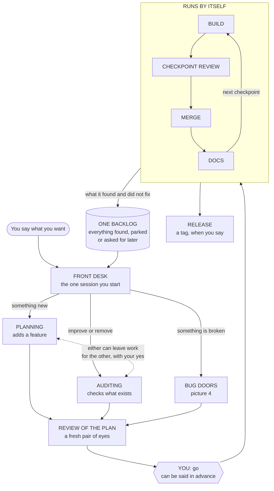
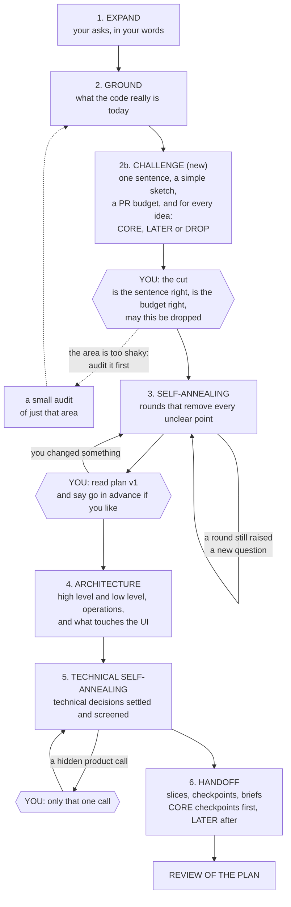
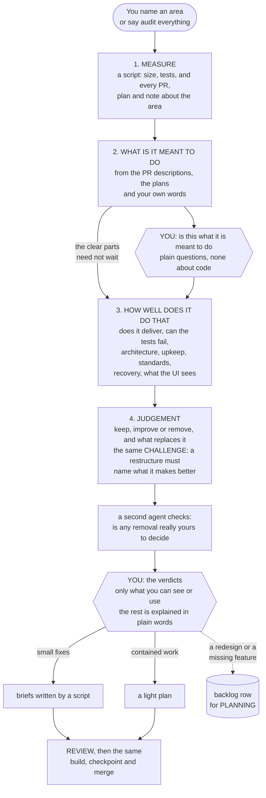
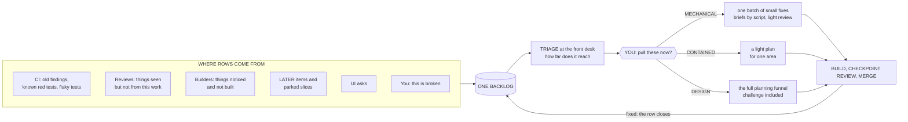
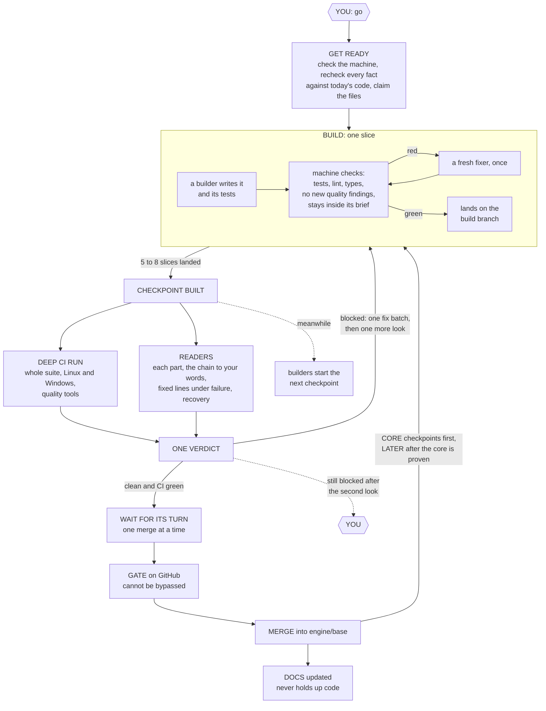
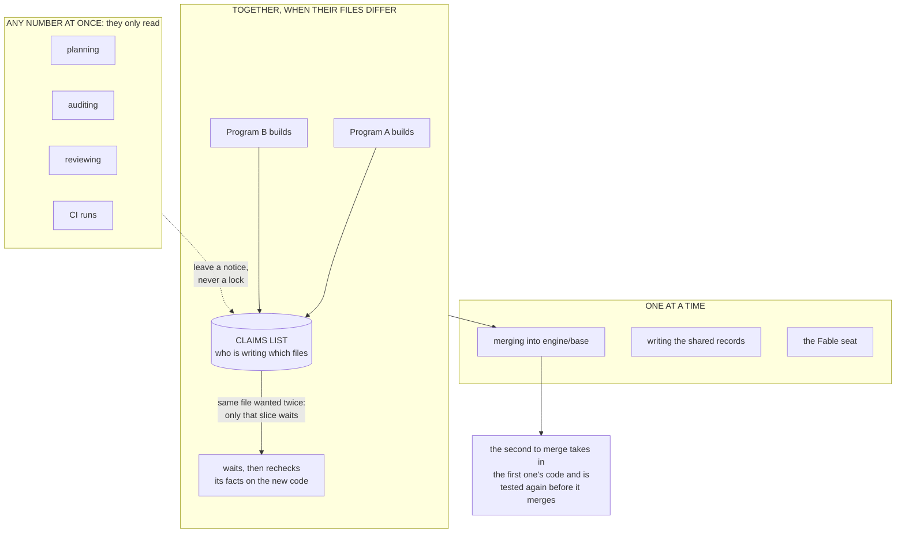

# The factory in seven pictures (13 November 2026)

Pictures for `FACTORY-DESIGN-2026-11-13.md`. Each has a three-line caption for him and, under it, a short key for builders with the section that holds the detail. Six-sided boxes are the points where he is asked something. Everything inside a box marked "runs by itself" needs nobody.

---

## 1. The whole factory

**In three lines.** You talk to one session. It sends your ask down one of three paths: plan something new, audit what exists, or fix a bug. After your go, building, reviewing, merging and docs run by themselves, and anything left over lands in one backlog you can look at.

| Box | What it is | Detail |
|---|---|---|
| Front desk | The `factory` skill in the session he starts. It reads the index and `ship phase`, routes his words, asks every question, starts the conveyor | 2.1, 2.11, 3.8 |
| Planning, Auditing | Pictures 2 and 3 | 2.2 to 2.4 |
| Bug doors | Picture 4 | 3.2 |
| The dotted link | A row in the backlog pointing at the other branch's folder; picked up only with his yes | 3.3 |
| Runs by itself | The conveyor, `ship chain`: one script that starts each agent and each check | 4, 11.8, picture 5 |
| Backlog | `_records/BACKLOG.tsv` on the `plans` branch | 3.1 |

---

## 2. Planning: the same stages as yesterday, with one added

**In three lines.** Planning is the funnel from yesterday: expand, ground, sharpen, architecture, sharpen again, hand off. The one new stage, the challenge, sits right after grounding and is allowed to say no. You are asked at the cut and at plan v1; the rest runs without you.

| Stage | Who | The check that must pass | Detail |
|---|---|---|---|
| 1 Expand | Opus, `funnel-expand` | `check_chain --stage expand` | 2.2 |
| 2 Ground | Opus, `funnel-ground` | `--stage ground` | 2.2 |
| 2b Challenge | **Fable**, `funnel-challenge` | `--stage challenge` | 2.3, 11.10, U20 |
| 3 Self-annealing | Opus, `funnel-anneal` and `funnel-subtract` | `--stage anneal`; stops when a round raises nothing new; after 5 rounds it asks him | 3.9, U21 |
| 4 Architecture | Opus, `funnel-architect` | `--stage arch`; needs `## Operations` and `## Interfaces` | 2.2, U24 |
| 5 Technical self-annealing | **Fable** proposes, Opus screens | `--stage technical` | 2.2 |
| 6 Handoff | Opus, `funnel-handoff` | `--stage handoff`, `check_plan` (budget, CORE before LATER) | U05, U21 |

---

## 3. Auditing: first what it is meant to do, then how well it does it

**In three lines.** An audit cannot judge code until it knows what the code is for, so it first rebuilds that picture from the PRs, the plans and your words, and checks the unclear parts with you. Then it judges quality against that. You decide what you can see or use; Fable decides the removals you could not judge, and tells you each one in a plain sentence.

| Stage | Who | Writes | Detail |
|---|---|---|---|
| 1 Measure | script, `census.py` | `CENSUS.md` | U26 |
| 2 Intent | Opus | `INTENT.md` (`N` lines, ambiguities) | 2.4, 11.10 |
| Intent check | him | his answers, `gates.intent` | 2.4 |
| 3 Quality | a probe script, then one Opus reader per part | `readers/`, `FINDINGS.tsv` | 2.4, U27 |
| 4 Judgement | **Fable**, then an Opus screen | `AUDIT.md`, the cut, the decider column | 2.4, U20, U26 |
| Verdicts | him | his answers, `gates.verdicts` | 2.4 |
| By door | script or light funnel | briefs, or a backlog row | U28 |

Removing code is one mechanism in both branches: planning's `funnel-subtract` and the audit share the same row, the same "removed, and why" list and the same proof that nothing still calls the thing.

---

## 4. Bugs and the backlog

**In three lines.** Everything the factory finds and does not fix becomes a row in one backlog, and nothing leaves it without your yes. A bug goes through one of three doors by how far it reaches. **Mechanical means: one obvious fix, nothing you can see changes, and it touches no fixed line (money, exits, the kill switch, keys).**

| Door | The test | The path | Detail |
|---|---|---|---|
| Mechanical | One obvious fix; no visible change; no fixed line | A sweep program: briefs from `sweep_briefs.py`, scripts plus one reader as review | 3.2, U28, U34 |
| Contained | One area; behaviour changes; the blast radius is known | Light funnel: ground, lenses 1 to 4 and 7, element index, handoff | 3.2 |
| Design | Crosses areas, or a fixed line, or a product call | The full funnel | 3.2 |

Builders never read the backlog, so nobody is ever blocked by an old finding. A row ends only two ways: closed with the commit that fixed it, or dropped in his words.

---

## 5. From go to merged

**In three lines.** A builder writes a slice and machines check it; no agent waits on a test. Every 5 to 8 slices the whole batch gets a deep CI run and a real review against your asks, and what the review finds is fixed in one batch. It merges only when the review is clean and CI is green for that exact code, and you are asked only if it is still blocked after a second look.

| Box | Who or what | Detail |
|---|---|---|
| Get ready | `init`, `preflight`, `facts --tip`, `claims claim` | 11.8, U08, U38 |
| Build | `ship run` (a script) starting `builder` workers; `verify_ready`, `slice_checks`, `land` | 2.6, U07 |
| Slice kinds | `feature`, `pin`, `refactor`, `remove`, `docs`: each has its own rule for what its tests must do at the parent | 2.6, U29 |
| Deep CI run | level `deep` in `qmx-ci.yml`; `summary.json` | 5, 11.11, U15 |
| Readers, verdict | `ship review`: `reader` workers, then one `verdict` worker | 2.7, U09 |
| One merge at a time | `merge.lock`; the second merger takes the first's code and reruns the deep run | 3.7, U38 |
| Gate, merge | branch protection with the required `gate` check; `ship merge` | 2.8, U10, U18 |
| Docs | `ship docs`, one `docs` worker, a docs-only PR | 2.9, U36 |

---

## 6. The loops, and where each one stops

```mermaid
flowchart TD
  subgraph P ["PLANNING AND AUDIT"]
    direction TB
    L1["Questions to you<br/>EXIT: nothing left only you can answer<br/>STOPS after 3 batches of 4"]
    L2["Self-annealing rounds<br/>EXIT: a round raises nothing new<br/>STOPS after 5 rounds"]
    L3["Plan review and the planner<br/>EXIT: the checks pass<br/>STOPS after 1 round trip"]
    L4["Budget growth<br/>EXIT: you say yes, or scope is cut<br/>every raise is yours"]
  end
  subgraph B ["BUILD"]
    direction TB
    L5["A slice's fix round<br/>EXIT: green<br/>STOPS after 1; a second red parks it"]
    L6["A worker that dies<br/>EXIT: it answers<br/>STOPS after 3 restarts"]
  end
  subgraph R ["REVIEW AND MERGE"]
    direction TB
    L7["Checkpoint fix batch<br/>EXIT: the second look is clean<br/>STOPS after 2 rounds; no third"]
    L8["A reader that does not finish<br/>EXIT: its notes are done<br/>STOPS after 1 restart"]
    L9["Waiting on CI<br/>EXIT: the run ends<br/>STOPS after 2 long waits"]
    L10["Merge when engine/base moved<br/>EXIT: green on an up-to-date branch<br/>after 2 tries it goes first"]
  end
  subgraph X ["BETWEEN THINGS"]
    direction TB
    L11["CORE then LATER<br/>EXIT: the LATER budget is used<br/>never starts before the core is proven"]
    L12["Audit and plan handing work across<br/>EXIT: the row is closed<br/>STOPS after 1 crossing"]
    L13["The backlog<br/>EXIT: fixed, or dropped in your words<br/>nothing leaves without your yes"]
  end
  P --> STOP{{"When a loop hits its number<br/>it stops and tells YOU what is still open.<br/>It never quietly gives up or carries on."}}
  B --> STOP
  R --> STOP
  X --> STOP
```

**In three lines.** The factory is a graph of steps, and every place it can go round is written down with the condition that ends it. Each loop also has a number of rounds after which it stops and tells you what is still open. That number is a setting and a safety valve, not a limit on thinking.

The loops, their exits and their round counts live in `D:/factory/INDEX.toml` (`[[loops]]`), and each has a test that proves it stops where it says (design sections 3.9 and 13.3).

---

## 7. Several things at once

**In three lines.** Reading is free: any number of plans, audits and reviews can run together. Builds run together when they write different files; if two want the same file, only that one slice waits. Three things take turns: merging into `engine/base`, writing the shared records, and the Fable seat.

| Thing | How it is kept safe | Detail |
|---|---|---|
| Two builds | `_records/CLAIMS.tsv`; a slice whose files overlap another program's claim shows `blocked-by claim` and is not a failure | 3.7, U38 |
| Two merges | `merge.lock` with oldest-waiter-first; the deep run on the merge result catches two changes that break each other without sharing a file | 3.7, 13.2 rows 47 to 49 |
| Script-written files (`uv.lock`, quality baselines, the contract dump) | Never claimed; rebuilt by script at merge time | 3.7 |
| A plan and an audit on one area | Each leaves a notice; the front desk tells him; facts are always rerun at the current tip before a handoff | 3.7 |
| The laptop | One pool of worker seats for every program | 11.6 |
