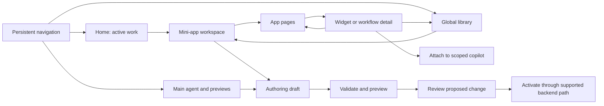

# QMX experience storyboard v0.1

Status: proposed behaviors for discussion. Authority: user's Excalidraw text, afternoon correction, and experience-first kickoff. Source element IDs refer to [the complete audit](../live-research/dictation-audit.md). Reference products supply examples, not QMX requirements.

## The proposed organizing rule

The outer navigation identifies where the user is working. The selected app supplies its own pages and views. An expanded object stays associated with that app. The assistant makes its current context visible. Authoring is a distinct activity reachable from the object being used.

Keep five concepts separate: **opened app** (a visible workspace attachment), **selected view** (what is on screen), **conversation** (messages/context), **durable product session** (backend identity and authority), and **run** (work executing). Selecting or closing a view does not itself grant permissions or stop work. The backend inventory supports the tab/session distinction; exact frontend restoration remains to design.

This is a relationship map, not a compulsory sequential workflow. Library, agent work, app use and authoring can each be entry points.

## Scene cards

### S-01 — Arrive at Home

**Intent:** understand what needs attention and resume work. **Source:** `JHZj5SdT`, persistent home/all-running/divider proposal.

The main navigation remains visible. A divider separates fixed destinations from opened apps. Home distinguishes running, waiting, failed and completed work where the backend reports those states; an opened app with no job is not labelled “running.” Selecting a work item opens the owning app/view or a meaningful fallback if it is unavailable. The proposed fallback explains the missing app or unavailable backend and offers the retained artifact/history when available. Activity aggregation and freshness are backend review questions, not assumed endpoints.

**Review check:** opening an app and starting a run are visibly different; a disconnected status does not become “idle.”

### S-02 — Work with the main agent

**Intent:** investigate or create across the permitted workspace. **Sources:** `rrUMAlEq`, `C39LFtm1`, `JHZj5SdT`; Hermes/Codex/VS Code reference images.

Session/history navigation accompanies the conversation. The adjacent work area can preview a document, browser, code/diff, terminal, model, widget, workflow or mini-app using suitable viewers. A preview identifies what it is showing and its source; the user can focus or close it without cancelling an unrelated run. The main agent may have broader tools than an app copilot, but still acts within actual grants. It is not an unrestricted authority bypass.

Preserve the source's live-browser/video and CLI use cases, with session history and agent settings as discoverable surfaces. The user considers both a bottom terminal and terminal-in-preview placement; neither is settled. They are separate from the proposed library and app history navigation.

**Review check:** a user can tell which session they are speaking to and whether they are viewing, editing or running something. Browser/video/terminal viewers remain design needs, not implemented features.

### S-03 — Use and switch mini-apps

**Intent:** operate a purposeful app without rebuilding its interface. **Sources:** `JHZj5SdT`; OpenBB demo/docs, Minara public workspaces, LSE public task switching.

Selecting an opened app keeps the outer navigation. Its local pages change to fit its purpose: a Research example might expose Overview and Evidence, while an ML example might expose Data and Experiments. These are illustrative names, not a decided roster. App-specific controls appear where relevant, respecting the optional/reusable top-bar proposal in `YJYDP26I`. Proposed switching restores that app's selected page, open detail and conversation context. Exact persistence across reload/reconnect is a separate contract.

**Review check:** switching Research → ML → Research restores the Research location in the interaction model. No job is stopped, started, or re-authorized by switching.

### S-04 — Expand a widget or inspect a workflow

**Intent:** move from an overview into the evidence or operation behind it. **Sources:** `w6Wra1LH`, `hoGJ6iaL`, `JHZj5SdT`; Prime summary/detail demo.

The leading proposal is a detail tab within the owning app. App pages and open-object tabs are distinguished by grouping and labels rather than treated as identical navigation. The detail uses the same object identity and selection as its compact representation, with more suitable content: chart/table/data provenance for an analytical widget, or inputs/steps/run state/results for a workflow. Closing detail returns to the app page. A refresh may show a newer result, so the view must identify the snapshot/run being displayed instead of silently mixing data.

A node graph is a possible workflow view, not a requirement for every workflow or every result. Unsupported widget detail needs an honest summary/data fallback rather than an empty expanded canvas.

**Review check:** compact and expanded views refer to the same artifact/run/parameters; app-page selection and detail-tab selection remain understandable.

### S-05 — Discuss the selected object

**Intent:** ask about an object with its context clearly attached. **Sources:** `nLB3FO70`, `JHZj5SdT`; OpenBB context docs, QuantX filing image, Xynth alert.

“Discuss” adds an explicit context reference to the app copilot. The proposed chip identifies object and snapshot/run; it is removable. Changing a view does not silently replace a deliberately attached reference. Stale or unavailable references are labelled. The conversation shows its app scope; attaching an object does not expand its allowed tools. Changes requested from app use should be distinguished from ordinary questions and routed through the supported editing/authoring mechanism.

**Review check:** the user can see and remove the attached object, and separate “what the agent can read” from “what it may change.” Exact attachment persistence is open; OpenBB's after-send clearing is not copied automatically.

### S-06 — Locate and reuse through the global library

**Intent:** find a durable item from its preview, then return. **Sources:** `NJidF6Tg`, `JHZj5SdT` including the sidebar correction; library reference image.

“Locate in library” selects the global library destination and focuses the existing object. Retain a labelled return location to the app/detail. A transient result without a saved identity instead offers an explicit save path only if supported; do not imply it already exists in the library. An app definition, configured app instance, saved result, knowledge item and executable contribution must not be conflated.

**Review check:** locating does not silently create a duplicate. Search/discovery does not imply permission to run the returned item. Multiple library content types and filters remain to refine against current domain owners.

### S-07 — Build or revise with the copilot

**Intent:** let a human and copilot create the same reviewable app definition. **Sources:** `rrUMAlEq`, `JHZj5SdT`; QuantX node-builder image, Minara creation entry points, LSE code/assistant video.

Enter authoring with the selected app/widget/workflow and a stated goal. The copilot proposes a draft composed from supported parts. A composition view controls app pages/widget placement; a workflow view controls logic/data flow; a code view supports custom implementation where allowed. These are related authoring surfaces, not proof that arbitrary code can be losslessly converted to a graph. Preview the draft in the normal app shell. Show validation findings and a change summary before any live activation.

**Review check:** preview and validation leave the active version unchanged; unsaved edits have explicit keep/discard handling. Activation, rollback and concurrent editing are later architecture questions. The inspected change-request fixture is not a production API.

### S-08 — Maintain and evolve

**Intent:** add or upgrade an app without making it behave differently from the rest of QMX. **Sources:** user's latest request for guardrails; `qhuD191N`, history/settings annotations; backend grant/session boundaries.

A future developer or agent reads the current contract/version, accepted decisions and affected component/scenario. Global preferences, app configuration, widget parameters and agent tool settings declare their scopes. Upgrades show compatibility and permission changes, including what happens to active work and saved views. Missing capabilities and invalid versions are explained at the affected action. Observability data displayed here must come from the eventual supported integration with the concurrent backend work.

The source also proposes adapting chart/table patterns for risk management and position sizing, and indicating what is local versus on a server/trading node. Preserve those needs while clarifying the dictated BMS/BIMS name and actual backend domains. Execution location is distinct from connection health, account scope and permission; a single blue icon should not silently stand for all four.

**Review check:** an upgrade declares compatibility/migration needs and proves existing accepted scenarios still work. Exact mechanisms remain open; the design must not invent lifecycle APIs.

## Cross-scene questions to settle

- O-01: Should detail tabs form a separate row beneath app pages, or another clearly scoped arrangement? The inline model deliberately uses separate groups to expose this question.
- O-02: Which context attachments persist per message, per conversation and across app switching?
- O-03: Which workspace state survives browser/app restart, as distinct from an in-memory switch?
- O-04: What are the initial library item types and the relationship between definitions and instances?
- O-05: Which workflows fit a visual graph, and which require code/custom steps?
- O-06: Which scope changes require explicit operator action according to current backend rules?
- O-07: How do session history and agent settings sit beside browser/video/CLI previews, and when is a bottom terminal preferable?
- O-08: Which risk/position-sizing views and local/server/trading-node indicators are needed, with which domain names and authoritative data?

Empty, loading, stale, disconnected, permission-denied, missing-object, failed-run and unsaved-edit states belong in the later screen specifications. They are named now to avoid designing only populated dashboards.
