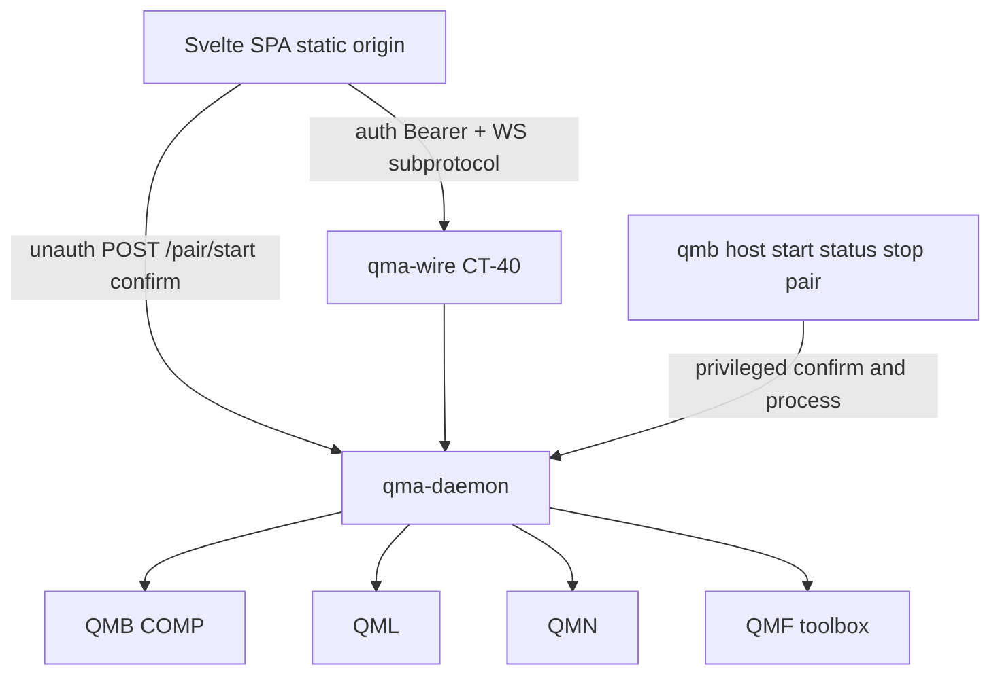
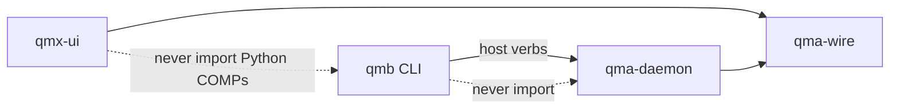
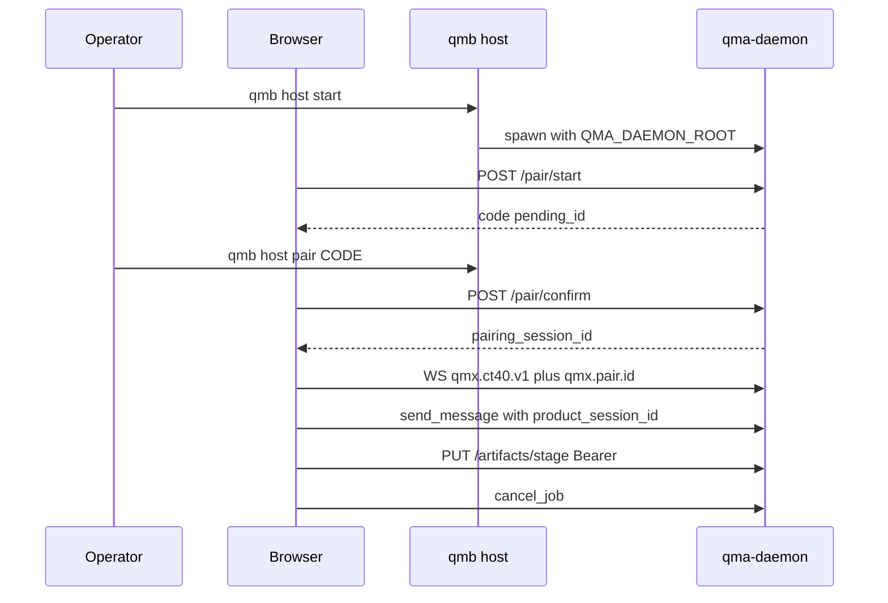

# Architecture Spine — QMX UI backend-delta

## Design Paradigm

**Privileged-door daemon with named pairing bootstrap.** QMX stays a pack-and-grant platform. The Svelte host stays a client of `qma-wire`. This sitting names the daemon, wire, and QMB changes that client needs.

QMB remains the only operator CLI. `qma-daemon` remains the only process that writes durable QMA state. Pairing is a **named unauthenticated HTTP carve-out** on the daemon origin so a browser can obtain one proof. After that proof exists, CT-40 is authenticated. Origin is a browser boundary. Origin is never operator identity.



## Inherited Invariants

Parents bind read-only. Local `AD-n` never means a parent, kit, QMA, or UI id. Cite `parent AD-n`, `kit AD-n`, `QMA AD-n`, `UI AD-n`. A local rule that would mint a sixth COMP, a new CT, a UI grant store, a UI BFF, REST invoke, cookies as login, or Origin-only session issuance is a **conflict**.

| Inherited | From | Binds here |
| --- | --- | --- |
| parent AD-1..AD-7 | 09-18 | Capability, envelope, Board vs graph vs Task Graph |
| parent AD-8 / DEC-0463 | 09-18 + kit | `psess:` authoring may omit `app_instance_id`; no third profile |
| parent AD-9 | 09-18 | Tools = hits ∩ host grants ∩ session GrantRecords ∩ health |
| parent AD-17 | 09-18 | UI is a client; adapters are not authority; mount does not kill work |
| parent AD-18 / AD-30 | 09-18 | Pack lifecycle; install is not grant; compile-at-enable |
| parent AD-21 | 09-18 | QMB is the only operator CLI; door parity |
| parent AD-24 / DEC-0464 | 09-18 + kit | Envelope `instance_id` required on invoke; `caller_kind` planned |
| parent AD-26 | 09-18 | JobHandle vocabulary; first durable terminal wins |
| parent AD-29 | 09-18 | Reconnect is a query; no intent replay |
| kit AD-1..AD-9 | 09-23 | Pack-and-grant SDK; optional copilot; widgets never own invoke |
| QMA AD-5 / AD-6 / AD-8 | 08-28 | Closed store list; journal forever; mailbox is a projection |
| QMA AD-17 | 08-28 | JobHandle states and cancel/reattach |
| QMA AD-20 | 08-28 | Durable mailbox Envelope; non-authoritative bus |
| QMA AD-21 | 08-28 | Plugin manifest; reversible load |
| QMA AD-24 | 08-28 | Principal classes; secrets as refs; authenticate before protocol |
| UI AD-1..AD-24 | 09-23 | Client host, issuers, pairing transport, chat/mailbox, PUT ingest, cancel |
| Epic 41–42, 46.4, 57, 60–65 | planned | Wire, journal, mailbox delivery, handles, pack SDK |

**Named amendments still required from kit/UI (not re-decided here):** envelope `caller_kind`; authoring `app_instance_id` optional; selected-ref kind `instance_id`; optional `PluginManifest.copilot_profile`. Those stay Epic 60.

## Invariants & Rules



### AD-1 — This sitting is backend-delta only [USER]

- **Binds:** all local ADs, companions, UI candidate edits
- **Prevents:** a second UI-design session; Documentation Factory from this sitting; epic rewrite; application code
- **Rule:** Scope is daemon, wire, QMB host door, and named records the reviewed UI needs. Preserve UI rail (Home / Copilot / Library / Authoring), Svelte seed, headless/visual/mixed independence, and closed UI findings R1, R3–R9. Edit the UI candidate only for the R2 issuance rule and the reload/cold-start wording. Do not run Documentation Factory, generate or start epics, or modify application branches.

### AD-2 — Planned stories are requirements [USER]

- **Binds:** every dependency row
- **Prevents:** treating inspect types as e2e; duplicating Epics 60–65; labelling mailbox “Epic 41 only”
- **Rule:** Classify each need as **reuse**, **already planned**, **adoption gap**, or **proposed amendment**. Inspect SHA is `34c148be`. Class/fixture existence is not delivery (DEC-0286). Durable mailbox delivery is **Epic 46 / Story 46.4**. Epic 41 owns wire/query vocabulary. Epic 42 owns journal/fold. Reuse Epics 60–65 for copilot_profile, caller_kind, diagnosis, retry, nested Mission, health/listing, and kit proofs.

### AD-3 — Pairing issuance [USER]

- **Binds:** `/pair/start`, `/pair/confirm`, `/pair/renew`, pairing table, UI second tab
- **Prevents:** Origin-only auto-approval; two builders shipping different issuance; treating Origin as operator identity
- **Rule:** A remembered Origin **never** authorizes issuance of a new `pairing_session_id`. Every new id requires **exactly one** of: (1) fresh privileged QMB confirmation of **that** pending request (`qmb host pair <code>` then POST `/pair/confirm`); or (2) an authenticated renewal that presents an existing **unexpired unrevoked** `pairing_session_id` matching that Origin (`POST /pair/renew` with `Authorization: Bearer pairing:<id>`). Origin match remains required and is never sufficient. Negative trace: Origin known, no valid proof, no fresh QMB confirm → no `pairing_session_id`, no CT-40. Positive traces: newly confirmed pending → token; valid authenticated renewal → token; revoked or expired proof alone → refusal. Details: `PAIRING-AND-ADMISSION.md`.

### AD-4 — Pairing table is a journal projection [CANDIDATE]

- **Binds:** COMP-QMA-DAEMON store; COMP-QMB confirm/revoke
- **Prevents:** a new sqlite class; ephemeral-only pairing that cannot survive a daemon restart the operator did not intend; secrets in the table
- **Rule:** Persist pairing as journal projections `pairing_pending` and `pairing_session` (**named amendment** of QMA AD-6 / AD-8 / FR-Q23 / Story 42.2 / parent AD-16 complete v1 list; not a new sqlite **class**). Join key is `pairing_session_id`. The row copies the operator’s existing broker `CredentialRef` at confirm (one ref per operator+Origin, shared by renewals). Fold contract: events `pairing.pending.*` / `pairing.session.*`; fold is the live unrevoked unexpired row set. TTL is `registry:pairing.session_ttl` (no number minted). **Holding rule:** if that row is unset, pairing HTTP **refuses to issue** (headless `credential_ref` clients still work). Missing TTL is not infinity. Revoke of an id **closes** WebSockets that offered that `qmx.pair.<id>` and refuses further HTTP Bearer for it. Renew does not revoke the old id; old sockets stay until detach **or** that old id is revoked. The copied `CredentialRef` must already be an allowlisted operator login ref — pairing must not mint a new `cred://` per session. Traces may name `pairing_session_id`; they must not dump `CredentialRef` values or pairing codes after expiry. Details: `PAIRING-AND-ADMISSION.md`.

### AD-5 — Unauthenticated bind is a named carve-out [CANDIDATE]

- **Binds:** daemon HTTP listener; Story 41.4; QMA AD-24 transport custody
- **Prevents:** silent override of “never offers an unauthenticated bind”; pairing on a WebSocket; unauthenticated `initialize`
- **Rule:** **Named amendment** to QMA AD-5, QMA AD-15, QMA AD-24, and Epic 41 Story 41.4: unauthenticated HTTP is allowed **only** for (1) `POST /pair/start`, (2) `POST /pair/confirm`, (3) CORS `OPTIONS` on daemon HTTP routes that declare CORS. `OPTIONS` never returns a `pairing_session_id`, never upgrades to WebSocket, and never returns artifact bytes. `POST /pair/renew` is **authenticated** (Bearer). Every other HTTP method and every WebSocket still authenticates before protocol bytes. Browser clients present `pairing_session_id`. Machine/worker clients still present `credential_ref` as Story 41.4. After a table match the daemon builds `AuthenticatedWireSession` from the row’s **copied operator `CredentialRef`** (the same ref for every live session of that operator+Origin). `pairing_session_id` is the row join key and is not passed to `parse_credential_ref`. QMB confirm is addable operator-principal command `confirm_pair` on the existing wire (headless `credential_ref`), not a browser `/pair/*` call and not a sqlite write from QMB. Cookies are refused. `Set-Cookie` on `/pair/*` is a spec miss.

### AD-6 — QMB owns process lifetime [CANDIDATE]

- **Binds:** UX-01, parent AD-21, local UI AD-19
- **Prevents:** browser spawn of Python; a launcher COMP; unnamed start/status/stop
- **Rule:** Privileged verbs are `qmb host start|status|stop|pair` (COMP-QMB add). `start` sets `QMA_DAEMON_ROOT` to the per-user path, spawns `python -m qma.daemon` if the lock is free, and reports already-running when the lock is live. `status` reports lock, pid, bind, pending/bound origins (ids present/absent, never secrets). `stop` stops the **local** daemon only. `qmb host pair <code>` issues operator-principal addable command `confirm_pair` (AM-09) with the operator `credential_ref` — QMB never writes daemon sqlite. `qmb host pair revoke --session|--origin` issues `revoke_pair`. **Named amendment** of the QMA AD-24 human-gate list: `confirm_pair` and `revoke_pair` are operator-only. Until the group exists, UI Start local is setup copy. Details: `HOST-LIFECYCLE.md`.

### AD-7 — Mailbox delivery stays Epic 46 [CANDIDATE]

- **Binds:** UI AD-18, Home/Copilot chat, reconnect
- **Prevents:** a parallel conversation store; routing Send through InvocationEnvelope; labelling delivery “Epic 41 mailbox”
- **Rule:** `send_message` remains the seed command (reuse vocab). Durable record is the CT-48 mailbox Envelope / journal `message.*` (Story 46.4). **Named amendment** to QMA AD-20 / Story 46.4: each accepted Envelope **persists** `product_session_id` (additive; **excluded from Envelope fp1**, same class as `correlation_id`). Replies and questions inherit it and refuse retarget. Originating wire pair `(producer_id, id)` and payload hash of the **wire payload bytes** live on the journal `message.*` row and are **echoed** on every `list_mailbox` row. Addable query `list_mailbox` is an authenticated HTTP GET **snapshot query** (same family as `facade_search`, not a new URL dialect). Full snapshot by `product_session_id`; pre-ack lookup `{product_session_id, producer_id, wire_id}` returns zero or one row. Connection principal must equal `product_session.principal`. Collision: same pair + same hash returns the prior result; same pair + different hash refuses for **journal lifetime**. **Named amendment** of Story 41.3: that lifetime, for mailbox sends only, is the journal — not `registry:wire.dedup_window`. Old rows without `product_session_id` are omitted from session snapshots. Details: `MAILBOX-AND-DELIVERY.md`.

### AD-8 — Cancel binds originating_psess at admit [CANDIDATE]

- **Binds:** UI AD-23, Epic 57 handles, Epic 63 nested children
- **Prevents:** observer cancel; mapping cancel to `stop_run`; a second invoke
- **Rule:** Addable command `cancel_job` (COMP-QMA-WIRE). `handle_id` **is** `job_id`. Other fields: `logical_run_id`, `attempt_id`, `command_id`, `expected_state`. **Named amendment** to QMA AD-17 / parent AD-26 / Story 57.3 handle **record** (states unchanged): at admit the handle stores immutable `originating_psess` copied from the admitting `psess:` (the session that invoked). `JobHandle.owner` remains the Quant `ActorId`. UI cancel authority is: connection operator principal **equals** `product_session.principal` of `originating_psess`. Observation is not authority. Nested child handles store the `psess:` that started **that child**. `expected_state` is **not** part of the `command_id` hash, so `queued`→`running` reuses the same `command_id`. Already-terminal records a no-op on existing `later_commands`. `unknown` is not cancellable. Headless QMB abort remains Story 36.5 and is a different door. Details: `CANCEL-AND-HANDLES.md`.

### AD-9 — Artifact ingest is authenticated PUT then explicit transfer [CANDIDATE]

- **Binds:** UI AD-22, J-UI-09, artifact store
- **Prevents:** hash-as-possession; JSON-RPC byte bodies; silent local fallback; calling the store “already implemented PUT”
- **Rule:** Initial possession is HTTP `PUT /artifacts/stage` on the **authenticated** daemon origin (`Authorization: Bearer pairing:<id>`, paired Origin, `Content-Length` required). Body is raw bytes. Completeness is daemon-recomputed fp1 **plus** byte count after complete bytes. Interrupted v1 PUT is refused; incomplete object deleted; no RFC 9110 §14.5 partial PUT; retry is a new full PUT. Same complete hash may reuse the object. Register through existing `before_artifact_register`. Addable command `transfer_artifact` writes journal projection `artifact_transfer_ticket` `{ticket_id, fp1, destination_placement}` (AM-03). **Data plane:** destination **pulls** `GET /artifacts/<fp1>` as `machine` principal with `Authorization` of its Story 41.4 `credential_ref` **and** header `X-QMX-Transfer-Ticket: <ticket_id>` (no query-string token, no pairing Bearer). Daemon never dials in. Destination verifies hash and byte count. Failure leaves the local-complete fp1 local. Details: `ARTIFACTS-AND-TRANSFER.md`.

### AD-10 — PackUiRequest is ingested request, not a grant [CANDIDATE]

- **Binds:** UI AD-15/AD-20, Epic 60
- **Prevents:** moving `copilot_profile` into `pack_ui_request`; `ui_view` contribution point; first-wins grants
- **Rule:** Host ingests at most one `qmx.ui.pack_ui_request.v1` document at enable. It is a versioned request DTO, not a contribution point. Optional `PluginManifest.copilot_profile` stays the Epic 60 sibling field. After enable, the ingested document is readable as an authenticated HTTP GET snapshot (pack metadata), not a new family. Nav items bind `view_ids`. Zero matching GrantRecords → paint, invoke refuses. One → that record. Two or more → `GRANT_AMBIGUOUS`. ActionContext remains host-minted and immutable. Details: `PACK-UI-AND-AUTHORING.md`.

### AD-11 — Draft head is not AD-22 staging [CANDIDATE]

- **Binds:** UI AD-21, first Run, QMA AD-22
- **Prevents:** collapsing draft/template/instance/JobHandle; using RefinementProposal as the graph editor store; a second enable machine
- **Rule:** Saved drafts are content-addressed bytes in the **existing artifact store** plus journal projection `editor_draft_head`. `editor_revision` **is** that content fp1. Daemon mints `editor_draft_id` on first save. Save = authenticated PUT of bytes **then** addable command `save_editor_draft` `{editor_draft_id, fp1, expected_revision}` (CAS on head). Library facade **excludes** these blobs (not a Workbench AD-3 kind). QMA AD-22 staging remains one record type — this is a **non-amendment** of AD-22 (AM-07). Validate/preview of a saved revision uses existing descriptor validation; compile identity remains parent AD-30 enable (no second validator record). First Run: publish into the local authoring pack, **enable** (parent AD-30), grant, select `instance_id`, `dispatchInvoke`. Details: `PACK-UI-AND-AUTHORING.md`.

### AD-12 — Provider secrets stay off the wire [INHERITED]

- **Binds:** first-run cards, Credential Broker, L34
- **Prevents:** secret values as pairing proof; browser OS-store writes as v1; venue keys in QMA
- **Rule:** Allowlist stays code in `qma-core` (`cred://models|inference|compute|sandbox|corpus|knowledge|telemetry/`). v1 browser may **select a ref** already resolvable. Writing a new value into the OS store is a later QMB/native helper, not a wire payload. Broker `_reader` injection is an **adoption gap** of the existing broker, not a new broker. Details: `PROVIDER-AND-COMPAT.md`.

### AD-13 — Compatibility is additive and honest [CANDIDATE]

- **Binds:** J-UI-13, J-UI-14, Epic 41.2
- **Prevents:** silent downgrade; claiming inspect types are live protocol
- **Rule:** Same-major wire changes are additive. `initialize` advertises capabilities including `pairing`, `list_mailbox`, `cancel_job`, `caller_kind`, `stage_artifact`, `transfer_artifact`, `pack_ui_request`. Missing capability → typed mismatch; shell stays usable for surfaces that do not need it. Older clients ignore unknown fields. Client bits are not journals. Clean-machine start uses `QMA_DAEMON_ROOT` + `qmb host start` + pair + initialize. Details: `PROVIDER-AND-COMPAT.md`.

### AD-14 — Reload, clone, and cold start are different recoveries [USER]

- **Binds:** sessionStorage, T-CH-06, TRACE-MATRIX Home row, UI AD-24
- **Prevents:** promising browser-restart restoration from sessionStorage; sharing `producer_id` across live tabs
- **Rule:** **Same-tab reload** (same page session): `sessionStorage` may restore `pairing_session_id` and a pending chat triple; **reconnect** presents that **same** id (not `/pair/renew` unless rotating). Query before any resend. **Auxiliary/cloned tab:** WHATWG copies sessionStorage; that **is** existing proof (reconnect or `/pair/renew`), not Origin-only issuance; `initialize` **must not** bind a `producer_id` that is already live on another connection. **Cold start / closed tab:** empty `sessionStorage`; **no Bearer**, so `/pair/renew` is impossible; new pair requires QMB confirm; `localStorage` remains forbidden; if the operator selects a `psess:`, restore history with `list_mailbox(product_session_id)` and **never** auto-resend. Details: `PAIRING-AND-ADMISSION.md`, `MAILBOX-AND-DELIVERY.md`.

### AD-15 — HTTP PUT is a byte channel on the daemon origin [CANDIDATE]

- **Binds:** CT-40 families, pairing HTTP, artifact PUT
- **Prevents:** a REST invoke API; a fourth message family; serving the SPA from port 8765
- **Rule:** Port 8765 carries: unauthenticated pairing POST + CORS OPTIONS (AD-5); authenticated HTTP GET snapshots (including `list_mailbox` and pack-ui metadata); authenticated HTTP PUT `/artifacts/stage`; authenticated HTTP GET `/artifacts/<fp1>` for **machine** transfer pull; authenticated JSON-RPC WebSocket; authenticated POST `/pair/renew`. PUT and artifact GET are byte channels, not invoke, not a BFF. SPA origin ≠ daemon origin.

### AD-16 — No sixth COMP and no new CT [INHERITED]

- **Binds:** all adds
- **Prevents:** COMP-UI, qma-cli, a second scheduler, a new protocol family name
- **Rule:** Adds are closed-and-addable names on `qma-wire`, journal projections on `qma-daemon`, and QMB CLI verbs. Envelope `instance_id` stays required on invoke. Headless `qmb` remains a door without the UI.

## Consistency Conventions

| Concern | Convention |
| --- | --- |
| Naming | Cite `parent AD-n` / `kit AD-n` / `QMA AD-n` / `UI AD-n` / local `AD-n`. Journeys stay `J-UI-*`. Classification: reuse / already planned / adoption gap / proposed amendment. |
| Data & formats | Pairing proof `pairing:<id>` Bearer and `qmx.pair.<id>` subprotocol. Mailbox Envelope ≠ wire envelope. JobHandle states unchanged. |
| State | Pairing, mailbox, draft head, JobHandle `originating_psess` are journal projections. Client layout stays client-local. |
| Errors | Typed refusals. Origin-only issuance is `POLICY_REJECTION`. Expired/revoked pairing is refusal then re-pair. |
| Auth | Operator principal for human gates and pairing confirm. Machine principal for workers and artifact pull. |
| Logging | Logs are not evidence. Pairing codes and session ids are not secrets; provider values are. |

## Stack

Inherited runtime. This sitting adds no frontend pins.

| Name | Version |
| --- | --- |
| CPython (daemon, QMB) | 3.14 (inherited; observed 3.14.6 at parent freeze) |
| qma-wire / qma-daemon / qma-core | packages at inspect `34c148be` plus named adds |
| Default bind | `127.0.0.1:8765` |
| Persistence | journal + sqlite under `QMA_DAEMON_ROOT` |
| UI host (out of scope here) | Svelte 5.57.1 + SvelteKit 2.70.3 as UI AD-2 |

## Structural Seed

```text
qma-daemon/
  process.py          # inspect: discards TCP bytes. This sitting names the live HTTP+WS contract.
  pairing/            # projection: pending + sessions
  bus/                # mailbox fold including product_session_id
  artifacts/          # PUT /artifacts/stage + transfer tickets
  drafts/             # journal-projected editor draft heads
  sessions/           # product_session (exists)
qma-wire/
  vocabulary.py       # add list_mailbox, cancel_job, transfer_artifact
  auth.py             # map pairing_session_id → AuthenticatedWireSession
qmb/doors/cli/
  host.py             # start|status|stop|pair|pair revoke
```



Operational envelope: v1 is a **workstation-local** daemon (loopback HTTP/WS) or an operator-recorded **remote HTTPS/WSS** host. Default data root is per-user (`%LOCALAPPDATA%\QMX\qma-daemon` on Windows). Single-instance lock `.daemon_writer`. Backup/restore remains QMA AD-27. Tauri packaging stays deferred (UI AD-12).

## Capability → Architecture Map

| Capability / Area | Lives in | Governed by |
| --- | --- | --- |
| Pairing issuance and proof | daemon pairing projection + QMB pair | AD-3, AD-4, AD-5, AD-14 |
| Process start/status/stop | COMP-QMB `qmb host` | AD-6 |
| Chat history | mailbox Envelope + `list_mailbox` | AD-7 |
| Cancel | `cancel_job` + `originating_psess` | AD-8 |
| Upload / remote placement | PUT + `transfer_artifact` pull | AD-9, AD-15 |
| Pack chrome request | PackUiRequest at enable | AD-10 |
| Authoring first Run | draft head + local pack enable | AD-11 |
| Provider refs | Credential Broker | AD-12 |
| Protocol mismatch / install | initialize capabilities | AD-13 |

## Deferred

| Item | Why it can wait |
| --- | --- |
| Numeric pairing TTL | Registry row `registry:pairing.session_ttl`; revisit when filling QMA AD-26 numbers |
| Cross-tab transfer code / QR | v1 second tab uses QMB confirm; revisit if operators reject that friction |
| RFC 9110 partial PUT / resume | v1 refuses incomplete; revisit if large artifacts need resume |
| Tauri sidecar calling `qmb host` | UI AD-12; not v1 bootstrap |
| Envelope crypto algorithm | GAP-DESK-ENVELOPE-CRYPTO |
| Isolated `sv create` lockfile | UI sitting; frontend stream |
| Trading ticket chrome | UI sitting deferred to a trading-app sitting |
| Exact `websockets` / ASGI server class | Implementation choice under live CT-40 server; must speak the named HTTP+WS contract |

## Open questions

None blocking joint review if AD-3 issuance and AD-14 recovery hold. Remaining later gates: registry TTL number; live server implementation; operator acceptance.
