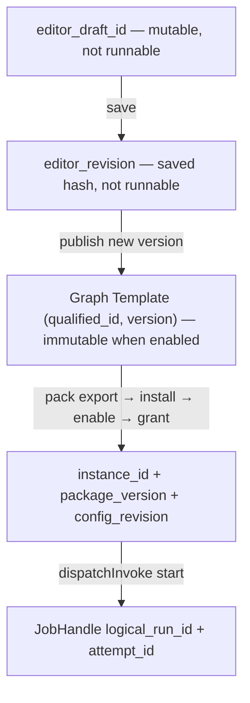
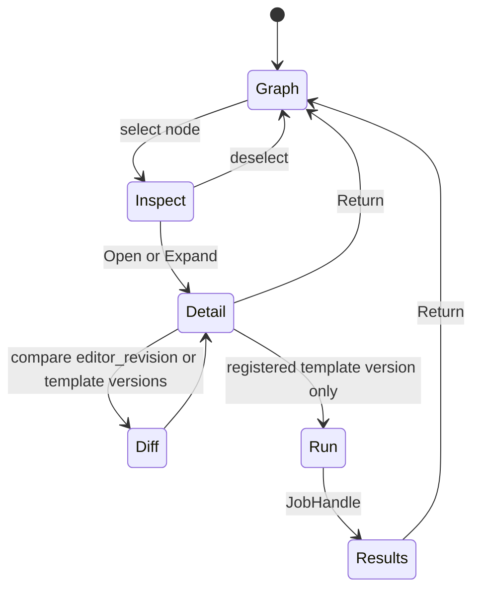

# Authoring and ML — typed identities and transitions

Law in `ARCHITECTURE-SPINE.md` (local AD-9). This companion is the identity, transition, and ML-journey contract. Layout remains the graph/code/detail family (VS Code image). LSE ML Studio UI is refused as a layout. Coordinates are not frozen.

**Provenance:** **CANDIDATE** sitting default for Codex R5. Not user-accepted. Not implementation. Not a new COMP, CT, sqlite class, or Library kind.

## Honesty at `34c148b`

| Claim | Fact |
| --- | --- |
| Graph Template register at enable | **Present** as plugin contribution `graph_template`; compile identity `(qualified_id, version)` |
| Enabled template bytes immutable | **Specified** parent AD-4; rebuild-on-load must not change an enabled `(id, version)` |
| `editor_draft_id` / `editor_revision` product surface | **Absent** |
| Draft test-run / temporary runnable version | **Refused** by this companion (must not be invented in UI or daemon) |
| MissionCompiler in Svelte | **Forbidden** (local AD-1 / parent AD-4) |
| `change_request` three records | **Types/fixture** (Story 58.4 / SCN-0019); not e2e (DEC-0286) |
| Pack `instance_id` ≠ `plugin_id` | **Specified** parent AD-8 / AD-16; plugin-install projection |
| JobHandle `logical_run_id` + `attempt_id` | **Present** as vocab/types |
| Live graph editor | **Absent.** No first-party Svelte app |
| LSE Train/Optimise form | **Rejected** as default ML UI |

DEC-0286 stands: class/fixture existence is not e2e.

## 1. Typed identities — do not collapse

Five identities. Chrome labels, tabs, and “draft/version” strings are not any of them. Expand/return (local AD-8) retains **these refs**, not one ambiguous string.

| Identity | Shape | Mutability | Runnable? | Owner |
| --- | --- | --- | --- | --- |
| **`editor_draft_id`** | durable id of a working copy | **Mutable** working copy. Unsaved client buffer and daemon- or client-staged bytes | **No** | COMP-QMA-DAEMON once saved; client-local until first save |
| **`editor_revision`** | content hash of a **saved** draft snapshot | **Immutable** snapshot. New edits mint a new hash on next save | **No** | COMP-QMA-DAEMON content-addressed staging (not a Workbench AD-3 kind) |
| **Graph Template** | `(qualified_id, version)` | Enabled version **immutable**. Byte change → new version or disable (parent AD-4) | **Yes**, after enable ∩ grant ∩ health | Plugin contribution at enable; COMP-QMA-DAEMON roster |
| **Pack instance** | `instance_id` + `package_version` + `config_revision` | Instance row mutable only via named pack/config CAS. Running work stays pinned to the instance/bytes it started | Invoke **target**, not the graph definition | Plugin-install projection (parent AD-16). `instance_id` ≠ `plugin_id` |
| **JobHandle** | `logical_run_id` + `attempt_id` | Handle record is append/CAS; first durable terminal wins (parent AD-26) | The **run**, not the template | COMP-QMA-CORE/DAEMON. States: `queued` `running` `done` `failed` `cancelled` `aborted` `unknown`. Never `succeeded` or `awaiting_approval` |

### 1.1 What each is not

| Identity | Must not be shown or stored as |
| --- | --- |
| `editor_draft_id` | Graph Template version; JobHandle; `selected_refs` kind; ArtifactHit; Board layout; QMA `sess:` |
| `editor_revision` | Enabled `(qualified_id, version)`; Workbench AD-3 Library kind; proof of remote possession |
| Graph Template | Artifact fp1; Task Graph; Board layout; Stage 0 mill `graph`; Skill; live scribble; pack `instance_id` |
| Pack instance | Template `(qualified_id, version)`; `psess:`; tab; grant |
| JobHandle | Template version; draft; Library kind; conversation id |

Graph Template ≠ Task Graph ≠ Board layout ≠ Stage 0 mill graph (parent AD-4, local AD-9). Board layout is client-only and writes nothing.

`selected_refs` kind `template` cites a **registered** `(qualified_id, version)`. It does not cite a draft. Kind `instance_id` is the kit add (DEC-0463); **absent** from `SELECTED_REF_KINDS` at `34c148b`. Kind `run` / `attempt` / `node_ids` cite execution, not the editor.

### 1.2 Mutation owner

| Surface | Who mutates | Who must not |
| --- | --- | --- |
| Unsaved editor buffer | Svelte `GraphCanvas` / `DetailHost` client-local | Daemon, pack, GrantRecord |
| Saved `editor_revision` | Daemon staging write on explicit Save | App-use; widget; json-render; MCP frame |
| Graph Template bytes | Pack authoring publish → new `version` (or disable) | In-place overwrite of an enabled version |
| `config_revision` | Named CAS on the instance | Tab switch; preview; layout edit |
| JobHandle | Owner COMP via envelope `start` / cancel path | UI compile; seed `start_mission`; `stop_run` |

App-use **must not** write package source, install code, apply a change-request, or retarget `app_instance_id` (parent AD-8, SCN-0019).

## 2. Transitions

Each row names the identity that exists **after** the act. Preview and validate are allowed on a named `editor_revision` (or the live unsaved buffer, labelled unsaved). **Run is not.**

| Act | From | To | Owner | Notes |
| --- | --- | --- | --- | --- |
| **Create draft** | empty Authoring canvas (platform destination; zero apps legal) | new `editor_draft_id`; no revision yet | UI mints local id; daemon persists id on first save | Not a template. Not an instance. Profile `authoring`. |
| **Edit** | `editor_draft_id` | same id; buffer dirty vs last `editor_revision` | client | Dirty buffer is not a revision. Does not touch running jobs. |
| **Validate** | named `editor_revision` **or** explicit “validate unsaved” (must hash the buffer first as a transient revision candidate) | `ChangeValidation`-class verdict against **that hash** | daemon graph/topology/schema checks (parent AD-6 DAG); UI displays | **Invalidates** if bytes change after the named hash. Validate ≠ Run. No JobHandle. |
| **Save revision** | dirty `editor_draft_id` | new immutable `editor_revision` (content hash) | COMP-QMA-DAEMON staging | Unsaved client buffer may still exist beside it. Hash is not a template version. |
| **Publish new template version** | named `editor_revision` whose last validation is still valid for that hash | new Graph Template `(qualified_id, version)` registered; enabled bytes immutable | pack/plugin enable path (parent AD-4, AD-30) | **This is the first runnable identity.** Prior version stays. |
| **Pack export** | validated template + ops it calls | versioned pack (manifest, contributions, compatibility, migrations) | host export (parent AD-18); `ExportScanReport` is the oracle | Packaging a loop exports the operations it calls; it does **not** mint a loop engine. |
| **Install** | downloaded pack | `installed` (bytes present) | host AD-30 | Install ≠ enable ≠ grant. |
| **Enable** | installed + validated | `enabled`; atomic roster; `availability_revision` | host AD-30 | Failed validation restores last usable roster. Collision of `(point, qualified_id)` refuses. |
| **Grant** | enabled contribution + operator | GrantRecord on `psess:` | host AD-24 | Hit ≠ grant. Upgrade cannot widen an existing grant. |
| **Run** | enabled template `(qualified_id, version)` ∩ GrantRecord ∩ health ∩ envelope `instance_id` | JobHandle (`logical_run_id`, `attempt_id`) | `dispatchInvoke` of the template `start` op; `node_ids` inside `input_schema` when running a subgraph | Not seed `start_mission`. Not in-process MissionCompiler. Not a live Board scribble. |

Authoring/Home **may not invoke** (including Graph Run) until exactly one `selected_refs` kind `instance_id` is present; envelope `instance_id` remains required (kit AD-3 / DEC-0463). Chat without invoke remains allowed (local AD-18).

### 2.1 Draft test-run — REFUSED

**Run is refused** until a new immutable Graph Template `(qualified_id, version)` is **registered** (publish) and the invoke path above is satisfied.

This closes Codex Team-B: a temporary runnable draft, a hidden “dev version” of the same `(qualified_id, version)`, or overwrite-in-place of enabled bytes is **unsupported**. Preview and validate stay legal on draft/revision. Graph Run is `dispatchInvoke` of an **already-registered** template.

| Attempt | Result |
| --- | --- |
| Run control on unsaved buffer | typed `draft_not_runnable` |
| Run naming only `editor_draft_id` or `editor_revision` | same refusal |
| Register a throwaway template version without pack/enable law | forbidden (would be Team-B) |
| Preview graph/code/data of a revision | allowed |
| Validate DAG/schema of a named revision | allowed; stale if bytes change |
| Run V1 template while V2 draft is open | allowed — different identities (trace T-R5-02) |

### 2.2 Validation invalidation

Validation records the `editor_revision` hash (or the hash of the buffer if the operator chose validate-unsaved). Any subsequent edit that changes bytes **invalidates** that verdict. Publish requires a **currently valid** validation of the hash being published. Re-validate is explicit. The UI must show the hash it validated, not a draft label.

### 2.3 Crash / reopen

| What | Restore |
| --- | --- |
| Last saved `editor_revision` | **Yes** — reopen that hash on `editor_draft_id` |
| Unsaved client buffer | **May be lost** (honest). Do not claim localStorage as durable product state |
| Board viewport/selection | Client-local; may be lost; must not be written to `psess:` |
| Running JobHandle | Continues (parent AD-17). Reconnect is a query (local AD-11) |
| Enabled template V1 | Unchanged by a crash in the V2 editor |

Reconnect does not replay unacked publish/enable/grant. Duplicate `command_id` returns the prior durable result (parent AD-29).

### 2.4 Change-request (app-use → authoring)

Path is parent AD-8 / AD-29 / SCN-0019. Three records, not one mutable payload:

1. App-use mints immutable `ChangeRequest` (`cr:`) with paired `{target_ref, base_hash}[]` and `request_hash` over requester facts + patch only.
2. Authoring writes `ChangeValidationRecord` (`conflict` \| `rebase-required` \| `valid`).
3. Authoring **plus operator principal** appends `ChangeApplyRecord`.

App-use **must not apply**. `promote` remains L17 and is not this path. Apply publishes a **new** template version and/or new `config_revision` / pack version as the patch requires. **v1 instance bytes, GrantRecords, and running JobHandles stay pinned.** Installation/upgrade must not mutate an existing row’s `granted_ops` or retarget `app_instance_id`. Nested invoke does not union grants. Authoring opens with scoped `selected_refs`, not the app-use private transcript, not layout/widget trees.

Fixture exists at `34c148b` (`staging/change_request.py`). Not e2e.

## 3. Graph / code / detail (same family)

Source: VS Code image; UX-07; local AD-9; `EXPERIENCE-AND-LAYOUT.md` §4.

- Select node → compact inspect (inputs/config/output). Not a run.
- **Open/Expand** → `DetailHost` for code, diff, data, or results. Retains canvas viewport, selection, `editor_draft_id`, `editor_revision`, template `(qualified_id, version)` if any, and JobHandle if a run is in view. Return restores that context (J-UI-03).
- Code editor works on an identified draft or published version. Arbitrary code does **not** round-trip losslessly through a graph.
- Nested work is parent-AD-3 invoke of a callee template `start` → one nested Mission / Task Graph / JobHandle. Merging two live Task Graphs is refused (parent AD-10 / kit).
- Graph Run is never a fifth composition mode.

## 4. Non-trading ML journey — same graph/code layout

No LSE Train/Optimise form. No third interior. Nodes and Open/Expand details **are** the ML work. Non-trading ML uses parent AD-11 class (3) `UngovernedWorkConfig` (Book/BMS/bot keys **absent, not null**). **No Book wrapper. No universal paper gate.** Dummy Book remains `INVALID_INPUT` on the trading path; it is not required here (P1-DATA-008).

Recipe **definition** identity remains `(recipe_def_id, recipe_def_version, recipe_def_hash)` (parent AD-31). A run produces a new output **release fp1** plus CT-07 lineage. Two runs of one definition are two releases, not two recipes. Preview ≠ export ≠ stream.

| Node / detail | Identity cited | Must show | Refusal |
| --- | --- | --- | --- |
| **Dataset** | `selected_refs` kind `dataset` and/or recipe definition tuple; not a machine path | provider, coverage, schema/roles, units, timezone/calendar, freshness, provenance, entitlement, revision | missing/denied/truncated distinct (P1-DATA-001..004) |
| **Features** | typed transform ports on template edges (parent AD-5) | alignment, known-at / no-lookahead, missing/late policy | silent Cartesian; guessed zip |
| **Split** | CT-12 split / partition membership on the **release** | train / validation / test / holdout as declared; sealed holdout denied on default research path | shuffle that leaks future into train |
| **Leakage check** | recorded on the recipe/run (retain **P1-DATA-005**) | alignment policy, exclusions, leakage checks on heterogeneous timezone/calendar/sparse data | run that cannot show the record |
| **Code / model config** | `editor_revision` until publish; then template version + config_revision | named hash/version; environment/code pins | editing V2 presented as the running V1 config |
| **Execution target** | composer target = one `selected_refs` kind `instance_id` plus optional granted account/placement | placement, GPU/entitlement **preflight** (retain **P1-PLC-001**) | missing local GPU and remote entitlement → refuse **before** schedule/cost |
| **Run inspect** | JobHandle `logical_run_id` + `attempt_id` | parent AD-26 states; completeness `complete` \| `partial` \| `missing` \| `expired`; logs as observation not evidence | cancelled **display** as proof of stop; incomplete GPU weights treated as promotable (P1-DATA-007) |
| **Compare** | two run identities (`run` / `attempt` refs) | conserved measures both runs define; lineage to definition + inputs | incompatible compare (trace T-R5-04) |
| **Artifact lineage** | release fp1 + CT-07 to definition, input revisions, code pins, `run_id`, completeness | distinct from the definition identity | treating release fp1 as the authored recipe (parent AD-31) |

Deployment / promote is **only if relevant**. Trading live still needs paper-then-live + L17. Non-trading clustering/report is first-class without bot fields.

Cancellation of an ML JobHandle is local AD-23 (`dispatchCancel`), not graph dispose, not tab close (J-UI-01, P1-PLC-004).

## 5. Closure traces (architecture, unexecuted)

Do not reuse frozen `P1-*` ids as UI journey numbers. Mapping is retain/map only.

### T-R5-01 — Edit after validate

1. Save revision `R1`. Validate names `R1` → `valid`.
2. Edit the draft (bytes change). Verdict for `R1` remains historically true for `R1` and is **not** valid for the dirty buffer.
3. Publish of the dirty buffer without a new valid validation **refuses**.
4. Save `R2`. Re-validate `R2`. Publish may proceed from `R2`.

### T-R5-02 — Run V1 while editing V2

1. Enabled template `(q, v1)` is running JobHandle `H` (`logical_run_id`, `attempt_id`).
2. Operator opens Authoring on `editor_draft_id` aiming at v2. Viewport/selection/draft refs retained on expand.
3. `H` stays pinned to `(q, v1)` + the `instance_id` / `config_revision` / grant it started with.
4. Graph Run control on the v2 draft **refuses** (`draft_not_runnable`) until publish of `(q, v2)`.
5. Switching the visible app does not cancel `H` (J-UI-01).

### T-R5-03 — Reopen after crash

1. Saved `editor_revision=R1`. Unsaved typing in the client buffer.
2. UI process dies. Daemon and `H` continue if they existed.
3. Reopen restores `R1`. Unsaved buffer is gone unless the client independently still has it — **not promised**.
4. Do not reopen a mutable draft and imply it matches `H`.

### T-R5-04 — Incompatible compare

Compare of two run identities refuses with a typed reason when any of: different recipe definition hash; different split/release identity; missing completeness; one run `unknown` without reconcile; mixing a Book-path metric with an ungoverned-ML measure the other policy does not define. Side-by-side of two model versions on the **same** pinned recipe remains legal (P1-DATA-006).

### T-R5-05 — Unavailable GPU / placement

Preflight (P1-PLC-001) sees missing local GPU and missing remote entitlement. Invoke **refuses before** schedule/cost. No silent local retarget. Shell stays usable for other work (J-UI-11 pattern). `failure_class` when present is `dependency` or `host`, not `view`.

### T-R5-06 — Change-request apply does not mutate the running instance

1. App-use inspects run `H` on instance v1; mints `cr:…` with base hashes.
2. New authoring `psess:` receives typed refs (not transcript, not layout).
3. Validation `valid`. Operator principal applies → v2 template/config as specified.
4. Instance v1, its GrantRecords, and `H` **unchanged**. No grant union. No account retarget.
5. Stale base hash → `conflict` / `rebase-required`, not apply (SCN-0019 branch C).

## 6. Unsupported (explicit)

| Act | Why |
| --- | --- |
| Draft test-run / temporary registered version | Team-B hole; local AD-9 |
| In-place mutate enabled `(qualified_id, version)` | parent AD-4 |
| Lossless code ↔ graph | local AD-9 |
| Live Board scribble as Mission | parent AD-4 |
| Merge two live Task Graphs | parent AD-10 |
| App-use apply / edit implementation | parent AD-8 |
| LSE Train/Optimise as default ML UI | user direction |
| Book wrapper on non-trading ML | parent AD-11 class 3; P1-DATA-008 |
| Universal paper gate | user + parent AD-11 |
| Fingerprint templates onto Artifact rail | parent AD-4 |
| UI-process MissionCompiler | local AD-1 |
| Layout JSON on `psess:` or template | parent AD-8 |
| `selected_refs` kind for drafts | closed catalogue |

## 7. Backend adds this companion depends on

No sixth COMP. No new CT number. No new sqlite class.

| Add | Owner | Class vs `34c148b` |
| --- | --- | --- |
| Persist `editor_draft_id` + `editor_revision` bytes (staging, not Library kind) | COMP-QMA-DAEMON | **add** (absent) |
| Validate-named-hash; invalidate on byte change | COMP-QMA-DAEMON | **add** chrome+command over existing DAG checks |
| Publish revision → new immutable template version | plugin enable / AD-30 | **adapt** existing register; forbid overwrite |
| Wire Graph Run = `start` of registered template | COMP-QMA-WIRE + DAEMON | reuse envelope; **add** live JSON-RPC |
| `selected_refs` kind `instance_id` | COMP-QMA-DAEMON + WIRE | **adapt** (DEC-0463; absent in `SELECTED_REF_KINDS`) |

Storage: drafts use existing staging/content-address (same “no new store class” law as `change_request`). They are **not** Workbench AD-3 ArtifactHits and **not** Graph Templates until publish.

## Sources

- `C:/Users/Mubarak/Desktop/QMX/_bmad-output/planning-artifacts/architecture/architecture-QMX-UI-2026-09-23/ARCHITECTURE-SPINE.md` (local AD-9, AD-8, AD-7)
- `C:/Users/Mubarak/Desktop/QMX/_bmad-output/planning-artifacts/architecture/architecture-QMX-2026-09-18/ARCHITECTURE-SPINE.md` (parent AD-4, AD-6, AD-8, AD-11, AD-26, AD-29, AD-30, AD-31)
- `C:/Users/Mubarak/Desktop/QMX/workroom/qmx-ui-review-2026-09-23/REVIEW.md` (R5)
- `C:/Users/Mubarak/Desktop/QMX/workroom/qmx-ui-architecture-handoff-2026-09-23/03-EXPERIENCE-SCOPE.md` (UX-06, UX-07, UX-09)
- `C:/Users/Mubarak/Desktop/QMX/docs/scenarios/SCN-0019-app-use-change-request.md`
- Inspect: `.worktrees/integration-inspect/qmx-agents/packages/qma-daemon/src/qma/daemon/staging/change_request.py`; `plugins/loader.py`; `sessions/product_session.py` (`SELECTED_REF_KINDS`)
