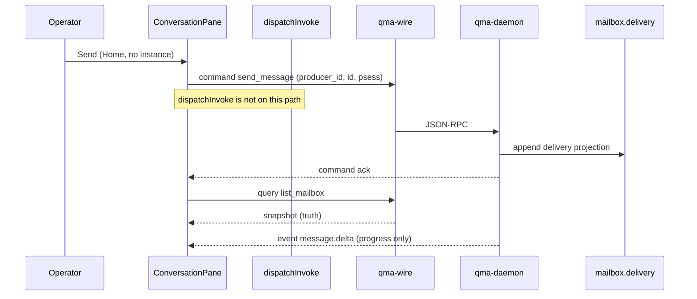
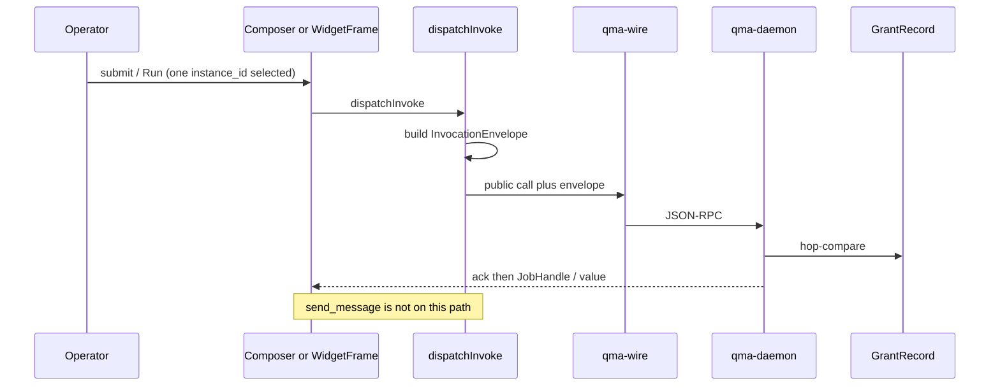

# Chat and history — split send from invoke

**Provenance:** sitting **CANDIDATE** closing [REVIEW.md R3](C:/Users/Mubarak/Desktop/QMX/workroom/qmx-ui-review-2026-09-23/REVIEW.md). Not user-accepted. Not a new COMP, CT, sqlite class, or UI message store.

This companion is the controlling contract for `ConversationPane.send` versus `dispatchInvoke`. It **closes** the research/10 fork that offered mailbox `send_message` **or** a granted-op invoke for the same Send. Team B (chat as `InvocationEnvelope`) is refused. Home chat must not mint a synthetic `instance_id`.

Spine local AD-8’s unique-issuer rule remains for **granted operations only**. The invoke-only sequence that lumped “press widget **or send message**” through `dispatchInvoke` is **wrong for chat**. `send_message` never builds an `InvocationEnvelope` and never enters `dispatchInvoke`.

---

## 0. Ruling in one screen

| Intent | Host | Wire | Envelope | `instance_id` |
| --- | --- | --- | --- | --- |
| Chat send (Home, Copilot, in-app panel) | `ConversationPane.send` → **`dispatchChat`** | CT-40 command `send_message` (`WireCommand.SEND_MESSAGE`) | **none** | **not required** |
| Answer a copilot `question` | `ConversationPane.answer_question` | `send_message` (kind `reply`) | **none** | **not required** |
| Answer mailbox `approval_request` | same pane, different command | seed command `approve_hook_action` | **none** | **not required** |
| Cancel visible stream | `ConversationPane.cancel_display` | none (chrome) | **none** | n/a |
| Composer tool/op submit | `Composer.submit` → `dispatchInvoke` | public call + parent-AD-24 `InvocationEnvelope` | **required** | **exactly one** `selected_refs` kind `instance_id` |
| Widget Run, json-render action, MCP `tools/call`, graph Run, command-palette op | those components → `dispatchInvoke` only | same as Composer.submit | **required** | **exactly one** `selected_refs` kind `instance_id` |

Home chat on an **authoring** `psess:` with **absent** `app_instance_id` is legal. A later authorized tool call is a **different** host contract and refuses unless that one instance ref is present.

---

## 1. Two host contracts (do not collapse)

### 1.1 `ConversationPane.send` — mailbox command

1. Operator (or in-app panel) commits composer **text**, not a pack `op_id`.
2. Host issues CT-40 **command** `send_message` over JSON-RPC 2.0 WebSocket.
3. Wire frame is the ordinary `WireEnvelope` (`v`, `type=send_message`, `id`, `producer_id`, `correlation_id`, `scope_path`, payload). Payload names `product_session_id`. It does **not** carry `InvocationEnvelope`.
4. Ack is transport. Durable membership is the mailbox snapshot (query), not the ack and not `message.delta`.
5. No GrantRecord, no `grant_id`, no `caller_kind`, no `idempotency_key` of the invoke family, no envelope `instance_id`.
6. `app_instance_id` may be absent on the authoring Home/`psess:`. Do not mint a dummy instance to make Send work.

`send_message` already exists in seed vocabulary:

```61:61:.worktrees/integration-inspect/qmx-agents/packages/qma-wire/src/qma/wire/vocabulary.py
    SEND_MESSAGE = "send_message"
```

(`WireCommand` member; `command.v1.schema.json` enum includes `"send_message"`. COMP-QMA-WIRE owns the name. Daemon does **not** dispatch it over the socket at `34c148b`.)

Command args this sitting binds (payload `args`; not a new CT):

```json
{
  "product_session_id": "psess:…",
  "body": { "text": "…" },
  "kind": "handoff"
}
```

`kind` uses CT-48 `MessageKind` when the send is a mailbox act (`handoff` \| `reply` \| `notify` \| `status` \| `question`). `approval_request` is **not** minted by ConversationPane.send; gates raise it. Optional `reply_to_ref` / `causation_id` follow CT-48. Chips on the message are `selected_refs` identities already legal on the `psess:` **or** message-only chrome not yet staged (see `LIBRARY-AND-ATTACHMENTS.md`).

Forbidden on this command: `InvocationEnvelope` keys (`logical_invocation_id`, `grant_id`, `op_id`, `instance_id` as envelope field, `idempotency_key`, `caller_kind`, `input_hash`). A client that sends those has left the chat contract.

### 1.2 `dispatchInvoke` — granted operation

`Composer.submit`, `WidgetFrame` Run / `request_invoke`, json-render `executeAction`, MCP Apps `tools/call` intercept, graph Run, and command-palette **ops** call **`apps/qmx-ui/src/lib/host/dispatchInvoke` only**. They never import the wire client. That function builds parent-AD-24 `InvocationEnvelope` and hop-compares GrantRecord + descriptor.

Invoke **requires** exactly one `selected_refs` entry of kind `instance_id`. Zero or many → typed `INVALID_INPUT`. Envelope `instance_id` copies that ref. Parent AD-24 stays: public operation envelopes carry `instance_id`. Copilot **tool** calls use `caller_kind=agent` when that field exists; operator-pressed Run uses `caller_kind=user`; template node uses `caller_kind=workflow`. Until the daemon accepts `caller_kind`, pack invoke is `caller_kind_unsupported` — **Home `send_message` still proceeds**, because it is not pack invoke.

A copilot that decides to call a tool after a chat turn is **not** a second `send_message`. It is `dispatchInvoke` under the same `psess:` grants. Chat without an instance remains allowed; the tool call waits until the operator selects one instance or is refused.

### 1.3 What each component may emit

| Component event | Contract |
| --- | --- |
| `ConversationPane.send` | `send_message` only |
| `ConversationPane.answer_question` | `send_message` reply **or** `approve_hook_action` when the mailbox row is `approval_request` |
| `ConversationPane.cancel_display` | chrome; local AD-13 Stop of local presentation; **not** `JobHandle.cancel`, **not** seed `stop_run` |
| `Composer.submit` | `dispatchInvoke` only |
| `WidgetFrame.message` | stages message-only chrome into the relevant pane; not a send and not an invoke (LIBRARY companion) |
| `WidgetFrame.request_invoke` / Run | `dispatchInvoke` |
| `SessionList.select_session` | chrome select of `psess:`; then history query |

`steer_agent` is not Send. `stop_run` is not widget Cancel. `retry_task` is not UI Retry. `launch_task` / `start_mission` are not graph Run.





---

## 2. Identities (closed set)

| Id | What it is | What it is not |
| --- | --- | --- |
| `product_session_id` (`psess:`) | Authority overlay. Key for grants, `selected_refs`, and **mailbox history**. Cardinality **1 `psess:` → many** QMA `sess:` | Not the engine Session. Not a tab. Not a thread string stored on the session row |
| QMA `Session` (`sess:`) | Execution container (execution_model + autonomy) | Not a third chat. Not the transcript |
| `conversation_thread_id` | **Hash-stable** id **derived from** `psess:` | Not a durable `product_session` field. Not `private_notes` |
| `message_id` | CT-48 `Envelope.msg_id` | Not wire `id` (command idempotency). Not `logical_invocation_id` |
| `job_handle` / `job_id` | Durable work | Not a chat row. May be **linked** from a message |
| Tab / pane / window | Chrome | Writes nothing on close |

**Thread derivation (v1, one primary thread per `psess:`):**

```
conversation_thread_id = "thread:" + hex(sha256(utf8(canonical product_session_id)))
```

Canonical form is the `psess:` string already stored on the row (no salt, no `producer_id`, no tab id). Every client of the same session derives the same thread. Home/Copilot of that session share that one primary thread. An **app-use** optional panel has its **own** app-use `psess:` (instance-bound) and therefore its **own** mailbox and `conversation_thread_id`. Switching apps does not merge threads (local AD-4; J-UI-01; J-UI-04).

v1 does not mint secondary threads under one `psess:`. A second thread is a named amendment.

**Questions bind** `(conversation_thread_id, message_id, optional job_handle)`. A question without a thread is refused. A job result without a message may still exist as a JobHandle on Home attention; it is not silently spliced into another `psess:` transcript.

---

## 3. Durable history owner

**Owner:** existing QMA mailbox. Store `mailboxes_and_delivery_state`, fold `mailbox_delivery_state`, bounded stream **`mailbox.delivery`**, sourced from journal `message.*` (CT-48 / DEC-0319). COMP-QMA-DAEMON is the sole writer.

**Key for product chat:** `product_session_id`. The fold is **indexed/filtered by `psess:`** for UI history. That is a named daemon amend of the existing projection, **not** a sixth store, **not** a new CT, **not** IndexedDB-as-truth, **not** `product_session.private_notes`.

Parent AD-8 durable fields on `product_session` remain:

`product_session_id`, `profile`, `principal`, `context_revision`, `app_instance_id`, `granted_ops`, `selected_refs`, optional `private_notes`, plus CONTRACTS §3 `account_scope`, `resume_cursor`, `cursor_generation`.

**Not durable** on that row (parent AD-8 / `NOT_DURABLE_FIELDS` @ `34c148b`): `qma_session_id`, tab/window/view/pane ids, attachment, layout.

Therefore:

- Transcript **is not** the engine `Session`.
- Transcript **is not** `private_notes` JSON used as a message store. `private_notes` stay session notes (retention/export/deletion with the row), not MemoryProvider, not Knowledge, not chat.
- Grants restore from the **product_session query**. Messages restore from **mailbox snapshot**. Mixing those snapshots is a bug.

CT-48 `Envelope` remains the message record (`msg_id`, `from`, `to`, `kind`, `correlation_id`, `body`, `artifact_refs`, optional mission/task/`reply_to_ref`/`causation_id`). Delivery states stay `delivered | queued | woke | deferred | dead_letter`. A message may request work; it is never the work.

Retention: `mailbox.delivery` is a **bounded non-evidence** stream (GAP-0089). Journal `message.*` is not trimmed. UI history is the **snapshot**. If the delivery projection compacted past the client cursor, the query returns snapshot/resync with a bumped generation — **never** a silent empty success.

Quant-owned CT-48 mailboxes (ActorId `from`/`to`) stay the bus. Product-session history **reuses that stream**, keyed by `psess:`. Do not stand up a parallel “conversation” table.

---

## 4. Authoritative history query

**Query:** closed-and-addable CT-40 `WireQuery` member **`list_mailbox`**.

| Fact | Value |
| --- | --- |
| Family | query (HTTP GET snapshot) |
| Owner of the **name** | **COMP-QMA-WIRE** (same addable pattern as `list_mission_hooks`, `facade_search`) |
| Owner of the **handler / fold** | COMP-QMA-DAEMON mailbox |
| At `34c148b` | **ABSENT** from `WireQuery` and `query.v1.schema.json` (enum ends at `facade_get`) |
| New CT? | **No.** Additive member of existing CT-40 |

Args: `{ "product_session_id": "psess:…" }` plus the usual snapshot cursor/generation the reconnect path already uses. Returns the mailbox snapshot for that `psess:` (envelopes, delivery state, question bindings, artifact/job refs).

**Snapshots are truth. Events are progress.** `message.delta` is **not** authoritative (research/10; DEC-0304). The pane paints deltas for streaming, then reconciles from `list_mailbox`. Accumulating an event tape as history is forbidden.

**Missing query is typed unavailable, not empty-success.** Until COMP-QMA-WIRE adds `list_mailbox` and the daemon serves it, the host must surface a typed `query_unavailable` (query name `list_mailbox`). It must **not** render “no messages” as a successful empty mailbox. A **present** query returning zero rows on a new `psess:` **is** a real empty mailbox and may paint empty.

`SessionList` lists `psess:` rows (product_session query). It is not the transcript.

---

## 5. Ack, idempotency, drafts

| Layer | Identity | Lost ack | Forbidden |
| --- | --- | --- | --- |
| Chat send | Wire pair **`(producer_id, command id)`** (`idempotency.py`; `registry:wire.dedup_window`) | **Query `list_mailbox`**. If `msg_id` is in the snapshot, the send landed; paint it. If absent, stay `unknown` until snapshot says otherwise | **Do not resend with a new `id`**. Do not invent invoke `idempotency_key` for chat |
| Invoke | Caller `idempotency_key` + envelope uniqueness (parent AD-24) | Query JobHandle / `query-state` **before** any resubmit | Blind retry of `external-egress`; second `dispatchInvoke` for the same submit |

`producer_id` is assigned at `initialize` and **stable across reconnects**. Wire `id` is minted by the producer per command. Duplicate `(producer_id, id)` inside the window returns the prior ack. Changing either member is a different command — that is why a lost-ack retry must reuse the **same** pair or only query.

**Drafts are client-local until `send_message` acks.** Unacked draft stays in the pane; reconnect does not upload it; it is not in the mailbox. Acked send that later appears in `list_mailbox` may drop the local draft. Composer invoke drafts follow the invoke contract, not this paragraph.

Duplicate Send in the UI (double-activate) coalesces on the same `(producer_id, id)` (J-UI-07). It must not mint a second command id.

---

## 6. Concurrent streams and app switch

Streams are scoped by `conversation_thread_id` (hence by `psess:`).

- Two conversations (Home authoring `psess:A` and app-use `psess:B`) may stream at once. Demux by `thread_id`. Do not merge histories (XR-07 proposal accepted here as sitting law; research/10).
- Switching the **visible app** restores that app’s `psess:` and its mailbox. It does **not** redirect in-flight `message.delta` of another `psess:`. Tokens, questions, and completion stay bound to the originating thread (J-UI-01).
- Closing a tab is `wire.detach`. It does not cancel the mailbox stream’s durable work and does not cancel JobHandles (local AD-13).
- Two chrome tabs of the **same** `psess:` share one thread and one mailbox. Each tab has its own `producer_id` (local AD-24). Wire uniqueness stays `(producer_id, id)`.

Result links inside a message are artifact/job **refs**. The JobHandle is observed on Home / `RunInspector`. Painting a job as a chat row does not own the handle.

---

## 7. Questions, stale and revised answers

Mailbox kinds `question` and `approval_request` are the pending-question surface (research/10). Binding is `(thread_id, message_id, optional job_handle)`.

- A later **`message_id` supersedes** the earlier one for **display** of the same question/answer slot.
- The UI shows **revised**. It **never silently deletes** the earlier id. Both ids remain in the `list_mailbox` snapshot.
- Operator edits of an unsent draft are local and have no `message_id` until ack.
- Stale question: the originating `psess:` still owns it after app switch. Answering it from a different visible app must not retarget the reply onto the visible app’s thread.
- `approval_request` is operator-principal `approve_hook_action` only (`OperatorPrincipalRequired` for `machine`). That is still **not** `dispatchInvoke`.

`cancel_display` stops local streaming presentation. It does not mark the mailbox row cancelled and does not `JobHandle.cancel`.

---

## 8. References in chat

Durable chips on a session are parent-AD-8 / kit `selected_refs` (closed kinds + kit `instance_id` when committed). Composer content that is **committed** to the `psess:` follows CAS mutate on that row (parent AD-29) — grants/refs restore with the product_session query, independent of mailbox.

**Widget message-only context is chrome until staged.** `WidgetFrame.message` does not write `selected_refs` and does not `send_message` by itself. Staging, upload/hash-is-not-possession, Knowledge cite, and unavailable recovery are the LIBRARY companion: [`LIBRARY-AND-ATTACHMENTS.md`](LIBRARY-AND-ATTACHMENTS.md). Cross-app reference does not merge transcripts or union grants (J-UI-04).

---

## 9. Reconnect and crash

Order after transport loss (research/10 §9–10; parent AD-29):

1. Re-auth `credential_ref`; `initialize` with the **same** `producer_id`.
2. **Product-session query** restores durable AD-8 fields (`granted_ops`, `selected_refs`, `profile`, `app_instance_id` absent-or-present, cursors). Does **not** replay unacked intent. Does **not** imply approval.
3. **`list_mailbox`** restores transcript for that `psess:`. Missing query → typed unavailable (section 4). Compacted delivery → snapshot/resync, not empty-success.
4. `wire.attach(scope, since_seq)` for **progress** (`message.delta` and others). Events must not overwrite a snapshot terminal.
5. `JobHandle.reattach` for in-flight **jobs** (separate from chat).
6. Unsent drafts remain local. In-flight deltas of `psess:A` are not attached to newly visible `psess:B`.

Lost `send_message` ack: query `list_mailbox` with the same `psess:`; **do not** mint a new command `id` (section 5). Lost invoke ack: JobHandle query, not mailbox, not a new envelope id.

---

## 10. Honesty at inspect `34c148b`

| Claim | Fact |
| --- | --- |
| `send_message` name | **Present** — `WireCommand.SEND_MESSAGE` in `vocabulary.py`; schema enum |
| Live dispatch of `send_message` | **Absent** — `DaemonProcess._handle_client` drains TCP bytes |
| `list_mailbox` | **ABSENT** — backend add, COMP-QMA-WIRE vocabulary + daemon handler |
| `product_session` messages | **Absent** — durable fields are context/grants/refs, not transcript (`product_session.py` `DURABLE_FIELDS`) |
| `private_notes` as chat | **Forbidden** even if the optional JSON column is later wired |
| Mailbox store | **Present** as Quant mailbox fold (`MAILBOX_STORE_NAME`, stream `mailbox.delivery`); **psess: index for UI history is the named amend** |
| `InvocationEnvelope.instance_id` | **Required on invoke** at inspect; authoring-optional `app_instance_id` is kit law, not wired |
| `caller_kind` | **Absent** — blocks pack invoke, not `send_message` |
| `message.delta` | Seed event; **not** truth |
| This file | Architecture candidate. Unexecuted |

CHANGE-IMPACT class: **reuse** `send_message` + mailbox store; **add** `list_mailbox` (wire vocabulary + query door + daemon index by `psess:`); **adapt** UI host to two functions (`sendMessage` vs `dispatchInvoke`). No new sqlite class.

---

## 11. Required traces (R3 closure)

Architecture traces. Unexecuted. Each row: intent → component → identity → wire → owner → ack/result → recovery.

### T-CH-01 — Home send, no instance

Operator on Home, authoring `psess:H`, `app_instance_id` absent, `selected_refs` has **no** `instance_id`. Types a message. `ConversationPane.send` → command `send_message` with `product_session_id=psess:H`. No `InvocationEnvelope`. Ack then `list_mailbox`. Snapshot contains `message_id`. `conversation_thread_id` derived from `psess:H`. **Forbidden:** `dispatchInvoke`; synthetic `inst:`; GrantRecord compare; `INVALID_INPUT` for missing instance **on this path**.

### T-CH-02 — Later authorized tool call (invoke)

Same `psess:H`. Operator selects exactly one `instance_id` (kit `selected_refs`). Copilot or Composer submits a granted op. `dispatchInvoke` builds envelope (`instance_id` copied, `caller_session_ref=psess:H`, `caller_kind=user` or `agent`). Host hop-compares GrantRecord. Result may link a JobHandle **into** a later mailbox `reply` as `artifact_refs` / job ref; the invoke itself is not `send_message`. Zero instance refs → `INVALID_INPUT` on **invoke only**. Chat history of T-CH-01 remains. **Forbidden:** routing the tool call as `send_message`; skipping the envelope.

### T-CH-03 — Two concurrent conversations

`psess:H` (authoring/Home) streaming answer A. `psess:B` (app-use panel for instance B) streaming answer B. Thread ids `thread:sha256(H)` and `thread:sha256(B)`. Deltas carry their `thread_id`. Pane H must not paint B’s tokens. Mailboxes are distinct. **Forbidden:** one merged transcript; one mailbox key.

### T-CH-04 — App switch

While A is in-flight on `psess:H`, operator selects opened app B. Chrome restores `psess:B` + `list_mailbox(B)`. In-flight deltas of `psess:H` continue bound to H (J-UI-01). Closing B unmounts chrome, does not cancel H’s mailbox work or B’s JobHandles. **Forbidden:** redirecting H’s answer into B; unioning `granted_ops`.

### T-CH-05 — Stale question, revised answer

Question `message_id=M1` on thread H, optional `job_handle=J`. Operator switches away and back. Question still bound `(thread_H, M1, J)`. Copilot (or operator reply) writes `message_id=M2` superseding M1 for display. UI shows **revised** and keeps M1 in the snapshot. **Forbidden:** deleting M1; answering onto the currently visible app’s thread if that thread is not H.

### T-CH-06 — Crash / reconnect, lost send ack

`send_message` issued with `(producer_id=P, id=C1)` then process dies before ack. Restart: same `P`; product_session query restores grants/refs; `list_mailbox(psess:H)`. If M is present, paint it and drop the draft. If not, UI `unknown`, **reuse** `(P, C1)` only if the host still holds that id; otherwise query again — **never** `id=C2` for the same draft. Then `wire.attach(..., since_seq)`. **Forbidden:** replay unacked intent as a new command; empty history because events were not replayed.

### T-CH-07 — History restoration vs missing query

Fresh client, `psess:H` known. `list_mailbox` implemented: snapshot is the transcript; events after `since_seq` are progress. `list_mailbox` **absent** (today’s inspect): typed `query_unavailable`, history surface **unavailable**, **not** an empty conversation, **not** “restore from `private_notes`”, **not** “restore from `sess:`”. Grants may still restore from product_session query. **Forbidden:** treating missing query as zero messages.

---

## 12. Forbidden (explicit)

- `send_message` through `dispatchInvoke`.
- `InvocationEnvelope` on chat send.
- Requiring `instance_id` / GrantRecord for Home chat.
- Synthetic app instance minted only so Send can invoke.
- Chat as a granted pack `op_id`.
- Transcript in `private_notes`, MemoryProvider, Knowledge, telemetry, or a new sqlite class.
- `sess:` as the conversation id.
- Authoritative UI history from `message.delta` alone.
- Empty-success when `list_mailbox` is missing.
- Resend with a new wire `id` after lost ack.
- Redirecting in-flight deltas across `psess:`.
- Silently deleting a superseded `message_id`.
- Widget message-only chrome treated as durable `selected_refs` before staging.

---

## 13. Citations

| Source | What it contributes |
| --- | --- |
| `vocabulary.py` `WireCommand.SEND_MESSAGE` | Seed CT-40 command exists; chat reuses it |
| Parent AD-8 durable fields (`architecture-QMX-2026-09-18` spine AD-8; CONTRACTS §3; `product_session.py` `DURABLE_FIELDS`) | Session row is grants/refs/profile — **not** messages |
| `research/10-transport-reconnect-ops.md` §3.3, §9 send-copilot row | Families; snapshot vs events; reconnect; **fork closed** in favor of mailbox send |
| `workroom/qmx-ui-review-2026-09-23/REVIEW.md` **R3** | Required split, traces, no synthetic instance |
| CT-48 / `mailbox.py` `mailbox.delivery` | Durable owner; bounded delivery projection |
| Local AD-4 | Chat without invoke legal; invoke needs one `instance_id` |
| Local AD-8 unique issuer | **Invoke** only — not Send |
| `LIBRARY-AND-ATTACHMENTS.md` | Message-only widget context until staged |
| J-UI-01, J-UI-04, J-UI-06, J-UI-07 | Switch, separate histories, reconnect, duplicate submit |
