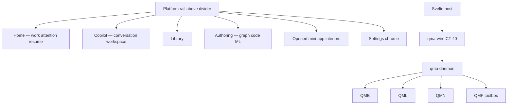
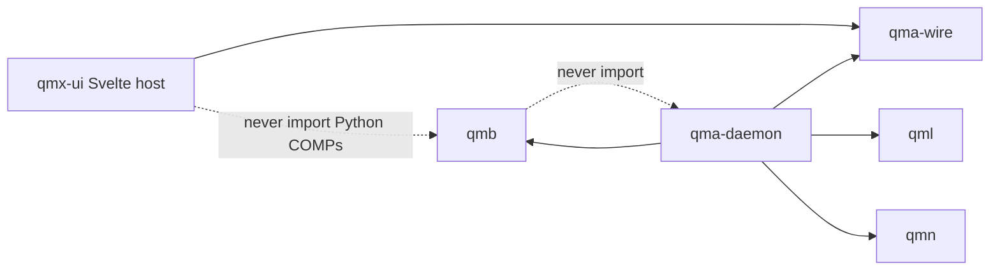
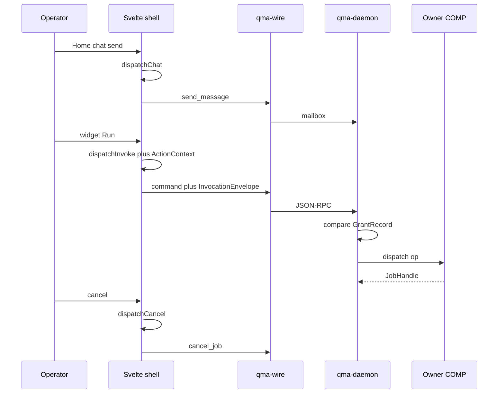

# Architecture Spine — QMX UI host

## Design Paradigm

**Differentiated-shell client over pack-and-grant host.** QMX remains a platform for discovering, constructing, testing, reusing, and operating capabilities. The UI is a **client** of `qma-wire` talking to `qma-daemon`. Packs, grants, envelopes, JobHandles, and COMP owners stay where the parents put them. Chrome never becomes a sixth COMP, a second scheduler, or a second grant store.

One persistent **platform rail** stays coherent. Destinations **above** the divider exist with zero opened apps: Home, Copilot, Library, Authoring. Interiors differ by purpose. Mini-app and authoring/ML families remain the working surfaces for opened apps. Headless packs remain first-class without a navigation pane.

Provenance on local ADs: **USER** = session/handoff direction; **INHERITED** = parent/kit restatement; **CANDIDATE** = this sitting’s default, not operator-accepted; **OBSERVED** = inspect SHA fact. `[CANDIDATE]` is not user approval.



## Inherited Invariants

Parents bind read-only. Local `AD-n` never means a parent or kit id. Cite `parent AD-n` and `kit AD-n`. A local rule that would mint a sixth COMP, treat json-render or MCP Apps as identity or grant, union nested grants, let app-use apply a change-request, persist layout on `product_session`, cancel durable work on panel dispose, or replay unacked intent on reconnect is a **conflict**.

| Inherited | From | Binds here |
| --- | --- | --- |
| parent AD-1..AD-7 | 09-18 | Capability, ContributionHit, envelope, Board vs graph vs Task Graph, mapping, DAG, QMA procedure runtime |
| parent AD-8 / DEC-0463 | 09-18 + 09-23 | `psess:` authoring or app-use; Home may omit `app_instance_id`; no third profile; layout not durable |
| parent AD-9 | 09-18 | Tools = hits ∩ host grants ∩ session GrantRecords ∩ health |
| parent AD-10 | 09-18 | Four composition modes; nested invoke does not union grants |
| parent AD-15 | 09-18 | Five listing axes |
| parent AD-16 | 09-18 | Logs are not evidence; closed sqlite |
| parent AD-17 | 09-18 | UI is a client; three presentation lanes; mount/dispose does not start or kill work |
| parent AD-18 | 09-18 | Pack lifecycle; install is not grant |
| parent AD-21 | 09-18 | Door parity; QMB is the only operator CLI |
| parent AD-24 / DEC-0464 | 09-18 + 09-23 | Envelope + `caller_kind`; `instance_id` required on invoke |
| parent AD-26 | 09-18 | JobHandle vocabulary |
| parent AD-29 | 09-18 | CAS reconnect; app-use mints change-request and must not apply |
| parent AD-30 | 09-18 | Enable/disable/uninstall; tombstone never another version |
| kit AD-1..AD-9 | 09-23 | Pack-and-grant SDK; widgets never own invoke; optional copilot; diagnosis; default retry `none`/`read` only; adapters unpinned in kit |
| Workbench AD-12 rung 4 | 09-14 | This sitting takes chrome. It does not skip host-grant law |
| Qt excluded | 02-CURRENT-DIRECTION | No Qt host |

Named parent amendments still bind: envelope `instance_id` required on every invoke; authoring invoke needs exactly one `selected_refs` kind `instance_id`; `caller_kind` is `user` or `agent` or `workflow` (specified; **absent** at `34c148b`).

## Invariants & Rules



The Svelte host speaks qma-wire after pairing. It must not spawn the daemon from browser JavaScript, must not `import qmb` / `import qml` / `import qmn`, must not compile Graph Templates in the UI process, and must not spawn `qmb` as a substitute for envelope invoke. QMB CLI may supervise the daemon (local AD-19). Rust in Tauri must not become a second orchestrator.

### AD-1 — The UI host is a client, not a COMP [INHERITED]

- **Binds:** shell, Tauri, Svelte packages, future `apps/qmx-ui`
- **Prevents:** a sixth COMP; a UI-owned scheduler, grant store, or workflow runtime
- **Rule:** The product UI is a **client** of `qma-wire` (CT-40) and of QMB/QMN doors the daemon already uses. Identity, grants, envelopes, JobHandles, and op execution stay in existing COMPs. `qma-ui-contract` remains a stub until a later increment ships types; this sitting does not mint `COMP-UI`. Chrome query helpers (`ProductSessionChrome`) stay query-only.

### AD-2 — Host stack seed [CANDIDATE]

- **Binds:** frontend workspace, coding agents
- **Prevents:** React/Next dashboard kits; Qt; SvelteKit 3 RC as a required pin; Tauri 3 alpha; wrapping every primitive
- **Rule:** Seed is **Svelte 5.57.1 + SvelteKit 2.70.3 + TypeScript 5.9 (Kit 2 peer; do not take npm TypeScript 7) + Vite 8.3.0 + Tailwind CSS 4.3.3 + shadcn-svelte 1.7.0 (Rhea, MIT, open code) + bits-ui 2.19.3 + `@xyflow/svelte` 1.6.6**. Toolchain: **Node.js >=22.12.0 <23.0.0** and **pnpm** with `apps/qmx-ui/pnpm-lock.yaml`. Isolated-scaffold gate records the resolved lockfile, `svelte-check`, and production build; that gate is unexecuted. Root layout sets `ssr = false`; `@sveltejs/adapter-static`. SPA fallback is `200.html` on a static host; a later Tauri template may use `index.html` (Deferred, target-specific). The SPA is served from a **static origin**, never from daemon port 8765. Tauri 2 does not host SvelteKit SSR. Graph canvases in any prerender path must set explicit node/handle sizes. Paid kits refused. Do not silently upgrade majors.

### AD-3 — Platform destinations stay independent of opened apps [USER]

- **Binds:** GAP-0081 layout, UX-02, UX-03, UX-04, UX-07
- **Prevents:** collapsing Home into Copilot; dropping Authoring from the rail; study-03 one three-column shell; a permanent generic secondary sidebar
- **Rule:** A persistent **narrow platform rail** holds destinations **above** a divider and opened-app icons **below**. Above, with **zero** opened apps: **Home**, **Copilot**, **Library**, **Authoring**. Settings is chrome, not a fifth product destination. Home is the **work / attention / resume** surface (running jobs, unknown, failed, resume an existing `psess:` or JobHandle). Copilot is the **conversation workspace** (sessions, messages, preview tabs). They may reuse `SessionList` / `ConversationPane` components; they are **not** the same destination or the same purpose. Authoring is independently reachable and uses the graph/code/ML family (VS Code image) even with no app open. Library is local AD-10. Opened apps below consume those services. Mini-app interiors keep app nav **above** a dense widget canvas (OpenBB); top nav may be omitted (`YJYDP26I`). Switching an opened app must change navigation and working composition. LSE ML Studio UI is refused. Coordinates are not frozen. Home/Authoring use profile `authoring`; Copilot of an app-use panel uses `app-use`. No third profile.

### AD-4 — Surface is not a session and not an engine run [INHERITED]

- **Binds:** tabs, panels, previews, copilot
- **Prevents:** tab-as-`psess:`; `sess:` as a third chat; merging histories on app switch
- **Rule:** `product_session` (`psess:`) owns grants and context. QMA `Session` (`sess:`) owns engine runs. Tabs, panels, docks, and previews are chrome. **Two chrome tabs** of the same `psess:` share that row. Closing a tab writes nothing and does not close the session. Switching the visible **app** restores that app’s `psess:`; it does not merge transcripts or union grants. Home uses profile `authoring` with `app_instance_id` absent. Home **may chat** (local AD-18) with no instance. Home/Authoring **may not invoke** until exactly one `selected_refs` kind `instance_id` is present; envelope `instance_id` remains required; zero or many such refs is `INVALID_INPUT`. Do not mint a synthetic instance for chat. In-app copilot is optional, profile `app-use`, and **must not apply** a change-request. Profile is immutable at create. `producer_id` cardinality is local AD-24.

### AD-5 — Independent dimensions [USER]

- **Binds:** UX-01..UX-12, headless packs
- **Prevents:** requiring a pane to run work; treating an open tab as job lifetime
- **Rule:** Presentation, execution location, invocation path, definition vs instance, conversation/authority, and observation stay independent. A headless pack (no `view:*`, no `copilot_profile`) is found and invoked via CLI/wire without acquiring navigation. A renderer or open tab does not own JobHandle lifetime. Equivalent operations must not depend on simulated clicks (parent AD-21). Not every combination is required; unsupported mixes refuse with a typed reason.

### AD-6 — Three presentation lanes; native first [CANDIDATE]

- **Binds:** widgets, generated UI, in-conversation tools
- **Prevents:** json-render as runtime or identity; MCP App HTML granting tools
- **Rule:** Lanes are (1) native QMX Svelte pane, (2) json-render catalog constrained to registered host components, (3) MCP Apps sandboxed iframe with host-proxied `tools/call`. Native panes remain default. Catalog `action` names an existing parent-AD-3 `op_id` and must not add or remove fields versus `input_schema`. Absence of a catalog entry still allows native/CLI invoke of that op. **MCP Apps profile:** specification `2026-01-26` (stable), SDK `@modelcontextprotocol/ext-apps` 2.0.0. Supported: one tool plus `ui://` resource, sandboxed iframe, host-proxied `tools/call`. QMX **declines** app-provided extra tools and any `tools/call` that bypasses intercept. That is host policy; the protocol may allow more. Every mounted view binds an immutable host `ActionContext` (local AD-20). Frontend **may** depend on `@json-render/core` 0.21.0, `@json-render/svelte` 0.21.0, and `@json-render/shadcn-svelte` 0.21.0 as optional adapters. Python core must not take those packages (kit AD-8).

### AD-7 — Composer splits content, tools, and target [CANDIDATE]

- **Binds:** UX-03, `selected_refs`
- **Prevents:** study-02 attachment modal; widget or layout JSON as a `selected_refs` kind
- **Rule:** The composer has three identifiable decisions: (1) **content/resources** as the closed parent-AD-8 `selected_refs` kinds plus kit `instance_id`; (2) **tool enablement** as a view over GrantRecords (does not grant); (3) **execution target**. Do not mint `local_path`, `upload_bytes`, or a Knowledge selected-ref kind. File ingest is local AD-22 (`stage_artifact` then artifact fp1). Knowledge cite uses the CT-44 returned artifact fp1 plus provenance metadata on that artifact. Widget message-only context is chrome until Save. Composer **Send** without a granted op is local AD-18. Composer **Run/submit of an op** is `dispatchInvoke`. Preview does not imply install or grant.

### AD-8 — Widgets bind and display; expand is explicit [CANDIDATE]

- **Binds:** UX-04, kit AD-2, parent AD-17
- **Prevents:** widget-owned invoke; mount starting durable work; a fifth composition mode
- **Rule:** A widget is a view of an op (`view:*` DTO). The widget binds and paints. Granted **invoke** unique issuer is **`apps/qmx-ui/src/lib/host/dispatchInvoke`**. Callers: `WidgetFrame` run, json-render ActionProvider, MCP intercept, graph Run, composer op-submit, command palette. They never import the wire client. Press builds parent-AD-24 `InvocationEnvelope` using the mount `ActionContext` (local AD-20), not renderer-supplied grant/instance. `caller_kind` is `user` / `agent` / `workflow`. There is no `caller_kind=widget`. Until the daemon accepts `caller_kind`, the host **refuses pack invoke** with `caller_kind_unsupported`; qmb CLI remains the headless door. **Send chat** is not this function (local AD-18). **Cancel** is not this function (local AD-23). Compact inspect is select-once. **Open/Expand** retains canvas viewport, selection, typed draft/revision/template/run refs (local AD-21), and return location. Shared filters stay inside one instance. Layout is client-local. Stale snapshot refuses invoke. `failure_class=view` is mount/stale/unhealthy.

### AD-9 — Graph, code, and detail stay one family [CANDIDATE]

- **Binds:** UX-07, UX-09, authoring/ML
- **Prevents:** LSE Train/Optimise as default ML UI; live Board scribble as a Mission; lossless code-to-graph conversion
- **Rule:** Authoring (platform destination) and opened ML/authoring apps use graph plus code/detail plus optional right copilot. Graph Template ≠ Task Graph ≠ Board layout ≠ Stage 0 mill graph. Typed identities and transitions live in `AUTHORING-AND-ML.md` (local AD-21). **Run is refused** on a mutable editor draft; Run requires an immutable Graph Template `(qualified_id, version)`. Graph Run is `dispatchInvoke` of that template’s `start` op. It is not seed `start_mission`, not in-process MissionCompiler, not a live Board scribble. Merging two live Task Graphs is refused. Arbitrary code does not round-trip losslessly. Non-trading ML needs no Book wrapper and no universal paper gate. Book/BMS remains the default trading composition.

### AD-10 — Library is one chrome over typed hits [CANDIDATE]

- **Binds:** UX-05
- **Prevents:** a new Library object type; collapsing rails; treating a hit as a grant
- **Rule:** Library is a **platform rail destination**. It overlays ArtifactHit (fp1 + Workbench AD-3 kind), KnowledgeHit (snapshot + locator), and ContributionHit (live tuple) without collapsing kinds. Hypothesis listing stays on `qml.research`, off the facade. Unavailable/deleted items are `unavailable` or `tombstone`, never a silent other version. Mini-app library chrome is a **filter** over the same hits, not a second taxonomy and not a tab that replaces the canvas. Open/use/reference never grants. Ranked/semantic search stays GAP-0073.

### AD-11 — First-run is partial readiness [CANDIDATE]

- **Binds:** UX-01, UX-12
- **Prevents:** blocking all work behind one provider; replaying unacked setup on reconnect
- **Rule:** Launch shows splash then a usable shell. Probe `127.0.0.1:8765` or a recorded remote. Never silently retarget remote failure onto local. If the daemon is absent, show connect/setup (local AD-19); do not pretend the browser started Python. Provider cards follow listing axes. Credentials are refs (L34). Reconnect is a query: `producer_id`, `wire.attach` `since_seq`, product-session `(resume_cursor, cursor_generation)`, `JobHandle.reattach`, and `list_mailbox` (local AD-18). It does not replay intent or imply approval. Details: `BOOTSTRAP-AND-AUTH.md`.

### AD-12 — Python daemon owns runtime; Tauri is an optional shell [CANDIDATE]

- **Binds:** packaging, local/VPS, UX-01
- **Prevents:** rewriting Python compute in Rust/C++; assuming Tauri makes charts or analytics faster
- **Rule:** Execution stays in CPython 3.14 (`qma-daemon`, QMB process-per-run, QMN on VPS). The UI speaks CT-40 three families: JSON-RPC 2.0 WebSocket commands; HTTP GET snapshot queries (authoritative); `wire.attach` events (not authoritative). No UI BFF. No REST invoke API. v1 **is a browser client of an already-running daemon** (local AD-19). Tauri 2.11.6 remains a later desktop candidate and is **not** the v1 bootstrap owner. Loopback may use `ws://` + `http://`. Non-loopback requires `wss://` + HTTPS. Closing the browser is `wire.detach` and never cancels JobHandles and never stops the daemon.

### AD-13 — Close, stop, cancel, and unknown are distinct [CANDIDATE]

- **Binds:** UX-02, UX-11, parent AD-26
- **Prevents:** tab-close as cancel; painting `unknown` as `failed`; cancelled display as proof of stop
- **Rule:** Close/unmount = `wire.detach`. Stop = end local presentation. Cancel = local AD-23 only. `unknown` is non-terminal. First durable terminal wins. Duplicate side-effecting submit coalesces on envelope `idempotency_key` and must not create a second `dispatchInvoke`. UI Retry is not a second invoke. Seed `retry_task` / `stop_run` are not widget Retry/Cancel.

### AD-14 — Operations chrome consumes kit queries [CANDIDATE]

- **Binds:** UX-11, GAP-0100
- **Prevents:** a fourth observability product; a second fencing machine
- **Rule:** Home attention, worker health, and any cutover **readiness surface** consume parent AD-15 axes, kit AD-5 diagnosis (`failure_class`, JobHandle, `correlation_id`, instance `health()` when it exists), and parent AD-25 fencing as **observation**. They do not authorize live, hot-swap, auto-retry `unknown-blocked`, or treat a dashboard filter as a command target. Logs are not evidence. Do not extend `qmn/FAILURES.md` onto mini-apps.

### AD-15 — `view:*` stays a wire DTO [CANDIDATE]

- **Binds:** pack contributions, coding-agent contracts
- **Prevents:** `ui_view` as a grant or invoke authority
- **Rule:** This sitting does **not** mint a `ui_view` contribution point. Packs still contribute **operations only**. Navigation and views are versioned **request DTOs** ingested at enable (`VIEW-AND-PACK-CONTRACT.md`). Optional **`PluginManifest.copilot_profile`** stays the Epic 60 / kit sibling field; the UI request **references** it and must not replace or forbid it. Published still does not grant. Coding agents author reviewable pack patches; generated output is not an untracked execution path.

### AD-16 — UI integration is a sibling of backend integration [CANDIDATE]

- **Binds:** delivery, verification
- **Prevents:** application code on `main`; treating the old `ui` branch as the app; claiming types are e2e
- **Rule:** New UI work lives on a dedicated integration stream cut from **`integration@34c148b`** (recommended worktree `.worktrees/ui-integration` — not created in this sitting; do not reuse `.worktrees/ui` at `af66288`). Backend review of `integration` is a separate activity. Combine only for a **tested deployment candidate**, then the operator promotes to `main`. At `34c148b`, `DaemonProcess` binds loopback TCP and discards bytes — a live JSON-RPC/HTTP/event server is a **backend add** the UI depends on, not a UI-owned bus. User-facing implementation later requires Reticle `reticle_act_and_wait` / `reticle_assert` plus process/package evidence Reticle cannot supply.

### AD-17 — Research charts keep provenance [CANDIDATE]

- **Binds:** UX-08
- **Prevents:** treating LayerChart as a financial tape; silent provider substitution; collapsing missing, empty, truncated, and denied
- **Rule:** Ordinary analytics charts use shadcn-svelte / LayerChart. Financial candlesticks use a dedicated host (`lightweight-charts` or successor) behind `WidgetFrame`. Instrument, time, and query pickers bind to existing descriptors, not free JSON. Linked views share typed mappings inside one instance (parent AD-5). Provenance, units, timezone, and freshness are visible cues on the snapshot. Missing, empty, truncated, and denied are distinct chrome states (retain P1-DATA-001 through P1-DATA-004). Large tables virtualize. Streaming plots consume stream doors; a stream subscription is not trading permission (parent AD-28). Preview is not export.

### AD-18 — Chat send is mailbox, not invoke [CANDIDATE]

- **Binds:** UX-03, Home, Copilot
- **Prevents:** routing Send through InvocationEnvelope; inventing a synthetic instance for Home chat
- **Rule:** Unique chat issuer is **`apps/qmx-ui/src/lib/host/dispatchChat`**. `ConversationPane.send` calls that function only. It issues CT-40 `send_message`. It does not call `dispatchInvoke`. No `instance_id` is required. A mailbox send does not grant tools and does not authorize the next agent turn. Durable history is the QMA mailbox. Each stored message persists `product_session_id` at write; replies inherit it. Pre-ack identity is the wire pair `(producer_id, id)`. `list_mailbox` looks up that pair (and `msg_id` after commit). Details: `CHAT-AND-HISTORY.md`.

### AD-19 — v1 bootstrap owner is QMB CLI, not the browser [CANDIDATE]

- **Binds:** UX-01, packaging
- **Prevents:** browser spawn of Python; unnamed launcher vs service fork; treating a cred:// ref as operator proof
- **Rule:** v1 requires an **externally running** `qma-daemon`. Privileged owner is COMP-QMB (`qmb host start|status|stop` — backend add). Until that command exists, UI Start local is a **setup instruction**, not a spawn. `QMA_DAEMON_ROOT` plus a lock file is the single-instance rule. **Unauthenticated bootstrap** is HTTP `/pair/start` and `/pair/confirm` only (loopback or the recorded HTTPS origin). **Authenticated CT-40** uses one proof: `pairing_session_id`. HTTP sends `Authorization: Bearer pairing:<id>`. WebSocket sends WHATWG subprotocols `qmx.ct40.v1` and `qmx.pair.<id>` (browsers cannot set an Authorization header on `WebSocket`). Cookies are not the v1 proof. The daemon maps that session to an operator `credential_ref` internally; the browser does not present an arbitrary `cred://` as login. Details: `BOOTSTRAP-AND-AUTH.md`.

### AD-20 — Mounted views carry host-minted ActionContext [CANDIDATE]

- **Binds:** UX-04, adapters
- **Prevents:** renderer-selected grant, instance, or caller; session-wide grant bag as widget authority
- **Rule:** Each mount receives an immutable host `ActionContext`: `psess`, `view_id`, contribution tuple, `instance_id`, `config_revision`, `grant_id`, `allowed_op_ids`, account scope, snapshot cursor. Untrusted specs/frames supply only action name and schema-valid input. Non-mount callers (composer, command palette) call host `bindActionContext` from the current TargetPicker; they do not mint grants. Matching GrantRecords: **zero** → `grant_id` null (paint allowed, invoke refuses); **one** → that record; **two or more** → typed `GRANT_AMBIGUOUS` (no first-wins, no merge). `dispatchInvoke` **intersects** that context with parent AD-9. Schema: `VIEW-AND-PACK-CONTRACT.md`.

### AD-21 — Draft is not a runnable template [CANDIDATE]

- **Binds:** UX-06, UX-07, UX-09
- **Prevents:** collapsing draft, template version, pack instance, and JobHandle
- **Rule:** Distinct ids: editor draft/revision, immutable Graph Template `(qualified_id, version)`, pack instance, JobHandle. Validate and preview may use a saved revision. First Run: publish the template **into the local authoring pack**, **enable that pack** (parent AD-30 compile-at-enable), grant, select that instance, then `dispatchInvoke`. Distributable export is a later copy, not the first enable. Save/publish use CAS `expected_revision`. **Run refuses** a mutable draft. Details: `AUTHORING-AND-ML.md`.

### AD-22 — Artifact ingest is daemon-owned [CANDIDATE]

- **Binds:** UX-03, UX-05, UX-12
- **Prevents:** hash-as-possession; a generic Library store; minting extra selected_ref kinds
- **Rule:** Uploads first possess bytes on the **authenticated local daemon** (HTTP PUT `/artifacts/stage`, not a JSON-RPC body). Completeness proof is daemon-recomputed fp1 plus byte count. Interrupted v1 uploads are **refused**; no resumable partial; no runnable incomplete ref. Remote execution requires an **explicit transfer** to that placement and a hash check. Home may attach before an instance exists. Silent local fallback is refused. Details: `LIBRARY-AND-ATTACHMENTS.md`.

### AD-23 — Cancel has one host function [CANDIDATE]

- **Binds:** UX-11, J-UI-08
- **Prevents:** mapping cancel to `stop_run`; a second invoke; adapter-owned cancel clients
- **Rule:** Unique issuer `apps/qmx-ui/src/lib/host/dispatchCancel`. CT-40 addable command `cancel_job` (absent at `34c148b`, COMP-QMA-WIRE). Fields: `handle_id`, `logical_run_id`, `attempt_id`, `command_id`, `expected_state` (JobHandle state plus attempt_id). **Authority:** operator of the JobHandle’s immutable `originating_psess` (admitted at start). Observation is not cancel authority. `expected_state`: a non-terminal advance `queued`→`running` does **not** invalidate the same `command_id`; an already-terminal handle records a no-op. Nested child handles cancel through this same function. Repeat uses the same `command_id`. First durable terminal wins. Not an InvocationEnvelope invoke. Not seed `stop_run`.

### AD-24 — Command identity is per producer and per session [CANDIDATE]

- **Binds:** multi-tab, reconnect
- **Prevents:** sharing producer_id across tabs; conflating command_id with invocation idempotency_key
- **Rule:** Cardinality: **one `producer_id` per chrome tab or OS window**. Two tabs of one `psess:` have two producer_ids. Wire command ids are unique per `(producer_id, id)` (existing dedup). Product-session `command_id` values are unique per `psess:` across those tabs. Invocation `idempotency_key` is a third identity and applies only to `dispatchInvoke`.

## Consistency Conventions

| Concern | Convention |
| --- | --- |
| Naming | Cite `parent AD-n` / `kit AD-n` / local `AD-n`. Journeys `J-UI-01`..`J-UI-14`. Do not reuse the frozen 85 `P1-*`/`P2-*` ids or `SCN-0001`..`SCN-0027`. |
| Data & formats | Wire envelope CT-40; InvocationEnvelope; GrantRecord ids; JobHandle states `queued` `running` `done` `failed` `cancelled` `aborted` `unknown`. Never `succeeded` or `awaiting_approval` on a handle. |
| State | Durable: `psess:` fields listed by parent AD-8. Client-local: rail layout, widget positions, open tabs. Forbidden on `psess:`: layout JSON, widget trees, json-render specs. |
| Errors | Typed refusals. Distinct chrome for loading, empty, unavailable, failed, reconnecting, stale, unknown. |
| Auth | Host grants only. Secrets as refs. UI never inlines venue keys into QMA. |
| Logging | Consume daemon JSON-lines when they exist; never treat them as journals. |

## Stack

| Name | Version |
| --- | --- |
| CPython (daemon, QMB, QML, QMN) | 3.14 (inherited; observed 3.14.6 at parent freeze, 3.14.7 current on docs 2026-09-23) |
| Svelte | 5.57.1 |
| SvelteKit | 2.70.3 |
| TypeScript | 5.9 (Kit 2 peer; npm latest 7.0.2 is not this pin) |
| Vite | 8.3.0 |
| Tailwind CSS | 4.3.3 |
| shadcn-svelte | 1.7.0; Rhea style; MIT |
| bits-ui | 2.19.3 |
| @xyflow/svelte | 1.6.6 |
| @json-render/core + svelte + shadcn-svelte | 0.21.0 optional adapter |
| @modelcontextprotocol/ext-apps | 2.0.0 optional MCP Apps host adapter |
| TradingView lightweight-charts | 5.2.1 optional financial canvas |
| LayerChart | 2.5.0 ordinary analytics |
| Tauri | 2.11.6 later desktop shell |
| @tauri-apps/plugin-shell | 2.3.6 |
| Node.js | >=22.12.0 <23.0.0 |
| pnpm | 10.x; lockfile `apps/qmx-ui/pnpm-lock.yaml` |

## Structural Seed

```text
(future, not created this sitting)
.worktrees/ui-integration/   # from integration@34c148b
  apps/qmx-ui/               # SvelteKit 2 static SPA
    src/routes/              # shell, first-run, settings
    src/lib/host/            # dispatchInvoke, dispatchCancel, dispatchChat; pairing client
    src/lib/shell/           # rail, destinations, interiors
    src/lib/widgets/         # QMX frames; shadcn primitives copied
    src/lib/graph/           # Svelte Flow adapter
    src/lib/adapters/        # json-render, MCP Apps hosts
```

At inspect `34c148b` this tree does not exist. `qma-ui-contract` is `STUB.md` only.



## Capability → Architecture Map

| Capability / Area | Lives in | Governed by |
| --- | --- | --- |
| Platform rail, Home, Copilot, Authoring | `apps/qmx-ui` shell | local AD-3; local AD-4 |
| Copilot conversation | mailbox + `psess:` | local AD-18 |
| Mini-app canvas and expand | native panes over `view:*` | local AD-8; local AD-6; local AD-20 |
| Authoring/ML graph and code | Svelte Flow adapter + code host | local AD-9; local AD-21 |
| Research charts and data | WidgetFrame + chart adapters | local AD-17 |
| Library and uploads | facade_search; stage_artifact | local AD-10; local AD-22 |
| Headless invoke | qmb CLI / future wire | local AD-5; SCN-0024 |
| First-run and pairing | QMB host + Credential Broker | local AD-11; local AD-19 |
| Cancel and multi-tab identity | dispatchCancel; producer_id | local AD-23; local AD-24 |
| Observability / cutover chrome | queries only | local AD-14 |
| Pack views | request DTOs | local AD-15; local AD-20 |
| Delivery branches | ui-integration sibling | local AD-16 |

## Deferred

| Item | Why it can wait |
| --- | --- |
| Exact `sv create` lockfile hashes | Isolated scaffold after Codex review |

| Minting `ui_view` contribution point | local AD-15 keeps DTO; revisit when packs need view discovery hits |
| GAP-0073 ranked/semantic Library search | Parent gap; chrome concatenates |
| GAP-0070 computer-use / Windows VPS | Fail-closed; hide or disable with named gap |
| GAP-0058 single-machine node | Not first-run |
| Brand identity beyond Rhea/neutral dark | User deferred aesthetics |
| Envelope crypto algorithm | GAP-DESK-ENVELOPE-CRYPTO stays backend |
| Live JSON-RPC server on `DaemonProcess` | Backend add the UI depends on; not designed as a new bus |
| Workload performance **budgets** | Workloads named in TRACE-MATRIX.md; numbers set at scaffold-plus-slice gate |
| Combined promotion to `main` | Operator click after a tested candidate |
| Tauri installer, auto-update, PyInstaller child-kill | v1 is browser plus daemon (local AD-12); desktop candidate later |

## Open questions

None blocking a closure review if local AD-18..AD-24 companions hold. Remaining later gates: isolated `sv create` lockfile; Monaco vs CodeMirror; `ui_view` mint; envelope crypto; `qmb host` implementation; live CT-40 server.
