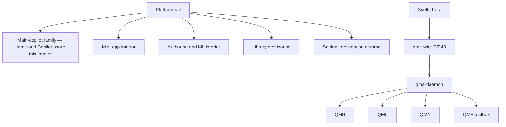
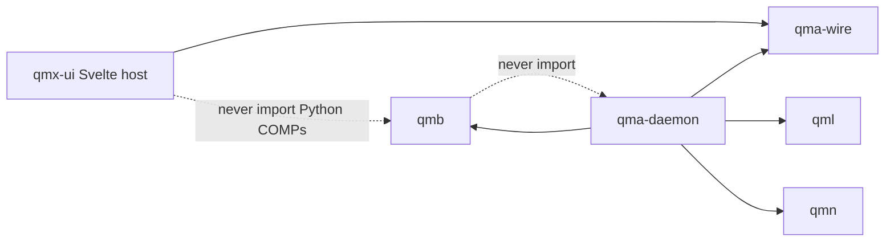
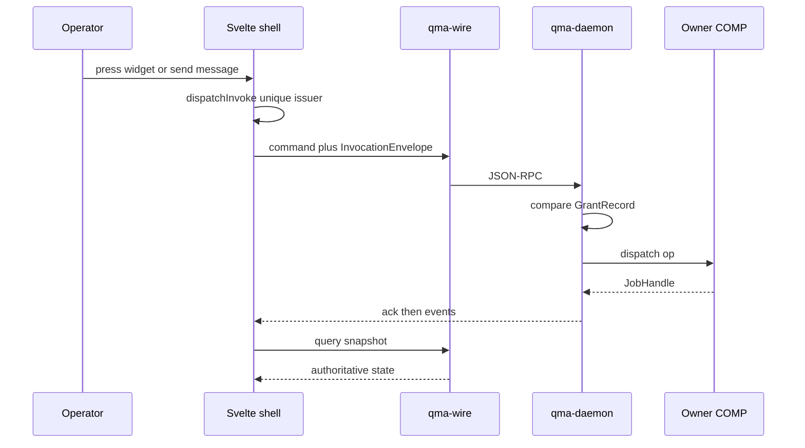

# Architecture Spine — QMX UI host

## Design Paradigm

**Differentiated-shell client over pack-and-grant host.** QMX remains a platform for discovering, constructing, testing, reusing, and operating capabilities. The UI is a **client** of `qma-wire` talking to `qma-daemon`. Packs, grants, envelopes, JobHandles, and COMP owners stay where the parents put them. Chrome never becomes a sixth COMP, a second scheduler, or a second grant store.

One persistent **platform rail** stays coherent. The interior **changes** with the destination: main copilot, mini-app, and authoring/ML are three families. Headless packs remain first-class without a navigation pane.



## Inherited Invariants

Parents bind read-only. Local `AD-n` never means a parent or kit id. Cite `parent AD-n` and `kit AD-n`. A local rule that would mint a sixth COMP, treat json-render or MCP Apps as identity or grant, union nested grants, let app-use apply a change-request, persist layout on `product_session`, cancel durable work on panel dispose, or replay unacked intent on reconnect is a **conflict**.

| Inherited | From | Binds here |
| --- | --- | --- |
| parent AD-1..AD-7 | 09-18 | Capability, ContributionHit, envelope, Board vs graph vs Task Graph, mapping, DAG, QMA procedure runtime |
| parent AD-8 / DEC-0463 | 09-18 + 09-23 | `psess:` authoring or app-use; Home may omit `app_instance_id`; no third profile; layout not durable |
| parent AD-9 | 09-18 | Tools = hits ∩ host grants ∩ session GrantRecords ∩ health |
| parent AD-10 | 09-18 | Four composition modes; nested invoke does not union grants |
| parent AD-15 | 09-18 | Five listing axes |
| parent AD-16 | 09-18 | Logs are not evidence; closed sqlite |
| parent AD-17 | 09-18 | UI is a client; three presentation lanes; mount/dispose does not start or kill work |
| parent AD-18 | 09-18 | Pack lifecycle; install is not grant |
| parent AD-21 | 09-18 | Door parity; QMB is the only operator CLI |
| parent AD-24 / DEC-0464 | 09-18 + 09-23 | Envelope + `caller_kind`; `instance_id` required on invoke |
| parent AD-26 | 09-18 | JobHandle vocabulary |
| parent AD-29 | 09-18 | CAS reconnect; app-use mints change-request and must not apply |
| parent AD-30 | 09-18 | Enable/disable/uninstall; tombstone never another version |
| kit AD-1..AD-9 | 09-23 | Pack-and-grant SDK; widgets never own invoke; optional copilot; diagnosis; default retry `none`/`read` only; adapters unpinned in kit |
| Workbench AD-12 rung 4 | 09-14 | This sitting takes chrome. It does not skip host-grant law |
| Qt excluded | 02-CURRENT-DIRECTION | No Qt host |

Named parent amendments still bind: envelope `instance_id` required on every invoke; authoring invoke needs exactly one `selected_refs` kind `instance_id`; `caller_kind` is `user` or `agent` or `workflow` (specified; **absent** at `34c148b`).

## Invariants & Rules



The host may speak qma-wire and attach to a local or recorded daemon. Host-supervised **start** of `python -m qma.daemon` is process supervision, not orchestration of Missions. The host must not `import qmb` / `import qml` / `import qmn`, must not compile Graph Templates in the UI process, and must not spawn `qmb` as a substitute for envelope invoke. Rust in Tauri must not become a second orchestrator.

### AD-1 — The UI host is a client, not a COMP [ADOPTED]

- **Binds:** shell, Tauri, Svelte packages, future `apps/qmx-ui`
- **Prevents:** a sixth COMP; a UI-owned scheduler, grant store, or workflow runtime
- **Rule:** The product UI is a **client** of `qma-wire` (CT-40) and of QMB/QMN doors the daemon already uses. Identity, grants, envelopes, JobHandles, and op execution stay in existing COMPs. `qma-ui-contract` remains a stub until a later increment ships types; this sitting does not mint `COMP-UI`. Chrome query helpers (`ProductSessionChrome`) stay query-only.

### AD-2 — Host stack seed [ADOPTED]

- **Binds:** frontend workspace, coding agents
- **Prevents:** React/Next dashboard kits; Qt; SvelteKit 3 RC as a required pin; Tauri 3 alpha; wrapping every primitive
- **Rule:** Seed is **Svelte 5.57.1 + SvelteKit 2.70.3 + TypeScript 5.9 (Kit 2 peer line; do not take npm TypeScript 7 as a required pin) + Vite 8.3.0 + Tailwind CSS 4.3.3 + shadcn-svelte 1.7.0 (Rhea compact, MIT, open code) + bits-ui 2.19.3 + `@xyflow/svelte` 1.6.6**. Root layout sets `ssr = false`; deploy with `@sveltejs/adapter-static`. SPA fallback is `200.html` on a static host; a later Tauri `create-tauri-app` scaffold may use that template’s `index.html` fallback. The SPA is served from a **static origin** (dev server or packaged webview), never from daemon port 8765. Tauri 2 does not host SvelteKit SSR. Graph canvases in any prerender path must set explicit node/handle sizes. Paid component kits are refused. Re-pin exact lockfile at isolated scaffold; do not silently upgrade majors.

### AD-3 — One rail, three interiors [ADOPTED]

- **Binds:** GAP-0081 layout, UX-02, UX-03, UX-04, UX-07
- **Prevents:** study-03 one three-column shell; a permanent generic secondary sidebar; prose cards as the working surface
- **Rule:** A persistent **narrow platform rail** holds destinations **above** a divider (Home, Copilot, Library, Settings) and opened-app icons **below** (instances). Selecting a destination replaces the interior. Required interiors: (1) **Main-copilot family** — session/history column, conversation, tabbed preview (Hermes/Codex/Cowork). **Home is that family** with profile `authoring` and `app_instance_id` absent. **Copilot is the same family** with a selected `psess:`. They are not two layout families. (2) **Mini-app** — app-owned navigation **above** a dense widget canvas, optional right copilot (OpenBB); top nav may be omitted (`YJYDP26I`). (3) **Authoring/ML** — graph and code/detail with right copilot (VS Code). Settings is destination chrome over listing-axis cards (local AD-11 language), not a fourth interior family and not a third profile. Library is local AD-10. Switching an opened app must change navigation and working composition. LSE ML Studio UI is refused as a layout. Coordinates are not frozen.

### AD-4 — Surface is not a session and not an engine run [ADOPTED]

- **Binds:** tabs, panels, previews, copilot
- **Prevents:** tab-as-`psess:`; `sess:` as a third chat; merging histories on app switch
- **Rule:** `product_session` (`psess:`) owns grants and context. QMA `Session` (`sess:`) owns engine runs. Tabs, panels, docks, and previews are chrome. **Two chrome tabs** (work-area tabs or OS windows) of the **same** `psess:` / instance share that row. Closing a tab writes nothing and does not close the session. Switching the visible **app** restores that app’s `psess:`; it does not merge transcripts or union grants. Home/main is profile `authoring` with `app_instance_id` absent. Authoring/Home **may not invoke** until exactly one `selected_refs` kind `instance_id` is present; envelope `instance_id` remains required; zero or many such refs is `INVALID_INPUT`. Attention, browse, and chat without invoke remain allowed. No third profile. In-app copilot is optional, profile `app-use`, and **must not apply** a change-request. Profile is immutable at create: docking a panel does not convert authoring into app-use.

### AD-5 — Independent dimensions [ADOPTED]

- **Binds:** UX-01..UX-12, headless packs
- **Prevents:** requiring a pane to run work; treating an open tab as job lifetime
- **Rule:** Presentation, execution location, invocation path, definition vs instance, conversation/authority, and observation stay independent. A headless pack (no `view:*`, no `copilot_profile`) is found and invoked via CLI/wire without acquiring navigation. A renderer or open tab does not own JobHandle lifetime. Equivalent operations must not depend on simulated clicks (parent AD-21). Not every combination is required; unsupported mixes refuse with a typed reason.

### AD-6 — Three presentation lanes; native first [ADOPTED]

- **Binds:** widgets, generated UI, in-conversation tools
- **Prevents:** json-render as runtime or identity; MCP App HTML granting tools
- **Rule:** Lanes are (1) native QMX Svelte pane, (2) json-render catalog constrained to registered host components, (3) MCP Apps sandboxed iframe with host-proxied `tools/call`. Native panes remain default. Catalog `action` names an existing parent-AD-3 `op_id` and must not add or remove fields versus `input_schema`. Absence of a catalog entry still allows native/CLI invoke of that op. MCP HTML cannot add tools; the host intercepts every `tools/call` against the session GrantRecord. Frontend **may** depend on `@json-render/core` 0.21.0, `@json-render/svelte` 0.21.0, and `@json-render/shadcn-svelte` 0.21.0 as **optional adapter packages**. Python core must not take those packages (kit AD-8).

### AD-7 — Composer splits content, tools, and target [ADOPTED]

- **Binds:** UX-03, `selected_refs`
- **Prevents:** study-02 attachment modal; widget or layout JSON as a `selected_refs` kind
- **Rule:** The composer has three identifiable decisions: (1) **content/resources** as the closed parent-AD-8 `selected_refs` kinds plus kit `instance_id` (artifact fp1, `research_ref`, contribution tuple, template tuple, dataset/run/attempt, node-id set citing a template, `instance_id`); (2) **tool enablement** as a view over GrantRecords (does not grant); (3) **execution target** (instance/account/placement). Do not mint `local_path` or `upload_bytes`. Uploads snapshot to an **artifact fp1**. A pointer to an already-stored file uses artifact/dataset/run. A machine path is not a portable id. Live ids show a stale/unavailable badge; snapshot bytes do not pretend to track a moving file. Remote placement stages the artifact or refuses; never silent local retarget. Cross-app reference does not merge histories or change command authority. Preview rendering does not imply install or grant.

### AD-8 — Widgets bind and display; expand is explicit [ADOPTED]

- **Binds:** UX-04, kit AD-2, parent AD-17
- **Prevents:** widget-owned invoke; mount starting durable work; a fifth composition mode
- **Rule:** A widget is a view of an op (`view:*` DTO: `view_id`, `op_id`, parameter binding, snapshot cursor, stale). The widget component binds and paints. The unique issuer is **`apps/qmx-ui/src/lib/host/dispatchInvoke`**. `WidgetFrame`, json-render ActionProvider, MCP `tools/call` intercept, graph Run, composer submit, and command palette **call that function only** and never import the wire client. Press builds parent-AD-24 `InvocationEnvelope` with `caller_kind=user` (operator), `agent` (copilot tool), or `workflow` (template node). There is no `caller_kind=widget`. Until the daemon accepts `caller_kind`, the host **refuses pack invoke** with typed `caller_kind_unsupported`; headless qmb CLI remains the operator door. Compact inspect is select-once. **Open/Expand** creates a work-area tab or expanded surface for code, diff, data, or results and **retains** canvas viewport, selection, draft/version, and return location. Return restores that context. Shared filters are typed mappings inside one instance (parent AD-5); they must not leak across apps. Layout editing is client-local, not a `psess:` field. Stale snapshot refuses invoke. `failure_class=view` is mount/stale/unhealthy, not an invoke failure.

### AD-9 — Graph, code, and detail stay one family [ADOPTED]

- **Binds:** UX-07, UX-09, authoring/ML
- **Prevents:** LSE Train/Optimise as default ML UI; live Board scribble as a Mission; lossless code-to-graph conversion
- **Rule:** Authoring/ML uses the selected app’s navigation, a central graph of typed operations, and an optional right copilot. Selecting a node shows compact inspection. Explicit Open/Expand opens code/diff/data/results for an identified draft or published version. Validation and test-run name that version. Running an older version is distinguishable from editing a new one. Graph Template ≠ Task Graph ≠ Board layout ≠ Stage 0 mill graph. Graph Run is `dispatchInvoke` of the already-registered template’s `start` op with `node_ids` inside `input_schema`. It is not seed `start_mission`, not in-process MissionCompiler inside Svelte, and not a live Board scribble. Merging two live Task Graphs is refused. Arbitrary code does not round-trip losslessly through a graph. Non-trading ML needs no Book wrapper and no universal paper gate. Book/BMS remains the default trading composition; an alternative composition is a complete PolicyPair, never dummy Book chrome.

### AD-10 — Library is one chrome over typed hits [ADOPTED]

- **Binds:** UX-05
- **Prevents:** a new Library object type; collapsing rails; treating a hit as a grant
- **Rule:** Library is a **platform rail destination**. It overlays ArtifactHit (fp1 + Workbench AD-3 kind), KnowledgeHit (snapshot + locator), and ContributionHit (live tuple) without collapsing kinds. Hypothesis listing stays on `qml.research`, off the facade. Unavailable/deleted items are `unavailable` or `tombstone`, never a silent other version. Mini-app library chrome is a **filter** over the same hits, not a second taxonomy and not a tab that replaces the canvas. Open/use/reference never grants. Ranked/semantic search stays GAP-0073.

### AD-11 — First-run is partial readiness [ADOPTED]

- **Binds:** UX-01, UX-12
- **Prevents:** blocking all work behind one provider; replaying unacked setup on reconnect
- **Rule:** Launch shows a small splash/status, then the first usable shell. Probe local daemon (default `127.0.0.1:8765`) or a recorded remote. Offer start-local or connect-remote; never silently retarget remote failure onto local. Host-supervised daemon sets `QMA_DAEMON_ROOT` to a stable per-user directory, not the launch cwd. Provider/proxy/API-key cards follow listing axes (published / configured / authorized / reachable / healthy). Credentials are refs (L34): QMA broker allowlist `cred://models|inference|compute|sandbox|corpus|knowledge|telemetry/`; venue/broker keys stay QMN provisioning. Reconnect is a **query**: stable `producer_id`, `wire.attach` with `since_seq` for the event stream, and product-session restore from `(resume_cursor, cursor_generation)` per parent AD-29. Then `JobHandle.reattach`. It restores durable `psess:` fields and does not replay intent, resubmit unacked commands, or imply approval.

### AD-12 — Python daemon owns runtime; Tauri is an optional shell [ADOPTED]

- **Binds:** packaging, local/VPS, UX-01
- **Prevents:** rewriting Python compute in Rust/C++; assuming Tauri makes charts or analytics faster
- **Rule:** Execution stays in CPython 3.14 processes (`qma-daemon`, QMB process-per-run, QMN on VPS). The UI client speaks CT-40 **three families**: commands JSON-RPC 2.0 WebSocket; queries HTTP GET snapshots (authoritative); events durable stream via `wire.attach` (not authoritative). No UI BFF. No REST invoke API. v1 **is** a **browser client + host-supervised local daemon**. Tauri 2.11.6 is the later desktop candidate (Deferred: installer, auto-update, PyInstaller child-kill). Protocol stories must not wait on Tauri. Loopback may use `ws://` + `http://`. Non-loopback requires `wss://` + HTTPS and an operator-recorded config. Closing the browser is `wire.detach` and never cancels JobHandles. Closing a Tauri window is the same detach unless the operator explicitly chose **Stop local runtime**, which stops only the host-supervised daemon process and still must not cancel work on QMN or a remote environment.

### AD-13 — Close, stop, cancel, and unknown are distinct [ADOPTED]

- **Binds:** UX-02, UX-11, parent AD-26
- **Prevents:** tab-close as cancel; painting `unknown` as `failed`; cancelled display as proof of stop
- **Rule:** Close/unmount = chrome dispose (`wire.detach`). Stop = request to end a view’s local presentation. Cancel = `JobHandle.cancel` only. `unknown` is non-terminal. First durable terminal wins a cancel/complete race. Duplicate submit of a side-effecting op coalesces on `idempotency_key` / envelope identity and must not create a second `dispatchInvoke`. UI Retry is **not** a second invoke: `none`/`read` follows kit AD-6 host retry; `external-egress`, `unknown-blocked`, and CAS conflict must not blind-retry. Seed `retry_task` / `stop_run` are not widget Retry/Cancel.

### AD-14 — Operations chrome consumes kit queries [ADOPTED]

- **Binds:** UX-11, GAP-0100
- **Prevents:** a fourth observability product; a second fencing machine
- **Rule:** Home attention, worker health, and any cutover **readiness surface** consume parent AD-15 axes, kit AD-5 diagnosis (`failure_class`, JobHandle, `correlation_id`, instance `health()` when it exists), and parent AD-25 fencing as **observation**. They do not authorize live, hot-swap, auto-retry `unknown-blocked`, or treat a dashboard filter as a command target. Logs are not evidence. Do not extend `qmn/FAILURES.md` onto mini-apps.

### AD-15 — `view:*` stays a wire DTO [ADOPTED]

- **Binds:** pack contributions, coding-agent contracts
- **Prevents:** `ui_view` as a grant or invoke authority
- **Rule:** This sitting does **not** mint a `ui_view` contribution point. Packs still contribute **operations only**. Navigation, widgets, and copilot profile remain request DTOs / request blobs. If a later increment mints `ui_view` as a discovery hit, published still does not grant. Coding agents author reviewable pack patches and constrained catalog specs; generated output is not an untracked in-process execution path.

### AD-16 — UI integration is a sibling of backend integration [ADOPTED]

- **Binds:** delivery, verification
- **Prevents:** application code on `main`; treating the old `ui` branch as the app; claiming types are e2e
- **Rule:** New UI work lives on a dedicated integration stream cut from **`integration@34c148b`** (recommended worktree `.worktrees/ui-integration` — not created in this sitting; do not reuse `.worktrees/ui` at `af66288`). Backend review of `integration` is a separate activity. Combine only for a **tested deployment candidate**, then the operator promotes to `main`. At `34c148b`, `DaemonProcess` binds loopback TCP and discards bytes — a live JSON-RPC/HTTP/event server is a **backend add** the UI depends on, not a UI-owned bus. User-facing implementation later requires Reticle `reticle_act_and_wait` / `reticle_assert` plus process/package evidence Reticle cannot supply.

### AD-17 — Research charts keep provenance [ADOPTED]

- **Binds:** UX-08
- **Prevents:** treating LayerChart as a financial tape; silent provider substitution; collapsing missing, empty, truncated, and denied
- **Rule:** Ordinary analytics charts use shadcn-svelte / LayerChart. Financial candlesticks use a dedicated host (`lightweight-charts` or successor) behind `WidgetFrame`. Instrument, time, and query pickers bind to existing descriptors, not free JSON. Linked views share typed mappings inside one instance (parent AD-5). Provenance, units, timezone, and freshness are visible cues on the snapshot. Missing, empty, truncated, and denied are distinct chrome states (retain P1-DATA-001 through P1-DATA-004). Large tables virtualize. Streaming plots consume stream doors; a stream subscription is not trading permission (parent AD-28). Preview is not export.

## Consistency Conventions

| Concern | Convention |
| --- | --- |
| Naming | Cite `parent AD-n` / `kit AD-n` / local `AD-n`. Journeys `J-UI-01`..`J-UI-12`. Do not reuse the frozen 85 `P1-*`/`P2-*` ids or `SCN-0001`..`SCN-0027`. |
| Data & formats | Wire envelope CT-40; InvocationEnvelope; GrantRecord ids; JobHandle states `queued` `running` `done` `failed` `cancelled` `aborted` `unknown`. Never `succeeded` or `awaiting_approval` on a handle. |
| State | Durable: `psess:` fields listed by parent AD-8. Client-local: rail layout, widget positions, open tabs. Forbidden on `psess:`: layout JSON, widget trees, json-render specs. |
| Errors | Typed refusals. Distinct chrome for loading, empty, unavailable, failed, reconnecting, stale, unknown. |
| Auth | Host grants only. Secrets as refs. UI never inlines venue keys into QMA. |
| Logging | Consume daemon JSON-lines when they exist; never treat them as journals. |

## Stack

| Name | Version |
| --- | --- |
| CPython (daemon, QMB, QML, QMN) | 3.14 (inherited; observed 3.14.6 at parent freeze, 3.14.7 current on docs 2026-09-23) |
| Svelte | 5.57.1 |
| SvelteKit | 2.70.3 |
| TypeScript | 5.9 (Kit 2 peer; npm latest 7.0.2 is not this pin) |
| Vite | 8.3.0 |
| Tailwind CSS | 4.3.3 |
| shadcn-svelte | 1.7.0; Rhea style; MIT |
| bits-ui | 2.19.3 |
| @xyflow/svelte | 1.6.6 |
| @json-render/core + svelte + shadcn-svelte | 0.21.0 optional adapter |
| @modelcontextprotocol/ext-apps | 2.0.0 optional MCP Apps host adapter |
| TradingView lightweight-charts | 5.2.1 optional financial canvas |
| LayerChart | 2.5.0 ordinary analytics |
| Tauri | 2.11.6 later desktop shell |
| @tauri-apps/plugin-shell | 2.3.6 |

## Structural Seed

```text
(future, not created this sitting)
.worktrees/ui-integration/   # from integration@34c148b
  apps/qmx-ui/               # SvelteKit 2 static SPA
    src/routes/              # shell, first-run, settings
    src/lib/host/            # dispatchInvoke unique issuer; qma-wire client; grants; JobHandle
    src/lib/shell/           # rail, destinations, interiors
    src/lib/widgets/         # QMX frames; shadcn primitives copied
    src/lib/graph/           # Svelte Flow adapter
    src/lib/adapters/        # json-render, MCP Apps hosts
```

At inspect `34c148b` this tree does not exist. `qma-ui-contract` is `STUB.md` only.



## Capability → Architecture Map

| Capability / Area | Lives in | Governed by |
| --- | --- | --- |
| Platform rail, Home, opened apps | `apps/qmx-ui` shell | local AD-3; local AD-4; local AD-11 |
| Main copilot | shell + `psess:` authoring | local AD-4; local AD-7; kit AD-3 |
| Mini-app canvas and expand | native panes over `view:*` | local AD-8; local AD-6 |
| Authoring/ML graph and code | Svelte Flow adapter + code host | local AD-9 |
| Research charts and data | WidgetFrame + chart adapters | local AD-17 |
| Library | facade_search client | local AD-10; parent AD-2 |
| Headless invoke | qmb CLI / future wire | local AD-5; SCN-0024 |
| First-run, providers, files | shell + Credential Broker + QMN provision | local AD-11; local AD-12 |
| Observability / cutover chrome | queries only | local AD-14 |
| Pack views and copilot profile | DTOs / request blobs | local AD-15; kit AD-1 |
| Delivery branches | ui-integration sibling | local AD-16 |

## Deferred

| Item | Why it can wait |
| --- | --- |
| Exact `sv create` lockfile hashes | Isolated scaffold after Codex review |

| Minting `ui_view` contribution point | local AD-15 keeps DTO; revisit when packs need view discovery hits |
| GAP-0073 ranked/semantic Library search | Parent gap; chrome concatenates |
| GAP-0070 computer-use / Windows VPS | Fail-closed; hide or disable with named gap |
| GAP-0058 single-machine node | Not first-run |
| Brand identity beyond Rhea/neutral dark | User deferred aesthetics |
| Envelope crypto algorithm | GAP-DESK-ENVELOPE-CRYPTO stays backend |
| Live JSON-RPC server on `DaemonProcess` | Backend add the UI depends on; not designed as a new bus |
| Workload performance numbers | Need representative graph/chart/table once a shell exists |
| Combined promotion to `main` | Operator click after a tested candidate |
| Tauri installer, auto-update, PyInstaller child-kill | v1 is browser plus daemon (local AD-12); desktop candidate later |

## Open questions

None blocking Codex review if local AD-7, local AD-10, and local AD-12 hold. Remaining: exact `sv create` lockfile; Monaco vs CodeMirror after a fidelity spike; when to mint `ui_view`; envelope crypto algorithm.
